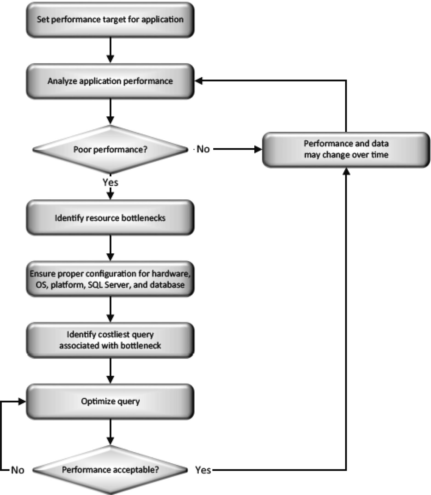
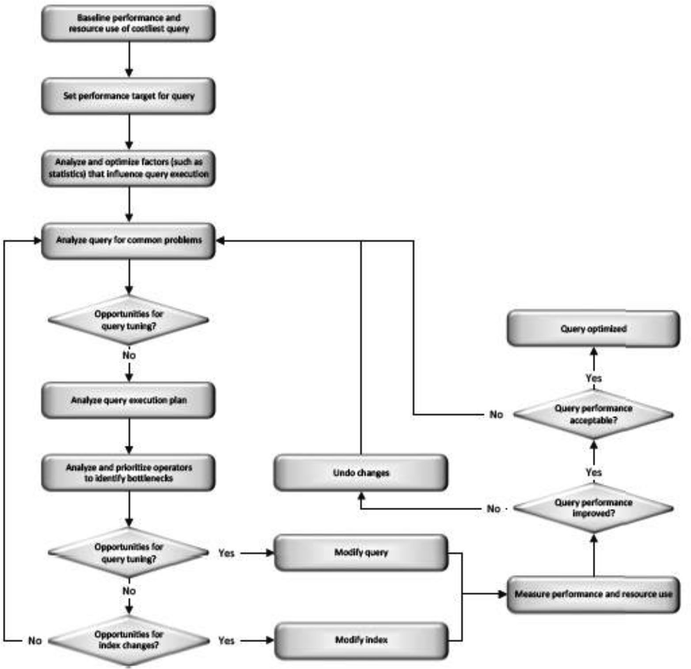
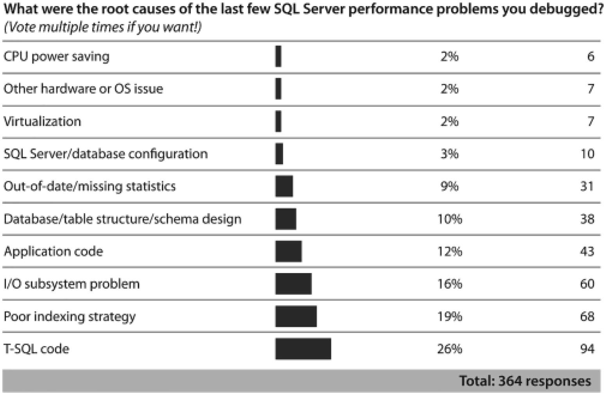

# CHƯƠNG 1: Tinh chỉnh hiệu năng truy vấn (Query Performance Tuning)

> **Thông tin sách gốc:**  
> © Grant Fritchey 2026  
> G. Fritchey, *SQL Server 2025 Query Performance Tuning*, https://doi.org/10.1007/979-8-8688-1865-3_1  

---

Tinh chỉnh truy vấn (Query tuning) chưa bao giờ là một công việc dễ dàng.

Bây giờ đã là năm 2025, và chúng ta vẫn chưa có một công tắc thần kỳ nào mang tên "chạy nhanh hơn". Mục tiêu của cuốn sách này là cung cấp cho bạn nhiều công cụ và kiến thức nhất có thể để việc tinh chỉnh truy vấn trở nên dễ dàng hơn. Tuy nhiên, nó vẫn sẽ không hề đơn giản. Trên thực tế, cách duy nhất dễ dàng để làm cho mọi thứ chạy nhanh hơn chỉ đơn giản là chi nhiều tiền hơn: Mua phần cứng lớn hơn, nhiều tài nguyên hơn sẽ dễ dàng hơn rất nhiều; nâng cấp lên một gói dịch vụ (service tier) cao hơn với nhà cung cấp dịch vụ đám mây (cloud provider) của bạn cũng dễ dàng hơn nhiều. Những giải pháp này là con đường tắt dễ dàng nhất để gia tăng hiệu năng. Nhưng đến một lúc nào đó, ngân sách bạn có thể chi trả để khắc phục các sự cố hiệu năng sẽ chạm mức giới hạn. Ngoài ra, bạn cũng có thể thử gửi yêu cầu đến một Mô hình Ngôn ngữ Lớn (LLM - Large Language Model) hoặc AI để xem nó trả lời ra sao. Dù đây có thể là một lối tắt hữu ích, bạn vẫn cần phải hiểu những gì nó đang nói và xác thực xem giải pháp được đề xuất có thực sự giải quyết được vấn đề hay không. Và đó chính là điểm bắt đầu của công việc tinh chỉnh hiệu năng truy vấn.

Có thể bạn đang làm việc trong một môi trường vận hành thuần túy truyền thống trên các máy chủ vật lý lớn được đặt ngay tại doanh nghiệp (on-premises). Mặt khác, bạn có thể đang chạy cơ sở dữ liệu dưới dạng dịch vụ (Database as a Service) thông qua Google Cloud SQL, Amazon RDS, hoặc Azure SQL Database. Cũng có khả năng bạn đang triển khai trên môi trường ảo hóa với các container được quản lý bởi Kubernetes hoặc trên các máy ảo (VM - Virtual Machine) truyền thống. Trong bất kỳ môi trường nào có SQL Server engine đang chạy, khi phải đối mặt với tình trạng hiệu năng kém, những thông tin được cung cấp trong cuốn sách này sẽ giúp ích cho bạn. Thực tế là, để giúp nhiều môi trường như vậy hoạt động nhanh hơn, hy vọng duy nhất của bạn có thể chỉ là: biết cách chọn các chỉ mục (indexes) tối ưu nhất, viết mã lệnh có hiệu năng thực thi tốt, và hiểu rõ các công cụ hỗ trợ để vắt kiệt tối đa hiệu năng từ nguồn tài nguyên phần cứng vốn có hạn.

Điều mà mọi người đều mong muốn ngay lúc này là một công thức đơn giản: nếu gặp "A", hãy làm "Z". Đáng tiếc là tôi không thể đưa cho bạn một công thức đơn giản như vậy, bởi vì nó không hề tồn tại. Thay vào đó, xuyên suốt cuốn sách này, chúng ta sẽ tập trung vào hai yếu tố cốt lõi: **sự thấu hiểu cách thức vận hành bên trong SQL Server engine** và **một phương pháp luận (methodology) bài bản để xác định chính xác điều gì đang gặp sự cố**. Dưới đây là một số chủ đề chúng ta sẽ tìm hiểu nhằm giúp bạn đạt được sự hiểu biết và phương pháp luận đó:

* **Sử dụng Extended Events:** Thu thập thông tin chuyên sâu về hành vi của truy vấn, vượt xa bất kỳ công cụ nào bạn từng thấy trước đây.
* **Xác định và xử lý tắc nghẽn (blocking):** Nắm vững các cơ chế nhận diện và giải quyết xung đột khóa/chặn giữa các truy vấn.
* **Hiểu rõ kế hoạch thực thi (Execution Plan):** Nắm bắt bản chất của execution plan và cách trích xuất thông tin hữu ích từ đó để hỗ trợ tinh chỉnh truy vấn.
* **Cơ chế hoạt động của Thống kê (Statistics):** Hiểu cách thức hoạt động của thống kê dữ liệu và cách vận dụng chúng để nâng cao hiệu năng thực thi.
* **Kỹ thuật lập chỉ mục hiện đại:** Ứng dụng các kỹ thuật chỉ mục tiên tiến như Columnstore Index để giúp truy vấn tăng tốc vượt bậc.
* **Nguyên nhân tái biên dịch (Recompilation):** Hiểu rõ lý do phát sinh việc biên dịch lại câu lệnh và cách xử lý khi nó trở thành vấn đề gây suy giảm hiệu năng.
* **Khai thác Query Store:** Tận dụng Kho lưu trữ truy vấn (Query Store) để vừa nhận diện các truy vấn chạy kém hiệu quả, vừa khắc phục hoặc cải thiện chúng.
* **Tối ưu hóa tự động từ Query Optimizer:** Nâng cao hiểu biết về cách bộ tối ưu hóa truy vấn có thể tự động hỗ trợ cải thiện hiệu năng trong một số trường hợp.
* **Ứng dụng AI hỗ trợ:** Nhận diện những tình huống bạn có thể tận dụng sự trợ giúp của AI để cải thiện hiệu năng truy vấn.
* **Triển khai phương pháp luận tinh chỉnh truy vấn:** Học cách áp dụng một quy trình tinh chỉnh bài bản, giúp các truy vấn chạy nhanh hơn một cách bền vững.

Dù rất muốn đi thẳng vào bất kỳ chủ đề cụ thể nào kể trên, trước hết chúng ta cần thảo luận về những nguyên lý nền tảng đằng sau việc tinh chỉnh hiệu năng truy vấn. Bạn hoàn toàn có thể lật mở bất kỳ chương nào trong sách hoặc tra cứu mục lục để tìm chủ đề mình cần ngay lập tức; tuy nhiên, nếu cố gắng tinh chỉnh truy vấn mà thiếu đi các khái niệm cốt lõi về quy trình xử lý cũng như nơi cần tập trung nỗ lực, bạn có thể thấy cuốn sách này không phát huy hết giá trị. Thay vào đó, chúng ta sẽ dành chương này để điểm qua một số nội dung then chốt nhằm định hình tư duy chung cho toàn bộ các chương tiếp theo:

* Quy trình tinh chỉnh hiệu năng truy vấn (The query performance tuning process)
* Thấu hiểu thế nào là "đủ tốt" (Understanding what defines “good enough”)
* Thiết lập các điểm so sánh chuẩn (Establishing comparison points)
* Các nguyên nhân phổ biến nhất dẫn đến sự cố hiệu năng (What the most likely performance issues are)

Với sự thấu hiểu về cách tiếp cận chuẩn mực được định hình trong chương này, chúng ta có thể sử dụng phương pháp đó xuyên suốt tất cả các chương còn lại của cuốn sách như một khuôn khổ (framework) vững chắc để xây dựng nhận thức và nâng cao kỹ năng tinh chỉnh hiệu năng.

Ấn bản này là bản cập nhật của phiên bản 2022 – vốn đã được viết lại hoàn toàn từ đầu. Trong suốt những năm qua, đã có rất nhiều cải tiến liên quan đến chỉ mục (indexing), thống kê (statistics) và xử lý blocking trong cả bản phát hành SQL Server 2025 lẫn Azure SQL. Tôi sẽ lồng ghép các cập nhật này xuyên suốt nội dung cũng như chỉ rõ từng điểm mới. Ngoài ra, phiên bản 2022 cũng còn một số chi tiết chưa đầy đủ hoặc thiếu sót, và tôi sẽ giải quyết triệt để trong ấn bản này. Mặc dù đây không phải là một lần viết lại toàn bộ từ con số không, nhưng nó là một cuốn sách mới, được cập nhật và tăng cường đáng kể. Tôi cũng sẽ cố gắng đưa vào những tình huống thực tế mà bạn có thể nhận được sự trợ giúp đắc lực từ AI hoặc LLM, bởi trong nhiều ngữ cảnh nhất định, chúng là những công cụ hỗ trợ cực kỳ hữu hiệu.

Tại phần này trong các ấn bản trước, tôi thường dành một chút thời lượng để nói về những gì cuốn sách **không** đề cập. Nhưng lần này, tôi chỉ muốn tập trung hoàn toàn vào những gì **được** đưa vào sách. Đối với các chủ đề ngoài việc tinh chỉnh truy vấn, bạn nên tham khảo các cuốn sách chuyên biệt khác.

Mặc dù có nhiều công cụ phục vụ làm việc với SQL Server, công cụ chủ đạo vẫn là **SQL Server Management Studio (SSMS)**. Tôi sử dụng phiên bản mới nhất, SSMS 21, để biên soạn cuốn sách này. Phiên bản Management Studio này đã được Microsoft tái cấu trúc hoàn toàn để chạy như một phần của Visual Studio – đây là đợt nâng cấp lớn đầu tiên của công cụ kể từ năm 2005. Tuy nhiên, phần lớn các ví dụ và ảnh chụp màn hình đều có thể hoạt động hoàn hảo và có giao diện gần như tương tự trên các phiên bản SSMS cũ hơn. Bạn có thể tải SSMS tại: [https://learn.microsoft.com/en-us/ssms/download-sql-server-management-studio-ssms](https://learn.microsoft.com/en-us/ssms/download-sql-server-management-studio-ssms).

Một số ví dụ trong cuốn sách này sẽ được xây dựng mới từ đầu, sử dụng các bảng dữ liệu được tạo sẵn đi kèm ví dụ. Tuy nhiên, phần lớn ví dụ sẽ sử dụng cơ sở dữ liệu mẫu **AdventureWorks**. Tôi biết cơ sở dữ liệu này hiện tại đã khá cũ. Thế nhưng, tất cả các lỗi về kiểu dữ liệu, sự phân bổ dữ liệu kém đồng đều cũng như những lựa chọn thiết kế dữ liệu chưa tối ưu (vốn là chủ ý có tính toán khi nó được xây dựng) lại biến nó thành một nguồn tài nguyên tuyệt vời để minh họa cách phát hiện và khắc phục các truy vấn chạy chậm – đó là lý do tôi sử dụng nó xuyên suốt cuốn sách. Một số ví dụ khác sẽ dùng **Wide World Importers**, một cơ sở dữ liệu mới hơn được xây dựng nhằm thể hiện phương pháp thiết kế cơ sở dữ liệu tốt hơn cũng như các tính năng mới của SQL Server. Vấn đề duy nhất của Wide World Importers là nó... quá hoàn hảo. Nó không mang lại nhiều cơ hội để tìm kiếm điểm cải tiến như AdventureWorks. Dẫu vậy, chúng ta vẫn sẽ sử dụng nó ở một số phần trong sách. Các cơ sở dữ liệu này có thể thay đổi đôi chút theo thời gian, vì vậy không có gì đảm bảo kết quả bạn quan sát được sẽ hoàn toàn trùng khớp 100% với tôi. Bạn có thể tải các cơ sở dữ liệu mẫu này tại: [https://github.com/microsoft/sql-server-samples/tree/master/samples/databases](https://github.com/microsoft/sql-server-samples/tree/master/samples/databases).

Bây giờ, chúng ta hãy cùng chuyển sang thảo luận về quy trình tinh chỉnh hiệu năng truy vấn.

---

## Quy trình tinh chỉnh hiệu năng truy vấn (The Query Performance Tuning Process)

Để bắt đầu tinh chỉnh truy vấn, trước tiên bạn phải xác định được truy vấn cụ thể nào đang cần bạn can thiệp. Bạn có thể thụ động chờ đợi người dùng phản ánh rằng họ đang gặp khó khăn, bực bội khi sử dụng cơ sở dữ liệu, nhưng một cách tiếp cận tốt hơn nhiều là phải chủ động. Điều này đồng nghĩa với việc bạn cần có một phương pháp giám sát (monitoring) hiệu năng truy vấn trước tiên. Từ đó, bạn có thể chỉ điểm ra các truy vấn đang gây ra nhiều vấn đề nhất.

Sau khi đã định vị được truy vấn, bạn sẽ phải phân tích và chẩn đoán (troubleshoot) các nguyên nhân tiềm ẩn khiến nó chạy chậm. Bạn có thể áp dụng nhiều cơ chế và giải pháp kỹ thuật khác nhau để xử lý các vấn đề này. Tiếp theo, bạn phải định lượng và đo lường lại hiệu năng sau khi áp dụng các thay đổi. Đó là toàn bộ một chu trình hoàn chỉnh. Điều bạn sẽ nhận thấy là bạn phải lặp đi lặp lại quy trình này liên tục.

Vì không có một giải pháp đơn lẻ nào luôn luôn giải quyết được mọi vấn đề hiệu năng, bạn cần sẵn sàng thử nghiệm với nhiều thay đổi và phương án khác nhau, đo lường tác động của chúng, rồi quyết định xem giải pháp nào mang lại hiệu quả cao nhất. Theo thời gian, bạn sẽ nhận diện được các vấn đề phổ biến mang tính quy luật trong mã lệnh và cấu trúc dữ liệu của hệ thống mình, giúp việc khắc phục trở nên dễ dàng hơn. Đồng thời, bạn cũng sẽ bắt gặp những vấn đề hoàn toàn cá biệt, chưa từng thấy trước đây.

Đó chính là khái quát ngắn gọn nhất về tinh chỉnh truy vấn. Giờ đây, chúng ta sẽ bắt đầu đi sâu vào chi tiết của từng bước để đạt được điều đó.

---

## Các vấn đề về hiệu năng ngoài truy vấn (Performance Issues)

Tinh chỉnh hiệu năng không chỉ đơn thuần xoay quanh các câu truy vấn và chỉ mục. Phần cứng, hệ điều hành, nhà cung cấp dịch vụ đám mây, hạ tầng mạng và các ứng dụng khác đều có thể tác động tiêu cực đến máy chủ cơ sở dữ liệu của bạn. Chúng ta sẽ tập trung vào việc tinh chỉnh truy vấn và quy trình tinh chỉnh truy vấn xuyên suốt cuốn sách này, nhưng bạn bắt buộc phải nhận biết được các yếu tố ngoại cảnh khác có thể ảnh hưởng đến hiệu năng hệ thống. Các nguyên nhân tiềm ẩn có thể bao gồm:

* Gói dịch vụ (performance tier) không đủ đáp ứng trên hạ tầng nhà cung cấp đám mây.
* Các ứng dụng khác ngoài SQL Server đang chiếm dụng tài nguyên trên máy chủ của bạn.
* Cấu hình dịch vụ SQL Server (SQL Server service configuration) chưa hợp lý.
* Năng lực phần cứng hoặc cấu hình máy ảo (VM) nơi máy chủ đang chạy bị quá tải.
* Các sự cố liên quan đến phần cứng mạng hoặc cấu hình mạng.
* Mã nguồn ứng dụng hoặc các báo cáo truy vấn vào máy chủ tự thân chúng bị cấu hình sai hoặc chưa được tối ưu.
* Quản lý tài nguyên container triển khai sai cách hoặc kém hiệu quả.
* Bản thân thiết kế cơ sở dữ liệu chưa được tối ưu hóa.
* Bạn có thể đang rơi vào tình huống mà việc lựa chọn cấu trúc dữ liệu quan hệ (relational data structure) là một quyết định sai lầm ngay từ đầu.

Bất kỳ yếu tố nào trong số này đều có thể dẫn đến hiệu năng kém, làm triệt tiêu hoàn toàn mọi nỗ lực nâng cao hiệu năng mà bạn đạt được thông qua việc tinh chỉnh truy vấn. Mặc dù chúng ta sẽ không đi quá sâu vào các vấn đề hạ tầng này trong các chương còn lại, chúng ta có thể thảo luận ngắn gọn về các cơ chế xử lý tiềm năng ngay tại đây.

### 1. Hạ tầng đám mây (Cloud Infrastructure)
Mặc dù môi trường đám mây là một nơi tuyệt vời để lưu trữ cơ sở dữ liệu và hiệu năng có thể đạt mức cực kỳ xuất sắc, bạn vẫn phải đưa ra nhiều lựa chọn khi cấu hình hệ thống, và những lựa chọn đó hoàn toàn có thể sai lầm. Để đối phó với vấn đề này, bạn sẽ phải tận dụng tối đa các công cụ được cung cấp bởi nhà cung cấp dịch vụ đám mây. Dù là AWS hay Azure, mỗi nhà cung cấp đều có các công cụ giám sát và đo lường hiệu năng đặc thù riêng. Bạn cần tìm hiểu các công cụ này và sử dụng chúng để nắm rõ liệu hệ thống có đang cạn kiệt tài nguyên ở gói dịch vụ (service tier) hiện tại hay không. 

Ngược lại, bạn cũng cần sử dụng các công cụ đó để đảm bảo mình không chọn một gói dịch vụ quá cao so với nhu cầu thực tế. Việc chọn sai không chỉ có nguy cơ ảnh hưởng đến hiệu năng, mà bạn còn có thể gây tổn hại trực tiếp đến lợi nhuận của công ty khi phải chi trả quá nhiều tiền nhưng chỉ sử dụng một phần nhỏ tài nguyên. Hãy dành thời gian tìm hiểu các cơ chế giám sát hiệu năng mà nhà cung cấp đám mây hỗ trợ để đạt được một giải pháp "vừa vặn và tối ưu" (just right).

### 2. Tranh chấp tài nguyên trong môi trường ảo hóa và container (Resource Contention)
Trong thời đại của hệ điều hành ảo hóa và công nghệ container, bạn có thể đang ở trong tình huống mà dịch vụ duy nhất chạy bên trong máy ảo (VM) hoặc container của bạn là SQL Server. Tuy nhiên, bạn có thể phát hiện ra rằng có các máy ảo khác hoặc các container khác chạy trên cùng một máy chủ vật lý đang ngốn hết tài nguyên dùng chung. Bạn cũng có thể thấy một ứng dụng khác được cài đặt trực tiếp trên cùng máy chủ (dù là máy ảo hay máy vật lý) và đang chiếm dụng toàn bộ tài nguyên. Khi bản thân SQL Server phải chờ đợi để được cấp quyền truy cập vào tài nguyên (CPU, bộ nhớ, I/O), thì tất cả các truy vấn đang thực thi trên hệ thống của bạn cũng sẽ bị ách tắc theo. Đó là lý do tại sao việc xác định xem những tiến trình/ứng dụng nào khác đang cùng chạy với instance SQL Server lại tối quan trọng đến vậy.

### 3. Cấu hình dịch vụ SQL Server (SQL Server Configuration)
Chúng ta sẽ thảo luận về một vài thiết lập máy chủ có liên quan trực tiếp và mật thiết đến hiệu năng truy vấn xuyên suốt cuốn sách. Tuy nhiên, có rất nhiều thông số cấu hình trên SQL Server instance mà nếu bạn thiết lập sai, chúng có thể gián tiếp bóp nghẹt hiệu năng. Ví dụ, cấu hình bộ nhớ (memory) sai cách có thể dễ dàng khiến các truy vấn bị "bỏ đói", không nhận đủ lượng tài nguyên cần thiết để vận hành. 

Hãy học cách sử dụng thủ tục lưu trữ hệ thống `sp_configure` để kiểm soát trực tiếp các tham số cấu hình hệ thống. Bạn cũng có thể truy vấn các giá trị thiết lập cấu hình thông qua bảng hệ thống `sys.configurations` trong cơ sở dữ liệu `master`. Công cụ SQL Server Management Studio cũng cung cấp sẵn các giao diện đồ họa trực quan để kiểm soát các cấu hình của SQL Server. 

Trong phần lớn các trường hợp và đại đa số ngữ cảnh, các thiết lập mặc định bên trong SQL Server đã đủ tốt để hệ thống đạt hiệu năng ổn định. Tôi sẽ đưa ra một vài gợi ý về những thay đổi mà bạn có thể muốn áp dụng khi chúng ta tiến sâu hơn vào cuốn sách. Tuân thủ theo các hướng dẫn thực hành tốt nhất (best practices) của Microsoft cho hầu hết các thiết lập luôn là con đường đúng đắn (với một số ngoại lệ cụ thể mà tôi sẽ chỉ rõ).

### 4. Năng lực phần cứng và ảo hóa (Hardware and Virtualization)
Đảm bảo rằng các máy chủ của bạn không bị quá tải khi xử lý dữ liệu là điều tối quan trọng. Mặc dù tinh chỉnh truy vấn là một khía cạnh trọng tâm của bài toán tối ưu hiệu năng tổng thể, trước hết bạn cần hiểu máy chủ của mình đang vận hành ra sao. Dù hệ thống của bạn là một bản cài đặt SQL Server truyền thống trên máy vật lý, một máy ảo (VM) hay một Docker container, bạn đều cần học cách thu thập các chỉ số hiệu năng (performance metrics) trên từng môi trường đó. 

Bạn cũng cần lập kế hoạch để thu thập các chỉ số đặc thù của từng nhà cung cấp nền tảng ảo hóa. Ví dụ, mặc dù cả VMware và Hyper-V đều là các phần mềm giám sát máy ảo (hypervisor) cho phép bạn ảo hóa các SQL Server instance, nhưng các chỉ số cốt lõi định nghĩa hành vi tài nguyên của mỗi nền tảng lại rất khác nhau. Điều tương tự cũng xảy ra đối với các máy ảo trên nền tảng đám mây. Hãy tập trung thu thập các số liệu về hàng đợi (queues) và thời gian chờ (waits), đặc biệt là xung quanh các tài nguyên đĩa I/O (Disk I/O), bộ nhớ (Memory) và CPU, vì đây là những tài nguyên dễ bị quá tải nhất khi khối lượng dữ liệu gia tăng.

### 5. Sự cố hạ tầng mạng (Network Issues)
Bên cạnh việc quản lý phần cứng và máy ảo, bạn còn cần phải quan tâm đến hạ tầng mạng của mình. Vấn đề này không chỉ đơn thuần là tốc độ tải lên hay tải xuống Internet. Nó còn liên quan trực tiếp đến tình trạng hoạt động và độ ổn định của các bộ định tuyến (routers), cáp mạng vật lý, cũng như các bộ kích sóng Wi-Fi (repeaters) đang được vận hành trong tổ chức của bạn.

### 6. Ứng dụng tùy biến và công cụ ORM (Custom Applications & ORMs)
Sau khi đề cập đến phần cứng, chúng ta phải thừa nhận rằng phần mềm cũng có thể là một nguồn cơn lớn của sự cố, đặc biệt là khi các ứng dụng tự phát triển (custom-built applications) không được tối ưu trong cách thức giao tiếp và tương tác với cơ sở dữ liệu. Bạn có thể gặp phải hầu như bất kỳ trục trặc nào, từ việc dùng sai trình điều khiển kết nối (driver) gây ra lỗi hết thời gian chờ kết nối (connection timeout), cho đến mã nguồn ứng dụng mở giao dịch (transaction) nhưng không chịu xác nhận (commit) một cách chuẩn xác, dẫn đến việc giam giữ tài nguyên trên máy chủ và gây ảnh hưởng tiêu cực đến hiệu năng trên diện rộng.

Bên cạnh việc thấu hiểu các câu truy vấn đang chạy trên hệ thống, đừng quên nắm bắt bản chất của các ứng dụng đang trực tiếp gọi những truy vấn đó. Hơn nữa, cách thức phát triển các ứng dụng đó cũng đóng vai trò quyết định. Phần mềm Ánh xạ Quan hệ Đối tượng (ORM - Object Relational Mapping) có thể là một đòn bẩy khổng lồ giúp đẩy nhanh tốc độ phát triển phần mềm. Tuy nhiên, nếu cấu hình không đúng cách, một công cụ ORM có thể biến thành "cơn ác mộng" khi sinh ra những câu truy vấn tồi tệ cho hệ thống của bạn. Hãy chủ động làm việc với đội ngũ phát triển ứng dụng để đảm bảo họ tuân thủ các quy chuẩn thực hành tốt nhất khi viết mã.

### 7. Thiết kế cơ sở dữ liệu chưa tối ưu (Poor Database Design)
Một thực trạng cũng rất phổ biến là cơ sở dữ liệu đơn giản là được thiết kế quá kém so với nhu cầu thực tế của dữ liệu và ứng dụng. Việc chuẩn hóa dữ liệu (data normalization) không đúng cách hoặc chưa hoàn chỉnh có thể là nguyên nhân trực tiếp dẫn đến hiệu năng tệ hại. Một lần nữa, các công cụ ORM có thể sinh ra các cơ sở dữ liệu có cấu trúc rập khuôn theo các đối tượng trong mã lập trình (objects), vốn có hiệu năng thực thi rất kém dù cho chúng giúp quá trình viết code ban đầu trở nên dễ dàng hơn. Hãy dành thời gian đánh giá lại các cấu trúc dữ liệu của bạn để đảm bảo cơ sở dữ liệu được thiết kế chuẩn mực, kiểu dữ liệu được lựa chọn chính xác và cấu trúc bảng có khả năng chịu tải tốt đối với khối lượng công việc đang đặt lên chúng.

### 8. Lựa chọn sai mô hình lưu trữ (Wrong Storage Model)
Cuối cùng, dù SQL Server là một công cụ quản trị dữ liệu cực kỳ mạnh mẽ và tuyệt vời, nó không phải là chiếc chìa khóa vạn năng cho mọi tình huống. Có thể bạn đang thu thập dữ liệu từ các hệ thống Internet Vạn Vật (IoT - Internet of Things) quy mô khổng lồ, nơi các luồng thông tin phi cấu trúc hoặc bán cấu trúc được đổ về với tốc độ nhanh hơn khả năng xử lý của SQL Server. Đôi khi, giải pháp đúng đắn không phải là cố gắng tinh chỉnh một truy vấn, một cơ sở dữ liệu hay một máy chủ, mà là mạnh dạn chuyển đổi sang một cơ chế lưu trữ dữ liệu phù hợp hơn. 

Hãy thấu hiểu sâu sắc cả nhu cầu nghiệp vụ lẫn yêu cầu kỹ thuật của dữ liệu mà bạn đang xây dựng hệ thống để quản lý. Có thể một cơ sở dữ liệu Khóa/Giá trị (Key/Value hay ID/Value), một công cụ tìm kiếm toàn văn (search engine), hoặc một dạng kho lưu trữ dữ liệu phi quan hệ (NoSQL) nào đó mới là giải pháp phục vụ tốt nhất cho bạn.

### Tổng kết các vấn đề hiệu năng
Nếu tất cả những điều kể trên nghe có vẻ đòi hỏi rất nhiều công sức, thì đúng là như vậy. Nơi tốt nhất để thực hiện những công việc tối ưu này là ngay từ giai đoạn thiết kế và xây dựng ứng dụng cũng như cơ sở dữ liệu. Sẽ khó khăn hơn rất nhiều nếu bạn phải sửa đổi cấu trúc và mã lệnh sau khi hệ thống đã đi vào vận hành thực tế (production). Mặc dù chủ động tối ưu từ đầu là điều lý tưởng nhất, trong thực tế bạn sẽ thường xuyên phải tiếp quản các hệ thống có sẵn và tìm cách khắc phục chúng. Hãy luôn ghi nhớ rằng: điều tốt nhất bạn có thể làm là hiểu rõ cách thức hệ thống của mình đang vận hành để từ đó xác định chính xác các điểm nghẽn hiệu năng thực sự (true bottlenecks). Một khi điểm nghẽn đã được định vị, bạn mới có thể bắt đầu quy trình xử lý nó một cách hiệu quả.

---

## Quy trình lặp đi lặp lại (A Repetitive Process)

Tinh chỉnh hiệu năng là một quy trình mà bạn sẽ phải lặp đi lặp lại trên bất kỳ hệ thống nào. Trên một số hệ thống, bạn có khả năng sẽ phải lặp lại quy trình này rất nhiều lần khi dữ liệu biến đổi liên tục, khối lượng công việc (workload) gia tăng, và các ứng dụng mới được đưa vào vận hành. Cốt lõi của quy trình này tương đối đơn giản:

* Xác định điểm nghẽn (Identify the bottleneck).
* Khắc phục điểm nghẽn đó (Fix it).
* Xác thực giải pháp khắc phục (Validate the fix).
* Đo lường mức độ tác động và hiệu năng hiện tại (Measure the impact and current performance).
* Bắt đầu lại quy trình với điểm nghẽn tiếp theo (Start again with the next bottleneck).

Một trong những thói quen tốt nhất mà bạn có thể rèn luyện là chỉ thay đổi duy nhất một thứ tại một thời điểm. Bất kỳ thay đổi nào đối với cấu trúc hoặc mã lệnh đều có thể tạo ra tác động vượt ra ngoài phạm vi đoạn mã trực tiếp mà bạn đang xử lý. Nếu bạn có thể giới hạn các chỉnh sửa của mình ở mức từng thay đổi một, khả năng đo lường và thấu hiểu tác động của những thay đổi đó sẽ được nâng cao rõ rệt. Hơn thế nữa, bạn sẽ biết chắc chắn thay đổi nào đã mang lại sự cải thiện và thay đổi nào không giúp ích được gì, thậm chí làm suy giảm hiệu năng.

Bạn có thể nhận định rằng việc bổ sung một chỉ mục (index) sẽ giúp cải thiện triệt để hiệu năng của một truy vấn, nhưng nó lại có thể khiến các truy vấn khác chạy chậm đi. Sự chậm trễ của các truy vấn khác có thể xuất phát từ việc chúng hiện đang chuyển sang sử dụng chỉ mục đó và chỉ mục lại không thực sự phù hợp với chúng; hoặc do chúng là các truy vấn sửa đổi dữ liệu (data modification queries - INSERT/UPDATE/DELETE) và giờ đây lại có thêm một chỉ mục nữa phải cập nhật mỗi khi dữ liệu được thêm vào, chỉnh sửa hoặc xóa khỏi hệ thống. Chương 9 và Chương 10 sẽ giúp bạn giải quyết các vấn đề liên quan đến chỉ mục. Chính những dạng vấn đề này là lý do vì sao việc sở hữu một hệ thống kiểm thử (test) hoặc phát triển (development) lại đóng vai trò tối quan trọng; tại đó, bạn có thể thực hiện các thay đổi mã lệnh mà không gây ảnh hưởng tiêu cực đến hệ thống môi trường thực tế (production).

Đây cũng là giai đoạn mà bạn có thể tìm kiếm sự trợ giúp từ trí tuệ nhân tạo (AI). Tuy nhiên, có một vài lưu ý cần ghi nhớ. Trước hết, bạn cần phải hết sức thận trọng khi đăng tải các thông tin riêng tư lên các mô hình AI công cộng. Nếu có dữ liệu độc quyền hoặc bí mật kinh doanh trong các truy vấn của bạn, tuyệt đối không được đưa lên. Thứ hai, đừng bao giờ tin tưởng một cách mù quáng vào những gì AI đề xuất. Hiện tượng ảo giác (hallucinations) — khi AI tự bịa ra câu trả lời — là hoàn toàn có thật và có thể gây ra nhiều phiền toái. Tương tự như những thông tin tôi cung cấp xuyên suốt cuốn sách này, bạn cần phải tự mình kiểm thử và xác thực xem thông tin của AI có thực sự phù hợp và chính xác để giải quyết các vấn đề hiệu năng của bạn hay không.

Việc tinh chỉnh một truy vấn đơn lẻ hiếm khi giải quyết được toàn bộ các vấn đề hiệu năng trên một hệ thống. Ban đầu, nhiều khả năng bạn sẽ nhận diện được các vấn đề phổ biến mang tính hệ thống xuất hiện trên một tập hợp lớn các câu truy vấn. Việc giải quyết triệt để tất cả những vấn đề này sẽ giúp loại bỏ phần lớn các sự cố hiệu năng. Tại thời điểm đó, trước khi tiếp tục chỉ đơn thuần cố gắng tinh chỉnh từng câu truy vấn một, bạn nên thiết lập các quy chuẩn thực hành tốt nhất (best practices) cho hiệu năng truy vấn. 

Một hệ thống mà tôi từng làm việc trước đây có quy định yêu cầu mọi câu truy vấn đều phải đáp ứng mức thời gian thực thi tối thiểu là dưới 3 giây. Rất may mắn là phần lớn các truy vấn đều chạy nhanh hơn mức này rất nhiều. Một vài trường hợp ngoại lệ được phép vượt quá ngưỡng đó. Việc thiết lập ngưỡng tối thiểu này đã giúp chúng tôi tập trung nguồn lực vào những đối tượng gây suy giảm hiệu năng tồi tệ nhất. Ví dụ này không nhất thiết phải là một quy tắc cứng nhắc mà bạn bắt buộc phải tuân theo. Nó chỉ nhằm mục đích truyền đạt cách bạn có thể thiết lập một mức chuẩn tối thiểu đủ dễ để vượt qua. Một khi mọi truy vấn đều đã vận hành đạt mức tốc độ này, hệ thống của bạn có thể sẽ cần thêm sự trợ giúp, và một mức chuẩn tối thiểu mới khắt khe hơn có thể được thiết lập.

*Hình 1-1: Quy trình tinh chỉnh hiệu năng cốt lõi (The core performance tuning process)*

*Hình 1-2: Quy trình tinh chỉnh truy vấn cốt lõi (The core query tuning process)*

Mặc dù quy trình này thoạt nhìn có vẻ phức tạp, nhưng thông qua thực hành, bạn sẽ thấy mình có thể hoàn thành các bước và đi qua các điểm ra quyết định một cách tương đối nhanh chóng. Mấu chốt là bạn cần dành thời gian để hiểu rõ mã nguồn, kiểm tra kế hoạch thực thi (execution plans) nếu cần thiết, và sau đó đánh giá cẩn thận các cơ hội cải thiện hiệu năng của mình. Việc kiểm thử kỹ lưỡng những thay đổi đã thực hiện để đảm bảo chúng thực sự mang lại sự cải thiện cũng là điều tối quan trọng. Việc áp dụng một phương pháp tiếp cận có cấu trúc bài bản cho công tác tinh chỉnh truy vấn sẽ đảm bảo mang lại tỷ lệ kết quả tích cực cao hơn, thay vì chỉ thử nghiệm mò mẫm một cách vô định.

---

## Hiểu rõ thế nào là "đủ tốt" (Understanding What Defines “Good Enough”)

Bộ tối ưu hóa truy vấn (Query Optimizer) sử dụng phương pháp tối ưu hóa "đủ tốt" (chúng ta sẽ tìm hiểu chi tiết về Query Optimizer trong Chương 2). Thay vì cố gắng tìm kiếm mức độ tối ưu hóa hoàn hảo tuyệt đối cho mọi câu truy vấn, nó lại cố gắng đạt được mức tối ưu vừa đủ mà không tốn quá nhiều tài nguyên và thời gian cho quá trình tối ưu. Đây cũng chính là cách tiếp cận tốt nhất cho công tác tinh chỉnh truy vấn của bạn. Bạn đơn giản là không thể nào tinh chỉnh mọi câu truy vấn đến từng micro-giây hiệu năng cuối cùng. Đơn giản là có quá nhiều cơ sở dữ liệu cùng quá nhiều câu truy vấn để bất kỳ ai trong chúng ta có thể làm được điều đó. 

Thay vào đó, như tôi đã đề cập trong phần trước, bạn sẽ cần phải định nghĩa thế nào là "đủ tốt" đối với các hệ thống của mình. Hoàn toàn không có một câu trả lời duy nhất nào đúng cho câu hỏi này. Một câu truy vấn chạy mất 10 mili-giây là rất tuyệt vời, cho đến khi truy vấn đó bị gọi tới hàng nghìn lần trong một phút. Khi đó, việc cắt giảm chỉ một hoặc hai mili-giây từ truy vấn đó có thể là vị cứu tinh cho toàn bộ hệ thống của bạn. Ngược lại, một câu truy vấn khác chạy trong khoảng 30 mili-giây, và nó vẫn đang hỗ trợ hệ thống một cách êm thấm. Nếu nó chỉ được gọi vài lần mỗi giờ, thì việc cố công cạo gọt bớt một mili-giây hiệu năng khỏi câu truy vấn đó hoàn toàn không đáng để bạn phải bỏ thời gian và công sức.

Mấu chốt ở đây chính là thời gian. Tinh chỉnh truy vấn là một công việc tiêu tốn rất nhiều thời gian. Sau khi bạn thiết lập các cơ chế giám sát truy vấn (được đề cập chi tiết trong Chương 3 cũng như một số chương khác), bạn cần có thời gian để tiếp nhận và phân tích khối dữ liệu thu thập được. Tiếp theo, sau khi đã xác định được câu truy vấn mà mình định tinh chỉnh, bạn sẽ phải dành kha khá thời gian đọc kỹ câu truy vấn đó để hiểu thấu đáo nó đang làm gì, thực hiện như thế nào và tại sao lại làm vậy. Kế đến, bạn sẽ phải tiêu tốn thêm thời gian xem xét kế hoạch thực thi của truy vấn (sẽ được trình bày trong Chương 4) để nắm bắt xem có cơ hội tối ưu nào hay không. Cuối cùng, bạn sẽ phải dành thời gian kiểm thử các giải pháp trước khi triển khai chúng lên máy chủ môi trường thực tế (production).

Đó là lý do vì sao bạn không nên lãng phí thời gian để cố vắt kiệt thêm từng mili-giây hiệu năng từ mọi câu truy vấn. Bạn chỉ nên dành thời gian quý báu của mình cho những truy vấn thực sự quan trọng và có ý nghĩa đối với hệ thống.

---

## Xác lập các điểm đối chuẩn so sánh (Establishing Comparison Points)

Để đạt được các mục tiêu đã đặt ra cho hệ thống và chạm tới ngưỡng tinh chỉnh truy vấn "đủ tốt", bạn bắt buộc phải xác lập các điểm đối chuẩn so sánh (comparison points). Đôi khi, mọi người hay nói về việc thiết lập một đường cơ sở (baseline) hành vi cho các truy vấn của mình. Tuy nhiên, bạn thực sự không cần phải có một tập hợp các phép đo lường và chỉ số (metrics) hoàn hảo không tì vết thì mới có thể nhận diện được các truy vấn hoạt động kém hiệu quả. Tất cả những gì bạn cần chỉ là khả năng so sánh tình trạng trước và sau khi bạn tinh chỉnh truy vấn, bằng bất kỳ phương pháp khả dĩ nào mà bạn có thể áp dụng.

Các điểm đối chuẩn so sánh mà bạn cần có thể bao gồm những yếu tố sau:

* **Đo lường toàn diện các truy vấn trên hệ thống:** Có thể chi tiết đến từng câu lệnh (statement) riêng lẻ trên mỗi cơ sở dữ liệu. Nhờ đó, bạn có thể thực hiện phân tích chuyên sâu để xem công sức tinh chỉnh truy vấn của mình có thực sự mang lại kết quả hay không.
* **Đo lường hiệu năng của ứng dụng hoặc báo cáo đang gọi đến cơ sở dữ liệu:** Thời gian phản hồi khứ hồi (round-trip time) thường là điều duy nhất mà người dùng thực sự bận tâm, vì vậy đây là một thước đo rất tốt cho hiệu năng truy vấn.
* **Xem xét tức thời hành vi gần đây của các truy vấn trong hệ thống:** Thông qua việc khai thác thông tin lưu trữ trong bộ nhớ đệm kế hoạch thực thi (plan cache) — một vùng không gian bộ nhớ bên trong SQL Server instance của bạn. Mặc dù đây không phải là một phép đo lường chi tiết toàn diện về hiệu năng, nhưng nó cung cấp cho bạn một điểm đối chuẩn rất giá trị.
* **Thực thi trực tiếp truy vấn ngay lập tức để quan sát hiệu năng thực tế:** Phương pháp này không được khuyến nghị đối với các hệ thống đang chịu áp lực tải nặng nề và chắc chắn tuyệt đối không áp dụng cho các truy vấn sửa đổi dữ liệu (data modification queries), nhưng nếu bạn có thể đo lường hành vi của truy vấn một cách an toàn, nó sẽ cung cấp cho bạn một điểm đối chuẩn cụ thể.
* **Chạy truy vấn trên một hệ thống phi thực tế (nonproduction system):** Mặc dù toàn bộ các hành vi đa dạng của một môi trường thực tế (production) khó có thể tái tạo hoàn toàn trong các môi trường khác, nhưng một câu truy vấn chạy chậm thì về bản chất vẫn là một câu truy vấn chạy chậm.

Một khi bạn đã có một điểm đo lường ban đầu, mục tiêu tiếp theo của bạn là thực hiện các thay đổi mà bạn tin rằng sẽ cải thiện hiệu năng, sau đó tiến hành đo lường lại để có thể đối chiếu hai hành vi trước và sau đó. Việc so sánh đối chiếu này là phần quan trọng nhất trong quá trình xác thực kết quả công việc của bạn. Nếu thiếu đi bước xác thực những việc mình đã làm, bạn không thể chắc chắn liệu mình có thực sự tạo ra tác động tích cực đối với hệ thống production hay không.

Vì trên thực tế bạn chỉ cần có hai điểm dữ liệu nhằm phục vụ mục đích so sánh, điều này giúp đơn giản hóa mọi việc đi rất nhiều. Bạn không nhất thiết phải có một bộ dữ liệu hoàn hảo không tì vết mới có thể bắt tay vào xử lý một câu truy vấn. Ngay cả phép đo lường sơ khởi đơn giản nhất cũng đã đủ để giúp bạn hiểu được hành vi của hệ thống.

Ngoài ra, khi bàn về các điểm đối chuẩn so sánh, tôi muốn nhấn mạnh ngay từ đầu rằng bạn cần phải đo lường nhiều yếu tố hơn là chỉ đơn thuần đo thời gian xử lý của một truy vấn (query duration/execution time). Chắc chắn rồi, thời gian hoàn thành truy vấn có lẽ là khía cạnh quan trọng nhất trong quá trình tinh chỉnh truy vấn. Tuy nhiên, hệ thống của chúng ta có thể bị nghẽn cổ chai ở việc sử dụng CPU, I/O đĩa (disk I/O) hoặc bộ nhớ (memory). Vì vậy, chúng ta cũng cần phải đo lường cả những chỉ số này. 

Khi tiến hành tinh chỉnh, chúng ta sẽ muốn xem liệu mức sử dụng CPU có giảm bớt nhờ những điều chỉnh của mình hay không. Điều tương tự cũng áp dụng cho tất cả các chỉ số khác mà tôi vừa đề cập. Trong thực tế, ở một số trường hợp, nếu bạn đang đối mặt với tình trạng tắc nghẽn ở một nguồn tài nguyên cụ thể, việc làm cho truy vấn tiêu tốn ít tài nguyên đó hơn có thể còn quan trọng hơn việc khiến nó chạy nhanh hơn. Thậm chí bạn có thể nhận thấy rằng việc chấp nhận để một truy vấn chạy chậm hơn đôi chút nhưng giảm bớt được lượng I/O hoặc dung lượng bộ nhớ mà nó chiếm dụng lại là một thắng lợi lớn cho hệ thống của bạn. Mọi thứ phụ thuộc hoàn toàn vào việc các vấn đề thực sự đang nằm ở đâu.

Xuyên suốt cuốn sách này, tôi sẽ trình diễn nhiều phương pháp đo lường khác nhau và chỉ rõ cách thức mà một kỹ thuật tinh chỉnh nhất định tác động không chỉ đến thời gian thực thi truy vấn mà còn ảnh hưởng đến mức tiêu thụ CPU và tất cả các tài nguyên liên quan khác.

---

## Các vấn đề hiệu năng có khả năng xảy ra cao nhất (Most Likely Performance Issues)

Như tôi đã đề cập ở phần đầu chương, hoàn toàn không có một công thức đơn giản nào dành riêng cho việc tinh chỉnh hiệu năng truy vấn. Tôi thực sự ước gì có một công thức như vậy và tôi có thể trao nó ngay cho bạn. Tuy nhiên, trong thực tế tồn tại một số vấn đề rất phổ biến thường xuyên lặp lại. Phần lớn các vấn đề đó đều đi kèm với một tập hợp giải pháp đã được xác định rõ ràng.

*Hình 1-3: Các nguyên nhân gốc rễ dẫn đến hiệu năng kém (Root causes of poor performance)*

Hai nguyên nhân phổ biến hàng đầu chính là bản thân mã lệnh T-SQL và hệ thống chỉ mục (indexing) của bạn. Xa hơn nữa, bạn có thể nhận thấy rằng việc thiết kế cấu trúc dữ liệu và các số liệu thống kê (statistics) bị lỗi thời cũng nằm trong danh sách sáu vấn đề hàng đầu. Điều này đồng nghĩa với việc có tới 64% tổng số vấn đề về hiệu năng liên quan trực tiếp đến các chủ đề được thảo luận sâu trong cuốn sách này.

Như tôi cũng đã khẳng định ở phần mở đầu của chương này, bạn hoàn toàn có thể dùng tiền để giải quyết các vấn đề hiệu năng: mua phần cứng lớn hơn, nhanh hơn và nhiều hơn, hoặc nâng cấp lên một gói dịch vụ (service tier) cao cấp hơn trên đám mây. Tuy nhiên, sau tất cả, bạn vẫn sẽ phải đối mặt với một thực tế rằng 64% các vấn đề gốc rễ vẫn nằm ở mã lệnh, chỉ mục và số liệu thống kê của bạn. Tóm lại, bạn có thể trang bị những hệ thống phần cứng tuyệt vời nhất có thể tưởng tượng ra, nhưng hiệu năng thu về vẫn tồi tệ nếu mã lệnh của bạn chưa đủ tốt.

---

## Các vấn đề hiệu năng phổ biến (Common Performance Issues)

Sau khi bạn đã chi tiền nhằm cố gắng cải thiện hiệu năng, bước tiếp theo bạn sẽ cần tìm đến danh sách này và tập trung nỗ lực giải quyết các vấn đề hiệu năng phổ biến nhất. Đây là điểm gần nhất mà chúng ta có thể chạm tới một "công thức đơn giản" cho công cuộc tinh chỉnh truy vấn của bạn. Các vấn đề phổ biến nhất bao gồm:

- Chỉ mục không đầy đủ hoặc kém chất lượng (Insufficient or poor indexes)
- Số liệu thống kê không chính xác hoặc bị thiếu (Inaccurate or missing statistics)
- Mã T-SQL kém chất lượng (Bad T-SQL)
- Kế hoạch thực thi có vấn đề (Problematic execution plans)
- Hiện tượng chặn quá mức (Excessive blocking)
- Khóa chết (Deadlocks)
- Các thao tác xử lý không theo tập hợp (Non–set-based operations)
- Thiết kế cơ sở dữ liệu không hợp lý (Incorrect database design)
- Khả năng tái sử dụng kế hoạch thực thi kém (Poor execution plan reuse)
- Tái biên dịch truy vấn quá thường xuyên (Frequent recompilation of queries)

Đây không phải là toàn bộ các vấn đề mà bạn có thể gặp phải, nhưng chúng là những vấn đề thường thấy nhất. Chúng ta sẽ giải quyết chi tiết từng vấn đề này xuyên suốt phần còn lại của cuốn sách, nhưng trước hết hãy cùng điểm qua từng mục để hiểu rõ nguyên nhân phát sinh cũng như hướng giải quyết chúng.

### Chỉ mục không đầy đủ hoặc kém chất lượng (Insufficient or Poor Indexes)

Mặc dù trong giới kỹ thuật thường có câu đùa vui rằng tất cả những gì bạn cần làm để khắc phục vấn đề hiệu năng chỉ là "ném" thêm một chỉ mục vào bảng, nhưng sự thật là việc thiếu chỉ mục (missing index) thực sự là một trong những nguyên nhân lớn nhất làm suy giảm hiệu năng trong SQL Server. Bạn cũng sẽ nhận thấy rằng đôi khi bảng đã có sẵn chỉ mục, nhưng đó lại không phải là chỉ mục phù hợp, hoặc là một chỉ mục với các khóa (keys) được lựa chọn kém tối ưu. 

Khi không có chỉ mục phù hợp trên một bảng dữ liệu, SQL Server không còn lựa chọn nào khác ngoài việc phải quét toàn bộ bảng (Table Scan) mỗi khi cố gắng lọc dữ liệu. Thao tác này ảnh hưởng trực tiếp đến hiệu năng đọc/ghi đĩa (disk I/O) và mức tiêu thụ bộ nhớ RAM. Hơn nữa, bạn sẽ chứng kiến tình trạng tranh chấp tài nguyên nghiêm trọng xuất phát từ các thao tác quét bảng này, từ đó dẫn đến hiện tượng chặn (blocking). Các Chương 9 đến Chương 11 của cuốn sách sẽ tập trung chuyên sâu vào chỉ mục và các chiến lược thiết kế chỉ mục.

Bởi vì chỉ mục đóng vai trò sống còn để mã lệnh có khả năng đạt hiệu năng tốt, bạn cần phối hợp liên chức năng giữa các nhóm phát triển và vận hành nhằm đảm bảo các bảng luôn có những chỉ mục thích hợp. Bạn vừa muốn mã lệnh có sẵn chỉ mục để tận dụng nhằm chạy nhanh hơn, lại vừa muốn đảm bảo rằng các chỉ mục đã tạo thực sự được mã lệnh sử dụng hiệu quả. Chính vì lý do này, bạn không thể tách rời việc viết mã T-SQL khỏi việc tạo chỉ mục; thay vào đó, bạn phải đảm bảo mã lệnh và chỉ mục luôn được thiết kế song hành cùng nhau.

Tuy nhiên, dù chỉ mục rất quan trọng, bạn hoàn toàn có thể rơi vào bẫy tạo quá nhiều chỉ mục (over-indexing). Mỗi lần bạn sửa đổi dữ liệu thông qua các thao tác `INSERT`, `DELETE` hoặc `UPDATE`, bất kỳ chỉ mục nào chứa các cột khóa hoặc cột đính kèm (`INCLUDE`) liên quan đến sự thay đổi dữ liệu đó đều sẽ phải cập nhật theo. Bạn có thể thấy hiệu năng của các truy vấn sửa đổi dữ liệu bị sụt giảm nghiêm trọng vì chúng phải chờ đợi tất cả các chỉ mục liên quan được cập nhật xong. Không những vậy, các truy vấn `SELECT` đọc dữ liệu cũng có thể bị chặn trong lúc các chỉ mục đang được cập nhật. Vì vậy, mặc dù bạn rất cần tạo và sử dụng chỉ mục, bạn cũng phải biết cách kiềm chế và tính toán cẩn trọng. Đây chính là lúc các bước kiểm thử hiệu năng (testing) phát huy vai trò quyết định.

### Số liệu thống kê không chính xác hoặc bị thiếu (Inaccurate or Missing Statistics)

Trình tối ưu hóa truy vấn (Query Optimizer) bên trong SQL Server thực hiện một khối lượng tính toán khổng lồ để xác định chính xác phương án tối ưu nhất nhằm đáp ứng một câu truy vấn, dựa trên số lượng hàng ước tính (row estimates) mà nó dự kiến sẽ bị tác động bởi truy vấn đó. Các ước tính số hàng này được lấy trực tiếp từ các số liệu thống kê (statistics) hiện hữu trên các chỉ mục và các cột dữ liệu trong cơ sở dữ liệu của bạn. 

Nếu các số liệu thống kê này bị thiếu hoặc đã quá lỗi thời, những quyết định lựa chọn do Query Optimizer đưa ra có thể cực kỳ tồi tệ. Bạn có thể chứng kiến thao tác quét toàn bộ bảng (scan) diễn ra trong khi đáng lẽ một thao tác tìm kiếm chỉ mục (seek) có thể tăng tốc độ xử lý vượt bậc. Ngược lại, đôi khi bạn lại thấy xuất hiện thao tác tìm kiếm (seek) trong khi một thao tác quét toàn bộ (scan) mới thực sự mang lại hiệu quả cao hơn. Nếu không có các ước tính số dòng chính xác, Query Optimizer đơn giản là không thể đưa ra được các quyết định tối ưu.

Về cơ bản, phần lớn số liệu thống kê đều được hệ thống tự động tạo lập và duy trì hoàn toàn tự động. Điều này hoàn toàn hợp lý nếu xét đến tầm quan trọng then chốt của chúng đối với hoạt động hiệu quả của toàn hệ thống. Tuy nhiên, tùy thuộc vào cách thức dữ liệu trong hệ thống của bạn biến động, các số liệu thống kê có thể nhanh chóng trở nên lỗi thời. Ngoài ra, trong SQL Server cũng có các tùy chọn cho phép vô hiệu hóa tính năng tự động tạo và tự động cập nhật thống kê, dẫn đến việc thiếu hụt thống kê hoặc thống kê không phản ánh đúng thực tế. Bên cạnh đó, còn có nhiều vấn đề phức tạp khác có thể phát sinh xoay quanh số liệu thống kê. Chúng ta sẽ cùng nhau tìm hiểu sâu về chủ đề này trong Chương 5.

### Mã T-SQL kém chất lượng (Bad T-SQL)

Trong khi các chỉ mục giúp truy vấn của bạn chạy nhanh hơn và số liệu thống kê cung cấp cho trình tối ưu hóa các ước tính số hàng chính xác hơn, bạn hoàn toàn có thể vô hiệu hóa toàn bộ những lợi thế đó bằng những quyết định viết mã kém chất lượng. 

Vô số vấn đề có thể bắt nguồn từ chính mã lệnh:
- Bạn có thể đang truy xuất và truyền tải quá nhiều dữ liệu qua mạng với ý định sẽ lọc lại dữ liệu ở tầng ứng dụng (application layer).
- Bạn có thể đã viết mã theo cách khiến SQL Server không thể sử dụng chỉ mục (mất tính sargable), dẫn đến các thao tác quét toàn bộ (scan) và tiêu tốn I/O quá mức.
- Bạn cũng có thể phức tạp hóa mã lệnh một cách không cần thiết, khiến Query Optimizer gặp khó khăn trong việc phân tích cú pháp và không thể đưa ra một kế hoạch thực thi tốt.
- Cuối cùng, việc sử dụng sai các loại đối tượng bên trong SQL Server có thể dẫn đến hiệu năng cực kỳ tồi tệ.

Những "dấu hiệu mã có vấn đề" (code smells) phổ biến — tức những thói quen viết mã kém chất lượng diễn ra thường xuyên mà chúng ta đang bàn tới — là một trong những lĩnh vực mà trí tuệ nhân tạo (AI) có thể phát huy thế mạnh vượt trội, vì vậy hãy tận dụng AI bất cứ khi nào có thể. Chúng ta sẽ cùng thảo luận sâu về hàng loạt chủ đề này xuyên suốt cuốn sách và tập trung vào các cơ chế đảm bảo thực hành viết mã tối ưu trong Chương 23.

### Kế hoạch thực thi có vấn đề (Problematic Execution Plans)

Trên thực tế, không hề có cái gọi là kế hoạch thực thi "hỏng" hay "sai". Mọi kế hoạch thực thi do Query Optimizer tạo ra đều có thể chạy được và trả về kết quả chính xác. Tuy nhiên, một số kế hoạch thực thi sẽ hoạt động hiệu quả hơn rất nhiều so với những kế hoạch khác. 

Mặc dù Query Optimizer là một sản phẩm phần mềm tinh xảo đáng kinh ngạc, nó vẫn không hoàn hảo tuyệt đối. Những kế hoạch thực thi không đạt mức tối ưu cho một truy vấn cụ thể có thể gây ra hiệu năng cực kỳ kém cỏi. Phần lớn thời gian, các kế hoạch thực thi có vấn đề có thể được khắc phục thông qua việc sửa đổi mã lệnh, cập nhật số liệu thống kê hoặc bổ sung thêm chỉ mục phù hợp. Bạn cũng có thể nạp một kế hoạch thực thi vào AI để nó nhận diện các vấn đề phổ biến bộc lộ bên trong đó. 

Tuy nhiên, đôi khi kế hoạch thực thi bị lựa chọn sai lệch cho một truy vấn cụ thể lại bắt nguồn từ một cơ chế nội tại được gọi là **parameter sniffing** (kỹ thuật bắt/thăm dò tham số). Trong phần lớn trường hợp, parameter sniffing giúp nâng cao hiệu năng. Dẫu vậy, parameter sniffing hoàn toàn có thể đi chệch hướng và gây ra thảm họa về hiệu năng. Chúng ta sẽ dành trọn vẹn Chương 13 để xử lý triệt để hiện tượng parameter sniffing bất lợi này.

> [!NOTE]
> Trình tối ưu hóa truy vấn vẫn có khả năng gặp lỗi trong quá trình tạo kế hoạch thực thi, tuy nhiên tình huống này cực kỳ hiếm gặp và thường chỉ xuất phát từ một lỗi phần mềm (bug) bên trong bản thân nhân xử lý của SQL Server.

### Hiện tượng chặn quá mức (Excessive Blocking)

SQL Server đảm bảo rằng dữ liệu được lưu trữ bên trong nó luôn nhất quán và chính xác thông qua việc áp dụng cơ chế ACID: **Atomicity** (Tính nguyên tử), **Consistency** (Tính nhất quán), **Isolation** (Tính cô lập) và **Durability** (Tính bền vững). Nói một cách ngắn gọn, các thay đổi đang được thực hiện đối với cơ sở dữ liệu sẽ không bị ảnh hưởng bởi những thay đổi khác cho đến khi chúng hoàn tất. Một câu truy vấn chỉ có thể nhìn thấy dữ liệu ở thời điểm trước hoặc sau khi thao tác sửa đổi đó đã hoàn thành hoàn toàn. Mặc dù có các phương thức để tinh chỉnh hành vi mặc định này, tất cả chúng đều vẫn phải tuân thủ các nguyên tắc nền tảng nhất định.

Cơ chế cô lập các thao tác sửa đổi dữ liệu này cho phép nhiều truy vấn có thể truy cập thông tin cùng lúc theo phương thức chia sẻ (shared), mà không gây ra hiện tượng chặn. Tuy nhiên, khi có nhiều hơn một tiến trình truy vấn cố gắng truy cập vào cùng một khối dữ liệu đang bị sửa đổi (hoặc đang bị giữ khóa để chuẩn bị sửa đổi), bạn sẽ thấy một tiến trình phải rơi vào trạng thái chờ đợi tiến trình kia giải phóng khóa. Đó chính là bản chất của hiện tượng chặn (**blocking**). 

Tình trạng chặn càng trở nên trầm trọng hơn một phần vì SQL Server quản lý và lưu trữ thông tin trên đĩa theo các trang dữ liệu (data pages) kích thước cố định 8KB. Vì vậy, hai tiến trình thậm chí không cập nhật cùng một hàng dữ liệu vẫn hoàn toàn có thể chặn lẫn nhau (nếu các hàng đó cùng nằm trên một trang dữ liệu 8KB).

Ngoài ra, sự thiếu hụt tài nguyên phần cứng — như không đủ dung lượng RAM, thiếu hụt CPU, hoặc ổ đĩa có tốc độ đọc/ghi không đủ nhanh — cũng có thể dẫn đến phát sinh thêm hiện tượng chặn. Khi các tiến trình phải chờ đợi tài nguyên phần cứng được giải phóng, chúng sẽ tiếp tục giữ các khóa (locks) trên các hàng hoặc trang dữ liệu mà các tiến trình khác đang rất cần, khiến cho hiện tượng chặn ngày càng tồi tệ hơn. Chúng ta sẽ thảo luận chi tiết về blocking trong Chương 16.

### Khóa chết (Deadlocks)

Khóa chết (Deadlock) có mối quan hệ chặt chẽ với hiện tượng chặn; trên thực tế, deadlock được kích hoạt bởi chính sự chặn lẫn nhau. Tuy nhiên, chặn (blocking) và khóa chết (deadlock) là hai khái niệm hoàn toàn khác biệt và cần phải được phân định rạch ròi trong tư duy của bạn. 

Vấn đề cốt lõi dẫn đến deadlock xảy ra khi hai tiến trình, mỗi bên đều đang nắm giữ một khóa độc quyền (exclusive lock) trên một tài nguyên/trang dữ liệu mà bên kia đang cần để hoàn thành giao dịch (transaction) của mình. Hiện tượng này thường được giới công nghệ ví von là "cái ôm chết người" (**deadly embrace**). Khi tình trạng này xảy ra, hệ thống buộc phải can thiệp: một tiến trình sẽ được cấp quyền tiếp tục hoàn thành, trong khi tiến trình còn lại bị SQL Server chọn làm "nạn nhân khóa chết" (**deadlock victim**) và toàn bộ các thay đổi chưa hoàn tất của tiến trình này sẽ bị buộc phải hoàn tác (**rollback**).

Chính thao tác hoàn tác (rollback) này mới là cơn đau đầu thực sự về mặt hiệu năng. Không những câu truy vấn của người dùng không thể hoàn thành, mà giờ đây SQL Server còn phải tốn thêm tài nguyên và công sức để thu hồi, dọn dẹp các thay đổi đang dở dang khỏi hệ thống. Điều này dẫn đến sự tranh chấp tài nguyên nhiều hơn, làm hệ thống chậm đi và tạo ra thêm các đợt chặn mới. Thêm vào đó, gần như chắc chắn người dùng hoặc ứng dụng gặp lỗi rollback sẽ gửi lại truy vấn đó ngay lập tức, thậm chí gửi lại nhiều lần liên tiếp. Điều này càng làm trầm trọng thêm các cuộc khủng hoảng hiệu năng do deadlock gây ra.

Xét cho cùng, bản thân deadlock cũng là một vấn đề liên quan mật thiết đến tốc độ xử lý. Nếu tất cả các truy vấn của bạn hoàn thành đủ nhanh, xác suất xảy ra deadlock sẽ trở nên vô cùng nhỏ. Chúng ta sẽ thảo luận sâu về deadlock trong Chương 17.

### Các thao tác không dựa trên tập hợp (Non–Set-Based Operations)

Ngôn ngữ SQL nói chung và T-SQL nói riêng vốn được thiết kế ngay từ đầu để làm việc với dữ liệu theo các tập hợp (sets). Không giống như nhiều ngôn ngữ lập trình hướng thủ tục hoặc hướng đối tượng khác, bạn không nên tiếp cận các truy vấn cơ sở dữ liệu với tư duy xử lý thông tin theo kiểu từng hàng một (row-by-row). 

Nhiều lập trình viên thường có thói quen sử dụng con trỏ (cursors) hoặc các cấu trúc vòng lặp khác để ép buộc SQL Server phải xử lý dữ liệu theo từng dòng đơn lẻ. Nói một cách thẳng thắn, thói quen này phá hủy hoàn toàn hiệu năng của hệ thống. Tôi sẽ giải quyết chi tiết vấn đề này trong Chương 18.

### Thiết kế cơ sở dữ liệu không hợp lý (Incorrect Database Design)

SQL Server là một hệ quản trị cơ sở dữ liệu quan hệ (relational data storage engine). Trong số rất nhiều hàm ý của định nghĩa này, có một điểm mấu chốt: SQL Server được thiết kế tối ưu để làm việc với các bảng sử dụng các ràng buộc khóa ngoại (foreign key constraints) như một cơ chế thực thi mối quan hệ toàn vẹn giữa các bảng. Phương pháp luận nền tảng để thiết kế nên các loại cơ sở dữ liệu này được gọi là **chuẩn hóa** (normalization). 

Việc đảm bảo cơ sở dữ liệu của bạn được chuẩn hóa đúng cách sẽ giúp tăng cường đáng kể hiệu năng:
- Bạn giảm bớt số lượng cột trong bảng bằng cách loại bỏ các giá trị trùng lặp.
- Bạn giảm thiểu kích thước và độ dài bản ghi bằng cách phân bổ và lưu trữ thông tin hợp lý qua nhiều bảng liên kết.

Tất cả những điều này, khi được thực hiện chuẩn xác, đều nâng cao hiệu năng của hệ thống một cách rõ rệt.

Ngoài ra, bạn cũng có thể áp dụng các kỹ thuật mô hình hóa dữ liệu khác nhau với các cơ sở dữ liệu quan hệ như SQL Server, chẳng hạn như mô hình lược đồ hình sao (star schema) cho kho dữ liệu (data warehouse). Những mô hình này nếu thiết kế sai lệch cũng sẽ ảnh hưởng tiêu cực và trực tiếp làm tổn hại đến hiệu năng truy vấn.

Một phần căn bản không thể tách rời của thiết kế cơ sở dữ liệu chính là chiến lược đánh chỉ mục. Các chỉ mục gom cụm (clustered indexes) và chỉ mục columnstore gom cụm (clustered columnstore indexes) trực tiếp định hình cách thức dữ liệu được tổ chức vật lý trên đĩa, từ đó chi phối trực tiếp phương thức truy xuất dữ liệu. Việc lựa chọn đúng chỉ mục và các cột khóa chuẩn xác cho chỉ mục đó (đối với chỉ mục dạng lưu trữ theo dòng - rowstore) cũng là một phần cốt lõi của thiết kế cơ sở dữ liệu, không khác gì việc định nghĩa các bảng.

Cuối cùng, việc lưu trữ đúng kiểu dữ liệu — nghĩa là giá trị ngày tháng phải được lưu trong cột kiểu `datetime`/`date`, và chuỗi ký tự phải được lưu trong cột kiểu `char`, `varchar` hoặc `nvarchar` — có tác động rất tích cực tới hiệu năng. Việc gán sai kiểu dữ liệu vào cơ sở dữ liệu thực sự có thể làm tổn hại hiệu năng: ví dụ nếu bạn lưu ngày tháng dưới dạng chuỗi ký tự trong cột văn bản, bạn sẽ đánh mất hoàn toàn khả năng sử dụng các hàm tính toán ngày tháng tối ưu tích hợp sẵn của SQL Server. Điều này cũng gây ra tác động tiêu cực nghiêm trọng đến việc thiết kế và khả năng tận dụng chỉ mục.

Chúng ta sẽ tiếp tục phân tích các khía cạnh khác nhau của thiết kế cơ sở dữ liệu xuyên suốt cuốn sách này, tuy nhiên đây là một chủ đề rất đồ sộ. Tôi đặc biệt khuyến nghị bạn nên tìm đọc cuốn sách của tác giả Louis Davidson: *Pro SQL Server Relational Database Design and Implementation: Best Practices for Scalability and Performance* (Apress, 2020).

### Khả năng tái sử dụng kế hoạch thực thi kém (Poor Execution Plan Reuse)

Quá trình biên dịch một kế hoạch thực thi do Query Optimizer thực hiện là một thao tác rất tốn kém tài nguyên CPU và bộ nhớ. Chính vì lý do đó, SQL Server sẽ lưu trữ các kế hoạch thực thi đã được biên dịch vào một vùng bộ nhớ đặc biệt được gọi là **bộ nhớ đệm kế hoạch** (**plan cache**). 

Ý tưởng ở đây rất trực quan và đơn giản: Nhiều câu truy vấn, thậm chí là hầu hết các truy vấn trong thực tế, đều có tính lặp đi lặp lại. Nhờ đó, các kế hoạch thực thi có thể được tái sử dụng nhiều lần, giúp giảm thiểu đáng kể chi phí tài nguyên phát sinh (overhead) cần thiết để tạo mới chúng. Việc tham số hóa (parameterization) các thủ tục lưu trữ (stored procedures) và các câu lệnh chuẩn bị sẵn (prepared statements) giúp cho việc tái sử dụng kế hoạch trở nên dễ dàng hơn rất nhiều. Một cơ chế khác được gọi là tham số hóa đơn giản (**simple parameterization**) — nơi trình tối ưu hóa tự động thêm các tham số vào các truy vấn đơn giản — cũng hướng tới mục tiêu tương tự. Tất cả các cơ chế này đều là nỗ lực nhằm tối đa hóa khả năng tái sử dụng kế hoạch thực thi.

Tuy nhiên, hoàn toàn có khả năng các truy vấn được cấu trúc theo cách khiến chúng không thể tái sử dụng các kế hoạch đã có trong bộ nhớ đệm, mặc dù về mặt ngữ nghĩa chúng giống hệt các truy vấn đã chạy trước đó. Việc phát sinh mã lệnh T-SQL động (dynamic T-SQL) không chuẩn mực có thể dẫn đến vấn đề này. Các công cụ ánh xạ đối tượng - quan hệ (ORM) nếu bị cấu hình sai cách cũng có thể sinh ra các tham số không phù hợp, ngăn cản việc tái sử dụng kế hoạch. Tất cả những yếu tố đó cộng dồn lại sẽ gây thêm gánh nặng chi phí tài nguyên cho hệ thống và kéo tụt hiệu năng xử lý. Nội dung này sẽ được trình bày chi tiết trong Chương 7.

### Tái biên dịch truy vấn quá thường xuyên (Frequent Recompilation of Queries)

Tương tự như việc thiếu khả năng tái sử dụng kế hoạch gây hao tổn tài nguyên hệ thống, việc các kế hoạch thực thi bị tái biên dịch (recompilation) liên tục cũng dẫn đến một vấn đề nan giải tương đương. 

Nói chung, việc tái biên dịch một kế hoạch thực thi tự nó là một cơ chế hữu ích và đáng mong muốn. Thao tác tái biên dịch thường được kích hoạt bởi sự biến động của dữ liệu, kéo theo việc các số liệu thống kê được cập nhật mới. Với thông tin dữ liệu mới cập nhật, trình tối ưu hóa có thể đưa ra những lựa chọn tốt hơn, phù hợp hơn cho các truy vấn của bạn.

Tuy nhiên, cũng giống như bất kỳ điều tốt đẹp nào khác, cái gì quá nhiều cũng trở thành vấn đề. Nếu hệ thống của bạn có các tập dữ liệu biến động cực kỳ nhanh chóng và liên tục, điều đó có thể dẫn đến việc các truy vấn bị tái biên dịch quá nhiều lần. Bạn cũng có thể gặp phải tình trạng tái biên dịch triền miên do các thói quen viết mã kém tối ưu gây ra. Chúng ta sẽ cùng nhau thảo luận về các giải pháp ngăn ngừa tái biên dịch không cần thiết trong Chương 8.

---

## Tóm tắt chương (Summary)

Chương này đã giới thiệu tới chúng ta những khái niệm nền tảng mà chúng ta sẽ tiếp tục phân tích sâu trong toàn bộ phần còn lại của cuốn sách. Bản chất lặp đi lặp lại của quy trình tinh chỉnh hiệu năng truy vấn ngụ ý rằng bạn sẽ phải thực hiện công việc này khá nhiều lần xuyên suốt vòng đời của một ứng dụng và cơ sở dữ liệu nhất định. Dẫu vậy, các khái niệm cốt lõi thì luôn bất biến:

1. Đầu tiên, hãy tiến hành đo lường hiệu năng hiện tại trên hệ thống của bạn để xác lập điểm chuẩn (baseline) làm căn cứ đối chiếu và so sánh.
2. Sử dụng các chỉ số đo lường thu thập được để xác định chính xác những truy vấn nào đang thực sự cần hỗ trợ tối ưu.
3. Nghiên cứu sâu và thử nghiệm các giải pháp tiềm năng, đồng thời kiểm chứng bất kỳ cải thiện hiệu năng nào thu được dựa trên các số liệu định lượng cụ thể.
4. Sau đó, lặp lại toàn bộ quy trình này một khi hệ thống và dữ liệu tiếp tục thay đổi theo thời gian.

Trong chương tiếp theo, chúng ta sẽ tìm hiểu về nguyên lý hoạt động của trình tối ưu hóa truy vấn (Query Optimizer). Chúng ta cũng sẽ được làm quen với các kế hoạch thực thi (execution plans) — chiếc cửa sổ mở ra góc nhìn tường tận về toàn bộ công việc mà Query Optimizer đã thực hiện. Vì mọi khía cạnh của hiệu năng truy vấn đều xoay quanh những gì mà trình tối ưu hóa đang làm, nên đây sẽ là điểm xuất phát tuyệt vời nhất để bạn bắt đầu nắm bắt các cơ chế có thể vận dụng nhằm giúp hệ thống của bạn vận hành nhanh hơn và ổn định hơn.
