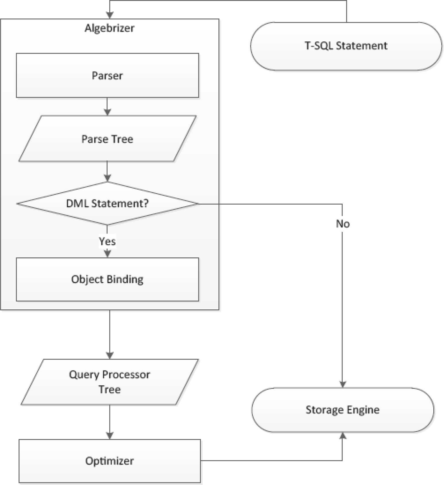
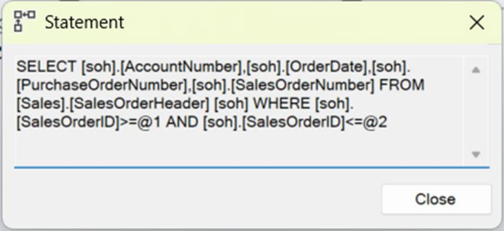
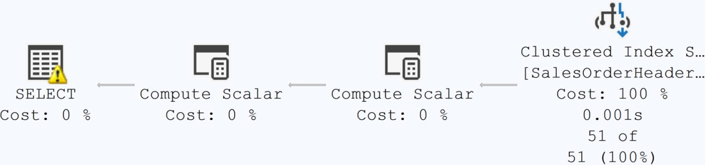
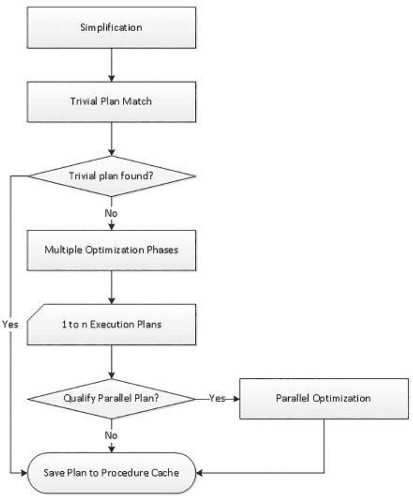
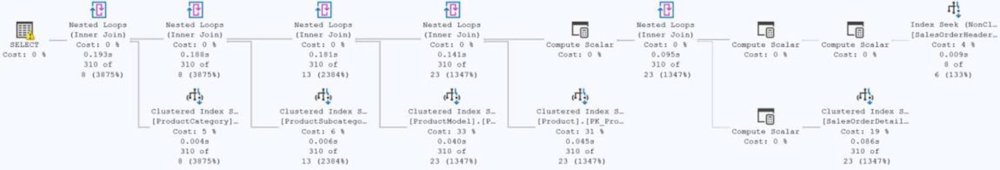
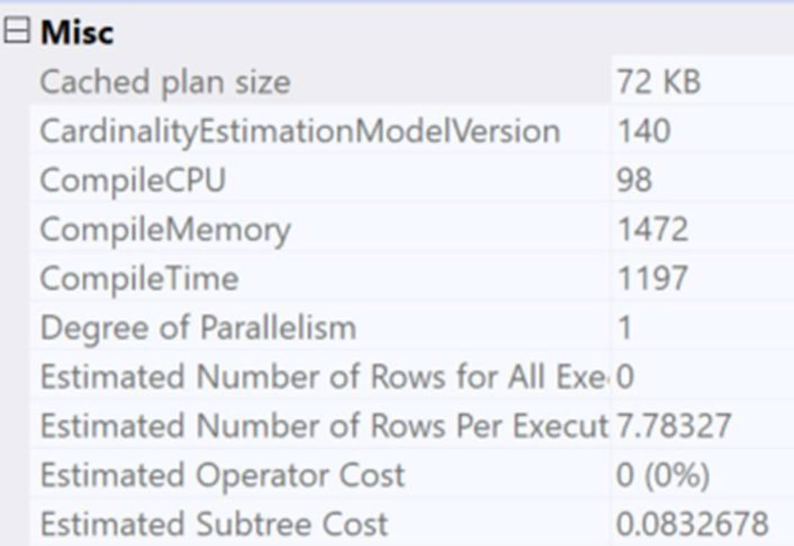
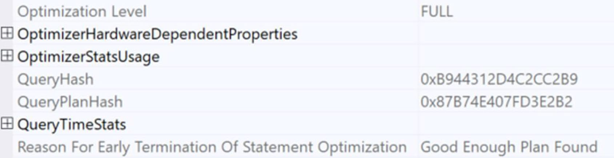
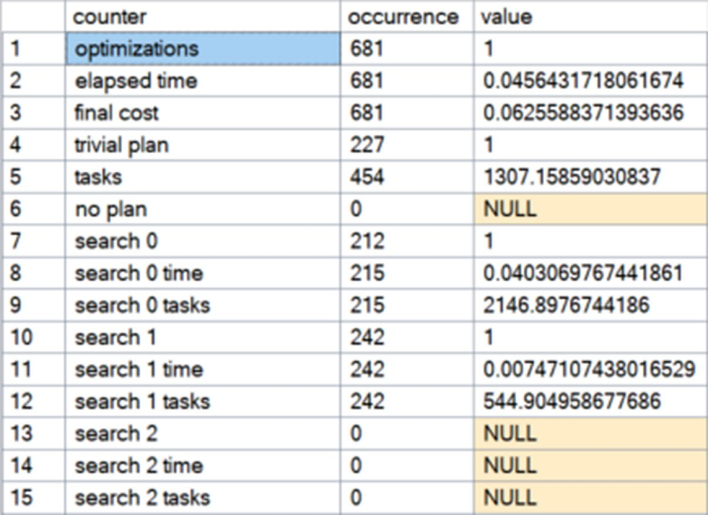

# CHƯƠNG 2: Khởi tạo kế hoạch thực thi và Bộ tối ưu hóa truy vấn (Execution Plan Generation and the Query Optimizer)

> **Thông tin sách gốc:**  
> © Grant Fritchey 2026  
> G. Fritchey, *SQL Server 2025 Query Performance Tuning*, https://doi.org/10.1007/979-8-8688-1865-3_2  

---

Mọi khía cạnh hiệu năng bên trong SQL Server đều bắt đầu, và thường kết thúc, tại Bộ tối ưu hóa truy vấn (Query Optimizer). 

Bởi vì Query Optimizer đóng vai trò sống còn đối với hiệu năng truy vấn, chúng ta sẽ đi sâu ngay vào cơ chế hành vi của nó nhằm hiểu rõ hơn vì sao các câu lệnh của chúng ta lại thực thi theo cách thức như vậy. Kết quả của quá trình tối ưu hóa (optimization process) là một **kế hoạch thực thi (Execution Plan)** – một lộ trình chi tiết để công cụ truy vấn (query engine) thực thi theo, đồng thời cũng là cơ chế hiển thị rõ các quyết định lựa chọn mà bộ tối ưu hóa đã đưa ra. Quá trình tối ưu hóa tiêu tốn rất nhiều tài nguyên hệ thống, đặc biệt là CPU, và có thể tương đối mất thời gian, ảnh hưởng trực tiếp đến thời gian thực thi tổng thể của truy vấn. Chúng ta sẽ cùng xem xét bản chất của quy trình này, cách thức một kế hoạch thực thi được tạo ra, và cách kế hoạch đó được nạp vào bộ nhớ trong vùng đệm kế hoạch (plan cache) với hy vọng tái sử dụng lại trong tương lai.

Trong chương này, chúng ta sẽ giải quyết các chủ đề sau:
* Tổng quan về quá trình tối ưu hóa truy vấn (The query optimization process in general)
* Kế hoạch thực thi và vùng đệm kế hoạch (Execution plans and the plan cache)
* Các yếu tố tác động đến quá trình tạo kế hoạch thực thi song song (Parallel plan generation)

---

## Quá trình tối ưu hóa truy vấn (The Query Optimization Process)

Bộ tối ưu hóa truy vấn trong SQL Server sử dụng cơ chế **phân tích dựa trên chi phí (cost-based analysis)** để đưa ra những quyết định cần thiết nhằm thỏa mãn các câu truy vấn mà bạn đã gửi lên. Để xử lý một truy vấn, một số lượng khổng lồ các lựa chọn phải được cân nhắc: Sử dụng chỉ mục (index) nào để truy cập một bảng dữ liệu, phương thức nối hai bảng lại với nhau ra sao (Nested Loops, Hash Join, Merge Join), và dữ liệu có cần phải được sắp xếp theo thứ tự hay không,... Tất cả những lựa chọn này cùng vô số yếu tố khác đều được bộ tối ưu hóa gán cho các mức chi phí ước tính (estimated costs).

Bộ tối ưu hóa cũng nắm bắt rất rõ cấu trúc của cơ sở dữ liệu. Từ các kiểu dữ liệu của các cột cho đến định nghĩa khóa chính (Primary Key), các ràng buộc (Constraints) và khóa ngoại (Foreign Keys), tất cả các đối tượng này đều tác động trực tiếp đến các ước lượng chi phí mà optimizer dựa vào để đưa ra quyết định. Cuối cùng, dữ liệu thực tế của bạn cũng được đưa vào tính toán chi phí thông qua việc sử dụng **số liệu thống kê (Statistics)** về dữ liệu (sẽ được trình bày chi tiết hơn trong Chương 5).

Như đã đề cập ở Chương 1, bộ tối ưu hóa không bao giờ cố gắng tạo ra một kế hoạch thực thi hoàn hảo tuyệt đối. Thay vào đó, optimizer sử dụng các mô hình toán học – dựa một phần vào các đối tượng và số liệu thống kê trong cơ sở dữ liệu – để tìm ra một kế hoạch **"đủ tốt" (good enough)**. Do đó, quá trình phân tích dựa trên chi phí luôn nỗ lực tìm kiếm một kế hoạch tối ưu nhất có thể, trong khi sử dụng càng ít tài nguyên phần cứng càng tốt và hoàn thành quá trình phân tích càng nhanh càng tốt.

Tuy nhiên, trước khi quá trình tối ưu hóa thực sự bắt đầu, có một số giai đoạn chuẩn bị ban đầu bắt buộc phải được hoàn thành.

---

## Các giai đoạn chuẩn bị tối ưu hóa (Optimization Preparation)

Vì bộ tối ưu hóa cần một lượng siêu dữ liệu (metadata) khổng lồ về hệ thống của bạn, nên có một số bước chuẩn bị diễn ra trước khi quá trình tối ưu hóa bắt đầu nhằm tập hợp toàn bộ thông tin này. Trật tự thực hiện của các bước đó như sau:

1. **Phân tích cú pháp (Parsing)**
2. **Ràng buộc / Định danh đối tượng (Binding)**
3. **Tối ưu hóa (Optimization)**

  
*Hình 2-1. Các bước diễn ra trước quá trình tối ưu hóa (Steps leading up to the optimization process)*

Chúng ta hãy cùng xem xét hai bước diễn ra trước quá trình tối ưu hóa thực sự.

---

### Phân tích cú pháp (Parsing)

Một câu truy vấn trước tiên sẽ đi qua **Relational Engine (Bộ máy quan hệ)** bên trong SQL Server. Đây là phần đầu tiên trong hai tiến trình xử lý truy vấn. Phần thứ hai là **Storage Engine (Bộ máy lưu trữ)** – nơi chịu trách nhiệm truy cập, sửa đổi dữ liệu và quản lý bộ nhớ đệm (caching). Relational engine đảm nhận việc phân tích cú pháp truy vấn thông qua một tiến trình gọi là **bộ đại số hóa (Algebrizer)**. Sau đó, relational engine sẽ thực thi truy vấn theo kế hoạch thực thi được tạo ra và yêu cầu dữ liệu từ storage engine.

Algebrizer thực hiện nhiều công đoạn, nhưng công đoạn đầu tiên là phân tích cú pháp truy vấn (query parsing). Tiến trình phân tích cú pháp đơn giản chỉ làm nhiệm vụ xác thực xem cú pháp câu lệnh trong truy vấn của bạn có hợp lệ hay không. Nếu phát hiện bất kỳ lỗi cú pháp nào, tiến trình sẽ lập tức bị chấm dứt ngay và toàn bộ quá trình tối ưu hóa phía sau sẽ bị hủy bỏ hoàn toàn. 

Nếu nhiều câu truy vấn được gửi cùng nhau trong một khối lệnh (batch), thì toàn bộ batch đó sẽ được kiểm tra cú pháp, và cả batch sẽ bị hủy nếu có lỗi cú pháp xảy ra ở bất kỳ vị trí nào trong đó. Mặc dù bạn có thể mắc nhiều lỗi cú pháp khác nhau, trình phân tích cú pháp (parser) sẽ dừng lại ngay ở lỗi đầu tiên gặp phải và đình chỉ mọi xử lý tiếp theo. Việc ngắt xử lý tức thì này là một minh chứng cho cách mà bộ tối ưu hóa cố gắng giảm thiểu chi phí phát sinh (overhead) của quá trình tối ưu.

Đoạn mã trong Listing 2-1 minh họa một batch có chứa lỗi cú pháp:

```sql
-- Listing 2-1. A batch with a syntax error
CREATE TABLE dbo.Example
(
    Col1 INT
);

INSERT INTO dbo.Example
(
    Col1
)
VALUES
(1);

SELECT e.Col1
FORM dbo.Example AS e; -- Phát sinh lỗi do viết sai chính tả thành 'FORM' thay vì 'FROM'
```

Một khi vượt qua được bước phân tích cú pháp, một cấu trúc nội bộ gọi là **cây phân tích cú pháp (parse tree)** sẽ được khởi tạo và chuyển giao sang bước tiếp theo.

---

### Ràng buộc / Định danh đối tượng (Binding)

Cây phân tích cú pháp (parse tree) lúc này được sử dụng để xác định và định danh tất cả các đối tượng cấu thành nên câu truy vấn. Danh sách đối tượng này bao gồm các bảng (tables), các cột (columns), các chỉ mục (indexes) và nhiều đối tượng khác. Quá trình này được gọi là **ràng buộc (Binding)**. 

Tại bước này, tất cả các kiểu dữ liệu đang được xử lý sẽ được định danh cụ thể. Các phép toán tổng hợp (aggregations) và các thao tác khác cũng được ánh xạ chi tiết. Tất cả các đối tượng và tiến trình này được hợp nhất lại thành một cấu trúc nội bộ khác mang tên **cây xử lý truy vấn (Query Processor Tree)**.

Algebrizer cũng sẽ xử lý các phép chuyển đổi kiểu dữ liệu ngầm định (implicit data conversions) bằng cách bổ sung thêm các bước tương ứng vào query processor tree. 

Bạn cũng có thể thấy quá trình **tối ưu hóa dựa trên cú pháp (syntax-based optimization)** xuất hiện, trong đó mã lệnh thực tế mà bạn gửi lên SQL Server sẽ được tự động biến đổi lại. Nếu bạn lấy đoạn mã trong Listing 2-2 và thu thập kế hoạch thực thi (sẽ được trình bày chi tiết trong Chương 4), bạn có thể quan sát thấy rõ những thay đổi về mặt cú pháp này.

```sql
-- Listing 2-2. The original code before binding
SELECT soh.AccountNumber,
       soh.OrderDate,
       soh.PurchaseOrderNumber,
       soh.SalesOrderNumber
FROM Sales.SalesOrderHeader AS soh
WHERE soh.SalesOrderID
BETWEEN 62500 AND 62550;
```

  
*Hình 2-2. Quá trình tối ưu hóa dựa trên cú pháp đang hoạt động (Syntax-based optimization at work)*

  
*Hình 2-3. Biểu tượng cảnh báo trên kế hoạch thực thi (A warning indicator on an execution plan)*

Dấu chấm than màu vàng hiển thị ngay trên toán tử đầu tiên bên trái có nhãn "SELECT" chính là dấu hiệu cảnh báo (warning). Khi quan sát cửa sổ thuộc tính (Properties) của toán tử đó, bạn sẽ thấy cột `SalesOrderID` thực tế đang phải trải qua một quá trình chuyển đổi kiểu dữ liệu:

```text
Type conversion in expression (CONVERT(nvarchar(23),[soh].[SalesOrderID],0)) may affect "CardinalityEstimate" in query plan choice.
(Chuyển đổi kiểu dữ liệu trong biểu thức có thể ảnh hưởng đến "Ước lượng số lượng bản ghi - CardinalityEstimate" khi lựa chọn kế hoạch truy vấn.)
```

Ví dụ này minh họa một số điểm quan trọng bên cạnh việc tối ưu hóa dựa trên cú pháp:

1. **Cảnh báo đôi khi có thể gây hiểu lầm hoặc không rõ ràng:** Trong trường hợp này, cảnh báo thực tế không xuất phát từ cột `SalesOrderID` được tham chiếu trong mệnh đề `WHERE` của truy vấn. Thay vào đó, nó bắt nguồn từ một cột được tính toán (calculated column) có tên là `SalesOrderNumber`. Phép tính toán của cột đó đang chuyển đổi `SalesOrderID` từ một số nguyên (`int`) thành một chuỗi ký tự và ghép thêm thông tin khác vào. Với cách tính toán đang được thiết lập, bộ tối ưu hóa nhận định rằng nếu biểu thức này được sử dụng làm điều kiện lọc trong mệnh đề `WHERE`, điều kiện kết nối trong mệnh đề `JOIN`, hoặc thậm chí trong mệnh đề `HAVING`, nó sẽ làm triệt tiêu khả năng tận dụng số liệu thống kê (statistics) và chỉ mục (indexes) để đạt hiệu năng tốt. Tuy nhiên, trong truy vấn cụ thể này, chúng ta không hề tham chiếu cột tính toán đó trong bất kỳ điều kiện lọc nào, do đó chúng ta có thể an tâm bỏ qua cảnh báo này. Tôi rất thích ví dụ này vì nó phản ánh chính xác mức độ thực tế của cơ sở dữ liệu AdventureWorks: rất nhiều vấn đề kiểu này thường xuyên len lỏi vào các cơ sở dữ liệu thực tế ngoài đời.

2. **Kế hoạch thực thi cho DDL và DML:** Khác với các truy vấn Ngôn ngữ Thao tác Dữ liệu (DML - Data Manipulation Language) mà chúng ta đã thấy từ đầu đến giờ, các truy vấn Ngôn ngữ Định nghĩa Dữ liệu (DDL - Data Definition Language) như `CREATE TABLE` sẽ không có kế hoạch thực thi (execution plan). Ví dụ, chỉ có một cách duy nhất để hệ thống thực thi câu lệnh `CREATE VIEW`. Do đó, hầu hết các lệnh DDL không cần phải trải qua quá trình tối ưu hóa. Ngoại lệ duy nhất là các truy vấn DDL dạng `CREATE INDEX`. Đối với việc tạo chỉ mục, bộ tối ưu hóa có thể tận dụng các chỉ mục hiện có để tạo ra một chỉ mục mới một cách hiệu quả hơn. Vì vậy, mặc dù bạn sẽ không bao giờ thấy một kế hoạch thực thi cho lệnh `CREATE PROCEDURE`, nhưng bạn sẽ thấy một kế hoạch thực thi khi khởi tạo chỉ mục bằng `CREATE INDEX`.

Sau khi tất cả các thao tác liên kết và định danh (binding) hoàn tất, một cấu trúc nội bộ hoàn chỉnh khác được tạo ra là **Query Processor Tree**. Và đây chính là điểm xuất phát để quá trình tối ưu hóa (Optimization) thực sự bắt đầu.

---

## Quá trình tối ưu hóa (The Optimization Process)

Quy trình tối ưu hóa là một thành phần phần mềm cực kỳ ấn tượng và tinh vi. Nếu không có một trình gỡ lỗi (debugger), bạn thực sự không thể quan sát trực tiếp cách nó vận hành trong thời gian thực. Tuy nhiên, chúng ta hoàn toàn có thể thấy được kết quả của quy trình này thông qua các kế hoạch thực thi (execution plans) mà nó tạo ra. Chúng ta cũng có thể sử dụng các Dynamic Management Views (DMV) và Extended Events để quan sát các khía cạnh khác nhau của quy trình tối ưu hóa. Trong cuốn sách này, chúng ta sẽ bắt gặp rất nhiều minh chứng thực tế về quá trình tối ưu hóa, nhưng việc khảo sát mã nguồn bằng một debugger nằm ngoài phạm vi của cuốn sách. Chúng ta sẽ chỉ tập trung vào các công cụ sẵn có ngay trước mắt. Hãy bắt đầu đi sâu thảo luận về quy trình tối ưu hóa.



*Hình 2-4: Quá trình tối ưu hóa (The optimization process)*

Chúng ta hãy cùng thảo luận về từng bước trong quy trình để hiểu rõ cách thức trình tối ưu hóa (Query Optimizer) đi đến việc tạo ra một kế hoạch thực thi.

### Đơn giản hóa (Simplification)

Bước đầu tiên trong quá trình tối ưu hóa là một giai đoạn được gọi là **đơn giản hóa** (*simplification*). Tại đây, trình tối ưu hóa sẽ đảm bảo rằng tất cả các đối tượng mà bạn tham chiếu trong truy vấn của mình thực sự được sử dụng. Số liệu thống kê (statistics) và số lượng dòng (row counts) bắt đầu được thu thập và áp dụng. Bước này cũng xem xét các ràng buộc (constraints) như khóa ngoại (foreign keys). Khi kết hợp tất cả các yếu tố này lại với nhau, bạn có thể thấy trình tối ưu hóa thực sự thay đổi những gì đang được xử lý. 

Ví dụ, bạn có thể viết một truy vấn kết hợp bốn bảng (4-table join). Tuy nhiên, chỉ có hai bảng được tham chiếu trong danh sách `SELECT` và mệnh đề `WHERE`. Dựa vào các ràng buộc, trình tối ưu hóa có thể xác định được rằng nó không cần hai bảng còn lại để thỏa mãn truy vấn, và do đó sẽ loại bỏ chúng khỏi quá trình xử lý tiếp theo, đơn giản hóa những gì cần được truy vấn — đó chính là lý do ra đời của tên gọi bước này.

### Khớp kế hoạch đơn giản (Trivial Plan Match)

Khi một truy vấn cực kỳ đơn giản, nó có thể khớp với một mẫu (pattern) mà ở đó không có sự lựa chọn nào khác ngoài duy nhất một kế hoạch thực thi khả dĩ. Tình huống đó được gọi là **Kế hoạch đơn giản** (*Trivial Plan*). Ví dụ đơn giản nhất là một bảng không có chỉ mục gom cụm (clustered index) — được gọi là bảng heap — và cũng không có bất kỳ chỉ mục nào khác. Cách duy nhất để truy cập bảng này là quét toàn bộ bảng (table scan). Thay vì phải mất công xây dựng một kế hoạch thực thi từ đầu, trình tối ưu hóa sẽ tìm kiếm xem mẫu truy vấn đó có khớp với các Trivial Plan hiện có hay không. Khi phát hiện một mẫu khớp, toàn bộ quá trình tối ưu hóa — vốn là một hoạt động tiêu tốn nhiều tài nguyên — sẽ được bỏ qua hoàn toàn. Thay vào đó, Trivial Plan sẽ được sử dụng ngay để đáp ứng truy vấn. 

Như đã nói trước đây, bạn sẽ chỉ thấy Trivial Plan xuất hiện ở các truy vấn cực kỳ đơn giản. Bạn có thể nhận biết một kế hoạch được đánh dấu là `Trivial` trong cửa sổ thuộc tính (properties) của kế hoạch thực thi (sẽ được thảo luận chi tiết trong Chương 4).

### Các giai đoạn tối ưu hóa (Optimization Phases)

Một khi đã xác định rõ rằng không thể tìm thấy một Trivial Plan, trình tối ưu hóa sẽ phải trải qua nhiều giai đoạn tối ưu hóa khác nhau nhằm nỗ lực đi đến một kế hoạch thực thi "đủ tốt" (good enough execution plan). Nó chia nhỏ quy trình này thành nhiều bước, mỗi bước đều cố gắng thực hiện ít công việc nhất có thể. Các giai đoạn này bao gồm:

* **Search 0 (Transaction):** Giai đoạn này được gọi là *Transaction* vì các dạng truy vấn có thể được thỏa mãn tại đây thường là các truy vấn xử lý giao dịch trực tuyến (OLTP - Online Transaction Processing) đơn giản, với rất ít phép kết nối (joins) và không cần đến các phép biến đổi phức tạp như sắp xếp lại thứ tự kết nối (reordering joins).
* **Search 1 (Quick Plan):** Đây là nơi diễn ra các phép xử lý phức tạp hơn, chẳng hạn như sắp xếp lại thứ tự kết nối và các phép biến đổi khác để đi đến một kế hoạch thực thi "đủ tốt".
* **Search 2 (Full Optimization):** Khi các truy vấn có độ phức tạp cao, chúng sẽ phải đi qua toàn bộ ba bước tối ưu hóa để đạt đến mức tối ưu hóa toàn diện (*full optimization*). Bước này bao gồm các đánh giá phức tạp hơn như việc sử dụng chỉ mục tổng hợp (composite index) và giải lồng truy vấn con (subquery unnesting, ví dụ: chuyển đổi một truy vấn con tương quan thành một phép `JOIN`).

Trình tối ưu hóa có thể đi tắt đón đầu (short-circuit) các bước tìm kiếm này, tiến thẳng tới Quick Plan hoặc Full Optimization và bỏ qua Transaction, tùy thuộc vào bản chất câu truy vấn, độ phức tạp của nó cùng các đối tượng hỗ trợ đi kèm như chỉ mục và ràng buộc. Mỗi giai đoạn này đều có thể đưa ra quyết định về cách thức thực hiện một thao tác `JOIN` cụ thể hoặc cách truy cập dữ liệu thông qua quét (scans) hay tìm kiếm (seeks).

Yếu tố chính chi phối hầu hết các quyết định bên trong trình tối ưu hóa là **số lượng dòng** (*row counts*). Số lượng dòng thường được ước tính dựa trên số liệu thống kê (statistics) của các cột nằm trong tiêu chí lọc, chẳng hạn như các vị từ trong mệnh đề `ON`, `HAVING` và `WHERE`. Khi đã có dữ liệu thống kê trong tay, trình tối ưu hóa bắt đầu đưa ra các lựa chọn và tính toán dựa trên mức ước tính CPU, bộ nhớ (memory) và I/O cần thiết để hoàn thành câu truy vấn. Các giá trị ước tính này được cộng lại để tạo thành **tổng chi phí** (*total cost*) cho việc thực thi truy vấn. Chi phí này không phải là một thước đo vật lý dựa trên hệ thống phần cứng của bạn; thay vào đó, nó là một phép tính tùy ý do trình tối ưu hóa đưa ra và thuần túy là một cấu trúc toán học trừu tượng.

Trình tối ưu hóa sẽ tính toán số lượng vòng lặp (iterations) mà nó cần thực hiện để thử nghiệm các kế hoạch khác nhau với các chiến lược khác nhau. Đồng thời, nó tính toán xem kế hoạch nào có khả năng mang lại chi phí thấp nhất. Khi tìm thấy một kế hoạch đáp ứng tất cả các yêu cầu đã tính toán, nó sẽ dừng quá trình tối ưu hóa lại ngay lập tức, ngay cả khi trên lý thuyết vẫn có thể tìm thấy một kế hoạch tốt hơn. Điều này được gọi là **Kết thúc sớm quá trình tối ưu hóa** (*Early Termination of Optimization*). 

Bạn cũng sẽ thấy quá trình tối ưu hóa bị chấm dứt khi trình tối ưu hóa đã thực hiện hết số vòng lặp được phân bổ tối đa. Tại thời điểm đó, nó sẽ kết thúc tối ưu hóa thông qua cơ chế được gọi là **Hết thời gian chờ** (*Timeout*, chi tiết sẽ được thảo luận trong Chương 4).

Nếu một câu truy vấn phải đi tới Search 2 (Full Optimization), nó cũng có thể được đánh giá để chuyển đổi từ một kế hoạch tuần tự (serial plan) sang một kế hoạch thực thi song song (parallel plan) — nội dung này sẽ được làm rõ hơn ở phần sau của chương.

### Đọc thuộc tính kế hoạch thực thi và DMV sys.dm_exec_query_optimizer_info

Chúng ta hoàn toàn có thể quan sát rất nhiều công việc mà trình tối ưu hóa đang thực hiện thông qua việc sử dụng các kế hoạch thực thi. Hãy lấy câu truy vấn trong Listing 2-3 làm ví dụ.

**Listing 2-3. Một truy vấn tương đối phức tạp (A slightly complex query)**

```sql
SELECT soh.SalesOrderNumber,
       sod.OrderQty,
       sod.LineTotal,
       sod.UnitPrice,
       sod.UnitPriceDiscount,
       p.Name AS ProductName,
       p.ProductNumber,
       ps.Name AS ProductSubCategoryName,
       pc.Name AS ProductCategoryName
FROM Sales.SalesOrderHeader AS soh
    JOIN Sales.SalesOrderDetail AS sod
        ON soh.SalesOrderID = sod.SalesOrderID
    JOIN Production.Product AS p
        ON sod.ProductID = p.ProductID
    JOIN Production.ProductModel AS pm
        ON p.ProductModelID = pm.ProductModelID
    JOIN Production.ProductSubcategory AS ps
        ON p.ProductSubcategoryID = ps.ProductSubcategoryID
    JOIN Production.ProductCategory AS pc
        ON ps.ProductCategoryID = pc.ProductCategoryID
WHERE soh.CustomerID = 29658;
```



*Hình 2-5: Kế hoạch thực thi của truy vấn phức tạp (Execution plan from the complex query)*



*Hình 2-6: Hành vi của optimizer hiển thị trong thuộc tính execution plan (Optimizer behaviors on display in the execution plan properties)*

Một số thông tin hiển thị trực quan ngay lập tức bao gồm:

* **CompileCPU:** Lượng thời gian CPU tiêu tốn để biên dịch kế hoạch thực thi này.
* **Estimated Number of Rows Per Execution:** Số lượng dòng ước tính mà trình tối ưu hóa đưa ra cho mỗi lần thực thi truy vấn này.
* **Estimated Subtree Cost:** Tổng chi phí ước tính kết hợp giữa CPU, I/O và bộ nhớ trên tất cả các thao tác trong cây kế hoạch (plan subtree) mà quá trình tối ưu hóa đã xác định được.



*Hình 2-7: Các thuộc tính bổ sung thể hiện hành vi optimizer (Additional properties showing optimizer behaviors)*

Một điểm rất đáng lưu ý tại đây: khi chúng ta nhìn thấy thuộc tính **Optimization Level** có giá trị là **"FULL"**, điều đó không nhất thiết đồng nghĩa với việc kế hoạch này đã phải trải qua giai đoạn Search 2. Nó chỉ đơn thuần mang ý nghĩa rằng đây không phải là một Kế hoạch đơn giản (Trivial Plan).

Một cách khác để quan sát các hoạt động của trình tối ưu hóa là sử dụng Dynamic Management View (DMV) `sys.dm_exec_query_optimizer_info`. Đúng như tên gọi của nó, DMV này hiển thị dữ liệu tổng hợp về toàn bộ quá trình tối ưu hóa trên máy chủ. Ví dụ về cách truy vấn DMV này được trình bày trong Listing 2-4.

**Listing 2-4. Truy vấn DMV dm_exec_query_optimizer_info (Querying the dm_exec_query_optimizer_info DMV)**

```sql
SELECT deqoi.counter,
       deqoi.occurrence,
       deqoi.value
FROM sys.dm_exec_query_optimizer_info AS deqoi;
```



*Hình 2-8: Thông tin tổng hợp về quá trình tối ưu hóa (Aggregated information about the optimization processes)*

Bạn có thể thấy rằng hệ thống mà tôi đang chạy thử nghiệm ở đây cho đến nay chưa phải thực hiện bất kỳ tối ưu hóa phức tạp nào. Chúng ta có thể biết được điều đó bởi vì không hề có thao tác nào thuộc giai đoạn Search 2 được ghi nhận. Bạn có thể quan sát thấy các thao tác khác đã được thực hiện cùng với thời gian ước tính cần thiết để hoàn thành chúng.

Thông tin này chỉ mang lại giá trị sử dụng ở một mức độ nhất định, nhưng sẽ rất hữu ích nếu bạn biết phải tìm đến đâu để lấy dữ liệu khi cần nắm bắt một số tiến trình nội bộ mà trình tối ưu hóa (Query Optimizer) đang trải qua cũng như tải trọng mà nó đang đặt lên hệ thống của bạn.

Bạn cũng có thể chạy đoạn mã này trước và sau khi thực thi một truy vấn nhằm theo dõi các loại hình tối ưu hóa đã diễn ra đối với truy vấn đó. Tuy nhiên, bạn cần thực hiện điều này trên một hệ thống thử nghiệm độc lập, nếu không bạn rất dễ nhìn thấy các dữ liệu tối ưu hóa của nhiều truy vấn khác diễn ra đồng thời chứ không chỉ riêng truy vấn mà bạn đang kiểm tra.

---

## Tạo kế hoạch thực thi song song (Generating Parallel Execution Plans)

Khi các kế hoạch thực thi trở nên đủ phức tạp, chúng có thể hưởng lợi từ việc thực thi song song (parallel execution). Thực thi song song diễn ra khi SQL Server có nhiều hơn một CPU khả dụng, từ đó cho phép nhiều bộ xử lý cùng tham gia xử lý một câu truy vấn duy nhất. Tuy nhiên, thực thi song song là một thao tác rất tốn kém tài nguyên, vì vậy bạn thực sự cần phải chắc chắn rằng truy vấn sẽ đạt được lợi ích rõ rệt từ tính song song trước khi cho phép nó chạy song song. 

Trên thực tế, rất nhiều truy vấn khi chạy theo cơ chế song song lại có tốc độ chậm hơn so với chạy tuần tự do chi phí quản lý và điều phối các luồng xử lý phát sinh. Đi xa hơn nữa ở điểm này, khi các truy vấn không thực sự cần xử lý song song lại bị ép chạy song song, bạn có thể chứng kiến hiệu năng toàn hệ thống bị sụt giảm nghiêm trọng do tài nguyên CPU bị vắt kiệt. Mặc dù thực thi song song mang lại nhiều lợi ích lớn, bạn phải hết sức thận trọng khi vận dụng nó.

Khi Query Optimizer cân nhắc xem một truy vấn phức tạp có nên chạy song song hay không, nó sẽ dựa trên một loạt yếu tố sau:
- Số lượng CPU khả dụng đối với SQL Server (nếu có nhiều hơn một CPU)
- Phiên bản SQL Server (SQL Server edition)
- Dung lượng bộ nhớ khả dụng (Available memory)
- Ngưỡng chi phí cho xử lý song song (Cost Threshold for Parallelism)
- Bản thân câu truy vấn đang được thực thi
- Số lượng hàng cần xử lý (Rows to be processed)
- Số lượng kết nối đồng thời đang hoạt động (Active concurrent connections)
- Mức độ song song tối đa (Max Degree of Parallelism - MAXDOP)

Ba yếu tố quan trọng nhất trong số các yếu tố kể trên là: số lượng CPU thực tế khả dụng cho SQL Server, thiết lập Mức độ song song tối đa (Max Degree of Parallelism), và Ngưỡng chi phí cho xử lý song song (Cost Threshold for Parallelism).

Nếu hệ thống chỉ có một CPU duy nhất (hoặc một vCPU duy nhất trên một nút NUMA) khả dụng cho SQL Server, bạn sẽ không bao giờ thấy bất kỳ truy vấn nào được chuyển sang chạy song song. Bạn cũng có thể hạn chế tính năng song song và kiểm soát số lượng CPU được sử dụng cho nó thông qua thiết lập `max degree of parallelism`. Đặt giá trị này bằng `1` sẽ loại bỏ hoàn toàn việc thực thi song song, tuy nhiên điều này không được khuyến nghị. Một trong những phương pháp để kiểm soát Max Degree of Parallelism là sử dụng cấu hình cấp máy chủ thông qua câu lệnh trong Listing 2-5.

**Listing 2-5.** Thay đổi cấu hình Max Degree of Parallelism

```sql
USE master;
EXEC sp_configure 'show advanced option', '1';
RECONFIGURE;
EXEC sp_configure 'max degree of parallelism', 2;
RECONFIGURE;
```

Các thay đổi được xác định bởi truy vấn này sẽ có hiệu lực ngay lập tức. Việc xác định giá trị cài đặt chính xác cho cấu hình này thường là một chủ đề gây nhiều tranh luận lớn. Chính hệ thống cụ thể và đặc thù tải công việc (workloads) của bạn phải là yếu tố dẫn dắt các quyết định này, chứ không phải một công thức tính toán tùy tiện nào đó chỉ dựa trên số lượng bộ xử lý của hệ thống. 

Vì lý do này, tôi sẽ không đưa ra một khuyến nghị cứng nhắc tại đây, ngoại trừ việc nhấn mạnh một lần nữa: việc thực thi song song cho một số truy vấn nhất định là điều rất đáng mong muốn, vì vậy bạn nên giữ lại khả năng đó trên hệ thống của mình (nghĩa là không nên đặt `max degree of parallelism` về 1). Tuy nhiên, đối với đa số hệ thống, giá trị mặc định là `0` — tức là cho phép sử dụng tất cả các CPU khả dụng — cũng không phải là một thiết lập lý tưởng.

Bạn cũng có thể kiểm soát mức độ song song trên từng truy vấn riêng lẻ thông qua các gợi ý truy vấn (query hints). Tôi sẽ lặp lại điều này nhiều lần trong cuốn sách: các gợi ý truy vấn cần phải được sử dụng một cách hết sức thận trọng và có cân nhắc kỹ lưỡng trên hệ thống của bạn. Listing 2-6 minh họa cách thức hoạt động của gợi ý này.

**Listing 2-6.** Kiểm soát mức độ song song thông qua gợi ý truy vấn (query hint)

```sql
SELECT e.ID,
       e.SomeValue
FROM dbo.Example AS e
WHERE e.ID = 42
OPTION (MAXDOP 2);
```

Nếu bạn muốn kiểm soát trực tiếp và hiệu quả hơn những kế hoạch nào được phép chạy song song, cách tiếp cận tốt nhất là can thiệp vào quy trình bằng cách điều chỉnh cấu hình Ngưỡng chi phí cho xử lý song song (**Cost Threshold for Parallelism**) (Listing 2-7). Giá trị mặc định là `5` là cực kỳ thấp đối với phần lớn các hệ thống hiện đại. Microsoft nhìn chung không hoàn toàn đồng tình với quan điểm này, nhưng cá nhân tôi sẽ lập tức nâng giá trị đó lên cao hơn trên bất kỳ hệ thống nào mà tôi chịu trách nhiệm quản trị. Một lần nữa, con số chính xác hoàn toàn phụ thuộc vào đặc tính hệ thống, các loại truy vấn và mức tải thực tế của bạn.

**Listing 2-7.** Thay đổi cấu hình Cost Threshold for Parallelism

```sql
USE master;
EXEC sp_configure 'show advanced option', '1';
RECONFIGURE;
EXEC sp_configure 'cost threshold for parallelism', 35;
RECONFIGURE;
```

Một phương pháp hữu hiệu để xác định giá trị hợp lý cho ngưỡng chi phí là khảo sát chi phí ước tính (estimated costs) của các truy vấn đang thực sự chạy trên hệ thống của bạn. Bằng cách sử dụng bất kỳ chỉ số đo lường truy vấn sẵn có nào cùng với các ước tính chi phí thu thập từ kế hoạch thực thi, bạn có thể nắm bắt được cách thức hệ thống vận hành và đưa ra các điều chỉnh thích hợp từ đó. 

Có nhiều cách để bạn xác định giá trị thích hợp cho hệ thống của mình. Ví dụ, truy vấn trong Listing 2-8 sẽ liệt kê toàn bộ các giá trị chi phí ước tính cho tất cả các kế hoạch thực thi hiện có trong bộ nhớ đệm (plan cache) trên hệ thống của bạn.

**Listing 2-8.** Truy xuất chi phí ước tính của tất cả các kế hoạch trong plan cache

```sql
WITH XMLNAMESPACES
(
    DEFAULT N'http://schemas.microsoft.com/sqlserver/2004/07/showplan'
)
, TextPlans
AS (SELECT CAST(detqp.query_plan AS XML) AS QueryPlan,
           detqp.dbid
    FROM sys.dm_exec_query_stats AS deqs
        CROSS APPLY sys.dm_exec_text_query_plan(
                                                deqs.plan_handle,
                                                deqs.statement_start_offset,
                                                deqs.statement_end_offset
                                             ) AS detqp ),
  QueryPlans
AS (SELECT RelOp.pln.value(N'@EstimatedTotalSubtreeCost', N'float') 
AS EstimatedCost,
           RelOp.pln.value(N'@NodeId', N'integer') AS NodeId,
           tp.dbid,
           tp.QueryPlan
    FROM TextPlans AS tp
        CROSS APPLY tp.QueryPlan.nodes(N'//RelOp') RelOp(pln) )
SELECT qp.EstimatedCost
FROM QueryPlans AS qp
WHERE qp.NodeId = 0;
```

Với dữ liệu được trả về, bạn có thể sử dụng chúng trong các phép tính toán thống kê để đi đến một giá trị ngưỡng chi phí thích hợp cho hệ thống của mình.

> [!CAUTION]
> Các truy vấn phân tích XML có thể rất tốn kém tài nguyên khi thực thi và tiêu tốn một lượng đáng kể tài nguyên hệ thống. Hãy hết sức thận trọng khi chạy một truy vấn dạng này trên các hệ thống môi trường sản xuất (production).

Như đã đề cập trước đó, việc thực thi song song các câu truy vấn rất tốn kém tài nguyên. Chạy song song không chỉ chiếm dụng nhiều chu kỳ CPU hơn mà còn đòi hỏi một lượng bộ nhớ RAM lớn hơn đáng kể. Do đó, SQL Server sẽ chủ động tính toán và xem xét lượng bộ nhớ khả dụng trước khi quyết định thực thi một kế hoạch song song. SQL Server sẽ tự động giảm bớt mức độ song song, hoặc thậm chí hủy bỏ hoàn toàn việc chạy song song cho một truy vấn nhất định nếu hệ thống đang ở trong tình trạng căng thẳng tài nguyên (stress).

Tất cả các truy vấn thao tác dữ liệu (DML - Data Manipulation Language) về bản chất đều được thực thi tuần tự (serially). Tuy nhiên, mệnh đề `SELECT` bên trong câu lệnh `INSERT`, cũng như mệnh đề `WHERE` trong các câu lệnh `UPDATE` hoặc `DELETE` hoàn toàn có thể được thực thi song song. Bản thân các thay đổi dữ liệu thực tế vẫn luôn luôn được áp dụng một cách tuần tự, tuyệt đối không bao giờ diễn ra song song.

Tại thời điểm thực thi (execution time), SQL Server có thể chủ động thay đổi hành vi thực thi song song. Sau đó, nó sẽ thiết lập số lượng luồng xử lý (processing threads) cho một truy vấn cụ thể, và số lượng luồng này sẽ được cố định trong suốt quá trình thực thi truy vấn đó. Giá trị này có thể được xem xét và đánh giá lại ở lần thực thi tiếp theo của truy vấn và hoàn toàn có thể thay đổi.

---

## Lưu bộ nhớ đệm kế hoạch thực thi (Execution Plan Caching)

Khi Query Optimizer hoàn tất quá trình xử lý của mình, kết quả cuối cùng thu được là một kế hoạch thực thi (execution plan). Kế hoạch này được lưu trữ trong bộ nhớ của SQL Server tại một khu vực được gọi là **bộ nhớ đệm kế hoạch** (**plan cache**). 

Việc lưu kế hoạch vào bộ nhớ đệm là một bước tối ưu hóa khác mà SQL Server thực hiện nhằm nỗ lực làm cho các truy vấn của bạn chạy nhanh hơn. Bằng cách lưu trữ kế hoạch, nó có thể được tái sử dụng cho các lần gọi tiếp theo thay vì hệ thống phải lặp lại toàn bộ quy trình tối ưu hóa tốn kém từ đầu. Tuy nhiên, các kế hoạch có thể bị dọn dẹp và loại bỏ khỏi bộ nhớ đệm thông qua nhiều cơ chế khác nhau. Một trong những cơ chế đó được gọi là "sự già hóa" (**aging**).

### Quá trình suy giảm độ ưu tiên của kế hoạch thực thi (Aging of the Execution Plan)

Bộ nhớ đệm kế hoạch (plan cache) là một phần thuộc vùng đệm bộ nhớ (**buffer cache**) của SQL Server — nơi cũng đồng thời lưu trữ các trang dữ liệu (data pages). Khi các kế hoạch thực thi mới liên tục được bổ sung vào plan cache, kích thước của plan cache sẽ không ngừng phình to, gây ảnh hưởng tiêu cực đến khả năng duy trì các trang dữ liệu hữu ích trong bộ nhớ RAM. 

Để giải quyết vấn đề này, SQL Server chủ động điều tiết việc duy trì các kế hoạch thực thi trong plan cache một cách linh hoạt: giữ lại những kế hoạch thực thi được sử dụng thường xuyên và loại bỏ những kế hoạch không được dùng đến sau một khoảng thời gian nhất định.

SQL Server theo dõi tần suất tái sử dụng của một kế hoạch thực thi bằng cách gắn kèm một trường giá trị tuổi thọ (**age**) cho kế hoạch đó. Khi một kế hoạch thực thi được khởi tạo, trường `age` này sẽ được gán giá trị khởi tạo bằng chính chi phí tài nguyên phát sinh để tạo ra kế hoạch đó. Một truy vấn phức tạp đòi hỏi quá trình tối ưu hóa chuyên sâu sẽ có giá trị trường `age` cao hơn đáng kể so với một truy vấn đơn giản.

Theo các khoảng thời gian định kỳ, giá trị chi phí hiện tại của tất cả các kế hoạch thực thi trong plan cache sẽ được tiến trình **Lazy Writer** của SQL Server kiểm tra và rà soát (đây là tiến trình chịu trách nhiệm điều phối phần lớn các tác vụ chạy ngầm trong SQL Server). Nếu một kế hoạch thực thi không được tái sử dụng trong một thời gian dài, giá trị chi phí hiện tại của nó dần dần sẽ bị giảm về 0. 

Kế hoạch nào tiêu tốn ít chi phí tạo ra hơn thì giá trị chi phí của nó sẽ bị đưa về 0 càng nhanh chóng. Một khi chi phí của kế hoạch thực thi chạm mốc 0, kế hoạch đó sẽ trở thành ứng viên hàng đầu để bị loại bỏ khỏi bộ nhớ. SQL Server sẽ tiến hành xóa tất cả các kế hoạch có chi phí bằng 0 khỏi plan cache khi áp lực bộ nhớ (memory pressure) tăng cao đến mức không còn đủ bộ nhớ trống để phục vụ cho các yêu cầu mới. 

Tuy nhiên, nếu hệ thống có dồi dào bộ nhớ và các trang bộ nhớ trống vẫn luôn sẵn sàng phục vụ các yêu cầu mới, các kế hoạch thực thi có chi phí bằng 0 vẫn có thể tiếp tục tồn tại trong plan cache một thời gian dài để có thể tái sử dụng lại sau này nếu phát sinh yêu cầu.

Cùng với việc bị giảm chi phí theo thời gian, các kế hoạch thực thi cũng có thể được tăng giá trị chi phí trở lại mức chi phí khởi tạo tối đa mỗi khi kế hoạch đó được tái sử dụng (hoặc tăng lên mức chi phí hiện tại đối với các kế hoạch ad hoc). 

Ví dụ, giả sử bạn có hai kế hoạch thực thi với chi phí khởi tạo ban đầu tương ứng là 100 và 10. Giá trị chi phí xuất phát của chúng do đó lần lượt sẽ là 100 và 10. Nếu cả hai kế hoạch thực thi này đều được tái sử dụng ngay sau đó, trường `age` của chúng sẽ được đặt lại về mức chi phí tối đa ban đầu. Với thang giá trị chi phí này, tiến trình Lazy Writer sẽ đưa chi phí của kế hoạch thứ hai về mức 0 nhanh hơn rất nhiều so với kế hoạch thứ nhất, trừ phi kế hoạch thứ hai được tái sử dụng với tần suất dày đặc hơn. Do đó, ngay cả khi một kế hoạch phức tạp đắt đỏ được tái sử dụng ít thường xuyên hơn một kế hoạch đơn giản giá rẻ, nhờ vào lợi thế của mức chi phí khởi tạo ban đầu cao, kế hoạch đắt đỏ đó vẫn có thể duy trì được giá trị chi phí khác 0 trong bộ nhớ đệm trong một khoảng thời gian dài hơn đáng kể.

---

## Tóm tắt chương (Summary)

Mặc dù bạn không nhất thiết phải thấu hiểu mọi khía cạnh vi mô bên trong trình tối ưu hóa truy vấn (Query Optimizer) thì mới có thể làm cho các truy vấn của mình chạy nhanh hơn, nhưng việc trang bị cho mình một mức độ hiểu biết thấu đáo về nó chắc chắn sẽ mang lại lợi ích to lớn. 

Trong chương này, bạn đã được chứng kiến quy trình căn bản mà trình tối ưu hóa trải qua: từ các bước phân tích cú pháp (parsing) và liên kết đối tượng (binding), thông qua bước đối chiếu các kế hoạch tầm thường (Trivial Plans), và cuối cùng tiến vào quy trình tối ưu hóa toàn diện dựa trên chi phí. Chúng ta cũng đã cùng nhau phân tích cách thức hoạt động của các kế hoạch thực thi song song cũng như cơ chế các kế hoạch thực thi được lưu trữ và già hóa trong bộ nhớ đệm kế hoạch (plan cache).

Trong chương tiếp theo, chúng ta sẽ cùng tìm hiểu về những phương pháp tối ưu nhất để thu thập và đo lường các chỉ số hiệu năng truy vấn.
