# CHƯƠNG 3: Các phương pháp thu thập chỉ số hiệu năng truy vấn (Methods for Capturing Query Performance Metrics)

> **Thông tin sách gốc:**  
> © Grant Fritchey 2026  
> G. Fritchey, *SQL Server 2025 Query Performance Tuning*, https://doi.org/10.1007/979-8-8688-1865-3_3  

---

Để hiểu rõ những câu truy vấn nào chúng ta cần tập trung ưu tiên trong quá trình tinh chỉnh hiệu năng, chúng ta cần có một phương pháp đo lường hiệu năng truy vấn một cách chính xác. Đồng thời, khi thực hiện các nỗ lực thử nghiệm khác nhau nhằm cải thiện hiệu năng, chúng ta cần có khả năng thu thập các chỉ số (metrics) để biết được những cải tiến đó hoạt động hiệu quả đến mức nào, hoặc liệu chúng có thực sự mang lại tác dụng hay không. Cuối cùng, chúng ta cần đo lường được kết quả sau khi tối ưu nhằm vừa xác thực kết quả đạt được, vừa khởi động lại quy trình từ đầu để nhận diện câu truy vấn chạy kém tiếp theo.

Mặc dù có rất nhiều cơ chế để thu thập chỉ số hiệu năng truy vấn, chúng ta sẽ tập trung nỗ lực vào ba phương pháp mà tôi nhận thấy là chính xác nhất và dễ triển khai nhất. Dù các phương pháp khác vẫn hoạt động, tôi thấy ba cơ chế này mang lại hiệu quả vượt trội hơn cả. Nếu bạn quyết định sử dụng một phương pháp khác, hãy duy trì tính nhất quán trong các chỉ số đo lường, bởi vì dường như mọi công cụ thu thập số liệu mà tôi từng sử dụng đều trả về các giá trị có sự chênh lệch nhất định so với những công cụ còn lại.

Trong chương này, chúng ta sẽ tìm hiểu về:
* Sử dụng các Khung nhìn Quản trị Động (Dynamic Management Views - DMVs)
* Thu thập các chỉ số chi tiết bằng Extended Events
* Các chỉ số hiệu năng truy vấn trong Kho lưu trữ truy vấn (Query Store)

---

## Các phương pháp thu thập chỉ số hiệu năng truy vấn (Methods to Capture Query Performance Metrics)

Có rất nhiều cách để thu thập các chỉ số đo lường truy vấn. Hầu hết các phương pháp đều có độ chính xác tương đương nhau, nhưng một số phương pháp lại dễ sử dụng hơn, cung cấp thông tin toàn diện hơn hoặc hoạt động tốt hơn ở quy mô lớn trên các hệ thống đồ sộ. Hãy để tôi điểm qua tất cả các khả năng hiện có, sau đó chúng ta sẽ thảo luận ngắn gọn lý do tại sao tôi không sử dụng một số phép đo nhiều như những phương pháp khác.

Các phương pháp đo lường hiệu năng truy vấn tiềm năng bao gồm:
* Bao gồm thống kê phía client (Include Client Statistics)
* Thuộc tính kết nối (Connection properties)
* `SET STATISTICS TIME` / `SET STATISTICS IO`
* `QueryTimeStats` trong kế hoạch thực thi (Execution Plan)
* Kho lưu trữ truy vấn (Query Store)
* Các khung nhìn quản trị động (Dynamic Management Views - DMVs)
* Các sự kiện theo vết (Trace Events / SQL Server Profiler)
* Extended Events

Vì chúng ta sẽ tìm hiểu chi tiết về DMVs, Query Store và Extended Events trong phần còn lại của chương này, tôi muốn thảo luận về các phương pháp còn lại ngay tại đây. Hãy bắt đầu với một phương pháp đo lường thực tế không hề chính xác (không giống như tất cả các phương pháp khác): **Include Client Statistics**.

---

### Bao gồm thống kê phía Client (Include Client Statistics)

Bạn có thể kích hoạt tính năng này bằng cách nhấp chuột phải vào cửa sổ truy vấn trong SQL Server Management Studio (SSMS) và chọn **"Include Client Statistics"** từ menu ngữ cảnh. Tính năng này sẽ thu thập thời gian thực thi và chỉ số I/O từ phía máy trạm (client) nơi bạn đang chạy truy vấn. 

Điều này đồng nghĩa với việc độ trễ mạng (network latency), sự tranh chấp tài nguyên cục bộ trên máy trạm và mọi yếu tố ngoại cảnh khác đều sẽ tác động tiêu cực làm sai lệch kết quả đo lường hiệu năng. Giá trị đầu ra của phương pháp này hoàn toàn không tương thích hay trùng khớp với kết quả từ các phương pháp đo lường phía máy chủ. Chính vì lý do này, tôi tuyệt đối không bao giờ sử dụng nó trong quá trình tinh chỉnh hiệu năng.

---

### Thuộc tính kết nối (Connection Properties)

Một cách nhanh chóng khác để kiểm tra thời gian thực thi là xem xét các thuộc tính của kết nối hiện tại trong SSMS.

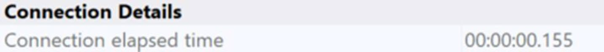  
*Hình 3-1. Thuộc tính kết nối hiển thị thời gian đã trôi qua (Connection properties showing elapsed time)*

---

### SET STATISTICS TIME / SET STATISTICS IO

Đây là cơ chế kinh điển để đo lường hiệu năng khi tinh chỉnh truy vấn. Các phiên bản trước của cuốn sách này đã sử dụng rất nhiều các giá trị này. Chúng có độ chính xác cao, vì vậy nếu bạn chọn sử dụng chúng thì hoàn toàn ổn. Bạn có thể sử dụng chúng bằng cách vào phần Options của SSMS, nhấp chuột phải và chọn từ menu ngữ cảnh, hoặc sử dụng lệnh T-SQL:

```sql
SET STATISTICS TIME ON;
SET STATISTICS IO ON;
```

Tuy nhiên, hãy để tôi giải thích lý do tại sao hiện nay tôi không còn sử dụng chúng nhiều như trước:
1. **Chỉ nhận được kết quả của một lần thực thi đơn lẻ:** Tôi nhận thấy rằng kết quả sẽ chính xác hơn rất nhiều nếu tôi thực thi một truy vấn nhiều lần rồi lấy giá trị trung bình. Việc tính toán giá trị trung bình bằng phương pháp này rất thủ công và bất tiện.
2. **Không ghi nhận mức tiêu thụ CPU:** Phương pháp này không cung cấp số liệu sử dụng CPU một cách toàn diện và thuận tiện.
3. **Hiện tượng can thiệp chéo làm giảm độ chính xác:** Nếu bạn đồng thời bật cả `TIME` và `IO`, việc thu thập số liệu I/O thực tế có thể tác động tiêu cực đến phép đo thời gian (`TIME`), khiến nó kém chính xác hơn. Bạn thường chỉ thấy hiện tượng này trên các truy vấn chạy dưới 1 giây hoặc dưới 100 mili-giây. Thế nhưng, thời điểm bạn cần độ chính xác cao nhất lại chính là lúc bạn phải tinh chỉnh đến từng mili-giây cuối cùng. Sự suy giảm độ chính xác đó làm giảm giá trị hữu dụng của phương pháp này.

Trường hợp duy nhất tôi vẫn quay lại sử dụng cơ chế này là khi tôi cần đo lường I/O chi tiết và phân tách cụ thể trên từng đối tượng bảng/chỉ mục tham gia vào truy vấn. `STATISTICS IO` luôn là một cách đơn giản, trực quan để lấy được chỉ số đó.

---

### QueryTimeStats trong Kế hoạch thực thi (Execution Plan)

Khi bạn thu thập các chỉ số thời gian chạy cùng với kế hoạch thực thi – được gọi là **"Actual Execution Plan"** trong SSMS (bắt đầu từ phiên bản SQL Server 2016) – bạn sẽ nhận được các chỉ số runtime của truy vấn, bao gồm cả số liệu thống kê thời gian chờ (wait statistics). Đây là những phép đo rất chính xác và nằm trực tiếp ngay trong kế hoạch thực thi. 

Tôi hoàn toàn sử dụng các thông số này khi phân tích. Tuy nhiên, một lần nữa, chúng cũng chỉ hiển thị cho một lần thực thi duy nhất, khiến việc tính toán giá trị trung bình rất khó khăn. Ngoài ra, việc thu thập execution plan thực tế gây ảnh hưởng tiêu cực đến phép đo thời gian, bởi vì chi phí phụ trợ (overhead) để thu thập các chỉ số runtime cùng với biểu đồ kế hoạch sẽ làm chậm tốc độ thực thi của truy vấn. Vì lý do này, khi tôi muốn đo đạc các chỉ số hiệu năng thuần túy với độ chính xác cao nhất, tôi sẽ **không** bật tính năng thu thập Actual Execution Plan. Thực tế đơn giản này khiến tôi không thể dựa hoàn toàn vào phương pháp này mọi lúc mọi nơi.

---

### Các sự kiện theo vết (Trace Events / SQL Server Profiler)

Đây có thể là một chủ đề khá nhạy cảm. Rất nhiều chuyên gia dữ liệu kỳ cựu đã làm việc với Trace Events và Profiler (giao diện đồ họa để tạo và đọc dữ liệu Trace Event) trong một thời gian rất dài. Họ cảm thấy thoải mái với công cụ này, đã phát triển kỹ năng xuất sắc với Trace Events và không có ý định từ bỏ. Tôi không phản đối thói quen của họ. Tuy nhiên, vì nhiều lý do kỹ thuật quan trọng, tôi sẽ không ủng hộ việc sử dụng Trace Events, và nếu bạn mới bắt đầu bước chân vào lĩnh vực tinh chỉnh hiệu năng truy vấn, tôi thực sự khuyên bạn cũng không nên sử dụng chúng.

* **Tiêu tốn tài nguyên hệ thống (Overhead cao):** Trace Events rất tốn kém tài nguyên bên trong hệ điều hành SQL Server. Khác với Extended Events – vốn được tích hợp trực tiếp và sâu vào các hành vi nội bộ của SQL Server từ bản 2008 – Trace Events được xây dựng và triển khai như một hệ thống phụ trợ tách biệt. Điều này khiến chúng tiêu tốn thêm một lượng CPU và bộ nhớ đáng kể vượt xa mức tiêu hao của Extended Events.
* **Cơ chế lọc kém hiệu quả:** Do kiến trúc thu thập dữ liệu của Trace Events, chúng không thể áp dụng bộ lọc ngay tại thời điểm phát sinh sự kiện (filter at capture) như Extended Events. Điều này đồng nghĩa với việc hệ thống vẫn phải tiêu tốn toàn bộ tài nguyên cần thiết để thu thập sự kiện, rồi sau đó mới lọc bỏ sự kiện khỏi kết quả trả về.
* **Giao diện Profiler GUI gây nghẽn tài nguyên:** Nếu bạn kết nối công cụ Profiler GUI vào một Trace Event trên máy chủ đang hoạt động (live/production server), nó sẽ cấp phát một vùng nhớ bổ sung trên chính máy chủ đó và dùng nó để tiêu thụ sự kiện theo thời gian thực, dẫn đến việc tước đoạt tài nguyên quý giá của hệ thống.
* **Xử lý dữ liệu kém tối ưu:** Cách thức bạn phân tích và đọc dữ liệu trong Trace Events không thể linh hoạt và hiệu quả bằng cửa sổ Live Data Explorer hiện đại trong Extended Events.

Vì tất cả những lý do trên, trên bất kỳ hệ thống nào chạy SQL Server 2012 trở lên, tôi sẽ không sử dụng Trace Events để thu thập thông tin. (Trước phiên bản 2012, Trace Events vẫn là cơ chế khả dĩ duy nhất). Tôi cũng tha thiết kêu gọi các chuyên gia dữ liệu giàu kinh nghiệm: Xin vui lòng hướng dẫn Extended Events thay vì SQL Trace cho thế hệ chuyên gia dữ liệu kế cận.

Đó là toàn bộ các cơ chế đo lường phụ trợ. Bây giờ, chúng ta hãy cùng chuyển sang ba phương pháp cốt lõi sẽ phục vụ bạn đắc lực nhất theo thời gian.

---

## Các Khung nhìn Quản trị Động (Dynamic Management Views - DMVs)

SQL Server có một số lượng cực kỳ lớn các DMV. Ngay cả khi chúng ta chỉ giới hạn trong phạm vi các DMV liên quan đến hiệu năng truy vấn, số lượng này vẫn rất đồ sộ. Vì vậy, tôi sẽ không cố gắng tài liệu hóa tất cả các DMV hay toàn bộ công dụng của chúng ở đây. Thay vào đó, chúng ta sẽ đề cập đến các DMV cốt lõi phục vụ đo lường hiệu năng truy vấn tại phần này, và sẽ tìm hiểu thêm các DMV bổ trợ xuyên suốt các chương tiếp theo của cuốn sách (chúng ta đã làm quen với một số DMV ở Chương 2).

> [!NOTE]
> Một số tài liệu kỹ thuật (và các phiên bản cũ hơn của cuốn sách này) cố gắng phân biệt rạch ròi giữa Khung nhìn Quản trị Động (Dynamic Management Views) và Hàm Quản trị Động (Dynamic Management Functions - DMFs). Tuy nhiên, hầu hết các kỹ sư đều sử dụng thuật ngữ chung "Dynamic Management Views" (DMVs) để gọi cả hai, và tôi cũng sẽ áp dụng quy ước này xuyên suốt cuốn sách.

Các DMV được chia thành hai nhóm lớn:
1. Nhóm phục vụ **các truy vấn đang thực thi (currently executing queries)**.
2. Nhóm phục vụ **các truy vấn đã hoàn thành thực thi trước đó (previously executed queries)**.

Thông tin thu thập cho các truy vấn đã thực thi trước đó hoàn toàn phụ thuộc vào bộ nhớ đệm (cache-dependent). Nếu vì bất kỳ lý do gì mà kế hoạch truy vấn bị đào thải khỏi cache (aged out) hoặc bị xóa cưỡng bức khỏi bộ nhớ đệm, toàn bộ các chỉ số đo lường hiệu năng của truy vấn đó cũng sẽ biến mất theo. Hơn nữa, thông tin cho các truy vấn đã thực thi trước đó chỉ là số liệu tổng hợp (aggregate only). Bạn không có cách nào để phân biệt giữa một lần truy vấn chạy lúc 2 giờ sáng và chính truy vấn đó chạy lúc 3 giờ sáng, trừ khi bạn tự mình dùng DMV để chụp lại số liệu tại cả hai thời điểm đó.

Tôi thường xuyên sử dụng DMVs để đo lường hiệu năng truy vấn vì nhiều lý do:
* Hầu hết chúng đều khả dụng trên mọi phiên bản SQL Server từ 2005 trở lên, bao gồm cả AWS RDS, Google Cloud SQL và Azure SQL Database. Điều đó đảm bảo tôi luôn luôn có một công cụ sẵn sàng trong tay.
* Không phải lúc nào các phương pháp khác cũng được bật sẵn trên máy chủ. Một số cơ sở dữ liệu có tải công việc quá nặng để có thể kích hoạt Query Store. Mặc dù Extended Events rất nhẹ, chúng vẫn tiêu tốn tài nguyên nhất định, nên không phải lúc nào tôi cũng duy trì các phiên Extended Events chạy liên tục. Nhưng với DMVs, tôi luôn luôn có thể "ngó nhanh" vào các chỉ số hiệu năng của hệ thống bất kỳ lúc nào.

Hãy cùng tìm hiểu cách thu thập thông tin về các truy vấn đang thực thi trước tiên.

### Các truy vấn đang thực thi (Actively Executing Queries)

Một tư duy rất quan trọng là hãy xem các DMV như những khối xếp hình Lego: bạn có thể kết hợp chúng theo nhiều cách thức khác nhau. Tuy nhiên, luôn có những điểm khởi đầu cốt lõi mà bạn sẽ thường xuyên dựa vào. Đối với các truy vấn đang chạy, điểm xuất phát trong hầu hết trường hợp là `sys.dm_exec_requests`.

DMV này thu thập một lượng thông tin khổng lồ về các truy vấn đang tích cực thực thi, bao gồm:
* `start_time`: Thời điểm truy vấn bắt đầu chạy.
* `command`: Loại lệnh truy vấn đang được thực thi.
* `plan_handle`: Định danh dùng để trích xuất kế hoạch thực thi từ bộ nhớ đệm.
* `sql_handle`: Định danh dùng để trích xuất văn bản lệnh T-SQL từ bộ nhớ đệm.
* `blocking_session_id`: Nếu tiến trình đang bị chặn, cột này chỉ rõ session ID nào đang gây tắc nghẽn.
* `wait_type`: Nếu tiến trình đang phải chờ đợi, nó đang chờ đợi loại tài nguyên nào.
* `total_elapsed_time`: Tổng thời gian tiến trình đã chạy tính đến thời điểm hiện tại (mili-giây).
* `cpu_time`: Lượng thời gian CPU mà tiến trình đã tiêu thụ.
* `reads`: Số lượng thao tác đọc dữ liệu mà tiến trình đã thực hiện.
* `writes`: Số lượng thao tác ghi dữ liệu mà tiến trình đã thực hiện.

Còn rất nhiều thông tin hữu ích khác được ghi nhận, nhưng danh sách trên đã nêu bật các trường quan trọng nhất. Mỗi lần bạn truy vấn `sys.dm_exec_requests`, kết quả trả về là một ảnh chụp tức thời (snapshot) tại đúng thời điểm đó. Bạn có thể không nhìn thấy cùng một truy vấn trong các lần gọi DMV tiếp theo, và bạn cũng sẽ không thấy các giá trị này thay đổi trừ khi bạn chủ động chạy lại câu lệnh truy vấn DMV.

Để khai thác sức mạnh của DMV này nhằm lấy ra các thông tin chi tiết và trực quan hơn, chúng ta cần kết hợp nó với một vài DMV/DMF khác:
* `sys.dm_exec_query_plan()`: Trả về biểu diễn XML của kế hoạch thực thi đang nằm trong plan cache tương ứng với `plan_handle`.
* `sys.dm_exec_sql_text()`: Trả về đoạn văn bản mã T-SQL của khối lệnh đang thực thi tương ứng với `sql_handle` hoặc `plan_handle`.

Listing 3-1 minh họa một cách kết hợp các DMV này để thu thập các chỉ số hiệu năng hữu ích cho các truy vấn đang chạy:

```sql
-- Listing 3-1. Combining sys.dm_exec_requests with other DMVs
SELECT dest.text,
       deqp.query_plan,
       der.cpu_time,
       der.logical_reads,
       der.writes
FROM sys.dm_exec_requests AS der
    CROSS APPLY sys.dm_exec_query_plan(der.plan_handle) AS deqp
    CROSS APPLY sys.dm_exec_sql_text(der.plan_handle) AS dest;
```

Bạn hoàn toàn có thể viết các câu lệnh phức tạp và tinh tế hơn đối với các DMV này, ví dụ như trích xuất từng câu lệnh đơn lẻ thay vì toàn bộ batch văn bản, lọc bỏ `session_id` của chính phiên đang chạy truy vấn giám sát,... Tuy nhiên, cấu trúc trong Listing 3-1 là vừa đủ để bạn bắt đầu.

---

### Các truy vấn đã thực thi trước đó (Previously Executed Queries)

Để quan sát các câu truy vấn đã hoàn thành thực thi trong quá khứ, chúng ta có nhiều lựa chọn, nhưng phổ biến nhất là sử dụng `sys.dm_exec_query_stats`. DMV này lưu trữ rất nhiều chỉ số giá trị về mặt hiệu năng:
* `sql_handle`: Dùng để lấy văn bản T-SQL của batch.
* `plan_handle`: Dùng để lấy kế hoạch thực thi của truy vấn.
* `last_execution_time`: Thời điểm gần nhất truy vấn này được thực thi.
* `execution_count`: Số lần truy vấn đã được thực thi kể từ khi nạp vào cache.
* `total_logical_reads`: Tổng số lần đọc logic tích lũy.
* `last_logical_reads`: Số lần đọc logic trong lần thực thi gần nhất.
* `avg_logical_reads`: Số lần đọc logic trung bình qua tất cả các lần chạy (hoặc có thể tính bằng `total_logical_reads / execution_count`).

Và tương tự như trên, DMV này cung cấp các chỉ số tổng cộng (total), trung bình (avg), tối thiểu (min), và tối đa (max) trên nhiều khía cạnh khác nhau như thời gian thực thi (elapsed time), thời gian CPU (cpu time), số lần đọc (reads) và số lần ghi (writes).

Để có cái nhìn toàn diện, chúng ta tiếp tục kết hợp DMV này với các hàm quản trị động khác. Listing 3-2 minh họa một cách truy vấn:

```sql
-- Listing 3-2. Combining sys.dm_exec_query_stats with other DMVs
SELECT dest.text,
       deqp.query_plan,
       deqs.execution_count,
       deqs.min_logical_writes,
       deqs.max_logical_reads,
       deqs.total_logical_reads,
       deqs.total_elapsed_time,
       deqs.last_elapsed_time
FROM sys.dm_exec_query_stats AS deqs
    CROSS APPLY sys.dm_exec_query_plan(deqs.plan_handle) AS deqp
    CROSS APPLY sys.dm_exec_sql_text(deqs.sql_handle) AS dest;
```

Bạn có thể bổ sung thêm mệnh đề `WHERE` để tìm kiếm các đoạn văn bản truy vấn cụ thể, sắp xếp theo cột đọc logic nhiều nhất hoặc thời gian thực thi lâu nhất.

Ngoài ra, SQL Server còn cung cấp các DMV chuyên biệt cho từng loại đối tượng cụ thể:
* `sys.dm_exec_procedure_stats`: Hoạt động tương tự `sys.dm_exec_query_stats`, nhưng chỉ dành riêng cho các thủ tục lưu trữ (Stored Procedures).
* `sys.dm_exec_function_stats`: Dành riêng cho các hàm do người dùng định nghĩa (User-Defined Functions - UDFs).
* `sys.dm_exec_trigger_stats`: Trả về thông tin hiệu năng tổng hợp dành riêng cho các trigger.

Sự kết hợp giữa các DMV này cho phép bạn nắm bắt toàn bộ bức tranh hiệu năng tổng hợp của các truy vấn hiện đang nằm trong bộ nhớ đệm. Chúng ta sẽ cùng xem thêm nhiều ví dụ truy vấn DMV bổ trợ khác xuyên suốt cuốn sách.

---

## Kho lưu trữ truy vấn (Query Store)

Query Store được giới thiệu lần đầu tiên trong SQL Server 2016 và liên tục nhận được nhiều nâng cấp giá trị trong từng bản phát hành tiếp theo. Cơ chế vận hành cốt lõi của nó vẫn không thay đổi: Query Store được kích hoạt độc lập trên từng cơ sở dữ liệu riêng biệt. 

Khi được bật, nó sẽ tự động thu thập các chỉ số hiệu năng truy vấn dưới dạng tổng hợp và lưu trữ bền vững ngay bên trong chính cơ sở dữ liệu đó. Các số liệu tổng hợp được phân chia theo các khoảng thời gian xác định (mặc định là các khoảng 60 phút), giúp bạn có khả năng so sánh hiệu năng theo thời gian thực tế thay vì chỉ phụ thuộc vào một con số tổng duy nhất. Chúng ta sẽ tìm hiểu toàn diện và sâu sắc về Query Store trong **Chương 6**. Ở đây, tôi muốn giới thiệu nó như là một trong ba trụ cột phương pháp chính để thu thập các chỉ số đo lường hiệu năng.

---

## Extended Events

Extended Events (XEvents) lần đầu tiên xuất hiện trong SQL Server 2008. Tuy nhiên, tại thời điểm đó, chúng chưa cung cấp đầy đủ chức năng và sự tiện lợi để trở thành công cụ đắc lực cho việc thu thập chỉ số truy vấn. 

Những cải tiến mang tính đột phá được giới thiệu trong SQL Server 2012 – bao gồm giao diện người dùng đồ họa (GUI), hàng loạt sự kiện mới cùng những thay đổi sâu sắc về cơ chế vận hành – đã biến Extended Events không chỉ trở thành một công cụ khả thi, mà còn là phương pháp hiệu quả nhất, tối ưu tài nguyên nhất để thu thập số liệu hiệu năng truy vấn chi tiết. 

Trace Events và SQL Server Profiler vẫn tồn tại trong SQL Server on-premises, nhưng hoàn toàn không được hỗ trợ trên Azure SQL Database. Với chi phí tiêu tốn tài nguyên quá lớn và sự thiếu vắng các tính năng hiện đại, tôi sẽ không sử dụng chúng trong cuốn sách này và khuyến nghị bạn không nên sử dụng chúng trên bất kỳ hệ sinh thái nào từ SQL Server 2012 trở lên. Kể từ thời điểm đó, ngày càng có nhiều sự kiện được bổ sung vào Extended Events, biến nó thành công cụ chủ đạo số một để chẩn đoán và giám sát toàn bộ hoạt động bên trong SQL Server, chứ không chỉ riêng gì các chỉ số truy vấn.

Extended Events bao gồm nhiều thành phần cấu trúc lập trình khác nhau, tuy nhiên chúng ta sẽ tiếp cận chúng theo cách đơn giản và trực quan nhất có thể. Với định hướng đó, chúng ta sẽ tập trung vào các khái niệm nền tảng sau:

* **Sessions (Phiên giám sát):** Định nghĩa những sự kiện nào sẽ được thu thập; cách thức chúng được lưu trữ, liên kết với nhau; và toàn bộ các khía cạnh hành vi của phiên Extended Events.
* **Events (Sự kiện):** Các hoạt động xảy ra bên trong SQL Server. Trọng tâm của chúng ta là hiệu năng truy vấn, nhưng Events cũng bao gồm sự kiện chờ đợi (waits), tái biên dịch (recompiles), bế tắc (deadlocks) và nhiều hiện tượng khác.
* **Global Fields / Actions (Trường dữ liệu toàn cục / Hành động):** Những mẩu thông tin bổ sung có thể gắn kèm vào một sự kiện nhất định (ví dụ: `database_name`, `client_app_name`, `sql_text`). Chúng đại diện cho các hành vi chức năng phụ trợ bổ sung bên trong SQL Server, vì vậy cần phải sử dụng một cách thận trọng và có chọn lọc để tránh tăng chi phí overhead.
* **Event Fields (Trường dữ liệu của sự kiện):** Mỗi sự kiện tự thân nó đã bao gồm một tập hợp các thông tin tiêu chuẩn và tùy chọn được thu thập sẵn (như `duration`, `cpu_time`, `logical_reads`). Đây chính là dữ liệu cốt lõi tạo nên sức mạnh của Extended Events.
* **Predicates (Vị từ / Bộ lọc):** Đơn giản là một mệnh đề `WHERE` được áp dụng cho Extended Events để lọc dữ liệu thu thập ngay tại thời điểm phát sinh sự kiện, loại bỏ các sự kiện không mong muốn trước khi chúng tiêu tốn bộ đệm.
* **Targets (Đích lưu trữ):** Xác định nơi lưu trữ dữ liệu được thu thập. Mặc định là Ring Buffer (một vùng đệm bộ nhớ trong Windows), tuy nhiên nên tránh dùng Ring Buffer trong môi trường production khi thu thập lượng lớn dữ liệu; thay vào đó nên sử dụng đích ghi ra tập tin (`event_file`).

Extended Events có thể được tạo, chỉnh sửa, khởi động, tạm dừng và xóa bỏ thông qua giao diện đồ họa (GUI) trong SQL Server Management Studio hoặc thông qua các câu lệnh T-SQL. Chúng ta sẽ dành phần lớn thời lượng trong chương này để thao tác trên giao diện GUI vì đây là cách dễ nhất để làm quen và thành thạo Extended Events. (Trong SSMS còn có một công cụ GUI mang tên *XEvent Profiler* mô phỏng lại hai mẫu template phổ biến của SQL Profiler để xem nhanh số liệu truy vấn, tuy nhiên chúng ta sẽ tập trung hướng dẫn bạn cách tự tạo các Session tùy biến chuyên sâu theo đúng nhu cầu). Cuối cùng, có một cửa sổ GUI rất tiện lợi gọi là **Live Data** cho phép chúng ta trực tiếp theo dõi các sự kiện được thu thập theo thời gian thực.

---

### Khởi tạo một phiên Extended Events (Creating an Extended Events Session)

Thực tế có hai giao diện đồ họa riêng biệt trong SSMS để tạo một Session tùy biến:
1. **New Session Wizard (Trình hướng dẫn tạo Session mới)**
2. **New Session window (Cửa sổ tạo Session mới)**

Trình hướng dẫn Wizard hầu như không mang lại giá trị gia tăng nào cho quy trình mà đôi khi còn ẩn bớt một số chức năng quan trọng, vì vậy chúng ta sẽ chỉ tập trung hoàn toàn vào **New Session window**. Hơn nữa, cửa sổ New Session cũng dễ sử dụng y hệt như Wizard, và bạn cũng sẽ sử dụng chính cửa sổ này mỗi khi cần chỉnh sửa một Session đã tồn tại, nên việc làm quen với nó ngay từ đầu là lựa chọn sáng suốt nhất.

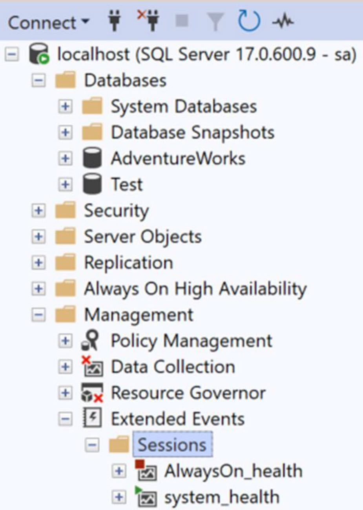  
*Hình 3-2. Cửa sổ Object Explorer hiển thị vị trí của các phiên Extended Events (The Object Explorer showing where Extended Events Sessions are located)*

Để mở cửa sổ tạo Session, trong Object Explorer bạn duyệt đến nhánh:  
`Management` -> `Extended Events` -> Nhấp chuột phải vào `Sessions` -> Chọn **New Session...**

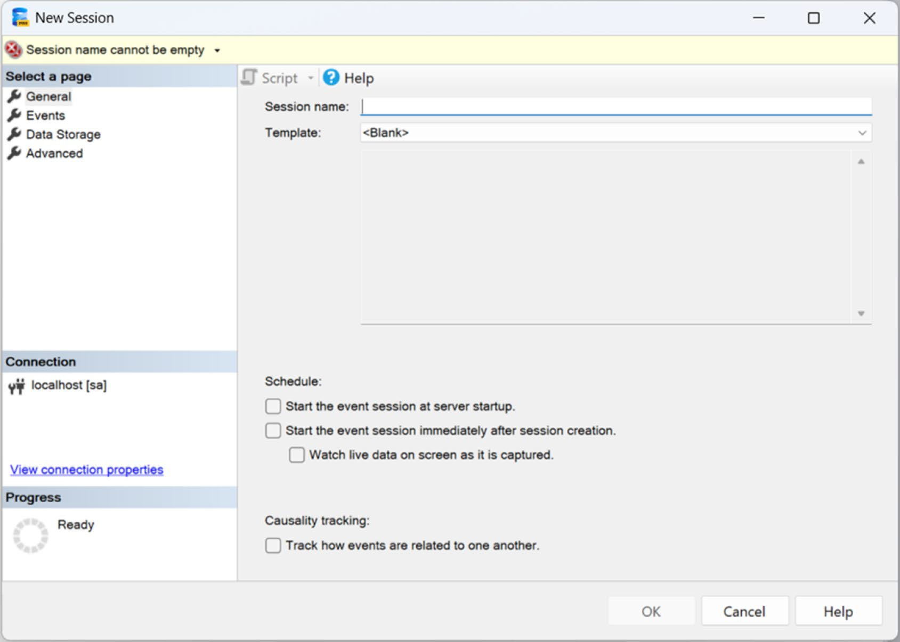  
*Hình 3-3. Cửa sổ New Session (The New Session window)*

Điều bắt buộc duy nhất bạn phải điền ở trang đầu tiên (**General**) là **"Session name"** (Tên phiên). Tất cả các thiết lập còn lại đều là tùy chọn. Tên Session có thể chứa khoảng trắng, độ dài tối đa 128 ký tự, và tên của một Session phải là duy nhất trên phạm vi một server instance. Tôi thường có thói quen đặt tên mang tính mô tả rõ ràng để biết ngay phiên giám sát đó thực hiện nhiệm vụ gì. 

Tuy nhiên, bạn chưa thể nhấn OK để tạo Session ngay lúc này, bởi vì mỗi Session bắt buộc phải chứa ít nhất một **Event** (Sự kiện).

Tại cửa sổ này, bạn có hai lựa chọn:
1. Tự mình cấu hình và bổ sung các Events để tạo ra một Session tùy biến hoàn toàn.
2. Tận dụng các mẫu dựng sẵn (**Templates**). 

Mục **Template** cung cấp một menu thả xuống với danh sách phong phú các mẫu cấu hình sẵn, phần lớn đều được định hướng phục vụ việc thu thập các chỉ số hiệu năng theo nhiều góc độ khác nhau. Bạn cũng có tùy chọn nạp một phiên từ một file mẫu có sẵn. 

Một vài ví dụ về các Templates hữu ích:
* **Count Query Locks:** Mẫu sử dụng Target dạng biểu đồ tần suất (Histogram) kết hợp với mã băm truy vấn (`query_hash`) để đếm số lượng khóa phát sinh trên mỗi truy vấn.
* **TSQL:** Một trong những template tương đương với SQL Profiler tiêu chuẩn. Nó thu thập các sự kiện đăng nhập (logins) cũng như thời điểm hoàn thành khối lệnh (batch completion) và gọi thủ tục từ xa (RPC completion).
* **Query Batch Sampling:** Template đặc thù của Extended Events sử dụng bộ lọc để chỉ lấy mẫu chỉ số truy vấn trên 20% tổng số phiên đang hoạt động trên máy chủ.
* **Query Detail Tracking:** Thu thập chi tiết tất cả các kiểu hoàn thành câu lệnh đơn lẻ, hoàn thành batch và hoàn thành RPC, đồng thời tự động lọc bỏ các truy vấn hệ thống và cơ sở dữ liệu hệ thống.
* **Query Wait Statistic:** Một template chuyên sâu khác chỉ có trên Extended Events, cho phép thu thập sự kiện bắt đầu và kết thúc của mọi truy vấn, các câu lệnh thành phần, cùng tất cả các thời gian chờ nội bộ lẫn bên ngoài trên 20% các phiên làm việc, bao gồm cả tính năng Theo vết Nhân quả (Causality Tracking - sẽ được giải thích chi tiết ở phần sau của chương).

Tóm lại, bạn có một điểm tựa rất vững chắc từ các mẫu có sẵn, hoặc có thể chủ động tùy biến các Session của riêng mình với các Event cụ thể. Từ giao diện này, bạn sẽ nhấp chuột vào mục **Events** ở khung điều hướng bên trái màn hình để bắt đầu thêm và cấu hình các sự kiện giám sát.

---

## Thêm và cấu hình các sự kiện (Adding and Configuring Events)

Bất kỳ Phiên (Session) nào cũng bắt buộc phải có ít nhất một Sự kiện (Event) được thêm vào. Một Session có thể chứa một số lượng lớn các Event. Tuy nhiên, tôi khuyến nghị bạn nên hết sức thận trọng khi thêm các Event vào một Session, bởi vì bạn có thể gây ảnh hưởng tiêu cực nghiêm trọng đến hệ thống nếu làm quá tải nó với quá nhiều sự kiện cần thu thập.

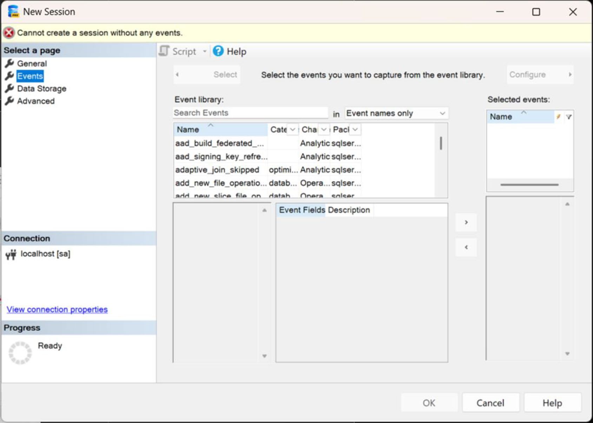

*Hình 3-4: Lựa chọn sự kiện cho phiên Extended Events (Session selection for Extended Events)*

Cửa sổ này có thể được phóng to tối đa (maximize) để cho phép bạn mở rộng độ rộng của các cột, giúp việc đọc thông tin trở nên dễ dàng hơn. Ở đây tôi sẽ giữ nguyên các thiết lập mặc định, vì vậy bạn sẽ nhìn thấy giao diện gần như tương tự những gì tôi thấy khi bạn bắt đầu thao tác.

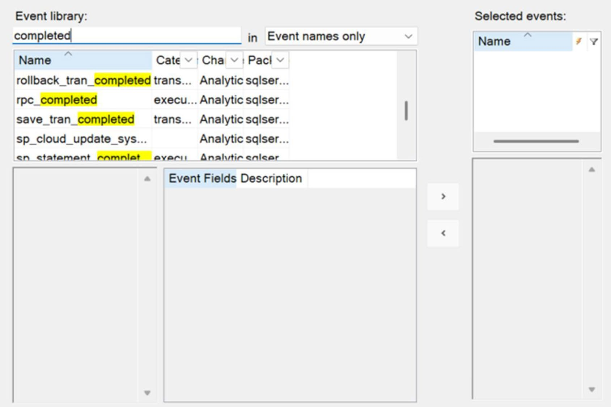

*Hình 3-5: Các sự kiện được lọc theo từ khóa "completed" (Events filtered to only those that have the phrase “completed”)*

Bạn cũng có thể thay đổi cách thức tìm kiếm. Theo mặc định, như được hiển thị trong menu thả xuống ngay cạnh hộp thoại văn bản, bạn sẽ chỉ tìm kiếm trong "Chỉ tên sự kiện" (Event names only). Với danh sách thả xuống này, bạn sẽ thấy thêm các tùy chọn khác:

* **Event names and descriptions:** Tên và phần mô tả sự kiện.
* **Event fields only:** Chỉ tìm trong các trường dữ liệu của sự kiện.
* **All:** Tìm kiếm trên tất cả các tiêu chí.

Bên cạnh ô tìm kiếm văn bản, bạn cũng có thể lọc theo **Category** (Phân loại), **Channel** (Kênh), và **Package** (Gói). Tôi thường giữ nguyên các thiết lập này vì tôi có thể dễ dàng tìm thấy những gì mình cần thông qua ô tìm kiếm. Ngoại lệ duy nhất là thuộc tính **Channel**. Chỉ có bốn kênh:

* **Admin:** Kênh quản trị.
* **Analytic:** Kênh phân tích.
* **Debug:** Kênh gỡ lỗi.
* **Operational:** Kênh vận hành.

Theo mặc định, kênh **Debug** bị vô hiệu hóa. Nguyên nhân là vì các Event trong kênh Debug có thể bị Microsoft thay đổi bất cứ lúc nào mà không cần thông báo trước. Ngoài ra, một số Event trong kênh Debug có tính chất khá nguy hiểm. Tôi đặc biệt khuyến nghị bạn nên thận trọng tối đa khi sử dụng các Event thuộc kênh Debug. Tốt hơn hết, bạn hãy bỏ qua và không đụng tới kênh này.

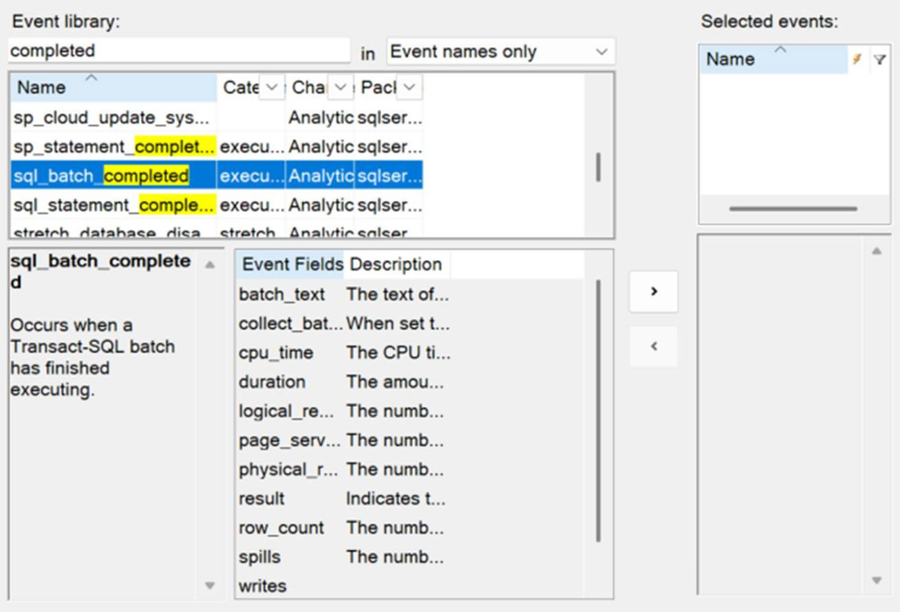

*Hình 3-6: Nhấp chọn ban đầu một sự kiện trong Extended Events (Initially clicking an Event in Extended Events)*

Hai ô bên dưới danh sách Event lúc này đã được điền thông tin chi tiết. Cửa sổ đầu tiên hiển thị phần mô tả của Event hiện đang được chọn. Cửa sổ thứ hai là danh sách các Trường dữ liệu (Fields) gắn liền với sự kiện đó cùng phần mô tả chi tiết của từng trường, bao gồm cả định nghĩa chỉ số đo lường. Ví dụ, phần mô tả của trường `duration` sẽ thông báo cho bạn biết các giá trị được tính bằng đơn vị micro-giây (microseconds). Theo mặc định, các cột này hơi hẹp, nhưng bạn có thể thay đổi kích thước của chúng để dễ đọc hơn.

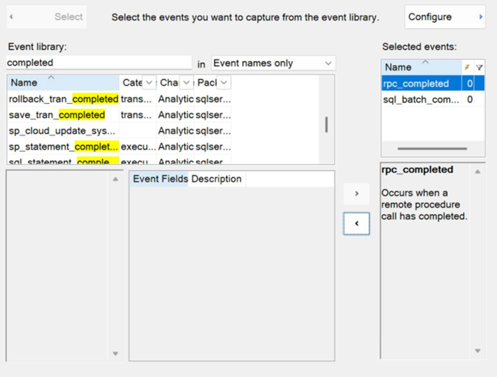

*Hình 3-7: Hai sự kiện được thêm vào danh sách các sự kiện được chọn (Two Events added to the Selected events list)*

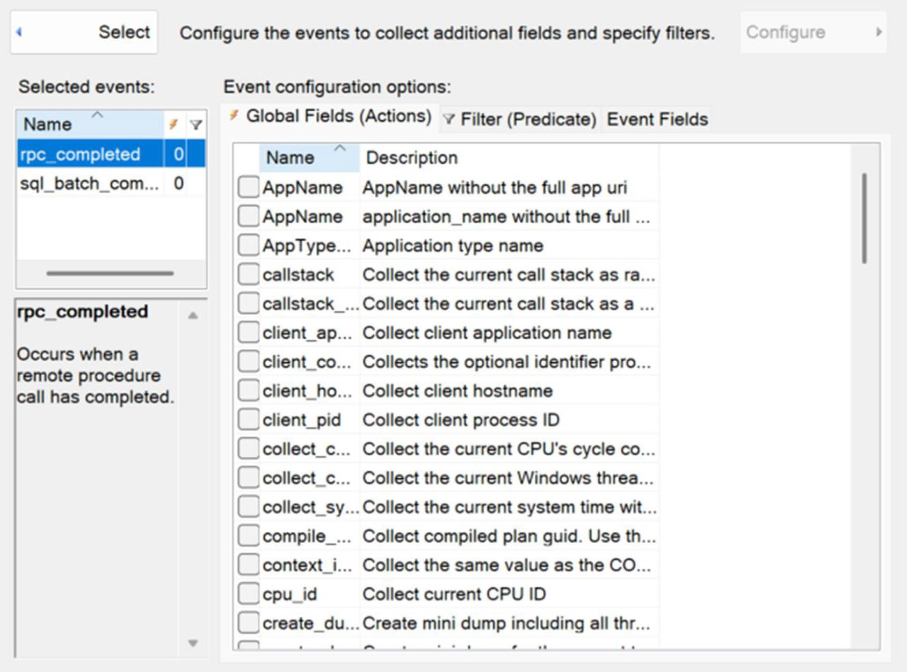

*Hình 3-8: Cửa sổ cấu hình sự kiện (The Event configuration window)*

Chúng ta sẽ lần lượt đi qua từng tab mà bạn nhìn thấy trong hình: **Global Fields** (Trường toàn cục), **Filter** (Bộ lọc vị từ), và **Event Fields** (Trường sự kiện).

### Thêm các trường toàn cục vào sự kiện (Adding Global Fields to Events)

Tab đầu tiên mở ra theo mặc định trong cửa sổ cấu hình sự kiện là **Global Fields**. Các trường này còn được gọi là **Actions**, và đây là tên gọi mang tính chính xác hơn. Đó là các mẩu dữ liệu bổ sung có thể được gắn kèm vào các Event. Như bạn có thể thấy, các cột hiển thị theo mặc định hơi hẹp. Bạn có thể kéo rộng chúng ra để quan sát rõ hơn loại dữ liệu nào đang hiện diện tại đó. Đối với mỗi Action, bạn cũng sẽ nhận được phần mô tả cho biết dữ liệu nào sẽ được tạo ra hoặc thu thập thông qua Action đó (ví dụ như các giá trị hàm băm `query_hash` và `query_plan_hash` đóng vai trò là "dấu vân tay" định danh của truy vấn; chúng ta sẽ bàn kỹ hơn về các giá trị băm này trong các chương sau). 

Để thêm các action vào những sự kiện mà chúng ta đang thu thập, tôi sẽ chọn cả hai sự kiện ở khung bên trái. Sau đó, tôi cuộn danh sách xuống để tìm các Action mong muốn và đánh dấu chọn vào ô kiểm tương ứng. Cửa sổ của tôi lúc này sẽ trông giống như Hình 3-9.

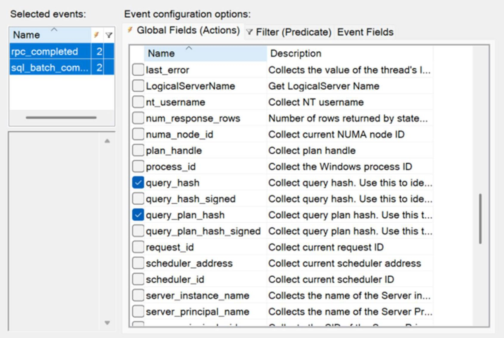

*Hình 3-9: Chọn các trường toàn cục cho nhiều sự kiện (Selecting Global Fields for multiple Events)*

### Sử dụng vị từ lọc với sự kiện (Using Predicates with Events)

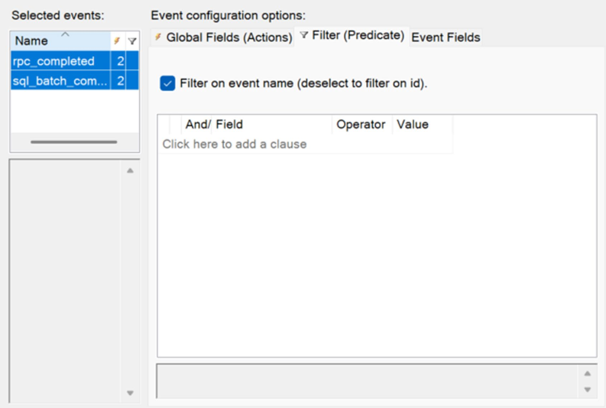

*Hình 3-10: Tab Filter (Predicate) dùng để cấu hình bộ lọc sự kiện (The Filter or Predicate tab for configuring Events)*

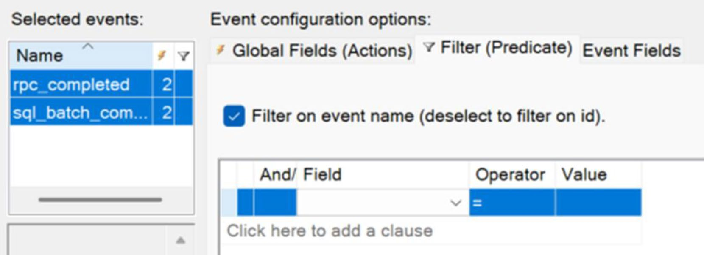

*Hình 3-11: Thêm vị từ lọc (Predicate) cho một tập hợp sự kiện (Adding a Predicate to a set of Events)*

Tiếp theo, bạn nhấp vào hộp danh sách thả xuống có nhãn **"Field"**. Thao tác này sẽ mở ra một danh sách các giá trị được tùy biến dựa trên những Event mà bạn đã chọn ở khung bên trái:
* Nếu bạn chỉ chọn một sự kiện đơn lẻ, bạn sẽ thấy danh sách tất cả các trường dữ liệu sự kiện (Event Fields) xuất hiện trước, theo sau là danh sách tất cả các Actions. Bạn có thể lọc theo bất kỳ trường nào trong số đó.
* Nếu bạn chọn nhiều hơn một sự kiện cùng lúc (như trong ví dụ của tôi), bạn sẽ nhận được danh sách các trường sự kiện chung phổ biến trước, sau đó là các Actions.

Extended Events thực hiện lọc sự kiện dựa trên Vị từ (Predicate) mà bạn cung cấp ngay tại thời điểm Sự kiện được thu thập (capture). Điều này đồng nghĩa với việc bạn nên chắc chắn rằng mình đang áp dụng các tiêu chí lọc nghiêm ngặt và chặt chẽ nhất có thể. Đồng thời, bạn cần đảm bảo rằng bộ lọc có tính chọn lọc cao nhất (nghiêm ngặt nhất) được đánh giá trước tiên, nhằm giúp giảm thiểu tối đa chi phí tài nguyên (overhead) cho quá trình thu thập sự kiện.

Trong ví dụ của mình, tôi sẽ chọn Action đại diện cho tên cơ sở dữ liệu. Trường này được hiển thị dưới dạng `sqlserver.database_name`. Điều này biểu thị rằng bản thân Action này thuộc về hệ thống SQL Server, trái ngược với các action thuộc hệ điều hành SQL Server OS vốn được hiển thị dưới dạng tiền tố `sqlos.*`.

Sau khi chọn trường, tôi tiến hành chọn toán tử so sánh (operator). Giá trị mặc định là phép toán bằng (`=`), đòi hỏi giá trị phải khớp chính xác. Các toán tử so sánh bao gồm (nhưng không giới hạn ở):

* **Equals:** Khớp chính xác hoàn toàn.
* **Less Than:** Xác định các giá trị nhỏ hơn một ngưỡng nhất định.
* **Greater Than:** Tìm các giá trị lớn hơn một ngưỡng nhất định.
* **Like:** Tìm kiếm các mẫu chuỗi ký tự khớp mẫu.

Ngoài ra còn có rất nhiều toán tử logic khác hỗ trợ việc lọc các Event, nhưng những toán tử kể trên là phổ biến và thông dụng nhất.

Cuối cùng, bạn cần cung cấp một giá trị cụ thể để toán tử logic tiến hành so sánh. Giá trị này có thể là các chuỗi ký tự (như trường hợp tên cơ sở dữ liệu) hoặc các giá trị số.

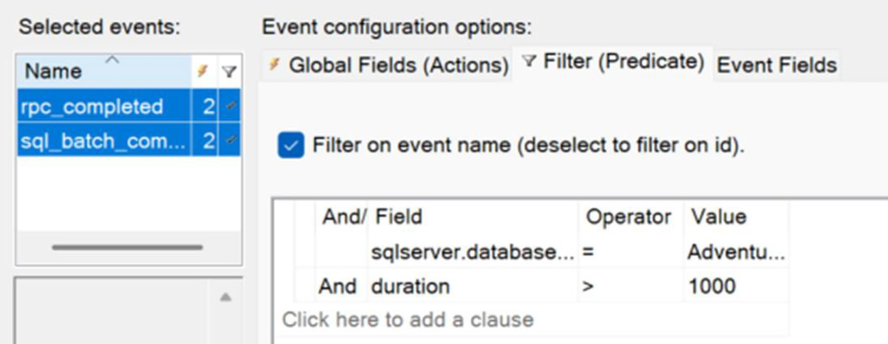

*Hình 3-12: Nhiều tiêu chí lọc cho các sự kiện (Multiple filter criteria for Events)*

Tương tự như với phần Actions, bạn có thể nhận thấy một dấu kiểm màu xanh lá cây đã được thêm vào bên dưới biểu tượng chiếc phễu trong hộp "Selected events" ở phía bên trái màn hình, cho thấy rằng các bộ lọc đã được áp dụng cho những Sự kiện đó. Bạn cũng có thể quan sát thấy tùy chọn toán tử logic giữa **"And"** và **"Or"** khi định nghĩa nhiều hơn một Vị từ (Predicate). Trong trường hợp này, tôi chọn sử dụng toán tử **"And"**.

Ở cuối trang, bạn cũng có thể đọc phần mô tả chi tiết của Trường dữ liệu mà bạn đang lọc, giúp định hướng cho bạn trong suốt quá trình thiết lập.

Như trước đó, việc phóng to cửa sổ này sẽ giúp bạn dễ dàng mở rộng kích thước các cột, làm cho chúng trở nên rõ ràng và dễ đọc hơn. Đây là một thói quen rất tốt cần duy trì khi tạo các phiên Extended Events.

### Các trường sự kiện tùy chọn (Optional Event Fields)

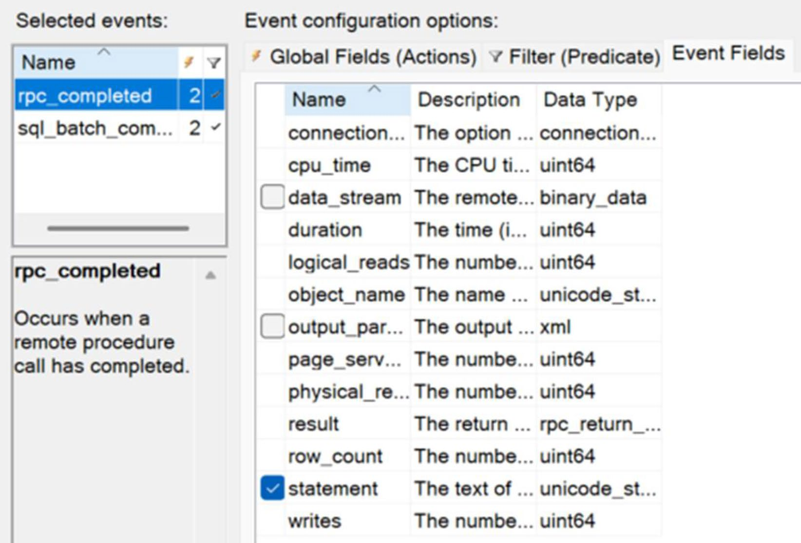

*Hình 3-13: Các trường sự kiện cho sự kiện rpc_completed (Event Fields for the rpc_completed event)*

Các Trường dữ liệu không có ô kiểm bên cạnh là những trường sẽ luôn luôn được trả về bởi một sự kiện nhất định. Những trường có ô kiểm là các **Trường tùy chọn** (*Optional Fields*). 

Theo mặc định, sự kiện `rpc_completed` luôn bao gồm các thông tin như `duration`, `object_name`, và `row_count`. Tuy nhiên, trường `statement` lại là một trường tùy chọn, mặc dù nó được đánh dấu chọn theo mặc định. Bạn có thể bỏ chọn trường này để giảm bớt chi phí tài nguyên khi thu thập sự kiện, nhưng đổi lại bạn sẽ mất đi khả năng nhìn thấy các giá trị tham số của lời gọi thủ tục lưu trữ. Bạn cũng có thể chủ động kích hoạt các trường như `output_parameters` hoặc `data_stream` khi cần thiết, với điều kiện bạn thực sự muốn thu thập các giá trị đó. 

Không phải tất cả các sự kiện đều có các trường tùy chọn, nhưng rất nhiều sự kiện có hỗ trợ, vì vậy đây là khu vực đáng để mắt tới khi bạn thiết lập các sự kiện của riêng mình.

Sau khi đã hoàn tất việc cấu hình toàn bộ các giá trị này, bước tiếp theo cần làm là xác định xem dữ liệu đầu ra từ quá trình thu thập Sự kiện sẽ được chuyển đến đâu.

---

## Thiết lập đích lưu trữ (Defining Targets)

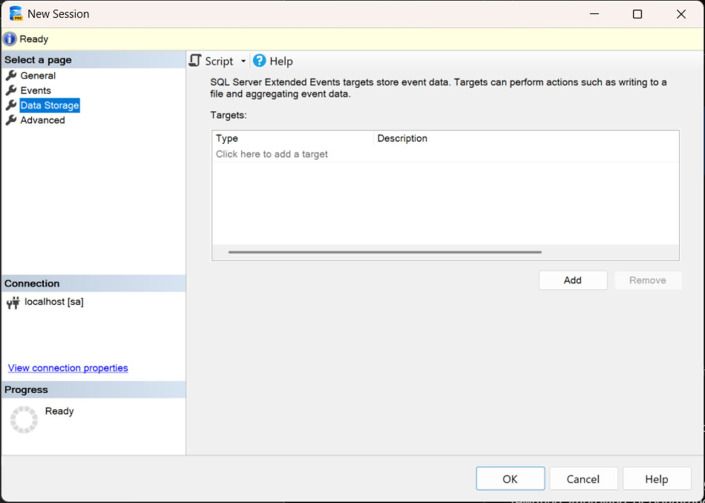

*Hình 3-14: Trang lưu trữ dữ liệu hoặc Đích đến (The Data Storage or Targets page)*

Như giao diện cửa sổ thông báo, bạn hãy nhấp vào dòng chữ *"Click here to add a target"* để bắt đầu thêm một đích lưu trữ. Các tùy chọn Đích đến (Targets) bao gồm:

* **etw_classic_sync_target:** Đầu ra theo dõi sự kiện dành cho Windows (Event Tracing for Windows - ETW). Tùy chọn này rất hiếm khi được sử dụng, nhưng luôn sẵn sàng nếu bạn có nhu cầu.
* **event_counter:** Đếm số lần xuất hiện của Sự kiện. Đây là một cách đơn giản để theo dõi tần suất diễn ra của một Event trên hệ thống đang được giám sát. Về bản chất, nó xuất dữ liệu trực tiếp vào bộ sưu tập sự kiện của hệ điều hành.
* **event_file:** Xuất toàn bộ các Event thu thập được vào một tệp tin trên đĩa. Đây là cơ chế thu thập dữ liệu được sử dụng phổ biến và rộng rãi nhất.
* **histogram:** Đích lưu trữ này cho phép bạn chỉ định một Event và sau đó chọn một Action hoặc một Field để gom nhóm và đếm số lượng. Đích này cực kỳ hữu ích và tiện lợi.
* **pair_matching:** Cho phép bạn định nghĩa một cơ chế để so khớp các cặp sự kiện tương ứng với nhau (chẳng hạn bắt đầu và kết thúc). Tùy chọn này tương đối phức tạp khi sử dụng và không thuận tiện bằng tính năng Theo dõi nhân quả (Causality Tracking).
* **ring_buffer:** Vùng nhớ đệm dạng vòng trong bộ nhớ RAM như đã được giải thích trước đó. Một lần nữa, đích này nên được sử dụng hết sức dè dặt và thận trọng trong môi trường thực tế (production).

Bạn có thể chỉ định một hoặc nhiều đích lưu trữ này cho bất kỳ Session nào. Ở đây, tôi sẽ giải thích chi tiết cách sử dụng hai đích quan trọng nhất: **event_file Target** và **histogram Target**. Các đích khác, dù hữu ích trong những tình huống đặc thù nhất định, nhưng không thực sự áp dụng cho công tác giám sát hành vi và hiệu năng truy vấn tiêu chuẩn.

### Sử dụng đích lưu trữ event_file (Using the event_file Target)

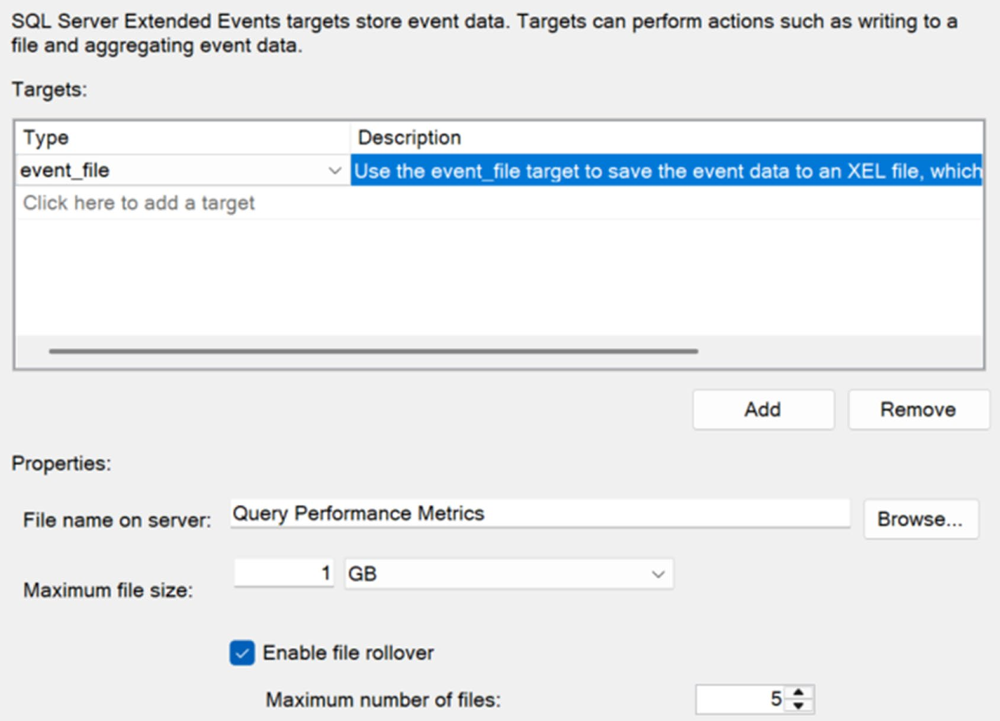

*Hình 3-15: Lựa chọn đích lưu trữ event_file (Selecting the event_file Target)*

Bạn phải cung cấp tên tệp và đường dẫn lưu trữ cho dữ liệu đầu ra của các Sự kiện. Bạn có thể nhập trực tiếp đường dẫn hoặc sử dụng nút **"Browse…"** để chọn thư mục. 
* Nếu bạn đang chạy thao tác này trên Azure SQL Database, đầu ra bắt buộc phải là dịch vụ lưu trữ Azure Blob Storage, và bạn cần đảm bảo rằng các chính sách bảo mật đã được thiết lập để cho phép xuất dữ liệu từ các Azure SQL Database instance của bạn. 
* Trên AWS RDS, bạn chỉ có một vị trí duy nhất dành cho tệp tin: `D:\rdsdbdata\log`.

Sau khi đã xác định xong tên tệp và vị trí lưu trữ, bạn có thể quyết định dung lượng tối đa của tệp, tính theo đơn vị Gigabyte (GB) hoặc Megabyte (MB). Giá trị mặc định là 1GB, nhưng con số này có thể là hơi nhỏ đối với một số hệ thống có lưu lượng lớn. Tuy nhiên, bạn cũng không nên đặt dung lượng tệp quá lớn, kẻo việc quản lý tệp tin sau này sẽ trở thành một vấn đề nan giải. Thông thường, kích thước tệp nằm trong khoảng từ 5GB đến 20GB là phù hợp và hoạt động tốt cho hầu hết các hệ thống. 

Bạn cũng có thể xác định xem có cho phép quay vòng tệp tin (file rollover) hay không. Cơ chế này hoạt động như sau: khi một tệp tin bị đầy, một tệp mới sẽ được tự động tạo ra, và quá trình này tiếp diễn cho đến khi đạt đến "Số lượng tệp tối đa" (Maximum number of files) mà bạn đã quy định. Khi chạm ngưỡng đó, các Event sẽ bắt đầu ghi đè tuần hoàn trở lại tệp đầu tiên.

Nhìn chung, đây là cách tiếp cận tốt nhất để quản lý dữ liệu do Extended Events thu thập. Việc xuất dữ liệu ra một tệp tin tĩnh đặt áp lực tải ít nhất lên hệ thống máy chủ. Việc lưu trữ dưới dạng các tệp tin cũng giúp bạn có thể sao lưu dữ liệu đó khi cần thiết, và bạn luôn có thể mở các tệp này trong cửa sổ Live Data Explorer (sẽ được giải thích chi tiết ở phần sau của chương).

### Sử dụng đích lưu trữ histogram (Using the histogram Target)

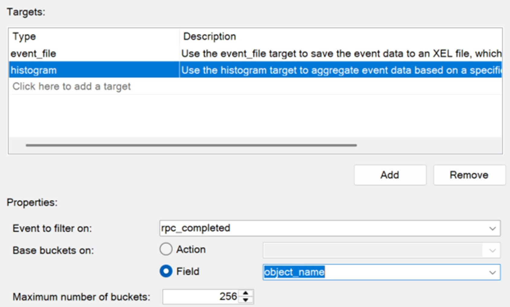

*Hình 3-16: Đếm tất cả các lần xuất hiện của các thủ tục lưu trữ bằng đích histogram (Counting all occurrences of stored procedures using the histogram Target)*

Tôi đã thêm đích này vào dưới dạng một Target thứ hai, chỉ nhằm mục đích minh họa cách thức hoạt động của nó. Trong thực tế, bạn hoàn toàn có thể lựa chọn chỉ sử dụng một đích lưu trữ duy nhất. Tất cả phụ thuộc vào những gì bạn kỳ vọng thu được từ một Session nhất định.

Việc thiết lập đích histogram trước hết bao gồm việc lựa chọn Sự kiện mà bạn muốn sử dụng từ danh sách thả xuống. Danh sách này sẽ chứa tất cả các Event mà bạn đã định nghĩa trên trang Events trước đó. Tiếp theo, bạn có hai nút chọn (radio buttons) để lựa chọn một **Action** hoặc một **Field** từ sự kiện đó làm khóa gom nhóm.

Ở đây, tôi đã chọn trường `object_name` từ sự kiện `rpc_completed`. Điều này có nghĩa là mỗi thủ tục lưu trữ riêng biệt (distinct stored procedure) sẽ nhận được một giá trị đếm số lần mà thủ tục lưu trữ đó được gọi. Cuối cùng, bạn thiết lập số lượng ngăn (number of buckets) định hình cho histogram. Giá trị mặc định là 256, nhưng bạn có thể điều chỉnh tăng hoặc giảm tùy theo nhu cầu. Một số lượng bucket lớn hơn sẽ đặt nhiều áp lực tải hơn lên hệ thống, do đó hãy thận trọng khi xác định giá trị này.

---

## Làm việc với các phiên (Working with Sessions)

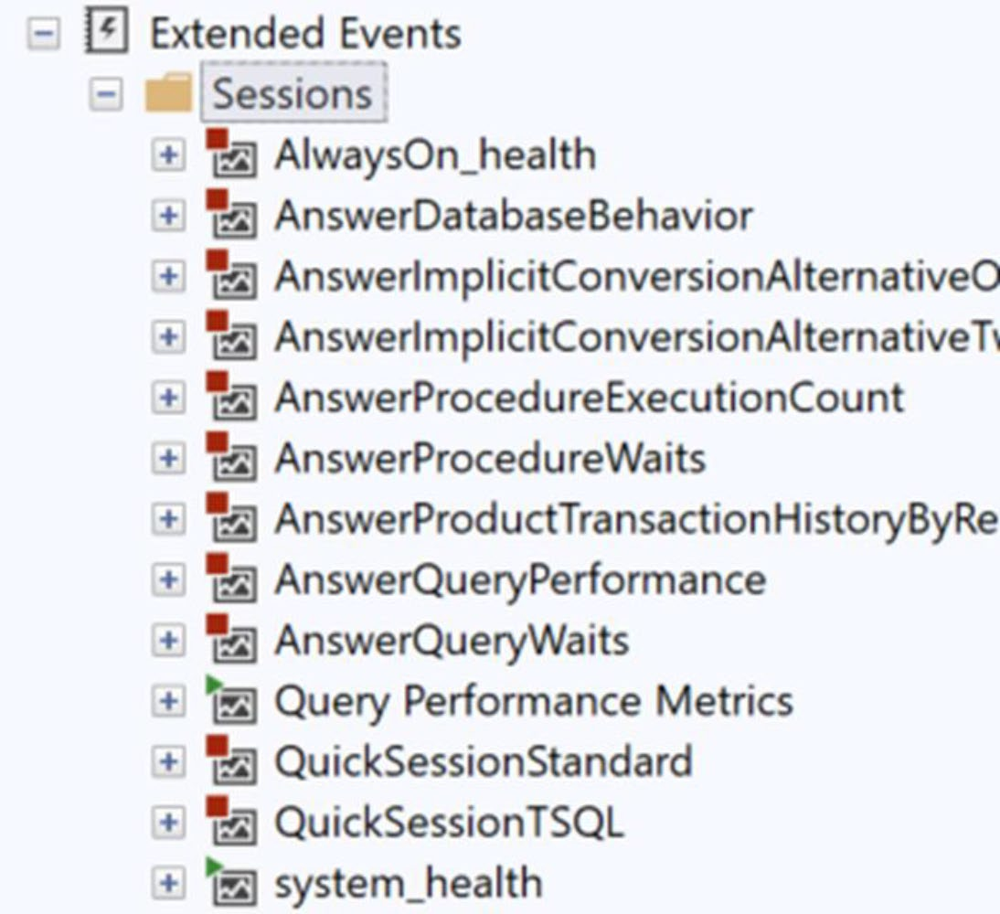

*Hình 3-17: Các phiên Extended Events trong cửa sổ Object Explorer (Extended Events Sessions in the Object Explorer window)*

Bạn có thể nhận biết phiên (Session) nào đang chạy và phiên nào đang dừng bằng cách quan sát mũi tên màu xanh lá cây hoặc hình vuông màu đỏ trên biểu tượng bên cạnh tên của Session. Từ đây, bạn có thể dừng hoặc khởi động một Session, chỉnh sửa một Session đang dừng (ngoại trừ trên AWS RDS — bạn không thể chỉnh sửa Session tại đó), xem các thuộc tính của các Session đang chạy, hoặc xóa bỏ Session. Chỉ cần nhấp chuột phải để mở menu ngữ cảnh lựa chọn.

Bạn cũng có thể điều khiển các phiên thông qua T-SQL, nội dung sẽ được trình bày ở phần sau của chương này.

---

## Thêm cơ chế theo dõi quan hệ nhân quả (Adding Causality Tracking)

Theo dõi quan hệ nhân quả (Causality Tracking) là một tính năng mạnh mẽ bên trong Extended Events. Nó cho phép bạn dễ dàng nhận diện các sự kiện có mối liên hệ mật thiết với nhau. Hơn thế nữa, tính năng này còn hiển thị trình tự thời gian chính xác mà các sự kiện đó phát sinh. Điều này làm cho Causality Tracking trở nên cực kỳ hữu ích trong các tình huống như khắc phục sự cố tái biên dịch (recompiles). Bạn có thể thu thập các chỉ số đo lường truy vấn cũng như các sự kiện tái biên dịch, sau đó liên kết trực tiếp chúng lại với nhau theo chuỗi nguyên nhân - kết quả.

Bạn định nghĩa tính năng Causality Tracking ở cấp độ Phiên (Session). Khi bật Causality Tracking, bạn đang bổ sung thêm một chút chi phí tài nguyên xử lý (overhead) vào quá trình thu thập của Extended Events. Tôi thường xuyên sử dụng tính năng này, nhưng tôi cũng luôn cố gắng thận trọng về mức tải bổ sung đặt lên hệ thống.

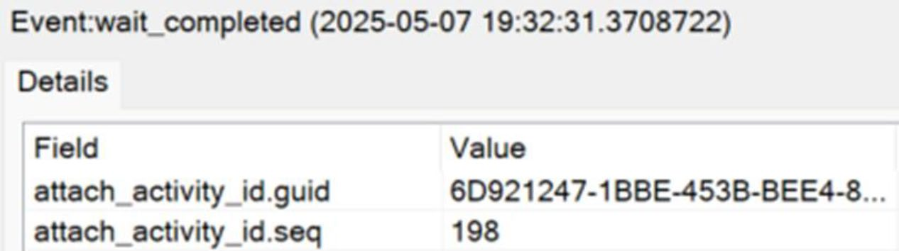

*Hình 3-18: Các trường Causality Tracking được thêm vào kết quả sự kiện (Causality Tracking fields added to event results)*

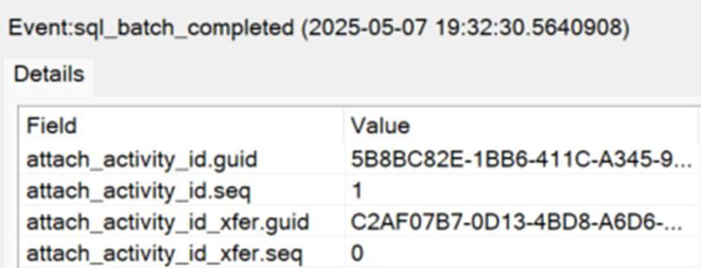

*Hình 3-19: Các GUID cha trong Causality Tracking (Parent GUIDs in Causality Tracking)*

Các cột bổ sung này, `attach_activity_id_xfer.guid` và `attach_activity_id_xfer.seq`, đại diện cho đối tượng cha của tập hợp các sự kiện hiện tại vốn được xác định bởi `attach_activity_id.guid` hiện hành. Trong các trường hợp như xử lý song song (parallelism), một hoặc nhiều tập giá trị Activity ID thứ cấp sẽ được tạo ra để theo dõi các luồng đó một cách độc lập với luồng cha. Một lần nữa, điều này cho phép bạn nhóm và sắp xếp các hoạt động dựa trên luồng cha liên quan của chúng, nâng cao đáng kể sức mạnh cho Extended Events.

---

## Viết kịch bản T-SQL cho Extended Events (Scripting Extended Events)

Trong khi giao diện đồ họa (GUI) cung cấp một phương thức trực quan dễ dàng để thiết lập và thao tác với các phiên Extended Events, bạn cũng sẽ rất thường xuyên sử dụng T-SQL. Chẳng hạn, T-SQL là một phương tiện tuyệt vời để luân chuyển và triển khai các Session giữa nhiều máy chủ khác nhau. Bạn có thể tự viết mã lệnh T-SQL trực tiếp hoặc xuất kịch bản (script out) một Session có sẵn từ SQL Server Management Studio (SSMS). Listing 3-3 minh họa một câu lệnh ví dụ dùng để tạo mới một Session.

**Listing 3-3.** Mã lệnh T-SQL để tạo phiên Extended Events

```sql
CREATE EVENT SESSION [Query Performance Metrics]
ON SERVER
    ADD EVENT sqlserver.rpc_completed
    (WHERE (
               [sqlserver].[database_name] = N'AdventureWorks'
               AND [duration] > (1000)
           )
    ),
    ADD EVENT sqlserver.sql_batch_completed
    (WHERE (
               [sqlserver].[database_name] = N'AdventureWorks'
               AND [duration] > (1000)
           )
    )
    ADD TARGET package0.event_file
    (SET filename = N'Query Performance Metrics');
```

Cú pháp của câu lệnh tương đối trực quan và rõ ràng. Bạn chỉ cần nắm rõ những Sự kiện (Events) nào mình muốn thêm vào kèm theo bất kỳ Trường tùy chọn (Fields) nào của chúng. Các Vị từ lọc (Predicates) của bạn được thể hiện dưới dạng các mệnh đề `WHERE`. Bạn có thể chỉ định và cấu hình các Đích lưu trữ (Targets). Tóm lại, bạn có thể dùng T-SQL để thực hiện mọi thao tác thiết lập một Session.

Bạn cũng có thể khởi động, dừng hoặc hủy bỏ (drop) một phiên bằng T-SQL. Listing 3-4 minh họa các tập lệnh dùng để khởi động và dừng phiên `[Query Performance Metrics]`.

**Listing 3-4.** Dừng và khởi động một Session bằng T-SQL

```sql
ALTER EVENT SESSION [Query Performance Metrics]
ON SERVER
STATE = START;

ALTER EVENT SESSION [Query Performance Metrics]
ON SERVER
STATE = STOP;
```

Cuối cùng, bạn có thể đọc trực tiếp dữ liệu xuất ra của Extended Events thông qua T-SQL bằng cách sử dụng một hàm hệ thống tích hợp sẵn. Listing 3-5 minh họa cách thức thực hiện điều này.

**Listing 3-5.** Truy vấn dữ liệu Extended Events trực tiếp

```sql
SELECT fx.object_name,
       fx.file_name,
       fx.event_data
FROM sys.fn_xe_file_target_read_file('.\Query Performance Metrics_*.xel',
                                     NULL,
                                     NULL,
                                     NULL) AS fx;
```

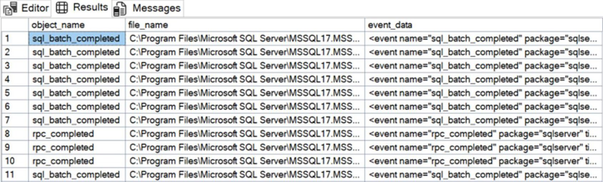

*Hình 3-20: Kết quả từ việc truy vấn dữ liệu Extended Event trực tiếp (Output from querying Extended Event data directly)*

Bạn có thể thấy phiên này đang thu thập cả hai sự kiện `rpc_completed` và `sql_batch_completed` trong cột `object_name`. Bạn cũng có thể thấy vị trí tệp tin Session được lưu trữ trên container Linux đang chạy SQL Server. Cuối cùng, cột `event_data` chứa dữ liệu XML nắm giữ toàn bộ thông tin chi tiết được ghi lại bởi mỗi Sự kiện. Chúng ta sẽ cùng xem các ví dụ về cách tận dụng tốt hơn chức năng này để khắc phục sự cố trong các chương tiếp theo.

Ngoài ra, bộ công cụ PowerShell tuyệt vời mang tên **DBATools** cung cấp một tập hợp các kịch bản và cơ chế mạnh mẽ để xử lý dữ liệu XML trong Extended Events. Nếu bạn chưa từng sử dụng bộ công cụ này, nó rất đáng để bạn dành thời gian khám phá tại địa chỉ: https://dbatools.io/.

---

## Cửa sổ Live Data Explorer (Live Data Explorer Window)

Bởi vì dữ liệu đầu ra của Extended Events có định dạng XML, việc đọc trực tiếp các thông tin này có thể gặp nhiều khó khăn. Mặc dù bạn hoàn toàn có thể viết các câu truy vấn XQuery trong T-SQL để trích xuất dữ liệu, điều đó cũng không hề đơn giản. Thay vào đó, trong hầu hết các trường hợp, tôi sẽ dựa vào cửa sổ **Live Data Explorer** để theo dõi và khai thác dữ liệu xuất ra từ Extended Events một cách trực quan. Trong các trường hợp khác, tôi sẽ sử dụng DBATools để hỗ trợ truy vấn XML.

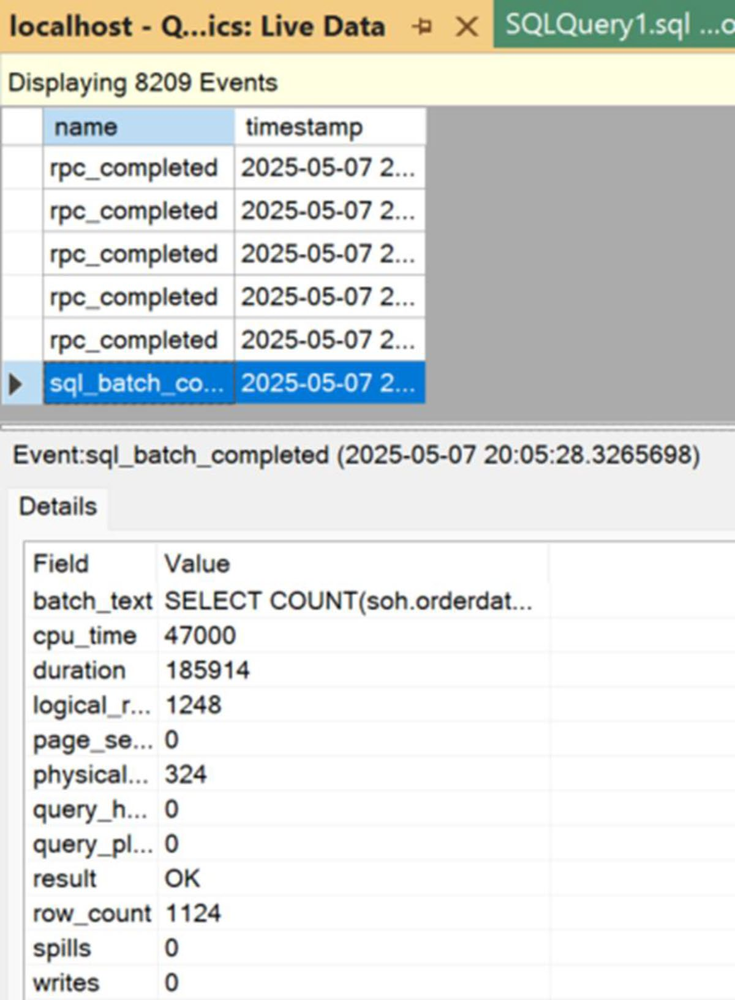

*Hình 3-21: Giao diện ban đầu của cửa sổ Live Data (Live Data window initial view)*

Màn hình được chia làm hai phần rõ rệt:
- Nửa trên là danh sách các Sự kiện (Events) mà bạn đã thu thập được theo thời gian thực.
- Nửa dưới là toàn bộ các Trường dữ liệu (Fields) chi tiết cho sự kiện đang được chọn.

Việc chọn một sự kiện ở danh sách phía trên sẽ làm hiển thị các thông tin chi tiết của nó ở bảng bên dưới. Mặc dù bạn hoàn toàn có thể sử dụng cửa sổ Live Data theo cách mặc định này, nhưng thao tác như vậy sẽ không đạt hiệu quả cao.

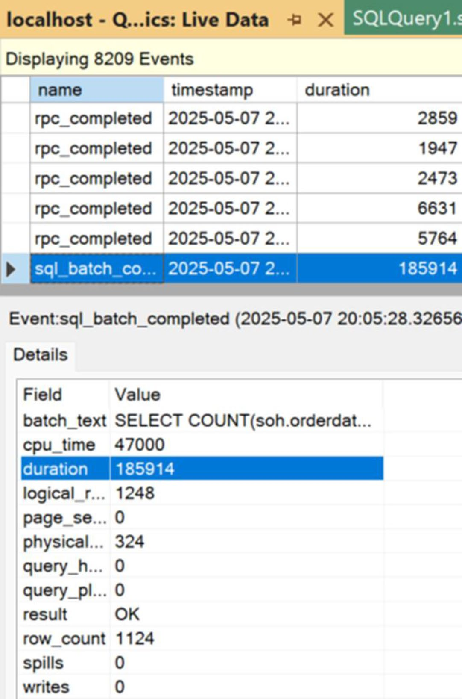

*Hình 3-22: Thêm các trường vào lưới hiển thị để quan sát dễ dàng hơn (Adding fields to the grid to make for easier viewing)*


*Hình 3-23: Thanh công cụ Live Data Explorer (The Live Data Explorer toolbar)*

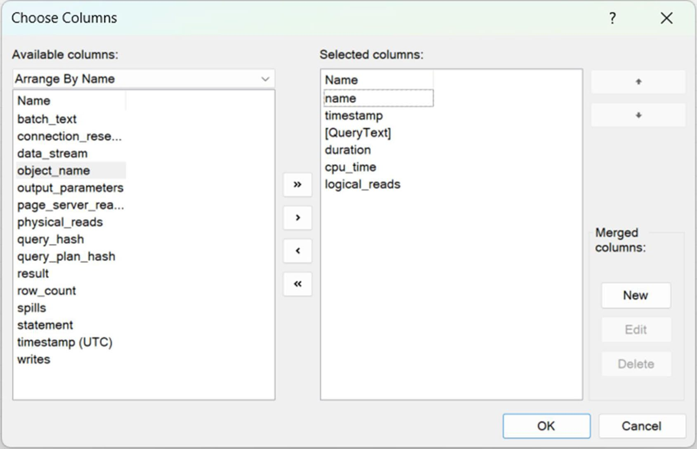

*Hình 3-24: Cửa sổ Choose Columns trong Live Data Explorer (Choose Columns window in the Live Data Explorer)*

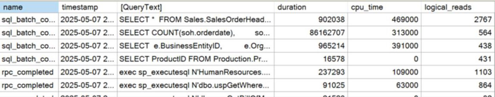

*Hình 3-25: Bảng dữ liệu mới hiển thị với các cột đã được lựa chọn (A new table with the columns selected on display)*

Bây giờ bạn đã có thể quan sát thấy nhiều thông tin trực quan hơn trong bảng dữ liệu, và giao diện này trở nên hữu ích hơn rất nhiều cho việc điều hướng cũng như định vị chính xác dữ liệu mà bạn đang tìm kiếm. Giờ đây, tôi có thể kiểm soát thông tin một cách sâu sát hơn nữa.

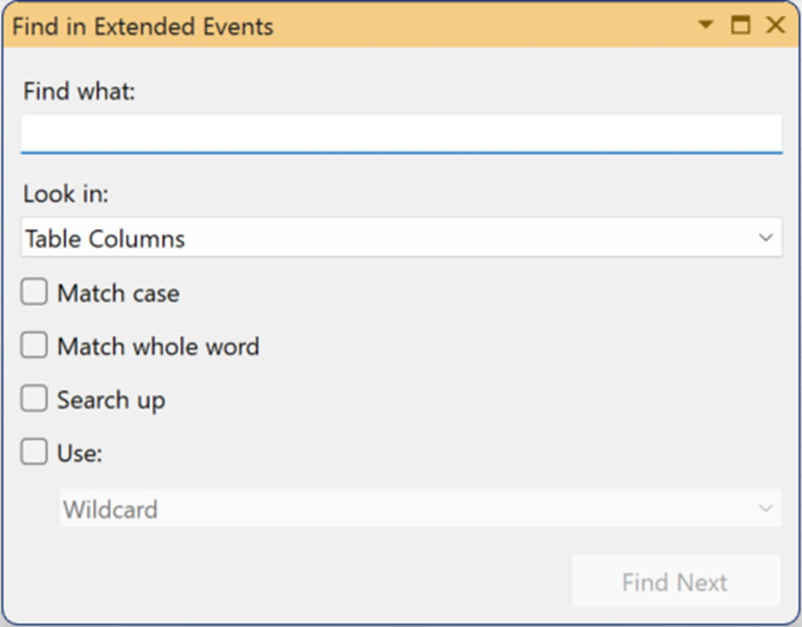

*Hình 3-26: Sử dụng chức năng tìm kiếm bên trong Live Data Explorer (Using the search function within the Live Data Explorer)*

Bạn cũng có thể lưu các thiết lập cấu hình hiển thị này ra một tệp tin và chia sẻ nó cho các thành viên khác trong nhóm của bạn. Bạn cũng sẽ nhận thấy rằng sau khi sắp xếp lại các cột trên một session, ứng dụng Management Studio của bạn sẽ luôn mở phiên làm việc đó theo đúng cấu hình mà bạn đã thiết lập trước đó.

Tiếp theo, có hai chức năng bổ sung vô cùng mạnh mẽ mà chúng ta sẽ đi sâu khám phá chi tiết hơn: lọc dữ liệu và tổng hợp dữ liệu.

### Lọc dữ liệu trực tiếp (Filtering Live Data)

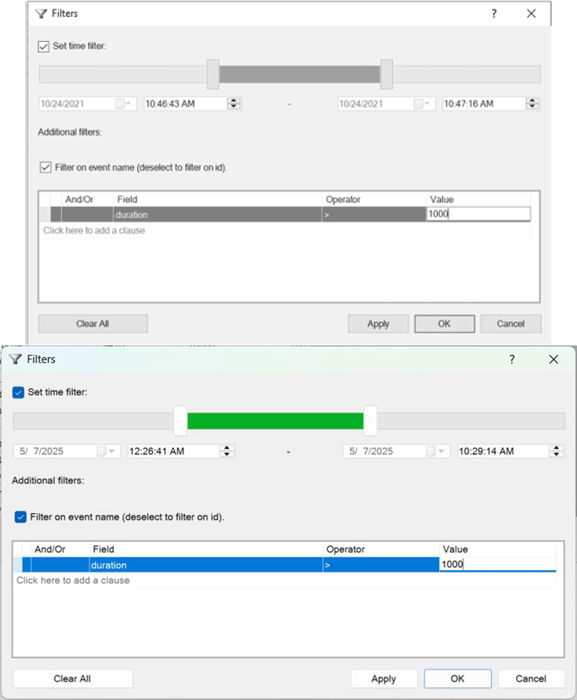

*Hình 3-27: Cửa sổ Live Data Filters với các bộ lọc được thiết lập (Live Data Filters window set with various filters)*

Một khi bộ lọc được áp dụng, dữ liệu hiển thị trong Live Data Explorer sẽ được giới hạn nghiêm ngặt chỉ còn những bản ghi thỏa mãn các tiêu chí đã định nghĩa. Bạn cũng có thể dễ dàng xóa bỏ các bộ lọc này khi cần thiết để quay lại chế độ xem toàn bộ.

### Gom nhóm và tổng hợp dữ liệu trực tiếp (Grouping & Aggregating Live Data)

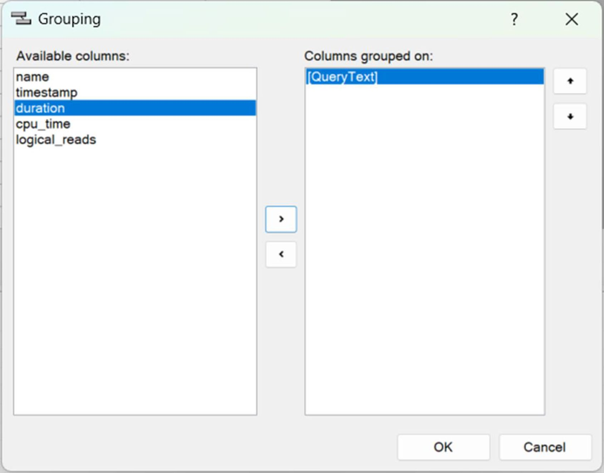

*Hình 3-28: Cửa sổ gom nhóm trong Live Data Explorer (Live Data Explorer Grouping window)*

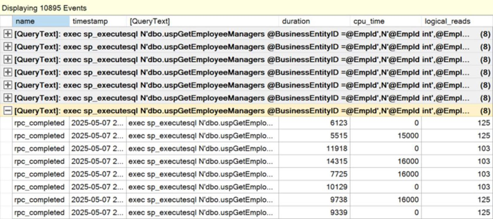

*Hình 3-29: Bảng Live Data Explorer được gom nhóm theo một cột (Table of the Live Data Explorer grouped by a column)*

Bạn có thể thấy rằng vì chúng ta đang theo dõi câu lệnh cho các thủ tục lưu trữ, mỗi giá trị tham số khác nhau sẽ tạo thành một chuỗi văn bản truy vấn khác nhau. Tuy nhiên, đối với một batch cụ thể ở đây, chúng ta có 8 phiên bản thực thi riêng biệt. Tôi đã mở rộng nhóm đó để bạn có thể thấy các cột dữ liệu bạn đã chọn vẫn hiển thị đầy đủ và duy trì định dạng chuẩn xác.

Nếu muốn gom nhóm theo tên của các thủ tục lưu trữ, tôi sẽ phải thêm trường `object_name` vào bảng hiển thị, sau đó tiến hành gom nhóm theo cột đó thay vì nhóm theo cột `[QueryText]` như đã làm ở đây. Bạn lưu ý rằng bạn chỉ có thể gom nhóm dựa trên những cột đang hiển thị công khai trên bảng.

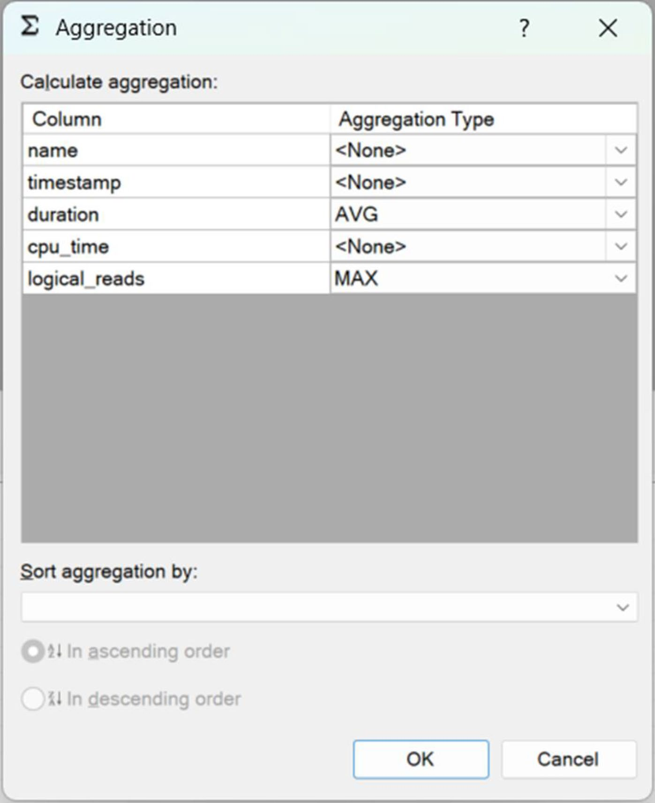

*Hình 3-30: Thiết lập hàm tổng hợp cho Live Data Explorer (Defining aggregation for the Live Data Explorer)*

Bạn có một loạt hàm tổng hợp (aggregations) phong phú để lựa chọn:
- **Minimum**: Giá trị nhỏ nhất
- **Maximum**: Giá trị lớn nhất
- **Average**: Giá trị trung bình
- **Summation**: Tổng tích lũy
- **Count**: Số lượng đếm

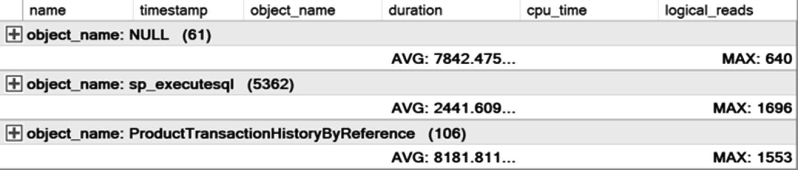

*Hình 3-31: Bảng Live Data Explorer hiển thị các giá trị đã được tổng hợp (Live Data Explorer table showing aggregated values)*

Dựa trên bảng tổng hợp này, tôi có thể khẳng định chắc chắn rằng: qua 106 lần thực thi của thủ tục lưu trữ `ProductTransactionHistoryByReference`, thời gian thực thi trung bình của nó là 8.181,811 micro giây (microsecond). Tôi cũng có thể nhận thấy số lượt đọc logic tối đa (`logical_reads`) của thủ tục này là 1.553 trang dữ liệu.

Bạn có thể thấy công cụ Live Data Explorer mang lại nhiều tiện ích to lớn như thế nào. Đây là một phương thức cực kỳ tiện lợi để nhanh chóng đo lường và nắm bắt hiệu năng truy vấn. Tất nhiên, bạn hoàn toàn có thể kết hợp linh hoạt các tính năng này: lọc ra đúng dữ liệu cần quan sát, sau đó áp dụng các hàm tổng hợp tính toán, hoặc tìm kiếm xuyên suốt dữ liệu — tùy thuộc vào bất kỳ nhu cầu thực tế nào của bạn.

---

## Các khuyến nghị chung khi sử dụng Extended Events (General Recommendations for Using Extended Events)

Mặc dù Extended Events là một công cụ tuyệt vời với mức độ tác động rất thấp lên hệ thống SQL Server của bạn, nhưng không có bất kỳ thứ gì là hoàn toàn "miễn phí". Dưới đây là một số khuyến nghị quan trọng mà tôi đúc kết để giúp bạn ứng dụng Extended Events thành công và an toàn nhất:

- Thiết lập kích thước tệp tin tối đa (max file size) một cách phù hợp.
- Tránh xa các sự kiện gỡ lỗi (debug events).
- Tránh sử dụng tùy chọn `No_Event_Loss`.

Tôi sẽ phân tích chi tiết từng khuyến nghị này trong các phần dưới đây.

> [!NOTE]
> Một lưu ý nhỏ bên lề: Để có thể sử dụng cơ chế thống kê nhẹ (lightweight statistics — sẽ được phân tích chi tiết trong Chương 4), nếu bạn đang vận hành SQL Server 2014, bạn sẽ cần tạo một phiên Extended Events với sự kiện `query_thread_profile`.

### Thiết lập kích thước tệp tối đa phù hợp (Set Max File Size Appropriately)

Giá trị mặc định cho kích thước tệp tin là 1GB. Con số này trên thực tế là khá nhỏ nếu bạn cân nhắc đến khối lượng thông tin khổng lồ có thể được thu thập bởi Extended Events. Bạn nên thiết lập con số này cao hơn đáng kể, trong khoảng từ 5GB đến 20GB, nhằm đảm bảo hệ thống có đủ không gian lưu trữ dữ liệu và không phải rơi vào tình trạng chờ đợi hệ thống tệp con (file subsystem) tạo mới tệp tin trong khi các vùng đệm bộ nhớ đã bị lấp đầy. Tình trạng này có thể dẫn đến việc mất mát sự kiện (event loss). 

Tuy nhiên, điều này còn phụ thuộc vào hệ thống cụ thể của bạn. Nếu bạn đã nắm vững mức độ dữ liệu dự kiến thu thập, hãy cài đặt kích thước tệp sao cho phù hợp nhất với môi trường vận hành riêng của mình.

### Tránh xa các sự kiện gỡ lỗi (Avoid Debug Events)

Extended Events không chỉ cung cấp cho bạn một cơ chế để quan sát hành vi nội bộ của SQL Server ở cấp độ vượt xa những gì SQL Trace trước đây có thể làm được, mà bản thân Microsoft cũng sử dụng chính tính năng này như một phần công cụ để gỡ lỗi và khắc phục sự cố nội bộ cho SQL Server. Vì vậy, có một số lượng sự kiện nhất định được thiết kế dành riêng cho mục đích gỡ lỗi nhân SQL Server. 

Các sự kiện này mặc định không xuất hiện trong trình hướng dẫn cấu hình (wizard), nhưng bạn hoàn toàn có thể tiếp cận chúng thông qua các câu lệnh T-SQL, hoặc kích hoạt hiển thị thông qua tùy chọn kênh (channel selection) trong cửa sổ cấu hình Session.

Nếu không có sự hướng dẫn trực tiếp từ các kỹ sư Microsoft, **tuyệt đối không sử dụng các sự kiện gỡ lỗi này**. Chúng có thể thay đổi bất cứ lúc nào mà không báo trước và chỉ được phục vụ cho nội bộ Microsoft. Nếu bạn thực sự muốn thử nghiệm, bạn phải đặc biệt chú ý đến bất kỳ sự kiện nào có gắn hành vi ngắt (**break action**). 

Hành vi này đồng nghĩa với việc: một khi sự kiện đó được kích hoạt, nó sẽ ra lệnh **dừng khẩn cấp toàn bộ tiến trình SQL Server** ngay tại chính dòng mã lệnh nội bộ đã kích hoạt sự kiện! Điều này có nghĩa là máy chủ cơ sở dữ liệu của bạn sẽ bị sập hoàn toàn (offline) và rơi vào trạng thái không xác định. Việc kích hoạt tính năng này trên môi trường sản xuất (production) có thể gây ra sự cố ngừng trệ thảm khốc toàn diện, dẫn đến nguy cơ mất mát dữ liệu và làm hư hại (corruption) cơ sở dữ liệu của bạn.

### Tránh sử dụng tùy chọn No_Event_Loss (Avoid the Use of No_Event_Loss)

Mô hình kiến trúc của Extended Events được thiết kế có chủ đích chấp nhận việc một số sự kiện có thể bị mất mát (dropped) trong điều kiện tải cao. Đây là thiết kế có chủ đích nhằm bảo vệ hiệu năng chung của hệ thống. 

Tuy nhiên, bạn hoàn toàn có thể cấu hình tùy chọn `No_Event_Loss` khi thiết lập phiên làm việc. Nếu bạn áp dụng tùy chọn này trên các hệ thống đang chịu tải nặng, bạn có thể chứng kiến một lượng tải trọng bổ sung rất lớn bị đè nặng lên hệ thống, bởi vì bạn đang ra lệnh cho SQL Server phải giữ lại mọi thông tin trong vùng đệm bằng mọi giá, bất chấp mọi hệ lụy về mặt hiệu năng. 

Đối với các phiên theo dõi có quy mô nhỏ, phạm vi hẹp và nhắm mục tiêu vào một hành vi cụ thể trong thời gian ngắn, cách tiếp cận này có thể chấp nhận được; nhưng trên diện rộng, bạn nên tránh lạm dụng nó.

---

## Tóm tắt chương (Summary)

Trong chương này, bạn đã được giới thiệu hai trong số ba phương pháp tốt nhất để thu thập các chỉ số đo lường hiệu năng truy vấn:
1. Bạn có thể sử dụng dữ liệu tổng hợp từ bộ nhớ đệm thông qua các khung nhìn quản lý động (**DMV**).
2. Bạn có thể lưu trữ và theo dõi dữ liệu gắn liền với chính cơ sở dữ liệu của mình trong **Query Store** (sẽ được tìm hiểu chi tiết trong Chương 6).
3. Bạn có thể đào sâu vào các hành vi nội tại ở mức độ cực kỳ chi tiết thông qua việc sử dụng **Extended Events**.

Bạn sẽ cần phối hợp linh hoạt các phương pháp này trong quá trình theo dõi, giám sát và phân tích các chỉ số hiệu năng truy vấn của riêng mình.

Trong chương tiếp theo, chúng ta sẽ bắt đầu tìm hiểu về cách sử dụng các kế hoạch thực thi (execution plans) như một chiếc la bàn dẫn đường để thấu hiểu sâu sắc cách thức các câu truy vấn thực sự vận hành bên trong SQL Server.
