# CHƯƠNG 4: Phân tích hành vi truy vấn bằng Kế hoạch thực thi (Analyzing Query Behavior Using Execution Plans)

> **Thông tin sách gốc:**  
> © Grant Fritchey 2026  
> G. Fritchey, *SQL Server 2025 Query Performance Tuning*, https://doi.org/10.1007/979-8-8688-1865-3_4  

---

Kế hoạch thực thi (Execution Plan) là cửa sổ trực quan tốt nhất giúp chúng ta thấu hiểu các quyết định lựa chọn mà Bộ tối ưu hóa truy vấn (Query Optimizer) đã đưa ra trong nỗ lực làm cho câu truy vấn của bạn chạy nhanh nhất có thể. Kế hoạch thực thi mô tả chính xác mọi hành vi của truy vấn: từ các kiểu phép nối (join operations) được áp dụng, cho đến các chỉ mục (indexes) nào được sử dụng và phương thức chúng được khai thác ra sao. Tuy nhiên, cần phải khẳng định rõ ràng ngay từ đầu: **Kế hoạch thực thi tuyệt đối không phải là một thước đo hiệu năng (measure of performance).**

Chương này sẽ phác thảo bản chất của kế hoạch thực thi, diện mạo trực quan của chúng và cách bạn có thể đọc hiểu chúng một cách chuẩn xác. Chúng ta sẽ cùng tìm hiểu các chủ đề sau:
* Cách thu thập kế hoạch thực thi (How to capture execution plans)
* Sự khác biệt thực sự giữa kế hoạch ước tính (estimated) và kế hoạch thực tế (actual)
* Những điểm trọng yếu cần quan sát trong một kế hoạch thực thi
* Ý nghĩa của một số toán tử cốt lõi (operators)
* Các công cụ hỗ trợ phân tích kế hoạch thực thi

Kế hoạch thực thi là một chủ đề vô cùng rộng lớn. Tôi sẽ trình bày một số điểm đặc thù xung quanh cách sử dụng chúng trong chương này, sau đó chúng ta sẽ tiếp tục vận dụng chúng xuyên suốt toàn bộ cuốn sách khi học cách tinh chỉnh truy vấn thông qua việc thấu hiểu các hành vi được phơi bày trên kế hoạch thực thi.

Bản thân các kế hoạch thực thi có cấu trúc đồng nhất trên tất cả các nền tảng dữ liệu của SQL Server. Một kế hoạch thu thập được trong Azure SQL Database, SQL Server 2025, AWS RDS, hay Azure SQL Managed Instance về cơ bản đều giống hệt nhau. Mặc dù một số hành vi mới hơn có thể hiển thị dưới dạng các toán tử mới, nhưng nhìn chung, kế hoạch thực thi là một công cụ phổ quát (ubiquitous tool) để giải mã hành vi truy vấn.

---

## Kế hoạch ước tính so với Kế hoạch thực tế (Estimated vs. Actual Execution Plans)

Chúng ta hãy bắt đầu ngay với một chủ đề thường gây nhiều tranh cãi và làm sáng tỏ nó dứt điểm. Một trong những phương thức thu thập kế hoạch thực thi phổ biến nhất là thông qua SQL Server Management Studio (SSMS). SSMS hiển thị cho chúng ta hai loại kế hoạch khác nhau: **Estimated (ước tính)** và **Actual (thực tế)**. 

Tuy nhiên, vấn đề nằm ở chỗ: những tên gọi này chưa thực sự phản ánh đúng bản chất kỹ thuật. **Thực tế chỉ có duy nhất một loại kế hoạch thực thi.** Điểm khác biệt duy nhất là: khi bạn cho phép SQL Server thực thi câu lệnh, nó có thể thu thập thêm các **chỉ số thời gian chạy (runtime metrics)** cụ thể và nhúng trực tiếp vào bên trong kế hoạch thực thi của truy vấn đó. Và một kế hoạch thực thi được bổ sung thêm các chỉ số runtime này chính là thứ mà cộng đồng kỹ thuật gọi là "kế hoạch thực thi thực tế" (*Actual Execution Plan*).

Điều này nghe có vẻ đi ngược lại với hàng thập kỷ tài liệu kỹ thuật trước đây, bao gồm cả những gì chính tôi từng viết. Thế nhưng, đây hoàn toàn là sự thật. Như chúng ta sẽ thấy ở phần tiếp theo và xuyên suốt cuốn sách, chúng ta có thể trích xuất kế hoạch thực thi từ rất nhiều nguồn khác nhau: từ các Dynamic Management Views (DMVs), Extended Events, cho đến Query Store. Tất cả các kế hoạch đó – đối với cùng một truy vấn xác định và trong điều kiện không xảy ra tái biên dịch (recompile) – đều giống hệt nhau. Và nếu chúng ta thực thi truy vấn đó rồi thu thập thêm các chỉ số runtime, thì khung cấu trúc kế hoạch thu được vẫn hoàn toàn giống hệt; nó chỉ đơn giản là chứa thêm các thông tin đo lường bổ sung.

Các thông tin bổ sung này – tức các chỉ số runtime – là nguồn dữ liệu cực kỳ giá trị mà chúng ta sẽ khai thác triệt để, bao gồm (nhưng không giới hạn ở):
* Số liệu thống kê thời gian chờ (Wait statistics) của truy vấn
* Thời gian thực thi thực tế (Duration)
* Số lượng dòng thực tế được xử lý (Actual row counts)
* Số lần thực thi thực tế của từng toán tử (Actual number of executions)

Tuy nhiên, hãy nhớ rằng đây chỉ là dữ liệu gia tăng. Bản thân cấu trúc kế hoạch luôn luôn như nhau (ngoại trừ trường hợp recompile, sẽ được bàn sâu trong Chương 8). Trong hầu hết các trường hợp, nếu điều kiện cho phép, hãy cố gắng thu thập kế hoạch thực thi kèm theo các chỉ số runtime vì lượng thông tin bổ sung này thường rất hữu ích. 

Thế nhưng, trong môi trường production thực tế, bạn không phải lúc nào cũng được phép chạy thử nghiệm các truy vấn nặng. Khi đó, đừng ngần ngại sử dụng kế hoạch thực thi không kèm chỉ số runtime – bởi đó có thể là công cụ duy nhất bạn có trong tay. Hơn nữa, khi bạn trích xuất kế hoạch từ Query Store hoặc truy vấn bộ nhớ đệm (plan cache), những kế hoạch đó vốn dĩ không đính kèm chỉ số runtime tức thời. Dẫu vậy, đó chính là kế hoạch đang được hệ thống sử dụng để thực thi truy vấn, và nó là một nguồn thông tin vô giá phục vụ cho quá trình tinh chỉnh.

---

## Các phương pháp thu thập Kế hoạch thực thi (Capturing Execution Plans)

Có rất nhiều phương pháp để thu thập kế hoạch thực thi:
1. Sử dụng trực tiếp SSMS để lấy kế hoạch ước tính (không chạy truy vấn) hoặc kế hoạch thực tế kèm chỉ số runtime (sau khi chạy truy vấn).
2. Trích xuất trực tiếp từ vùng đệm kế hoạch (plan cache) trong bộ nhớ RAM thông qua các DMV.
3. Trích xuất từ Kho lưu trữ truy vấn (Query Store) nếu tính năng này được kích hoạt trên cơ sở dữ liệu.
4. Sử dụng Extended Events để tự động bắt các kế hoạch thực thi theo nhiều điều kiện khác nhau.

Trước khi đi vào chi tiết, có một nguyên tắc then chốt bạn cần ghi nhớ: **Hành động thu thập chỉ số runtime cùng với kế hoạch thực thi là một thao tác rất tốn kém tài nguyên hệ thống (overhead cao).** Lý do là vì bạn vừa phải cho chạy truy vấn, vừa buộc database engine phải theo dõi và đo đạc các chỉ số ở mức độ cực kỳ chi tiết. Quá trình này sẽ trực tiếp làm chậm thời gian thực thi của câu lệnh và tiêu tốn nhiều tài nguyên hơn bình thường. 

Do đó, bạn nên hình thành một thói quen chuyên nghiệp: **Hoặc là thu thập kế hoạch thực thi, hoặc là đo lường chỉ số runtime. Không nên làm cả hai cùng một lúc khi đang cần đo lường thời gian chạy chính xác.**

Đằng sau giao diện đồ họa trực quan (Graphical Execution Plan), định dạng gốc thực sự của kế hoạch là **XML**. Đó là cách nó được lưu trữ trong bộ nhớ đệm, trong Query Store và trong hầu hết các công cụ trích xuất. (Trước đây còn có định dạng text plan, nhưng chúng chứa rất ít thông tin nên chúng ta sẽ không bàn tới).

---

### Thu thập bằng SQL Server Management Studio (SSMS)

Trong SSMS, bạn có thể xem kế hoạch thực thi mà không cần chạy lệnh, hoặc chọn chạy lệnh để nhận cả kế hoạch lẫn chỉ số runtime. Hãy lấy một truy vấn mẫu đơn giản từ Listing 4-1 để minh họa xuyên suốt chương:

```sql
-- Listing 4-1. Simple query to illustrate execution plans
SELECT soh.SalesOrderNumber,
       p.Name,
       sod.OrderQty
FROM Sales.SalesOrderHeader AS soh
    JOIN Sales.SalesOrderDetail AS sod
        ON sod.SalesOrderID = soh.SalesOrderID
    JOIN Production.Product AS p
        ON p.ProductID = sod.ProductID
WHERE soh.CustomerID = 30052;
```

Để xem kế hoạch thực thi, chúng ta nhấp vào nút tương ứng trên thanh công cụ SQL Editor. Tuy nhiên, trước khi nhấp nút, bạn cần **bôi đen (highlight)** đoạn mã truy vấn trong Listing 4-1. Trong một khối lệnh (batch), mỗi câu lệnh đơn lẻ đều sẽ sinh ra một kế hoạch thực thi riêng; vì vậy, nếu chỉ muốn xem kế hoạch của một câu lệnh cụ thể, hãy bôi đen đoạn mã đó, nếu không bạn sẽ nhận về kế hoạch của toàn bộ các lệnh có trong cửa sổ soạn thảo.

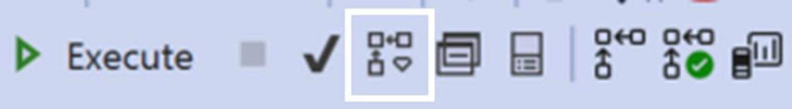  
*Hình 4-1. Thanh công cụ SQL Editor với nút Display Estimated Execution Plan (Ctrl+L) được đánh dấu*

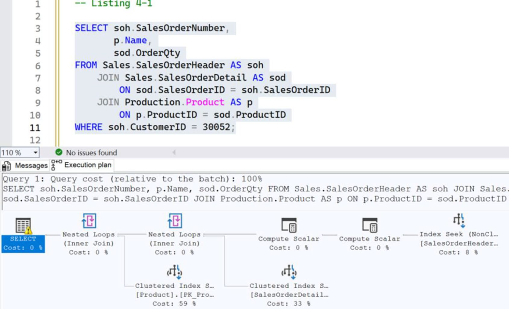  
*Hình 4-2. Truy vấn được bôi đen và kế hoạch thực thi ước tính tương ứng*

Chúng ta sẽ tìm hiểu chi tiết về các đối tượng (gọi là **toán tử - operators**) trong kế hoạch ở phần sau. Hiện tại, bạn đã thu thập thành công kế hoạch thực thi đầu tiên của mình.

Nếu muốn nhận kế hoạch thực thi kèm theo các chỉ số runtime, bạn hãy kích hoạt nút **Include Actual Execution Plan** (Ctrl+M) trên thanh công cụ rồi thực thi truy vấn (F5):

  
*Hình 4-3. Thanh công cụ SQL Editor với nút Include Actual Execution Plan được kích hoạt*

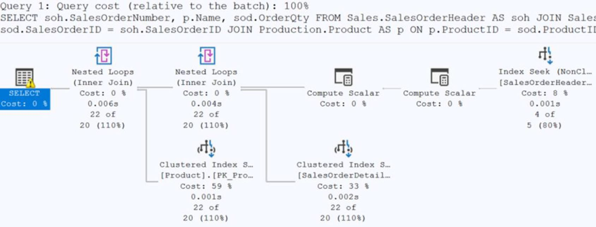  
*Hình 4-4. Một kế hoạch thực thi kèm theo các chỉ số thời gian chạy (runtime metrics)*

Bạn có thể thấy rằng dù cấu trúc hình dáng cơ bản của kế hoạch và số lượng đối tượng bên trong là hoàn toàn như nhau, nhưng có thêm các thông tin đo lường bổ sung xuất hiện trên từng toán tử – đó chính là các chỉ số runtime.

---

### Thu thập qua Dynamic Management Views (DMVs)

Chúng ta đã làm quen với việc trích xuất kế hoạch qua DMV ở Chương 3, nhưng hãy mở rộng thêm một chút. Trước tiên, hãy thêm mệnh đề `WHERE` vào câu truy vấn từ Chương 3 để định vị chính xác câu lệnh mẫu mà chúng ta vừa chạy:

```sql
-- Listing 4-2. Filtering for a particular query
SELECT dest.text,
       deqp.query_plan,
       deqs.execution_count,
       deqs.total_elapsed_time,
       deqs.last_elapsed_time
FROM sys.dm_exec_query_stats AS deqs
    CROSS APPLY sys.dm_exec_query_plan(deqs.plan_handle) AS deqp
    CROSS APPLY sys.dm_exec_sql_text(deqs.sql_handle) AS dest
WHERE dest.text LIKE 'SELECT soh.SalesOrderNumber,
       p.Name,%';
```

  
*Hình 4-5. Kết quả truy vấn bộ nhớ đệm kế hoạch (plan cache) bằng DMV*

Lưu ý rằng cột `query_plan` hiển thị dữ liệu XML có gạch chân dạng liên kết siêu văn bản. Nếu bạn nhấp chuột vào liên kết này, SSMS sẽ tự động nhận diện đây là một kế hoạch thực thi và mở nó trong một tab đồ họa riêng biệt. Hầu hết các kế hoạch trong bộ nhớ đệm đều có thể truy cập theo cách này. Tuy nhiên, khi mở ra, bạn sẽ chỉ thấy kế hoạch thực thi thuần túy chứ không có chỉ số runtime, vì các chỉ số runtime chi tiết của từng toán tử không được lưu trữ trong plan cache thông thường.

#### Xử lý giới hạn độ sâu XML với `sys.dm_exec_text_query_plan`
Không phải mọi kế hoạch đều hiển thị được qua `sys.dm_exec_query_plan`. Do kiểu dữ liệu XML trong SQL Server có giới hạn về độ sâu lồng nhau (nesting limit: tối đa 128 cấp), một số kế hoạch thực thi của các truy vấn cực lớn và phức tạp có thể vượt quá giới hạn này và gây lỗi khi parse XML. 

Để khắc phục, SQL Server cung cấp một DMV khác mang tên `sys.dm_exec_text_query_plan`. Bạn truyền tham số `plan_handle` tương tự như trên, nhưng kết quả trả về là chuỗi văn bản thuần túy (NVARCHAR(MAX)) thay vì XML. Để xem dưới dạng đồ họa, bạn chỉ cần sao chép đoạn text đó, lưu thành tệp có phần mở rộng `.sqlplan` và mở tệp đó trong SSMS.

#### Thu thập kế hoạch thực tế cuối cùng với `sys.dm_exec_query_plan_stats`
Bắt đầu từ SQL Server 2019, một DMV đột phá đã được bổ sung là `sys.dm_exec_query_plan_stats`, cho phép bạn lấy được **kế hoạch thực thi thực tế gần nhất (last actual plan)** của một truy vấn đang nằm trong cache (kèm theo cả chỉ số runtime!). 

Để sử dụng DMV này, bạn phải kích hoạt cơ chế thu thập thống kê nhẹ (Lightweight Profiling) bằng cách bật cờ Trace Flag 2451 ở cấp server hoặc cấu hình phạm vi database như trong Listing 4-3:

```sql
-- Listing 4-3. Enabling last query plan stats
ALTER DATABASE SCOPED CONFIGURATION SET LAST_QUERY_PLAN_STATS = ON;
```

Sau khi kích hoạt, DMV này sẽ lưu giữ kế hoạch thực thi gần nhất kèm theo các chỉ số runtime. Chúng ta có thể viết lại truy vấn từ Listing 4-2 để khai thác DMV này như trong Listing 4-4:

```sql
-- Listing 4-4. Querying the sys.dm_exec_query_plan_stats DMV
SELECT dest.text,
       deqps.query_plan,
       deqs.execution_count,
       deqs.total_elapsed_time,
       deqs.last_elapsed_time
FROM sys.dm_exec_query_stats AS deqs
    CROSS APPLY sys.dm_exec_query_plan_stats(deqs.plan_handle) AS deqps
    CROSS APPLY sys.dm_exec_sql_text(deqs.sql_handle) AS dest
WHERE dest.text LIKE 'SELECT soh.SalesOrderNumber,
       p.Name,%';
```

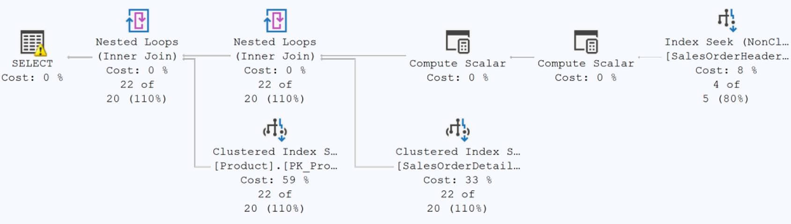  
*Hình 4-6. Kế hoạch thực thi kèm theo các chỉ số runtime lấy từ DMV sys.dm_exec_query_plan_stats*

Bạn có thể thấy rõ số lượng dòng thực tế (actual row counts) và các chỉ số runtime tiêu chuẩn nằm ngay trong kế hoạch. 

Tuy nhiên, không phải lúc nào bạn cũng đảm bảo lấy được kế hoạch từ DMV này:
* Kế hoạch phải đang tồn tại trong `sys.dm_exec_cached_plans`. Nếu nó đã bị xóa khỏi cache (aged out), bạn sẽ không thể lấy được.
* Với các truy vấn quá đơn giản, bạn có thể chỉ nhận được nút gốc (root operator - như SELECT) thay vì toàn bộ cây kế hoạch hoàn chỉnh.
* Nếu câu lệnh không thể lưu vào cache, nó cũng sẽ không xuất hiện qua DMV này.

---

### Thu thập từ Kho lưu trữ truy vấn (Query Store)

Chúng ta sẽ tìm hiểu chuyên sâu về Query Store trong Chương 6. Tuy nhiên, chúng ta có thể xem nhanh cách trích xuất một kế hoạch thực thi từ Query Store. Query Store được kích hoạt mặc định trong SQL Server 2025. Các bảng hệ thống (system views) lưu trữ thông tin của Query Store cho phép chúng ta truy vấn kế hoạch như trong Listing 4-5:

```sql
-- Listing 4-5. Retrieving a plan from the Query Store
SELECT qsq.query_id,
       qsq.query_hash,
       CAST(qsp.query_plan AS XML) AS QueryPlan
FROM sys.query_store_query AS qsq
    JOIN sys.query_store_plan AS qsp
        ON qsp.query_id = qsq.query_id
    JOIN sys.query_store_query_text AS qsqt
        ON qsqt.query_text_id = qsq.query_text_id
WHERE qsqt.query_sql_text LIKE 'SELECT soh.SalesOrderNumber,
         p.Name,%';
```

  
*Hình 4-7. Trích xuất kế hoạch thực thi từ Query Store*

---

### Thu thập từ Extended Events

Một phương pháp linh hoạt khác để bắt kế hoạch thực thi là sử dụng Extended Events. Có nhiều sự kiện chuyên biệt mà bạn có thể cấu hình:

* `query_post_compilation_showplan`: Kích hoạt ngay sau khi một truy vấn hoàn thành quá trình biên dịch (compilation).
* `query_pre_execution_showplan`: Kích hoạt sau khi truy vấn hoàn tất quá trình tối ưu hóa (optimization).
* `query_post_execution_plan_profile`: Khả dụng từ SQL Server 2017 trở lên, sử dụng cơ chế Lightweight Profiling để thu thập kế hoạch thực thi kèm các chỉ số runtime với chi phí hệ thống thấp nhất.
* `query_post_execution_showplan`: Kích hoạt sau khi truy vấn thực thi xong, thu thập đầy đủ cả kế hoạch thực thi lẫn các chỉ số runtime chi tiết (chi phí tài nguyên cao hơn).

> [!WARNING]
> Việc thu thập kế hoạch thực thi bằng Extended Events có thể là một thao tác tiêu tốn nhiều tài nguyên máy chủ. Hãy luôn thực hiện cẩn trọng và áp dụng các bộ lọc (predicates) chặt chẽ để chỉ thu thập những sự kiện thực sự cần thiết.

Cách sử dụng phổ biến nhất là bắt kế hoạch sau biên dịch (`query_post_compilation_showplan`), hoặc sử dụng `query_post_execution_plan_profile` để bắt kế hoạch thực tế với chi phí tối thiểu nhờ hạ tầng Lightweight Profiling.

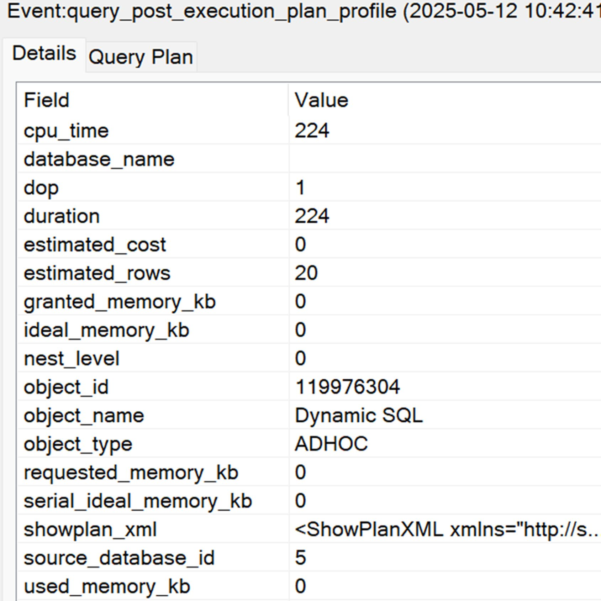  
*Hình 4-8. Các trường dữ liệu của Extended Event sau khi thu thập kế hoạch thực thi*

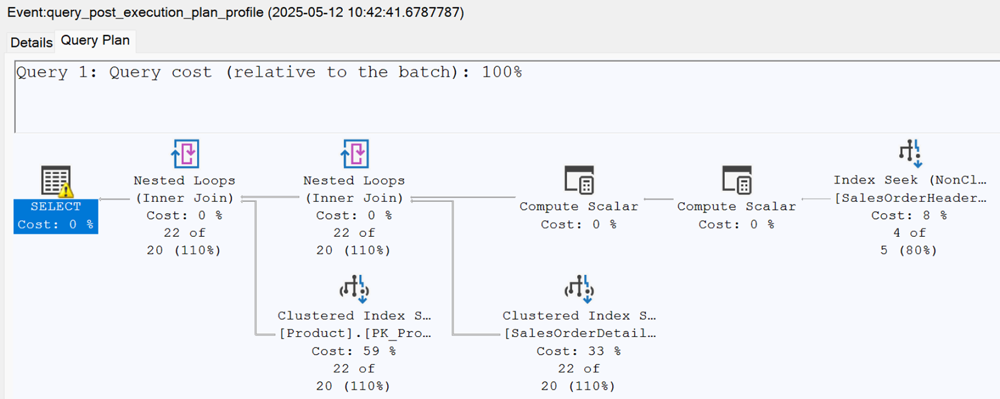  
*Hình 4-9. Kế hoạch thực thi hiển thị trực tiếp bên trong giao diện Extended Events*

Đây là một kế hoạch thực thi đồ họa hoàn chỉnh với đầy đủ các thuộc tính và tính năng tương tác như bất kỳ kế hoạch nào khác trong SSMS.

---

## Cấu trúc bên trong một Kế hoạch thực thi (What Is Inside an Execution Plan)

Để phân tích và đánh giá một kế hoạch thực thi, chúng ta cần hiểu rõ các thành phần cấu tạo nên nó.

### 1. Toán tử (Operators) và Biểu tượng (Icons)

Một kế hoạch thực thi là tập hợp của nhiều toán tử (operators) đại diện cho các hành động cụ thể mà SQL Server engine thực hiện. Mỗi toán tử được biểu diễn bằng một biểu tượng trực quan:

  
*Hình 4-10. Biểu tượng đại diện cho toán tử Nested Loops (vòng lặp lồng nhau)*

Bên cạnh biểu tượng là tên của toán tử cùng với hành vi mà nó đảm nhận:

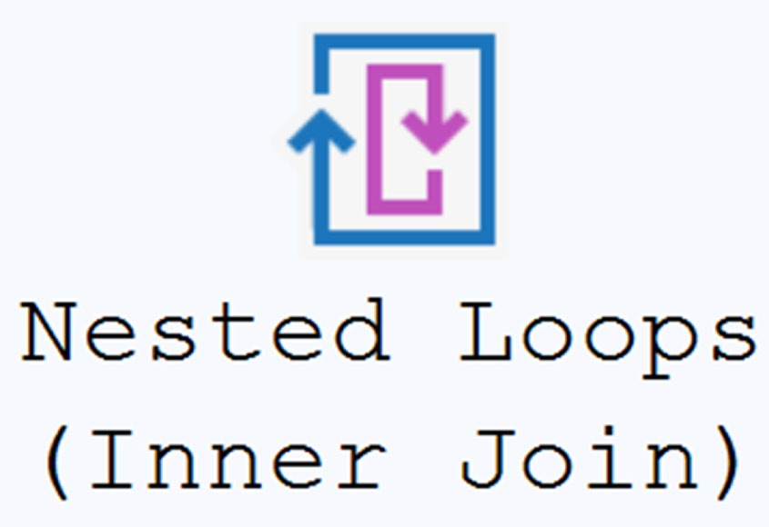  
*Hình 4-11. Biểu tượng kết hợp với tên toán tử và thao tác đại diện*

### 2. Chi phí ước tính (Estimated Cost)

Bên dưới mỗi toán tử, bạn sẽ thấy một tỷ lệ phần trăm chi phí. Con số này đại diện cho tỷ lệ chi phí ước tính của toán tử đó so với tổng chi phí ước tính của toàn bộ kế hoạch:

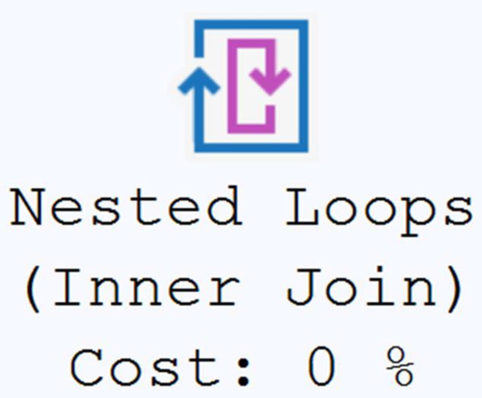  
*Hình 4-12. Chi phí ước tính của toán tử (Estimated Cost)*

### 3. Các chỉ số thời gian chạy (Runtime Metrics)

Khi bạn thu thập kế hoạch thực tế (Actual Execution Plan), các giá trị đo lường thời gian chạy bổ sung sẽ hiển thị ngay bên dưới toán tử, bao gồm số dòng thực tế được xử lý và thời gian CPU thực tế:

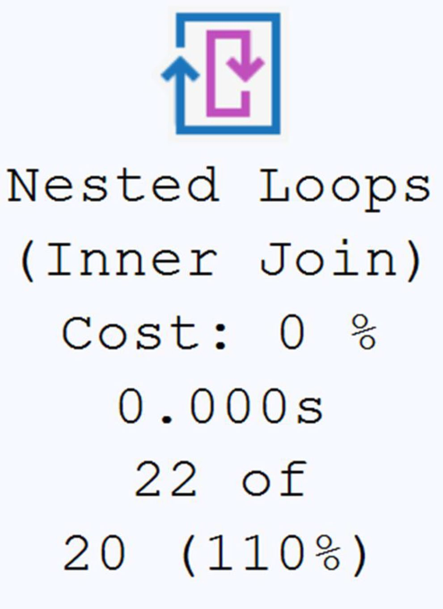  
*Hình 4-13. Các giá trị bổ sung từ các chỉ số đo lường thời gian chạy (runtime metrics)*

### 4. Đường ống truyền dữ liệu (Data Flow Pipes)

Các toán tử trong kế hoạch không đứng tách rời mà được kết nối với nhau thông qua các mũi tên hoặc đường ống (pipes) đại diện cho luồng di chuyển của dữ liệu giữa các bước xử lý:

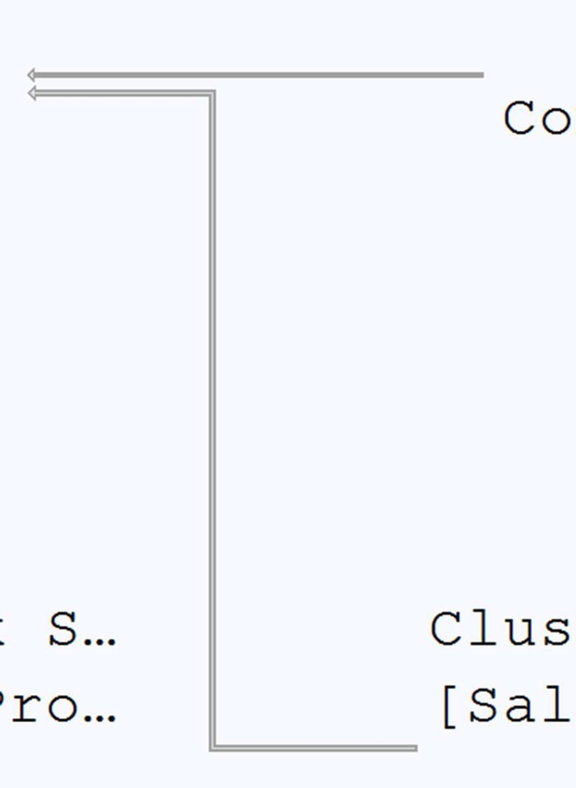  
*Hình 4-14. Các đường ống đại diện cho luồng dữ liệu kết nối các toán tử lại với nhau*

Độ dày của các đường ống này tỷ lệ thuận với số lượng dòng dữ liệu được truyền qua giữa các toán tử: đường ống càng dày biểu thị lượng dữ liệu luân chuyển càng lớn.

---

## Đọc hiểu kế hoạch thực thi (Reading an Execution Plan)

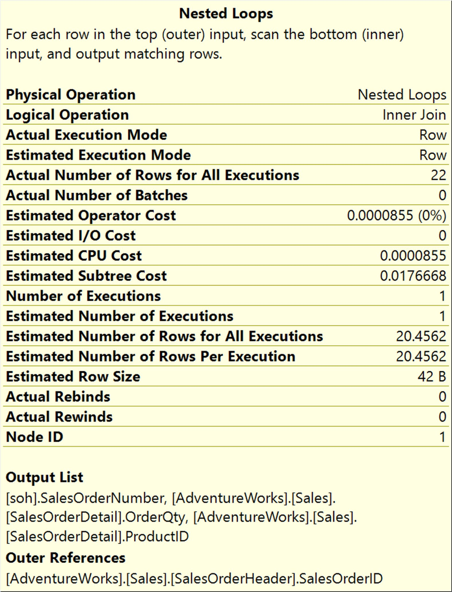

*Hình 4-15: Chú giải công cụ (Tooltip) cho toán tử Nested Loops (The tooltip for the Nested Loops operator)*

Nếu bạn đọc kỹ các thông tin hiển thị trong chú giải công cụ (tooltip), bạn sẽ nhận thấy nhiều dữ liệu rất hữu ích, chẳng hạn như số lượng dòng ước tính (Estimated Number of Rows) cho toán tử này. Tuy nhiên, toàn bộ các thông tin này cùng rất nhiều dữ liệu chi tiết hơn nữa đều sẽ hiển thị đầy đủ trong cửa sổ thuộc tính (Properties) của toán tử. Do cửa sổ Properties cung cấp khối lượng thông tin vượt trội hơn rất nhiều, cá nhân tôi hầu như không bao giờ sử dụng tooltip; thậm chí tôi còn thấy chúng gây phiền toái hơn là giúp ích khi liên tục tự động bật lên và che khuất tầm nhìn. Dù vậy, một phần thông tin thực sự giá trị từ tooltip chính là phần mô tả tóm tắt hành vi của toán tử ngay ở dòng trên cùng.

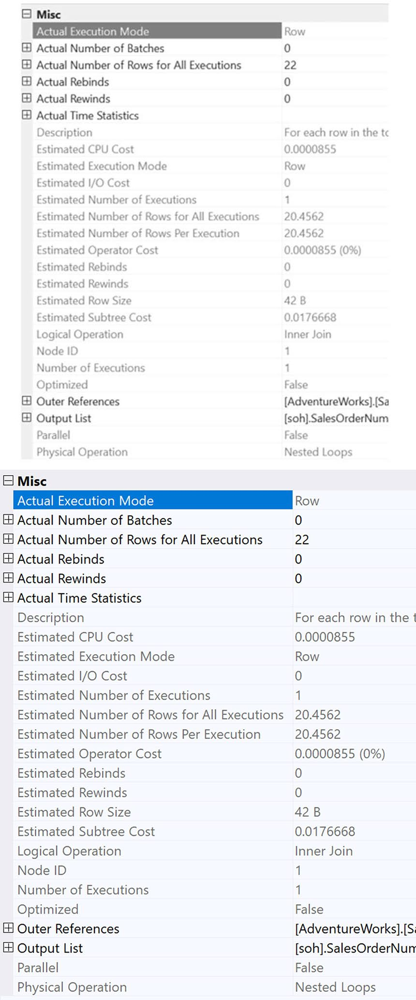

*Hình 4-16: Các thuộc tính của toán tử Nested Loops (Properties of the Nested Loops operator)*

Chúng ta sẽ lần lượt tìm hiểu ý nghĩa chi tiết của từng thuộc tính này xuyên suốt cuốn sách. Một số thuộc tính có thể được mở rộng để hiển thị các giá trị bổ sung bằng cách nhấp vào dấu cộng (`+`). Các giá trị thuộc tính đôi khi rất dài; ở mép phải của ô giá trị có thể xuất hiện dấu ba chấm (`...`). Nhấp vào dấu ba chấm đó sẽ mở ra một cửa sổ riêng hiển thị toàn bộ nội dung giá trị của thuộc tính đang được chọn.

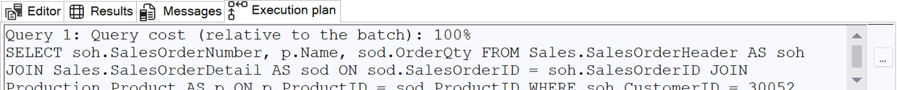

*Hình 4-17: Thông tin tổng quan tại phần đầu của kế hoạch thực thi (The information at the top of the execution plan)*

Trên đây là tất cả các loại đối tượng cấu thành nên một kế hoạch thực thi. Mỗi đối tượng này đều có thể sở hữu một tập hợp các thuộc tính phong phú và đa dạng khác nhau. Tất cả các đối tượng đều đại diện cho các kiểu hành vi xử lý khác nhau bên trong kế hoạch thực thi. Giờ đây, chúng ta cần tìm hiểu cách kết hợp các đối tượng này lại với nhau nhằm thấu hiểu và đọc một kế hoạch thực thi một cách chuẩn xác.

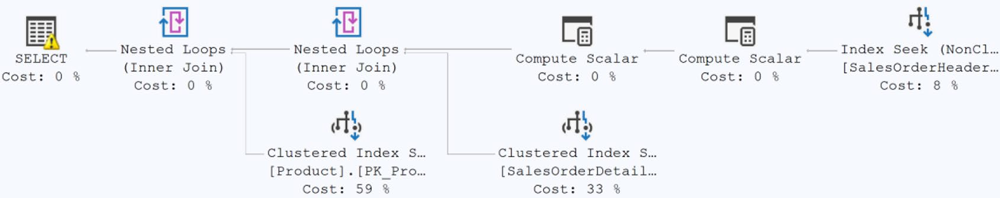

*Hình 4-18: Kế hoạch thực thi thu được từ Listing 4-1 (Execution plan from Listing 4-1)*

Có hai cách tiếp cận khi quan sát bất kỳ kế hoạch thực thi nào:

Về mặt logic, một kế hoạch thực thi được đọc giống như cách đọc một cuốn sách tiếng Anh: **từ trái sang phải**. Điều này đồng nghĩa với việc toán tử đầu tiên trong kế hoạch là toán tử `SELECT` nằm ở góc trên cùng bên trái. Tiếp theo là toán tử `Nested Loops` thứ nhất. Kế tiếp là toán tử `Nested Loops` thứ hai và cứ thế tiếp tục dọc theo sơ đồ. Bạn cũng có thể thấy quy luật này được thể hiện rõ ràng thông qua giá trị định danh nút (**NodeID**) của từng toán tử. 

Toán tử ngoài cùng bên trái — trong trường hợp này là `SELECT` — chứa siêu dữ liệu (metadata) về chính kế hoạch thực thi, do đó nó không được gán mã `NodeID`. Về mặt kỹ thuật thuần túy, những gì tôi gọi xuyên suốt cuốn sách này là "toán tử đầu tiên" (`SELECT`, `INSERT`, `UPDATE`, `DELETE`) thực chất chỉ là khối siêu dữ liệu chứ không phải là một toán tử xử lý dữ liệu thực thụ. Tuy nhiên, thay vì phải đặt ra thêm một thuật ngữ mới làm phức tạp vấn đề, chúng ta hãy cứ gọi nó là một toán tử. Toán tử được đánh số đầu tiên mang giá trị `NodeID` trong kế hoạch này sẽ là toán tử `Nested Loops`. Nó được gán giá trị bằng không (`0`), và sau đó việc đánh số thứ tự sẽ tăng dần từ đó trở đi.

Cách đọc logic này bám sát cách thức mà một kế hoạch thực thi được khởi tạo bên trong công cụ truy vấn (query engine): Mỗi toán tử sẽ yêu cầu dữ liệu từ các toán tử đứng ngay sau nó theo thứ tự, cho đến khi dữ liệu được tìm thấy và trả ngược về xuyên qua các toán tử còn lại.

Tiếp theo, bạn cần diễn giải xem các toán tử đang làm nhiệm vụ gì. Phần mô tả (description) là điểm khởi đầu tuyệt vời. Ví dụ, phần mô tả cho toán tử `Nested Loops` như sau:
> *"Với mỗi dòng từ đầu vào phía trên (bên ngoài), tiến hành quét đầu vào phía dưới (bên trong), và xuất ra các dòng khớp điều kiện."* (*For each row in the top (outer) input, scan the bottom (inner) input, and output matching rows.*)

Một trong những chìa khóa cốt lõi để đọc hiểu kế hoạch thực thi không chỉ là nắm vững chức năng của từng toán tử, mà còn là theo dõi luồng đầu vào (input) và đầu ra (output) của từng toán tử nhằm thấu hiểu chính xác những gì đang diễn ra với dữ liệu xuyên suốt toàn bộ kế hoạch.

Chúng ta sẽ cùng nhau đi qua rất nhiều ví dụ thực tế về việc đọc hiểu kế hoạch thực thi xuyên suốt cuốn sách này.

---

## Tìm kiếm những gì trong một Execution Plan? (What Do You Look for in an Execution Plan?)

Việc cố gắng đọc từng thuộc tính đơn lẻ của mọi toán tử bên trong một kế hoạch thực thi là một công việc cực kỳ cồng kềnh, tốn thời gian và gần như là bất khả thi. Vì vậy, thay vào đó, chúng ta sẽ làm việc dựa trên các **"biển chỉ dẫn"** (*signposts*). Đây là những lối tắt quan sát giúp cho việc đọc hiểu kế hoạch thực thi trở nên nhanh chóng và dễ dàng hơn rất nhiều. 

Lần đầu tiên nhìn vào một kế hoạch thực thi, tôi luôn tìm kiếm những yếu tố sau:

* **Toán tử đầu tiên (First Operator):** Khối siêu dữ liệu tổng quan về kế hoạch nằm ở toán tử ngoài cùng bên trái.
* **Cảnh báo (Warnings):** Các dấu hiệu cảnh báo trực quan cho thấy những vấn đề tiềm ẩn của kế hoạch thực thi.
* **Toán tử có chi phí cao nhất (Most Costly Operations):** Các toán tử có chi phí ước tính cao nhất nhiều khả năng chính là những thao tác tốn kém tài nguyên nhất trong thực tế.
* **Đường ống dữ liệu dày (Fat Pipes):** Các đường ống có kích thước lớn đại diện cho khối lượng luân chuyển dữ liệu khổng lồ.
* **Các toán tử phụ trội (Extra Operators):** Bất cứ khi nào bạn nhìn thấy một toán tử mà bạn chưa hiểu rõ nó là gì hoặc không hiểu tại sao nó lại xuất hiện ở đó, nó cần phải thu hút ngay sự chú ý của bạn.
* **Các thao tác quét (Scans):** Thao tác tìm kiếm (Seek) không hẳn tự nhiên là tốt và thao tác quét (Scan) không mặc nhiên là xấu, nhưng Scan đại diện cho khối lượng thao tác I/O lớn — vốn thường xuyên là nguồn gốc của các vấn đề hiệu năng.
* **Số lượng ước tính so với thực tế (Estimate vs. Actual Counts):** Khi số lượng dòng thực tế sai lệch quá xa so với số lượng dòng ước tính, đó có thể là dấu hiệu rõ ràng của các vấn đề nghiêm trọng bên trong truy vấn.

Chúng ta hãy cùng dành thời gian đi sâu phân tích từng biển chỉ dẫn này để hiểu rõ lý do vì sao chúng lại đóng vai trò là những dấu mốc định hướng quan trọng cho bạn.

### Toán tử đầu tiên (First Operator)

Toán tử đầu tiên — nằm ở ngoài cùng bên trái của kế hoạch thực thi — chứa siêu dữ liệu (metadata) bao quát về chính kế hoạch đó. Không phải tất cả các kế hoạch đều có toán tử này. Các kế hoạch được thu thập thông qua SQL Trace sẽ hoàn toàn không có nó. Các kế hoạch thu thập bằng các phiên bản Extended Events cũ hơn cũng có thể thiếu vắng nó. Tuy nhiên, dù có biểu tượng đồ họa hay không, dữ liệu vẫn luôn nằm ở đó trong mã XML; chỉ là nó không được gói gọn trong một toán tử trực quan mà thôi.

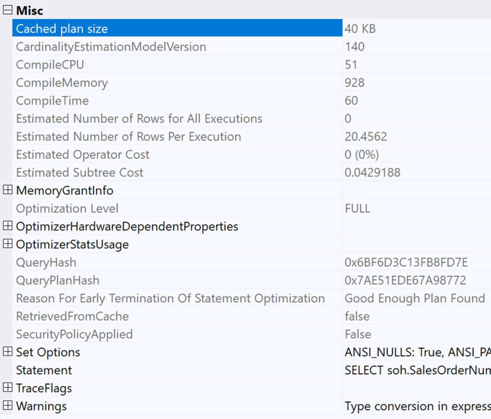

*Hình 4-19: Các thuộc tính của toán tử đầu tiên trong kế hoạch thực thi (Properties of the first operator in an execution plan)*

* **Cached plan size:** Cho biết chính xác dung lượng mà kế hoạch này đang chiếm dụng trong bộ nhớ RAM.
* **QueryHash & QueryPlanHash:** Giá trị `QueryHash` được coi là "dấu vân tay" định danh của một câu truy vấn nhất định và có thể được dùng để tìm kiếm các câu truy vấn tương đồng. Tương tự như vậy đối với `QueryPlanHash`. Đây đơn thuần là các giá trị băm (hash values) được tạo ra từ chính mã lệnh T-SQL (đối với `QueryHash`) và từ cấu trúc kế hoạch thực thi (đối với `QueryPlanHash`). Vì bản chất là cấu trúc băm, chúng vẫn có khả năng bị trùng lặp (hash collision), nghĩa là không đảm bảo duy nhất tuyệt đối 100%. Dù vậy, chúng là cơ chế tuyệt vời để tìm kiếm các truy vấn hoặc kế hoạch tương tự hoặc giống hệt nhau trên hệ thống của bạn.
* **Set Options:** Thể hiện các thiết lập kết nối chuẩn ANSI; những khác biệt trong các thiết lập này có thể dẫn đến các kế hoạch thực thi hoàn toàn khác nhau, do đó chúng được lưu trữ kèm theo kế hoạch.
* **Tham số hóa (Parameterization):** Bạn có thể thấy kiểu tham số hóa của truy vấn, cùng các giá trị tại thời điểm biên dịch (*compile values*), và nếu có dữ liệu runtime, bạn sẽ thấy cả các giá trị thực tế tại thời điểm thực thi (*runtime values*).
* **MemoryGrantInfo:** Cho biết lượng bộ nhớ mà SQL Server ước tính cần phải cấp phát cho kế hoạch thực thi này. Nếu có chỉ số runtime, bạn cũng sẽ nhận được lượng bộ nhớ thực tế đã sử dụng (*actual memory grant*), đây là một điểm đối chuẩn so sánh tuyệt vời.
* **Warnings:** Cuối cùng, ở phần dưới cùng của Hình 4-19, bạn có thể quan sát thấy toàn bộ các cảnh báo gắn liền với kế hoạch thực thi này được tập hợp đầy đủ tại một nơi duy nhất.

Tất cả các thông tin mô tả chi tiết cách thức kế hoạch được biên dịch, các tham số cấu hình và nhiều dữ liệu quan trọng khác chính là lý do vì sao tôi luôn bắt đầu từ toán tử đầu tiên này mỗi khi phân tích một kế hoạch thực thi mới.

### Cảnh báo (Warnings)

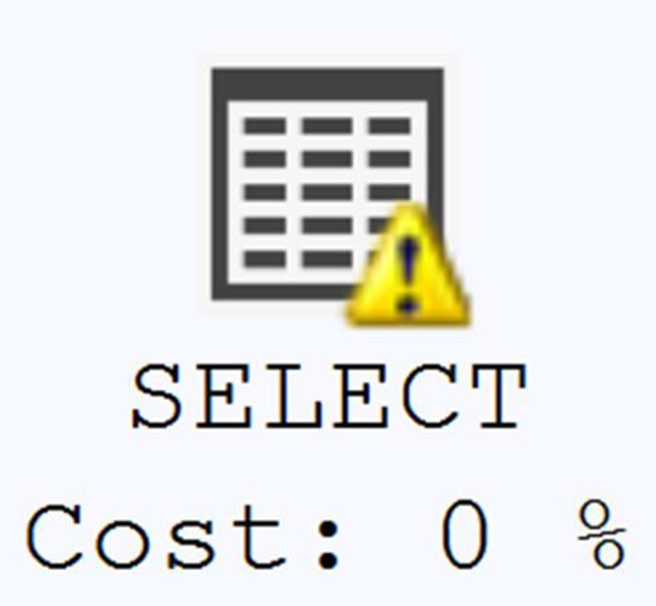

*Hình 4-20: Toán tử SELECT đi kèm biểu tượng cảnh báo (The SELECT operator with a warning indicator)*

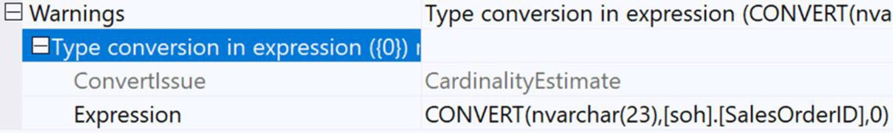

*Hình 4-21: Chi tiết cảnh báo bên trong các thuộc tính của toán tử (Details of a warning within the properties of the operator)*

Cảnh báo trong hình đang thông báo cho chúng ta biết rằng một thao tác chuyển đổi kiểu dữ liệu (data conversion/implicit conversion) đang được thực hiện đối với cột `SalesOrderID`, điều này có thể làm sai lệch các phép ước tính số dòng (**CardinalityEstimate**), từ đó tác động tiêu cực đến hiệu năng thực thi. Trên toán tử bạn sẽ chỉ nhìn thấy một biểu tượng chỉ báo cảnh báo duy nhất (dấu chấm than màu vàng), nhưng toán tử đó có thể chứa nhiều cảnh báo khác nhau. Nếu có nhiều hơn một cảnh báo, bạn sẽ thấy chúng được liệt kê đầy đủ trong cửa sổ thuộc tính.

> [!NOTE]
> Biểu tượng cảnh báo không khẳng định chắc chắn rằng một sự cố thực tế đang xảy ra, mà chỉ đơn thuần cảnh báo rằng một vấn đề tiềm ẩn có thể phát sinh.

Trên thực tế, trong trường hợp cụ thể này, cảnh báo trên là một kết quả dương tính giả (**false positive**), bởi vì cột dữ liệu đang xét không hề tham gia vào bất kỳ thao tác lọc dữ liệu nào, do đó nó không thể gây ảnh hưởng xấu tới các phép ước tính số dòng. Chúng ta sẽ cùng nhau thảo luận sâu hơn về các tình huống này trong các chương sau.

Có một dạng cảnh báo rất đáng chú ý khác mà chúng ta nên khảo sát nhanh thông qua Listing 4-6.

**Listing 4-6. Một truy vấn không có điều kiện kết nối (A query without JOIN criteria)**

```sql
SELECT pv.OnOrderQty,
       a.City
FROM Purchasing.ProductVendor AS pv,
     Person.Address AS a
WHERE a.City = 'Tulsa';
```

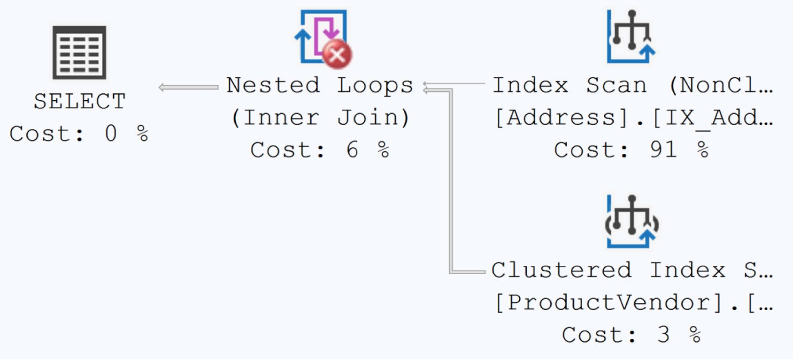

*Hình 4-22: Kế hoạch thực thi hiển thị một dạng cảnh báo khác (An execution plan showing another kind of warning)*

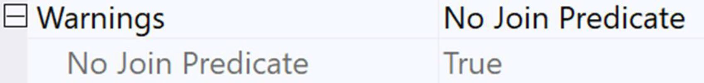

*Hình 4-23: Phần mô tả cảnh báo từ toán tử Nested Loops (Warning description from the Nested Loops operator)*

Cảnh báo này cực kỳ rõ ràng: chúng ta hoàn toàn không có vị từ kết nối (**No JOIN predicate**). Trong trường hợp này, tôi chủ ý viết câu truy vấn thiếu điều kiện kết nối nhằm mục đích minh họa lỗi cho bạn thấy. Đôi khi bạn có thể cố tình viết một truy vấn bỏ qua điều kiện kết nối để tạo ra một tập kết quả tích Descartes (**Cartesian product** — mọi dòng của bảng này kết hợp với mọi dòng của bảng kia). Tuy nhiên, trong đại đa số trường hợp thực tế, điều đó xuất phát từ việc ai đó đã sơ suất viết sai mã lệnh.

Còn rất nhiều nguyên nhân tiềm ẩn khác dẫn đến các cảnh báo (chẳng hạn như tràn dữ liệu ra bộ nhớ tạm TempDB - *Spill to TempDB*). Tất cả chúng sẽ hiển thị trực quan dưới dạng biểu tượng dấu chấm than màu vàng hoặc dấu "X" màu đỏ. Một số cảnh báo chỉ hiển thị trong các kế hoạch thực thi có chỉ số runtime, trong khi những cảnh báo khác (bao gồm cả hai ví dụ chúng ta vừa khảo sát) sẽ xuất hiện trong cả kế hoạch ước tính lẫn kế hoạch thực tế.

### Các thao tác có chi phí cao nhất (Most Costly Operations)

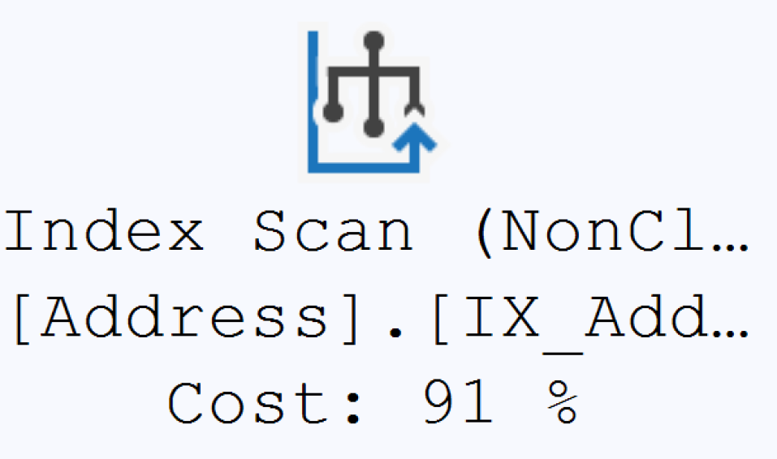

*Hình 4-24: Toán tử có chi phí cao nhất trong kế hoạch thực thi (The highest cost operator in the execution plan)*

Như chúng ta sẽ thấy xuyên suốt cuốn sách, các quy trình phát sinh nhiều thao tác I/O thường cũng chính là thủ phạm khiến các câu truy vấn chạy chậm chạp. Chi phí ước tính gắn liền với thao tác **Index Scan** trong ví dụ này là vị trí sáng giá nhất để chúng ta tập trung nỗ lực tối ưu nếu muốn câu truy vấn chạy nhanh hơn.

Hãy luôn ghi nhớ rằng: mặc dù chi phí ước tính có thể rất cao, nhưng nó vẫn mãi chỉ là một con số ước tính. Bạn hoàn toàn có thể phát hiện ra rằng thủ phạm thực sự gây ra hiệu năng chậm chạp lại ẩn nấp ở một vị trí khác. Tuy nhiên, trong trường hợp này, nếu quan sát số lượng dòng thực tế so với số lượng dòng ước tính, cả hai giá trị đều là 19.614 dòng, cho thấy phép ước tính chi phí của thao tác này là hoàn toàn chính xác.

### Đường ống dữ liệu dày (Fat Pipes)

Bởi vì các đường ống đại diện cho sự luân chuyển của dữ liệu, việc xác định các luồng dữ liệu khối lượng lớn có thể giúp chúng ta giải mã kế hoạch thực thi nhằm nhận diện nguyên nhân tiềm tàng gây ra các vấn đề hiệu năng. 

Một khía cạnh khác mà chúng ta cần đặc biệt để mắt tới khi quan sát các đường ống là **sự chuyển tiếp**: 
* Hoặc chuyển tiếp từ các đường ống dày thành các đường ống mỏng.
* Hoặc ngược lại, các đường ống mỏng ngày càng phình to ra.

Trong trường hợp thứ nhất (đường ống dày trở nên mỏng hơn), bạn đang chứng kiến hiện tượng **lọc dữ liệu trễ** (*late filtering*). Trong tình huống này, việc bổ sung một chỉ mục phù hợp hoặc điều chỉnh lại mã lệnh truy vấn có thể mang lại sự cải thiện rõ rệt.

Trong trường hợp thứ hai, bạn đang thấy dữ liệu bị nhân bản (multiplied) đột biến khi tiến trình thực thi truy vấn diễn ra. Sự gia tăng luân chuyển dữ liệu đồng nghĩa với việc phát sinh thêm nhiều thao tác I/O và chiếm dụng nhiều tài nguyên bộ nhớ hơn. Đây một lần nữa là dấu hiệu cho thấy bạn cần xem xét và điều chỉnh lại mã lệnh T-SQL.

### Các toán tử phụ trội (Extra Operators)

Trên thực tế, hoàn toàn không có thứ gì gọi là "toán tử phụ trội" cả. Mỗi toán tử đều có một mục đích cụ thể và được đưa vào để thực thi truy vấn. Tuy nhiên, tôi dùng thuật ngữ này như một lối diễn đạt ngắn gọn để mô tả tình huống mà bạn cần điều tra một toán tử cụ thể do thiếu hụt thông tin về nó. Nếu bạn không biết một toán tử làm nhiệm vụ gì hoặc không hiểu vì sao nó lại xuất hiện ở đó, nó phải là đối tượng thu hút sự chú ý của bạn để bạn có thể thấu hiểu cặn kẽ hơn cách thức truy vấn đang được xử lý.

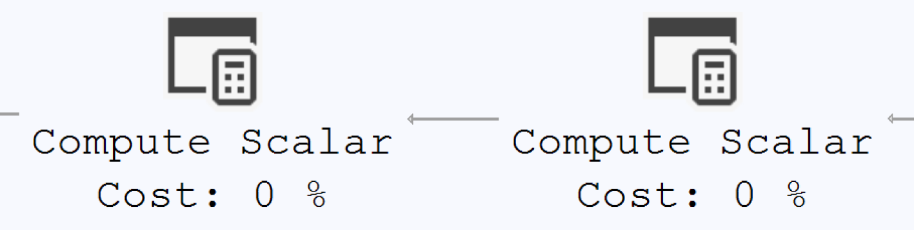

*Hình 4-25: Hai toán tử Compute Scalar đóng vai trò là các toán tử phụ trội (Two Compute Scalar operators represent extra operators)*

Vì chúng ta chưa biết toán tử **Compute Scalar** là gì, nó đại diện cho một "toán tử phụ trội" trong trường hợp này. Nếu nhìn vào phần mô tả của toán tử, chúng ta sẽ nhận được định nghĩa về chức năng của nó:
> *"Tính toán các giá trị mới từ các giá trị sẵn có trong một dòng."* (*Compute new values from existing values in a row.*)

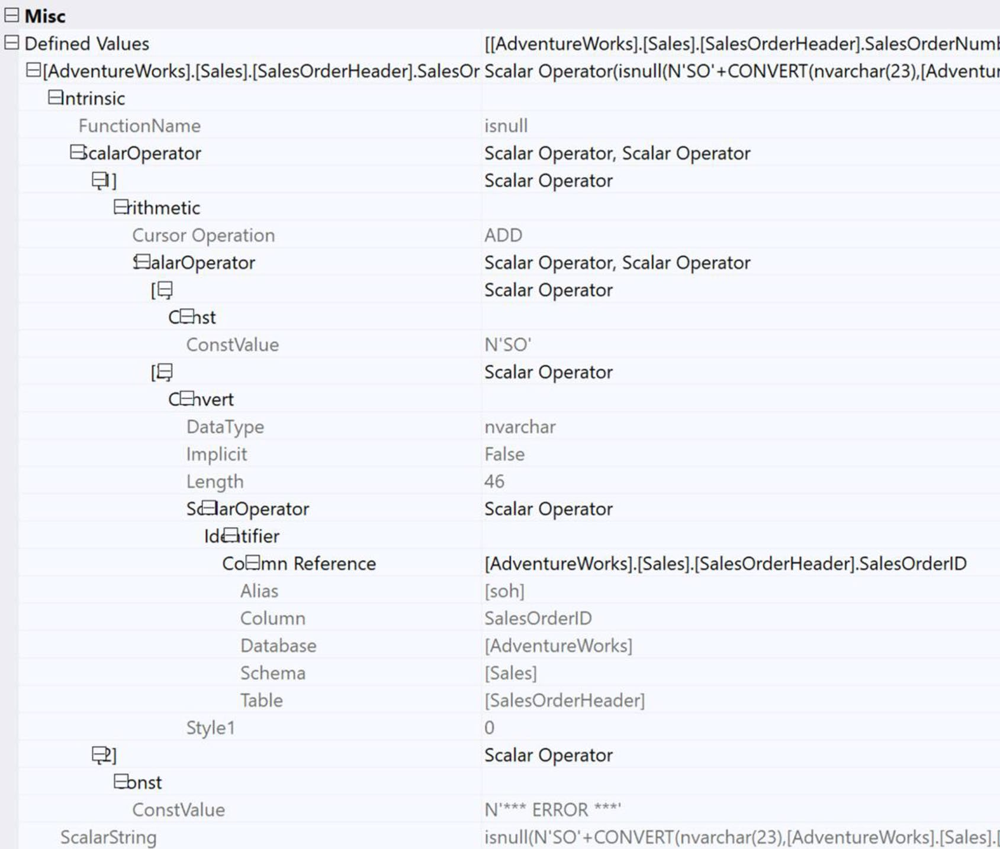

*Hình 4-26: Chi tiết thuộc tính Defined Values của toán tử Compute Scalar (The details behind the Defined Values property of a Compute Scalar operator)*

Những gì thuộc tính đó đang định nghĩa cho chúng ta thực chất là đoạn mã T-SQL sau:

```sql
Scalar Operator(isnull(N'SO'+CONVERT(nvarchar(23),[AdventureWorks].[Sales].[SalesOrderHeader].[SalesOrderID] as [soh].[SalesOrderID],0), N'*** ERROR ***'))
```

Nếu kiểm tra cấu trúc của các bảng dữ liệu, bạn sẽ thấy bảng `SalesOrderHeader` có chứa một cột tính toán (**computed column**) mang tên `SalesOrderNumber`, và đoạn mã T-SQL trên chính là phép tính toán cần thiết để tạo ra giá trị cho cột đó.

Giờ đây, chúng ta không những đã giải đáp được các thắc mắc xoay quanh toán tử này, mà còn xác định được ngọn nguồn của cảnh báo xuất hiện ở phần đầu chương: Chính hàm `CONVERT` này là tác nhân trực tiếp phát sinh cảnh báo.

### Thao tác quét (Scans)

Các thao tác quét (**Scans**) đóng vai trò là một biển chỉ dẫn định hướng bởi vì chúng đại diện cho sự luân chuyển dữ liệu. Luân chuyển càng nhiều dữ liệu đồng nghĩa với việc truy cập đĩa và bộ nhớ càng nhiều, và đây là nguyên nhân rất phổ biến dẫn tới các trục trặc về hiệu năng. Vì vậy, việc tìm kiếm các thao tác quét là một cách để nhanh chóng xác định vị trí các vấn đề tiềm ẩn trong kế hoạch thực thi.

Tuy nhiên, nếu chúng ta quan sát một câu truy vấn như trong Listing 4-7, cách duy nhất để đáp ứng câu truy vấn đó là thông qua một thao tác quét (scan).

**Listing 4-7. Một truy vấn chỉ có thể sử dụng thao tác Scan (A query that can only use a Scan operation)**

```sql
SELECT *
FROM Production.UnitMeasure AS um;
```

Khi không có bất kỳ điều kiện lọc nào, trình tối ưu hóa chỉ có thể lựa chọn thao tác quét. Một thao tác tìm kiếm (**seek**) trong trường hợp này trên thực tế sẽ chạy chậm hơn cả thao tác quét. Chúng ta sẽ tìm hiểu nguyên nhân chính xác trong Chương 9. Hãy nhớ rằng: Thao tác quét không mang bản chất xấu và thao tác tìm kiếm không mặc nhiên là hoàn hảo. Đơn giản là các thao tác quét đại diện cho sự luân chuyển dữ liệu — một trong những nguyên nhân phổ biến nhất gây ra sự cố hiệu năng — và đó là lý do vì sao chúng ta sử dụng chúng như một biển chỉ dẫn quan trọng.

### Ước tính so với Thực tế (Estimate vs. Actual)

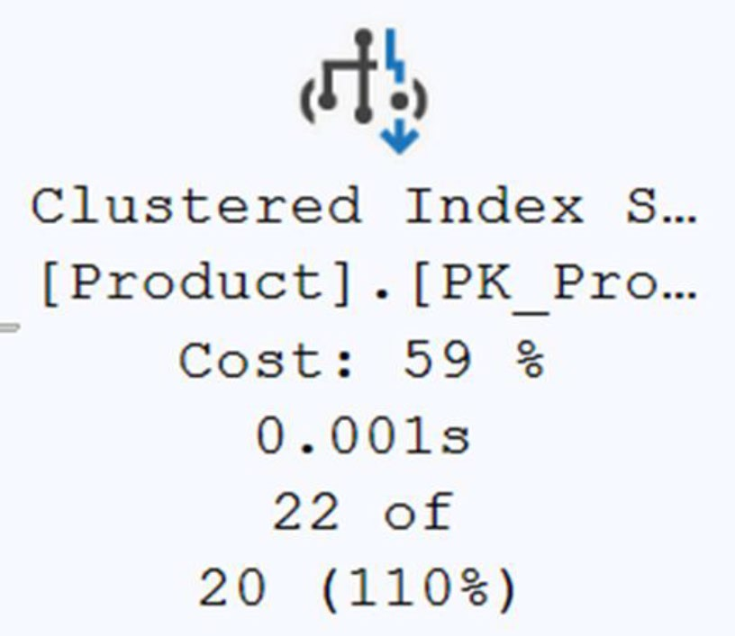

*Hình 4-27: So sánh giá trị ước tính và giá trị thực tế trong kế hoạch thực thi (Estimated values compared with actual values in an execution plan)*

Bạn có thể nhận thấy ngay rằng số lượng dòng ước tính được xử lý bởi toán tử này là 20 dòng. Số lượng dòng thực tế là 22 dòng, đạt tỷ lệ 110% so với tổng số. Trong trường hợp này, mức sai lệch đó là chưa đủ lớn để chúng ta phải bận tâm. Trong thực tế, bạn sẽ chỉ cần lo lắng khi nhận thấy mức chênh lệch tăng vọt từ ba lần trở lên, hoặc ngược lại, giảm xuống chỉ còn một phần năm hoặc ít hơn trong phép so sánh đối chiếu. Đây không phải là những con số giới hạn cứng nhắc, mà chỉ là những hướng dẫn mang tính kinh nghiệm thực tiễn.

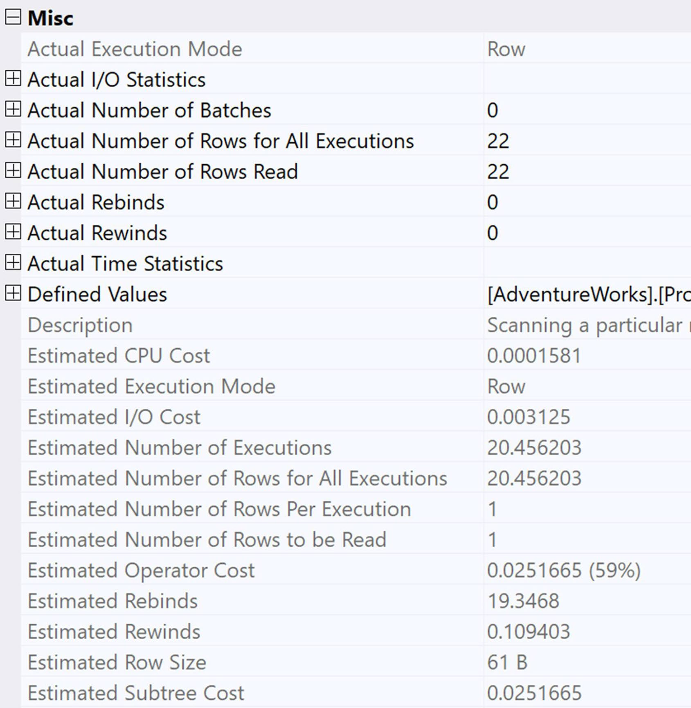

*Hình 4-28: So sánh giá trị ước tính và thực tế trong cửa sổ thuộc tính (Comparing the estimated and actual values in the properties)*

---

## Sau những biển chỉ dẫn (After the Signposts)

Chúng ta có thể sử dụng các "biển chỉ dẫn" (signposts) để nhanh chóng nhận diện các vấn đề tiềm ẩn bên trong một kế hoạch thực thi (execution plan). Điều này đặc biệt hữu ích trong lần đầu tiên bạn quan sát một kế hoạch thực thi cụ thể. Tuy nhiên, các biển chỉ dẫn đó chỉ có thể giúp bạn đi được một đoạn đường nhất định trong việc thấu hiểu tường tận những gì đang thực sự diễn ra bên trong kế hoạch. 

Sau khi bạn đã khai thác hết quy trình đơn giản bằng cách dựa vào các biển chỉ dẫn, phần còn lại sẽ là công việc đòi hỏi nhiều công sức hơn: tìm hiểu cặn kẽ những gì đang diễn ra trong một kế hoạch mà tại đó các biển chỉ dẫn không còn cung cấp đủ thông tin để bạn tiếp tục suy luận.

Trước hết, hãy rèn luyện thói quen theo dõi giá trị **NodeID** của các toán tử (operators). Việc nắm rõ NodeID giúp bạn biết được thứ tự mà các toán tử được khởi tạo (instantiated), từ đó hỗ trợ bạn hiểu rõ quy trình câu truy vấn đang được xử lý như thế nào. Bạn cũng sẽ bắt gặp các toán tử tham chiếu ngược lại các toán tử khác, do đó việc chú ý đến các tham chiếu giá trị NodeID khác sẽ giúp bạn đọc hiểu kế hoạch thực thi một cách mạch lạc.

Tiếp theo, hãy tạo thói quen theo dõi dữ liệu đầu ra (output) của từng toán tử. Rất nhiều toán tử sẽ biến đổi hoặc bổ sung thêm các cột vào tập kết quả. Nắm được nguồn gốc xuất phát của các cột dữ liệu đó sẽ rất hữu ích cho việc hiểu sâu về kế hoạch.

Cuối cùng, hãy sớm rèn luyện thói quen sử dụng cửa sổ thuộc tính (**Properties**) của các toán tử. Đúng là trong một số trường hợp, thông tin bạn cần ngay lập tức đã có sẵn trong hộp thoại chú giải công cụ (**tooltip**). Tuy nhiên, rất nhiều khi các thông tin quan trọng lại không nằm ở đó. Việc luôn có sẵn một bức tranh toàn cảnh và chi tiết hơn trong tầm tay sẽ giúp bạn đọc và hiểu các kế hoạch thực thi một cách chuẩn xác và sâu sắc hơn.

---

## Các công cụ hỗ trợ làm việc với Execution Plans (Tools That Assist You with Execution Plans)

Càng đi sâu vào việc đọc và phân tích các kế hoạch thực thi, bạn sẽ càng thấy cần có thêm sự trợ giúp để điều hướng và nắm bắt cấu trúc của chúng. Công cụ đầu tiên tôi muốn giới thiệu đến bạn chính là một cuốn sách khác do tôi chắp bút: *SQL Server Execution Plans, Third Edition* (Redgate Press). Đó là một cuốn sách đồ sộ chỉ tập trung chuyên sâu vào bản chất của kế hoạch thực thi, cách thức chúng vận hành và phương pháp diễn giải chúng. Cuốn sách đó đi sâu vào từng chi tiết của các kế hoạch nhưng không đề cập nhiều đến khía cạnh tinh chỉnh truy vấn tổng thể. Đó chính là lý do cuốn sách bạn đang cầm trên tay này ra đời.

Bên cạnh đó, có một số tính năng tích hợp sẵn bên trong SSMS và một số công cụ của bên thứ ba rất đáng để bạn cân nhắc sử dụng.

### SQL Server Management Studio (SSMS)

Ngay từ đầu, cần nhấn mạnh một vài điểm quan trọng về SQL Server Management Studio (SSMS). Vì bạn rất có khả năng sẽ thu thập phần lớn các kế hoạch thực thi của mình thông qua Extended Events, truy vấn các DMV, hoặc thông qua Query Store, nên đương nhiên bạn sẽ làm việc với các kế hoạch trên giao diện SSMS nhiều hơn. Việc hiểu rõ SSMS có thể hỗ trợ bạn như thế nào sẽ giúp việc xử lý các kế hoạch thực thi trở nên dễ dàng hơn rất nhiều.

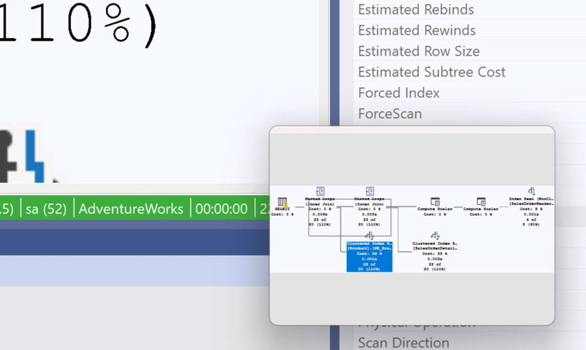

*Hình 4-29: Màn hình điều hướng thu nhỏ để kéo xem toàn cảnh kế hoạch thực thi (The screen for dragging around the view of an execution plan)*

Mặc dù bạn có thể dùng chuột kéo rê kế hoạch trực tiếp trên màn hình, khung điều hướng này cho phép bạn di chuyển khung nhìn bao quát toàn bộ kế hoạch một cách trực quan. Tính năng này rất hữu ích nếu bạn chưa biết nên bắt đầu xem từ đâu, bởi nó cung cấp cho bạn cái nhìn toàn cảnh về hình dạng tổng thể của kế hoạch, từ đó giúp bạn quyết định vị trí cần phóng to để kiểm tra chi tiết.

Tiếp theo, chúng ta sẽ tìm hiểu một số chức năng chi tiết và mạnh mẽ hơn khi làm việc với execution plan trong SSMS.

#### Tìm kiếm nút toán tử (Find Node)

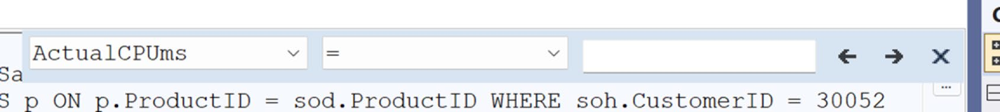

*Hình 4-30: Cửa sổ Find Node đang mở bên trong một kế hoạch thực thi (The Find Node window open within an execution plan)*

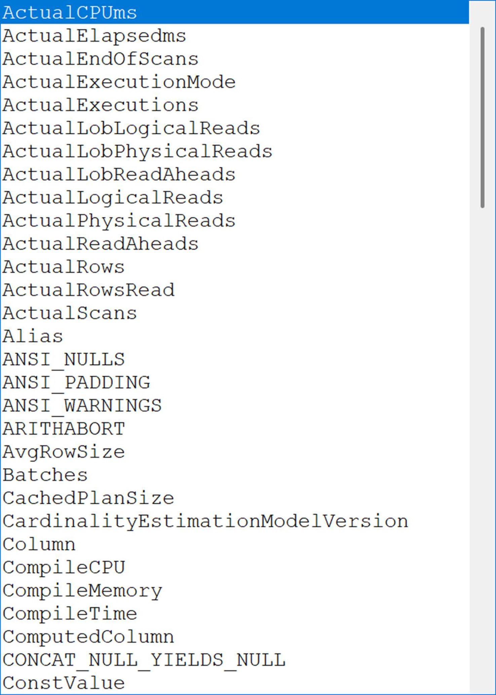

*Hình 4-31: Một phần danh sách các thuộc tính trong menu thả xuống của Find Node (Part of the list of properties in the Find Node drop-down menu)*

Khi bạn chọn một thuộc tính trong danh sách này, bạn sẽ tiến hành tìm kiếm các giá trị tương ứng nằm bên trong thuộc tính đó. Lưu ý rằng bạn chỉ có thể tìm kiếm trên một thuộc tính tại một thời điểm.

Menu thả xuống tiếp theo cung cấp cho bạn hai tùy chọn so khớp:
- **Equals**: Bằng chính xác
- **Contains**: Chứa chuỗi ký tự

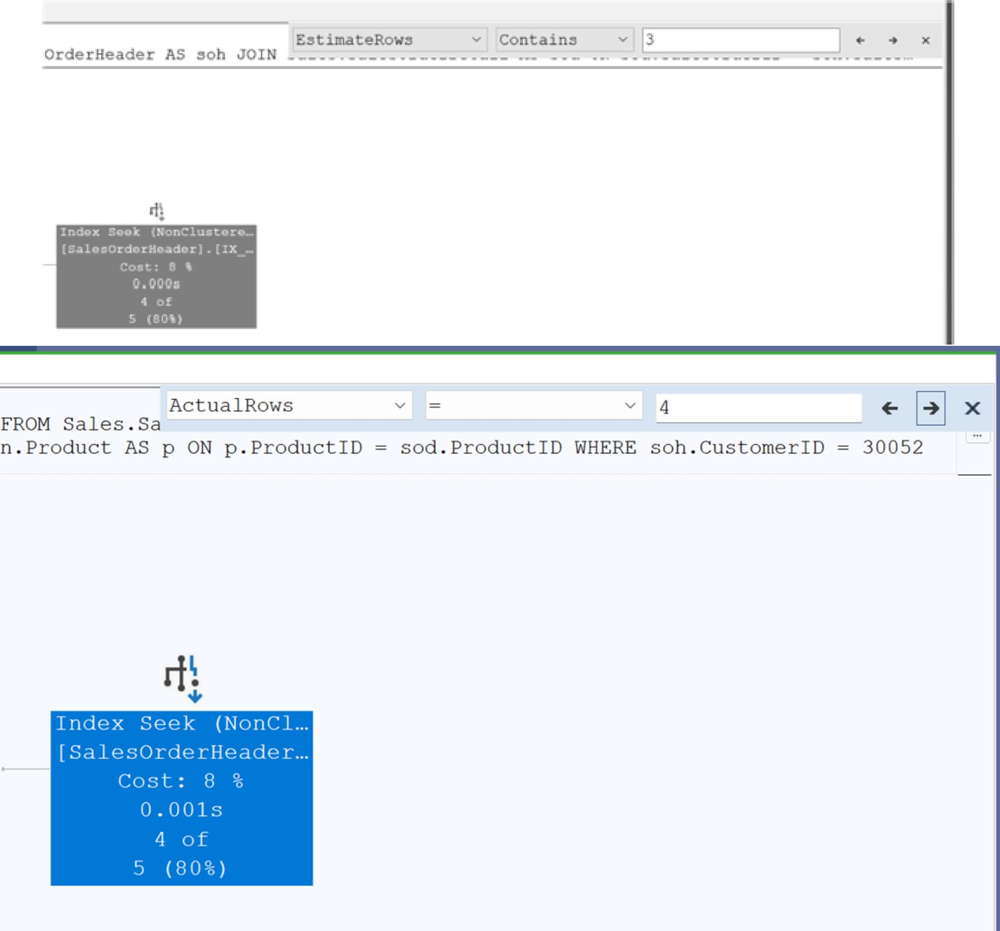

*Hình 4-32: Kết quả tìm kiếm các toán tử bằng chức năng Find Node (Results of searching for operators using Find Node)*

Trong ví dụ này, tôi đã thực hiện tìm kiếm bất kỳ toán tử nào có thuộc tính `ActualRows` bằng đúng giá trị "4". Kết quả là toán tử **Index Seek** đã được định vị chính xác vì nó trả về 4 hàng dữ liệu.

#### So sánh các kế hoạch thực thi (Compare Plans)

Bạn có thể so sánh hai kế hoạch thực thi để tìm ra toàn bộ các điểm khác biệt cũng như tương đồng giữa chúng bằng cách sử dụng công cụ có sẵn trong SSMS. Một trong hai kế hoạch bắt buộc phải được lưu lại dưới dạng tệp tin. Bạn có thể lưu một kế hoạch thành tệp tin `.sqlplan` bằng cách nhấp chuột phải vào chính kế hoạch đó và chọn **Save Execution Plan As...** từ menu ngữ cảnh.

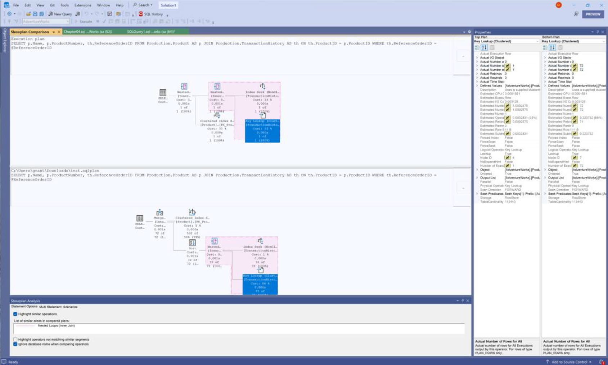

*Hình 4-33: So sánh hai kế hoạch thực thi bên trong SSMS (Comparing two execution plans within SSMS)*

Khung nhìn tổng thể này có thể hơi khó quan sát, vì vậy hãy cùng chia nhỏ giao diện thành ba khu vực chức năng chính bên trong cửa sổ **Showplan Comparison**.

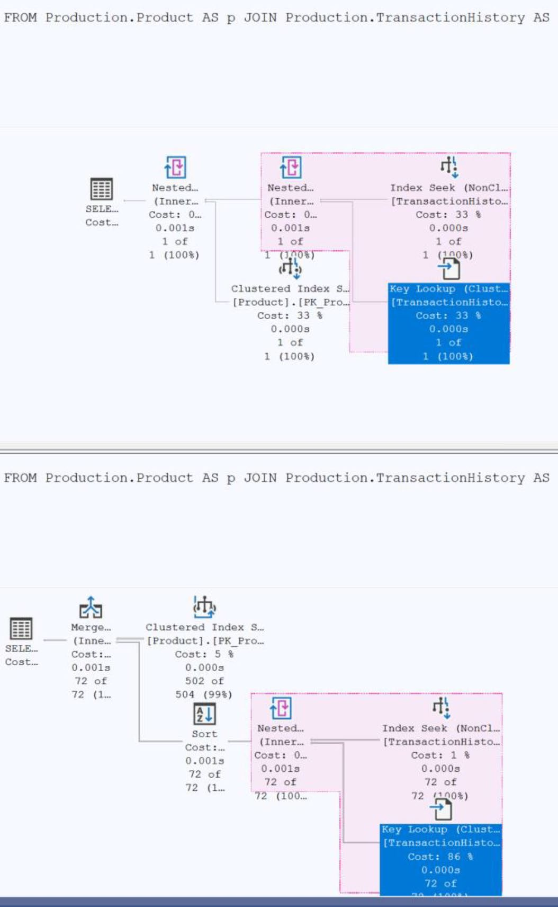

*Hình 4-34: Các kế hoạch được so sánh làm nổi bật các đặc tính chung tương đồng (Compared plans showing common characteristics)*

Trong ví dụ trên, các điểm tương đồng xuất hiện ở những vị trí mà cả hai kế hoạch đều có phép nối **Nested Loops**, một toán tử **Index Seek**, và một toán tử **Key Lookup**. Chúng ta sẽ cùng phân tích kỹ các mẫu hình toán tử này trong các chương tiếp theo. 

Tại thời điểm này, bạn có thể nhận thấy điểm khác biệt rõ ràng: kế hoạch phía trên (kế hoạch đang được đem ra so sánh) sử dụng thêm một phép nối Nested Loops khác, trong khi kế hoạch phía dưới (lấy từ tệp tin đã lưu) lại sử dụng một phép nối **Merge Join**. Ngoài ra còn có các điểm sai khác khác nữa. Các kế hoạch hiển thị bên trong cửa sổ Showplan Comparison vẫn tương tác và hoạt động hoàn toàn giống như các kế hoạch hiển thị thông thường khác trong SSMS.

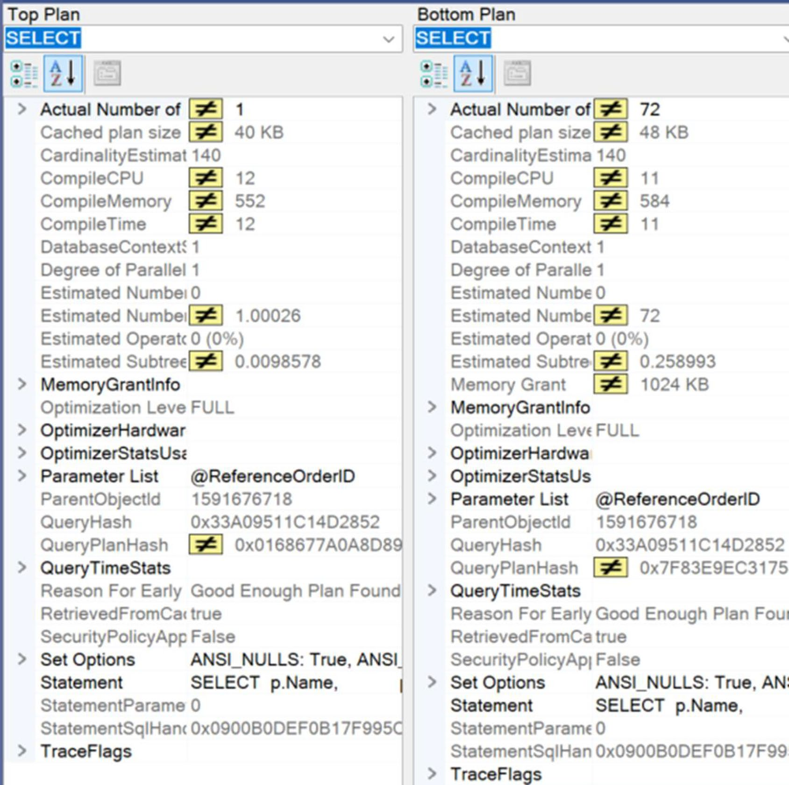

*Hình 4-35: So sánh giá trị của các thuộc tính giữa hai kế hoạch (Comparing the values of properties between two plans)*

Bạn có thể quan sát thấy các giá trị thuộc tính nào trùng khớp và những giá trị nào không khớp nhau. Nếu một toán tử nhất định chỉ tồn tại trong kế hoạch này mà không có trong kế hoạch kia, bạn sẽ không thấy phần so sánh tương ứng xuất hiện tại đây.

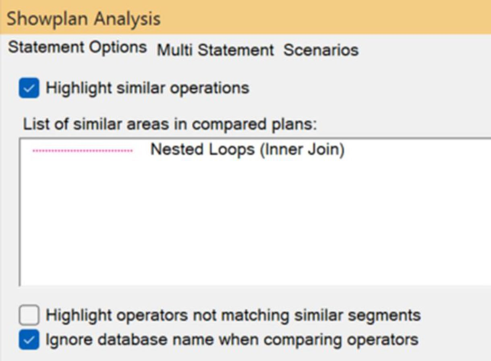

*Hình 4-36: Các tùy chọn cấu hình cho việc so sánh kế hoạch thực thi (Options for comparing execution plans)*

Bạn có thể bật hoặc tắt tính năng làm nổi bật (highlight) các phần tương đồng của kế hoạch. Bạn cũng có thể chọn làm nổi bật các phần không trùng khớp giữa hai kế hoạch. Cuối cùng, bạn có thể chọn bỏ qua tên cơ sở dữ liệu khi tiến hành so sánh, điều này cực kỳ thuận tiện khi bạn cần so sánh giữa các môi trường hệ thống khác nhau (như giữa môi trường Test và Production).

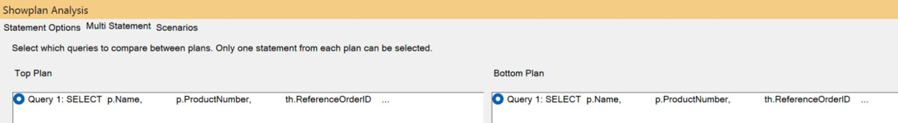

*Hình 4-37: Lựa chọn câu lệnh trong trường hợp kế hoạch chứa nhiều câu lệnh (Multi-statement selection in a plan comparison)*

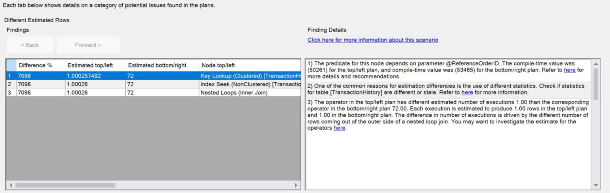

*Hình 4-38: Ba toán tử với các số hàng ước tính khác biệt (Three operators with different estimated rows)*

#### Thống kê truy vấn trực tiếp (Live Query Statistics)

Một công cụ bổ sung vô cùng giá trị khác có sẵn bên trong SSMS là **Live Query Statistics**. Chức năng này cho phép bạn quan sát trực tiếp các dòng dữ liệu đang dịch chuyển qua từng toán tử của kế hoạch thực thi theo thời gian thực. Tính năng này thực sự hữu ích đối với những câu truy vấn có thời gian chạy rất dài. Ngoài ra, để sử dụng được nó, hệ thống của bạn cần đáp ứng một số tiêu chí nhất định:

- Trong **SQL Server 2014**, bạn phải đang kích hoạt một phiên Extended Events sử dụng sự kiện `query_thread_profile`. Điều này sẽ kích hoạt tính năng kế hoạch trực tiếp.
- Đối với **SQL Server 2016** và **2017**, bạn cũng có thể sử dụng phiên Extended Events tương tự. Tuy nhiên, bạn có thể thiết lập cờ theo dõi (**trace flag**) `7412` trên toàn máy chủ. Cờ này sẽ bật cơ chế gọi là lập hồ sơ nhẹ (**lightweight profiling**). Bạn cũng có thể sử dụng gợi ý truy vấn `QUERY_PLAN_PROFILE` để kích hoạt tính năng này ở cấp độ từng truy vấn riêng lẻ.
- Từ **SQL Server 2019** trở lên, cũng như trên **Azure SQL Database**, cơ chế lightweight profiling đã được kích hoạt mặc định. Bạn có thể vô hiệu hóa nó ở cấp độ cơ sở dữ liệu bằng cách sử dụng tùy chọn cấu hình: `ALTER DATABASE SCOPED CONFIGURATION SET LIGHTWEIGHT_QUERY_PROFILING = OFF`.

Bởi vì đây là một tiến trình động chuyển động trực tiếp theo thời gian thực, nó sẽ không thể thể hiện trọn vẹn sự sống động trên trang sách tĩnh. Tuy nhiên, tôi sẽ dẫn dắt bạn qua một câu truy vấn mẫu để bạn có thể tự mình trải nghiệm. Listing 4-8 minh họa một câu truy vấn mất khoảng 10 đến 15 giây để chạy trên một máy tính xách tay thông thường.

**Listing 4-8.** Một truy vấn mẫu có thời gian chạy dài

```sql
SELECT o.*,
       o2.*
FROM sys.objects AS o,
     sys.objects AS o2;
```

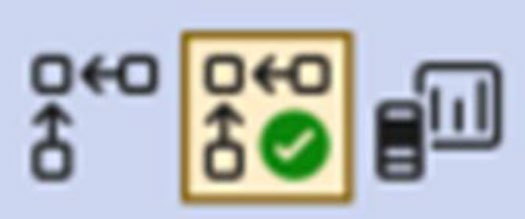

*Hình 4-39: Bật tùy chọn Include Live Query Statistics (Include Live Query Statistics)*

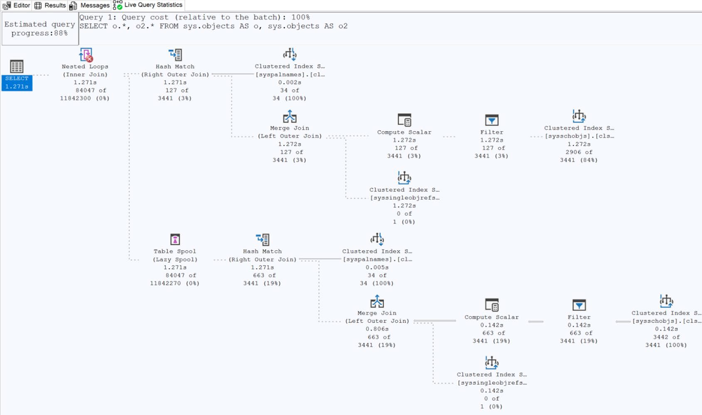

*Hình 4-40: Một kế hoạch thực thi trực tiếp đang hoạt động (A live execution plan in action)*

Hãy chú ý xem cách một số đường ống truyền dữ liệu hiển thị dưới dạng nét liền trong khi một số khác hiển thị nét đứt:
- Các đường ống nét liền biểu thị các hoạt động xử lý đã hoàn tất.
- Các đường ống nét đứt chuyển động trực tiếp thể hiện sự luân chuyển dữ liệu đang diễn ra ngay tại thời điểm đó. 

Số lượng hàng hiển thị bên dưới các toán tử được cập nhật liên tục theo thời gian thực, cho biết toán tử nào đã hoàn thành và tiến độ thực thi của những toán tử vẫn đang hoạt động. Ở góc trên bên trái thậm chí còn hiển thị phần trăm tiến độ hoàn thành tổng thể. Mặc dù chi tiết này hơi nhỏ, nhưng ở thời điểm tôi chụp màn hình, nó đang ở mức 88%.

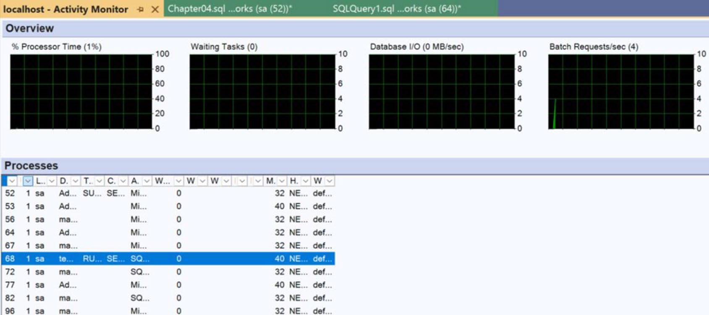

*Hình 4-41: Cửa sổ Activity Monitor trong SSMS (The Activity Monitor window in SSMS)*

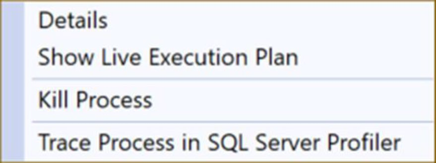

*Hình 4-42: Menu ngữ cảnh cho phép chọn Show Live Execution Plan (Context menu that lets you select Show Live Execution Plan)*

Ngoài đặc tính động theo thời gian thực, về cơ bản đây vẫn là một kế hoạch thực thi như bình thường; bạn vẫn có thể rê chuột xem tooltip, mở cửa sổ Properties và theo dõi mọi thông tin chi tiết như đã được trình bày xuyên suốt chương này.

Toàn bộ cơ chế này được vận hành bởi một DMV hệ thống mang tên `sys.dm_exec_query_profiles`. Bạn hoàn toàn có thể truy vấn thông tin từ DMV này trong khi các truy vấn đang thực thi để theo dõi số lượng hàng đang được xử lý tích cực, tương tự như những gì hiển thị trên đồ họa.

Cần lưu ý rằng việc theo dõi kế hoạch trực tiếp là một tiến trình tương đối tốn kém tài nguyên và có thể đặt thêm một lượng tải đáng kể lên máy chủ, do đó bạn chỉ nên sử dụng khi thực sự cần thiết. Các kế hoạch thực thi trực tiếp cực kỳ hữu ích đối với những truy vấn chạy siêu lâu — chẳng hạn như các tác vụ nạp dữ liệu ETL lớn — giúp bạn nắm được tiến độ hoàn thành của chúng. 

Hãy luôn nhớ rằng số lượng hàng dự kiến được dựa trên các ước tính ban đầu; do đó, nếu có sự chênh lệch lớn giữa số hàng ước tính và số hàng thực tế, thì chỉ số phần trăm hoàn thành hiển thị trên bất kỳ toán tử nào cũng như cho toàn bộ truy vấn sẽ không hoàn toàn chính xác tuyệt đối.

### Công cụ của bên thứ ba (Third Party Tools)

Chúng ta sẽ không đi sâu vào việc hướng dẫn chi tiết cách sử dụng các công cụ này. Tôi chỉ đơn thuần chỉ ra cách mà các công cụ này có thể hỗ trợ bạn trong việc đọc hiểu và phân tích các kế hoạch thực thi.

#### SolarWinds Plan Explorer

Plan Explorer là một công cụ phân tích kế hoạch thực thi cực kỳ mạnh mẽ. Nó không chỉ hiển thị các kế hoạch thực thi của bạn dưới nhiều định dạng trực quan khác nhau, mà còn tích hợp một loạt các công cụ phân tích chuyên sâu nhằm giúp bạn đọc và hiểu kế hoạch dễ dàng hơn rất nhiều. Một số thuật toán phân tích của nó thậm chí có thể chỉ ra chính xác vị trí phát sinh vấn đề hiệu năng được minh họa trong kế hoạch thực thi. 

Một tính năng rất đắt giá của Plan Explorer là khả năng ẩn danh hóa kế hoạch (**anonymize plan**): loại bỏ toàn bộ tên chỉ mục, tên bảng, tên cột và các giá trị dữ liệu cụ thể trong câu truy vấn. Điều này giúp bạn dễ dàng chia sẻ kế hoạch ra bên ngoài hoặc lên các diễn đàn cộng đồng mà không lo lộ lọt dữ liệu nhạy cảm.

Mặc dù Plan Explorer có thể tích hợp với SSMS, nhưng bạn không thể thay thế hoàn toàn giao diện xem kế hoạch mặc định của SSMS bằng công cụ này. Dù công cụ này gần đây không còn nhận được nhiều bản cập nhật thường xuyên như trước, nó vẫn giữ nguyên giá trị rất lớn.

Plan Explorer hoàn toàn miễn phí tải về tại địa chỉ: http://solarwinds.com.

#### Supratimas

Supratimas là một công cụ phân tích kế hoạch thực thi chạy trên nền tảng web. Nó không có quy mô tính năng đồ sộ như Plan Explorer, tuy nhiên nó cung cấp sự trợ giúp rất thiết thực khi bạn cần quan sát kế hoạch. 

Bạn chỉ cần dán đoạn mã XML của kế hoạch vào trang web, và công cụ sẽ liệt kê cho bạn các thao tác có chi phí tốn kém nhất theo thứ tự từ cao xuống thấp. Bạn cũng nhận được danh sách các toán tử gây ra tải trọng I/O nhiều nhất, cũng được sắp xếp theo thứ tự giảm dần. Việc nhấp vào từng mục trong danh sách sẽ đưa bạn đến ngay toán tử liên quan. Điều này chắc chắn sẽ giúp bạn nắm bắt nhanh hơn những điểm nóng đang diễn ra bên trong kế hoạch.

Supratimas có thể truy cập tại: http://supratimas.com.

#### Paste The Plan

Paste The Plan là công cụ đơn giản nhất trong số các công cụ của bên thứ ba. Đây thực chất là một phương thức chia sẻ kế hoạch thực thi dễ dàng với mọi người. Bạn dán nội dung XML của kế hoạch vào trang web (tương tự như Supratimas), sau đó bạn sẽ nhận được một đường link URL để chia sẻ cho đồng nghiệp hoặc chuyên gia tư vấn. Người nhận có thể xem kế hoạch của bạn trực tiếp trên trình khám phá đồ họa của trang web hoặc tải tệp tin về máy tính của họ.

Giao diện kế hoạch đồ họa ở đây có phần hạn chế và không hiển thị toàn bộ thuộc tính chi tiết. Ngoài ra, bạn nên cân nhắc sử dụng Plan Explorer để ẩn danh hóa kế hoạch trước khi đăng tải nó lên một trang web hoàn toàn công khai như thế này.

Paste The Plan được phát triển bởi Brent Ozar tại địa chỉ: https://brentozar.com/pastetheplan.

#### Trợ lý Trí tuệ Nhân tạo (AI)

Bạn hoàn toàn có thể sao chép nội dung XML của một kế hoạch thực thi và nạp nó vào một trong các Mô hình Ngôn ngữ Lớn (LLM). Bởi vì bản chất của việc đọc kế hoạch thực thi chính là nhận diện các mẫu hình (pattern recognition), nên AI có khả năng thực hiện rất tốt các bước diễn giải cơ bản ban đầu. 

Tuy nhiên, khi độ phức tạp của kế hoạch thực thi tăng cao, xác suất xảy ra hiện tượng "ảo giác" (hallucination — các câu trả lời bịa đặt không có thật) sẽ trở nên lớn hơn. Việc sử dụng các công cụ AI có thể đóng vai trò như một lối tắt hữu ích để tăng tốc độ nắm bắt hành vi của một truy vấn thông qua kế hoạch thực thi của nó. 

Dù vậy, bạn tuyệt đối không được mặc định coi mọi điều mà mô hình LLM đưa ra đều chính xác. Phương châm bất biến của bạn phải luôn là: **"Tin tưởng nhưng phải kiểm chứng"** (Trust but verify). Bên cạnh đó, hãy luôn nhớ kỹ: **không bao giờ đưa các thông tin riêng tư, nhạy cảm của doanh nghiệp vào các hệ thống AI công cộng**.

---

## Tóm tắt chương (Summary)

Trong chương này, bạn đã được tìm hiểu về bản chất của các kế hoạch thực thi và những bước đi đầu tiên trong phương pháp đọc hiểu chúng. Sự khác biệt cốt lõi giữa kế hoạch thực thi ước tính (estimated) và kế hoạch thực thi có chỉ số runtime thực tế (actual) đã được phân định rạch ròi. Bạn cũng đã điểm qua một loạt các "biển chỉ dẫn" quan trọng giúp định hướng nhanh khi phân tích một kế hoạch thực thi. Cuối cùng, chúng ta đã khám phá các công cụ hỗ trợ hữu ích giúp cho việc tương tác và phân tích kế hoạch thực thi trở nên dễ dàng và hiệu quả hơn.

Trong chương tiếp theo, chúng ta sẽ cùng đi sâu vào tìm hiểu về các số liệu thống kê (statistics): cách thức chúng được thu thập và sử dụng để phản ánh sự phân phối dữ liệu, độ chọn lọc (cardinality), và các ước tính số lượng hàng — những yếu tố then chốt dẫn dắt mọi quyết định tối ưu hóa của Query Optimizer.
