# CHƯƠNG 5: Thống kê, Phân phối dữ liệu và Bản số (Statistics, Data Distribution, and Cardinality)

> **Thông tin sách gốc:**  
> © Grant Fritchey 2026  
> G. Fritchey, *SQL Server 2025 Query Performance Tuning*, https://doi.org/10.1007/979-8-8688-1865-3_5  

---

Trong Chương 2, chúng ta đã thảo luận về quá trình tối ưu hóa truy vấn và cách Bộ tối ưu hóa (Query Optimizer) sử dụng các chỉ mục, ràng buộc cùng những đối tượng khác trong cơ sở dữ liệu để tìm ra phương án tối ưu nhất thỏa mãn câu truy vấn. Sự kết hợp của tất cả các đối tượng đó là cơ sở để bộ tối ưu hóa đưa ra các giá trị ước tính. 

Tuy nhiên, một trong những yếu tố đơn lẻ mang tính quyết định lớn nhất dẫn dắt optimizer lựa chọn phương thức xử lý này thay vì phương thức khác chính là **số lượng dòng dữ liệu (Row counts / Cardinality)**. Vì SQL Server trên thực tế không thể đếm toàn bộ số dòng dữ liệu trước mỗi lần thực thi câu lệnh, nó duy trì các thông tin siêu dữ liệu về sự phân bổ của dữ liệu bên trong từng cột. Nguồn thông tin đó được gọi là **Thống kê (Statistics)**. Thống kê được sử dụng để thiết lập các ước tính về số lượng dòng cho bộ tối ưu hóa, từ đó giúp nó đưa ra các quyết định thực thi chính xác và hiệu quả hơn.

Trong chương này, chúng ta sẽ đi sâu vào tầm quan trọng sống còn của thống kê trong quá trình tối ưu hóa truy vấn. Cụ thể, tôi sẽ đề cập đến các chủ đề sau:
* Thống kê trong quá trình tối ưu hóa truy vấn
* Hành vi của thống kê trên các cột có chỉ mục
* Thống kê trên các cột không đánh chỉ mục khi được sử dụng trong điều kiện lọc và kết nối
* Phân tích thống kê đơn cột và đa cột, bao gồm cách tính toán độ chọn lọc (Selectivity / Density) của cột phục vụ cho việc lập chỉ mục
* Quy trình bảo trì thống kê (Statistics maintenance)
* Đánh giá hiệu quả của thống kê được sử dụng trong quá trình thực thi truy vấn

---

## Thống kê trong quá trình tối ưu hóa truy vấn (Statistics in the Query Optimization Process)

Như bạn đã biết từ Chương 2, bộ tối ưu hóa vận hành theo quy trình tối ưu hóa dựa trên chi phí (cost-based optimization). Optimizer lựa chọn các cơ chế truy cập dữ liệu và phương thức kết nối (join) phù hợp bằng cách xác định **độ chọn lọc (Selectivity)** của dữ liệu – tức dữ liệu có tính duy nhất cao đến mức nào. 

Các cột chỉ xuất hiện đơn thuần trong mệnh đề `SELECT` thì không cần đến thống kê. Chỉ những cột tham gia vào các cơ chế lọc và liên kết dữ liệu – bao gồm `WHERE`, `HAVING` và `JOIN` – mới bắt buộc phải có thống kê. Khi một chỉ mục được tạo ra (chúng ta sẽ thảo luận chi tiết về chỉ mục từ Chương 9), thống kê sẽ tự động được tạo dựa trên dữ liệu nằm trong cột hoặc các cột định nghĩa khóa chỉ mục (index key). Theo mặc định, thống kê cũng sẽ được tự động khởi tạo trên các cột không thuộc chỉ mục nếu các cột đó được sử dụng trong các điều kiện lọc.

Việc nắm giữ thống kê về dữ liệu và sự phân bổ dữ liệu trong các cột được tham chiếu tại các vị từ (predicates) là yếu tố then chốt quyết định cách thức optimizer vạch ra chiến lược tối ưu nhất để thực thi truy vấn. Thống kê cho phép bộ tối ưu hóa thực hiện phép tính toán siêu tốc xem có bao nhiêu dòng dữ liệu khả năng cao sẽ được trả về ứng với một giá trị cụ thể trong cột. Khi đã có sẵn ước lượng số dòng, optimizer có thể đưa ra những lựa chọn chuẩn xác hơn nhằm tìm ra cách thức hiệu quả nhất để truy xuất và xử lý dữ liệu.

Nhìn chung, các thiết lập mặc định của hệ thống và cơ sở dữ liệu sẽ cung cấp đầy đủ các thống kê cần thiết để optimizer hoàn thành nhiệm vụ hiệu quả. Đồng thời, cơ chế bảo trì thống kê mặc định thường xuyên cung cấp cho optimizer các giá trị cập nhật mới nhất. Tuy nhiên, bạn vẫn cần phải đánh giá (thông qua kiến thức trong phần "Phân tích Thống kê") xem liệu các thống kê của mình có đang được khởi tạo và duy trì đúng mực hay không. Trong nhiều tình huống thực tế, bạn sẽ thấy mình cần phải chủ động kiểm soát thủ công việc tạo mới hoặc bảo trì các đối tượng thống kê này.

---

## Thống kê trên các cột có chỉ mục Rowstore (Statistics on Rowstore Indexed Columns)

Mức độ hỗ trợ của một chỉ mục trong việc giúp truy vấn chạy nhanh hơn phụ thuộc phần lớn vào số liệu thống kê trên cột (hoặc các cột) định nghĩa khóa của chỉ mục đó. Optimizer sử dụng thống kê từ các cột khóa chỉ mục để đưa ra ước tính số lượng dòng, từ đó định hình phần lớn các quyết định lựa chọn còn lại. 

SQL Server hỗ trợ hai phương thức lưu trữ chỉ mục: **Rowstore** (lưu trữ theo dòng truyền thống) và **Columnstore** (lưu trữ theo cột) – chúng ta sẽ tìm hiểu cả hai trong Chương 9. Đối với các chỉ mục Rowstore, đối tượng thống kê luôn được tự động tạo kèm theo chỉ mục. Hành vi này là cố định và không thể thay đổi. Với chỉ mục Columnstore, bạn có thể chủ động bổ sung thống kê nếu muốn. Riêng các chỉ mục nonclustered được tạo trên nền bảng columnstore thì luôn có thống kê, vì bản chất chúng vẫn là các cấu trúc rowstore.

Sự biến động của dữ liệu thực tế có thể làm thay đổi hoàn toàn quyết định lựa chọn chỉ mục của optimizer:
* Nếu một bảng chỉ chứa duy nhất 1 dòng khớp với một giá trị cụ thể của cột, thì việc sử dụng chỉ mục (Index Seek) là một lựa chọn tuyệt vời.
* Nhưng nếu dữ liệu thay đổi theo thời gian và hiện tại có một lượng khổng lồ các dòng khớp với giá trị đó, chỉ mục có thể trở nên kém hiệu quả hơn nhiều so với việc quét toàn bộ bảng (Scan).

Đó là lý do tối quan trọng giải thích vì sao bạn luôn phải đảm bảo hệ thống sở hữu **thống kê cập nhật (up-to-date statistics)**.

Theo mặc định, SQL Server sẽ tự động cập nhật thống kê trên các chỉ mục khi dữ liệu trong các cột khóa chỉ mục có sự thay đổi theo thời gian. Bạn có thể vô hiệu hóa hành vi này nếu muốn. Có một tùy chọn cấp cơ sở dữ liệu mang tên **Auto Update Statistics** để kiểm soát hành vi tự động này.

### Bảng 5-1. Ngưỡng tự động cập nhật thống kê mặc định (Default automatic statistics maintenance)

| Loại bảng | Số dòng trong bảng | Ngưỡng kích hoạt cập nhật (Update Threshold) |
| :--- | :--- | :--- |
| Tạm thời (Temporary) | Dưới 6 dòng | 6 thay đổi |
| Tạm thời (Temporary) | Từ 6 đến 500 dòng | 500 thay đổi |
| Cố định (Permanent) | Dưới 500 dòng | 500 thay đổi |
| Cả hai | Lớn hơn 500 dòng | `MIN(500 + (0.2 * n), SQRT(1,000 * n))` |

*Các thay đổi ở đây bao gồm các thao tác `INSERT`, `UPDATE`, hoặc `DELETE`. Giá trị được tính tích lũy tổng hợp: ví dụ trên một bảng cố định có dưới 500 dòng, nếu có 200 dòng được chèn, 200 dòng bị xóa và 100 dòng được sửa đổi thì ngưỡng 500 sẽ bị chạm và kích hoạt tự động cập nhật thống kê. Trong công thức tính, `n` đại diện cho tổng số dòng hiện có của bảng. Hệ thống sẽ lấy giá trị nhỏ nhất (`MIN`) giữa hai công thức.*

Hãy lấy ví dụ một bảng lớn có **5.000.000 dòng**:
* Công thức thứ nhất (`500 + 0.2 * n`): `500 + 0.2 * 5,000,000 = 1,000,500` thay đổi.
* Công thức thứ hai (`SQRT(1,000 * n)`): `SQRT(1,000 * 5,000,000) = SQRT(5,000,000,000) ≈ 70,710` thay đổi.

Vì lấy giá trị nhỏ nhất, nên chỉ cần có **70.710 dòng** bị thay đổi là SQL Server đã tự động kích hoạt cập nhật thống kê.

Để thấy rõ sự cải tiến, hãy nhìn lại cơ chế ngưỡng cũ trước đây:

### Bảng 5-2. Ngưỡng cập nhật thống kê cũ (Old statistics maintenance thresholds)

| Loại bảng | Số dòng trong bảng | Ngưỡng kích hoạt cập nhật |
| :--- | :--- | :--- |
| Tạm thời | Dưới 6 dòng | 6 thay đổi |
| Tạm thời | Từ 6 đến 500 dòng | 500 thay đổi |
| Cố định | Dưới 500 dòng | 500 thay đổi |
| Cả hai | Lớn hơn 500 dòng | `500 + (0.2 * n)` |

Với phương thức cũ cố định ở mức 20%, trên cùng bảng 5 triệu dòng đó, hệ thống buộc phải chờ đến khi có hơn **1.000.500 dòng** bị sửa đổi thì mới kích hoạt cập nhật thống kê! Rõ ràng, cơ chế cũ dẫn đến việc thống kê bị cập nhật rất thưa thớt và thường xuyên bị lỗi thời nghiêm trọng trên các bảng lớn.

#### Cập nhật thống kê đồng bộ so với bất đồng bộ (Asynchronous Statistics Update)
Thông thường (đồng bộ), khi một truy vấn chạy và nhận thấy thống kê đã chạm ngưỡng cần cập nhật, truy vấn đó sẽ phải tạm dừng (stop and wait) để chờ tiến trình cập nhật thống kê hoàn tất rồi mới tiếp tục tối ưu hóa và thực thi. 

Tuy nhiên, nếu bạn bật tính năng **Asynchronous Statistics Update (Cập nhật thống kê bất đồng bộ)**, truy vấn hiện tại sẽ được phép tiếp tục thực thi ngay lập tức với số liệu thống kê cũ; đồng thời một tiến trình ngầm sẽ được kích hoạt để cập nhật thống kê ở hậu cảnh. Sau khi hoàn tất, mọi truy vấn tiếp theo sử dụng thống kê đó sẽ được hưởng lợi từ các giá trị mới.

Bạn có thể bật/tắt tính năng bảo trì thống kê tự động bằng lệnh `ALTER DATABASE`. Tôi thực sự khuyên bạn **luôn duy trì bật** tính năng này trên hệ thống. Rất hiếm hệ thống gặp vấn đề do việc cập nhật thống kê tự động, trong khi đại đa số đều hưởng lợi to lớn từ nó. Bạn chỉ nên cân nhắc chuyển sang cập nhật bất đồng bộ nếu phát hiện thấy các lỗi quá thời gian (timeouts) và các sự kiện chờ kéo dài bắt nguồn trực tiếp từ việc cập nhật thống kê đồng bộ.

---

### Lợi ích của Thống kê được cập nhật (Benefits of Updated Statistics)

Chúng ta hãy cùng khảo sát xem việc cập nhật thống kê mang lại lợi ích cụ thể ra sao cho hiệu năng truy vấn. Để chủ động kiểm soát tuyệt đối dữ liệu trong bảng thử nghiệm thay vì dùng AdventureWorks, Listing 5-1 sẽ tạo một bảng chuyên dụng cho bài test:

```sql
-- Listing 5-1. Creating a table and index
DROP TABLE IF EXISTS dbo.Test1;
GO
CREATE TABLE dbo.Test1
(
    C1 INT,
    C2 INT IDENTITY
);

SELECT TOP 1500
       IDENTITY(INT, 1, 1) AS n
INTO #Nums
FROM master.dbo.syscolumns AS sC1,
     master.dbo.syscolumns AS sC2;

INSERT INTO dbo.Test1
(
    C1
)
SELECT n
FROM #Nums;

DROP TABLE #Nums;

CREATE NONCLUSTERED INDEX i1 ON dbo.Test1 (C1);
```

Bây giờ, chúng ta chạy một truy vấn lọc theo giá trị `C1 = 2` trên bảng vừa tạo. Truy vấn này chỉ trả về đúng 1 dòng và sẽ tận dụng chỉ mục như trong Listing 5-2:

```sql
-- Listing 5-2. Retrieving a single row from the table
SELECT t.C1,
       t.C2
FROM dbo.Test1 AS t
WHERE t.C1 = 2;
```

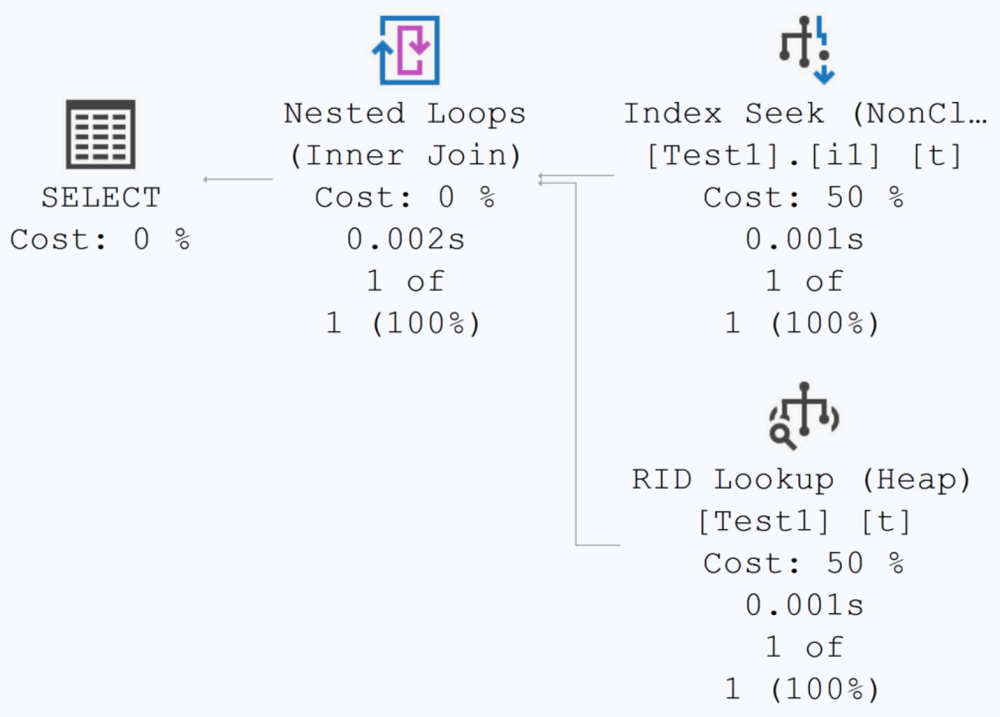  
*Hình 5-1. Thao tác Index Seek được optimizer lựa chọn để truy xuất dữ liệu*

Chúng ta sẽ sử dụng một phiên Extended Events để theo dõi hành vi của các tiến trình cập nhật thống kê cũng như bắt hiệu năng truy vấn. Listing 5-3 minh họa cách thiết lập phiên này:

```sql
-- Listing 5-3. Creating and starting an Extended Events session
CREATE EVENT SESSION [Statistics]
ON SERVER
    ADD EVENT sqlserver.auto_stats
    (ACTION
     (
         sqlserver.sql_text
     )
     WHERE (sqlserver.database_name = N'AdventureWorks')
    ),
    ADD EVENT sqlserver.sql_batch_completed
    (WHERE (sqlserver.database_name = N'AdventureWorks'));
GO
ALTER EVENT SESSION [Statistics] ON SERVER STATE = START;
```

Bây giờ, chúng ta chèn thêm một dòng đơn lẻ vào bảng (Listing 5-4):

```sql
-- Listing 5-4. Adding a single row to the Test1 table
INSERT INTO dbo.Test1
(
    C1
)
VALUES
(2);
```

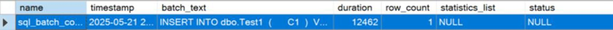  
*Hình 5-2. Kết quả Extended Events hiển thị không có sự kiện auto_stats nào phát sinh*

Chúng ta không thấy sự kiện cập nhật thống kê nào xuất hiện bởi vì việc thêm 1 dòng không đủ để vượt qua ngưỡng kích hoạt. Hơn nữa, chỉ 1 dòng tăng thêm cũng không làm thay đổi kế hoạch thực thi. 

Để quan sát tác động thực sự của sự biến động dữ liệu lên thống kê, chúng ta sẽ chèn thêm **1.500 dòng** đều có giá trị `C1 = 2` vào bảng (Listing 5-5):

```sql
-- Listing 5-5. Adding 1,500 rows
SELECT TOP 1500
       IDENTITY(INT, 1, 1) AS n
INTO #Nums
FROM master.dbo.syscolumns AS scl,
     master.dbo.syscolumns AS sC2;

INSERT INTO dbo.Test1
(
    C1
)
SELECT 2
FROM #Nums;

DROP TABLE #Nums;
```

Khi chạy lại truy vấn trong Listing 5-2, chúng ta nhận được kế hoạch thực thi mới và sự kiện Extended Events như sau:

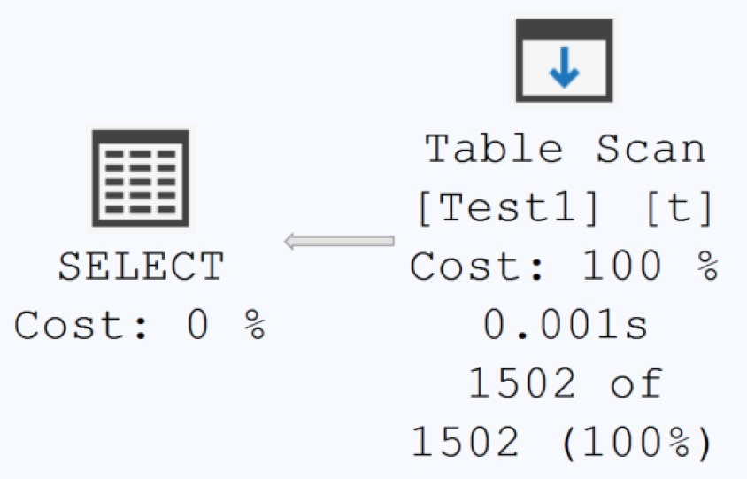  
*Hình 5-3. Kế hoạch thực thi chuyển sang thao tác quét bảng (Table Scan)*

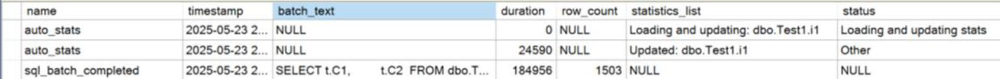  
*Hình 5-4. Đầu ra của phiên Extended Events ghi nhận sự kiện auto_stats được kích hoạt*

Vì chúng ta đã thêm một lượng lớn dòng dữ liệu, ngưỡng cập nhật đã bị vượt qua, do đó SQL Server đã tự động làm mới thống kê. Cột `statistics_list` và `status` từ sự kiện `auto_stats` cho thấy tiến trình được gọi hai lần: lần một để nạp và làm mới thống kê `dbo.Test1.i1`, và lần hai xác nhận rằng thống kê đã được cập nhật thành công. 

Ngay sau đó, truy vấn được thực thi. Do thống kê đã phản ánh đúng thực tế rằng hiện có tới 1.501 dòng mang giá trị `C1 = 2`, optimizer đã thông minh thay đổi kế hoạch thực thi: nó chọn **một lần quét bảng duy nhất (Table Scan)** thay vì phải thực hiện 1.501 lần thao tác tìm kiếm chỉ mục (Index Seek) kèm tra cứu (Lookup) cực kỳ tốn kém!

Ví dụ này cũng minh chứng lý do bạn cần cân nhắc kỹ trước khi bật cập nhật thống kê bất đồng bộ: nếu ở chế độ bất đồng bộ, truy vấn vừa rồi có thể đã phải chạy bằng kế hoạch cũ (1.501 lần seek) với hiệu năng rất tệ hại.

---

### Tác hại của Thống kê lỗi thời (Drawbacks of Outdated Statistics)

Trong phần trước, thống kê được tự động cập nhật và giúp optimizer tạo ra một kế hoạch thực thi tối ưu hơn rất nhiều. Điều đó chứng minh giá trị của thống kê chính xác. 

Ngược lại, khi thống kê bị lỗi thời, bộ tối ưu hóa sẽ đưa ra những quyết định sai lầm dựa trên những giả định không phản ánh đúng thực tế dữ liệu, dẫn đến sự suy giảm hiệu năng nghiêm trọng.

Hãy cùng thực nghiệm những gì xảy ra khi thống kê bị lỗi thời theo các bước sau:
1. Chạy lại Listing 5-1 để tái tạo bảng thử nghiệm ban đầu với 1.500 dòng và chỉ mục nonclustered.
2. Tắt tính năng tự động cập nhật thống kê bằng Listing 5-6:

```sql
-- Listing 5-6. Disabling automatic update of statistics
ALTER DATABASE AdventureWorks SET AUTO_UPDATE_STATISTICS OFF;
```

3. Thêm 1.500 dòng mới đều có giá trị `C1 = 2` vào bảng bằng Listing 5-5.
4. Chạy lại câu truy vấn tìm kiếm `C1 = 2` từ Listing 5-2.

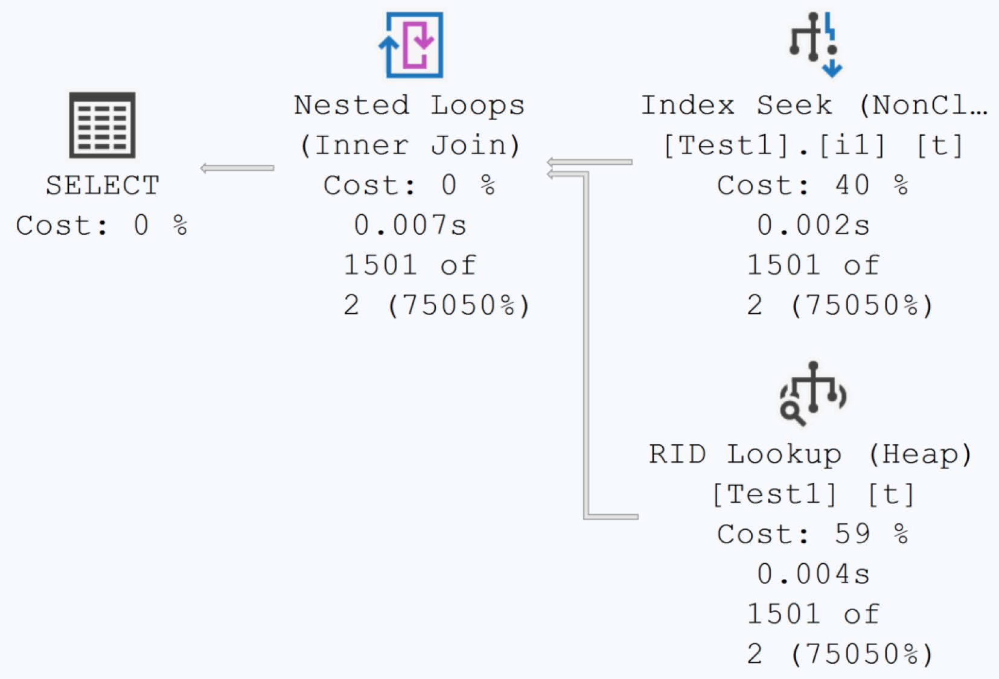  
*Hình 5-5. Kế hoạch thực thi sai lệch do dựa trên thống kê đã bị lỗi thời*

Bởi vì tính năng tự động cập nhật thống kê đã bị tắt, optimizer vẫn "ngây thơ" tin rằng chỉ có đúng 1 dòng mang giá trị `C1 = 2`. Kết quả là nó kiên quyết lựa chọn thao tác **Index Seek kết hợp RID Lookup lặp đi lặp lại 1.501 lần**!

### Bảng 5-3. Đo lường hiệu năng của các trạng thái bảo trì thống kê khác nhau

| Trạng thái cập nhật thống kê | Kế hoạch thực thi | Thời gian thực thi TB (ms) | Số lần đọc logic (Logical Reads) |
| :--- | :--- | :--- | :--- |
| **Được cập nhật đầy đủ (Up to date)** | Hình 5-3 (Table Scan) | **44.2 ms** | **11 reads** |
| **Bị lỗi thời (Out of date)** | Hình 5-5 (Index Seek + Lookup) | **63.6 ms** | **1.510 reads** |

Số lượng đọc logic (1.510 so với 11) và thời gian thực thi tăng vọt rõ rệt khi thống kê bị lỗi thời – mặc dù chúng ta đang chạy cùng một câu lệnh truy vấn trên cùng một tập kết quả dữ liệu trả về! Sự khác biệt trong cách thức optimizer xử lý câu truy vấn dẫn đến những biến động hiệu năng sống còn. Lợi ích từ việc giữ cho thống kê luôn cập nhật hầu như luôn vượt trội hơn rất nhiều so với chi phí phát sinh để thực hiện việc cập nhật đó.

Trước khi kết thúc phần này, hãy bật lại tính năng tự động cập nhật thống kê bằng Listing 5-7:

```sql
-- Listing 5-7. Enabling automatic statistics update
ALTER DATABASE AdventureWorks SET AUTO_UPDATE_STATISTICS ON;
```

---

## Thống kê trên các cột không đánh chỉ mục (Statistics on Nonindexed Columns)

Trong thực tế, việc các cột không nằm trong bất kỳ khóa chỉ mục nào nhưng vẫn được sử dụng trong mệnh đề `WHERE` hoặc điều kiện `JOIN` là vô cùng phổ biến. Khi điều này diễn ra, optimizer vẫn bắt buộc phải thấu hiểu bản số (cardinality) và sự phân bổ dữ liệu của cột đó – tương tự như đối với một cột có chỉ mục – nhằm đưa ra các quyết định thực thi chính xác.

Mặc dù việc một cột không có chỉ mục đồng nghĩa với việc không có cấu trúc cây B-Tree nào hỗ trợ tìm kiếm nhanh dữ liệu, optimizer vẫn có thể tận dụng số liệu thống kê trên cột đó để lựa chọn các thuật toán nối (Join), cấp phát bộ nhớ (Memory Grant) hoặc thứ tự xử lý bảng tối ưu hơn. Chính vì vậy, theo mặc định, **SQL Server sẽ tự động tạo thống kê trên các cột được sử dụng làm điều kiện lọc**.

Một kịch bản hiếm hoi mà bạn có thể cân nhắc việc tắt tính năng tự động tạo thống kê là khi hệ thống thường xuyên thực thi hàng loạt các truy vấn T-SQL tùy biến (ad-hoc) chỉ chạy đúng một lần duy nhất và không bao giờ lặp lại. Trong ngữ cảnh đó, chi phí tài nguyên để tạo thống kê có thể lớn hơn lợi ích thu được. Tuy nhiên, ngay cả trong trường hợp này, bạn vẫn cần phải thử nghiệm và đo đạc kỹ lưỡng. Đối với đại đa số hệ thống, bạn **luôn nên duy trì bật tính năng tự động tạo thống kê**, trừ khi bạn có bằng chứng kỹ thuật rõ ràng chứng minh việc tự động tạo thống kê đang trực tiếp gây quá tải cho hệ thống.

---

### Lợi ích của Thống kê trên Cột không đánh chỉ mục (Benefits of Statistics on a Nonindexed Column)

Để kiểm chứng lợi ích của thống kê trên các cột non-indexed, Listing 5-8 sẽ khởi tạo hai bảng thử nghiệm với sự phân bổ dữ liệu hoàn toàn đối lập nhau. Cả hai bảng đều có 10.001 dòng:
* Bảng `Test1`: Chỉ có đúng 1 dòng có giá trị `Test1_C2 = 1`, còn lại 10.000 dòng mang giá trị `Test1_C2 = 2`.
* Bảng `Test2`: Phân bổ dữ liệu ngược lại hoàn toàn (1 dòng mang giá trị 2, và 10.000 dòng mang giá trị 1).

```sql
-- Listing 5-8. Two test tables with varying data distributions
DROP TABLE IF EXISTS dbo.Test1;
GO
CREATE TABLE dbo.Test1
(
    Test1_C1 INT IDENTITY,
    Test1_C2 INT
);

INSERT INTO dbo.Test1
(
    Test1_C2
)
VALUES
(1);

SELECT TOP 10000
       IDENTITY(INT, 1, 1) AS n
INTO #Nums
FROM master.dbo.syscolumns AS scl,
     master.dbo.syscolumns AS sC2;

INSERT INTO dbo.Test1
(
    Test1_C2
)
SELECT 2
FROM #Nums;
GO

CREATE CLUSTERED INDEX i1 ON dbo.Test1 (Test1_C1);

-- Tạo bảng thứ hai với 10.001 dòng, nhưng phân bổ dữ liệu đối lập
IF (SELECT OBJECT_ID('dbo.Test2')) IS NOT NULL
    DROP TABLE dbo.Test2;
GO

CREATE TABLE dbo.Test2
(
    Test2_C1 INT IDENTITY,
    Test2_C2 INT
);

INSERT INTO dbo.Test2
(
    Test2_C2
)
VALUES
(2);

INSERT INTO dbo.Test2
(
    Test2_C2
)
SELECT 1
FROM #Nums;

DROP TABLE #Nums;
GO

CREATE CLUSTERED INDEX il ON dbo.Test2 (Test2_C1);
```

Chúng ta cần kiểm tra lại xem cơ sở dữ liệu có đang kích hoạt tùy chọn tự động tạo thống kê mặc định hay không bằng hàm `DATABASEPROPERTYEX` (Listing 5-9):

```sql
-- Listing 5-9. Checking database properties using DATABASEPROPERTYEX
SELECT DATABASEPROPERTYEX('AdventureWorks', 'IsAutoCreateStatistics');
```

Giá trị trả về phải là `1`. Nếu là `0`, bạn cần kích hoạt lại bằng Listing 5-10:

```sql
-- Listing 5-10. Enabling the automatic creation of statistics
ALTER DATABASE AdventureWorks SET AUTO_CREATE_STATISTICS ON;
```

Bây giờ, chúng ta thực hiện phép nối hai bảng trên các cột `Test1_C2` và `Test2_C2` – những cột **hoàn toàn không có bất kỳ chỉ mục nào** trên cả hai bảng – đồng thời lọc theo điều kiện `Test1_C2 = 2` (Listing 5-11):

```sql
-- Listing 5-11. Joining the two test tables
SELECT t1.Test1_C2,
       t2.Test2_C2
FROM dbo.Test1 AS t1
    JOIN dbo.Test2 AS t2
        ON t1.Test1_C2 = t2.Test2_C2
WHERE t1.Test1_C2 = 2;
```

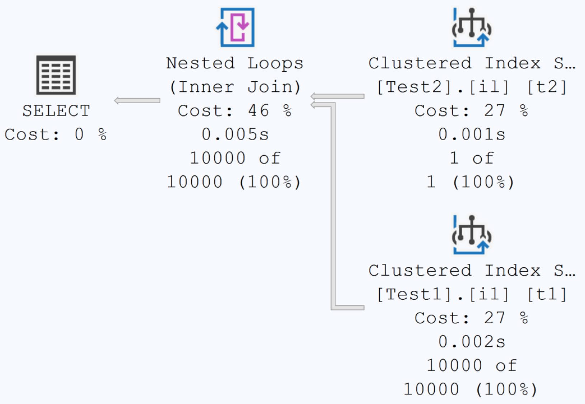  
*Hình 5-6. Kế hoạch thực thi trên hai bảng khi các cột nối và lọc không có chỉ mục*

Bạn có thể quan sát thấy số lượng dòng ước tính (estimated rows) và số dòng thực tế (actual rows) khớp hoàn hảo với dữ liệu chúng ta đã thiết kế: đúng 1 dòng được trả về từ bảng `Test2` và 10.000 dòng từ bảng `Test1`. 

Làm thế nào optimizer biết chính xác điều này khi không hề có chỉ mục? Hãy nhìn vào sự kiện Extended Events:

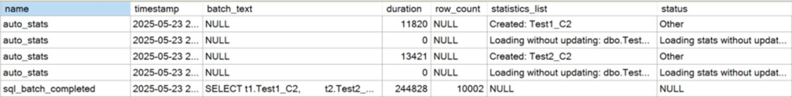  
*Hình 5-7. Phiên Extended Events ghi nhận các sự kiện auto_stats khởi tạo và nạp thống kê*

Thuộc tính `statistics_list` cho thấy thống kê đã được tự động tạo mới trên cột, sau đó được nạp vào bộ nhớ để optimizer sử dụng. Để xem đối tượng thống kê vừa được tạo, chúng ta truy vấn bảng hệ thống `sys.stats` (Listing 5-12):

```sql
-- Listing 5-12. Querying the sys.stats table to see table statistics
SELECT s.name,
       s.auto_created,
       s.user_created
FROM sys.stats AS s
WHERE object_id = OBJECT_ID('Test1');
```

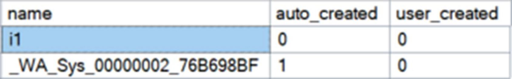  
*Hình 5-8. Đối tượng thống kê tự động tạo xuất hiện trong bảng sys.stats*

Cột `auto_created = 1` xác nhận đây là thống kê do hệ thống tự sinh. Bạn cũng sẽ thấy quy ước đặt tên chuẩn mực của SQL Server có tiền tố `_WA_Sys*`. (Lưu ý rằng thống kê đi kèm chỉ mục `i1` được tạo cùng với chỉ mục nhưng không được đánh dấu là `auto_created`).

#### Quy ước đặt tên thống kê tự động của SQL Server:
* `_WA`: Đại diện cho bang **Washington** – nơi đặt trụ sở chính của Microsoft (đây là sự thật lịch sử thú vị!).
* `_Sys`: Xác định đây là đối tượng do hệ thống tự sinh (System-generated).
* `_00000002`: Vị trí thứ tự (ordinal position) của cột trong bảng đang được tạo thống kê (ở đây là cột thứ 2: `Test1_C2`).
* `76B698BF`: Chuỗi mã băm định danh duy nhất (hex) của đối tượng bảng để phân biệt với các thống kê khác.

Nếu chúng ta thay đổi điều kiện lọc từ giá trị `2` sang giá trị `1` như trong Listing 5-13:

```sql
-- Listing 5-13. Filtering on different criteria
SELECT t1.Test1_C2,
       t2.Test2_C2
FROM dbo.Test1 AS t1
    JOIN dbo.Test2 AS t2
        ON t1.Test1_C2 = t2.Test2_C2
WHERE t1.Test1_C2 = 1;
```

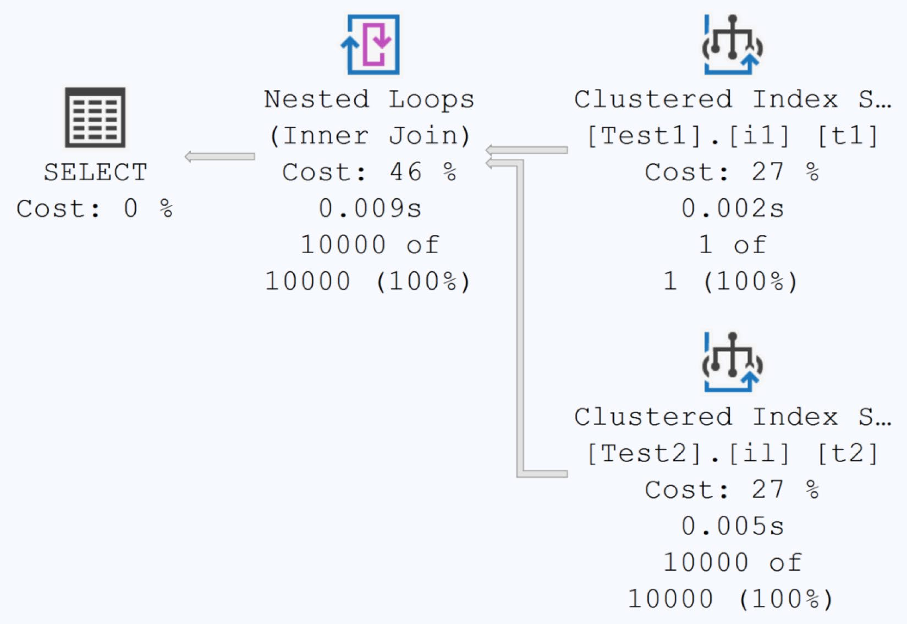  
*Hình 5-9. Kế hoạch thực thi thay đổi chiến lược khi tập dữ liệu trả về biến đổi*

Rõ ràng, nếu muốn tối ưu hóa hiệu năng triệt để, chúng ta sẽ cần bổ sung thêm chỉ mục phù hợp cho các cột này. Tuy nhiên, ví dụ này đã chứng minh rằng: ngay cả trên các cột không có chỉ mục, sự hiện diện của thống kê vẫn cho phép optimizer điều chỉnh chiến lược thực thi kế hoạch một cách cực kỳ linh hoạt và thông minh.

---

### So sánh Hiệu năng khi thiếu Thống kê (Comparing Performance with Missing Statistics)

Điều gì sẽ xảy ra nếu các cột hoàn toàn không có thống kê? Chúng ta hãy cùng thực nghiệm:
1. Chạy lại Listing 5-8 để tái tạo các bảng dữ liệu mà không có thống kê tự động nào tồn tại.
2. Tắt tính năng tự động tạo thống kê bằng Listing 5-14:

```sql
-- Listing 5-14. Disabling the automatic creation of statistics
ALTER DATABASE AdventureWorks SET AUTO_CREATE_STATISTICS OFF;
```

3. Thực thi lại truy vấn kết nối từ Listing 5-11.

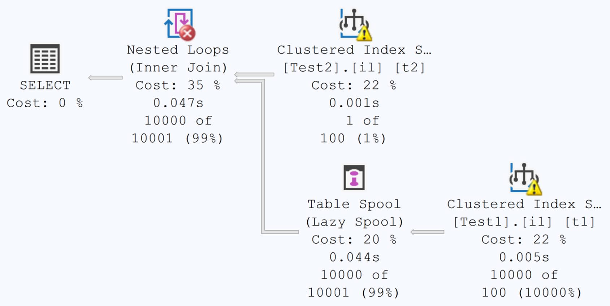  
*Hình 5-10. Kế hoạch thực thi phát sinh nhiều cảnh báo do thiếu hoàn toàn thống kê*

Khi hoàn toàn không có thống kê, bộ tối ưu hóa buộc phải đưa ra những quyết định xử lý rất khác thường. Bạn có thể thấy ngay các dấu cảnh báo màu vàng trên các toán tử Clustered Index Scan:

```text
Columns With No Statistics: [AdventureWorks].[dbo].[Test2].Test2_C2
(Các cột không có thống kê: Test2_C2)
```

Điều này hoàn toàn dễ hiểu vì chúng ta đã tắt tính năng tự động tạo thống kê của SQL Server. Toán tử Nested Loops join cũng xuất hiện cảnh báo nghiêm trọng:

```text
No Join Predicate
(Không có vị từ kết nối)
```

Do không có bất kỳ cơ sở nào để ước tính số lượng dòng, optimizer gần như mặc định giả định rằng mọi giá trị đều có thể phải đối sánh với nhau. Vì lý do đó, nó quyết định chèn thêm một toán tử **Table Spool** (cơ chế lưu trữ trung gian tạm thời trong bộ đệm của kế hoạch thực thi) để chứa dữ liệu đọc từ bảng `Test1`, với hy vọng giảm bớt số lần phải quét lại bảng `Test1`. Đồng thời, bạn sẽ thấy khi thiếu thống kê, optimizer thường áp dụng một con số phỏng đoán mặc định là **100 dòng**.

### Bảng 5-4. Các chỉ số thời gian chạy cho hai kế hoạch thực thi khác nhau

| Sự tồn tại của Thống kê | Kế hoạch thực thi | Thời gian thực thi TB (ms) | Số lần đọc logic (Logical Reads) |
| :--- | :--- | :--- | :--- |
| **Có Thống kê (With statistics)** | Hình 5-6 | **57.9 ms** | **48 reads** |
| **Không có Thống kê (Without statistics)** | Hình 5-10 | **72.5 ms** | **20.248 reads** |

Số lần đọc đĩa logic tăng vọt từ **48 reads lên tới 20.248 reads** khi thiếu thống kê! Vì không có dữ liệu thống kê phân phối thực tế, optimizer buộc phải "đoán mò" bằng các công thức phỏng đoán toán học (heuristic calculations). Những phỏng đoán này đương nhiên không thể nào chính xác bằng việc có số liệu thực tế để ra quyết định.

Nếu bạn buộc phải tắt tính năng tự động tạo thống kê trong một tình huống đặc thù nào đó, bạn nên chủ động giám sát xem có bao nhiêu truy vấn trong hệ thống đang bị "đói" thống kê thông qua sự kiện Extended Events mang tên `missing_column_statistics`.

---

## Phân tích chi tiết số liệu thống kê (Analyzing Statistics)

Số liệu thống kê (Statistics) được cấu thành từ ba tập hợp dữ liệu:

* **Header:** Chứa thông tin siêu dữ liệu tổng quan về đối tượng thống kê mà bạn đang xem xét.
* **Density Graph (Biểu đồ mật độ):** Một cấu trúc toán học biểu thị độ chọn lọc (selectivity) của một hoặc nhiều cột tham gia tạo nên đối tượng thống kê.
* **Histogram (Biểu đồ tần suất):** Một cấu trúc thống kê thể hiện cách thức dữ liệu được phân phối thực tế qua các giá trị cụ thể bên trong cột đầu tiên của đối tượng thống kê.

Trong số các tập dữ liệu này, thành phần được sử dụng phổ biến nhất chính là **Histogram**. Histogram sẽ hiển thị một mẫu dữ liệu đại diện, bao gồm tối đa 200 dòng (được gọi là các bước - *steps*), cùng với số lần xuất hiện của các giá trị bên trong từng bước. Nếu cột dữ liệu cho phép giá trị `NULL`, bạn có thể thấy tới 201 dòng, với một dòng được bổ sung dành riêng cho giá trị `NULL`. Các bước này được sinh ra từ chính dữ liệu thực tế thông qua việc lấy mẫu phân phối ngẫu nhiên trên toàn bộ tập dữ liệu.

Để quan sát số liệu thống kê hoạt động trong thực tế, tôi sẽ tạo một bảng thử nghiệm mới như được trình bày trong Listing 5-15.

**Listing 5-15. Tạo bảng thử nghiệm để phân tích số liệu thống kê (Creating a testing table for statistics analysis)**

```sql
DROP TABLE IF EXISTS dbo.Test1;
GO
CREATE TABLE dbo.Test1
(
    C1 INT,
    C2 INT IDENTITY
);
INSERT INTO dbo.Test1
(
    C1
)
VALUES
(1  );
SELECT TOP 10000
       IDENTITY(INT, 1, 1) AS n
INTO #Nums
FROM master.dbo.syscolumns sc1,
     master.dbo.syscolumns sc2;
INSERT INTO dbo.Test1
(
    C1
)
SELECT 2
FROM #Nums;
DROP TABLE #Nums;
CREATE NONCLUSTERED INDEX FirstIndex ON dbo.Test1 (C1);
```

Lệnh cuối cùng trong đoạn mã trên tiến hành tạo một chỉ mục phi gom cụm (nonclustered index) trên bảng. Khi chỉ mục được tạo, SQL Server sẽ tự động tạo ra một đối tượng thống kê tương ứng dựa trên khóa của chỉ mục đó. Chúng ta có thể truy xuất thông tin thống kê của chỉ mục `FirstIndex` bằng cách thực thi lệnh `DBCC SHOW_STATISTICS` như trong Listing 5-16.

**Listing 5-16. Truy xuất số liệu thống kê bằng DBCC SHOW_STATISTICS (Retrieving statistics using DBCC SHOW_STATISTICS)**

```sql
DBCC SHOW_STATISTICS(Test1, FirstIndex);
```

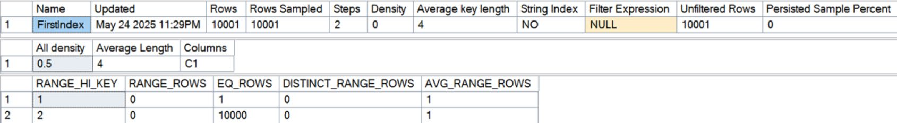

*Hình 5-11: Số liệu thống kê trên chỉ mục FirstIndex (Statistics on index FirstIndex)*

Bạn sẽ nhận được ba tập kết quả riêng biệt từ lệnh `SHOW_STATISTICS`. Tôi đã phác thảo các tập kết quả này ở đầu phần: Header, Density Vector (Density Graph) và Histogram. Chúng ta hãy cùng lần lượt đi sâu vào từng thành phần để hiểu rõ ý nghĩa của chúng.

### Phần đầu thông tin thống kê (Header)

Phần Header chứa các thông tin siêu dữ liệu tổng quan về đối tượng thống kê. Một số trường dữ liệu rất quen thuộc và dễ hiểu như `Name` (tên thống kê) và `Updated` (thời điểm cập nhật lần cuối). Các cột còn lại mang tính chất mô tả chi tiết:
* **Rows:** Đại diện cho tổng số dòng tồn tại trong bảng tại thời điểm số liệu thống kê được tạo lập hoặc cập nhật.
* **Rows Sampled:** Cho biết có bao nhiêu dòng dữ liệu thực tế đã được lấy mẫu để xây dựng nên đối tượng thống kê này; trong ví dụ của chúng ta là 10.001 dòng.
* **Steps:** Cho biết số lượng bước xuất hiện trong biểu đồ tần suất (Histogram); tại đây con số chỉ là 2.
* **Density:** Hiển thị độ dài khóa trung bình cho chỉ mục.
* Các cột còn lại mô tả trạng thái của đối tượng thống kê và phụ thuộc vào các thiết lập cấu hình khác, điều mà chúng ta sẽ tìm hiểu ở phần sau của chương.

### Mật độ (Density)

Độ chọn lọc (selectivity) đóng vai trò quyết định đến hiệu quả của việc truy xuất dữ liệu:
* Các bộ lọc có độ chọn lọc cao (high selectivity) trả về rất ít dòng dữ liệu, khiến cho chỉ mục phi gom cụm (nonclustered index) phát huy tối đa hiệu quả.
* Mặt khác, các bộ lọc có độ chọn lọc thấp (low selectivity) sẽ trả về một lượng dữ liệu rất lớn từ bảng. Một bộ lọc có độ chọn lọc thấp có thể khiến chỉ mục phi gom cụm trở nên hoàn toàn mất tác dụng. Việc điều hướng thông qua một chỉ mục nonclustered rồi thực hiện tra cứu ngược về bảng gốc (lookup) đối với một tập kết quả quá lớn sẽ kém hiệu quả hơn nhiều so với việc chỉ đơn giản là quét toàn bộ chỉ mục gom cụm (clustered index scan) hoặc quét toàn bộ bảng heap.

Số liệu thống kê theo dõi độ chọn lọc của một cột dưới dạng **tỷ lệ mật độ** (*density ratio*). Có hai công thức tính toán: một dành cho tập thống kê cột đơn lẻ như trường hợp chúng ta đang xem xét ở đây, và công thức thứ hai dành cho thống kê phức hợp (compound statistics) bao gồm nhiều cột. Chúng ta sẽ tìm hiểu về thống kê phức hợp ở phần sau. Công thức tính toán cơ bản cho một cột đơn lẻ như sau:

$$\text{Density} = \frac{1}{\text{Số lượng giá trị phân biệt của một cột (Number of distinct values)}}$$

Mật độ (Density) luôn là một giá trị nằm trong khoảng từ 0 đến 1. **Mật độ càng thấp, cột đó càng có độ chọn lọc cao và càng thích hợp để làm khóa chỉ mục.** Nếu bạn muốn tự mình kiểm chứng các giá trị này, bạn có thể thực thi một câu lệnh T-SQL như trong Listing 5-17.

**Listing 5-17. Tính toán giá trị mật độ (Calculating the density value)**

```sql
SELECT 1.0 / COUNT(DISTINCT C1)
FROM dbo.Test1;
```

Giá trị Density được trình tối ưu hóa sử dụng để ước tính số lượng dòng khi biểu đồ tần suất (Histogram) không thể áp dụng được (chẳng hạn khi giá trị tìm kiếm nằm ngoài phạm vi histogram hoặc trong các phép nối phức tạp). Cách tính rất đơn giản: lấy giá trị Density nhân với tổng số dòng trong bảng để thu được số dòng ước tính trung bình cho bất kỳ một giá trị phân biệt ngẫu nhiên nào.

### Biểu đồ tần suất (Histogram)

Thành phần dữ liệu được khai thác nhiều nhất và quan trọng nhất trong các đối tượng thống kê chính là **Histogram**. Mặc dù là tập kết quả thứ ba được trả về, nhưng đây lại là thành phần cốt lõi nhất mà bạn bắt buộc phải thấu hiểu. Nó bao gồm 5 cột dữ liệu và tối đa 200 dòng (bước):

* **RANGE_HI_KEY:** Giá trị biên trên của mỗi dải (range). Dải này có thể chứa hoặc không chứa các giá trị dữ liệu bên trong. Giá trị này luôn là một giá trị dữ liệu thực tế xuất hiện trong cột. Nếu là cột kiểu số (như `INT` trong ví dụ của chúng ta), nó sẽ là một con số. Nếu là kiểu chuỗi ký tự, nó sẽ hiển thị dưới dạng chuỗi (ví dụ: `"London"` từ cột `City`).
* **EQ_ROWS:** Số lượng dòng bên trong dải tại thời điểm thống kê được tạo/cập nhật có giá trị khớp chính xác với giá trị `RANGE_HI_KEY`.
* **RANGE_ROWS:** Số lượng dòng nằm giữa giá trị biên trên của bước trước đó và giá trị biên trên của bước hiện tại, không tính hai điểm biên này.
* **DISTINCT_RANGE_ROWS:** Số lượng các giá trị phân biệt (distinct values) nằm bên trong dải (giữa hai biên). Nếu tất cả các giá trị đều là duy nhất, thì `RANGE_ROWS` sẽ bằng đúng `DISTINCT_RANGE_ROWS`.
* **AVG_RANGE_ROWS:** Số lượng dòng trung bình cho mỗi giá trị khóa tiềm năng nằm bên trong dải. Về cơ bản, giá trị này được tính bằng: `RANGE_ROWS / DISTINCT_RANGE_ROWS`.

Trình tối ưu hóa sẽ lấy giá trị tìm kiếm từ câu truy vấn; giả sử là giá trị `1` trong ví dụ của chúng ta. Sau đó, nó đối chiếu vào Histogram để xác định số dòng ước tính. Vì giá trị `1` chính là `RANGE_HI_KEY` của dải đầu tiên, optimizer biết ngay rằng `EQ_ROWS` có giá trị là 1 và do đó không cần phải thực hiện thêm bất kỳ phép tính toán nào khác. Vì tập dữ liệu mẫu của chúng ta chỉ gồm hai giá trị là `1` và `2`, chúng ta chỉ có hai bước trong histogram. Hãy cùng quan sát một tập dữ liệu thống kê phong phú hơn trong Listing 5-18.

**Listing 5-18. Truy xuất thống kê từ bảng Sales.SalesOrderDetail (Retrieving statistics from the Sales.SalesOrderDetail table)**

```sql
DBCC SHOW_STATISTICS('Sales.SalesOrderDetail', 'IX_SalesOrderDetail_ProductID');
```

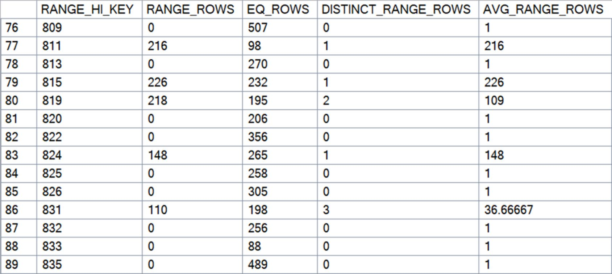

*Hình 5-12: Biểu đồ tần suất từ số liệu thống kê IX_SalesOrderDetail_ProductID (Histogram from the IX_SalesOrderDetail_ProductID statistics)*

Giờ đây, giả sử câu truy vấn của chúng ta tìm kiếm giá trị `827`. Nếu quan sát các giá trị trong cột `RANGE_HI_KEY`, giá trị gần nhất nằm ngay phía trên giá trị cần tìm là `831`. Tiếp theo, nếu nhìn sang cột `AVG_RANGE_ROWS`, chúng ta nhận được giá trị là `36.66667`. Khi trình tối ưu hóa xây dựng kế hoạch thực thi cho truy vấn tìm kiếm `ProductID = 827`, nó sẽ ước tính rằng sẽ có xấp xỉ 36,66667 dòng khớp với điều kiện này.

### Ước tính độ chọn lọc / số lượng dòng (Cardinality)

Số liệu thống kê — bao gồm Histogram và Density — được Query Optimizer sử dụng để tính toán xem có bao nhiêu dòng dữ liệu dự kiến sẽ được xử lý bởi mỗi toán tử bên trong kế hoạch thực thi. Phép tính toán xác định số lượng dòng này được gọi là **ước tính Cardinality** (*cardinality estimate*). 

Cardinality biểu thị số lượng dòng trong một tập dữ liệu, đồng nghĩa với việc nó liên quan trực tiếp đến các phép đo mật độ trong SQL Server. Phần lớn thời gian, thông tin này được trích xuất trực tiếp từ Histogram như đã phân tích ở trên. Tuy nhiên, khi có nhiều cột cùng tham gia vào các điều kiện lọc, phép tính toán Cardinality bắt buộc phải tính đến độ chọn lọc tiềm năng của từng cột. Công thức tính toán trên bất kỳ phiên bản nào từ SQL Server 2014 trở lên (với bộ ước lượng Cardinality mới - New CE) như sau:

$$\text{Selectivity}_1 \times (\text{Selectivity}_2)^{1/2} \times (\text{Selectivity}_3)^{1/4} \times \dots$$

Phép ước tính này dựa trên giả định rằng các cột dữ liệu có mối tương quan nhất định với nhau (exponential backoff model). Bằng cách lấy lũy thừa bậc $1/2$ cho độ chọn lọc của cột thứ hai, sau đó là $1/4$, $1/8$,... tùy thuộc vào số lượng cột tham gia, dữ liệu được xử lý như thể các cột có mối quan hệ tương hỗ lẫn nhau, vốn là điều thường thấy trong thực tế nghiệp vụ.

Nếu bạn đang vận hành một phiên bản SQL Server cũ hơn hoặc chạy cơ sở dữ liệu ở mức độ tương thích cũ hơn (Compatibility Level $\le 110$ - Legacy CE), công thức tính toán sẽ giả định tính độc lập hoàn toàn giữa các cột:

$$\text{Selectivity}_1 \times \text{Selectivity}_2 \times \text{Selectivity}_3 \times \dots$$

Một phép tính khác phát huy tác dụng khi xử lý các giá trị tăng đơn điệu (monotonically increasing values), chẳng hạn như cột `IDENTITY` hoặc cột ngày tháng liên tục tăng. Với một tập thống kê mới được tạo bằng tùy chọn `FULLSCAN`, mọi thứ hoạt động hoàn toàn chính xác. Tuy nhiên, nếu bạn sử dụng phương pháp lấy mẫu (sample) để tạo thống kê hoặc bảng liên tục có dữ liệu mới được chèn vào vượt quá giá trị cao nhất trong Histogram, bộ ước tính Cardinality (CE) sẽ phải đưa ra giả định về số dòng trung bình từ số liệu thống kê. Trước phiên bản SQL Server 2014, giả định mặc định là dữ liệu nằm ngoài biên trên luôn chỉ trả về 1 dòng duy nhất, bất kể thực tế có bao nhiêu dòng chèn mới. Phương pháp tính toán mới của SQL Server 2014 trở đi đảm bảo tạo ra các kế hoạch thực thi chính xác hơn trong hầu hết các trường hợp. Dù vậy, nếu dữ liệu của bạn có sự phân phối không đồng đều (dữ liệu bị lệch - skewed data), nó vẫn có thể dẫn đến các ước tính Cardinality sai lệch, kéo theo kế hoạch thực thi có hiệu năng kém.

Bạn có thể sử dụng Extended Events để quan sát trực tiếp cách các ước tính Cardinality được hình thành. Điều này đặc biệt hữu ích khi bạn thực sự không hiểu một ước tính cụ thể bắt nguồn từ đâu. Sự kiện Extended Events dùng để theo dõi quá trình này là `query_optimizer_estimate_cardinality`.

> [!NOTE]
> Sự kiện `query_optimizer_estimate_cardinality` thuộc kênh **Debug** trong Extended Events. Các sự kiện Debug chỉ nên được sử dụng hết sức cẩn trọng, sau khi đã kiểm thử kỹ lưỡng trên môi trường phi thực tế (nonproduction). Các sự kiện trong gói này có thể bị thay đổi hoặc gỡ bỏ bất kỳ lúc nào mà không cần thông báo trước.

Listing 5-19 minh họa một phiên Extended Events mẫu dùng để theo dõi quá trình ước tính Cardinality trong thực tế.

**Listing 5-19. Phiên Extended Events cho query_optimizer_estimate_cardinality (Extended Events session for query_optimizer_estimate_cardinality)**

```sql
CREATE EVENT SESSION [CardinalityEstimation]
ON SERVER
    ADD EVENT sqlserver.auto_stats
    (WHERE ([sqlserver].[database_name] = N'AdventureWorks')),
    ADD EVENT sqlserver.query_optimizer_estimate_cardinality
    (WHERE ([sqlserver].[database_name] = N'AdventureWorks')),
    ADD EVENT sqlserver.sql_batch_completed
    (WHERE ([sqlserver].[database_name] = N'AdventureWorks')),
    ADD EVENT sqlserver.sql_batch_starting
    (WHERE ([sqlserver].[database_name] = N'AdventureWorks'))
    ADD TARGET package0.event_file
    (SET filename = N'cardinalityestimation')
WITH
(
    TRACK_CAUSALITY = ON
);
```

Chúng ta có một câu truy vấn tương đối phức tạp trong Listing 5-20 nhằm sinh ra một kế hoạch thực thi lớn với nhiều toán tử, từ đó phát sinh nhiều sự kiện ước tính Cardinality để khảo sát.

**Listing 5-20. Truy vấn SELECT trên nhiều bảng (SELECT query against several tables)**

```sql
SELECT so.Description,
       p.Name AS ProductName,
       p.ListPrice,
       p.Size,
       pv.AverageLeadTime,
       pv.MaxOrderQty,
       v.Name AS VendorName
FROM Sales.SpecialOffer AS so
    JOIN Sales.SpecialOfferProduct AS sop
        ON sop.SpecialOfferID = so.SpecialOfferID
    JOIN Production.Product AS p
        ON p.ProductID = sop.ProductID
    JOIN Purchasing.ProductVendor AS pv
        ON pv.ProductID = p.ProductID
    JOIN Purchasing.Vendor AS v
        ON v.BusinessEntityID = pv.BusinessEntityID
WHERE so.DiscountPct > .15;
```

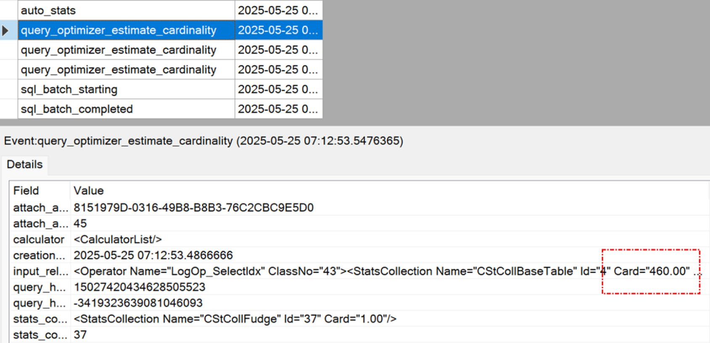

*Hình 5-13: Phiên Extended Events hiển thị kết quả từ sự kiện query_optimizer_estimate_cardinality (Session showing output from the query_optimizer_estimate_cardinality event)*

Bạn có thể thấy các sự kiện `auto_stats` được kích hoạt. Sau đó, phần được tô sáng là sự kiện `query_optimizer_estimate_cardinality` đầu tiên được chọn, cho phép bạn quan sát toàn bộ các thuộc tính của sự kiện ở phía dưới màn hình. Hai khu vực chúng ta cần tập trung vào là giá trị `input_relation` và giá trị `stats_collected`. Cả hai đều ở định dạng XML. Các con số đáng chú ý là các giá trị `Card`:
* Giá trị đầu tiên là `460.00` (được đóng khung nét đứt ở bên phải), thể hiện tổng thể Cardinality của bảng (tổng số dòng).
* Giá trị thứ hai là `1.00`, đại diện cho số dòng ước tính thu được từ đối tượng thống kê tương ứng.

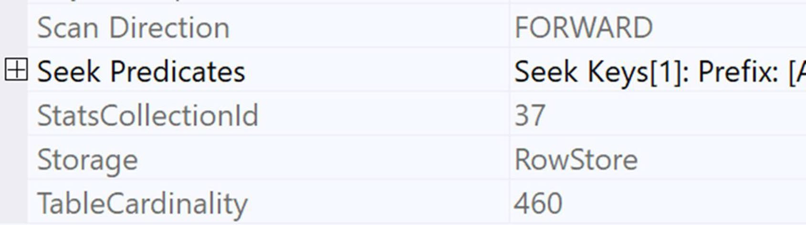

*Hình 5-14: Khớp StatsCollectionId giữa toán tử và thuộc tính (StatsCollectionId matching the operator to the properties)*

Phương pháp này chỉ hữu ích trong một số trường hợp hiếm hoi vì các giá trị Cardinality đều đã được thể hiện sẵn ngay trong các toán tử của kế hoạch thực thi. Bạn chỉ cần đến nó khi phải truy lùng các vấn đề phức tạp, ẩn khuất. Một thông tin giá trị khác được sự kiện này trả về là **phiên bản công cụ ước tính Cardinality** (*cardinality estimation engine version*), rất hữu ích khi bạn đối mặt với các sự cố sau nâng cấp phiên bản SQL Server. Lưu ý rằng sự kiện này không khả dụng trên Azure SQL Database.

### Thống kê trên chỉ mục đa cột (Statistics on a Multicolumn Index)

Khi làm việc với một chỉ mục chỉ có một cột khóa duy nhất, số liệu thống kê được xác định bởi Histogram và giá trị Density của riêng cột đó. Tuy nhiên, khi một chỉ mục sở hữu khóa phức hợp (**compound key** — gồm nhiều hơn một cột xác định khóa), thông tin thống kê sẽ có sự khác biệt quan trọng:

* **Histogram:** Chỉ duy nhất cột đầu tiên trong khóa phức hợp được sử dụng để xây dựng Histogram. Điều này khiến cho việc lựa chọn thứ tự các cột trong khóa chỉ mục trở nên tối quan trọng. Cột có mức độ phân phối dữ liệu tốt nhất — thông thường là cột có tính chọn lọc cao nhất (mật độ Density thấp nhất) — nên được đặt làm cột đầu tiên.
* **Density:** Đối tượng thống kê sẽ chứa nhiều giá trị Density: giá trị mật độ cho riêng cột đầu tiên, tiếp theo là giá trị mật độ cho sự kết hợp của hai cột đầu tiên, ba cột đầu tiên, và cứ thế tiếp tục cho toàn bộ các cột trong khóa chỉ mục.

Việc tồn tại nhiều giá trị Density đảm bảo rằng trình tối ưu hóa có thể ước tính số dòng chính xác hơn khi nhiều cột từ chỉ mục được sử dụng trong các vị từ của mệnh đề `WHERE`, `HAVING` hoặc `JOIN`.

Bạn sẽ chỉ nhận được biểu đồ mật độ đa cột (multicolumn density graphs) thông qua việc tạo một chỉ mục có khóa phức hợp hoặc tạo số liệu thống kê thủ công bằng lệnh `CREATE STATISTICS`. Bạn sẽ **không bao giờ** thấy một biểu đồ mật độ đa cột được sinh ra từ quy trình tự động tạo thống kê (auto-created statistics) của SQL Server. 

Listing 5-21 minh họa một truy vấn sử dụng hai cột trong mệnh đề `WHERE`.

**Listing 5-21. Truy vấn với hai cột trong mệnh đề WHERE (Query with two columns in the WHERE clause)**

```sql
SELECT p.Name,
       p.Class
FROM Production.Product AS p
WHERE p.Color = 'Red'
      AND p.DaysToManufacture > 15;
```

Một chỉ mục trên hai cột `p.Color` và `p.DaysToManufacture` sẽ sở hữu giá trị Density đa cột. Trước khi chạy truy vấn, chúng ta hãy xem danh sách các số liệu thống kê hiện có trên bảng bằng Listing 5-22.

**Listing 5-22. Truy vấn các bảng hệ thống để trả về danh sách thống kê (Querying the system tables to return a list of statistics)**

```sql
SELECT s.name,
       s.auto_created,
       s.user_created,
       s.filter_definition,
       sc.column_id,
       c.name AS ColumnName
FROM sys.stats AS s
    JOIN sys.stats_columns AS sc
        ON sc.stats_id = s.stats_id
           AND sc.object_id = s.object_id
    JOIN sys.columns AS c
        ON c.column_id = sc.column_id
           AND c.object_id = s.object_id
WHERE s.object_id = OBJECT_ID('Production.Product');
```

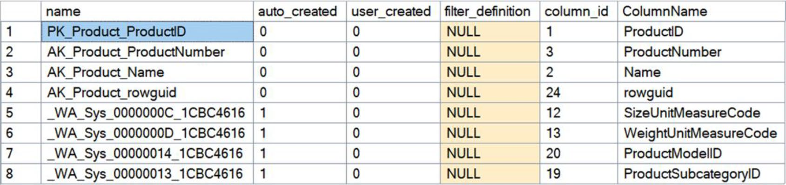

*Hình 5-15: Danh sách số liệu thống kê ban đầu trên bảng Product (List of statistics on the Product table)*

Sau khi thực thi câu truy vấn Listing 5-21, chúng ta truy vấn lại danh sách thống kê:

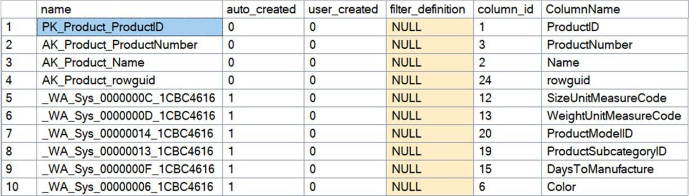

*Hình 5-16: Các số liệu thống kê được bổ sung tự động trên bảng Product (Added statistics to the Product table)*

Như bạn thấy, thay vì tạo ra một đối tượng thống kê đa cột, SQL Server đã tự động tạo ra hai đối tượng thống kê đơn cột riêng biệt cho từng cột liên quan.

Để quan sát các giá trị Density thực sự trong một chỉ mục đa cột, tôi sẽ chỉnh sửa chỉ mục nonclustered đã tạo từ Listing 5-15 thành chỉ mục hai cột như trong Listing 5-23.

**Listing 5-23. Chỉnh sửa chỉ mục để có hai cột khóa (Changing the index to have two keys)**

```sql
CREATE NONCLUSTERED INDEX FirstIndex
ON dbo.Test1 (
                 C1,
                 C2
             )
WITH (DROP_EXISTING = ON);
```

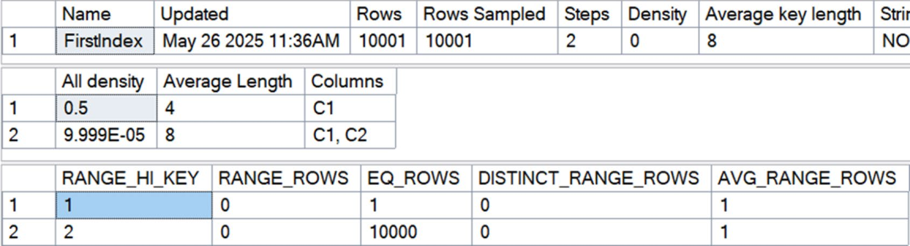

*Hình 5-17: Số liệu thống kê với biểu đồ mật độ đa cột (Statistics with a multicolumn density graph)*

Bây giờ bạn có thể thấy phần Density đã thay đổi: dòng thứ nhất hiển thị mật độ của riêng cột đầu tiên (`C1`), và dòng thứ hai hiển thị mật độ của tổ hợp cả hai cột (`C1, C2`). Không có gì thay đổi trong Histogram vì nó luôn luôn chỉ đại diện cho cột đầu tiên.

### Thống kê trên chỉ mục có điều kiện lọc (Statistics on a Filtered Index)

Chỉ mục có điều kiện lọc (**Filtered Index**, sẽ được thảo luận trong Chương 9) được thiết kế nhằm giới hạn dữ liệu cấu thành nên chỉ mục thông qua việc sử dụng mệnh đề `WHERE`. Do bản chất đó, dữ liệu Density và Histogram đi kèm với chỉ mục này cũng sẽ chỉ đại diện cho tập dữ liệu thỏa mãn điều kiện lọc.

Để quan sát điều này, chúng ta tạo một chỉ mục thông thường trên bảng `Sales.SalesOrderHeader` như trong Listing 5-24.

**Listing 5-24. Tạo chỉ mục trên cột PurchaseOrderNumber (Creating an index on the PurchaseOrderNumber column)**

```sql
CREATE INDEX IX_Test ON Sales.SalesOrderHeader (PurchaseOrderNumber);
```

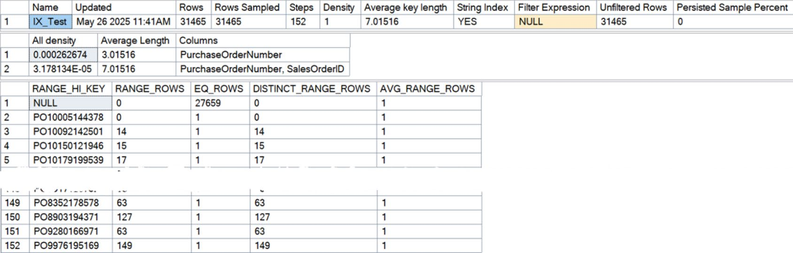

*Hình 5-18: Số liệu thống kê trên một chỉ mục không có bộ lọc (Statistics on an unfiltered index)*

Nếu chỉ mục này được tạo lại để loại bỏ các giá trị `NULL` nhằm tăng tính hiệu quả, mã lệnh sẽ như Listing 5-25.

**Listing 5-25. Tái tạo chỉ mục có điều kiện lọc (Altering the index to make it filtered)**

```sql
CREATE INDEX IX_Test
ON Sales.SalesOrderHeader (PurchaseOrderNumber)
WHERE PurchaseOrderNumber IS NOT NULL
WITH (DROP_EXISTING = ON);
```

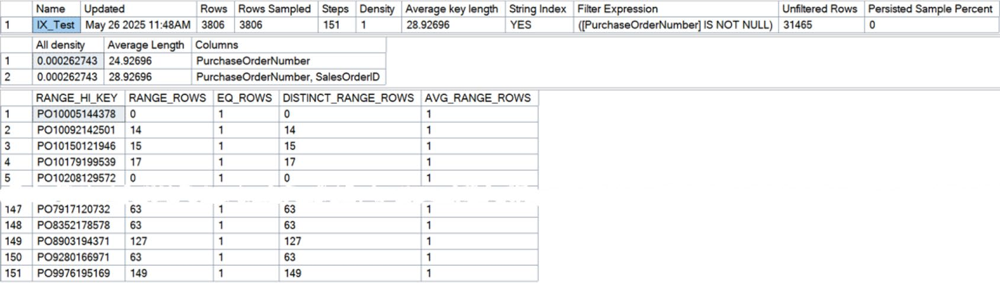

*Hình 5-19: Số liệu thống kê mới dựa trên chỉ mục có điều kiện lọc (New statistics based on the filtered index)*

Bạn cũng hoàn toàn có thể tự tạo các **thống kê có điều kiện lọc** (*filtered statistics*) mà không cần tạo chỉ mục. Việc này cho phép bạn xây dựng các biểu đồ tần suất được tinh chỉnh chuyên sâu, đặc biệt hữu ích trên các **bảng phân vùng** (*partitioned tables*). Điều này là cần thiết vì số liệu thống kê không được tự động tạo riêng lẻ trên từng phân vùng, và bạn cũng không thể trực tiếp tạo thống kê theo phân vùng bằng lệnh `CREATE STATISTICS` thông thường. Thay vào đó, bạn có thể tạo các chỉ mục lọc hoặc thống kê lọc tương ứng với từng phân vùng cụ thể.

Trước khi tiếp tục, hãy dọn dẹp chỉ mục thử nghiệm bằng Listing 5-26.

**Listing 5-26. Xóa chỉ mục thử nghiệm (Removing the test index)**

```sql
DROP INDEX Sales.SalesOrderHeader.IX_Test;
```

### Điều khiển bộ ước lượng Cardinality (Controlling the Cardinality Estimator)

Khi chạy SQL Server 2014 trở lên, hệ thống sẽ tự động kích hoạt bộ ước lượng Cardinality mới nhất. Cách thức chủ yếu để kiểm soát điều này là thông qua **mức độ tương thích của cơ sở dữ liệu** (*database compatibility level*):
* Nếu đặt từ `120` trở lên, bạn đang sử dụng bộ ước lượng Cardinality mới (New CE).
* Nếu đặt từ `110` trở xuống, hệ thống sẽ sử dụng bộ ước lượng cũ (Legacy CE).

Bạn có thể kiểm soát bộ ước lượng nào được áp dụng thông qua nhiều cấp độ khác nhau, tùy thuộc vào phiên bản SQL Server đang vận hành:

1. **Mức độ tương thích cơ sở dữ liệu (Database compatibility level)**
2. **Cờ theo dõi 9481 (Trace flag 9481)**
3. **Thiết lập cấu hình phạm vi cơ sở dữ liệu: `LEGACY_CARDINALITY_ESTIMATION`**
4. **Gợi ý truy vấn (Query hint): `FORCE_LEGACY_CARDINALITY_ESTIMATION`**
5. **Gợi ý trong Query Store (Query Store hint): `FORCE_LEGACY_CARDINALITY_ESTIMATION`**

Tùy chọn nào bạn lựa chọn phụ thuộc vào mức độ chi tiết (granularity) mà bạn cần can thiệp trên hệ thống. 

Tùy chọn ít chi tiết nhất (ảnh hưởng diện rộng nhất) là thay đổi mức độ tương thích cơ sở dữ liệu, như minh họa trong Listing 5-27.

**Listing 5-27. Thay đổi mức độ tương thích cơ sở dữ liệu (Changing the database compatibility level)**

```sql
ALTER DATABASE AdventureWorks SET COMPATIBILITY_LEVEL = 110;
```

Lệnh này sẽ khiến toàn bộ cơ sở dữ liệu hoạt động như một cơ sở dữ liệu SQL Server 2012, vô hiệu hóa nhiều tính năng hiện đại khác của hệ thống. Đây thường là một lựa chọn tồi.

Tùy chọn tiếp theo là kích hoạt Cờ theo dõi (**Trace flag 9481**) (hỗ trợ từ SQL Server 2014 trở lên). Tuy nhiên, việc kiểm soát hành vi thông qua trace flags mang tính cổ điển, gây khó khăn cho việc quản lý cấu hình tập trung. Một cách tiếp cận ưu việt hơn là sử dụng **Database Scoped Configuration** (Cấu hình trong phạm vi cơ sở dữ liệu) như trong Listing 5-28.

**Listing 5-28. Điều khiển bộ ước lượng cũ qua Database Scoped Configuration (Controlling the legacy cardinality estimation engine)**

```sql
ALTER DATABASE SCOPED CONFIGURATION SET LEGACY_CARDINALITY_ESTIMATION = ON;
```

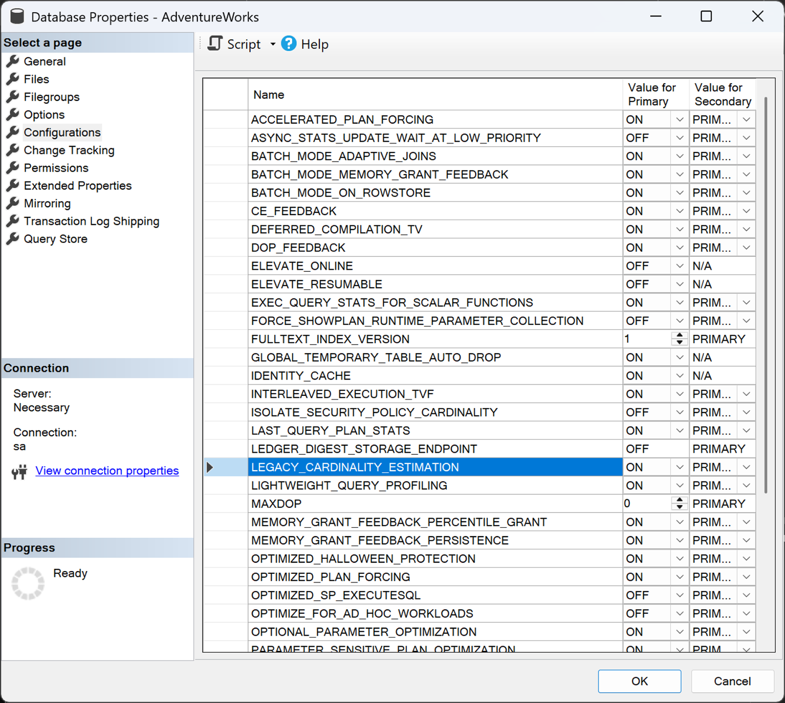

*Hình 5-20: Tất cả các thiết lập trong Database Scoped Configuration (All Database Scoped Configuration settings)*

Giao diện đồ họa này thậm chí còn cho phép bạn kiểm soát các thiết lập cho từng bản sao Primary và Secondary trong mô hình Always On Availability Groups.

Ở mức độ chi tiết cao hơn, bạn có thể áp dụng gợi ý truy vấn `USE HINT ('FORCE_LEGACY_CARDINALITY_ESTIMATION')` cho một câu lệnh cụ thể, như trong Listing 5-29.

**Listing 5-29. Kiểm soát Cardinality thông qua gợi ý truy vấn (Controlling cardinality through a query hint)**

```sql
SELECT p.Name,
       p.Class
FROM Production.Product AS p
WHERE p.Color = 'Red'
      AND p.DaysToManufacture > 15
OPTION (USE HINT ('FORCE_LEGACY_CARDINALITY_ESTIMATION'));
```

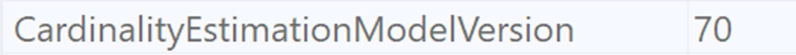

*Hình 5-21: Thuộc tính kế hoạch thực thi hiển thị công cụ ước lượng cardinality (Execution plan property showing the cardinality estimation engine)*

Cuối cùng, nếu bạn sử dụng SQL Server 2022 trở lên, Azure SQL Database hoặc Azure SQL Managed Instance, bạn có thể áp dụng tính năng **Query Store hints** để ép buộc sử dụng bộ ước lượng cũ mà không cần phải chỉnh sửa mã nguồn ứng dụng. Chúng ta sẽ cùng nhau tìm hiểu chi tiết về tính năng Query Store hints trong Chương 6.

---

## Bảo trì số liệu thống kê (Statistics Maintenance)

### Tự động tạo thống kê (Auto Create Statistics)

Chúng ta đã thảo luận về cách số liệu thống kê được tự động tạo lập trên các cột chưa được đánh chỉ mục khi các cột đó được sử dụng làm điều kiện lọc trong các mệnh đề `JOIN`, `WHERE`, hoặc `HAVING`. Hành vi này được kích hoạt mặc định trong SQL Server và nhìn chung bạn nên luôn duy trì thiết lập này.

### Tự động cập nhật thống kê (Auto Update Statistics)

Chúng ta cũng đã phân tích cơ chế cập nhật số liệu thống kê của hệ thống. Tương tự như trên, bạn nên giữ nguyên các thiết lập mặc định của SQL Server, trừ khi các kết quả kiểm thử nghiêm ngặt chứng minh rằng việc vô hiệu hóa tính năng này trên một hệ thống cụ thể là giải pháp đánh đổi xứng đáng để chấp nhận số liệu thống kê bị lỗi thời. Nếu bạn quyết định tắt tính năng tự động cập nhật thống kê, bạn bắt buộc phải tự xây dựng các quy trình bảo trì thống kê định kỳ của riêng mình để đảm bảo dữ liệu thống kê luôn phản ánh sát thực tế.

### Tự động cập nhật thống kê bất đồng bộ (Auto Update Statistics Asynchronously)

Chúng ta đã đề cập đến tính năng này nhiều lần trong chương, nhưng chưa giải thích cặn kẽ cách thức hoạt động của nó. Khi tùy chọn `AUTO_UPDATE_STATISTICS_ASYNC` được bật sang trạng thái `ON`, hành vi cơ bản của số liệu thống kê trong SQL Server không bị thay đổi hoàn toàn:

Khi một tập số liệu thống kê bị đánh dấu là đã lỗi thời theo công thức ngưỡng biến động dữ liệu, quy trình cập nhật thống kê sẽ **không làm gián đoạn** việc thực thi của câu truy vấn hiện tại như trong cơ chế đồng bộ thông thường. Thay vào đó, câu truy vấn sẽ tiếp tục hoàn tất quá trình thực thi bằng cách sử dụng tập số liệu thống kê cũ sẵn có. Sau khi truy vấn hoàn thành, tiến trình ngầm mới tiến hành cập nhật số liệu thống kê.

Cách tiếp cận này rất hấp dẫn trong thực tế, bởi vì khi số liệu thống kê được cập nhật đồng bộ, kế hoạch thực thi hiện tại sẽ bị xóa khỏi bộ nhớ đệm (plan cache) và một kế hoạch thực thi mới phải được biên dịch lại ngay lập tức. Tùy thuộc vào độ phức tạp của câu truy vấn, việc tạo ra một kế hoạch thực thi mới có thể là một tiến trình tốn thời gian, gây chậm trễ cho lần thực thi đó. Bằng cách không bắt câu truy vấn phải chờ đợi cả quá trình cập nhật thống kê lẫn quá trình tạo kế hoạch thực thi mới, truy vấn có thể hoàn thành tác vụ ngay lập tức. Ở lần thực thi tiếp theo của chính truy vấn đó, số liệu thống kê mới đã sẵn sàng và nó chỉ cần trải qua bước tái biên dịch lại kế hoạch.

Tuy nhiên, dù chức năng này giúp tăng tốc độ thực thi tại thời điểm thống kê bị kích hoạt cập nhật, nó cũng có thể khiến các truy vấn vốn dĩ sẽ hưởng lợi rất lớn từ thống kê mới và kế hoạch mới lại phải tiếp tục chịu đựng sự chậm trễ với kế hoạch thực thi cũ kém tối ưu. Do đó, việc kiểm thử kỹ lưỡng trước khi kích hoạt tính năng này là điều bắt buộc để đảm bảo nó mang lại nhiều lợi ích hơn là rủi ro.

> [!NOTE]
> Nếu bạn muốn bật tính năng tự động cập nhật thống kê bất đồng bộ (`AUTO_UPDATE_STATISTICS_ASYNC ON`), bạn bắt buộc phải bật tùy chọn `AUTO_UPDATE_STATISTICS ON` trước đó.

### Bảo trì thủ công (Manual Maintenance)

Mặc dù SQL Server thực hiện rất tốt việc tự động bảo trì số liệu thống kê, bạn vẫn có thể cần phải can thiệp thủ công trực tiếp trong một số trường hợp cụ thể:

- **Khi tiến hành thử nghiệm số liệu thống kê:** Xin vui lòng không chạy các kịch bản thử nghiệm tải nặng trên các máy chủ và cơ sở dữ liệu môi trường sản xuất (production).
- **Sau khi nâng cấp từ phiên bản cũ lên phiên bản SQL Server mới hơn:** Giả định rằng bạn đang nâng cấp lên SQL Server 2016 hoặc cao hơn, bạn nên tận dụng Query Store như một phần của quy trình nâng cấp. Điều này cũng đồng nghĩa với việc bạn không nên vội vàng cập nhật toàn bộ số liệu thống kê ngay lập tức. Thay vào đó, hãy để chúng tự động cập nhật dần dần như trước. Sau đó, khi bạn thay đổi mức tương thích (compatibility level) thông qua quy trình nâng cấp Query Store (được trình bày trong Chương 6), đó mới là thời điểm thích hợp để bạn chủ động cập nhật lại toàn bộ thống kê.
- **Khi thực thi các tác vụ SQL tức thời (ad hoc) một lần duy nhất:** Trong những trường hợp này, bạn có thể phải cân nhắc giữa việc để hệ thống tự động bảo trì thống kê hay chủ động kiểm soát chính xác thời điểm và cách thức thống kê được cập nhật. Điều này thường chỉ đáng lưu tâm đối với các cơ sở dữ liệu có dung lượng đặc biệt lớn.
- **Tính năng tự động cập nhật thống kê không kích hoạt đủ thường xuyên:** Tình trạng này có thể bắt nguồn từ nhiều nguyên nhân. Bạn thường phát hiện ra vấn đề khi một truy vấn chạy chậm và khi quan sát kế hoạch thực thi, bạn thấy sự chênh lệch rất lớn giữa số hàng ước tính và số hàng thực tế. Trong các trường hợp này, bạn cần can thiệp thủ công — hoặc như một tác vụ xử lý tức thời một lần, hoặc như một phần của lịch trình bảo trì định kỳ nhằm bổ trợ cho cơ chế tự động của hệ thống.

### Quản lý các thiết lập thống kê (Manage Statistics Settings)

Bạn có thể kiểm soát thiết lập Tự động tạo thống kê ở cấp độ cơ sở dữ liệu. Để vô hiệu hóa thiết lập này, sử dụng câu lệnh `ALTER DATABASE` như trong Listing 5-30.

**Listing 5-30.** Tắt tính năng Auto Create Statistics

```sql
ALTER DATABASE AdventureWorks SET AUTO_CREATE_STATISTICS OFF;
```

Bạn có thể kiểm soát tính năng Tự động cập nhật thống kê ở nhiều cấp độ khác nhau của cơ sở dữ liệu, bao gồm toàn bộ các chỉ mục và thống kê trên một bảng, hoặc ở cấp độ từng chỉ mục/thống kê riêng lẻ. Để tắt tính năng Auto Update Statistics ở cấp độ cơ sở dữ liệu, sử dụng câu lệnh trong Listing 5-31.

**Listing 5-31.** Tắt tính năng Auto Update Statistics ở cấp cơ sở dữ liệu

```sql
ALTER DATABASE AdventureWorks SET AUTO_UPDATE_STATISTICS OFF;
```

Việc vô hiệu hóa thiết lập này ở cấp độ cơ sở dữ liệu sẽ ghi đè lên toàn bộ các thiết lập riêng lẻ ở các cấp độ thấp hơn. Tính năng cập nhật bất đồng bộ yêu cầu tính năng cập nhật tự động phải được bật trước, sau đó bạn mới có thể kích hoạt tính năng bất đồng bộ như trong Listing 5-32.

**Listing 5-32.** Bật tính năng tự động cập nhật thống kê bất đồng bộ

```sql
ALTER DATABASE AdventureWorks SET AUTO_UPDATE_STATISTICS_ASYNC ON;
```

Để cấu hình tính năng Tự động cập nhật thống kê cho toàn bộ các chỉ mục và thống kê trên một bảng cụ thể trong cơ sở dữ liệu hiện hành, sử dụng thủ tục lưu trữ hệ thống `sp_autostats` như trong Listing 5-33.

**Listing 5-33.** Tắt tự động cập nhật thống kê trên một bảng đơn lẻ

```sql
USE AdventureWorks;
EXEC sp_autostats
    'HumanResources.Department',
    'OFF';
```

Bạn cũng có thể sử dụng chính thủ tục lưu trữ này để cấu hình thiết lập cho từng chỉ mục hoặc đối tượng thống kê riêng lẻ. Để vô hiệu hóa thiết lập cho chỉ mục `AK_Department_Name` trên bảng `HumanResources.Department`, thực thi câu lệnh trong Listing 5-34.

**Listing 5-34.** Vô hiệu hóa thống kê tự động trên một chỉ mục đơn lẻ

```sql
EXEC sp_autostats
    'HumanResources.Department',
    'OFF',
    AK_Department_Name;
```

Bạn cũng có thể sử dụng tùy chọn `WITH NORECOMPUTE` của lệnh `UPDATE STATISTICS` để vô hiệu hóa tính năng này cho toàn bộ hoặc từng chỉ mục/thống kê riêng lẻ trên bảng. Thủ tục lưu trữ `sp_createstats` cũng hỗ trợ tùy chọn `NORECOMPUTE`. Tùy chọn `NORECOMPUTE` không tắt tính năng tự động cập nhật thống kê của toàn bộ cơ sở dữ liệu mà chỉ áp dụng riêng cho đối tượng thống kê cụ thể đó.

Hãy tránh việc tắt các tính năng thống kê tự động, trừ khi bạn đã xác nhận chắc chắn qua kiểm thử rằng điều đó mang lại lợi ích hiệu năng rõ rệt. Nếu các tính năng tự động bị tắt, bạn sẽ phải tự chịu trách nhiệm nhận diện và tạo thủ công các thống kê bị thiếu trên các cột không được đánh chỉ mục, đồng thời duy trì các số liệu thống kê hiện có luôn được cập nhật. Nhìn chung, bạn chỉ nên xem xét tắt các tính năng thống kê tự động cho các bảng có kích thước cực kỳ lớn.

Nếu bạn muốn kiểm tra trạng thái xem một bảng có đang bị tắt tính năng thống kê tự động hay không, bạn có thể thực thi lệnh trong Listing 5-35.

**Listing 5-35.** Kiểm tra trạng thái tự động cập nhật thống kê của một bảng

```sql
EXEC sp_autostats 'HumanResources.Department';
```

Để bật lại tính năng bảo trì tự động cho bảng và chỉ mục đã bị tắt trước đó, thực thi lệnh trong Listing 5-36.

**Listing 5-36.** Khôi phục tính năng tự động cập nhật thống kê trên bảng và chỉ mục

```sql
EXEC sp_autostats
    'HumanResources.Department',
    'ON';
EXEC sp_autostats
    'HumanResources.Department',
    'ON',
    AK_Department_Name;
```

### Tạo số liệu thống kê thủ công (Create Statistics Manually)

Bạn có thể tự tạo số liệu thống kê theo hai phương thức:

- **Lệnh `CREATE STATISTICS`**: Bạn có thể dùng lệnh này để tạo thống kê trên một hoặc nhiều cột của một bảng hoặc một indexed view. Không giống như lệnh `CREATE INDEX`, lệnh `CREATE STATISTICS` mặc định sử dụng phương pháp lấy mẫu dữ liệu (sampling).
- **Thủ tục `sys.sp_createstats`**: Thủ tục lưu trữ này tạo số liệu thống kê đơn cột cho tất cả các cột hợp lệ trên toàn bộ các bảng người dùng trong cơ sở dữ liệu hiện hành. Các cột không hợp lệ sẽ bị loại trừ: `ntext`, `text`, `geometry`, `geography`, `image`, các cột sparse, các cột đã có sẵn thống kê hoặc là cột đầu tiên của khóa chỉ mục. Đây là một hàm được giữ lại chủ yếu vì lý do tương thích ngược (backward compatibility), và cá nhân tôi không khuyến nghị sử dụng nó.

Bạn sẽ thấy một đối tượng thống kê được tự động tạo ra cho một chỉ mục columnstore (columnstore index), nhưng các giá trị bên trong tập thống kê đó sẽ là NULL. Các cột riêng lẻ trên chỉ mục columnstore vẫn có thể có số liệu thống kê do hệ thống tự động sinh ra. Khi làm việc với chỉ mục columnstore, nếu bạn nhận thấy mình vẫn đang tham chiếu đến các cột đơn lẻ trong các truy vấn lọc dữ liệu, việc tạo một đối tượng thống kê đa cột (multicolumn statistic) có thể mang lại hiệu quả thiết thực.

Ngoại trừ các thống kê trên từng cột đơn lẻ và bất kỳ thống kê nào bạn tự tạo thêm, bạn không cần phải bận tâm về đối tượng thống kê chỉ mục tự động tạo trên một chỉ mục columnstore. Trường hợp ngoại lệ duy nhất là khi bạn phân vùng (partition) chỉ mục columnstore (lưu ý rằng phân vùng không phải là công cụ nâng cao hiệu năng mà là công cụ quản lý và lưu trữ dữ liệu). Trong tình huống này, bạn sẽ cần chuyển đổi số liệu thống kê của mình sang dạng gia tăng (**incremental statistics**) bằng câu lệnh trong Listing 5-37.

**Listing 5-37.** Cấu hình thống kê gia tăng (incremental) khi phân vùng

```sql
UPDATE STATISTICS dbo.bigProduct
WITH RESAMPLE,
     INCREMENTAL = ON;
```

Để cập nhật số liệu thống kê thủ công, bạn sử dụng một trong các tùy chọn sau:

- **Lệnh `UPDATE STATISTICS`**: Bạn có thể dùng lệnh này để cập nhật thống kê của một chỉ mục riêng lẻ, hoặc toàn bộ các chỉ mục và các cột không đánh chỉ mục của một bảng hay indexed view.
- **Thủ tục `sys.sp_updatestats`**: Thủ tục lưu trữ hệ thống này dùng để cập nhật số liệu thống kê cho tất cả các bảng người dùng trong cơ sở dữ liệu hiện tại. Tuy nhiên, nó chỉ có thể lấy mẫu (sampling) chứ không thể sử dụng tùy chọn `FULLSCAN`. Nó cũng sẽ cập nhật thống kê ngay cả khi chỉ có một sửa đổi duy nhất diễn ra trên tập dữ liệu đó. Tóm lại, đây là một công cụ bảo trì tương đối thô sơ.

Bạn có thể nhận thấy rằng việc chỉ dựa hoàn toàn vào cơ chế tự động cập nhật thống kê đôi khi không đáp ứng được yêu cầu trong mọi hoàn cảnh. Lên lịch chạy lệnh `UPDATE STATISTICS` cho cơ sở dữ liệu vào các khung giờ thấp điểm (off-hours) là một giải pháp hoàn toàn hợp lý. `UPDATE STATISTICS` là phương chế được ưu tiên hơn vì nó mang lại độ linh hoạt và khả năng kiểm soát cao hơn rất nhiều. 

Do đặc thù phân phối dữ liệu, phương pháp lấy mẫu (sampling) mặc định đôi khi không đủ độ chính xác cần thiết. Phương pháp lấy mẫu là mặc định vì nó nhanh hơn. Tuy nhiên, nếu bạn rơi vào trường hợp số liệu thống kê không phản ánh chính xác phân phối thực tế của dữ liệu, bạn có thể ép buộc hệ thống thực hiện quét toàn bộ dữ liệu bằng tùy chọn `FULLSCAN` để toàn bộ các hàng đều được đưa vào tính toán thống kê (tương tự như khi một thống kê được tạo lập ban đầu). Thao tác `FULLSCAN` có thể rất tốn kém tài nguyên, do đó bạn nên chọn lọc kỹ càng những đối tượng thống kê nào thực sự cần áp dụng tùy chọn này.

Khi bạn tự tạo số liệu thống kê thủ công, chúng được coi là các đối tượng vĩnh viễn (permanent objects). Do đó, chúng có thể ngăn cản việc thay đổi cấu trúc bảng (schema modification). Các thống kê tự động tạo thì có thể tự động bị xóa bỏ khi bảng và chỉ mục bị sửa đổi. Bắt đầu từ **SQL Server 2022**, bạn có thể thêm tùy chọn tự động xóa bỏ khi tạo thống kê thủ công: chỉ cần bổ sung `WITH AUTO_DROP = ON` vào cuối câu lệnh `CREATE STATISTICS`. Bạn cũng có thể áp dụng tùy chọn `AUTO_DROP` này cho các thống kê hiện có trong các câu lệnh `UPDATE STATISTICS`.

---

## Phân tích hiệu quả của thống kê đối với một truy vấn (Analyzing the Effectiveness of Statistics for a Query)

Nhằm hỗ trợ Query Optimizer tạo ra các kế hoạch thực thi tối ưu nhất cho các câu truy vấn của bạn, bạn bắt buộc phải duy trì số liệu thống kê trên các đối tượng cơ sở dữ liệu luôn chuẩn xác. Các sự cố liên quan đến thống kê cũ, sai lệch, bị thiếu hoặc không chính xác diễn ra rất phổ biến trong thực tế. Bạn luôn cần cảnh giác trước nguy cơ phát sinh vấn đề từ số liệu thống kê khi phân tích hiệu năng của một câu truy vấn. Trên thực tế, việc kiểm tra xem thống kê đã được cập nhật hay chưa ngay từ đầu phiên tinh chỉnh truy vấn sẽ giúp loại bỏ một vấn đề rất dễ giải quyết. 

Trong phần này, bạn sẽ quan sát thấy những gì mình có thể thực hiện khi phát hiện số liệu thống kê bị thiếu hoặc lỗi thời.

Trọng tâm ở đây sẽ hướng vào kế hoạch thực thi (execution plan). Bạn cần chú ý kiểm tra các điểm sau:
- Có sẵn chỉ mục trên các cột được tham chiếu trong điều kiện lọc và liên kết (`JOIN`) hay không.
- Trong trường hợp thiếu chỉ mục, liệu đã có sẵn số liệu thống kê trên các cột đó chưa (thông thường có sẵn chỉ mục vẫn là phương án tốt hơn).
- Vì các số liệu thống kê lỗi thời hoàn toàn không có giá trị và thậm chí còn gây hại cho các kế hoạch thực thi, điều tối quan trọng là các ước tính do Query Optimizer sử dụng từ thống kê phải luôn mới nhất.

### Xử lý sự cố thiếu thống kê (Resolving a Missing Statistics Issue)

Để minh họa những gì xảy ra khi số liệu thống kê bị thiếu, Listing 5-38 sẽ thực hiện một loạt các bước: đầu tiên tắt tính năng tự động tạo và cập nhật thống kê, sau đó thiết lập một bảng thử nghiệm, tạo chỉ mục và nạp dữ liệu mẫu.

**Listing 5-38.** Thiết lập môi trường thử nghiệm cho trường hợp thiếu thống kê

```sql
ALTER DATABASE AdventureWorks SET AUTO_CREATE_STATISTICS OFF;
ALTER DATABASE AdventureWorks SET AUTO_UPDATE_STATISTICS OFF;
GO

DROP TABLE IF EXISTS dbo.Test1;
GO

CREATE TABLE dbo.Test1
(
    C1 INT,
    C2 INT,
    C3 CHAR(50)
);

INSERT INTO dbo.Test1
(
    C1,
    C2,
    C3
)
VALUES
(51, 1, 'C3'),
(52, 1, 'C3');

CREATE NONCLUSTERED INDEX iFirstIndex ON dbo.Test1 (C1, C2);

SELECT TOP 10000
       IDENTITY(INT, 1, 1) AS n
INTO #Nums
FROM master.dbo.syscolumns AS scl,
     master.dbo.syscolumns AS sC2;

INSERT INTO dbo.Test1
(
    C1,
    C2,
    C3
)
SELECT n % 50,
       n,
       'C3'
FROM #Nums;

DROP TABLE #Nums;
```

Bởi vì chỉ mục được tạo trên hai cột `(C1, C2)`, số liệu thống kê gắn liền với chỉ mục này sẽ chứa biểu đồ tần suất (histogram) cho cột đầu tiên `C1`, và các giá trị mật độ (density) cho các tổ hợp cột `(C1)` và `(C1, C2)`. Hoàn toàn không có histogram hay giá trị mật độ đứng độc lập cho riêng cột `C2`.

Khi Query Optimizer nhận được câu truy vấn trong Listing 5-39, nó sẽ không thể tự động tạo thống kê cho cột `C2` do chúng ta đã tắt tính năng này.

**Listing 5-39.** Truy vấn minh họa trường hợp thiếu số liệu thống kê

```sql
SELECT t.C1,
       t.C2,
       t.C3
FROM dbo.Test1 AS t
WHERE t.C2 = 1;
```

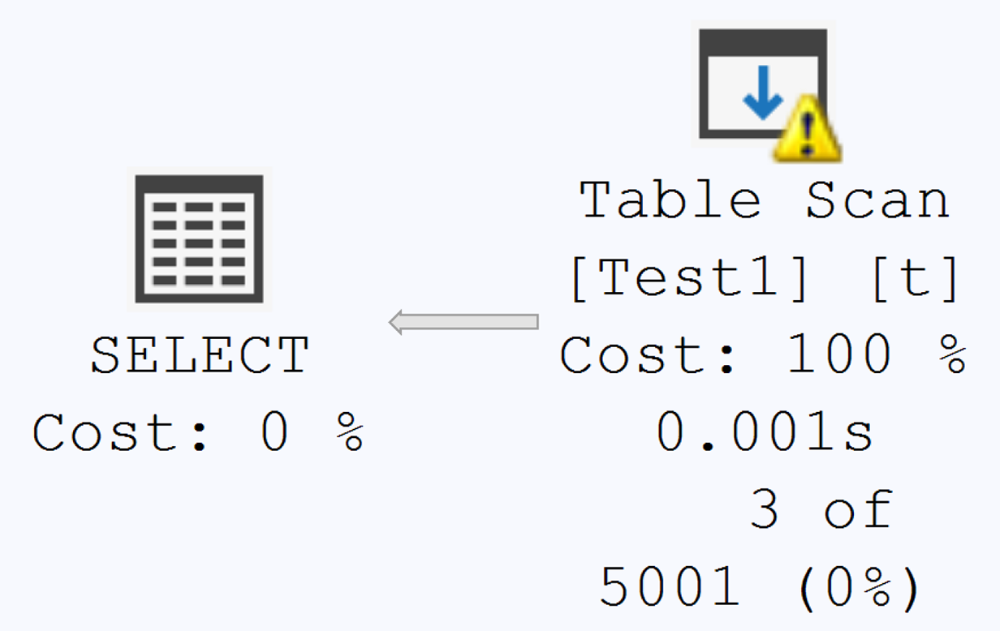

*Hình 5-22: Quét toàn bộ bảng xuất phát từ việc thiếu thống kê (Index scan caused by missing statistics)*

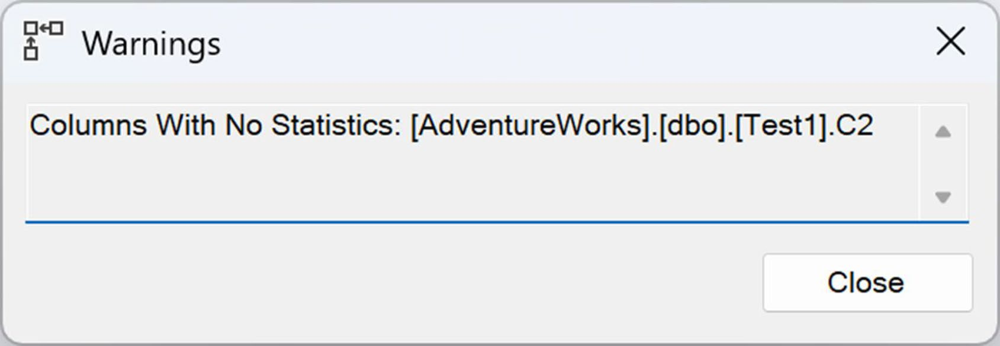

*Hình 5-23: Giá trị thuộc tính từ cảnh báo trong toán tử Table Scan (Property values from the warning in the Table Scan operator)*

Bạn sẽ nhận được một cảnh báo (warning) khi không có số liệu thống kê trên cột được sử dụng trong thao tác lọc, bởi vì Query Optimizer biết rằng nó sẽ không thể đảm bảo đưa ra các ước tính số hàng chính xác. Giữa cảnh báo rõ ràng này cùng với sự chênh lệch khổng lồ giữa số hàng ước tính và số hàng thực tế, bạn biết chắc chắn rằng bảng đang bị thiếu số liệu thống kê. Trung bình, câu truy vấn này chạy mất 2,1ms với 92 lượt đọc (reads).

Để giải quyết sự cố thiếu thống kê này, tôi sẽ chủ động tạo một đối tượng thống kê trên cột `C2` bằng câu lệnh `CREATE STATISTICS` trong Listing 5-40.

**Listing 5-40.** Sử dụng CREATE STATISTICS để tạo thống kê trên một cột

```sql
CREATE STATISTICS Stats1 ON Test1(C2);
```

Trước khi chạy lại câu truy vấn, chúng ta sử dụng Listing 5-41 để xóa kế hoạch cũ ra khỏi bộ nhớ đệm.

**Listing 5-41.** Xóa kế hoạch thực thi cụ thể khỏi bộ nhớ đệm cache

```sql
DECLARE @Planhandle VARBINARY(64);
SELECT @Planhandle = deqs.plan_handle
FROM sys.dm_exec_query_stats AS deqs
    CROSS APPLY sys.dm_exec_sql_text(deqs.sql_handle) AS dest
WHERE dest.text = 'SELECT   *
FROM    dbo.Test1
WHERE   C2 = 1;';

IF @Planhandle IS NOT NULL
BEGIN
    DBCC FREEPROCCACHE(@Planhandle);
END;
```

Sau khi chạy lại truy vấn trong Listing 5-39:
- Số lượt đọc (Reads): 34
- Thời gian thực thi (Duration): 8,3ms

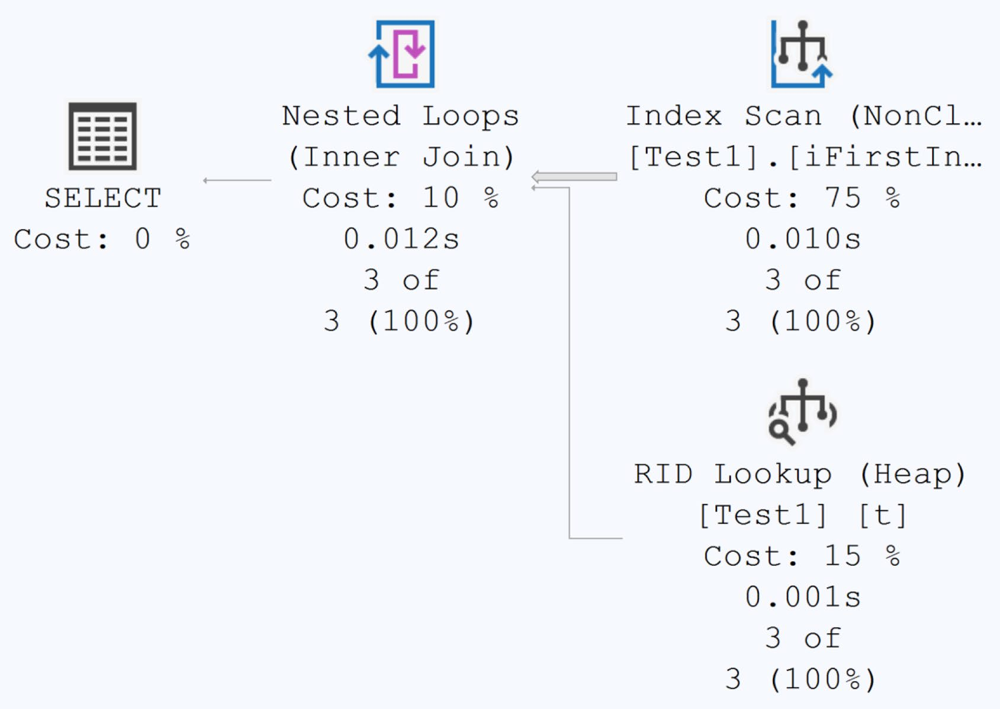

*Hình 5-24: Kế hoạch thực thi mới tối ưu hơn nhờ có số liệu thống kê (A different execution plan, thanks to statistics)*

Bởi vì giờ đây đã có số liệu thống kê để tham chiếu, Query Optimizer có thể ước tính chính xác rằng chỉ có 3 hàng dữ liệu sẽ được trả về từ câu truy vấn. Nhờ đó, trình tối ưu hóa quyết định phương án tốt hơn là sử dụng chỉ mục `iFirstIndex` để quét dữ liệu. Tuy nhiên, vì chỉ mục này chỉ chứa các cột khóa mà không có cột `C3`, hệ thống phải quay lại bảng chính trên heap để thực hiện thao tác tra cứu dòng thông qua toán tử **RID Lookup**. 

Số lượt đọc đã giảm mạnh từ 88 xuống 34 lượt đọc (một bước tiến lớn về I/O). Tuy nhiên, do cần xử lý phụ trội cho phép nối Nested Loops và thao tác tra cứu RID Lookup đối với từng dòng, thời gian thực thi lại tăng từ 2,1ms lên 8,4ms. Một giải pháp khắc phục triệt để ở đây là: thêm cột `C3` vào làm cột đính kèm (`INCLUDE`) trên chỉ mục, giúp truy vấn hoàn toàn được bao phủ (covering index) và đạt hiệu năng đỉnh cao. Chúng ta sẽ cùng xem xét giải pháp dạng này chi tiết hơn trong các chương sau.

### Xử lý sự cố thống kê lỗi thời (Resolving an Outdated Statistics Issue)

Số liệu thống kê bị lỗi thời hoặc không chuẩn xác cũng gây tác hại nghiêm trọng không kém gì việc thiếu thống kê. Các lựa chọn do Query Optimizer đưa ra có thể hoàn toàn sai lệch và không phù hợp với phân phối dữ liệu hiện tại. Thật không may, kế hoạch thực thi sẽ không hiển thị những cảnh báo nổi bật, rõ ràng đối với thống kê lỗi thời như cách nó làm đối với thống kê bị thiếu. Thay vào đó, bạn sẽ phải chủ yếu dựa vào việc đối chiếu giữa số hàng ước tính (estimated rows) và số hàng thực tế (actual rows) trong kế hoạch thực thi có runtime metrics.

Có một sự kiện Extended Event thuộc kênh Debug có thể thông báo khi các ước tính thống kê bị sai lệch nghiêm trọng, mang tên `inaccurate_cardinality_estimate`. Tuy nhiên, vì đây là một sự kiện debug nội bộ, tôi khuyến cáo bạn phải hết sức thận trọng khi sử dụng nó, chỉ áp dụng khi có các bộ lọc chặt chẽ và chỉ chạy trong các khoảng thời gian rất ngắn.

Listing 5-42 sẽ truy xuất số liệu thống kê hiện có từ chỉ mục kiểm thử `iFirstIndex`.

**Listing 5-42.** Kiểm tra thống kê của iFirstIndex bằng DBCC SHOW_STATISTICS

```sql
DBCC SHOW_STATISTICS (Test1, iFirstIndex);
```

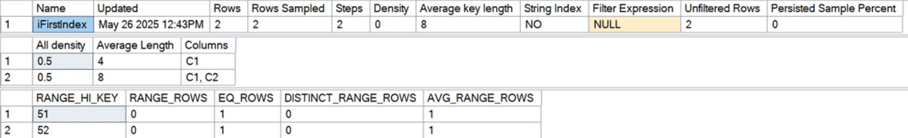

*Hình 5-25: Dữ liệu thống kê của chỉ mục iFirstIndex (Statistics for iFirstIndex)*

Tiếp theo, chúng ta chạy câu truy vấn trong Listing 5-43.

**Listing 5-43.** Câu truy vấn SELECT trên bảng Test1

```sql
SELECT C1,
       C2,
       C3
FROM dbo.Test1
WHERE C1 = 51;
```

Kết quả đo lường:
- Số lượt đọc (Reads): 94
- Thời gian thực thi (Duration): 2,5ms

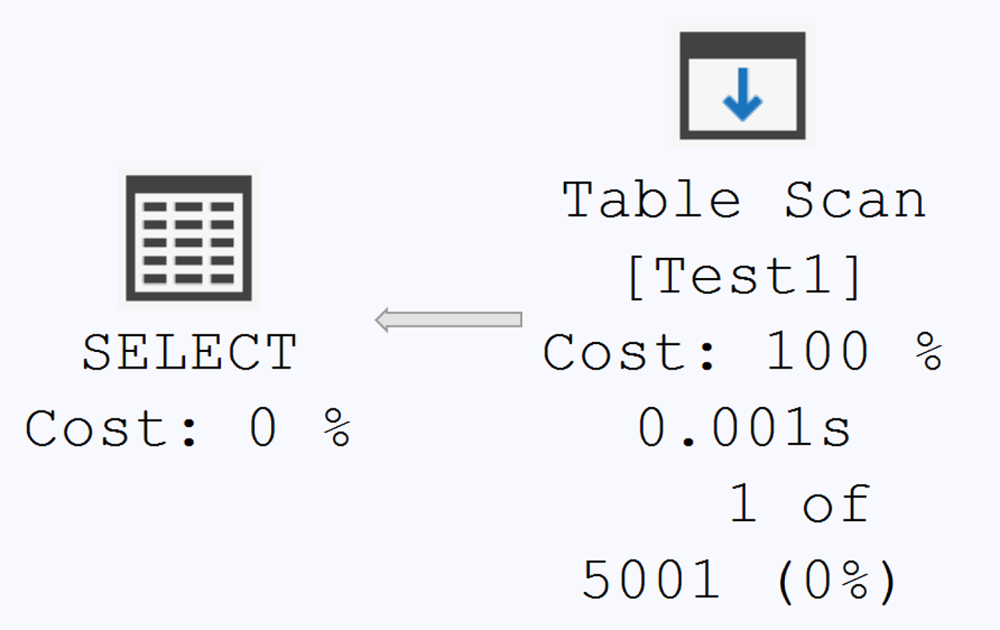

*Hình 5-26: Kế hoạch thực thi phát sinh khi số liệu thống kê bị lỗi thời (An execution plan with out-of-date statistics)*

Quan sát kế hoạch thực thi cùng các chỉ số runtime thực tế, chúng ta thấy rằng chỉ có duy nhất **1 hàng** được trả về, nhưng Query Optimizer lại ước tính tới **5.001 hàng** dựa trên dữ liệu thống kê lỗi thời trước đó. Bạn cũng có thể thấy rõ sự sai lệch này giữa estimated rows và actual rows trong cửa sổ Properties của toán tử.

Khi bạn nhận thấy sự chênh lệch giữa số hàng ước tính và thực tế gấp nhiều lần (dù cao hơn hay thấp hơn), rất có khả năng chiến lược xử lý được trình tối ưu hóa lựa chọn không còn đạt hiệu quả chi phí cho phân phối dữ liệu thực tế nữa.

Để giúp Query Optimizer đưa ra ước tính chính xác, số liệu thống kê trên chỉ mục liên quan `iFirstIndex` cần phải được cập nhật lại. Nếu tôi để tính năng tự động cập nhật thống kê hoạt động, thao tác này đã được tự động thực hiện trong quá trình nạp dữ liệu. Tuy nhiên, ở đây chúng ta sẽ chủ động cập nhật bằng câu lệnh trong Listing 5-44.

**Listing 5-44.** Cập nhật số liệu thống kê trên iFirstIndex với FULLSCAN

```sql
UPDATE STATISTICS Test1 iFirstIndex
WITH FULLSCAN;
```

Thao tác `FULLSCAN` có thể không hoàn toàn cần thiết trong mọi tình huống. Phương pháp lấy mẫu (sampling) thường cũng đạt độ chính xác khá tốt và chạy nhanh hơn nhiều, tiêu tốn ít tài nguyên hơn. Tuy nhiên, trên các hệ thống không bị quá tải, hoặc trong khung giờ thấp điểm, tôi có xu hướng ưu tiên dùng `FULLSCAN` để có độ chính xác cao nhất. Cả hai cách tiếp cận đều khả thi miễn là bạn không gây tác động tiêu cực đến hệ thống và số liệu thống kê thu được đủ tốt.

Sau khi cập nhật thống kê, chạy lại câu lệnh trong Listing 5-43 thu được kết quả:
- Số lượt đọc (Reads): 4
- Thời gian thực thi (Duration): 419 micro giây (µs)

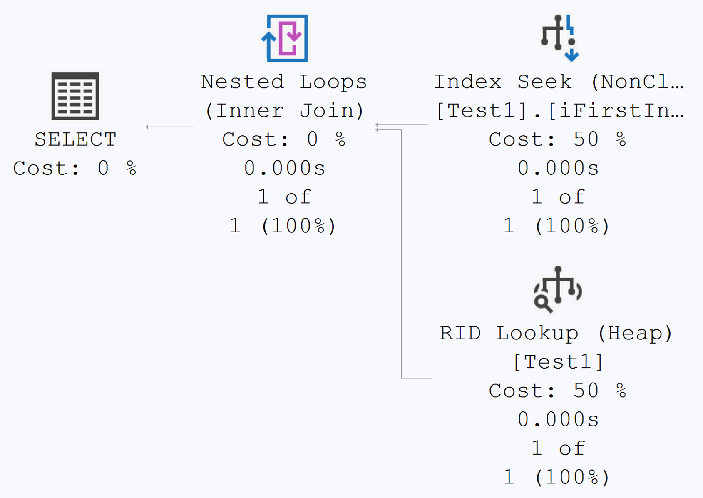

*Hình 5-27: Kế hoạch thực thi hoàn toàn mới sau khi số liệu thống kê được cập nhật (A different execution plan after the statistics are updated)*

Với số liệu thống kê mới được cập nhật, Query Optimizer đã đưa ra một kế hoạch thực thi hoàn toàn khác biệt. Thay vì dự tính 5.001 hàng, nó biết chắc chắn rằng chỉ có 1 hàng dữ liệu duy nhất cần xử lý, vì vậy thao tác tìm kiếm chỉ mục (**Index Seek**) trên `iFirstIndex` đã được lựa chọn thay cho thao tác quét. Hệ thống vẫn cần thực hiện RID Lookup để lấy nốt dữ liệu từ heap, nhưng những cải thiện này đã giúp:
- Số lượt đọc giảm từ 88 xuống chỉ còn **4 lượt đọc**.
- Thời gian thực thi giảm từ 2,1ms xuống chỉ còn **419 micro giây** — nhanh hơn gấp 5 lần!

Trước khi tiếp tục, hãy bật lại các tùy chọn tự động tạo và cập nhật thống kê cho cơ sở dữ liệu bằng câu lệnh trong Listing 5-45.

**Listing 5-45.** Bật lại các tính năng tự động tạo và cập nhật thống kê

```sql
ALTER DATABASE AdventureWorks SET AUTO_CREATE_STATISTICS ON;
ALTER DATABASE AdventureWorks SET AUTO_UPDATE_STATISTICS ON;
```

---

## Các khuyến nghị thực tiễn về thống kê (Recommendations on Statistics)

Xuyên suốt chương này, tôi đã đưa ra nhiều khuyến nghị về cách thức quản lý và duy trì số liệu thống kê của bạn. Để tiện cho việc tra cứu, tôi tổng hợp lại các khuyến nghị này kèm theo một số điểm lưu ý bổ sung:

### Tính tương thích ngược của số liệu thống kê (Backward Compatibility of Statistics)

Khi nâng cấp các cơ sở dữ liệu của bạn giữa các phiên bản SQL Server khác nhau, việc ứng dụng Query Store như một cơ chế xuyên suốt quá trình nâng cấp (được trình bày trong Chương 6) nhìn chung là phương pháp tối ưu. Nhờ đó, số liệu thống kê sẽ được cập nhật tự nhiên theo thời gian khi dữ liệu có sự biến động. Tôi khuyến nghị bạn nên để quá trình này diễn ra tự nhiên thay vì cố gắng cập nhật toàn bộ thống kê ngay lập tức sau khi nâng cấp. 

Tuy nhiên, khuyến nghị này giả định rằng bạn có sử dụng Query Store. Nếu không sử dụng Query Store, việc chủ động cập nhật lại toàn bộ số liệu thống kê sau khi nâng cấp là một quyết định sáng suốt để đảm bảo mọi thay đổi trong cơ chế hành vi của thống kê trên phiên bản mới được áp dụng ngay lập tức.

### Tự động tạo thống kê (Auto Create Statistics)

Tính năng này luôn luôn nên được giữ ở trạng thái BẬT (`ON`). Khi đó, SQL Server có thể tự động tạo ra các thống kê cần thiết trên các cột chưa được đánh chỉ mục, giúp tạo ra các kế hoạch thực thi tốt hơn và mang lại hiệu năng cao hơn. Bạn cũng có thể nhận thấy việc chủ động tự tạo các thống kê phức hợp (đa cột) là hữu ích trong một số trường hợp cụ thể.

### Tự động cập nhật thống kê (Auto Update Statistics)

Tính năng này cũng luôn nên được duy trì ở trạng thái BẬT (`ON`), cho phép SQL Server thu được các kế hoạch thực thi chính xác hơn khi phân phối dữ liệu biến đổi theo thời gian. Thông thường, lợi ích to lớn về mặt hiệu năng thu được luôn vượt trội so với chi phí tài nguyên phát sinh (overhead).

Nếu bạn gặp phải sự cố đặc thù với tính năng Auto Update Statistics và bắt buộc phải tắt nó, bạn phải đảm bảo rằng mình đã xây dựng một quy trình tự động hóa để cập nhật thống kê định kỳ. Vì lý do hiệu năng, bất cứ khi nào có thể, hãy lên lịch chạy quy trình đó trong các khung giờ thấp điểm.

Bạn cũng rất có thể sẽ cần bổ trợ thêm cho quy trình bảo trì thống kê tự động. Việc bạn cần áp dụng trên toàn bộ cơ sở dữ liệu hay chỉ cho một số chỉ mục hoặc thống kê cụ thể sẽ do đặc thù tải công việc của hệ thống quyết định.

### Tự động cập nhật thống kê bất đồng bộ (Auto Update Statistics Asynchronously)

Việc để câu truy vấn chờ đợi số liệu thống kê được cập nhật trước khi tạo kế hoạch sẽ hoạt động hoàn toàn ổn định trong phần lớn các trường hợp. Trong những tình huống mà thao tác cập nhật thống kê hoặc việc tái biên dịch kế hoạch gây ra chi phí tài nguyên nặng nề hơn so với chi phí tiếp tục chạy với thống kê cũ, bạn hãy bật tính năng bất đồng bộ này. 

Chỉ cần luôn nhớ rằng điều đó đồng nghĩa với việc các truy vấn vốn dĩ hưởng lợi ngay từ thống kê mới sẽ phải chịu thiệt thòi cho đến lần thực thi tiếp theo. Đừng quên rằng tính năng tự động cập nhật thống kê phải được kích hoạt thì bạn mới có thể bật chế độ bất đồng bộ.

### Tỷ lệ lấy mẫu dữ liệu khi thu thập thống kê (Amount of Sampling to Collect Statistics)

Nhìn chung, bạn nên sử dụng tỷ lệ lấy mẫu mặc định của hệ thống. Tỷ lệ này được xác định bởi một thuật toán thông minh và hiệu quả dựa trên dung lượng dữ liệu và số lượng thay đổi. Mặc dù tỷ lệ mặc định là tối ưu cho đa số trường hợp, nếu đối với một truy vấn cụ thể bạn nhận thấy số liệu thống kê không đủ độ chuẩn xác, bạn có thể chủ động cập nhật chúng bằng tùy chọn `FULLSCAN`. Bạn cũng có thể chỉ định một tỷ lệ lấy mẫu cụ thể bằng mệnh đề `SAMPLE` (theo tỷ lệ phần trăm hoặc theo số hàng nhất định).

Nếu việc này cần được thực hiện lặp đi lặp lại nhiều lần, bạn có thể thiết lập một SQL Server Agent Job để tự động hóa công việc. Vì lý do hiệu năng, hãy đảm bảo SQL Job này được lên lịch chạy vào các khung giờ thấp điểm. 

Để phát hiện những trường hợp mà tỷ lệ lấy mẫu mặc định không đạt kết quả tối ưu, hãy phân tích tính hiệu quả của số liệu thống kê đối với các câu truy vấn tốn kém tài nguyên nhất trong quá trình khắc phục sự cố hiệu năng cơ sở dữ liệu. Hãy luôn nhớ rằng `FULLSCAN` là một thao tác rất tốn kém tài nguyên, do đó bạn chỉ nên áp dụng nó trên những bảng hoặc chỉ mục mà bạn xác định chắc chắn sẽ thực sự thu được lợi ích vượt bậc.

---

## Tóm tắt chương (Summary)

Quy trình tối ưu hóa dựa trên chi phí (Cost-Based Optimization) của SQL Server đòi hỏi phải có số liệu thống kê chuẩn xác trên các cột được sử dụng trong các điều kiện lọc để xác định chiến lược xử lý hiệu quả nhất. Số liệu thống kê trên một chỉ mục luôn được tự động tạo ra trong quá trình khởi tạo chỉ mục đó, và theo mặc định, SQL Server cũng tự động duy trì cập nhật các số liệu thống kê trên cả cột có chỉ mục lẫn cột không có chỉ mục khi dữ liệu biến động theo thời gian. Cơ chế này cho phép Query Optimizer luôn đưa ra những quyết định chiến lược xử lý tốt nhất dựa trên sự phân phối dữ liệu thực tế tại thời điểm đó.

Mặc dù bạn hoàn toàn có thể tắt cả hai tính năng tự động tạo và tự động cập nhật thống kê, lời khuyên kiên định là bạn nên luôn duy trì bật các tính năng này. Lợi ích mà chúng mang lại cho trình tối ưu hóa hầu như luôn vượt xa chi phí tài nguyên phát sinh để duy trì chúng. Đối với những câu truy vấn tốn kém tài nguyên, hãy phân tích kỹ lưỡng số liệu thống kê để đảm bảo cơ chế bảo trì tự động đang thực hiện đúng cam kết của nó. Bạn hoàn toàn có thể bổ trợ cho tiến trình tự động bằng các quy trình bảo trì thủ công của riêng mình khi cần thiết.

Giờ đây, khi chúng ta đã có một nền tảng vững chắc về cách các kế hoạch thực thi được tạo ra (từ Chương 4) và cách số liệu thống kê chi phối quá trình tạo kế hoạch đó (từ Chương 5), chúng ta sẽ cùng tìm hiểu về cách sử dụng **Query Store** trong chương tiếp theo để hiểu sâu hơn nữa về hành vi của truy vấn và kế hoạch thực thi bên trong SQL Server.
