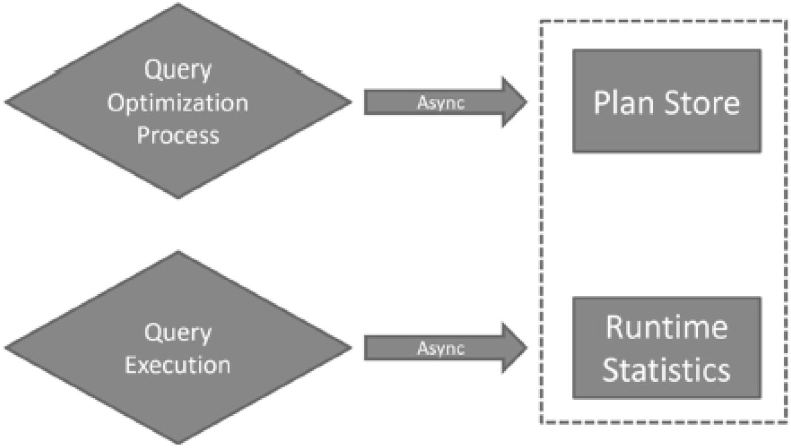
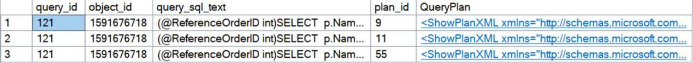
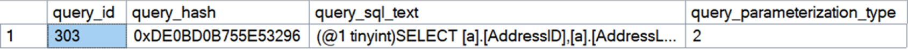
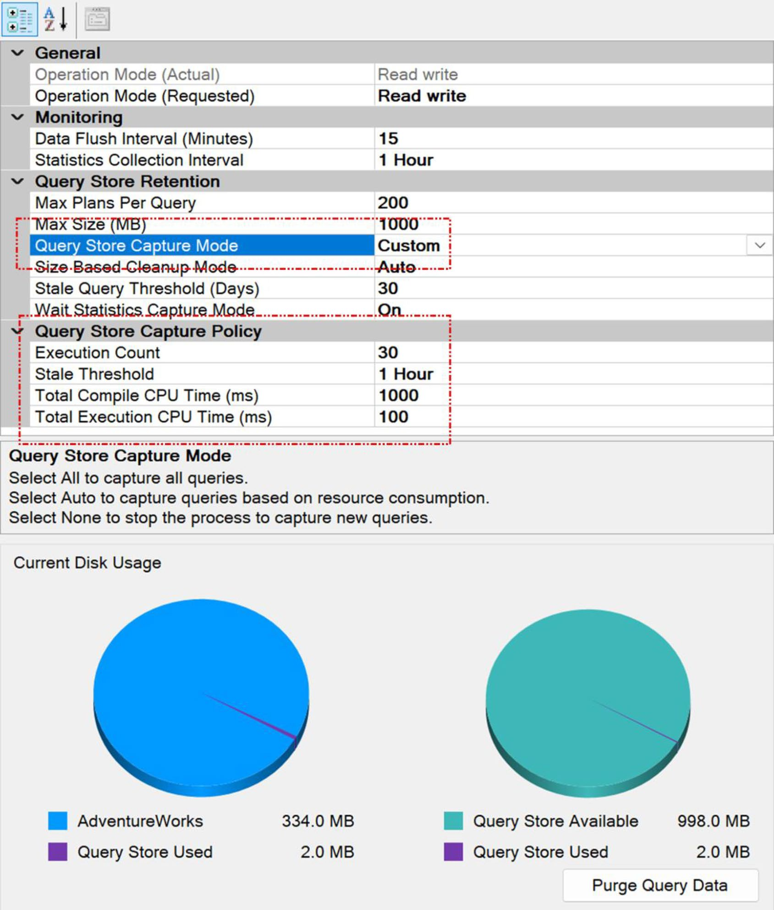
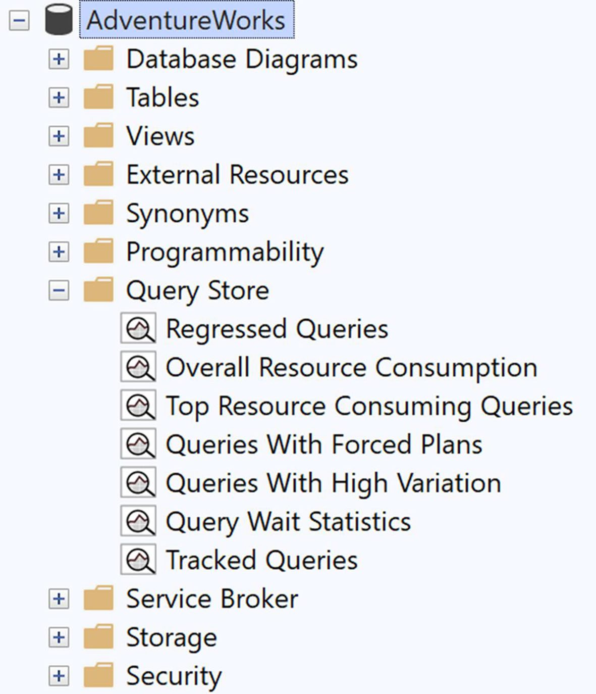
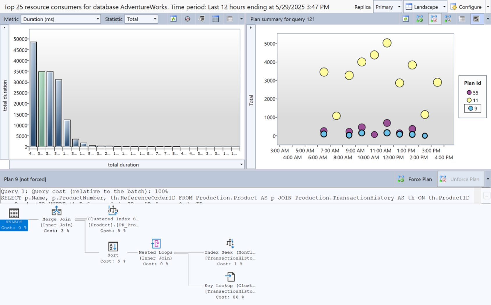
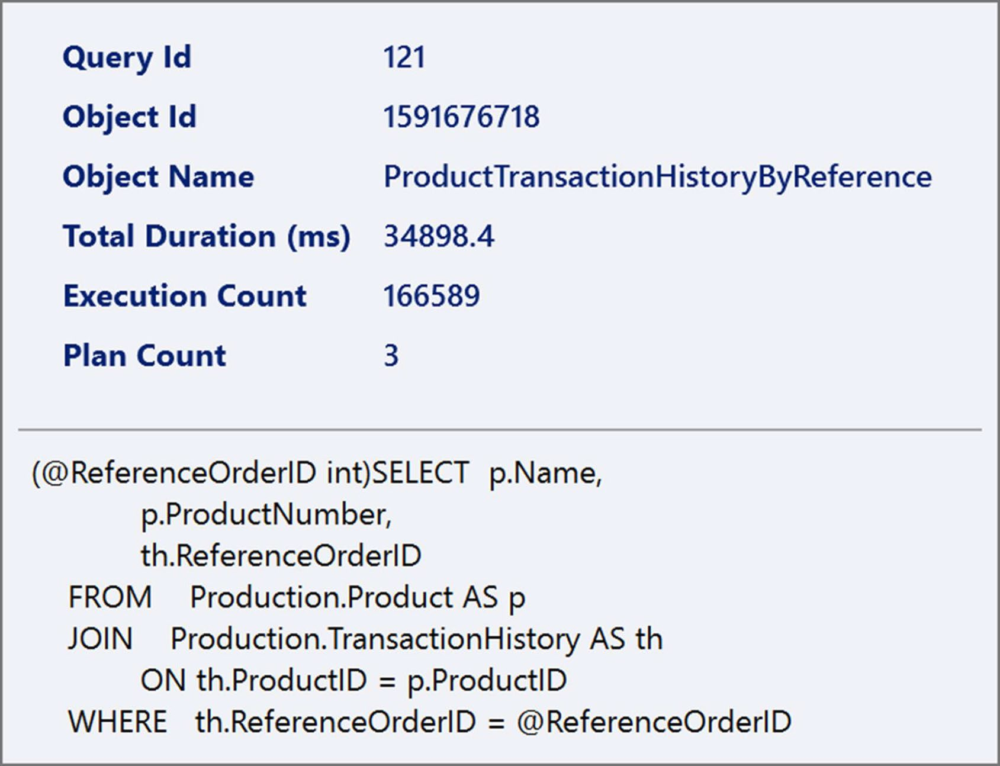
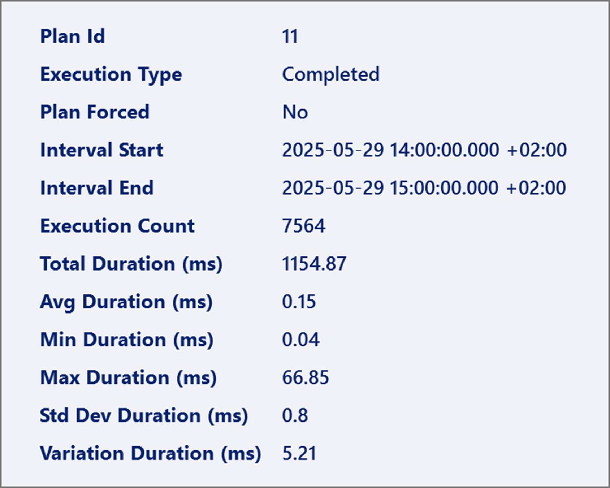
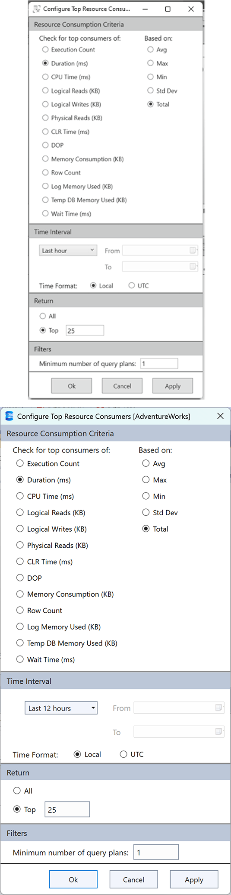
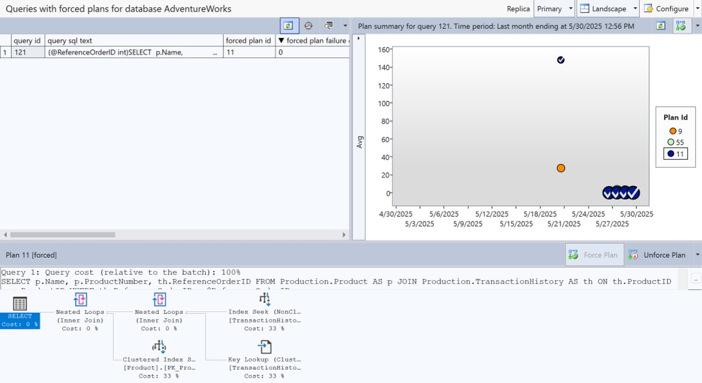

# CHƯƠNG 6: Sử dụng Kho lưu trữ truy vấn để phân tích Hiệu năng và Kế hoạch thực thi (Using the Query Store for Query Performance and Execution Plans)

> **Thông tin sách gốc:**  
> © Grant Fritchey 2026  
> G. Fritchey, *SQL Server 2025 Query Performance Tuning*, https://doi.org/10.1007/979-8-8688-1865-3_6  

---

Kho lưu trữ truy vấn (Query Store) bổ sung một khối lượng khổng lồ các tính năng mạnh mẽ cho SQL Server và Azure SQL Database nhằm hỗ trợ đắc lực cho công việc tinh chỉnh truy vấn. 

1. **Thu thập chỉ số lịch sử:** Query Store tự động thu thập các chỉ số hiệu năng trên bất kỳ cơ sở dữ liệu nào được kích hoạt, cho phép bạn quan sát một tập hợp các số liệu đo lường theo dòng thời gian lịch sử.
2. **Lưu trữ kế hoạch thực thi:** Nó lưu giữ các kế hoạch thực thi (execution plans) để bạn có thể theo dõi xem cấu trúc kế hoạch và hành vi truy vấn biến đổi ra sao theo thời gian.
3. **Kiểm soát kế hoạch thực thi:** Nó trao cho bạn quyền can thiệp và kiểm soát kế hoạch thông qua cơ chế ép buộc kế hoạch (**Plan Forcing**) và chèn gợi ý truy vấn (**Query Hints**) mà không cần chỉnh sửa mã nguồn ứng dụng.

Tất cả những khả năng này kết hợp lại biến Query Store thành một vũ khí cực kỳ sắc bén và tiện lợi trong việc chẩn đoán và tối ưu hóa hiệu năng truy vấn.

Trong chương này, tôi sẽ đề cập đến các chủ đề sau:
* Nguyên lý vận hành của Query Store và các loại thông tin mà nó thu thập
* Các báo cáo đồ họa và công cụ tích hợp cho Query Store trong Management Studio
* Ép buộc kế hoạch (Plan Forcing) – phương thức buộc SQL Server phải sử dụng một kế hoạch thực thi cụ thể
* Gợi ý truy vấn thông qua Query Store (Query Hints) – cho phép áp dụng gợi ý mà không cần sửa code
* Phương pháp nâng cấp phiên bản an toàn giúp bảo vệ hiệu năng hệ thống

---

## Chức năng và Thiết kế của Query Store (Query Store Function and Design)

Query Store lần đầu tiên được giới thiệu trong SQL Server 2016; trước phiên bản đó, tính năng này hoàn toàn không tồn tại. Mặc dù sở hữu rất nhiều tiện ích, chức năng cốt lõi hàng đầu của Query Store là **thu thập thông tin tổng hợp về các truy vấn đang thực thi bên trong một cơ sở dữ liệu cụ thể**, bao gồm cả các chỉ số hiệu năng (runtime metrics) lẫn số liệu thống kê thời gian chờ (wait statistics). Song song với việc ghi nhận số liệu, nó cũng tự động lưu giữ toàn bộ các kế hoạch thực thi gắn liền với những câu lệnh đó.

* Trong **Azure SQL Database**, Query Store được bật mặc định.
* Bắt đầu từ **SQL Server 2022**, Query Store cũng đã được kích hoạt mặc định cho các cơ sở dữ liệu mới.
* Trong **SQL Server 2025**, các bản sao thứ cấp cho phép đọc (**Readable Secondaries**) trong nhóm Always On Availability Groups cũng sẽ được **bật Query Store theo mặc định**.

Bạn có thể chủ động tắt Query Store trên từng cơ sở dữ liệu riêng lẻ nếu muốn. (Trước phiên bản SQL Server 2022, Query Store ở trạng thái mặc định là tắt). Việc bật hoặc tắt Query Store có thể thực hiện dễ dàng bằng lệnh T-SQL mà hoàn toàn không đòi hỏi phải khởi động lại máy chủ (server restart).

> [!NOTE]
> **Cơ chế thu thập trên bản sao thứ cấp (Readable Secondaries in Availability Groups):**  
> Vì các bản sao thứ cấp ở trạng thái chỉ đọc (read-only), nên thông tin Query Store được thu thập trên bản sao thứ cấp thực chất sẽ được chuyển tiếp và lưu trữ tạm thời bên trong cơ sở dữ liệu chính (primary database), sau đó được đồng bộ và ghi xuống bản sao thứ cấp như một phần trong quy trình vận hành tiêu chuẩn của Availability Groups. Bạn có thể truy vấn số liệu này bằng bất kỳ cơ chế nào được hướng dẫn trong chương này.

Listing 6-1 minh họa câu lệnh kích hoạt Query Store trên cơ sở dữ liệu `AdventureWorks`:

```sql
-- Listing 6-1. Enabling the Query Store on AdventureWorks
ALTER DATABASE AdventureWorks SET QUERY_STORE = ON;
```

Bạn cũng có thể sử dụng cửa sổ thuộc tính cơ sở dữ liệu (Database Properties) trong SQL Server Management Studio để cấu hình Query Store. Tôi sẽ trình bày chi tiết giao diện đồ họa ở phần sau của chương.

  
*Hình 6-1. Cơ chế hoạt động của Query Store khi thu thập dữ liệu (Behavior of the Query Store when collecting data)*

### Cơ chế thu thập dữ liệu bất đồng bộ (Asynchronous Architecture)

Quá trình tối ưu hóa truy vấn thông thường **không bị ảnh hưởng trực tiếp** bởi Query Store:
1. Khi một truy vấn được gửi lên hệ thống, kế hoạch thực thi sẽ được tạo ra như đã mô tả trong Chương 2. 
2. Thông thường, kế hoạch này sẽ được nạp vào bộ nhớ đệm (plan cache – chi tiết trong Chương 7), trừ khi tính năng Plan Forcing của Query Store can thiệp để thay đổi hành vi.
3. Trong điều kiện không có plan forcing, sau khi kế hoạch được lưu vào plan cache, một **tiến trình bất đồng bộ (asynchronous process)** sẽ sao chép kế hoạch đó sang một vùng nhớ riêng biệt để lưu trữ tạm thời.
4. Kế tiếp, một tiến trình bất đồng bộ khác sẽ ghi kế hoạch từ bộ nhớ tạm vào các bảng hệ thống của Query Store nằm ngay trong cơ sở dữ liệu. 

Các tiến trình bất đồng bộ này được thiết kế có chủ đích nhằm giảm thiểu tối đa chi phí tài nguyên phụ trợ (overhead) mà Query Store có thể gây ra cho hệ thống.

Sau đó, truy vấn tiếp tục được thực thi bình thường. Khi truy vấn kết thúc, các chỉ số runtime (thời gian thực thi - duration, số lần đọc/ghi - reads/writes, số liệu thống kê thời gian chờ - wait statistics,...) sẽ được ghi vào một vùng nhớ tách biệt thông qua tiến trình bất đồng bộ. Dữ liệu này được tổng hợp (aggregated) ngay khi được lưu trữ trong RAM. Sau đó, một tiến trình bất đồng bộ định kỳ sẽ đảm bảo các thông tin này được xả (flush) xuống các bảng hệ thống trên đĩa. Khoảng thời gian tổng hợp mặc định (**Aggregation Interval**) là **60 phút**, và bạn hoàn toàn có thể điều chỉnh tăng hoặc giảm tùy thuộc vào đặc thù của hệ thống.

### Tính toàn vẹn và Lưu trữ dữ liệu
Thông tin được Query Store ghi lại nằm trực tiếp bên trong chính cơ sở dữ liệu nơi nó được kích hoạt. Các chỉ số đo lường truy vấn và kế hoạch thực thi gắn liền với cơ sở dữ liệu: chúng được sao lưu cùng bản backup và sẽ được phục hồi nguyên vẹn khi bạn khôi phục (restore) cơ sở dữ liệu sang môi trường khác. 

Đây là các bảng hệ thống nội bộ (internal system tables) và được lưu trên ổ đĩa dữ liệu chính cùng với các bảng hệ thống khác. Nếu hệ thống đột ngột bị mất điện, dừng dịch vụ bất thường hoặc chuyển đổi dự phòng (failover), bạn có thể bị mất một lượng dữ liệu Query Store đang nằm tạm trên bộ nhớ RAM mà chưa kịp ghi xuống đĩa. Khoảng thời gian xả dữ liệu xuống đĩa mặc định là **15 phút** (`DATA_FLUSH_INTERVAL_SECONDS = 900`), và bạn cũng có thể tùy chỉnh thông số này. Tuy nhiên, vì đây là các dữ liệu thống kê tổng hợp phục vụ mục đích phân tích hiệu năng, nên việc thất thoát một vài phút dữ liệu trong sự cố hiếm hoi không phải là vấn đề quá đáng lo ngại.

Khi bạn chạy các câu lệnh truy vấn thông tin từ Query Store, SQL Server sẽ tự động hợp nhất cả dữ liệu đang nằm trên RAM lẫn dữ liệu đã ghi xuống đĩa. Quá trình này diễn ra hoàn toàn trong suốt và tự động.

---

## Thông tin được Query Store thu thập (Information Collected by the Query Store)

Thực thể dữ liệu cốt lõi vận hành bên trong Query Store chính là **từng câu lệnh truy vấn đơn lẻ (individual query statement)**. Cho dù câu truy vấn đó nằm bên trong một thủ tục lưu trữ (Stored Procedure) hay nằm trong một khối lệnh T-SQL tổng hợp (Batch), điều đó không làm thay đổi bản chất thu thập của Query Store: nó luôn ghi nhận số liệu dựa trên từng câu lệnh đơn lẻ. Bạn có thể dễ dàng liên kết câu lệnh ngược lại với Stored Procedure cha (vì trường `object_id` được ghi lại), nhưng bạn không thể liên kết ngược lại với một tiến trình batch tổng thể ngoại trừ việc phân tích văn bản T-SQL.

Query Store quản lý dữ liệu thông qua **7 bảng hệ thống (System Views)** cốt lõi:

* `sys.query_store_query`: Bảng chính lưu trữ thông tin định danh về các truy vấn trong Query Store.
* `sys.query_store_query_text`: Chứa đoạn mã văn bản T-SQL thực tế của câu lệnh truy vấn.
* `sys.query_store_plan`: Lưu trữ toàn bộ các kế hoạch thực thi tương ứng với một truy vấn.
* `sys.query_store_runtime_stats`: Chứa các chỉ số đo lường thời gian chạy tổng hợp (runtime metrics).
* `sys.query_store_wait_stats`: Lưu trữ các số liệu thống kê thời gian chờ tổng hợp (wait statistics) cho từng truy vấn.
* `sys.query_store_runtime_stats_interval`: Lưu trữ mốc thời gian bắt đầu và kết thúc của từng khoảng thời gian tổng hợp (interval).
* `sys.database_query_store_options`: Hiển thị các thông số thiết lập cấu hình của Query Store trên cơ sở dữ liệu hiện tại.

Mặc dù SSMS cung cấp sẵn nhiều báo cáo đồ họa trực quan để theo dõi Query Store, việc tự viết các câu lệnh truy vấn T-SQL sẽ giúp bạn trích xuất chính xác những thông tin mình cần một cách nhanh chóng nhất. 

Ví dụ, nếu muốn xem toàn bộ các truy vấn và kế hoạch thực thi thuộc về một thủ tục lưu trữ cụ thể, bạn có thể thực hiện như trong Listing 6-2:

```sql
-- Listing 6-2. Querying the Query Store for a stored procedure query
SELECT qsq.query_id,
       qsq.object_id,
       qsqt.query_sql_text,
       qsp.plan_id,
       CAST(qsp.query_plan AS XML) AS QueryPlan
FROM sys.query_store_query AS qsq
    JOIN sys.query_store_query_text AS qsqt
        ON qsq.query_text_id = qsqt.query_text_id
    JOIN sys.query_store_plan AS qsp
        ON qsp.query_id = qsq.query_id
WHERE qsq.object_id = OBJECT_ID('dbo.ProductTransactionHistoryByReference');
```

  
*Hình 6-2. Một câu truy vấn đơn lẻ nhưng sở hữu nhiều kế hoạch thực thi khác nhau bên trong một Stored Procedure*

Ở đây, bạn thấy rằng Stored Procedure này chỉ chứa duy nhất một câu lệnh thực thi – được định danh là `query_id = 121`. Tuy nhiên, ứng với một truy vấn duy nhất đó, Query Store lại ghi nhận tới **3 kế hoạch thực thi khác nhau** trong cột `plan_id`: `9`, `11`, và `55`!

### Cách Query Store lưu trữ văn bản truy vấn có tham số

Một chi tiết kỹ thuật rất quan trọng cần lưu ý là cách thức văn bản truy vấn được lưu trữ trong Query Store. Vì câu lệnh này là một phần của một Stored Procedure có tham số đầu vào, nên **phần định nghĩa tham số sẽ được tự động gắn kèm vào phần đầu của văn bản T-SQL**:

```text
(@ReferenceOrderID int)SELECT  p.Name,              p.
ProductNumber,              th.ReferenceOrderID      FROM    Production.
Product AS p      JOIN    Production.TransactionHistory AS 
th              ON th.ProductID = p.ProductID      WHERE   
th.ReferenceOrderID = @ReferenceOrderID
```

Bạn có thể thấy rõ định nghĩa tham số `(@ReferenceOrderID int)` xuất hiện ngay trước câu lệnh `SELECT`. Bản thân Stored Procedure gốc được viết như trong Listing 6-3:

```sql
-- Listing 6-3. Procedure definition for ProductTransactionHistoryByReference
CREATE OR ALTER PROC dbo.ProductTransactionHistoryByReference
(@ReferenceOrderID int)
AS
BEGIN
    SELECT p.Name,
           p.ProductNumber,
           th.ReferenceOrderID
    FROM Production.Product AS p
        JOIN Production.TransactionHistory AS th
            ON th.ProductID = p.ProductID
    WHERE th.ReferenceOrderID = @ReferenceOrderID;
END;
```

Do sự khác biệt về chuỗi văn bản được gắn thêm phần khai báo tham số, việc tìm kiếm một câu truy vấn cụ thể bằng cách đối sánh chuỗi văn bản thuần túy (`LIKE 'SELECT...'`) có thể gặp đôi chút khó khăn nếu bạn không tính đến tiền tố tham số này.

Hãy xem một ví dụ thú vị khác với một batch truy vấn ad-hoc trong Listing 6-4:

```sql
-- Listing 6-4. Batch process running a simple query
SELECT a.AddressID,
       a.AddressLine1
FROM Person.Address AS a
WHERE a.AddressID = 72;
```

Mặc dù đây là một batch truy vấn độc lập chứ không phải Stored Procedure, nó vẫn có thể bị SQL Server tự động tham số hóa thông qua cơ chế **Tham số hóa đơn giản (Simple Parameterization)**. Rất may mắn, Query Store cung cấp một hàm hệ thống chuyên dụng để xử lý trường hợp này: `sys.fn_stmt_sql_handle_from_sql_stmt`. Hàm này nhận vào chuỗi văn bản câu lệnh và trả về mã SQL handle tương ứng, giúp bạn định vị chính xác câu truy vấn trong Query Store như trong Listing 6-5:

```sql
-- Listing 6-5. Putting sys.fn_stmt_sql_handle_from_sql_stmt to work
SELECT qsq.query_id,
       qsq.query_hash,
       qsqt.query_sql_text,
       qsq.query_parameterization_type
FROM sys.query_store_query_text AS qsqt
    JOIN sys.query_store_query AS qsq
        ON qsq.query_text_id = qsqt.query_text_id
    JOIN sys.fn_stmt_sql_handle_from_sql_stmt(
             'SELECT a.AddressID,
       a.AddressLine1
FROM Person.Address AS a
WHERE a.AddressID = 72;',
             2)  AS fsshfss
        ON fsshfss.statement_sql_handle = qsqt.statement_sql_handle;
```

  
*Hình 6-3. Lấy định danh query_id cho một truy vấn đã được tham số hóa*

Cột `query_parameterization_type` trong kết quả trả về cung cấp thông tin về kiểu tham số hóa mà truy vấn đã trải qua:
* `0`: Không tham số hóa (None).
* `1`: Do người dùng tự tham số hóa trong mã lệnh (User parameterized).
* `2`: Tham số hóa đơn giản do SQL Server tự động thực hiện (Simple parameterization).
* `3`: Tham số hóa cưỡng bức theo cấu hình cơ sở dữ liệu (Forced parameterization).

---

## Dữ liệu thời gian chạy của truy vấn (Query Runtime Data)

Nắm bắt được câu truy vấn và kế hoạch thực thi là điều tuyệt vời, nhưng bạn cũng rất cần quan sát các chỉ số thời gian chạy (runtime metrics). 

Cơ chế tổ chức các chỉ số runtime trong Query Store có hai điểm đặc thù rất quan trọng:
1. **Chỉ số runtime gắn liền với từng Kế hoạch thực thi (Execution Plan), chứ không gắn trực tiếp với câu truy vấn:** Vì một câu truy vấn có thể sinh ra nhiều kế hoạch khác nhau và mỗi kế hoạch sẽ có hành vi hiệu năng hoàn toàn khác nhau, nên các chỉ số đo lường (CPU, thời gian thực thi, số lần đọc/ghi) luôn được thu thập riêng biệt cho từng `plan_id`.
2. **Chỉ số runtime được tổng hợp theo từng Khoảng thời gian (Runtime Stats Interval):** Khoảng thời gian mặc định là **60 phút**. Điều này có nghĩa là ứng với mỗi khung giờ, bạn sẽ có một bộ chỉ số runtime tổng hợp độc lập nếu truy vấn có phát sinh lượt chạy trong khoảng thời gian đó.

Vì dữ liệu được phân mảnh thành các khoảng thời gian rời rạc, khi muốn phân tích bức tranh tổng thể, bạn có thể cần thực hiện thao tác "tổng hợp của các số liệu tổng hợp" (aggregate the aggregates) – tức tính tổng (`SUM`) hoặc lấy trung bình (`AVG`) của các giá trị tích lũy qua nhiều khoảng thời gian. 

Mặc dù điều này đòi hỏi viết câu lệnh SQL phức tạp hơn một chút, nhưng việc phân chia theo từng interval mang lại giá trị vô cùng to lớn: **Nó cung cấp cho bạn nhiều điểm đối chuẩn tham chiếu (comparison points) theo thời gian.** Bạn có thể theo dõi chính xác hành vi của một truy vấn đang tốt lên hay xấu đi sau một bản cập nhật mã nguồn hoặc sau khi bảo trì chỉ mục. Bạn nhận được độ sâu và sự chi tiết tương tự như Extended Events, nhưng với sự tiện lợi và đơn giản của việc viết truy vấn SQL trên bộ nhớ đệm!

Listing 6-6 minh họa cách trích xuất chỉ số runtime và thống kê thời gian chờ (wait statistics) của một kế hoạch thực thi trong một mốc thời gian cụ thể:

```sql
-- Listing 6-6. Retrieving runtime information from the Query Store
DECLARE @CompareTime DATETIME = '2025-05-29 12:22';

SELECT CAST(qsp.query_plan AS XML),
       qsrs.count_executions,
       qsrs.avg_duration,
       qsrs.stdev_duration,
       qsws.wait_category_desc,
       qsws.avg_query_wait_time_ms,
       qsws.stdev_query_wait_time_ms
FROM sys.query_store_plan AS qsp
    JOIN sys.query_store_runtime_stats AS qsrs
        ON qsrs.plan_id = qsp.plan_id
    JOIN sys.query_store_runtime_stats_interval AS qsrsi
        ON qsrsi.runtime_stats_interval_id = qsrs.runtime_stats_interval_id
    LEFT JOIN sys.query_store_wait_stats AS qsws
        ON qsws.plan_id = qsrs.plan_id
           AND qsws.execution_type = qsrs.execution_type
           AND qsws.runtime_stats_interval_id = qsrs.runtime_stats_interval_id
WHERE qsp.plan_id = 11
      AND @CompareTime BETWEEN qsrsi.start_time
                           AND     qsrsi.end_time;
```

  
*Hình 6-4. Các chỉ số thời gian chạy và thống kê thời gian chờ cho một kế hoạch thực thi bên trong một khoảng thời gian xác định*

Bên cạnh việc liên kết hiệu năng với một kế hoạch cụ thể, ngữ cảnh thực thi (execution context) cũng được hệ thống tính đến: cùng một câu lệnh truy vấn nhưng chạy độc lập từ một batch ad-hoc có thể mang hành vi khác so với khi được bọc trong một Stored Procedure.

Nếu bạn muốn tổng hợp toàn bộ các chỉ số đo lường hiệu năng của một kế hoạch qua tất cả các khoảng thời gian ghi nhận trong Query Store, bạn có thể sử dụng biểu thức CTE như trong Listing 6-7:

```sql
-- Listing 6-7. Taking an average of all Query Store runtime metrics for a query
WITH QSAggregate
AS (SELECT qsrs.plan_id,
           SUM(qsrs.count_executions) AS CountExecutions,
           AVG(qsrs.avg_duration) AS AvgDuration,
           AVG(qsrs.stdev_duration) AS StDevDuration,
           qsws.wait_category_desc,
           AVG(qsws.avg_query_wait_time_ms) AS AvgQueryWaitTime,
           AVG(qsws.stdev_query_wait_time_ms) AS StDevQueryWaitTime
    FROM sys.query_store_runtime_stats AS qsrs
        LEFT JOIN sys.query_store_wait_stats AS qsws
            ON qsws.plan_id = qsrs.plan_id
               AND qsws.runtime_stats_interval_id = qsrs.runtime_stats_interval_id
    GROUP BY qsrs.plan_id,
             qsws.wait_category_desc)
SELECT CAST(qsp.query_plan AS XML),
       qsa.*
FROM sys.query_store_plan AS qsp
    JOIN QSAggregate AS qsa
        ON qsa.plan_id = qsp.plan_id
WHERE qsp.plan_id = 11;
```

Tôi sử dụng phép `LEFT JOIN` với bảng `sys.query_store_wait_stats` ở đây vì không phải lúc nào truy vấn cũng phát sinh dữ liệu thời gian chờ (Query Store mặc định chỉ ghi nhận các sự kiện chờ có thời lượng lớn hơn 1ms). Câu lệnh này sẽ trích xuất toàn bộ dữ liệu hiệu năng tổng hợp cho `plan_id` được chỉ định, bất kể nó đã trải qua bao nhiêu khoảng thời gian (intervals).

---

## Điều khiển Query Store (Controlling the Query Store)

Ở phần đầu của chương, tôi đã hướng dẫn cách bật Query Store thông qua Listing 6-1. Ngoài ra, còn có một số lệnh quan trọng khác giúp bạn hoàn toàn làm chủ cách thức vận hành của Query Store trên hệ thống của mình. Dĩ nhiên, bạn có thể tắt Query Store trên một cơ sở dữ liệu tương tự như cách bạn đã bật nó trong Listing 6-1, chỉ cần thay đổi giá trị thành `OFF`. Việc vô hiệu hóa Query Store sẽ không xóa bỏ các thông tin đã lưu trữ bên trong nó. Nếu bạn thực sự muốn dọn dẹp sạch toàn bộ dữ liệu này, bạn có thể thực thi lệnh trong Listing 6-8.

**Listing 6-8. Xóa toàn bộ thông tin khỏi Query Store (Removing all information from the Query Store)**

```sql
ALTER DATABASE AdventureWorks SET QUERY_STORE CLEAR;
```

Bạn cũng có thể lựa chọn xóa một cách có chọn lọc. Listing 6-9 minh họa cách xóa một câu truy vấn cụ thể hoặc một kế hoạch thực thi cụ thể khỏi Query Store. Mấu chốt là bạn phải biết định danh của truy vấn (`@query_id`) hoặc định danh của kế hoạch (`@plan_id`) bên trong Query Store.

**Listing 6-9. Xóa một truy vấn hoặc một kế hoạch khỏi Query Store (Removing a query or a plan from the Query Store)**

```sql
EXEC sys.sp_query_store_remove_query @query_id = @QueryId;
EXEC sys.sp_query_store_remove_plan @plan_id = @PlanID;
```

Các câu truy vấn ở phần trước của chương đã chỉ ra cách lấy cả hai giá trị `plan_id` và `query_id` bằng cách tìm kiếm theo văn bản truy vấn hoặc theo các đối tượng được lưu trữ bên trong Query Store.

Do Query Store sử dụng một quy trình bất đồng bộ (asynchronous process) để ghi dữ liệu từ bộ nhớ đệm RAM xuống đĩa cứng, nên hoàn toàn có khả năng bị thất thoát một lượng thông tin nhỏ mà Query Store vừa mới thu thập nếu hệ thống bị tắt đột ngột. Nếu bạn đang ở trong tình huống chuẩn bị thực hiện việc tắt máy chủ có kiểm soát (controlled shutdown) hoặc chuyển đổi dự phòng (failover), bạn có thể chủ động ép buộc toàn bộ dữ liệu trong bộ nhớ RAM phải ghi ngay lập tức xuống đĩa bằng cách sử dụng thủ tục lưu trữ trong Listing 6-10.

**Listing 6-10. Đẩy dữ liệu Query Store từ bộ nhớ xuống đĩa (Flushing the Query Store from memory to disk)**

```sql
EXEC sys.sp_query_store_flush_db;
```

Cuối cùng, bạn có thể thay đổi các hành vi mặc định của Query Store. Có khá nhiều tham số cấu hình, và chúng ta sẽ không đi sâu vào tất cả chúng tại đây. Tuy nhiên, để kiểm tra các thiết lập cấu hình hiện tại, bạn có thể truy vấn khung nhìn hệ thống `sys.database_query_store_options` như trong Listing 6-11.

**Listing 6-11. Truy xuất tất cả các thiết lập hiện tại của Query Store (Retrieving all current Query Store settings)**

```sql
SELECT *
FROM sys.database_query_store_options AS dqso;
```

Listing 6-11 chủ ý sử dụng `SELECT *` để lấy về toàn bộ các cột thông tin. Trong thực tế quản trị, bạn hoàn toàn có thể chọn lọc các cột dữ liệu cụ thể cần quan tâm. Bạn có thể sửa đổi các giá trị cấu hình này bằng T-SQL (như trong Listing 6-12) hoặc thông qua giao diện đồ họa của SQL Server Management Studio (SSMS). Dưới đây là cách sử dụng T-SQL:

**Listing 6-12. Thay đổi dung lượng lưu trữ tối đa cho Query Store (Changing the maximum storage size for the Query Store)**

```sql
ALTER DATABASE AdventureWorks SET QUERY_STORE (MAX_STORAGE_SIZE_MB = 200);
```

Khi bạn thực hiện các thay đổi đối với các thiết lập bên trong Query Store, chúng sẽ có hiệu lực ngay lập tức mà không yêu cầu khởi động lại dịch vụ hay đặt lại bất kỳ tiến trình nào. Các giá trị mặc định đã đủ tốt cho rất nhiều hệ thống. Tuy nhiên, có một tập hợp giá trị cấu hình mà bạn rất nên cân nhắc điều chỉnh trên các hệ thống của mình, đó chính là **Chế độ thu thập của Query Store** (*Query Store Capture Mode*).

### Chế độ thu thập (Capture Mode)

Trước phiên bản SQL Server 2019, bạn chỉ có ba tùy chọn cho cách thức Query Store ghi nhận các truy vấn:
* **ALL:** Đây là tùy chọn mặc định trước đây, nghĩa là Query Store sẽ thu thập toàn bộ mọi câu truy vấn phát sinh trên hệ thống.
* **NONE:** Tùy chọn này giữ cho Query Store vẫn ở trạng thái kích hoạt (enabled) — nhờ đó bạn vẫn có thể thực hiện các thao tác quan trọng như ép buộc kế hoạch (plan forcing) — nhưng Query Store sẽ ngừng thu thập dữ liệu mới.
* **AUTO:** Với tùy chọn này, Query Store sẽ chỉ thu thập các câu truy vấn đã được thực thi ít nhất ba lần hoặc có thời gian chạy vượt quá một giây. Cơ chế này giúp giảm bớt chi phí tài nguyên (overhead) của Query Store và phối hợp rất tốt với tùy chọn cấu hình `Optimize for Ad Hoc Workloads` — một thiết lập hỗ trợ quản lý bộ nhớ đệm kế hoạch thực thi (chúng ta sẽ thảo luận chi tiết trong Chương 7).

Bắt đầu từ SQL Server 2019, Microsoft đã bổ sung thêm chế độ **CUSTOM**, cho phép người quản trị kiểm soát chi tiết chính sách thu thập dữ liệu:



*Hình 6-5: Chuyển đổi chế độ Capture Mode sang Custom (Changing the Capture Mode to Custom)*

Khi lựa chọn chế độ Custom, bạn có thể tinh chỉnh tập hợp bốn thuộc tính quan trọng (như được đóng khung trong Hình 6-5):

* **Execution Count (Số lần thực thi):** Số lần tối thiểu một câu truy vấn phải chạy trước khi nó được Query Store chính thức ghi nhận.
* **Stale Threshold (Ngưỡng thời gian đánh giá):** Khoảng thời gian mà câu truy vấn phải thỏa mãn các tiêu chí thu thập đã đặt ra.
* **Total Compile CPU Time (ms):** Tổng lượng thời gian CPU tiêu tốn cho việc biên dịch trong khoảng thời gian đánh giá trước khi câu truy vấn được thu thập.
* **Total Execution CPU Time (ms):** Tương tự như thời gian biên dịch, nhưng đo lường tổng thời gian CPU dành cho việc thực thi.

Rõ ràng là Query Store vẫn phải thu thập một lượng thông tin ban đầu rất nhỏ trên các truy vấn này để có thể xác định khi nào chúng thỏa mãn điều kiện để bắt đầu ghi nhận toàn diện. Tuy nhiên, việc áp dụng các bộ lọc này cho phép bạn kiểm soát trực tiếp và chặt chẽ khối lượng dữ liệu mà Query Store thu thập.

Hãy luôn ghi nhớ rằng: Tất cả các thiết lập cho Query Store chỉ có hiệu lực ở **cấp độ cơ sở dữ liệu** (*database level*). Nếu bạn quyết định áp dụng một giá trị cấu hình chuẩn mực trên toàn hệ thống, bạn sẽ phải thiết lập nó riêng biệt trên từng cơ sở dữ liệu có kích hoạt Query Store.

---

## Hệ thống báo cáo trực quan của Query Store (Query Store Reporting)

Bên cạnh việc sử dụng các truy vấn T-SQL để khai thác dữ liệu từ các khung nhìn hệ thống, SQL Server Management Studio (SSMS) còn cung cấp một bộ giao diện báo cáo đồ họa trực quan tích hợp sẵn, giúp việc chẩn đoán hiệu năng trở nên nhanh chóng và thuận tiện hơn rất nhiều.



*Hình 6-6: Danh sách các báo cáo Query Store bên trong cơ sở dữ liệu (Query Store reports within a database)*

Các báo cáo có sẵn bao gồm:

* **Regressed Queries (Truy vấn suy giảm hiệu năng):** Báo cáo này liệt kê các truy vấn bị suy giảm hiệu năng tiêu cực do sự thay đổi trong kế hoạch thực thi.
* **Overall Resource Consumption (Tiêu thụ tài nguyên tổng thể):** Báo cáo thể hiện mức độ tiêu thụ tài nguyên của toàn bộ cơ sở dữ liệu trong một khoảng thời gian nhất định (mặc định là một tháng gần nhất).
* **Top Resource Consuming Queries (Các truy vấn tiêu tốn nhiều tài nguyên nhất):** Liệt kê danh sách các truy vấn ngốn nhiều tài nguyên nhất dựa trên dữ liệu hiện có trong Query Store.
* **Queries With Forced Plans (Các truy vấn có kế hoạch bị ép buộc):** Hiển thị bất kỳ truy vấn nào đang được áp dụng tính năng ép buộc kế hoạch thực thi (plan forcing).
* **Queries With High Variation (Các truy vấn có độ biến động cao):** Báo cáo hiển thị các truy vấn có độ lệch chuẩn (variation) rất lớn trong các chỉ số runtime, thường là do truy vấn đó có nhiều hơn một kế hoạch thực thi khác nhau.
* **Query Wait Statistics (Thống kê thời gian chờ của truy vấn):** Tập trung vào các trạng thái chờ (waits) đang diễn ra trên cơ sở dữ liệu của bạn, được phân loại chi tiết theo từng truy vấn và từng nhóm loại chờ (wait category).
* **Tracked Queries (Các truy vấn được theo dõi):** Bạn có thể đánh dấu một câu truy vấn cụ thể trong Query Store và sau đó sử dụng báo cáo này để theo dõi sát sao hành vi của tất cả các truy vấn đã được đánh dấu.

Trong số các báo cáo trên, báo cáo **Top Resource Consuming Queries** (thường hiển thị Top 25) là báo cáo được sử dụng phổ biến nhất khi bắt tay vào tinh chỉnh hiệu năng.



*Hình 6-7: Báo cáo Top 25 Resource Consumers từ Query Store (Top 25 Resource Consumers report from the Query Store)*

Giao diện báo cáo này bao gồm ba khu vực dữ liệu riêng biệt:
1. **Góc trên bên trái:** Biểu đồ thanh và danh sách các câu truy vấn tiêu tốn nhiều tài nguyên nhất theo chỉ số đã chọn (ví dụ: Duration, CPU, Logical Reads,...).
2. **Góc trên bên phải:** Biểu đồ thể hiện các kế hoạch thực thi khác nhau của câu truy vấn hiện đang được chọn ở khung bên trái theo trục thời gian.
3. **Phía dưới:** Sơ đồ kế hoạch thực thi đồ họa chi tiết của kế hoạch đang được chọn ở góc trên bên phải.



*Hình 6-8: Các thuộc tính chi tiết về truy vấn từ báo cáo (Properties about the query from the report)*

Khi chọn một truy vấn, cửa sổ thuộc tính sẽ hiển thị các thông tin quan trọng như tổng số lần thực thi (`execution_count`), toàn bộ văn bản câu truy vấn (`query_sql_text`), và số lượng các kế hoạch thực thi gắn liền với truy vấn đó.



*Hình 6-9: Thuộc tính về một kế hoạch thực thi nhất định (Properties about a given execution plan)*

Mỗi kế hoạch thực thi hiển thị trên biểu đồ đại diện cho các thời điểm khác nhau giữa các lần biên dịch và tái biên dịch, cũng như các lần chuyển đổi kế hoạch. Bạn có thể quan sát thấy các chỉ số hiệu năng cụ thể của kế hoạch đang xét, bao gồm số lần thực thi của riêng kế hoạch đó (đối chiếu với tổng số lần thực thi của câu truy vấn).

Để điều chỉnh các tiêu chí hiển thị của báo cáo, bạn có thể nhấp vào nút **Configure** ở góc trên bên phải của cửa sổ báo cáo:



*Hình 6-10: Cửa sổ cấu hình báo cáo (Report configuration window)*

Cửa sổ này cho phép bạn tùy biến toàn diện báo cáo:
* Bạn có thể chọn bất kỳ chỉ số đo lường nào (Metric: Duration, CPU Time, Logical Reads, Logical Writes, Physical Reads, CLR Time, Memory Consumption,...) để định hình một góc nhìn hoàn toàn mới cho báo cáo.
* Bạn có thể lựa chọn các hàm tổng hợp thống kê khác nhau (Statistic: Total, Average, Min, Max, Standard Deviation) cho các chỉ số đó.
* Bên dưới, bạn có thể tùy chọn khoảng thời gian phân tích (Time Interval), bao gồm cả việc tùy biến chính xác ngày giờ bắt đầu và kết thúc (Custom).
* Số lượng truy vấn trả về có thể được kiểm soát thông qua thiết lập giá trị **Return**.
* Cuối cùng, bạn có thể lọc dữ liệu dựa trên số lượng kế hoạch thực thi trên mỗi truy vấn (Filters: Count of Plans).


*Hình 6-11: Thao tác ép buộc và bỏ ép buộc kế hoạch từ các báo cáo (Forcing and unforcing plans from the reports)*

Chúng ta sẽ cùng tìm hiểu chi tiết về cơ chế ép buộc kế hoạch (plan forcing) trong phần tiếp theo.

---

## Ép buộc kế hoạch thực thi (Plan Forcing)

Phần lớn các tính năng của Query Store tập trung chủ yếu vào việc thu thập các kế hoạch thực thi, các chỉ số đo lường runtime và số liệu thống kê thời gian chờ (wait statistics) của các truy vấn trên cơ sở dữ liệu. Tuy nhiên, có một tính năng bổ sung vô cùng đắt giá: **ép buộc kế hoạch thực thi** (**plan forcing**). 

Plan forcing đơn giản là khả năng đánh dấu một kế hoạch thực thi cụ thể làm kế hoạch ưu tiên bắt buộc. Quy trình tối ưu hóa vẫn diễn ra bình thường theo quy chuẩn của Query Optimizer. Sau đó, hệ thống sẽ thực hiện kiểm tra xem câu truy vấn có kế hoạch nào đang bị ép buộc hay không. Nếu có, kế hoạch bị ép buộc đó sẽ được sử dụng trực tiếp để thực thi, miễn là nó vẫn là một kế hoạch thực thi hợp lệ.

Mục tiêu cốt lõi của việc ép kế hoạch là khả năng đảm bảo tính nhất quán tuyệt đối về hành vi thực thi cho các câu truy vấn của bạn. Việc một câu truy vấn bị tái biên dịch có thể dẫn đến sự thay đổi hành vi kế hoạch, gây ra sụt giảm hiệu năng nghiêm trọng cho toàn hệ thống. Việc ép một kế hoạch ổn định sẽ loại bỏ hoàn toàn nguy cơ đó bằng cách đảm bảo rằng duy nhất kế hoạch đã chọn luôn được sử dụng thay vì bất kỳ phương án nào khác.

Hầu hết các câu truy vấn đều hỗ trợ tính năng ép kế hoạch. Nếu gặp phải truy vấn không hỗ trợ, hệ thống sẽ trả về thông báo lỗi. Đối với con trỏ (cursors), chỉ có hai loại con trỏ hỗ trợ ép kế hoạch là: `FAST_FORWARD` và `STATIC`.

Việc triển khai ép buộc kế hoạch rất đơn giản: bạn chỉ cần cung cấp định danh truy vấn (`query_id`) và định danh kế hoạch (`plan_id`). Listing 6-13 minh họa cú pháp T-SQL thực hiện điều này.

**Listing 6-13.** Ép buộc một kế hoạch thực thi bằng T-SQL

```sql
EXEC sys.sp_query_store_force_plan 121, 11;
```

Sau khi chạy câu lệnh này, bất cứ khi nào câu truy vấn tương ứng được biên dịch hoặc tái biên dịch, kế hoạch thực thi được đại diện bởi mã ID `11` sẽ luôn được lựa chọn sử dụng. Tuy nhiên, tồn tại một ngoại lệ hiếm hoi: trong một số trường hợp rất đặc biệt, trình tối ưu hóa có thể sử dụng một kế hoạch hơi khác biệt sau khi tái biên dịch. Kế hoạch đó về cơ bản gần như giống hệt kế hoạch gốc; thuật ngữ chính thức được Microsoft sử dụng cho tình huống này là "một kế hoạch tương đương về mặt chuẩn mực" (**a morally equivalent plan**). Một lần nữa, đây là trường hợp rất hiếm gặp, nhưng trong thực tế vẫn có thể xảy ra.



*Hình 6-12: Báo cáo Queries With Forced Plans hiển thị các truy vấn đang bị ép kế hoạch (Queries With Forced Plans)*

---

## Ép buộc gợi ý truy vấn (Forcing Query Hints)

Gợi ý truy vấn (query hints) thực chất là một tính năng có tên gọi chưa hoàn toàn chuẩn xác. Thay vì chỉ đóng vai trò là "gợi ý" hay khuyến nghị, chúng thực sự là những mệnh lệnh bắt buộc mà Query Optimizer bắt buộc phải tuân theo. Có một số lượng rất lớn các gợi ý truy vấn trong SQL Server, và một số gợi ý điển hình sẽ được trình bày xuyên suốt cuốn sách này.

> [!NOTE]
> Các gợi ý truy vấn sẽ tước đi quyền lựa chọn phương án tối ưu của Query Optimizer. Việc sử dụng chúng phải được thực hiện hết sức thận trọng, chỉ sau khi đã trải qua quá trình kiểm thử kỹ lưỡng và chỉ nên coi là giải pháp cuối cùng.

Khả năng sử dụng Query Store để áp đặt trực tiếp một gợi ý lên một câu truy vấn có sẵn trên Azure SQL Database cũng như từ phiên bản SQL Server 2022 trở lên. Khái niệm này hoạt động gần như tương tự như việc ép buộc kế hoạch: bạn xác định câu truy vấn mà mình muốn gắn thêm gợi ý, lấy mã định danh `query_id` của nó từ Query Store, sau đó thực thi đoạn mã trong Listing 6-14.

**Listing 6-14.** Ép buộc một gợi ý truy vấn qua Query Store

```sql
EXEC sys.sp_query_store_set_hints 550, N'OPTION(OPTIMIZE FOR UNKNOWN)';
```

Gợi ý truy vấn mà tôi sử dụng ở đây là một gợi ý rất phổ biến khi cần xử lý các sự cố liên quan đến cơ chế parameter sniffing bất lợi (sẽ được phân tích chuyên sâu trong Chương 13). Điểm ưu việt tuyệt đối của thủ tục `sys.sp_query_store_set_hints` là bạn có thể áp dụng gợi ý truy vấn mà hoàn toàn **không cần phải can thiệp hay sửa đổi bất kỳ dòng mã nguồn T-SQL nào trong ứng dụng**. Trong SQL Server trước đây có một phương pháp tương tự mang tên Plan Guides (hướng dẫn kế hoạch), nhưng Plan Guides phức tạp và không hoạt động trơn tru, hiệu quả như cơ chế mới của Query Store.

Không giống như việc ép kế hoạch, tính năng ép gợi ý truy vấn hiện không hiển thị trên giao diện đồ họa của SSMS. Bạn sẽ cần thực thi các câu truy vấn T-SQL để kiểm tra xem những truy vấn nào đang được gắn gợi ý (Listing 6-15).

**Listing 6-15.** Truy vấn danh sách các câu lệnh đang được áp đặt gợi ý

```sql
SELECT qsqh.query_hint_id,
       qsqh.query_id,
       qsqh.query_hint_text,
       qsqh.source_desc
FROM sys.query_store_query_hints AS qsqh;
```

Khi muốn gỡ bỏ gợi ý truy vấn khỏi Query Store, bạn có thể thực hiện thông qua thủ tục trong Listing 6-16.

**Listing 6-16.** Xóa bỏ gợi ý truy vấn khỏi Query Store

```sql
EXEC sp_query_store_clear_hints @query_id = 550;
```

Tương tự như ép buộc kế hoạch, việc ép gợi ý truy vấn cũng được lưu trữ bền vững (persisted) trên đĩa và sẽ không bị mất đi khi máy chủ khởi động lại hoặc khi xảy ra sự cố chuyển đổi dự phòng (failover). Bất kỳ gợi ý nào không hợp lệ đều sẽ được hệ thống tự động bỏ qua.

---

## Tối ưu hóa ép kế hoạch (Optimized Plan Forcing)

Bộ tính năng Xử lý truy vấn thông minh (**Intelligent Query Processing - IQP**, được phân tích chi tiết trong Chương 21) bao gồm một tập hợp các cải tiến nội tại nhằm nâng cao hiệu năng truy vấn và giải quyết các vấn đề tắc nghẽn phổ biến. Một trong những vấn đề đó liên quan trực tiếp đến quá trình tối ưu hóa truy vấn: đôi khi việc biên dịch để sinh ra một kế hoạch thực thi có thể là một thao tác tiêu tốn cực kỳ nhiều tài nguyên CPU và bộ nhớ. 

Chính vì vậy, bắt đầu từ mức tương thích cơ sở dữ liệu **160** (tương ứng với SQL Server 2022 và Azure SQL Database), Microsoft đã cải tiến phương thức khởi tạo đối với một số kế hoạch thực thi:

Khi một kế hoạch thực thi được tạo ra và độ phức tạp của nó vượt qua một số ngưỡng nội bộ nhất định của Query Optimizer, một phần của tiến trình tối ưu hóa đó sẽ được lưu trữ vào một thuộc tính ẩn bên trong đoạn mã XML lưu trong Query Store. Dữ liệu được lưu trữ ở đây chính là một **kịch bản phát lại quá trình tối ưu hóa** (**compilation replay script**), giúp cho các lần tối ưu hóa tiếp theo diễn ra nhanh hơn vượt bậc.

Sự đánh đổi ở đây là dung lượng lưu trữ bổ sung trên đĩa để đổi lấy sự tiết kiệm tài nguyên xử lý CPU. Trình tối ưu hóa sẽ ước tính thời gian cần thiết để tối ưu hóa truy vấn. Nếu ước tính này cho thấy các tài nguyên — được tính toán dựa trên số lượng đối tượng tham gia, số lượng phép nối (`JOIN`), số tác vụ tối ưu hóa và thời gian biên dịch — vượt qua các ngưỡng quy định nội bộ, kịch bản replay script sẽ được lưu trữ vĩnh viễn.

Trong SQL Server 2022 trở lên và Azure SQL Database, hành vi này được kích hoạt mặc định trên các cơ sở dữ liệu mới. Bạn có thể vô hiệu hóa tính năng này ở cấp độ cơ sở dữ liệu bằng tùy chọn Database Scoped Configuration như trong Listing 6-17.

**Listing 6-17.** Vô hiệu hóa tính năng Optimized Plan Forcing ở cấp cơ sở dữ liệu

```sql
ALTER DATABASE SCOPED CONFIGURATION SET OPTIMIZED_PLAN_FORCING = OFF;
```

Bạn cũng có thể sử dụng một gợi ý truy vấn riêng lẻ để vô hiệu hóa tính năng này cho một câu lệnh cụ thể: `OPTION (USE HINT('DISABLE_OPTIMIZED_PLAN_FORCING'))`.

Không phải tất cả các truy vấn đều đủ điều kiện để áp dụng Optimized Plan Forcing:
- Nếu quy trình tối ưu hóa kết thúc ở bất kỳ giai đoạn nào ngoài `FULL` (tối ưu hóa hoàn toàn), câu truy vấn sẽ không nhận được lợi ích này.
- Các truy vấn phân tán (distributed queries) không đủ điều kiện.
- Các câu truy vấn có chứa gợi ý `RECOMPILE` cũng không được phép áp dụng.

Mặc dù bạn không thể trực tiếp quan sát nội dung của replay script, bạn hoàn toàn có thể kiểm tra xem những truy vấn và kế hoạch nào đang sở hữu kịch bản này bằng cách truy vấn các bảng hệ thống của Query Store như trong Listing 6-18.

**Listing 6-18.** Kiểm tra kế hoạch có chứa compilation replay script

```sql
SELECT qsqt.query_sql_text,
       TRY_CAST(qsp.query_plan AS XML) AS query_plan,
       qsp.is_forced_plan
FROM sys.query_store_plan AS qsp
    INNER JOIN sys.query_store_query AS qsq
        ON qsp.query_id = qsq.query_id
    INNER JOIN sys.query_store_query_text AS qsqt
        ON qsq.query_text_id = qsqt.query_text_id
WHERE qsp.has_compile_replay_script = 1;
```

Cuối cùng, bạn cũng có thể tắt tính năng Optimized Plan Forcing khi thực hiện ép một kế hoạch thông qua tham số `@disable_optimized_plan_forcing = 1`. Bạn có thể truy vấn các trường hợp này thông qua cột `is_optimized_plan_forcing_disabled` trong `sys.query_store_plan`.

---

## Sử dụng Query Store cho việc nâng cấp hệ thống (Query Store for Upgrades)

Trong khi việc giám sát và tinh chỉnh hiệu năng truy vấn hàng ngày là ứng dụng phổ biến thường thấy của Query Store, một trong những mục đích mạnh mẽ và giá trị nhất của công cụ này chính là đóng vai trò như một **tấm lưới an toàn** (**safety net**) phục vụ cho quy trình nâng cấp các phiên bản SQL Server.

Giả sử bạn đang lên kế hoạch di chuyển và nâng cấp hệ thống từ SQL Server 2016 lên SQL Server 2025:

Theo phương pháp truyền thống, bạn sẽ phục hồi cơ sở dữ liệu lên một phiên bản thử nghiệm ở đâu đó, sau đó chạy hàng loạt bài kiểm thử để đảm bảo mọi thứ vận hành ổn định. Nếu bạn phát hiện và ghi nhận đầy đủ mọi sự cố phát sinh, điều đó thật tuyệt vời. Tuy nhiên, trong thực tế, bạn có thể sẽ phải viết lại một số đoạn mã lệnh do những thay đổi trong nhân Query Optimizer hoặc bộ ước lượng độ chọn lọc (Cardinality Estimation engine) mới. Điều đó có thể làm chậm tiến độ nâng cấp, hoặc thậm chí khiến doanh nghiệp quyết định trì hoãn hay từ bỏ việc nâng cấp (một lựa chọn thường thấy nhưng kém sáng suốt). 

Đó là chưa kể tình huống giả định rằng bạn phát hiện được hết các lỗi: trong thực tế hoàn toàn có thể xảy ra trường hợp bạn bỏ sót một câu truy vấn quan trọng nào đó bỗng nhiên chạy cực kỳ chậm chạp do ước tính số dòng bị thay đổi trên phiên bản mới.

Đây chính là thời điểm mà Query Store trở thành tấm lưới an toàn cứu cánh cho bạn. Trước hết, bạn vẫn nên thực hiện đầy đủ các bước kiểm thử và khắc phục sự cố theo các phương pháp tiêu chuẩn thông thường. Tuy nhiên, Query Store bổ sung thêm sức mạnh vượt trội cho các phương pháp đó. Dưới đây là quy trình chuẩn mực từng bước cần thực hiện:

1. **Phục hồi cơ sở dữ liệu** lên phiên bản SQL Server mới hoặc tiến hành nâng cấp trực tiếp máy chủ của bạn (quy trình này áp dụng cho máy chủ sản xuất, nhưng bạn cũng hoàn toàn có thể thực hiện trên môi trường kiểm thử).
2. **Giữ nguyên cơ sở dữ liệu ở mức tương thích cũ (older compatibility mode)**. Tuyệt đối không thay đổi sang mức tương thích mới ngay lập tức, vì nếu làm vậy bạn sẽ kích hoạt cả Query Optimizer mới lẫn Cardinality Estimator mới trước khi chúng ta kịp thu thập dữ liệu đối chuẩn.
3. **Kích hoạt tính năng Query Store**. Query Store hoàn toàn có thể vận hành ổn định ở chế độ tương thích cũ.
4. **Chạy các kịch bản kiểm thử tải** hoặc cho phép hệ thống vận hành thực tế trong một khoảng thời gian đủ dài để đảm bảo Query Store đã ghi nhận được hầu hết các câu truy vấn phổ biến trong hệ thống. Khoảng thời gian này sẽ linh hoạt tùy theo đặc thù nghiệp vụ của bạn.
5. **Nâng mức tương thích của cơ sở dữ liệu (compatibility level)** lên giá trị cao nhất tương ứng với phiên bản mới.
6. **Tiếp tục để hệ thống vận hành dưới tải thực tế** trong một khoảng thời gian. Sau đó, mở các báo cáo **"Queries With High Variation"** (Truy vấn có độ biến động cao) hoặc **"Regressed Queries"** (Truy vấn bị thoái lui hiệu năng). Một trong những báo cáo này sẽ ngay lập tức chỉ ra những câu truy vấn đột nhiên chạy chậm hơn rõ rệt so với giai đoạn trước đó.
7. **Điều tra và phân tích các truy vấn đó**: Nếu nhận thấy nguyên nhân làm sụt giảm hiệu năng bắt nguồn từ việc kế hoạch thực thi bị thay đổi sang phương án kém hơn, bạn chỉ việc chọn lại kế hoạch tốt đã từng chạy trước thời điểm nâng cấp và sử dụng tính năng **plan forcing** để ép buộc SQL Server tiếp tục sử dụng kế hoạch tối ưu đó.
8. **Tiến hành tối ưu hóa dài hạn**: Ở những nơi cần thiết, hãy dành thời gian viết lại các câu lệnh truy vấn và/hoặc tái cấu trúc hệ thống để đảm bảo rằng bản thân truy vấn có thể tự mình biên dịch ra một kế hoạch vận hành tối ưu trên phiên bản mới mà không cần phải phụ thuộc vào việc ép kế hoạch.

Cách tiếp cận này không thể ngăn chặn mọi vấn đề phát sinh, và bạn vẫn bắt buộc phải kiểm thử hệ thống cẩn thận. Tuy nhiên, việc tận dụng Query Store sẽ trao cho bạn cơ chế phòng vệ chủ động để đối phó tức thì với các thay đổi nội tại trong SQL Server gây ảnh hưởng đến kế hoạch thực thi và hiệu năng. Bạn cũng có thể áp dụng quy trình tương tự này khi triển khai các bản cập nhật tích lũy (Cumulative Update - CU).

---

## Tóm tắt chương (Summary)

Với Query Store, bạn đã có thêm một vũ khí đắc lực trong kho công cụ của mình để hỗ trợ nhận diện và cô lập các câu truy vấn có hiệu năng kém cỏi. Khi bạn cần phân tích sâu các hành vi vi mô, bạn vẫn sẽ dựa vào Extended Events. Tuy nhiên, khi bạn cần tiếp cận dữ liệu nhanh chóng với khả năng đối chiếu và so sánh hiệu năng trực quan giữa các mốc thời gian khác nhau, Query Store chính là giải pháp lý tưởng.

Với khả năng thu thập và lưu trữ đồng thời nhiều kế hoạch thực thi khác nhau cho cùng một câu truy vấn, bạn có thể dễ dàng quan sát thấy sự biến động của hiệu năng theo thời gian rõ ràng hơn bao giờ hết. Cuối cùng, bạn có thể chủ động ép buộc kế hoạch (force plans) và ép buộc gợi ý truy vấn (force hints) để áp đặt hành vi tối ưu mà mình mong muốn lên các câu truy vấn mà không cần thay đổi mã nguồn ứng dụng.

Xuyên suốt các chương vừa qua, chúng ta đã thảo luận cặn kẽ về cách các kế hoạch thực thi được sinh ra, cách thức đọc hiểu từng toán tử bên trong chúng, và cách áp đặt kế hoạch thông qua Query Store. Trong chương tiếp theo, chúng ta sẽ cùng đi sâu vào tìm hiểu về cơ chế vận hành của bộ nhớ đệm kế hoạch thực thi (**plan cache**) trong SQL Server và cách thức nó tác động trực tiếp đến hiệu năng tổng thể của hệ thống.
