# CHƯƠNG 7: Cơ chế hoạt động của Bộ nhớ đệm Kế hoạch thực thi (Execution Plan Cache Behavior)

> **Thông tin sách gốc:**  
> © Grant Fritchey 2026  
> G. Fritchey, *SQL Server 2025 Query Performance Tuning*, https://doi.org/10.1007/979-8-8688-1865-3_7  

---

Quá trình tối ưu hóa truy vấn (Query Optimization) là một thao tác rất tốn kém tài nguyên hệ thống. Chính vì lý do này, SQL Server lưu giữ các kế hoạch thực thi (Execution Plans) đã được tạo ra trong bộ nhớ RAM nhằm tái sử dụng chúng cho các lần thực thi tiếp theo. Vùng không gian bộ nhớ nơi lưu trữ các kế hoạch này được gọi là **Bộ nhớ đệm kế hoạch (Plan Cache)**. 

Thấu hiểu cách thức các kế hoạch được đưa vào, duy trì và loại bỏ khỏi plan cache là một phần trọng tâm không thể thiếu của quá trình tinh chỉnh hiệu năng truy vấn. Trong chương này, tôi sẽ dẫn dắt bạn qua các cơ chế mà bạn có thể sử dụng để giám sát, quan sát plan cache và tối ưu hóa việc tái sử dụng kế hoạch thực thi (plan reuse).

Cụ thể, tôi sẽ đề cập đến các chủ đề sau:
* Truy vấn bộ nhớ đệm kế hoạch (Querying the plan cache)
* Sử dụng mã băm kế hoạch truy vấn (`query_plan_hash`) và mã băm truy vấn (`query_hash`) như các cơ chế nhận diện các câu lệnh gây vấn đề
* Các cơ chế nâng cao tỷ lệ tái sử dụng kế hoạch thông qua cache
* Sự tương tác và mối liên hệ giữa Query Store và Plan Cache

---

## Truy vấn Bộ nhớ đệm Kế hoạch (Querying the Plan Cache)

Điểm đến đầu tiên để tìm kiếm thông tin về plan cache là các Khung nhìn Quản trị Động (Dynamic Management Views - DMVs). Listing 7-1 minh họa cách truy vấn DMV cốt lõi `sys.dm_exec_cached_plans`:

```sql
-- Listing 7-1. Querying the plan cache for useful information
SELECT decp.refcounts,
       decp.usecounts,
       decp.size_in_bytes,
       decp.cacheobjtype,
       decp.objtype,
       decp.plan_handle
FROM sys.dm_exec_cached_plans AS decp;
```

### Bảng 7-1. Các thông tin hữu ích trong sys.dm_exec_cached_plans

| Tên cột | Diễn giải ý nghĩa |
| :--- | :--- |
| `refcounts` | Số lượng đối tượng trong bộ nhớ đệm đang tham chiếu đến kế hoạch này. Giá trị sẽ luôn luôn tối thiểu là 1. |
| `usecounts` | Số lần kế hoạch này đã được tra cứu và tái sử dụng từ cache. (Con số này không nhất thiết bằng chính xác số lần người dùng gọi truy vấn). |
| `size_in_bytes` | Kích thước dung lượng bộ nhớ (tính bằng byte) mà kế hoạch đang chiếm dụng trong plan cache. |
| `cacheobjtype` | Loại đối tượng bộ đệm. Được quyết định bởi kiểu truy vấn, loại đối tượng và liệu tùy chọn `Optimize for Ad Hoc` có được kích hoạt hay không (sẽ được bàn sâu ở phần sau). |
| `objtype` | Loại đối tượng cụ thể mà kế hoạch này được tạo ra (ví dụ: `Adhoc`, `Prepared`, `Proc`, `Trigger`,...). |
| `plan_handle` | Định danh con trỏ bộ nhớ duy nhất đại diện cho kế hoạch. Dùng để kết nối với các DMV khác như `sys.dm_exec_query_plan`. |

DMV này có thể được kết hợp linh hoạt với nhiều DMV khác để thu thập bức tranh toàn cảnh:
* Kết hợp với `sys.dm_exec_requests` để theo dõi các truy vấn đang chạy tức thời.
* Kết hợp với `sys.dm_exec_query_stats` để lấy số liệu hiệu năng tích lũy tổng hợp.
* Kết hợp với hàm `sys.dm_exec_query_plan(plan_handle)` để trích xuất biểu đồ XML của kế hoạch thực thi.

Các kế hoạch không tồn tại vĩnh viễn trong bộ nhớ đệm. Việc khởi động lại máy chủ (server reboot), dừng dịch vụ SQL Server, chuyển đổi dự phòng (failover), tách cơ sở dữ liệu (detach database) – bất kỳ sự kiện nào trong số này – đều sẽ xóa sạch toàn bộ các kế hoạch khỏi cache. Ngoài ra, kế hoạch sẽ bị suy giảm độ ưu tiên theo thời gian (**plan aging**) và có thể bị đẩy ra khỏi bộ nhớ đệm khi hệ thống gặp áp lực về bộ nhớ (**memory pressure**). Chúng ta sẽ bàn luận sâu sắc về các hiện tượng này trong Chương 8 khi tìm hiểu về hiện tượng tái biên dịch (recompilation). Khi một kế hoạch bị đào thải khỏi cache vì bất kỳ lý do gì, bạn sẽ không còn nhìn thấy nó trong DMV này nữa.

---

## Lưu trữ và Tái sử dụng Kế hoạch Thực thi (Execution Plan Caching and Plan Reuse)

Ngay khi một câu truy vấn được gửi lên SQL Server, sau khi kiểm tra cú pháp (parsing) và liên kết đối tượng (binding), SQL Server sẽ tìm kiếm xem trong plan cache đã có sẵn một kế hoạch thực thi nào khớp với câu lệnh đó hay chưa:
1. Nếu **không tìm thấy**, quá trình tối ưu hóa (optimization) sẽ diễn ra như đã trình bày trong Chương 2 để sinh ra kế hoạch mới.
2. Nếu có một kế hoạch bị ép buộc (**Forced Plan**) từ Query Store, kế hoạch bị ép đó sẽ được sử dụng ngay lập tức thay vì biên dịch mới.
3. Nếu tìm thấy một kế hoạch **khớp cả về văn bản truy vấn lẫn ngữ cảnh thực thi** (như các thiết lập ANSI và môi trường kết nối), thì kế hoạch đó sẽ được **tái sử dụng ngay lập tức**, bỏ qua toàn bộ giai đoạn biên dịch tốn kém. Điều này giúp tiết kiệm đáng kể thời gian CPU và dung lượng bộ nhớ RAM.

Dù bạn đang làm việc với các truy vấn ad-hoc, thủ tục lưu trữ (Stored Procedures) hay bất kỳ cấu trúc nào khác, việc luôn cung cấp các điều kiện lọc (filtering criteria) để giới hạn tập kết quả trả về là một nguyên tắc vàng. Cơ chế lọc dữ liệu có tác động mang tính quyết định đến khả năng tái sử dụng kế hoạch thực thi. Trong thời đại hiện đại ngày nay, triết lý kinh điển: *"chỉ di chuyển dữ liệu bạn thực sự cần và chỉ khi bạn cần đến nó"* vẫn giữ nguyên giá trị tuyệt đối. Hãy tận dụng tối đa các mệnh đề lọc trên mọi truy vấn của bạn.

Chúng ta có thể phân loại khái quát toàn bộ các truy vấn trong SQL Server thành hai nhóm lớn quyết định cách thức và thời điểm kế hoạch được tái sử dụng:
1. **Ad hoc** (Truy vấn tùy biến / tức thời)
2. **Prepared** (Truy vấn đã được chuẩn bị / tham số hóa)

Trong các phần tiếp theo, chúng ta sẽ định nghĩa rõ từng loại truy vấn và quan sát cách chúng được tái sử dụng ra sao trong thực tế. Để phục vụ việc thực nghiệm, chúng ta sẽ cần chủ động xóa kế hoạch khỏi bộ nhớ đệm bằng hai câu lệnh:

* `DBCC FREEPROCCACHE`: Câu lệnh này sẽ xóa sạch **toàn bộ kế hoạch khỏi bộ nhớ đệm trên tất cả các cơ sở dữ liệu**, buộc mọi truy vấn tiếp theo phải biên dịch lại từ đầu. Bạn có thể truyền thêm tham số `plan_handle`, `sql_handle` hoặc tên resource pool để chỉ xóa đích danh một kế hoạch cụ thể.
* `ALTER DATABASE SCOPED CONFIGURATION CLEAR PROCEDURE_CACHE`: Câu lệnh này chỉ xóa các kế hoạch thuộc về **cơ sở dữ liệu hiện tại**. Bắt đầu từ SQL Server 2019 và trên Azure SQL, bạn cũng có thể truyền thêm tham số `plan_handle` để chỉ xóa một kế hoạch duy nhất.

> [!CAUTION]
> Chạy lệnh `DBCC FREEPROCCACHE` trên môi trường Production mà không chỉ định cụ thể `plan_handle` hoặc `sql_handle` có thể gây ra hiện tượng bão CPU (CPU spike) do hàng loạt truy vấn ồ ạt biên dịch lại cùng một lúc. Hãy hết sức thận trọng khi sử dụng lệnh này!

---

## Khối lượng công việc Ad Hoc (Ad Hoc Workload)

Các truy vấn được gửi trực tiếp lên SQL Server mà không thông qua định nghĩa tham số chính thức – dù chúng sử dụng các giá trị hằng số viết cứng (hard-coded literal values) hay các biến cục bộ (local variables) – đều được xếp vào loại **khối lượng công việc Ad hoc (Ad hoc workloads)**. Hầu hết các ví dụ trong cuốn sách từ đầu đến giờ đều là truy vấn ad-hoc. 

Listing 7-2 minh họa một câu truy vấn ad-hoc điển hình:

```sql
-- Listing 7-2. An ad hoc query retrieving information from SQL Server
SELECT soh.SalesOrderNumber,
       soh.OrderDate,
       sod.OrderQty,
       sod.LineTotal
FROM Sales.SalesOrderHeader AS soh
    JOIN Sales.SalesOrderDetail AS sod
        ON soh.SalesOrderID = sod.SalesOrderID
WHERE soh.CustomerID = 29690
      AND sod.ProductID = 711;
```

Các giá trị trong mệnh đề `WHERE` ở đây (`29690` và `711`) là các giá trị cố định (hard-coded). Theo cấu trúc này, câu lệnh luôn gắn chặt với những giá trị cụ thể đó. Ngay cả khi bạn thay thế bằng biến cục bộ (`DECLARE @CustomerID INT = 29690...`), bản chất của nó vẫn không tương đương với một câu truy vấn có tham số chuẩn mực (Prepared Query). Do đó, bất kỳ sự thay đổi nào đối với các giá trị này đồng nghĩa với việc bạn sẽ phải nhận một kế hoạch thực thi mới hoàn toàn, bởi vì về mặt kỹ thuật, câu truy vấn không còn giống hệt nhau nữa.

Khi truy vấn trong Listing 7-2 được gửi lên lần đầu, một kế hoạch thực thi được tạo ra và lưu vào cache với kỳ vọng rằng chính xác câu lệnh đó sẽ được gọi lại. Để một kế hoạch được tái sử dụng từ cache, **chuỗi văn bản T-SQL gửi lên bắt buộc phải khớp chính xác 100%**: từng dấu cách, ký tự xuống dòng và các giá trị cung cấp kèm theo đều phải trùng khớp tuyệt đối. Nếu có bất kỳ sự sai khác nào, kế hoạch sẽ không thể tái sử dụng.

Khi thực thi Listing 7-2 lần đầu tiên, chúng ta kiểm tra thông tin trong plan cache bằng Listing 7-3:

```sql
-- Listing 7-3. Retrieving information about an ad hoc query
SELECT c.usecounts,
       c.cacheobjtype,
       c.objtype
FROM sys.dm_exec_cached_plans AS c
    CROSS APPLY sys.dm_exec_sql_text(c.plan_handle) AS t
WHERE t.text = 'SELECT soh.SalesOrderNumber,
       soh.OrderDate,
       sod.OrderQty,
       sod.LineTotal
FROM Sales.SalesOrderHeader AS soh
    JOIN Sales.SalesOrderDetail AS sod
        ON soh.SalesOrderID = sod.SalesOrderID
WHERE soh.CustomerID = 29690
      AND sod.ProductID = 711;';
```

  
*Hình 7-1. Kết quả từ sys.dm_exec_cached_plans ghi nhận 1 lần thực thi (usecounts = 1) với cacheobjtype = Compiled Plan và objtype = Adhoc*

Nếu chúng ta thực thi lại câu lệnh trong Listing 7-2 một lần nữa mà không thay đổi bất kỳ ký tự nào, kết quả kiểm tra cache sẽ như sau:

  
*Hình 7-2. Giá trị usecounts tăng lên 2 – xác nhận kế hoạch thực thi đã được tái sử dụng thành công*

Điều này xác nhận cơ chế tái sử dụng kế hoạch đang hoạt động tốt. Tuy nhiên, điều gì xảy ra nếu chúng ta thay đổi chỉ một giá trị nhỏ trong câu lệnh – ví dụ đổi `soh.CustomerID = 29500` như trong Listing 7-4?

```sql
-- Listing 7-4. Changing the ad hoc query
SELECT soh.SalesOrderNumber,
       soh.OrderDate,
       sod.OrderQty,
       sod.LineTotal
FROM Sales.SalesOrderHeader AS soh
    JOIN Sales.SalesOrderDetail AS sod
        ON soh.SalesOrderID = sod.SalesOrderID
WHERE soh.CustomerID = 29500
      AND sod.ProductID = 711;
```

Khi chạy Listing 7-4, chúng ta sửa lại câu lệnh truy vấn cache để kiểm tra cả hai truy vấn tương đồng này bằng cách dùng `LIKE` (Listing 7-5):

```sql
-- Listing 7-5. Showing the existence of a new execution plan in cache
SELECT c.usecounts,
       c.cacheobjtype,
       c.objtype,
       t.text,
       c.plan_handle
FROM sys.dm_exec_cached_plans AS c
    CROSS APPLY sys.dm_exec_sql_text(c.plan_handle) AS t
WHERE t.text LIKE 'SELECT  soh.SalesOrderNumber,
        soh.OrderDate,
        sod.OrderQty,
        sod.LineTotal
FROM    Sales.SalesOrderHeader AS soh
JOIN    Sales.SalesOrderDetail AS sod
        ON soh.SalesOrderID = sod.SalesOrderID%';
```

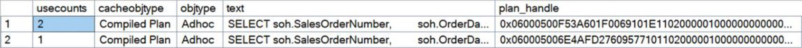  
*Hình 7-3. Hai kế hoạch thực thi riêng biệt tồn tại song song trong cache với hai plan_handle hoàn toàn khác nhau*

Như bạn thấy trong Hình 7-3, hiện có **hai kế hoạch thực thi độc lập** trong bộ nhớ đệm: một kế hoạch đã chạy 2 lần và một kế hoạch mới chỉ chạy 1 lần. Hai giá trị `plan_handle` hoàn toàn khác nhau. 

Nếu ứng dụng tiếp tục gửi lên các giá trị CustomerID khác nhau theo phong cách ad-hoc này, hệ thống sẽ liên tục phải biên dịch và sinh ra hàng nghìn kế hoạch thực thi mới! Hiện tượng này làm tăng vọt mức tiêu thụ CPU và chiếm dụng một lượng RAM khổng lồ – tình trạng này được gọi là **Ô nhiễm bộ nhớ đệm (Plan Cache Bloat)**. May mắn thay, SQL Server cung cấp các giải pháp để cải thiện tình trạng này.

---

### Tối ưu hóa cho Khối lượng công việc Ad Hoc (Optimize for Ad Hoc Workloads)

Khi bạn phải quản trị một hệ thống có khối lượng lớn các truy vấn ad-hoc (thường gặp trong các ứng dụng ORM hoặc báo cáo BI), bạn có thể đạt được sự cải thiện vượt bậc về dung lượng bộ nhớ bằng cách kích hoạt thiết lập cấp server mang tên: **Optimize for Ad Hoc Workloads**.

Thiết lập này làm thay đổi cơ chế SQL Server lưu trữ các truy vấn ad-hoc lần đầu tiên:
* Thay vì lưu toàn bộ một kế hoạch thực thi hoàn chỉnh vào cache ngay sau lần biên dịch đầu tiên, SQL Server sẽ chỉ lưu một **mẩu kế hoạch rút gọn (Plan Stub)**.
* Một Plan Stub không thực sự lưu trữ cấu trúc kế hoạch chi tiết, nhờ đó tiết kiệm được tới **99% dung lượng bộ nhớ** cho các truy vấn chỉ chạy đúng một lần rồi biến mất. Plan stub chỉ lưu đủ lượng siêu dữ liệu để nhận diện câu lệnh.
* Khi chính xác câu lệnh đó được gọi đến **lần thứ hai**, SQL Server mới thực hiện biên dịch lại đầy đủ và lưu toàn bộ kế hoạch hoàn chỉnh vào cache.

Listing 7-6 minh họa cách kích hoạt thiết lập này thông qua `sp_configure`:

```sql
-- Listing 7-6. Enabling Optimize for Ad Hoc Workloads
EXEC sys.sp_configure 'show advanced option', '1';
GO
RECONFIGURE;
GO
EXEC sys.sp_configure 'optimize for ad hoc workloads', 1;
GO
RECONFIGURE;
```

Khi chạy một truy vấn ad-hoc mới lần đầu tiên trên hệ thống đã bật thiết lập này:

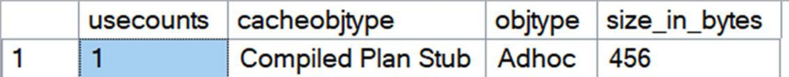  
*Hình 7-4. Thuộc tính cacheobjtype hiển thị là "Compiled Plan Stub" với dung lượng size_in_bytes chỉ có 456 bytes!*

Khi câu truy vấn đó được thực thi lần thứ hai:

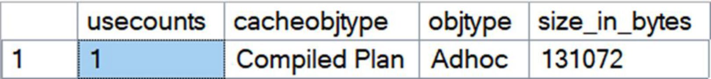  
*Hình 7-5. Thuộc tính cacheobjtype chuyển thành "Compiled Plan" và dung lượng size_in_bytes tăng lên 131.072 bytes*

Bạn có thể thấy rõ mức độ tiết kiệm bộ nhớ RAM to lớn đến nhường nào khi sử dụng Optimize for Ad Hoc Workloads: hàng nghìn truy vấn ad-hoc chỉ chạy một lần duy nhất trong ngày sẽ chỉ tiêu tốn vài trăm byte thay vì hàng trăm kilobyte mỗi kế hoạch!

Để đưa hệ thống về trạng thái ban đầu, bạn dùng Listing 7-7:

```sql
-- Listing 7-7. Disabling Optimize for Ad Hoc Workloads
EXEC sp_configure 'optimize for ad hoc workloads', 0;
GO
RECONFIGURE;
GO
EXEC sp_configure 'show advanced option', '0';
GO
RECONFIGURE;
```

Tôi khuyên bạn **nên kích hoạt tùy chọn này trên hầu hết các hệ thống production**. Mặc dù có một chi phí nhỏ là phải biên dịch lại khi truy vấn chạy lần thứ hai, nhưng lợi ích tiết kiệm bộ nhớ RAM là cực kỳ to lớn và giúp giải phóng bộ nhớ quý giá cho bộ đệm dữ liệu (Buffer Pool).

---

### Tham số hóa đơn giản (Simple Parameterization)

Một phần trong quy trình của optimizer là chủ động kiểm tra các truy vấn ad-hoc để xem liệu nó có thể tự động thay thế các giá trị viết cứng (hard-coded values) bằng các tham số nội bộ hay không. Khi phát hiện một truy vấn thỏa mãn điều kiện, nó sẽ tự động tham số hóa kế hoạch thực thi thông qua tiến trình gọi là **Tham số hóa đơn giản (Simple Parameterization)**.

Trong quá trình này, optimizer phải đảm bảo một điều kiện an toàn tuyệt đối: nếu truy vấn được tham số hóa, sự biến động của giá trị tham số trong tương lai sẽ **không làm thay đổi cấu trúc của kế hoạch thực thi**. Nếu xác định là an toàn, SQL Server sẽ tự động tái cấu trúc câu lệnh thành dạng có tham số và lưu kế hoạch đã tham số hóa đó vào cache.

Listing 7-8 minh họa một câu truy vấn đơn giản là ứng viên hoàn hảo cho tham số hóa đơn giản:

```sql
-- Listing 7-8. A simple ad hoc query that is a candidate for parameterization
SELECT a.AddressLine1,
       a.City,
       a.StateProvinceID
FROM Person.Address AS a
WHERE a.AddressID = 42;
```

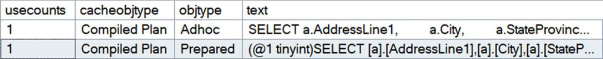  
*Hình 7-6. Kết quả cache hiển thị hai bản ghi: một bản ghi Adhoc và một bản ghi Prepared với câu lệnh đã được tham số hóa (@1 tinyint)*

Đặc biệt lưu ý kiểu dữ liệu của tham số tự sinh: `@1 tinyint`. Lý do là vì giá trị `42` nằm trọn vẹn trong khoảng giá trị của kiểu `tinyint` (0 - 255). 

Điều gì xảy ra nếu chúng ta chạy câu lệnh tương tự nhưng truyền vào một giá trị lớn hơn nhiều (`32509`) như trong Listing 7-9?

```sql
-- Listing 7-9. Same query with a higher hard-coded value
SELECT a.AddressLine1,
       a.City,
       a.StateProvinceID
FROM Person.Address AS a
WHERE a.AddressID = 32509;
```

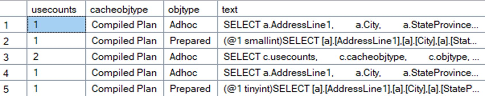  
*Hình 7-7. Một kế hoạch Prepared mới được sinh ra với kiểu dữ liệu tham số là smallint*

Bởi vì giá trị mới `32509` vượt quá giới hạn của `tinyint`, SQL Server không thể dùng lại kế hoạch `(@1 tinyint)` mà buộc phải tạo ra một kế hoạch Prepared mới với tham số mang kiểu dữ liệu `smallint` (`@1 smallint`). 

Nếu tiếp tục truyền một con số lớn hơn 32.767, bạn sẽ thấy thêm một kế hoạch với kiểu `int`. Mặc dù điều này tạo ra một vài biến thể kế hoạch trong cache, nhưng con số vài biến thể theo kiểu dữ liệu này vẫn nhỏ hơn vô số lần so với việc phải lưu riêng biệt từng kế hoạch cho mỗi giá trị literal khác nhau!

---

Chúng ta hãy thay đổi câu truy vấn thêm một lần nữa như trong Listing 7-10.

**Listing 7-10. Một truy vấn khác sử dụng giá trị trong phạm vi tinyint (Another query using a tinyint)**

```sql
SELECT a.AddressLine1,
       a.City,
       a.StateProvinceID
FROM Person.Address AS a
WHERE a.AddressID = 56;
```

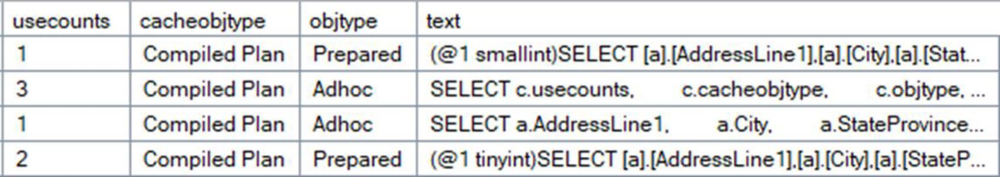

*Hình 7-8: Kế hoạch đã chuẩn bị hiện được sử dụng hai lần (The prepared plan has now been used twice)*

Như bạn có thể thấy trong Hình 7-8, kế hoạch tham số hóa đã được tái sử dụng lần thứ hai (`usecounts = 2`).

Hãy xem xét một tình huống phức tạp hơn một chút khi sử dụng toán tử khoảng giá trị `BETWEEN` như trong Listing 7-11.

**Listing 7-11. Truy vấn SELECT sử dụng toán tử BETWEEN (A SELECT query using the BETWEEN operator)**

```sql
SELECT a.AddressLine1,
       a.PostalCode
FROM Person.Address AS a
WHERE a.AddressID
BETWEEN 40 AND 60;
```

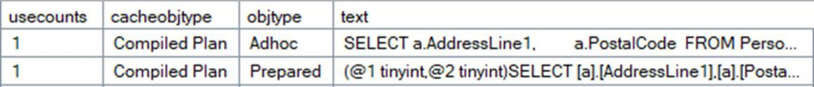

*Hình 7-9: Thay đổi trong truy vấn dẫn đến thay đổi trong bộ nhớ đệm (Changes to the query result in changes in the cache)*

Bạn có thể nhận thấy khá rõ ràng rằng quá trình tham số hóa đơn giản đã được thực hiện cho cả hai giá trị hard-coded dùng trong toán tử `BETWEEN`. Tuy nhiên, còn có một chi tiết quan trọng khác có thể không dễ nhận ra ngay. Dưới đây là đoạn mã gốc chưa định dạng được trích xuất từ `sys.dm_exec_sql_text`:

```sql
(@1 tinyint,@2 tinyint)SELECT [a].[AddressLine1],[a].[PostalCode] FROM [Person].[Address] [a] WHERE [a].[AddressID]>=@1 AND [a].[AddressID]<=@2
```

Điểm then chốt cần chú ý ở đây là câu truy vấn gốc ban đầu sử dụng toán tử `BETWEEN`, nhưng trình tối ưu hóa đã chủ động chuyển đổi nó thành cặp toán tử `>=` và `<=` để tiến hành biên dịch kế hoạch thực thi. Để kiểm chứng điều này, chúng ta hãy thử chạy chính câu truy vấn đó dưới dạng một truy vấn ad hoc như trong Listing 7-12.

**Listing 7-12. Chuyển đổi truy vấn theo đúng cách thức tối ưu hóa (Changing the query to what the optimizer liked)**

```sql
SELECT a.AddressLine1,
       a.PostalCode
FROM Person.Address AS a
WHERE a.AddressID >= 40
      AND a.AddressID <= 60;
```

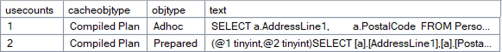

*Hình 7-10: Tái sử dụng truy vấn đã được tham số hóa (Reuse of the parameterized query)*

Chúng ta thấy rằng kế hoạch thực thi vốn được biên dịch cho Listing 7-11 nay lại được tái sử dụng trực tiếp cho Listing 7-12, hoàn toàn khớp với những gì mà trình tối ưu hóa dự định thực hiện. Như vậy, SQL Server không chỉ sửa đổi các câu truy vấn khi tiến hành tham số hóa chúng, mà nó còn có khả năng nhận diện mẫu khuôn mẫu (template) mà nó đã từng sử dụng và tự động tái sử dụng lại khuôn mẫu đó.

Dù vậy, tính năng tham số hóa đơn giản (Simple Parameterization) được áp dụng tương đối dè dặt. SQL Server lựa chọn cách tiếp cận thận trọng đối với việc tự động tham số hóa, bởi vì các truy vấn ad hoc thường hưởng lợi rất lớn từ việc sở hữu các kế hoạch thực thi riêng biệt tối ưu cho từng giá trị hard-coded cụ thể (tránh rủi ro do lệch phân phối dữ liệu). Nếu bất kỳ câu truy vấn mẫu nào của chúng ta có chứa thao tác kết nối `JOIN` tới một hoặc nhiều bảng bổ sung, nó sẽ lập tức bị loại trừ khỏi phạm vi xem xét của Simple Parameterization. Khi hệ thống của bạn mở rộng quy mô với các truy vấn phức tạp, bạn sẽ rất hiếm khi bắt gặp Simple Parameterization phát huy tác dụng.

## Tham số hóa bắt buộc (Forced Parameterization)

Việc tham số hóa không chỉ cải thiện khả năng tái sử dụng kế hoạch mà còn có thể mang lại hiệu năng vượt trội nhờ cắt giảm chi phí biên dịch lặp đi lặp lại (mặc dù nó cũng có thể kéo theo các vấn đề tiềm ẩn, điều mà chúng ta sẽ thảo luận chi tiết khi nói về *parameter sniffing* trong Chương 14). Nếu hệ thống của bạn đang phải gánh một lượng lớn các câu truy vấn ad hoc, bạn có thể muốn gia tăng tỷ lệ các truy vấn được tự động tham số hóa. 

SQL Server cung cấp một thiết lập ở cấp độ cơ sở dữ liệu nhằm nỗ lực đưa nhiều truy vấn hơn qua quy trình tham số hóa tự động, được gọi là **Tham số hóa bắt buộc** (*Forced Parameterization*). Để thử nghiệm tính năng này, chúng ta cần kích hoạt nó trên cơ sở dữ liệu bằng lệnh trong Listing 7-13.

**Listing 7-13. Kích hoạt tính năng Tham số hóa bắt buộc (Enabling forced parameterization)**

```sql
ALTER DATABASE AdventureWorks SET PARAMETERIZATION FORCED;
```

Lần này, thay vì sử dụng một truy vấn đơn giản, chúng ta hãy xem xét một kịch bản thực tế hơn. Listing 7-14 trình bày một câu truy vấn có độ phức tạp cao hơn với nhiều phép `JOIN`.

**Listing 7-14. Câu lệnh SELECT từ nhiều bảng (SELECT statement from multiple tables)**

```sql
SELECT ea.EmailAddress,
       e.BirthDate,
       a.City
FROM Person.Person AS p
    JOIN HumanResources.Employee AS e
        ON p.BusinessEntityID = e.BusinessEntityID
    JOIN Person.BusinessEntityAddress AS bea
        ON e.BusinessEntityID = bea.BusinessEntityID
    JOIN Person.Address AS a
        ON bea.AddressID = a.AddressID
    JOIN Person.StateProvince AS sp
        ON a.StateProvinceID = sp.StateProvinceID
    JOIN Person.EmailAddress AS ea
        ON p.BusinessEntityID = ea.BusinessEntityID
WHERE ea.EmailAddress LIKE 'david%'
      AND sp.StateProvinceCode = 'WA';
```

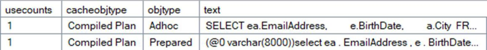

*Hình 7-11: Truy vấn đã trải qua quá trình tham số hóa bắt buộc (A query has gone through forced parameterization)*

Nhìn vào mã SQL được tham số hóa từ bộ nhớ đệm:

```sql
(@0 varchar(8000))select ea . EmailAddress , e . BirthDate , a . City 
from Person . Person as p join HumanResources . Employee as e on p . 
BusinessEntityID = e . BusinessEntityID join Person . BusinessEntityAddress 
as bea on e . BusinessEntityID = bea . BusinessEntityID join Person . 
Address as a on bea . AddressID = a . AddressID join Person . StateProvince 
as sp on a . StateProvinceID = sp . StateProvinceID join Person . 
EmailAddress as ea on p . BusinessEntityID = ea . BusinessEntityID where ea 
. EmailAddress like 'david%' and sp . StateProvinceCode = @0
```

Có một số giới hạn và quy tắc nghiêm ngặt đối với cách thức hoạt động của Forced Parameterization, và chúng ta có thể thấy một trong số các quy tắc đó đang diễn ra ở đây:
* Mệnh đề `ea.EmailAddress LIKE 'david%'` **không** được tham số hóa.
* Giá trị `'WA'` được tham số hóa thành biến `@0 varchar(8000)`. Mặc dù chuỗi giá trị chỉ dài hai ký tự nhưng tham số lại được định nghĩa là `varchar(8000)`. Dù giá trị độ dài này khác với định nghĩa cột trong cơ sở dữ liệu, nó sẽ không gây ra bất kỳ xung đột nào đối với chỉ mục hay số liệu thống kê.

Dưới đây là một số trường hợp giới hạn mà Forced Parameterization sẽ không áp dụng:
* Các câu truy vấn `INSERT … EXECUTE`.
* Các câu lệnh nằm bên trong thủ tục lưu trữ (stored procedures), trigger, và hàm do người dùng định nghĩa (UDF) vì bản thân chúng vốn đã là các câu lệnh chuẩn bị sẵn (prepared statements).
* Các câu lệnh được chuẩn bị sẵn phía máy khách (Client-side prepared statements).
* Các truy vấn có chứa gợi ý truy vấn `RECOMPILE`.
* Các đối số mẫu và mệnh đề thoát (escape clause) được sử dụng trong câu lệnh `LIKE` (như chúng ta vừa quan sát thấy ở trên).

Để xem danh sách đầy đủ các trường hợp ngoại lệ, bạn có thể tham khảo thêm tài liệu chính thức từ Microsoft. Tuy nhiên, với danh sách trên, bạn đã có thể hình dung rõ ràng những dạng truy vấn nào sẽ không thể hưởng lợi từ Forced Parameterization.

Trước khi tiếp tục, hãy sử dụng Listing 7-15 để tắt chế độ Forced Parameterization, đưa cơ sở dữ liệu trở về chế độ Simple Parameterization mặc định.

**Listing 7-15. Vô hiệu hóa tính năng Tham số hóa bắt buộc (Disabling forced parameterization)**

```sql
ALTER DATABASE AdventureWorks SET PARAMETERIZATION SIMPLE;
```

## Khối lượng công việc chuẩn bị sẵn (Prepared Workload)

Các truy vấn được xếp vào nhóm khối lượng công việc chuẩn bị sẵn (**Prepared Workload**) sử dụng các tham số (parameters) như một thành phần nền tảng cốt lõi trong quy trình thực thi. Mặc dù chúng vẫn có thể được viết bằng cách sử dụng các biến cục bộ hoặc các giá trị hard-coded, nhưng toàn bộ triết lý đằng sau khối lượng công việc chuẩn bị sẵn (còn gọi là các câu lệnh chuẩn bị sẵn - *prepared statements*) là tận dụng tối đa tham số như một phương thức dễ dàng để thay đổi kết quả đầu ra của truy vấn mà không cần phải thay đổi mã lệnh thực thi. 

Có ba kỹ thuật chính để tạo lập khối lượng công việc chuẩn bị sẵn:
1. **Thủ tục lưu trữ (Stored Procedures):** Cho phép bạn tạo một hoặc nhiều câu lệnh T-SQL có khả năng tiếp nhận và trả về các tham số do người dùng cung cấp.
2. **`sp_executesql`:** Thủ tục hệ thống tích hợp sẵn trong SQL Server cho phép thực thi một câu lệnh T-SQL có chứa tham số mà không cần phải định nghĩa nó thành một stored procedure tĩnh.
3. **Mô hình Chuẩn bị / Thực thi (Prepare/Execute Model):** Cho phép ứng dụng phía máy khách (client application) yêu cầu máy chủ sinh trước một kế hoạch thực thi để tái sử dụng trong các lần gọi tiếp theo bằng cách truyền tham số, tương tự như cơ chế của stored procedure. Đây là mô hình hoạt động tiêu chuẩn của các công cụ ORM như Entity Framework hay Hibernate.

### Thủ tục lưu trữ (Stored Procedures)

Sử dụng thủ tục lưu trữ (stored procedure) là một kỹ thuật kinh điển và hiệu quả bậc nhất để nâng cao tính khả dụng và hiệu suất của bộ nhớ đệm kế hoạch thực thi (plan cache). 

Stored procedure được biên dịch khi chúng được thực thi lần đầu tiên (điều này khác biệt với các thủ tục biên dịch gốc - *native compiled procedures* trong In-Memory OLTP mà chúng ta sẽ tìm hiểu trong Chương 19). Một kế hoạch thực thi sẽ được tạo ra cho từng câu lệnh SQL riêng lẻ bên trong thủ tục. Kế hoạch này sau đó sẽ được lưu vào plan cache và tái sử dụng liên tục khi thủ tục được gọi với các giá trị tham số khác nhau.

Bảng 7-2 liệt kê các sự kiện Extended Events hữu ích để theo dõi hành vi lưu trữ kế hoạch của stored procedure trong bộ nhớ đệm.

**Bảng 7-2. Các sự kiện Extended Events để phân tích việc lưu đệm kế hoạch (Events to analyze plan caching)**

| Sự kiện (Event) | Mô tả (Description) |
| :--- | :--- |
| `sp_cache_hit` | Kế hoạch thực thi được tìm thấy thành công trong bộ nhớ đệm sau khi tìm kiếm. |
| `sp_cache_miss` | Không tìm thấy kế hoạch thực thi nào trong bộ nhớ đệm khi tìm kiếm. |
| `sp_cache_insert` | Một kế hoạch thực thi mới được tạo ra và nạp vào bộ nhớ đệm. |
| `sp_cache_remove` | Một kế hoạch thực thi đã bị loại bỏ khỏi bộ nhớ đệm. |

Để kiểm chứng cơ chế này, chúng ta tạo một stored procedure như trong Listing 7-16.

**Listing 7-16. Định nghĩa thủ tục lưu trữ dbo.BasicSalesInfo (Stored procedure definition for dbo.BasicSalesInfo)**

```sql
CREATE OR ALTER PROCEDURE dbo.BasicSalesInfo
    @ProductID INT,
    @CustomerID INT
AS
SELECT soh.SalesOrderNumber,
       soh.OrderDate,
       sod.OrderQty,
       sod.LineTotal
FROM Sales.SalesOrderHeader AS soh
    JOIN Sales.SalesOrderDetail AS sod
        ON soh.SalesOrderID = sod.SalesOrderID
WHERE soh.CustomerID = @CustomerID
      AND sod.ProductID = @ProductID;
```

Để mô phỏng một lời gọi thủ tục từ xa (RPC - Remote Procedure Call), chúng ta có thể thực thi procedure thông qua một đoạn mã PowerShell đơn giản tận dụng module DBATools như trong Listing 7-17.

**Listing 7-17. Thực thi thủ tục lưu trữ dbo.BasicSalesInfo bằng PowerShell (Executing the dbo.BasicSalesInfo stored procedure)**

```powershell
$credential = Get-Credential 'sa'
$instance = Connect-DbaInstance -SqlInstance "localhost" -SqlCredential $credential
Invoke-DbaQuery -SqlInstance $instance -Query 'dbo.BasicSalesInfo' -SqlParameter @{ CustomerId = 29690; ProductID = 711 } -Database 'AdventureWorks' -CommandType StoredProcedure
```

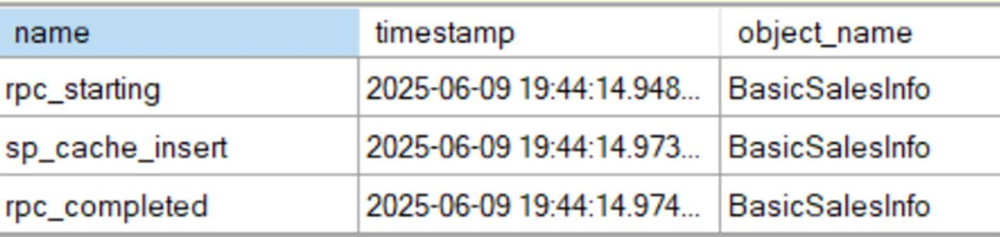

*Hình 7-12: Nạp một stored procedure vào bộ nhớ đệm trong lần chạy đầu tiên (Adding a stored procedure to cache)*

Trong lần chạy đầu tiên, bạn sẽ thấy sự kiện `sp_cache_miss` xuất hiện trước, theo sau là `sp_cache_insert` khi kế hoạch được biên dịch và nạp vào cache. Khi gọi lại thủ tục lần thứ hai với các giá trị tham số khác (`CustomerId = 29690; ProductID = 707`):

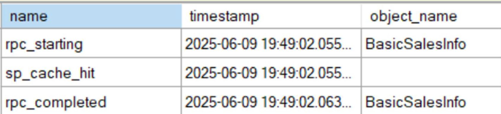

*Hình 7-13: Stored procedure được tìm thấy trong bộ nhớ đệm (The stored procedure was found in cache)*

Bạn có thể thấy thủ tục bắt đầu chạy, lập tức tìm thấy kế hoạch trong cache (`sp_cache_hit`), và hoàn thành thực thi mà Query Optimizer hoàn toàn không cần phải tham gia vào lần chạy thứ hai này, mặc dù các giá trị tham số đã thay đổi. Sự kiện `sp_cache_hit` là minh chứng rõ ràng nhất cho hiệu quả của prepared statements.

> [!NOTE]
> Ở đây tôi thực thi thủ tục từ xa thông qua PowerShell. Nếu bạn chạy thủ tục từ một khối lệnh (batch) bên trong SSMS hay Azure Data Studio (ADS), bạn có thể thấy một sự kiện `sp_cache_miss` xuất hiện trước sự kiện `sp_cache_hit`. Nguyên nhân là vì bản thân khối lệnh batch của SSMS chưa có trong cache, dẫn tới một miss cho batch, nhưng ngay sau đó là một hit cho chính thủ tục lưu trữ.

Thủ tục lưu trữ sở hữu một vài đặc tính hành vi riêng biệt rất đáng để thảo luận chi tiết:
* Thời điểm thủ tục lưu trữ được biên dịch.
* Các cơ chế giúp thủ tục lưu trữ gia tăng hiệu năng.
* Các lợi ích phi hiệu năng của thủ tục lưu trữ.

### Thời điểm Stored Procedures được biên dịch

Stored procedures **chỉ được biên dịch khi chúng được thực thi lần đầu tiên**. Có một quan niệm sai lầm phổ biến từ lâu cho rằng thủ tục lưu trữ được biên dịch ngay tại thời điểm tạo lập (`CREATE PROCEDURE`). Điều này hoàn toàn không đúng trong SQL Server. 

Khi bạn chạy lệnh `CREATE PROCEDURE`, không có bất kỳ quá trình tối ưu hóa nào diễn ra. Thay vào đó, chỉ có cú pháp của bản thân câu lệnh `CREATE` được phân tích (parse), và định nghĩa của thủ tục được ghi nhận vào cơ sở dữ liệu. Nhờ cơ chế **Phân giải tên hoãn lại** (*Deferred Name Resolution*), bạn thậm chí có thể tạo các thủ tục lưu trữ trước khi tạo các đối tượng (bảng, view) mà thủ tục đó tham chiếu tới. Listing 7-18 minh họa một stored procedure hoàn toàn có thể lưu thành công dù bảng không hề tồn tại.

**Listing 7-18. Một stored procedure có thể lưu thành công nhưng không thể thực thi (A stored procedure that will save but can’t execute)**

```sql
CREATE OR ALTER PROCEDURE dbo.MyNewProc
AS
SELECT MyID
FROM dbo.NotHere; --Bảng dbo.NotHere không hề tồn tại
```

Nếu bạn thực thi lệnh `CREATE OR ALTER PROCEDURE` ở trên, nó sẽ hoàn thành mà không có lỗi. Nhưng nếu bạn cố gắng gọi thực thi thủ tục này (`EXEC dbo.MyNewProc`), bạn sẽ nhận được thông báo lỗi ngay lập tức vì lúc này quá trình biên dịch mới thực sự diễn ra và không tìm thấy bảng. Điều này chứng minh chắc chắn rằng stored procedure chỉ được biên dịch khi nó bắt đầu được thực thi.

### Lợi ích về mặt hiệu năng của Stored Procedures

Bản thân stored procedure không có "phép thuật" nào tự động khiến truy vấn chạy nhanh hơn — đối với SQL Server engine, một câu truy vấn thì bản chất vẫn là một câu truy vấn. Tuy nhiên, chúng mang lại các lợi thế hiệu năng rõ rệt:

* **Tái sử dụng kế hoạch thực thi (Plan Reuse):** Cắt giảm triệt để chi phí CPU và thời gian biên dịch lại kế hoạch truy vấn cho mỗi lần gọi.
* **Tận dụng Parameter Sniffing:** Trình tối ưu hóa sử dụng giá trị tham số được truyền vào tại thời điểm biên dịch đầu tiên kết hợp với số liệu thống kê (statistics) để tạo ra một kế hoạch thực thi chuyên biệt và tối ưu nhất cho cấu trúc dữ liệu đó (chúng ta sẽ phân tích sâu về chủ đề này trong Chương 13).
* **Đặt logic nghiệp vụ gần với dữ liệu (Business Logic Near the Data):** Một số quy tắc nghiệp vụ gắn chặt với việc thao tác dữ liệu nên được thực thi trực tiếp tại nơi lưu trữ dữ liệu, thay vì kéo một lượng lớn dữ liệu thô qua mạng về phía ứng dụng để xử lý. Các thao tác tổng hợp (aggregations) và xử lý theo tập hợp (set-based) vận hành đạt hiệu năng tối đa khi nằm bên trong stored procedures.
* **Giảm thiểu lưu lượng mạng (Reduced Network Traffic):** Thay vì phải gửi các khối lệnh T-SQL dài dòng qua đường truyền mạng, ứng dụng chỉ cần gửi tên của thủ tục và các tham số truyền vào. Dữ liệu cũng được lọc trực tiếp tại máy chủ cơ sở dữ liệu trước khi trả về, giúp giảm đáng kể băng thông mạng.

### Các lợi ích phi hiệu năng của Stored Procedures

Bên cạnh khía cạnh hiệu năng, stored procedures còn cung cấp nhiều giá trị kiến trúc quan trọng khác:

* **Cô lập ứng dụng khỏi các thay đổi cấu trúc dữ liệu:** Việc truy cập dữ liệu thông qua tầng stored procedures giúp đội ngũ quản trị cơ sở dữ liệu có thể thay đổi cấu trúc bảng bên dưới mà không làm gián đoạn hoặc bắt buộc phải sửa đổi mã nguồn ứng dụng. Thủ tục lưu trữ có thể đóng vai trò như một lớp chuyển đổi thích ứng.
* **Tạo điểm quản trị tập trung duy nhất (Single Point of Administration):** Các logic nghiệp vụ cốt lõi nằm trong stored procedures được duy trì tập trung bên trong cơ sở dữ liệu. Nhờ đó, việc kiểm soát mã lệnh, phân quyền truy cập và kiểm tra hành vi có thể được quản lý trực tiếp và nhất quán.
* **Tăng cường bảo mật (Enhanced Security):** Quyền hạn của người dùng hoặc tài khoản ứng dụng đối với các bảng vật lý có thể bị thu hồi hoàn toàn; quyền truy cập chỉ được cấp phát độc quyền thông qua các stored procedures (hoặc views). Bằng cách này, bạn ẩn giấu hoàn toàn cấu trúc dữ liệu nền tảng khỏi người dùng và ngăn chặn hiệu quả các nguy cơ tấn công SQL Injection.

Stored procedures không phải là giải pháp vạn năng. Chúng làm tăng thêm chi phí quản trị, lưu trữ và bảo trì mã nguồn. Trong các hệ thống mà phần lớn các truy vấn chỉ được thực thi một lần duy nhất hoặc có tần suất rất thưa thớt, việc tạo thủ tục lưu trữ cho từng truy vấn có thể là không khả thi. Trong những trường hợp như vậy, giải pháp tối ưu chính là sử dụng `sp_executesql`.

---

### Sử dụng sp_executesql (Putting sp_executesql to Work)

Chúng ta có thể trích xuất câu truy vấn từ thủ tục lưu trữ ví dụ trước đó, `dbo.BasicSalesInfo`, và thực thi nó thông qua thủ tục lưu trữ hệ thống `sp_executesql` như được minh họa trong Listing 7-19.

**Listing 7-19.** Sử dụng sp_executesql trong thực tế

```sql
DECLARE @query NVARCHAR(MAX),
        @paramlist NVARCHAR(MAX);

SET @query
    = N'SELECT soh.SalesOrderNumber,
       soh.OrderDate,
       sod.OrderQty,
       sod.LineTotal
FROM Sales.SalesOrderHeader AS soh
    JOIN Sales.SalesOrderDetail AS sod
        ON soh.SalesOrderID = sod.SalesOrderID
WHERE soh.CustomerID = @CustomerID
      AND sod.ProductID = @ProductID';

SET @paramlist = N'@CustomerID INT, @ProductID INT';

EXEC sys.sp_executesql @query,
                       @paramlist,
                       @CustomerID = 29690,
                       @ProductID = 711;
```

Bạn bắt buộc phải sử dụng chuỗi ký tự Unicode khi làm việc với `sp_executesql`. Đó là lý do tại sao tôi khai báo các biến kiểu `NVARCHAR` và đặt tiền tố chữ cái `N` trước định nghĩa chuỗi văn bản. 

Listing 7-20 cho phép chúng ta truy vấn bộ nhớ đệm để quan sát cách thức `sp_executesql` được tổ chức và lưu trữ bên trong plan cache.

**Listing 7-20.** Truy vấn bộ nhớ đệm cache để quan sát các câu truy vấn sp_executesql

```sql
SELECT c.usecounts,
       c.cacheobjtype,
       c.objtype,
       t.text
FROM sys.dm_exec_cached_plans AS c
    CROSS APPLY sys.dm_exec_sql_text(c.plan_handle) AS t
WHERE text LIKE '(@CustomerID%';
```


*Hình 7-14: Một câu lệnh chuẩn bị sẵn được xây dựng bởi sp_executesql (A prepared statement built by sp_executesql)*

Tiếp theo, nếu chúng ta thực thi lại đoạn mã đó nhưng thay đổi giá trị của các tham số:


*Hình 7-15: Lần sử dụng thứ hai của kế hoạch đã chuẩn bị từ sp_executesql (Second use of the prepared plan from sp_executesql)*

Mặc dù chúng ta đã thay đổi các tham số trong lệnh batch, nhưng nhờ việc sử dụng `sp_executesql` để thực thi truy vấn, bạn có thể nhận thấy rằng câu lệnh này hoạt động giống như một câu lệnh đã chuẩn bị (prepared statement) và chỉ số số lần tái sử dụng (`usecounts`) đã tăng lên thành 2.

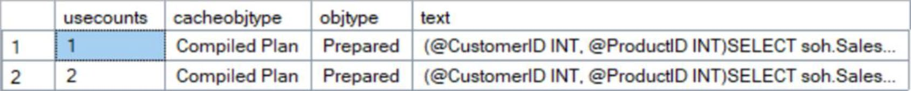

*Hình 7-16: Một kế hoạch chuẩn bị mới được khởi tạo (A new prepared plan is created)*

Mục tiêu của việc sử dụng `sp_executesql` bao gồm hai khía cạnh then chốt:
1. **Quan trọng nhất**: Bạn có thể đảm bảo một mức độ tái sử dụng kế hoạch thực thi nhất định, ngay cả đối với một câu truy vấn batch thông thường như trong Listing 7-19.
2. **Bảo mật**: Bằng cách sử dụng các giá trị tham số hóa, chúng ta đảm bảo rằng các tham số được định kiểu dữ liệu một cách tường minh và chặt chẽ, từ đó loại trừ hoàn toàn nguy cơ tấn công tiêm nhiễm mã độc SQL (**SQL Injection**) trong các tiến trình xử lý dữ liệu động.

Bạn cũng có thể phát hành các câu lệnh chuẩn bị sẵn thông qua các tập lệnh ODBC và OLEDB bằng cách sử dụng tương ứng các phương thức `SQLExecDirect` và `ICommandWithParameters`. Đây chính là cơ chế mà phần lớn các công cụ ánh xạ đối tượng - quan hệ (**ORM**) như Entity Framework sử dụng để thực thi các câu truy vấn của chúng thông qua các prepared statements.

Trước phiên bản SQL Server 2025, tồn tại một điểm yếu cố hữu đối với `sp_executesql`: Quy trình biên dịch của `sp_executesql` không được tuần tự hóa (serialized) như cách mà SQL Server áp dụng cho các stored procedures. Điều này đồng nghĩa với việc bạn có thể gặp phải tình trạng được gọi là **"cơn bão biên dịch"** (**compile storm**) nếu nhiều tiến trình khác nhau đồng thời cố gắng thực thi cùng một câu truy vấn chưa có sẵn trong cache. 

Được giới thiệu trong **SQL Server 2025** và có sẵn trên **Azure SQL Database**, giờ đây bạn có thể kích hoạt tùy chọn cấu hình cấp cơ sở dữ liệu mang tên `OPTIMIZE_SP_EXECUTESQL`.

Khi thiết lập này được bật, quá trình biên dịch câu lệnh sẽ được tuần tự hóa, tương tự như cơ chế của stored procedure. Thay đổi này sẽ loại bỏ hoàn toàn nguy cơ phình to bộ nhớ đệm (**cache bloat**) và sự xung đột, xáo trộn dữ liệu bộ nhớ đệm liên tục (**cache thrashing**) do nhiều câu lệnh biên dịch cùng một lúc. Thiết lập này mặc định ở trạng thái TẮT (`OFF`). Tuy nhiên, việc bật nó rất đơn giản như thể hiện trong Listing 7-21.

**Listing 7-21.** Kích hoạt thiết lập Database Scoped Configuration OPTIMIZE_SP_EXECUTESQL

```sql
ALTER DATABASE SCOPED CONFIGURATION
SET OPTIMIZED_SP_EXECUTESQL = ON;
```

Có một lưu ý quan trọng đi kèm khi kích hoạt thiết lập này: Microsoft khuyến nghị bạn nên kích hoạt tính năng cập nhật số liệu thống kê bất đồng bộ (`AUTO_UPDATE_STATISTICS_ASYNC ON`). Ngoài ra, họ cũng khuyến nghị bật thêm thiết lập Database Scoped Configuration `ASYNC_STATS_UPDATES_WAIT_AT_LOW_PRIORITY`. Việc bật cả hai tùy chọn này sẽ giúp hệ thống giảm thiểu các hiện tượng chờ đợi (waits) trong trường hợp thời gian biên dịch bị kéo dài khi sử dụng `sp_executesql`.

### Mô hình Chuẩn bị / Thực thi (Prepare/Execute Model)

ODBC và OLEDB cung cấp mô hình **Prepare/Execute** để gửi các câu truy vấn lên máy chủ dưới dạng một khối lượng công việc đã chuẩn bị (prepared workload). Tương tự như nguyên lý hoạt động của `sp_executesql`, mô hình này cho phép bạn tham số hóa các câu truy vấn:

1. **Giai đoạn Prepare (Chuẩn bị):** Cho phép SQL Server biên dịch và tạo ra kế hoạch thực thi cho câu truy vấn, đồng thời trả về một tay cầm kế hoạch (**plan handle**) cho mã nguồn ứng dụng phía client.
2. **Giai đoạn Execute (Thực thi):** Ứng dụng sau đó có thể tái sử dụng chính plan handle đó để gọi thực thi câu truy vấn nhiều lần chỉ bằng cách truyền vào các giá trị tham số mới.

Cơ chế này giúp giảm thiểu đáng kể chi phí băng thông đường truyền mạng, vì ứng dụng không bắt buộc phải gửi toàn bộ chuỗi văn bản T-SQL dài mỗi khi muốn thực thi lại câu lệnh. Lưu ý rằng bạn không thể sử dụng trực tiếp cơ chế này bên trong mã T-SQL nội bộ, mà nó chỉ áp dụng cho mã ứng dụng bên ngoài.

> [!NOTE]
> Để tìm hiểu tài liệu mô tả chi tiết về cách áp dụng mô hình prepare/execute trong ứng dụng, vui lòng tham khảo tài liệu của Microsoft: *"SqlCommand.Prepare Method"* (https://bit.ly/2DBzN4b).

---

## Mã băm truy vấn và Mã băm kế hoạch (Query Hash and Query Plan Hash)

SQL Server tự động tạo ra một giá trị băm cho câu truy vấn (**query_hash**) và một giá trị băm cho kế hoạch thực thi (**query_plan_hash**). Các giá trị băm này trở nên cực kỳ hữu ích khi bạn cần tìm kiếm các câu truy vấn và các kế hoạch có sự tương đồng về mặt cấu trúc. 

Việc các nhà phát triển tạo ra các mẫu hình viết mã (coding patterns) lặp đi lặp lại trong dự án là rất phổ biến. Những mẫu hình này dẫn đến sự ra đời của các câu truy vấn tương đồng hoặc các kế hoạch thực thi có cấu trúc giống hệt nhau. Khi bạn phát hiện ra một mẫu hình cụ thể đang hoạt động kém hiệu quả và tìm ra giải pháp tối ưu cho nó, khả năng định vị nhanh chóng toàn bộ các câu truy vấn hoặc kế hoạch khác đang tuân theo cùng mẫu hình đó để áp dụng sửa đổi trên diện rộng là một tiện ích vô cùng giá trị.

`query_hash` và `query_plan_hash` được lưu trữ sẵn trong các DMV hệ thống như `sys.dm_exec_query_stats` hay `sys.dm_exec_requests`. Các giá trị băm này cũng được lưu trữ bền vững bên trong **Query Store**. Bạn thậm chí có thể thu thập chúng thông qua các sự kiện Extended Events hoặc bằng cách thêm chúng làm hành động (Action). Tóm lại, có rất nhiều phương thức thuận tiện để bạn tiếp cận các giá trị băm này. 

Tuy nhiên, giống như bất kỳ hàm băm nào khác trong khoa học máy tính, về lý thuyết vẫn tồn tại xác suất xảy ra hiện tượng đụng độ băm (collision) — tức là hai truy vấn hoặc hai kế hoạch không thực sự giống hệt nhau vẫn có thể sinh ra cùng một giá trị băm. Do đó, mặc dù rất hữu ích, các giá trị băm này không hoàn toàn là các định danh duy nhất tuyệt đối.

Để quan sát các giá trị băm trong thực tế, chúng ta sẽ thực thi hai câu truy vấn riêng biệt qua hai bước như minh họa trong Listing 7-22.

**Listing 7-22.** Hai câu truy vấn tương đồng dùng để kiểm tra giá trị băm

```sql
SELECT p.Name AS ProductName,
       ps.Name AS SubCategory,
       pc.Name AS Category
FROM Production.Product AS p
    JOIN Production.ProductSubcategory AS ps
        ON p.ProductSubcategoryID = ps.ProductSubcategoryID
    JOIN Production.ProductCategory AS pc
        ON ps.ProductCategoryID = pc.ProductCategoryID
WHERE pc.Name = 'Bikes'
      AND ps.Name = 'Touring Bikes';

SELECT p.Name AS ProductName,
       ps.Name AS SubCategory,
       pc.Name AS Category
FROM Production.Product AS p
    JOIN Production.ProductSubcategory AS ps
        ON p.ProductSubcategoryID = ps.ProductSubcategoryID
    JOIN Production.ProductCategory AS pc
        ON ps.ProductCategoryID = pc.ProductCategoryID
where pc.Name = 'Bikes'
      and ps.Name = 'Road Bikes';
```

Điểm khác biệt duy nhất về mặt logic giữa hai câu truy vấn là các giá trị hằng số (literal values) trong mệnh đề `WHERE` trên cột `ProductSubcategory.Name`. Ngoài ra, bạn cũng sẽ thấy câu lệnh thứ hai viết chữ thường cho từ khóa `where` và `and`. 

Tôi sẽ thực thi riêng biệt từng câu truy vấn nói trên. Sau đó, tôi sẽ trích xuất các giá trị băm tương ứng từ `sys.dm_exec_query_stats` bằng câu lệnh trong Listing 7-23.

**Listing 7-23.** Truy xuất các giá trị hash từ bộ nhớ đệm cache

```sql
SELECT deqs.execution_count,
       deqs.query_hash,
       deqs.query_plan_hash,
       dest.text
FROM sys.dm_exec_query_stats AS deqs
    CROSS APPLY sys.dm_exec_sql_text(deqs.plan_handle) AS dest
WHERE dest.text LIKE 'SELECT p.Name AS ProductName%';
```

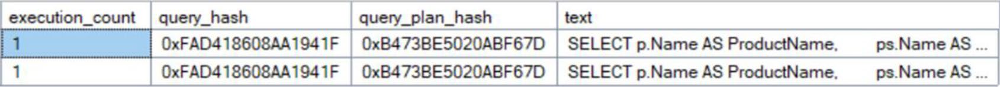

*Hình 7-17: Truy xuất các giá trị hash từ plan cache (Retrieving the hash values from cache)*

Các câu truy vấn này có độ phức tạp đủ lớn khiến cơ chế Simple Parameterization không được kích hoạt. Đồng thời, chế độ Forced Parameterization đang ở trạng thái tắt. Vì lý do đó, với hai mệnh đề `WHERE` chứa các giá trị hằng số khác nhau, hệ thống tạo ra hai kế hoạch thực thi riêng biệt. 

Tuy nhiên, bạn có thể thấy rằng giá trị `query_plan_hash` của cả hai dòng hoàn toàn trùng khớp nhau. Điều này chứng minh rằng hai kế hoạch thực thi này có cấu trúc giống hệt nhau. Bạn cũng có thể quan sát thấy cả hai giá trị `query_hash` đều khớp nhau: bất chấp sự thay đổi nhỏ về chữ hoa/chữ thường trong văn bản truy vấn, điều đó không đủ để tạo ra một giá trị băm truy vấn mới.

Bây giờ, nếu tôi sửa đổi danh sách các cột trong mệnh đề `SELECT` như trong Listing 7-24, kết quả sẽ thay đổi.

**Listing 7-24.** Loại bỏ hai cột khỏi danh sách SELECT

```sql
SELECT p.Name AS ProductName
FROM Production.Product AS p
    JOIN Production.ProductSubcategory AS ps
        ON p.ProductSubcategoryID = ps.ProductSubcategoryID
    JOIN Production.ProductCategory AS pc
        ON ps.ProductCategoryID = pc.ProductCategoryID
WHERE pc.Name = 'Bikes'
      AND ps.Name = 'Touring Bikes';
```

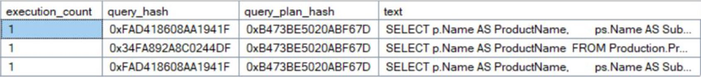

*Hình 7-18: Một giá trị query_hash mới được tạo ra (A new query_hash value)*

Cấu trúc cú pháp của câu truy vấn khi không còn hai cột phụ đã bị thay đổi, do đó bạn thấy một giá trị `query_hash` hoàn toàn mới xuất hiện ở dòng thứ hai. Tuy nhiên, về mặt bản chất cấu trúc cây toán tử thực thi vẫn tương đương, do đó một kế hoạch giống hệt nhau vẫn được sinh ra, thể hiện qua giá trị `query_plan_hash` hoàn toàn trùng khớp.

Bạn có thể thấy rõ lợi ích to lớn của việc sử dụng các giá trị băm khi tìm kiếm các câu truy vấn trong hệ thống. Nếu các câu truy vấn này gặp vấn đề về hiệu năng và bạn tìm ra phương án tối ưu, bạn có thể nhanh chóng truy vấn các giá trị `query_plan_hash` tương ứng để tìm ra toàn bộ những nơi cần áp dụng bản sửa đổi đó.

Bạn cũng có thể gặp phải trường hợp ngược lại: các câu lệnh có giá trị `query_hash` giống hệt nhau, nhưng giá trị `query_plan_hash` lại hoàn toàn khác biệt. Để kiểm chứng điều này, chúng ta xem xét hai câu truy vấn trong Listing 7-25.

**Listing 7-25.** Các câu truy vấn gần như giống hệt nhau nhưng tạo ra hai kế hoạch thực thi khác nhau

```sql
SELECT p.Name,
       tha.TransactionDate,
       tha.TransactionType,
       tha.Quantity,
       tha.ActualCost
FROM Production.TransactionHistoryArchive AS tha
    JOIN Production.Product AS p
        ON tha.ProductID = p.ProductID
WHERE p.ProductID = 461;

SELECT p.Name,
       tha.TransactionDate,
       tha.TransactionType,
       tha.Quantity,
       tha.ActualCost
FROM Production.TransactionHistoryArchive AS tha
    JOIN Production.Product AS p
        ON tha.ProductID = p.ProductID
WHERE p.ProductID = 712;
```

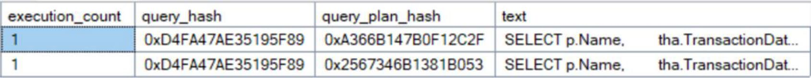

*Hình 7-19: Sự thay đổi của giá trị query_plan_hash (Changes to the query_plan_hash value)*

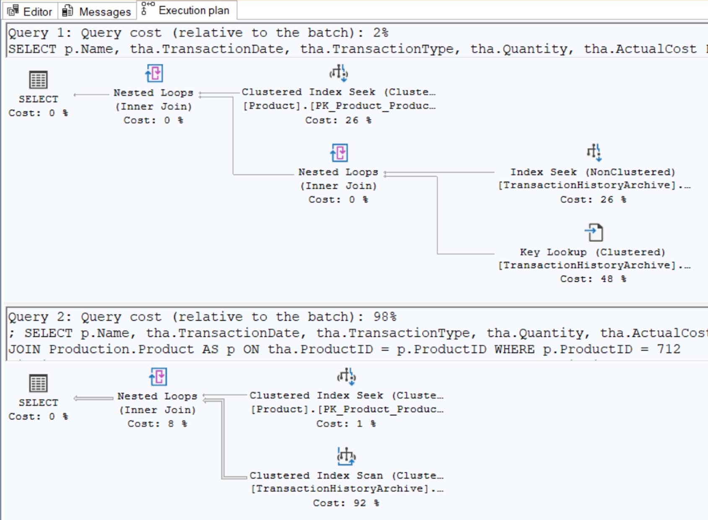

*Hình 7-20: Hai kế hoạch thực thi hoàn toàn khác biệt (Radically different execution plans)*

Các giá trị băm là một công cụ cực kỳ tiện lợi để bạn săn tìm mã nguồn gần như giống nhau hoặc các kế hoạch có cấu trúc giống hệt nhau. Dẫu vậy, như bạn đã chứng kiến, mã lệnh không nhất thiết phải trùng khớp tuyệt đối từng ký tự thì mới có cùng giá trị băm.

---

## Các khuyến nghị thực tiễn về Plan Cache (Execution Plan Cache Recommendations)

Nguyên tắc cốt lõi của bộ nhớ đệm kế hoạch (plan cache) là **tái sử dụng các kế hoạch thực thi** nhằm giảm thiểu tối đa chi phí tài nguyên phát sinh do quá trình biên dịch kế hoạch gây ra. Để tận dụng tối đa cơ chế này, các câu truy vấn của bạn bắt buộc phải được thiết kế sao cho chúng có khả năng tái sử dụng. Bất cứ khi nào có thể, hãy hạn chế các truy vấn ad hoc tùy tiện và chuyển sang dựa vào các câu lệnh đã chuẩn bị (prepared statements). 

Dưới đây là các khuyến nghị quan trọng giúp đảm bảo quản trị plan cache hiệu quả:

- **Tham số hóa rõ ràng các giá trị trong câu truy vấn của bạn.**
- **Ưu tiên sử dụng Stored Procedures ở bất kỳ nơi nào có thể.**
- **Sử dụng `sp_executesql` như một giải pháp thay thế linh hoạt cho Stored Procedures.**
- **Tận dụng tối đa mô hình Prepare/Execute trong ứng dụng.**
- **Hạn chế tối đa các truy vấn Ad Hoc.**
- **Kích hoạt tùy chọn Optimize for Ad Hoc Workloads.**
- **Ưu tiên sử dụng `sp_executesql` thay vì `EXECUTE(...)` đối với các câu lệnh SQL động.**

Chúng ta hãy cùng điểm qua từng khuyến nghị này:

### Tham số hóa tường minh các giá trị trong truy vấn (Explicitly Parameterize Values in Your Query)

Rất phổ biến trong thực tế khi một câu truy vấn được gọi thực thi liên tục, nhưng chỉ khác nhau ở các giá trị hằng số trong mệnh đề `WHERE`. Bạn có thể đạt được tỷ lệ tái sử dụng kế hoạch cao hơn rất nhiều bằng cách tham số hóa các câu truy vấn, tách rời phần cấu trúc tĩnh khỏi các giá trị biến thiên. Mặc dù bạn có thể dựa vào Simple Parameterization hoặc Forced Parameterization, nhưng cả hai đều có những giới hạn nhất định. Việc chủ động tham số hóa tường minh các truy vấn sẽ nâng cao khả năng tái sử dụng kế hoạch và giảm thiểu đáng kể số lượng kế hoạch dư thừa trong cache. Chỉ cần lưu ý rằng một số kế hoạch có thể nhạy cảm với giá trị tham số (parameter sniffing, sẽ được phân tích sâu trong Chương 13).

### Sử dụng Stored Procedures ở bất cứ nơi nào có thể (Use Stored Procedures Where You Can)

Tham số hóa các truy vấn bên trong Stored Procedures là phương pháp tuyệt vời nhất để hỗ trợ quản trị bộ nhớ đệm cache. Vì ứng dụng chỉ cần gửi tên của thủ tục cùng các tham số qua đường truyền mạng, lưu lượng mạng (network traffic) sẽ giảm đáng kể so với việc gửi toàn bộ chuỗi văn bản của các truy vấn ad hoc. Vì các kế hoạch của Stored Procedures được tái sử dụng trực tiếp từ bộ nhớ đệm, trong hầu hết trường hợp chúng sẽ chạy nhanh hơn rất nhiều so với truy vấn ad hoc vốn phải biên dịch lại trong mỗi lần gọi.

Tất nhiên, cái gì quá nhiều cũng không tốt. Có những quy tắc nghiệp vụ rất thích hợp để đặt bên trong cơ sở dữ liệu, nhưng cũng có những logic nghiệp vụ phức tạp tuyệt đối không bao giờ nên đưa vào trong cơ sở dữ liệu.

### Sử dụng sp_executesql thay cho lệnh EXECUTE thông thường (Use sp_executesql Over EXECUTE)

Bạn có thể gặp phải những tình huống mà việc tạo Stored Procedure là không khả thi hoặc không hợp lý. Khi tận dụng `sp_executesql`, bạn vẫn có thể biến mã lệnh động của mình thành một khối lượng công việc đã chuẩn bị sẵn (prepared workload). Toàn bộ chuỗi truy vấn cần được truyền vào `sp_executesql`. Việc sử dụng `sp_executesql` thông qua cơ chế tham số hóa cũng giúp triệt tiêu hoàn toàn nguy cơ bị tấn công tiêm nhiễm mã độc SQL Injection.

Mặc dù bạn hoàn toàn có thể sử dụng câu lệnh `EXECUTE(@sql)` với một chuỗi văn bản ad hoc ghép chuỗi thông thường, tôi khuyến cáo bạn **hãy tránh xa phương pháp này**. Thứ nhất, bạn sẽ không thể tham số hóa mã lệnh (khiến mỗi chuỗi câu lệnh khác nhau lại sinh ra một kế hoạch mới làm rác cache). Thứ hai, bạn rất dễ mở toang cánh cửa cho các lỗ hổng bảo mật SQL Injection thâm nhập vào hệ thống. Nếu bạn bắt buộc phải xây dựng và thực thi các chuỗi SQL động, hãy luôn luôn thực hiện thông qua `sp_executesql`.

### Tận dụng mô hình Prepare/Execute (Take Advantage of the Prepare/Execute Model)

Nếu ứng dụng của bạn xây dựng các chuỗi truy vấn và gửi qua mạng bằng `sp_executesql`, bạn nên cân nhắc chuyển sang sử dụng mô hình Prepare/Execute của trình điều khiển client (ODBC/OLEDB/.NET). Với phương thức này, ứng dụng chỉ phải gửi toàn bộ chuỗi truy vấn dài qua mạng duy nhất một lần. Hơn nữa, vì ứng dụng chỉ cần tham chiếu đến tay cầm kế hoạch (plan handle), nhiều kết nối người dùng khác nhau đều có thể cùng tận dụng các kế hoạch đã chuẩn bị đó.

### Giảm thiểu các truy vấn Ad Hoc (Avoid Ad Hoc Queries)

Một lượng truy vấn ad hoc nhất định dường như là điều không thể tránh khỏi trong đa số hệ thống hiện đại. Tuy nhiên, hãy làm mọi cách có thể để giảm thiểu chúng. Vì các truy vấn ad hoc hầu như không bao giờ đạt được khả năng tái sử dụng kế hoạch, chúng làm tiêu tốn thêm thời gian CPU quý giá cho việc biên dịch liên tục. Chúng cũng dẫn đến hiện tượng phình to bộ nhớ đệm (cache bloat), lấp đầy RAM bằng những kế hoạch vô dụng chỉ dùng một lần rồi bỏ.

### Bật tính năng Optimize for Ad Hoc Workloads (Enable Optimize for Ad Hoc)

Vì các câu truy vấn ad hoc là điều khó tránh khỏi hoàn toàn, hãy giữ chúng không làm ô nhiễm bộ nhớ đệm của bạn bằng cách kích hoạt tùy chọn **Optimize for Ad Hoc Workloads** trên máy chủ SQL Server. Khi tùy chọn này được bật, một kế hoạch thực thi đầy đủ sẽ chỉ được phép lưu vào bộ nhớ đệm nếu câu truy vấn đó được gọi thực thi từ lần thứ hai trở đi.

---

## Tóm tắt chương (Summary)

Quá trình tối ưu hóa truy vấn là một thao tác rất tốn kém tài nguyên hệ thống. Bộ nhớ đệm kế hoạch (plan cache) được kiến trúc chính là để giải quyết bài toán này. Bằng cách lưu trữ các kế hoạch trong bộ nhớ đệm, chúng có thể được tái sử dụng liên tục nhằm tránh việc phải lặp lại bước tối ưu hóa tốn kém. Phương thức tốt nhất để đảm bảo khả năng tái sử dụng kế hoạch là áp dụng một trong các kỹ thuật tham số hóa truy vấn. 

Stored Procedures nhìn chung luôn được coi là kỹ thuật chuẩn mực và hiệu quả nhất để đảm bảo tái sử dụng kế hoạch. Tuy nhiên, `sp_executesql` cung cấp một cơ chế thay thế mạnh mẽ và linh hoạt không kém cho các tình huống truy vấn động. Cuối cùng, mô hình Prepare/Execute trao thêm cho các nhà phát triển ứng dụng một phương thức tuyệt vời để bảo đảm tính tái sử dụng kế hoạch từ phía client.

Chương tiếp theo cũng sẽ tiếp tục đào sâu về quá trình tối ưu hóa truy vấn và bộ nhớ đệm kế hoạch. Chúng ta sẽ cùng thảo luận về cơ chế kế hoạch bị già hóa và loại bỏ khỏi bộ nhớ đệm, cũng như các nguyên nhân và giải pháp kiểm soát hiện tượng tái biên dịch (recompilation) truy vấn.