# CHƯƠNG 8: Hiện tượng Tái biên dịch Truy vấn (Query Recompilation)

> **Thông tin sách gốc:**  
> © Grant Fritchey 2026  
> G. Fritchey, *SQL Server 2025 Query Performance Tuning*, https://doi.org/10.1007/979-8-8688-1865-3_8  

---

Để giảm thiểu chi phí tài nguyên phát sinh từ việc biên dịch các kế hoạch thực thi, các kế hoạch này được lưu giữ trong một vùng không gian bộ nhớ RAM gọi là **Bộ nhớ đệm kế hoạch (Plan Cache)**. Khi các câu lệnh đã chuẩn bị (Prepared Statements) – dù dưới dạng thủ tục lưu trữ (Stored Procedures) hay các cơ chế tạo truy vấn có tham số khác – được thực thi, tiến trình sẽ tận dụng tối đa các kế hoạch sẵn có trong cache.

Tuy nhiên, có rất nhiều nguyên nhân có thể khiến các kế hoạch bị xóa bỏ hoặc buộc phải biên dịch lại khỏi bộ nhớ đệm:
* **Mặt tích cực:** Khi dữ liệu thay đổi đáng kể, số liệu thống kê được cập nhật mới, hoặc cấu trúc bảng có sự tinh chỉnh, việc tạo ra một kế hoạch thực thi mới có thể giúp truy vấn đạt hiệu năng vượt trội hơn rất nhiều.
* **Mặt tiêu cực:** Khi hiện tượng tái biên dịch diễn ra quá thường xuyên (**excessive recompilation**), nó sẽ đặt một khối lượng tải khổng lồ lên bộ vi xử lý (CPU), gây lãng phí bộ nhớ và cản trở trực tiếp đến hiệu năng vận hành chung của toàn bộ hệ thống.

Trong chương này, tôi sẽ đề cập đến các chủ đề sau:
* Lợi ích và tác hại của hiện tượng tái biên dịch (The benefits and drawbacks of recompilation)
* Cách nhận diện chính xác các câu lệnh đơn lẻ đang bị tái biên dịch
* Phân tích các nguyên nhân gốc rễ dẫn đến tái biên dịch
* Các phương pháp và quy chuẩn thực hành tốt nhất để ngăn ngừa tái biên dịch không cần thiết

---

## Lợi ích và Tác hại của Tái biên dịch (Benefits and Drawbacks of Recompilation)

Biên dịch và tái biên dịch kế hoạch thực thi là một thao tác rất tốn kém tài nguyên hệ thống. Tuy nhiên, khi dữ liệu biến động theo thời gian, số liệu thống kê (statistics) cũng sẽ thay đổi theo. Bộ tối ưu hóa (Query Optimizer) có thể tìm ra các chiến lược thực thi và xử lý dữ liệu thông minh hơn khi sự phân bổ dữ liệu và thống kê được cập nhật mới. Việc bổ sung thêm các chỉ mục mới (indexes) và các ràng buộc toàn vẹn (constraints) trên một bảng nhất định cũng có thể mang lại lợi ích to lớn nếu truy vấn được sinh một kế hoạch thực thi mới.

### Cơ chế tái biên dịch ở cấp độ câu lệnh (Statement-Level Recompilation)

Bắt đầu từ SQL Server 2005 trở đi, quá trình tái biên dịch luôn được thực hiện ở **cấp độ câu lệnh đơn lẻ (statement level)** thay vì phải biên dịch lại toàn bộ thủ tục lưu trữ (procedure level). Cơ chế này dẫn đến hai hệ quả:
1. **Tổng số lượng sự kiện recompile có thể xuất hiện nhiều hơn:** Bạn có thể quan sát thấy số lượng lần recompile tổng thể cao hơn so với việc toàn bộ thủ tục bị biên dịch lại cùng một khối.
2. **Tiết kiệm thời gian, CPU và giảm thiểu tắc nghẽn (blocking):** Hệ quả tích cực thứ hai này bù đắp hoàn toàn cho điều thứ nhất: hệ thống chỉ phải tốn tài nguyên biên dịch lại đúng câu lệnh thành phần nào thực sự có nhu cầu, trong khi các câu lệnh khác trong cùng thủ tục vẫn giữ nguyên kế hoạch đã có.

### Tác động của Query Store lên quá trình Tái biên dịch
Quy trình tái biên dịch tiêu chuẩn sẽ có sự thay đổi khi tính năng **Ép buộc kế hoạch (Plan Forcing)** được kích hoạt từ Query Store:
* Tiến trình tái biên dịch vẫn diễn ra bình thường, nhưng kế hoạch vừa được biên dịch mới sẽ **không được áp dụng**. Thay vào đó, SQL Server sẽ thế chỗ bằng chính kế hoạch đang bị ép buộc (forced plan).
* Ngoài ra, nếu Query Store đang ép buộc một **Gợi ý truy vấn (Query Hint)**, thì gợi ý đó sẽ được tự động áp dụng trong suốt quá trình recompile.
* Tuy nhiên, nếu kế hoạch bị ép buộc bị đánh dấu là không còn hợp lệ (ví dụ do bảng bị thay đổi cấu trúc hoặc chỉ mục bị xóa), thì kế hoạch biên dịch mới lúc này mới được phép đưa vào sử dụng. (Để xem chi tiết hơn về Query Store, hãy tham khảo lại Chương 6).

---

### Khảo sát Lợi ích của Tái biên dịch

Để hiểu rõ việc tái biên dịch có thể mang lại lợi ích ra sao, tôi sẽ tạo một thủ tục lưu trữ mẫu trong Listing 8-1:

```sql
-- Listing 8-1. Creating the dbo.WorkOrder procedure
CREATE OR ALTER PROCEDURE dbo.WorkOrder
AS
SELECT wo.WorkOrderID,
       wo.ProductID,
       wo.StockedQty
FROM Production.WorkOrder AS wo
WHERE wo.StockedQty
BETWEEN 500 AND 700;
```

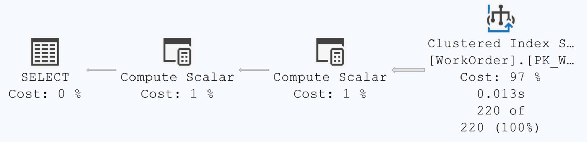  
*Hình 8-1. Kế hoạch thực thi ban đầu của thủ tục dbo.WorkOrder sử dụng Clustered Index Scan*

Chúng ta sẽ tìm hiểu sâu hơn về chỉ mục trong Chương 9 và 10, nhưng có thể khẳng định ngay rằng một thao tác quét toàn bộ chỉ mục (Clustered Index Scan) trong tình huống này là chưa tối ưu. Bộ tối ưu hóa thậm chí còn đưa ra một gợi ý chỉ mục còn thiếu (Missing Index hint) ngay trên đồ họa kế hoạch thực thi. 

Chúng ta có thể nâng cao hiệu năng bằng cách bổ sung một chỉ mục nonclustered mới trên bảng `WorkOrder` như trong Listing 8-2:

```sql
-- Listing 8-2. Creating a new index on the WorkOrder table
CREATE INDEX IX_Test ON Production.WorkOrder (StockedQty, ProductID);
```

Sau khi chỉ mục mới được tạo, chúng ta thực thi lại thủ tục `dbo.WorkOrder`:

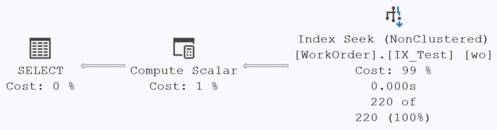  
*Hình 8-2. Kế hoạch thực thi mới của thủ tục dbo.WorkOrder đã chuyển sang thao tác Index Seek cực nhanh*

Nguyên nhân chủ đạo dẫn đến việc tái biên dịch trong thực tế xuất hiện sau khi **số liệu thống kê (statistics) được cập nhật**. SQL Server sẽ tự động đánh dấu các câu lệnh từng sử dụng thống kê đó là "cần được biên dịch lại". Bất kỳ khi nào một câu lệnh bị đánh dấu, nó sẽ được recompile ngay trong lần thực thi tiếp theo, và ứng dụng gọi câu lệnh sẽ phải chờ cho đến khi quá trình tái biên dịch hoàn tất.

Listing 8-3 dọn dẹp chỉ mục thử nghiệm vừa tạo:

```sql
-- Listing 8-3. Removing the new index on the WorkOrder table
DROP INDEX Production.WorkOrder.IX_Test;
```

---

### Khảo sát Tác hại của Tái biên dịch vô ích

Không phải lúc nào việc tái biên dịch cũng sinh ra một kế hoạch tốt hơn. Listing 8-4 minh họa một câu truy vấn có vấn đề bên trong thủ tục lưu trữ: sử dụng `SELECT *` mà hoàn toàn không có bất kỳ điều kiện lọc nào.

```sql
-- Listing 8-4. Creating the procedure dbo.WorkOrderAll
CREATE OR ALTER PROCEDURE dbo.WorkOrderAll
AS
-- Cố ý sử dụng SELECT * để làm ví dụ minh họa
SELECT *
FROM Production.WorkOrder AS wo;
```

Khi thực thi thủ tục này, bởi vì nó yêu cầu trả về toàn bộ các dòng và toàn bộ các cột của bảng, nên phương thức tối ưu nhất để thỏa mãn truy vấn **luôn luôn là quét toàn bộ bảng/chỉ mục chính (Clustered Index Scan)**. Ngay cả khi bạn cố tình tạo thêm một chỉ mục nonclustered mới, chỉ mục đó cũng hoàn toàn vô dụng đối với truy vấn này – nhưng việc tạo chỉ mục lại vô tình kích hoạt một sự kiện tái biên dịch không đáng có!

Để theo dõi chi tiết hiện tượng này, chúng ta thiết lập một phiên Extended Events chuyên dụng để bắt các sự kiện recompile như trong Listing 8-5:

```sql
-- Listing 8-5. CREATE statement for the QueryAndRecompile session
CREATE EVENT SESSION [QueryAndRecompile]
ON SERVER
    ADD EVENT sqlserver.rpc_completed
    (WHERE ([sqlserver].[database_name] = N'AdventureWorks')),
    ADD EVENT sqlserver.rpc_starting
    (WHERE ([sqlserver].[database_name] = N'AdventureWorks')),
    ADD EVENT sqlserver.sp_statement_completed
    (WHERE ([sqlserver].[database_name] = N'AdventureWorks')),
    ADD EVENT sqlserver.sp_statement_starting
    (WHERE ([sqlserver].[database_name] = N'AdventureWorks')),
    ADD EVENT sqlserver.sql_batch_completed
    (WHERE ([sqlserver].[database_name] = N'AdventureWorks')),
    ADD EVENT sqlserver.sql_batch_starting
    (WHERE ([sqlserver].[database_name] = N'AdventureWorks')),
    ADD EVENT sqlserver.sql_statement_completed
    (WHERE ([sqlserver].[database_name] = N'AdventureWorks')),
    ADD EVENT sqlserver.sql_statement_recompile
    (WHERE ([sqlserver].[database_name] = N'AdventureWorks')),
    ADD EVENT sqlserver.sql_statement_starting
    (WHERE ([sqlserver].[database_name] = N'AdventureWorks'))
    ADD TARGET package0.event_file
    (SET filename = N'QueryAndRecompile')
WITH
(
    TRACK_CAUSALITY = ON
);
GO
ALTER EVENT SESSION QueryAndRecompile ON SERVER STATE = START;
```

Sau khi khởi động phiên Extended Events, chúng ta chạy chuỗi lệnh trong Listing 8-6:

```sql
-- Listing 8-6. Executing the procedure and creating an index
EXEC dbo.WorkOrderAll;
GO
CREATE INDEX IX_Test ON Production.WorkOrder(StockedQty,ProductID);
GO
EXEC dbo.WorkOrderAll; -- Thực thi sau khi tạo chỉ mục IX_Test
```

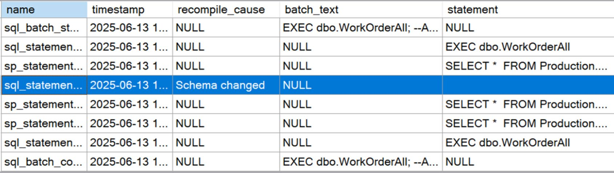  
*Hình 8-3. Một sự kiện sql_statement_recompile xuất hiện nhưng không mang lại bất kỳ cải thiện nào*

Trong Hình 8-3, sự kiện recompile được đánh dấu nổi bật để chúng ta phân tích nguyên nhân. Cột `recompile_cause` thông báo lý do là: **"Schema changed"** (Lược đồ bảng đã thay đổi). Nguyên nhân chính là do thao tác tạo chỉ mục nonclustered mới trên bảng `WorkOrder` trước lần thực thi thứ hai.

Trong kịch bản này, việc tái biên dịch hoàn toàn vô ích và lãng phí: kế hoạch thực thi mới sinh ra giống hệt 100% so với kế hoạch cũ (vẫn là Clustered Index Scan). Tuy nhiên, vì các điều kiện kích hoạt recompile đã bị chạm tới, SQL Server vẫn buộc phải:
1. Xóa kế hoạch cũ khỏi bộ nhớ đệm.
2. Tiêu tốn CPU để biên dịch một kế hoạch mới.
3. Nạp kế hoạch mới vào cache.
4. Cuối cùng mới thực thi câu lệnh.

Đó chính là lý do vì sao các sự kiện tái biên dịch tràn lan hoặc không cần thiết có thể biến thành một điểm nghẽn hiệu năng nghiêm trọng. (Hãy chạy lại Listing 8-3 để xóa chỉ mục thử nghiệm trước khi tiếp tục).

---

## Xác định Câu lệnh bị Tái biên dịch (Identifying the Statement Being Recompiled)

Bên trong một thủ tục lưu trữ lớn bao gồm hàng chục hoặc hàng trăm câu lệnh đơn lẻ, việc xác định chính xác câu lệnh nào đang bị tái biên dịch là một thử thách không nhỏ. Đó là lý do vì sao phiên Extended Events trong Listing 8-5 được thiết lập với tính năng **Theo dõi quan hệ nhân quả (Causality Tracking - `TRACK_CAUSALITY = ON`)**.

Chuỗi sự kiện được ghi nhận tuần tự như sau (Hình 8-3):
1. `sql_batch_starting`: Khối lệnh (batch) bắt đầu chạy.
2. `sql_statement_starting`: Lệnh đơn trong batch (chính là lệnh gọi thực thi Stored Procedure) bắt đầu.
3. `sp_statement_starting`: Câu lệnh thành phần đầu tiên trong thủ tục bắt đầu chạy. Tuy nhiên, kế hoạch của câu lệnh này bị đánh dấu cần recompile do lược đồ bảng thay đổi.
4. `sql_statement_recompile`: Sự kiện tái biên dịch được kích hoạt ngay lập tức.
5. `sp_statement_starting`: Câu lệnh trong Stored Procedure bắt đầu chạy lại sau khi quá trình tái biên dịch hoàn tất.
6. `sp_statement_completed`: Câu lệnh trong thủ tục kết thúc thực thi.
7. `sql_statement_completed`: Câu lệnh gọi thủ tục ở cấp độ batch hoàn tất.
8. `sql_batch_completed`: Toàn bộ batch kết thúc.

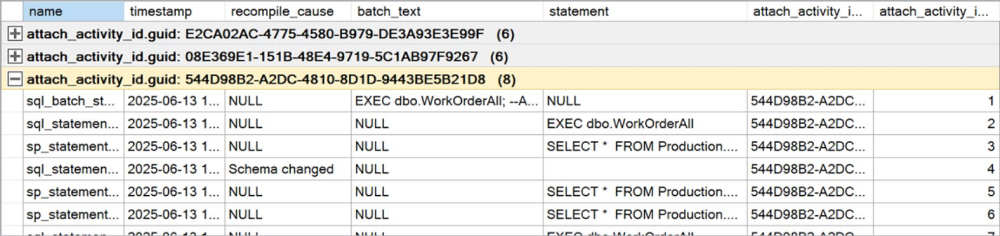  
*Hình 8-4. Gom nhóm dữ liệu theo attach_activity_id_guid và sắp xếp theo sequence để truy vết chính xác tiến trình recompile*

Nhờ sự kết hợp giữa các sự kiện bắt đầu/kết thúc và mã định danh tuần tự của Causality Tracking, bạn có thể chỉ điểm chính xác câu lệnh cụ thể nào trong Stored Procedure đã gây ra hiện tượng tái biên dịch và vào thời điểm nào.

---

## Phân tích Nguyên nhân Tái biên dịch (Analyzing Causes of Recompilation)

Mặc dù recompile có thể giúp tối ưu hóa kế hoạch, nhưng khi nó trở nên mất kiểm soát, nó sẽ tước đoạt chu kỳ xử lý của CPU và khóa chặn (block) các tiến trình khác đang chờ kế hoạch đó hoàn tất. Hiểu rõ các nguyên nhân dẫn đến tái biên dịch là chìa khóa để ngăn chặn chúng.

Các nguyên nhân cốt lõi gây ra hiện tượng tái biên dịch ở cấp độ câu lệnh bao gồm:

* **Thay đổi lược đồ (Schema Changes):** Nếu một bảng, bảng tạm hoặc khung nhìn (view) được tham chiếu bởi câu lệnh bị thay đổi cấu trúc, siêu dữ liệu (metadata) hoặc chỉ mục, việc recompile là bắt buộc.
* **Thay đổi ràng buộc/liên kết (Binding Changes):** Khi các giá trị ràng buộc mặc định (defaults) của một cột trong bảng thay đổi.
* **Cập nhật số liệu thống kê (Statistics Updates):** Khi số liệu thống kê mà câu lệnh sử dụng được cập nhật mới (dù tự động hay thủ công).
* **Phân giải đối tượng trì hoãn (Deferred Object Resolution):** Nếu một đối tượng cần thiết cho truy vấn được tạo động ngay bên trong khối lệnh thực thi, câu lệnh tham chiếu đến đối tượng đó bắt buộc phải recompile khi đối tượng xuất hiện.
* **Thay đổi các tùy chọn SET (SET Options):** Nếu các tùy chọn cấu hình phiên (như `ANSI_NULLS`, `QUOTED_IDENTIFIER`) thay đổi giữa các lần gọi.
* **Gọi thủ tục `sp_recompile`:** Lệnh tường minh yêu cầu tái biên dịch đối tượng.
* **Gợi ý truy vấn `RECOMPILE` (Query Hint):** Cố ý yêu cầu biên dịch lại mỗi lần chạy thông qua `OPTION (RECOMPILE)`.
* **Kế hoạch nhạy cảm với tham số (Parameter-Sensitive Plans - PSPs):** Khi một trong các biến thể kế hoạch trong cơ chế PSP Optimization cần recompile hoặc khi kế hoạch điều phối (dispatcher plan) thay đổi.
* **Tối ưu hóa tham số tùy chọn (Optional Parameter Optimization - OPO):** Tương tự như cơ chế PSPs.

Để xem toàn bộ danh mục các nguyên nhân tái biên dịch được định nghĩa bên trong SQL Server, bạn có thể truy vấn bảng hệ thống `sys.dm_xe_map_values` như trong Listing 8-7:

```sql
-- Listing 8-7. Querying sys.dm_xe_map_values
SELECT dxmv.map_value
FROM sys.dm_xe_map_values AS dxmv
WHERE dxmv.name = 'statement_recompile_cause';
```

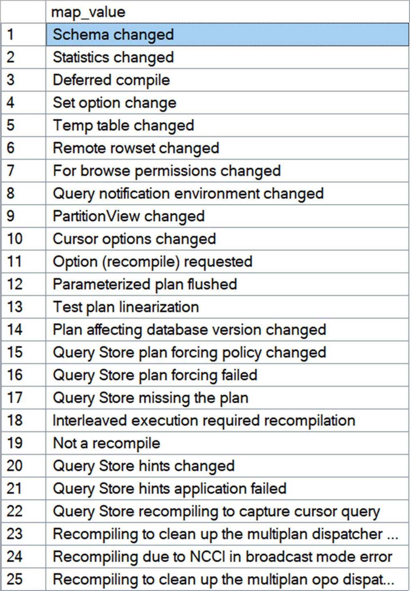  
*Hình 8-5. Danh sách các nguyên nhân gây recompile được SQL Server hỗ trợ theo dõi qua Extended Events*

---

## Phân giải Đối tượng Trì hoãn (Deferred Object Resolution)

Một kịch bản rất hay gặp trong thực tế là một khối lệnh (batch) hoặc thủ tục lưu trữ thực hiện tạo động các đối tượng cơ sở dữ liệu rồi sử dụng chúng ngay trong các câu lệnh tiếp theo. 

Khi một batch như vậy được thực thi lần đầu tiên:
* Kế hoạch ban đầu không thể chứa thông tin về đối tượng sắp được tạo ra.
* Chiến lược xử lý của các câu lệnh sử dụng đối tượng đó phải được **trì hoãn (deferred)** cho đến thời điểm thời gian chạy (runtime).
* Khi câu lệnh DML tham chiếu đến đối tượng vừa tạo được gọi, câu lệnh đó bắt buộc phải **recompile** để tạo ra một kế hoạch thực thi mới dựa trên đối tượng thực tế.

Cả bảng vật lý thông thường lẫn bảng tạm cục bộ (local temporary tables `#`) đều có thể được tạo trong batch để lưu trữ kết quả trung gian. Tuy nhiên, hành vi tái biên dịch do phân giải đối tượng trì hoãn giữa hai loại bảng này lại có sự khác biệt rất lớn!

### Tái biên dịch trên Bảng vật lý (Recompilation on a Table)

Để quan sát cơ chế phân giải trì hoãn trên một bảng vật lý, chúng ta xem xét thủ tục lưu trữ trong Listing 8-8:

```sql
-- Listing 8-8. Stored procedure that creates a table
CREATE OR ALTER PROC dbo.RecompileTable
AS
CREATE TABLE dbo.ProcTest1
(
    C1 INT
);

SELECT *
FROM dbo.ProcTest1;

DROP TABLE dbo.ProcTest1;
```

Khi thực thi thủ tục này hai lần liên tiếp với phiên Extended Events đang theo dõi, chúng ta thu được kết quả như trong Hình 8-6:

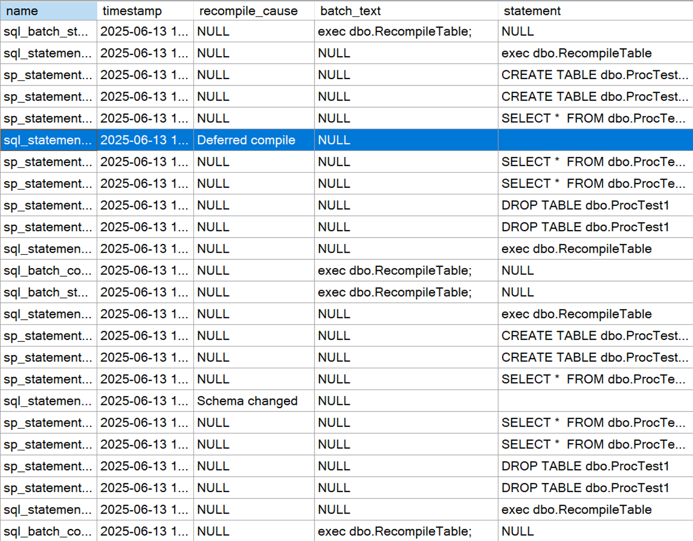  
*Hình 8-6. Các sự kiện recompile phát sinh từ hai lần thực thi thủ tục RecompileTable*

Trong Hình 8-6:
* Sự kiện recompile đầu tiên hiển thị cột `recompile_cause` là: **"Deferred compile"** (Biên dịch trì hoãn) – do câu lệnh `SELECT` phải chờ bảng `dbo.ProcTest1` được tạo xong mới có thể biên dịch kế hoạch.
* Khi thủ tục được thực thi lần thứ hai, **một sự kiện recompile khác lại tiếp tục xảy ra!** 

Lý do là vì: khi chúng ta xóa bảng (`DROP TABLE`) ở cuối batch, kế hoạch thực thi đã được biên dịch trước đó cho câu lệnh không bị xóa khỏi cache. Nó vẫn tồn tại để tái sử dụng. Tuy nhiên, khi thủ tục chạy lại lần 2, bảng `dbo.ProcTest1` bị tạo mới lại từ đầu – và SQL Server xem hành động tạo lại bảng vật lý đó là **một sự thay đổi về lược đồ (Schema Changed)**! 

Do đó, với bảng vật lý thông thường, hiện tượng tái biên dịch sẽ liên tục lặp đi lặp lại trong mọi lần thực thi thủ tục.

---

### Tái biên dịch trên Bảng tạm thời (Recompilation on a Temporary Table)

Trong thực tế lập trình T-SQL, việc tạo các bảng tạm thời (temporary tables - `#TempTable`) bên trong các khối lệnh (batches) hoặc thủ tục lưu trữ là một thực hành rất phổ biến. Listing 8-9 trình bày một câu truy vấn đơn giản để minh họa cơ chế phân giải đối tượng hoãn lại (deferred object resolution) khi làm việc với bảng tạm.

**Listing 8-9. Thủ tục lưu trữ tạo bảng tạm thời (Stored procedure that creates a temporary table)**

```sql
CREATE OR ALTER PROC dbo.RecompileProc
AS
CREATE TABLE #TempTable (C1 INT);
INSERT INTO #TempTable (C1)
VALUES (42);
```

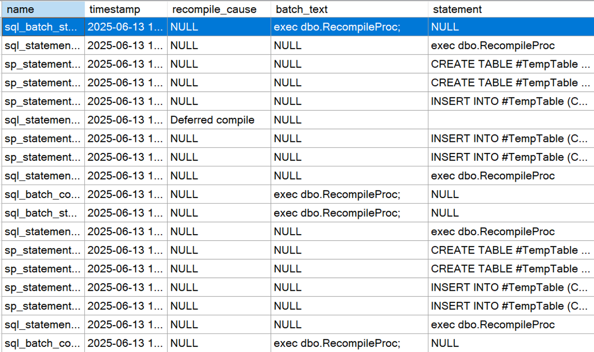

*Hình 8-7: Tái biên dịch cấp câu lệnh do phân giải biên dịch trì hoãn (Statement-level recompile caused by deferred compilation)*

Bạn có thể thấy nguyên nhân tái biên dịch được ghi nhận trong cột `recompile_cause` là **Deferred compile** (Biên dịch hoãn lại). Câu lệnh đầu tiên trong thủ tục tạo ra bảng tạm thời `#TempTable`, và câu lệnh thứ hai thực hiện việc chèn dữ liệu vào bảng đó. Câu lệnh thứ hai bắt buộc phải bị hoãn lại quá trình biên dịch cho đến khi đối tượng bảng tạm thực sự được tạo ra trong `tempdb`. 

Tuy nhiên, khác với ví dụ về bảng thông thường ở phần trước, việc tạo bảng tạm thời **không** bị SQL Server coi là một sự thay đổi đối với lược đồ (schema change) tổng thể của cơ sở dữ liệu. Do đó, trong các lần thực thi tiếp theo của thủ tục, sẽ không có lần tái biên dịch thứ hai nào diễn ra, và kế hoạch thực thi đã biên dịch sẽ được tái sử dụng hoàn toàn.

## Tránh tái biên dịch không cần thiết (Avoiding Recompiles)

Tôi muốn nhấn mạnh một lần nữa rằng việc tái biên dịch có thể mang lại lợi ích cực kỳ to lớn cho một câu truy vấn nhất định. Nếu dữ liệu trong bảng đã biến động đáng kể, trình tối ưu hóa hoàn toàn có thể đưa ra các lựa chọn chiến lược tốt hơn cho kế hoạch thực thi mới. 

Tuy nhiên, có những thói quen viết mã (coding practices) không chuẩn mực có thể vô tình khiến cho các đợt tái biên dịch không cần thiết liên tục diễn ra. Bạn cũng có thể chứng kiến hiện tượng tái biên dịch quá mức (excessive recompiles) do việc thay đổi mã lệnh hoặc các yếu tố môi trường khác như đã phân tích. Do đó, việc tuân thủ các quy tắc thực hành tốt nhất (best practices) sẽ giúp chúng ta giảm thiểu tối đa tần suất tái biên dịch không mong muốn.

Các phương pháp sau đây sẽ giúp giảm bớt số lượng các lần tái biên dịch:

* Tránh đan xen các câu lệnh DDL và DML.
* Giảm thiểu tái biên dịch do thay đổi số liệu thống kê.
* Sử dụng gợi ý truy vấn `KEEPFIXED PLAN`.
* Vô hiệu hóa tính năng tự động bảo trì thống kê trên bảng cụ thể.
* Sử dụng biến bảng (table variables).
* Tận dụng bảng tạm qua nhiều phạm vi (nested procedures).
* Tránh thay đổi các tùy chọn `SET` bên trong khối lệnh.

### Tránh đan xen câu lệnh DDL và DML (Avoid Interleaving DDL and DML Statements)

Một thói quen rất phổ biến của các lập trình viên là sử dụng bảng tạm cục bộ bên trong một khối lệnh hoặc thủ tục lưu trữ, sau đó liên tục sửa đổi cấu trúc (như `ALTER TABLE`) hoặc tạo thêm chỉ mục (`CREATE INDEX`) xen kẽ giữa các câu lệnh truy vấn dữ liệu (`SELECT`, `INSERT`, `UPDATE`). Việc thực hiện các thay đổi DDL này sẽ phá hủy tính hợp lệ của kế hoạch thực thi đang có, buộc SQL Server phải tiến hành tái biên dịch đối với tất cả các câu lệnh tham chiếu đến bảng tạm đó sau thời điểm thay đổi. Listing 8-10 minh họa một thủ tục đan xen DDL và DML dẫn đến hiện tượng tái biên dịch liên tiếp.

**Listing 8-10. Thủ tục đan xen câu lệnh DDL và DML (Procedure with interleaved DDL and DML)**

```sql
CREATE OR ALTER PROC dbo.TempTable
AS
--Tất cả các câu lệnh ban đầu đều được biên dịch sơ khởi
CREATE TABLE #MyTempTable
(
    ID INT,
    Dsc NVARCHAR(50)
);
--Câu lệnh này bắt buộc phải tái biên dịch
INSERT INTO #MyTempTable
(
    ID,
    Dsc
)
SELECT pm.ProductModelID,
       pm.Name
FROM Production.ProductModel AS pm;
--Câu lệnh này bắt buộc phải tái biên dịch
SELECT mtt.ID,
       mtt.Dsc
FROM #MyTempTable AS mtt;
CREATE CLUSTERED INDEX iTest ON #MyTempTable (ID);
--Việc tạo chỉ mục gây ra một lần tái biên dịch khác
SELECT mtt.ID,
       mtt.Dsc
FROM #MyTempTable AS mtt;
CREATE TABLE #t2
(
    c1 INT
);
--Tái biên dịch từ việc tạo thêm bảng mới
SELECT c1
FROM #t2;
```

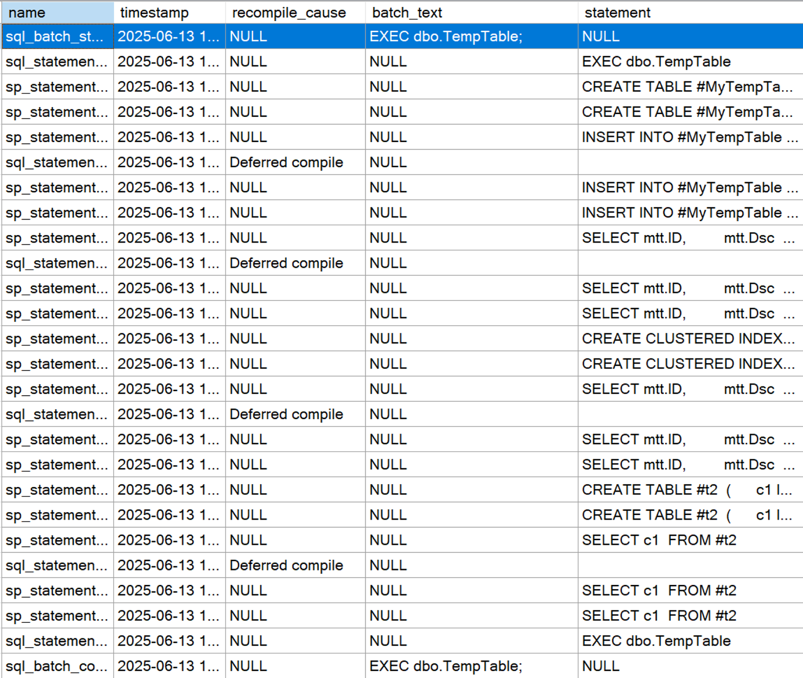

*Hình 8-8: Nhiều lần tái biên dịch do đan xen DDL và DML (Multiple recompiles from interleaved DDL and DML)*

Hãy luôn nhớ rằng: Về nguyên tắc, mọi câu lệnh trong thủ tục đều nhận được một kế hoạch ban đầu. Tuy nhiên, vì các câu lệnh tham chiếu đến những đối tượng chưa tồn tại hoặc bị thay đổi lược đồ giữa chừng, SQL Server buộc phải thực hiện thêm rất nhiều công việc biên dịch lại trong mỗi lần thủ tục này được gọi. 

> [!TIP]
> **Quy tắc vàng:** Luôn gom toàn bộ các câu lệnh DDL (tạo bảng tạm, tạo chỉ mục trên bảng tạm) lên đầu thủ tục trước khi thực thi bất kỳ câu lệnh DML nào (`SELECT`, `INSERT`, `UPDATE`, `DELETE`).

### Giảm tái biên dịch do thay đổi số liệu thống kê (Reduce Recompilation Caused by Statistics Changes)

Trong phần lớn trường hợp, khi khối lượng dữ liệu thay đổi theo thời gian dẫn đến việc số liệu thống kê được cập nhật, câu truy vấn thực sự cần một kế hoạch thực thi mới phù hợp hơn. Điều này đồng nghĩa với việc chi phí CPU dành cho lần tái biên dịch đó là hoàn toàn xứng đáng. 

Tuy nhiên, trong một số tình huống đặc thù, kế hoạch thực thi mới được tạo ra lại giống hệt kế hoạch cũ vì sự phân phối dữ liệu vẫn giữ nguyên ngay cả sau khi thống kê được cập nhật. Nếu hiện tượng này diễn ra liên tục trên các bảng có tần suất ghi cao, các đợt tái biên dịch liên tiếp có thể gây áp lực nghiêm trọng lên CPU máy chủ. Trong những trường hợp hiếm hoi này, bạn có hai giải pháp kỹ thuật để xử lý:

* Áp dụng gợi ý truy vấn `OPTION (KEEPFIXED PLAN)`.
* Vô hiệu hóa tính năng tự động cập nhật thống kê trên bảng cụ thể.

#### Sử dụng gợi ý truy vấn KEEPFIXED PLAN (Use the KEEPFIXED PLAN Hint)

Trong trường hợp bạn muốn ngăn chặn việc tái biên dịch kế hoạch thực thi do các biến động thống kê dữ liệu, bạn có thể áp dụng gợi ý truy vấn `KEEPFIXED PLAN`. 

Về bản chất, thuật ngữ "query hint" (gợi ý truy vấn) có phần chưa hoàn toàn lột tả hết bản chất: Thay vì chỉ là một lời "gợi ý" mang tính tham khảo, query hint thực chất là một **mệnh lệnh bắt buộc** đối với Query Optimizer hoặc SQL Server engine. Khi có gợi ý `KEEPFIXED PLAN`, thay vì loại bỏ kế hoạch khỏi bộ nhớ đệm để biên dịch lại khi số liệu thống kê bị thay đổi, SQL Server engine sẽ giữ nguyên kế hoạch hiện tại để tiếp tục thực thi. Listing 8-11 cung cấp đoạn mã thử nghiệm cơ chế này.

**Listing 8-11. Kịch bản thử nghiệm gợi ý truy vấn KEEPFIXED PLAN (Script to create a table and procedure for a query hint)**

```sql
IF
(
    SELECT OBJECT_ID('dbo.Test1')
) IS NOT NULL
    DROP TABLE dbo.Test1;
GO
CREATE TABLE dbo.Test1
(
    C1 INT,
    C2 CHAR(50)
);
INSERT INTO dbo.Test1
VALUES
(1, '2');
CREATE NONCLUSTERED INDEX IndexOne ON dbo.Test1 (C1);
GO
--Tạo thủ tục lưu trữ tham chiếu đến bảng trên kèm gợi ý KEEPFIXED PLAN
CREATE OR ALTER PROC dbo.TestProc
AS
SELECT t.C1,
       t.C2
FROM dbo.Test1 AS t
WHERE t.C1 = 1
OPTION (KEEPFIXED PLAN);
GO
--Lần thực thi đầu tiên khi bảng chỉ có 1 dòng
EXEC dbo.TestProc; --Lần chạy 1
--Chèn một lượng lớn dòng dữ liệu để làm thay đổi thống kê vượt ngưỡng
WITH Nums
AS (SELECT 1 AS n
    UNION ALL
    SELECT Nums.n + 1
    FROM Nums
    WHERE Nums.n < 1000)
INSERT INTO dbo.Test1
(
    C1,
    C2
)
SELECT 1,
       Nums.n
FROM Nums
OPTION (MAXRECURSION 1000);
GO
--Thực thi lại thủ tục lưu trữ sau khi thống kê đã biến động mạnh
EXEC dbo.TestProc;
```

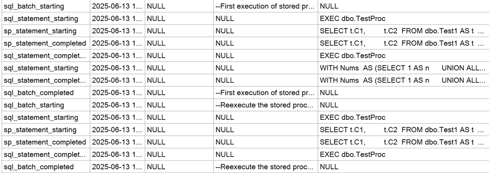

*Hình 8-9: Kết quả của gợi ý truy vấn KEEPFIXED PLAN (Results of the KEEPFIXED PLAN query hint)*

Bạn có thể thấy rằng thủ tục thực thi lần đầu tiên không có sự kiện tái biên dịch. Sau đó, đoạn mã chèn thêm hàng loạt dữ liệu mới — một mức biến động dữ liệu đủ lớn để chắc chắn kích hoạt cơ chế tái biên dịch trong điều kiện bình thường. Tuy nhiên, quan sát sự kiện trong Hình 8-9, chúng ta hoàn toàn không thấy bất kỳ sự kiện tái biên dịch nào xuất hiện trong lần chạy thứ hai. Kế hoạch cũ vẫn được giữ nguyên vẹn nhờ có `OPTION (KEEPFIXED PLAN)`.

> [!CAUTION]
> Việc sử dụng bất kỳ query hint nào cũng chỉ nên được quyết định sau khi đã trải qua quá trình kiểm thử nghiêm ngặt chứng minh rằng đó là giải pháp tối ưu nhất. `KEEPFIXED PLAN` có thể khiến một kế hoạch thực thi tồi tệ bị "khóa chặt" trên hệ thống, trong khi một kế hoạch mới lẽ ra có thể mang lại hiệu năng vượt trội hơn nhiều nếu được phép tái biên dịch.

Một gợi ý truy vấn khác cũng rất đáng chú ý trong ngữ cảnh này là **`KEEP PLAN`**. Gợi ý này áp dụng riêng cho các **bảng tạm thời** (#TempTable). Nó sẽ giữ nguyên kế hoạch thực thi cho đến khi bảng tạm tích lũy đủ ngưỡng biến động ít nhất 500 dòng đối với việc cập nhật thống kê, giúp giảm thiểu đáng kể số lượng tái biên dịch khi làm việc với bảng tạm.

#### Vô hiệu hóa bảo trì thống kê tự động trên một bảng (Disable Automatic Statistics Maintenance on a Table)

Bạn cũng có tùy chọn vô hiệu hóa việc tự động cập nhật thống kê, áp dụng cho toàn bộ cơ sở dữ liệu hoặc chỉ riêng cho từng bảng cụ thể. Listing 8-12 hướng dẫn cách tắt tính năng tự động cập nhật thống kê trên bảng `dbo.Test1`.

**Listing 8-12. Vô hiệu hóa cập nhật thống kê tự động trên một bảng (Disabling automatic statistics maintenance on one table)**

```sql
EXEC sys.sp_autostats 'dbo.Test1', 'OFF';
```

Giờ đây, bất kể dữ liệu trong bảng này biến động nhiều đến đâu, số liệu thống kê sẽ không bao giờ tự động cập nhật. Điều này đồng nghĩa với việc không có câu truy vấn nào bị đánh dấu để tái biên dịch do dữ liệu thay đổi.

Một lần nữa, đây là một thiết lập tiềm ẩn rủi ro rất cao. Bạn phải thực hiện kiểm thử diện rộng để đảm bảo rằng việc đóng băng thống kê này không gây tổn hại đến các câu truy vấn khác trên hệ thống. Hơn nữa, nếu bạn quyết định tắt cập nhật tự động, bạn bắt buộc phải thiết lập một quy trình bảo trì thủ công (ví dụ: Job chạy vào ban đêm) để cập nhật số liệu thống kê và kiểm soát các đợt tái biên dịch theo cách có chủ đích.

### Sử dụng biến bảng (Use Table Variables)

Bảng tạm thời (`#TempTable`) và biến bảng (`@TableVariable`) thoạt nhìn gần như tương đồng nhau về mọi mặt (đều lưu trữ trong `tempdb`). Tuy nhiên, biến bảng sở hữu một điểm khác biệt mang tính cốt lõi: **Biến bảng hoàn toàn không có số liệu thống kê (statistics).**

Chính vì không có số liệu thống kê, biến bảng sẽ không bao giờ phải chịu các đợt tái biên dịch bắt nguồn từ sự thay đổi số liệu thống kê như trên bảng tạm. Hãy quan sát ví dụ với bảng tạm thời trong Listing 8-13.

**Listing 8-13. Cập nhật dữ liệu vào bảng tạm thời trong vòng lặp (Updating a temporary table)**

```sql
DECLARE @count INT;
CREATE TABLE #TempTable
(
    C1 INT PRIMARY KEY
);
SET @count = 1;
WHILE @count < 8
BEGIN
    INSERT INTO #TempTable
    (
        C1
    )
    VALUES
    (@count);
    SELECT tt.C1
    FROM #TempTable AS tt
        JOIN Production.ProductModel AS pm
            ON pm.ProductModelID = tt.C1
    WHERE tt.C1 < @count;
    SET @count += 1;
END;
DROP TABLE #TempTable;
```

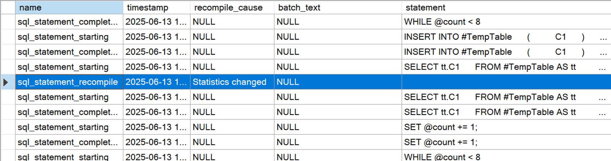

*Hình 8-10: Tái biên dịch gây ra do thay đổi số liệu thống kê trên bảng tạm (A recompile caused by a statistics change)*

Bởi vì ngưỡng biến động 6 dòng dữ liệu ban đầu trên bảng tạm đã bị vượt qua trong vòng lặp, một sự kiện tái biên dịch do thay đổi thống kê (`Statistics changed`) đã lập tức xảy ra. Bây giờ chúng ta hãy chuyển đổi đoạn mã trên sang sử dụng biến bảng như trong Listing 8-14.

**Listing 8-14. Sử dụng biến bảng thay thế bảng tạm (Updating a table variable)**

```sql
DECLARE @TempTable TABLE
(
    C1 INT PRIMARY KEY
);
DECLARE @Count TINYINT = 1;
WHILE @Count < 8
BEGIN
    INSERT INTO @TempTable
    (
        C1
    )
    VALUES
    (@Count );
    SELECT tt.C1
    FROM @TempTable AS tt
       JOIN Production.ProductModel AS pm
       ON pm.ProductModelID = tt.C1
       WHERE tt.C1 < @Count;
    SET @Count += 1;
END;
```

Trong trường hợp này, vì biến bảng không có số liệu thống kê nên hoàn toàn không có sự kiện cập nhật thống kê nào diễn ra, và không hề có bất kỳ lần tái biên dịch nào phát sinh.

> [!NOTE]
> Đối với các tập dữ liệu rất nhỏ (vài chục đến vài trăm dòng), biến bảng là lựa chọn ưu việt vì việc thiếu thống kê giúp loại bỏ hoàn toàn chi phí tái biên dịch. Tuy nhiên, khi kích thước tập dữ liệu lớn dần lên, việc thiếu thống kê sẽ khiến cho trình tối ưu hóa luôn ước tính sai số dòng (mặc định là 1 dòng trước SQL Server 2019), dẫn đến các kế hoạch thực thi tồi tệ (như chọn sai loại Join). Khi đó, bảng tạm thời với số liệu thống kê đầy đủ sẽ mang lại hiệu năng cao hơn rất nhiều, bất chấp chi phí tái biên dịch.

### Sử dụng bảng tạm qua nhiều phạm vi (Use Temporary Tables Across Multiple Scopes)

Bạn có thể khai báo một bảng tạm trong một thủ tục bên ngoài (outer procedure) và sau đó tái sử dụng lại chính bảng tạm đó trong một thủ tục con bên trong (inner procedure) được gọi từ thủ tục bên ngoài. 

Trước phiên bản SQL Server 2019 (và ngoài Azure SQL Database), mô hình gọi lồng nhau này sẽ gây ra hiện tượng tái biên dịch trong thủ tục con ở mỗi lần gọi. Tuy nhiên, những cải tiến hiện đại trong SQL Server engine đã loại bỏ hoàn toàn hạn chế này. Listing 8-15 minh họa một ví dụ thực tế.

**Listing 8-15. Thủ tục lồng nhau sử dụng chung bảng tạm (Nested procedures to avoid recompiles)**

```sql
CREATE OR ALTER PROC dbo.OuterProc
AS
CREATE TABLE #Scope
(ID INT PRIMARY KEY,
ScopeName VARCHAR(50));
EXEC dbo.InnerProc
GO
CREATE OR ALTER PROC dbo.InnerProc
AS
INSERT INTO #Scope
(
    ID,
    ScopeName
)
VALUES
(   1,   -- ID - int
    'InnerProc' -- ScopeName - varchar(50)
    );
SELECT s.ScopeName
FROM #Scope AS s;
GO
```

Khi tạo thủ tục `dbo.OuterProc`, bạn có thể nhận được cảnh báo về việc phụ thuộc vào `dbo.InnerProc`. Dù vậy, cả hai thủ tục đều được tạo thành công, và khi thủ tục bên ngoài được thực thi, bạn sẽ không còn thấy các sự kiện tái biên dịch phát sinh từ thủ tục bên trong nữa.

### Tránh thay đổi thiết lập SET bên trong khối lệnh (Avoid Changing SET Options Within a Batch)

Việc thay đổi các thiết lập môi trường kết nối (`SET options`) ngay giữa lúc đang thực thi một thủ tục hoặc khối lệnh sẽ dẫn thẳng tới hiện tượng tái biên dịch bắt buộc. Để đảm bảo tính tương thích ANSI và giữ cho kế hoạch thực thi luôn ổn định, khuyến nghị chung là bạn nên duy trì các tùy chọn sau ở trạng thái `ON`:

* `SET ARITHABORT ON`
* `SET CONCAT_NULL_YIELDS_NULL ON`
* `SET QUOTED_IDENTIFIER ON`
* `SET ANSI_NULLS ON`
* `SET ANSI_PADDING ON`
* `SET ANSI_WARNINGS ON`
* Riêng `SET NUMERIC_ROUNDABORT` nên được đặt thành `OFF`.

Listing 8-16 thể hiện một đoạn mã cố tình vi phạm nguyên tắc này bằng cách thay đổi thiết lập `SET` liên tục bên trong một thủ tục.

**Listing 8-16. Thay đổi thiết lập môi trường bên trong thủ tục (Changing environment settings within a procedure)**

```sql
CREATE OR ALTER PROC dbo.TestProc
AS
SELECT 'a' + NULL + 'b'; --Câu lệnh 1
SET CONCAT_NULL_YIELDS_NULL OFF;
SELECT 'a' + NULL + 'b'; --Câu lệnh 2
SET ANSI_NULLS OFF;
SELECT 'a' + NULL + 'b'; --Câu lệnh 3
GO
EXEC dbo.TestProc; --Lần chạy 1
EXEC dbo.TestProc; --Lần chạy 2
```

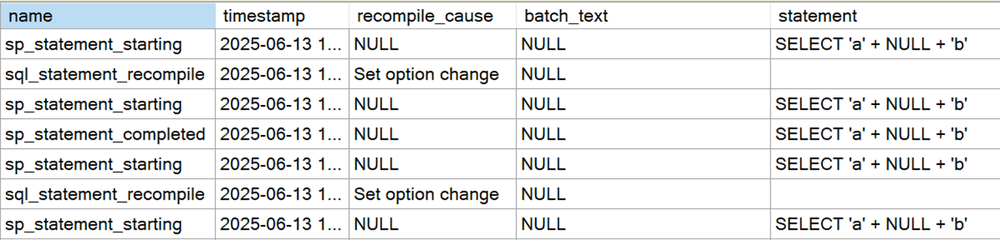

*Hình 8-11: Tái biên dịch gây ra do thay đổi các thiết lập SET (Recompiles caused by SET option changes)*

Trong lần thực thi đầu tiên, các câu lệnh nằm sau các lệnh `SET` đều bị tái biên dịch do môi trường kết nối bị thay đổi (`SET option changed`). Tuy nhiên, bạn sẽ nhận thấy rằng trong lần thực thi thứ hai của thủ tục, không còn sự kiện tái biên dịch nào xuất hiện nữa. Đó là bởi vì các thiết lập `SET` tương ứng lúc này đã được lưu trực tiếp vào siêu dữ liệu của kế hoạch thực thi trong cache. Dù vậy, hậu quả là đối với cùng một câu truy vấn giống hệt nhau, hiện đang có tới ba kế hoạch thực thi khác nhau cùng tồn tại và chiếm dụng bộ nhớ trong plan cache.

> [!NOTE]
> Riêng việc thay đổi thiết lập `SET NOCOUNT ON/OFF` **không** gây ra hiện tượng tái biên dịch kế hoạch thực thi.

---

## Kiểm soát kết quả tái biên dịch (Controlling Recompile Results)

Trong phần trước, chúng ta đã tìm hiểu nhiều phương pháp khác nhau nhằm giảm thiểu số lượng các lần tái biên dịch (recompiles). Tuy nhiên, đôi khi việc tái biên dịch là điều không thể tránh khỏi. Trong trường hợp đó, bạn cần có những cơ chế để chủ động kiểm soát kết quả đầu ra của quá trình tái biên dịch. 

Bạn có bốn phương án sau:
- **Ép buộc kế hoạch (Plan forcing)**
- **Chỉ dẫn kế hoạch (Plan guides)**
- **Gợi ý truy vấn (Query hints)**
- **Ép buộc gợi ý (Hint forcing)**

### Ép buộc kế hoạch qua Query Store (Plan Forcing)

Chúng ta đã thảo luận sơ lược về cơ chế ép buộc kế hoạch trong Chương 6 khi tìm hiểu về Query Store. Chúng ta cũng sẽ tìm hiểu sâu hơn về nó trong Chương 13 khi xử lý các kế hoạch thực thi nhạy cảm với tham số (parameter-sensitive plans). Dẫu vậy, tính năng này rất xứng đáng được nhấn mạnh chi tiết ngay tại chương này.

Cần hiểu rõ rằng: **việc ép buộc kế hoạch sẽ không ngăn cản quá trình tái biên dịch diễn ra**. Nếu bất kỳ tiêu chí nào làm kích hoạt tái biên dịch được thỏa mãn, kế hoạch vẫn sẽ được đưa vào quy trình biên dịch lại. Tuy nhiên, tính năng ép kế hoạch cho phép bạn **kiểm soát kết quả cuối cùng** của quá trình tái biên dịch đó: thay vì sinh ra một kế hoạch hoàn toàn mới với nguy cơ bị thoái lui hiệu năng, Query Optimizer sẽ buộc phải sử dụng lại đúng kế hoạch đã được bạn đánh dấu ưu tiên bắt buộc (với điều kiện kế hoạch đó không bị coi là không hợp lệ do có sự thay đổi mã lệnh hoặc cấu trúc bảng). Đây chính là một phương thức hữu hiệu để bạn kiểm soát kết quả của việc tái biên dịch.

### Gợi ý truy vấn (Query Hints)

Tôi đã giới thiệu khái niệm gợi ý truy vấn ở phần đầu chương khi chúng ta sử dụng `OPTION (KEEPFIXED PLAN)` để loại bỏ việc tái biên dịch và `KEEP PLAN` để giảm thiểu tần suất tái biên dịch đối với các bảng tạm thời. Rất nhiều gợi ý truy vấn có sẵn trong SQL Server được thiết kế trực tiếp nhằm áp đặt các lựa chọn lên Query Optimizer. Chúng ta sẽ cùng xem xét nhiều gợi ý khác nhau xuyên suốt cuốn sách, nhưng có một gợi ý đặc biệt tôi muốn đề cập ngay tại đây: **`OPTIMIZE FOR`**.

Gợi ý `OPTIMIZE FOR` cho phép bạn kiểm soát chính xác giá trị tham số được Query Optimizer sử dụng trong quá trình biên dịch kế hoạch:
- Bạn có thể sử dụng `OPTIMIZE FOR` với một giá trị tham số cụ thể được chỉ định sẵn để thu được một kế hoạch thực thi chuẩn xác và tối ưu nhất cho giá trị điển hình đó.
- Bạn cũng có thể sử dụng `OPTIMIZE FOR UNKNOWN` để hướng dẫn trình tối ưu hóa tạo ra một kế hoạch mang tính khái quát (generic plan) dựa trên các giá trị mật độ trung bình thay vì bám vào một giá trị tham số cụ thể tại lần gọi đầu tiên.

Chúng ta sẽ phân tích sâu hơn về các gợi ý này trong Chương 13, nhưng hãy cùng xem xét một ví dụ minh họa ngay lúc này trong Listing 8-17.

**Listing 8-17.** Thủ tục lưu trữ nhạy cảm với tham số có sử dụng gợi ý truy vấn

```sql
CREATE OR ALTER PROCEDURE dbo.CustomerList @CustomerID INT
AS
SELECT soh.SalesOrderNumber,
       soh.OrderDate,
       sod.OrderQty,
       sod.LineTotal
FROM Sales.SalesOrderHeader AS soh
    JOIN Sales.SalesOrderDetail AS sod
        ON soh.SalesOrderID = sod.SalesOrderID
WHERE soh.CustomerID >= @CustomerID
OPTION (OPTIMIZE FOR (@CustomerID = 1));
```

Việc sử dụng một gợi ý truy vấn như trong Listing 8-17 đòi hỏi mã nguồn T-SQL của thủ tục phải được chỉnh sửa. Có các phương án để bạn không phải sửa mã lệnh sẽ được trình bày ở hai phần tiếp theo. 

Tuy nhiên, dù quá trình tái biên dịch diễn ra như thế nào, câu truy vấn bên trong thủ tục này sẽ luôn luôn nhận được duy nhất một kế hoạch thực thi cố định, dựa trên giá trị tham số `@CustomerID = 1` được cung cấp bên trong gợi ý `OPTIMIZE FOR`.

Chúng ta có thể kiểm chứng điều này trong thực tế bằng cách thực thi các câu lệnh trong Listing 8-18.

**Listing 8-18.** Thực thi thủ tục CustomerList với các giá trị tham số khác nhau kèm yêu cầu tái biên dịch

```sql
EXEC dbo.CustomerList @CustomerID = 7920 WITH RECOMPILE;
EXEC dbo.CustomerList @CustomerID = 30118 WITH RECOMPILE;
```

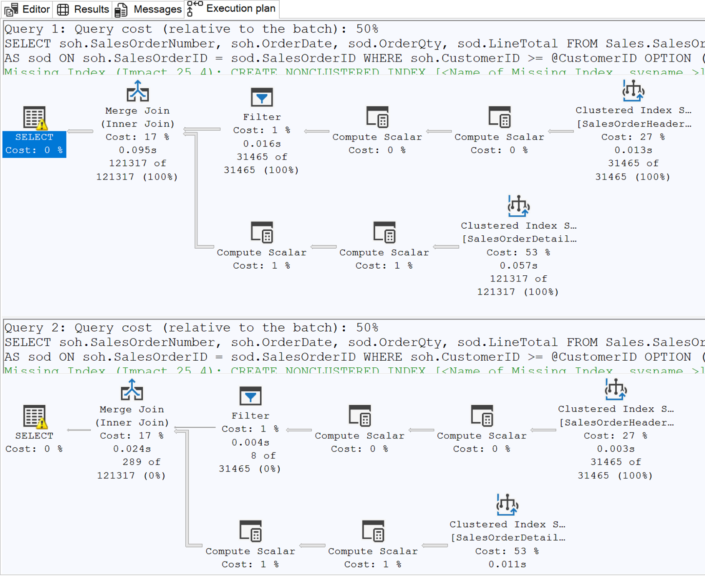

*Hình 8-12: Hai kế hoạch thực thi giống hệt nhau (Two identical execution plans)*

Bạn có thể quan sát thấy cả hai kế hoạch thực thi hoàn toàn giống hệt nhau về cấu trúc cây toán tử. Tuy nhiên, nhờ việc thu thập các chỉ số runtime thực tế, bạn sẽ thấy sự khác biệt rất lớn mà trong điều kiện bình thường sẽ dẫn đến việc tạo ra hai kế hoạch hoàn toàn khác nhau:
- Câu truy vấn đầu tiên trả về 121.317 hàng dữ liệu trên tổng số 121.317 hàng được ước tính. Tóm lại, kế hoạch đó là tối ưu tuyệt đối cho giá trị tham số truyền vào đầu tiên.
- Tuy nhiên, kế hoạch thứ hai trong thực tế chỉ trả về **289 hàng dữ liệu**. Điều này gợi ý rất mạnh mẽ rằng một kế hoạch thực thi khác (ví dụ dùng Index Seek kết hợp Key Lookup hoặc Nested Loops) đáng lẽ đã được lựa chọn cho giá trị tham số thứ hai.

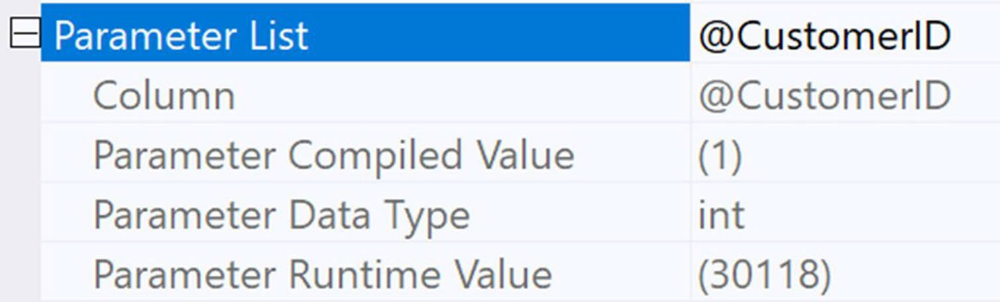

*Hình 8-13: Danh sách tham số từ toán tử đầu tiên (Parameter list from the first operator)*

Như vậy, mặc dù câu truy vấn được gọi thực thi với giá trị `@CustomerID = 30118`, giá trị dùng để biên dịch kế hoạch (`Parameter Compiled Value`) vẫn luôn cố định là `1`. Điều này diễn ra bất chấp việc câu lệnh được yêu cầu tái biên dịch trực tiếp khi thực thi (`WITH RECOMPILE`).

### Chỉ dẫn kế hoạch (Plan Guides)

Trong phần trước, chúng ta đã thêm trực tiếp một gợi ý truy vấn vào định nghĩa của thủ tục lưu trữ. Nhưng điều gì sẽ xảy ra nếu bạn muốn áp dụng một gợi ý truy vấn, nhưng vì lý do bảo mật, chính sách phân quyền hoặc mã nguồn ứng dụng đóng gói từ nhà cung cấp bên thứ ba (vendor code) mà bạn **hoàn toàn không được phép sửa đổi mã T-SQL**? 

Chỉ dẫn kế hoạch (**Plan Guides**) đôi khi có thể giúp chúng ta giải quyết bài toán hóc búa này. Listing 8-19 minh họa thủ tục `CustomerList` ban đầu khi chưa có gợi ý truy vấn.

**Listing 8-19.** Thủ tục CustomerList ở trạng thái nguyên bản không chứa gợi ý

```sql
CREATE OR ALTER PROCEDURE dbo.CustomerList @CustomerID INT
AS
SELECT soh.SalesOrderNumber,
       soh.OrderDate,
       sod.OrderQty,
       sod.LineTotal
FROM Sales.SalesOrderHeader AS soh
    JOIN Sales.SalesOrderDetail AS sod
        ON soh.SalesOrderID = sod.SalesOrderID
WHERE soh.CustomerID >= @CustomerID;
```

Nếu tôi quyết định rằng câu truy vấn này cần được gắn một gợi ý tối ưu, nhưng không thể can thiệp vào định nghĩa của thủ tục, tôi sẽ tạo một đối tượng Plan Guide như trong Listing 8-20.

**Listing 8-20.** Tạo một đối tượng Plan Guide cấp đối tượng (Object Plan Guide)

```sql
sp_create_plan_guide @name = N'MyGuide',
                     @stmt = N'SELECT soh.SalesOrderNumber,
       soh.OrderDate,
       sod.OrderQty,
       sod.LineTotal
FROM Sales.SalesOrderHeader AS soh
    JOIN Sales.SalesOrderDetail AS sod
        ON soh.SalesOrderID = sod.SalesOrderID
WHERE soh.CustomerID >= @CustomerID;',
                     @type = N'OBJECT',
                     @module_or_batch = N'dbo.CustomerList',
                     @params = NULL,
                     @hints = N'OPTION (OPTIMIZE FOR (@CustomerID = 1))';
```

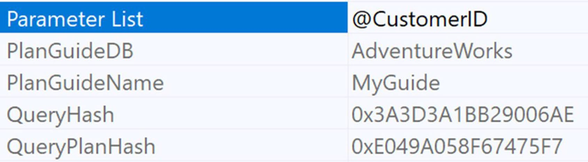

*Hình 8-14: Thuộc tính PlanGuideName trong một kế hoạch thực thi (The PlanGuideName property in an execution plan)*

Thuộc tính **PlanGuideName** sẽ được bổ sung vào kế hoạch thực thi (nằm trong cửa sổ Properties của toán tử đầu tiên) chỉ khi nào một Plan Guide thực sự được so khớp và áp dụng thành công. Bạn có thể thấy rõ tên của Plan Guide hiển thị tại đây là `MyGuide`.

Listing 8-20 đại diện cho một **Object Plan Guide** — nghĩa là bản thân Plan Guide này chỉ liên kết chặt chẽ với module/thủ tục được chỉ định (`dbo.CustomerList`). 

Ngoài ra, bạn cũng có thể tạo Plan Guide cho các câu truy vấn đứng độc lập, chẳng hạn như các lệnh batch ad hoc. Loại này được gọi là **SQL Plan Guide**. Tương tự như Object Plan Guide, bạn bắt buộc phải khớp chính xác từng ký tự khoảng trắng, xuống dòng và định dạng văn bản của câu truy vấn thì Plan Guide mới có hiệu lực.

Listing 8-21 thể hiện một phiên bản truy vấn ad hoc của cùng đoạn mã mà chúng ta đang sử dụng.

**Listing 8-21.** Một câu truy vấn ad hoc đang cần áp dụng gợi ý truy vấn

```sql
SELECT soh.SalesOrderNumber,
       soh.OrderDate,
       sod.OrderQty,
       sod.LineTotal
FROM Sales.SalesOrderHeader AS soh
    JOIN Sales.SalesOrderDetail AS sod
        ON soh.SalesOrderID = sod.SalesOrderID
WHERE soh.CustomerID >= 1;
```

Nếu chúng ta muốn can thiệp vào quá trình tái biên dịch để ép buộc một hành vi thực thi cụ thể, chúng ta có thể tạo một SQL Plan Guide như trong Listing 8-22.

**Listing 8-22.** Ép buộc sử dụng Index Seek thông qua SQL Plan Guide

```sql
EXECUTE sp_create_plan_guide @name = N'MyGoodSQLGuide',
                             @stmt = N'SELECT soh.SalesOrderNumber,
       soh.OrderDate,
       sod.OrderQty,
       sod.LineTotal
FROM Sales.SalesOrderHeader AS soh
    JOIN Sales.SalesOrderDetail AS sod
        ON soh.SalesOrderID = sod.SalesOrderID
WHERE soh.CustomerID >= 1;',
                             @type = N'SQL',
                             @module_or_batch = NULL,
                             @params = NULL,
                             @hints = N'OPTION (TABLE HINT(soh, FORCESEEK))';
```

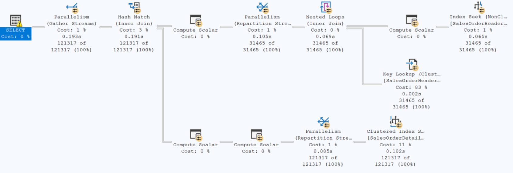

*Hình 8-15: Kế hoạch thực thi sau khi áp dụng gợi ý qua plan guide (The execution plan after applying a hint through a plan guide)*

Còn một phương thức bổ sung khác để kiểm soát kết quả tái biên dịch thông qua Plan Guide. Để minh họa cơ chế này:
1. Trước hết, tôi xóa sạch plan cache để đảm bảo không còn kế hoạch nào trong bộ nhớ.
2. Tiếp theo, tôi tiến hành xóa các Plan Guide đã tạo bằng các câu lệnh trong Listing 8-23.

**Listing 8-23.** Xóa bỏ các đối tượng Plan Guide

```sql
EXECUTE sp_control_plan_guide @operation = 'Drop', @name = N'MyGoodSQLGuide';
EXECUTE sp_control_plan_guide @operation = 'Drop', @name = N'MyGuide';
```

Sau khi hoàn tất, tôi thực thi lại câu truy vấn trong Listing 8-21 để kế hoạch nguyên bản được nạp vào bộ nhớ đệm cache. Giờ đây, tôi có thể tận dụng một cơ chế Plan Guide khác: **tạo Plan Guide trực tiếp từ một kế hoạch thực thi sẵn có trong cache** thông qua thủ tục `sp_create_plan_guide_from_handle` (Listing 8-24).

**Listing 8-24.** Tạo Plan Guide từ Plan Handle có sẵn trong cache

```sql
DECLARE @plan_handle VARBINARY(64),
        @start_offset INT;

SELECT @plan_handle = deqs.plan_handle,
       @start_offset = deqs.statement_start_offset
FROM sys.dm_exec_query_stats AS deqs
    CROSS APPLY sys.dm_exec_sql_text(sql_handle)
    CROSS APPLY sys.dm_exec_text_query_plan(deqs.plan_handle, deqs.statement_start_offset, deqs.statement_end_offset) AS qp
WHERE text LIKE N'SELECT soh.SalesOrderNumber%';

EXECUTE sp_create_plan_guide_from_handle
    @name = N'ForcedPlanGuide',
    @plan_handle = @plan_handle,
    @statement_start_offset = @start_offset;
```

Cơ chế này hoạt động rất tương đồng với tính năng ép kế hoạch (plan forcing), nhưng đòi hỏi nhiều bước thiết lập kỹ thuật phức tạp hơn. Dẫu vậy, đây vẫn là một phương án khả thi để bạn áp đặt kết quả của một lần tái biên dịch.

> [!WARNING]
> Tôi muốn đặc biệt nhấn mạnh rằng: **việc lạm dụng Plan Guides có thể là một phương pháp tiếp cận tiềm ẩn nhiều rủi ro nguy hiểm**. Khi phân phối dữ liệu biến đổi theo thời gian, những kế hoạch thực thi từng hoạt động rất tốt trong quá khứ có thể sẽ không còn phù hợp ở hiện tại. Nếu bạn quyết định triển khai Plan Guides, hãy đảm bảo rằng bạn đã thiết lập một quy trình định kỳ để đánh giá lại xem liệu các chỉ dẫn kế hoạch đó có còn phù hợp và đem lại hiệu quả hay không.

### Ép buộc gợi ý truy vấn qua Query Store (Hint Forcing)

Trên **Azure SQL Database** cũng như từ phiên bản **SQL Server 2022** trở lên, bạn có thêm một giải pháp hiện đại và tối ưu vượt bậc để kiểm soát kết quả tái biên dịch: **ép buộc gợi ý truy vấn** (**Hint Forcing**) thông qua Query Store (`sys.sp_query_store_set_hints`). Chúng ta đã cùng tìm hiểu chi tiết nguyên lý hoạt động và các ưu thế vượt trội của phương pháp này trong Chương 6.

---

## Tóm tắt chương (Summary)

Trong phần lớn các trường hợp thực tế, quy trình tái biên dịch (recompilation) đóng vai trò hỗ trợ đắc lực cho chúng ta: Dữ liệu, cấu trúc bảng hoặc mã lệnh đã có sự thay đổi, và một kế hoạch thực thi mới được cập nhật sẽ giúp tăng cường đáng kể hiệu năng tổng thể của hệ thống. 

Tuy nhiên, như chúng ta đã thảo luận xuyên suốt chương này, điều đó không phải lúc nào cũng đúng. **Extended Events** là một công cụ tuyệt vời giúp bạn thấu hiểu chính xác nguyên nhân vì sao một câu lệnh cụ thể lại bị kích hoạt tái biên dịch. Giờ đây, bạn đã được trang bị hàng loạt phương pháp hữu hiệu để giảm thiểu tần suất tái biên dịch không cần thiết trên hệ thống của mình. Cuối cùng, chúng ta đã cùng nhau điểm qua các cơ chế kiểm soát kết quả đầu ra của quá trình tái biên dịch. Bằng khả năng nhận diện tường tận nguồn gốc phát sinh tái biên dịch, bạn sẽ hoàn toàn làm chủ hệ thống và ngăn ngừa triệt để các đợt tái biên dịch gây lãng phí tài nguyên.

Các chương vừa qua đã tập trung đi sâu vào các cơ chế nội tại của SQL Server trong việc tạo lập, quản lý và vận hành các kế hoạch thực thi. Trong các chương tiếp theo, chúng ta sẽ bắt đầu chuyển hướng sang phân tích các cấu trúc cơ sở dữ liệu cụ thể có thể làm tổn hại hoặc nâng cao hiệu năng của bạn. Chúng ta sẽ bắt đầu với chủ đề quan trọng hàng đầu: **Chỉ mục (Indexes)**.