# CHƯƠNG 9: Kiến trúc Chỉ mục (Index Architecture)

> **Thông tin sách gốc:**  
> © Grant Fritchey 2026  
> G. Fritchey, *SQL Server 2025 Query Performance Tuning*, https://doi.org/10.1007/979-8-8688-1865-3_9  

---

Lựa chọn chỉ mục (index) chính xác là một trong những cơ chế đơn lẻ mang lại hiệu quả vượt trội nhất để gia tăng hiệu năng bên trong SQL Server. Xuất phát từ thực tế đơn giản này, việc thấu hiểu tường tận cách thức vận hành của các cấu trúc chỉ mục là điều tối quan trọng để giúp bạn lựa chọn đúng công cụ cho từng bài toán cụ thể. 

Kể từ SQL Server 2016, chỉ mục Columnstore dạng cụm (Clustered Columnstore Index) đã được hoàn thiện. Ngày nay, chúng ta có quyền lựa chọn cơ chế lưu trữ tối ưu nhất cho dữ liệu của mình: hoặc là **Chỉ mục Rowstore dạng cụm (Clustered Rowstore)** hoặc là **Chỉ mục Columnstore dạng cụm (Clustered Columnstore)** tùy thuộc vào các mẫu truy cập dữ liệu phổ biến nhất. Sau đó, chúng ta có thể bổ sung thêm các chỉ mục phụ trợ (Nonclustered Indexes) trên từng cấu trúc đó để hỗ trợ các đường dẫn truy vấn khác.

Trong chương này, tôi sẽ đề cập đến các chủ đề sau:
* Bản chất của chỉ mục là gì
* Các khuyến nghị nền tảng khi lựa chọn chỉ mục
* Hành vi của chỉ mục Rowstore dạng cụm và không cụm
* Hành vi của chỉ mục Columnstore dạng cụm và không cụm
* Các khuyến nghị thực tiễn về việc sử dụng chỉ mục

---

## Chỉ mục Rowstore là gì? (What Is a Rowstore Index?)

Sự tồn tại của một chỉ mục trên bảng có thể tạo ra ranh giới sống còn giữa việc hệ thống phải duyệt qua từng dòng dữ liệu đơn lẻ trên toàn bộ bảng – gọi là thao tác **quét (Scan)** – với việc đi thẳng trực tiếp đến đúng dòng thông tin bạn cần. Khẳng định rằng điều này giúp cải thiện hiệu năng (đặc biệt là I/O) vẫn còn là một cách nói quá khiêm tốn. 

Một hình ảnh tương đồng dễ hiểu nhất về chỉ mục cơ sở dữ liệu chính là mục lục tra cứu ở cuối cuốn sách này: Nếu bạn muốn tìm hiểu về thuật ngữ "deadlock", nếu cuốn sách không có trang mục lục tra cứu, bạn sẽ buộc phải lật giở đọc từng trang sách một từ đầu đến cuối; nhưng với trang mục lục chỉ mục, bạn có thể nhảy ngay đến đúng trang chứa thông tin cần tìm. Chỉ mục trong cơ sở dữ liệu cũng vận hành chính xác theo cách thức như vậy.

Để thấy rõ cơ chế này trong thực tế, hãy xem xét dữ liệu từ bảng `Production.Product` trong AdventureWorks. Giả sử chúng ta muốn xem danh sách các sản phẩm và sắp xếp theo tên sản phẩm (`Name`). Câu truy vấn sẽ có dạng như Listing 9-1 (để minh họa trực quan, tôi chỉ lấy 10 dòng đầu tiên):

```sql
-- Listing 9-1. Retrieving all Products ordered by Name
SELECT TOP 10
       p.ProductID,
       p.[Name],
       p.StandardCost,
       p.[Weight],
       ROW_NUMBER() OVER (ORDER BY p.NAME DESC) AS RowNumber
FROM Production.Product p
ORDER BY p.NAME DESC;
```

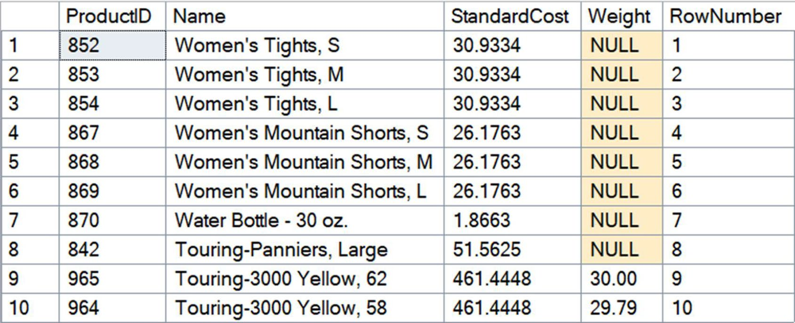  
*Hình 9-1. Dữ liệu được sắp xếp và đánh số thứ tự theo trường Product.Name*

Bạn có thể hình dung tập kết quả này hoạt động tương tự như một chỉ mục: Dữ liệu được sắp xếp và lưu trữ theo `Name`. Bạn có thể tra cứu nhanh dữ liệu dựa trên giá trị `RowNumber`. Trong cơ sở dữ liệu, truy vấn ở trên đã phải quét toàn bộ bảng vì nó không chứa mệnh đề `WHERE`.

Nếu yêu cầu nghiệp vụ thay đổi: chúng ta chỉ muốn lọc lấy những sản phẩm có chi phí tiêu chuẩn `StandardCost > 200`, hệ thống sẽ buộc phải quét toàn bộ bảng để đối sánh từng dòng xem giá trị có vượt qua 200 hay không. Chúng ta có thể tạo ra các cấu trúc chỉ mục khác nhau để giải quyết bài toán này.

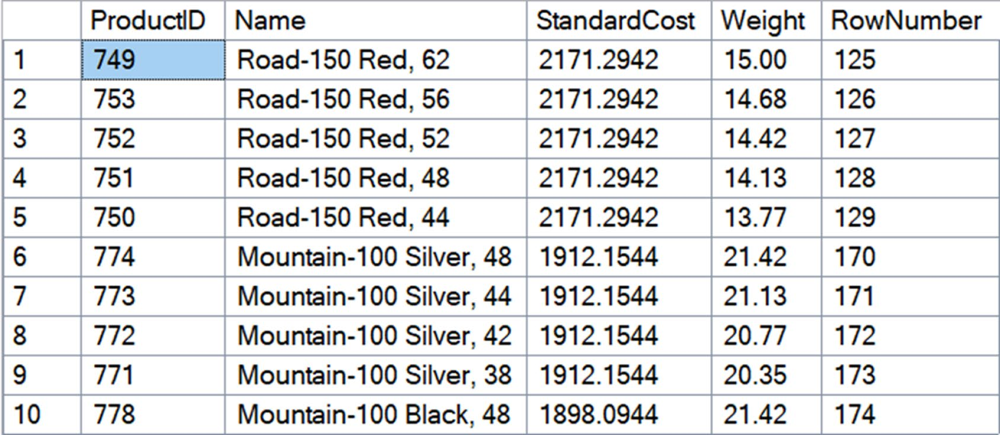  
*Hình 9-2. Dữ liệu được sắp xếp lại thứ tự vật lý theo trường StandardCost*

*(Lưu ý rằng tôi vẫn giữ hàm `ROW_NUMBER()` sắp xếp theo `Name` để bạn quan sát thấy các giá trị ban đầu).*

Khi dữ liệu đã được sắp xếp theo `StandardCost`, việc tìm kiếm các giá trị lớn hơn 200 trở nên cực kỳ đơn giản: hệ thống chỉ cần nhảy đến dòng đầu tiên vượt qua ngưỡng 200 rồi đọc tiếp các dòng phía sau. 

Một chỉ mục vừa có chức năng sắp xếp dữ liệu, vừa trực tiếp lưu trữ các dòng dữ liệu vật lý theo đúng thứ tự sắp xếp đó được gọi là **Chỉ mục Cụm (Clustered Index)**. Bởi vì cấu trúc lưu trữ của SQL Server được định hình xoay quanh các clustered index, nên đây chính là chỉ mục quan trọng số một cần được xác định trên các bảng dữ liệu của bạn.

### Bảng 9-1. Một cấu trúc "chỉ mục" trên cột StandardCost

| StandardCost | RowNumber |
| :--- | :--- |
| 2171.2942 | 125 |
| 2171.2942 | 126 |
| 2171.2942 | 127 |
| 2171.2942 | 128 |
| 2171.2942 | 129 |
| 1912.1544 | 170 |

Cấu trúc trong Bảng 9-1 tương tự như một **Chỉ mục Không cụm (Nonclustered Index)**: Chúng ta có một cột khóa chỉ mục (`StandardCost`) và một con trỏ định danh trỏ ngược về dòng dữ liệu gốc (`RowNumber`). Trong SQL Server, con trỏ này sẽ là khóa chính của clustered index (Clustering Key) nếu bảng có chỉ mục cụm, hoặc là một định danh dòng vật lý (**RID - Row Identifier**) nếu bảng ở dạng Heap (bảng không có chỉ mục cụm).

Bên cạnh các dạng chỉ mục Rowstore và Columnstore tiêu chuẩn, SQL Server còn cung cấp nhiều kiểu chỉ mục chuyên biệt khác mà chúng ta sẽ tìm hiểu ở các chương sau:
* **Hash Index:** Một phần trong kiến trúc bảng tối ưu hóa bộ nhớ (Memory-Optimized Tables - In-Memory OLTP), trình bày trong Chương 19.
* **Memory-Optimized Nonclustered Index:** Một dạng chỉ mục khác cho In-Memory OLTP, trình bày trong Chương 19.
* **Spatial Index:** Chỉ mục không gian tối ưu hóa tìm kiếm tọa độ địa lý/hình học (Geometry/Geography), trình bày trong Chương 10.
* **XML Index:** Chỉ mục dành riêng cho kiểu dữ liệu XML, trình bày trong Chương 10.
* **Full-Text Index:** Chỉ mục tìm kiếm toàn văn được quản lý bởi công cụ Full-Text Engine, trình bày trong Chương 10.
* **Vector Index:** Chỉ mục chuyên dụng mới hỗ trợ tăng tốc các phép toán với kiểu dữ liệu Vector phục vụ các tác vụ AI, trình bày trong Chương 10.

---

### Lợi ích của Chỉ mục (The Benefits of Indexes)

Để một hệ quản trị cơ sở dữ liệu hoạt động hiệu quả, nó phải có khả năng truy xuất dữ liệu một cách nhanh chóng nhất. 
* Khi một bảng **không có chỉ mục cụm**, bảng đó được gọi là một **Heap (đống dữ liệu)**. Heap chỉ là một tập hợp các trang dữ liệu không theo bất kỳ trật tự sắp xếp nào, với các con trỏ RID trỏ đến vị trí vật lý của từng dòng. Cách duy nhất để tìm kiếm dữ liệu trên Heap là duyệt qua từng dòng một thông qua thao tác **Table Scan**.
* Khi tạo **Clustered Index**, bản thân các dòng dữ liệu vật lý sẽ được sắp xếp và lưu trữ theo khóa chỉ mục (Index Key). Khóa này vừa là cơ chế sắp xếp, vừa là con trỏ dẫn đường.
* Một **Nonclustered Index** lưu trữ bản sao của các cột khóa và con trỏ trỏ về bảng gốc (RID đối với Heap hoặc Clustering Key đối với Clustered Index). 

Lợi ích đầu tiên của chỉ mục là dữ liệu được sắp xếp có trật tự, giúp việc tìm kiếm trở nên có định hướng.

Dữ liệu trong SQL Server được tổ chức trên các **trang dữ liệu (Data Pages) có kích thước cố định 8KB**. Trang dữ liệu là đơn vị I/O tối thiểu được di chuyển giữa đĩa cứng và bộ nhớ RAM. Do đó, việc bạn có thể nhét được bao nhiêu dòng dữ liệu trên một trang 8KB là yếu tố quyết định hiệu năng:
* Một chỉ mục nonclustered thông thường có kích thước rất nhỏ gọn (chỉ gồm các cột khóa và các cột bổ trợ `INCLUDE`). 
* Vì kích thước mỗi bản ghi nhỏ, nên một trang 8KB của chỉ mục nonclustered chứa được **nhiều dòng hơn rất nhiều** so với trang dữ liệu của bảng gốc.
* Điều này đồng nghĩa với việc SQL Server chỉ cần đọc ít trang đĩa hơn để tìm thấy dữ liệu, giảm thiểu đáng kể số lượng thao tác đọc đĩa (I/O) và tiết kiệm không gian bộ nhớ đệm (Buffer Cache).
* Ngoài ra, chỉ mục nonclustered được lưu trữ tách biệt hoàn toàn khỏi bảng gốc; bạn thậm chí có thể đặt nó trên một ổ đĩa vật lý riêng biệt để phân tán tải I/O.

Hãy xem xét ví dụ trực quan về việc lưu trữ:

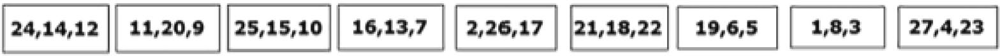  
*Hình 9-3. 27 dòng dữ liệu được lưu trữ ngẫu nhiên không có thứ tự trên các trang 8KB*

Trong Hình 9-3, để tìm kiếm giá trị `5`, SQL Server bắt buộc phải quét toàn bộ các dòng trên tất cả 9 trang dữ liệu (thực hiện 9 lần đọc đĩa I/O). Dù đã tìm thấy số 5 ở một trang nào đó, nó vẫn phải quét tiếp đến trang cuối cùng vì không có gì đảm bảo trang cuối không chứa thêm số 5.

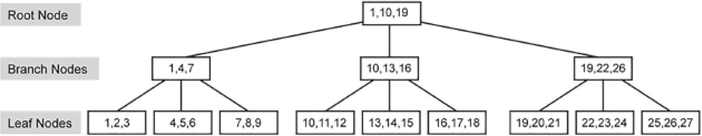  
*Hình 9-4. 27 dòng dữ liệu được lưu trữ theo thứ tự tăng dần trên các trang*

Khi dữ liệu được sắp xếp có thứ tự (Hình 9-4), việc tìm kiếm đã dễ dàng hơn nhưng vẫn cần phải duyệt qua các trang.

Đột phá thực sự đến từ **Cấu trúc Cây B-Tree (Balanced Tree)**:

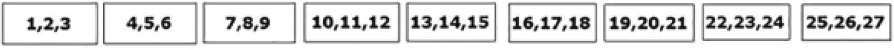  
*Hình 9-5. 27 dòng dữ liệu được tổ chức dưới cấu trúc cây B-Tree đa tầng*

Cấu trúc B-Tree bao gồm:
* **Trang gốc (Root page/node):** Nằm ở đỉnh cây, chứa các giá trị định tuyến dẫn đến các trang tầng dưới.
* **Các trang trung gian (Intermediate pages/nodes):** Các nhánh điều hướng trung gian.
* **Các trang lá (Leaf pages/nodes):** Tầng đáy chứa dữ liệu thực tế (với Clustered Index) hoặc các khóa chỉ mục kèm con trỏ (với Nonclustered Index).

Thuật toán B-Tree tối thiểu hóa số trang phải đọc: Để tìm giá trị `5`, SQL Server:
1. Bắt đầu từ trang Root: Trang Root chỉ đến trang nhánh đầu tiên (vì giá trị bắt đầu là 1, nhỏ hơn 5, trong khi trang nhánh kế tiếp bắt đầu từ 10).
2. Đọc trang nhánh trung gian: Tìm thấy trang lá bắt đầu từ giá trị 4 (lớn hơn 1 và nhỏ hơn 7).
3. Đọc trang lá: Quét các dòng trên trang lá đó và tìm thấy giá trị 5.

Hệ thống chỉ mất **đúng 3 lần đọc trang (reads)** để tìm ra kết quả! Và quan trọng nhất: việc tìm kiếm giá trị `25` cũng sẽ chỉ mất đúng 3 lần đọc trang.

---

### Chi phí phát sinh của Chỉ mục (Index Overhead)

Không có gì là miễn phí. Mặc dù chỉ mục mang lại lợi ích hiệu năng đọc khổng lồ, chúng cũng đi kèm với cái giá phải trả:
1. **Tiêu tốn dung lượng:** Một bảng có nhiều chỉ mục đòi hỏi nhiều không gian lưu trữ trên đĩa và chiếm dụng nhiều bộ nhớ RAM hơn một bảng Heap tương đương.
2. **Làm chậm các thao tác DML:** Các câu lệnh `INSERT`, `UPDATE` và `DELETE` có thể mất nhiều thời gian thực thi hơn. Khác với lệnh `SELECT` chỉ đọc dữ liệu, các lệnh DML sửa đổi nội dung bảng. Khi bạn chèn một dòng mới bằng `INSERT`, SQL Server không chỉ ghi vào bảng gốc mà còn phải chèn thêm bản ghi vào **tất cả các chỉ mục** đang tồn tại trên bảng đó. Vì dữ liệu chỉ mục bắt buộc phải duy trì tính có thứ tự, hệ thống có thể phải thực hiện dịch chuyển dữ liệu hoặc phân tách trang (**Page Split**), tiêu tốn rất nhiều CPU và I/O.

Khi quyết định tạo một chỉ mục, bạn luôn phải cân nhắc hai câu hỏi:
1. Chỉ mục này có giúp cải thiện hiệu năng truy vấn đọc hay không?
2. Chỉ mục này gây tác động tiêu cực đến hiệu năng ghi ở mức độ nào?

Để đo lường hành vi của chỉ mục trong thực tế, các DMV hữu ích nhất là `sys.dm_db_index_operational_stats` (theo dõi hành vi I/O và khóa lock) và `sys.dm_db_index_usage_stats` (đếm số lần chỉ mục được seek/scan/update theo thời gian).

#### Khảo sát thực nghiệm tác động của chỉ mục lên thao tác UPDATE
Hãy cùng quan sát qua một ví dụ cụ thể. Trước tiên, Listing 9-2 tạo một bảng Heap với 10.000 dòng:

```sql
-- Listing 9-2. Building a table with 10,000 rows
IF (SELECT OBJECT_ID('IndexTest')) IS NOT NULL
    DROP TABLE dbo.IndexTest;
GO

CREATE TABLE dbo.IndexTest
(
    C1 INT,
    C2 INT,
    C3 VARCHAR(50)
);

WITH Nums
AS (SELECT TOP (10000)
           ROW_NUMBER() OVER (ORDER BY (SELECT 1)) AS n
    FROM MASTER.sys.all_columns ac1
        CROSS JOIN MASTER.sys.all_columns ac2)
INSERT INTO dbo.IndexTest
(
    C1,
    C2,
    C3
)
SELECT n,
       n,
       'C3'
FROM Nums;
```

Bật `STATISTICS IO` và thực thi câu lệnh `UPDATE` trong Listing 9-3:

```sql
-- Listing 9-3. Updating the IndexTest table
UPDATE dbo.IndexTest
SET C1 = 1,
    C2 = 1
WHERE C2 = 1;
```

Kết quả đo lường I/O trên bảng Heap:
```text
Table 'IndexTest'. Scan count 1, logical reads 29
```

Bây giờ, chúng ta tạo một Clustered Index trên cột `C1` bằng Listing 9-4:

```sql
-- Listing 9-4. Creating a clustered index on IndexTest
CREATE CLUSTERED INDEX iTest
ON dbo.IndexTest(C1);
```

Chạy lại câu lệnh `UPDATE` trong Listing 9-3, kết quả I/O biến đổi:
```text
Table 'IndexTest'. Scan count 1, logical reads 42
Table 'Worktable'. Scan count 1, logical reads 5
```

Số lần đọc logic tăng từ 29 lên 42, cộng thêm 5 lần đọc trên Worktable (bảng tạm nội bộ trong tempdb dùng để sắp xếp dữ liệu). Chi phí I/O tăng lên rõ rệt vì SQL Server phải tái sắp xếp lại vị trí vật lý của dòng dữ liệu trong cấu trúc cây chỉ mục.

#### Mặt đối lập: Chỉ mục hỗ trợ tìm kiếm nhanh dòng cần sửa đổi
Tuy nhiên, đừng quên rằng: **Trước khi muốn UPDATE hoặc DELETE một dòng dữ liệu, SQL Server bắt buộc phải TÌM RA dòng dữ liệu đó trước tiên!** 

Điều này có nghĩa là mặc dù chỉ mục làm tăng chi phí ghi, nó lại giúp tăng tốc giai đoạn tìm kiếm dòng cần cập nhật. Hãy xem điều gì xảy ra nếu chúng ta tạo thêm một chỉ mục nonclustered trên cột điều kiện lọc `C2` bằng Listing 9-5:

```sql
-- Listing 9-5. Creating a new index on IndexTest
CREATE INDEX iTest2
ON dbo.IndexTest(C2);
```

Khi chạy lại câu lệnh `UPDATE` trong Listing 9-3, kết quả I/O lúc này là:
```text
Table 'IndexTest'. Scan count 1, logical reads 15
Table 'Worktable'. Scan count 1, logical reads 5
```

Tổng số lần đọc logic giảm từ **42 xuống chỉ còn 20 reads** – thậm chí còn thấp hơn cả con số 29 reads của bảng Heap ban đầu! Lý do là vì chỉ mục `iTest2` đã giúp SQL Server tìm ra chính xác dòng dữ liệu cần sửa đổi ngay lập tức mà không phải quét toàn bộ bảng.

---

## Chỉ mục Columnstore là gì? (What Is a Columnstore Index?)

Nói một cách đơn giản, **Chỉ mục Columnstore lưu trữ dữ liệu theo từng Cột thay vì theo từng Dòng**. Bằng cách xoay trục lưu trữ dữ liệu (pivoting), chỉ mục columnstore trở nên mạnh mẽ phi thường khi xử lý các truy vấn phân tích (Analytical queries) – những câu lệnh thường xuyên chứa các phép tổng hợp dữ liệu lớn như `SUM`, `AVG`, `COUNT`, `GROUP BY`.

### Ưu điểm vượt trội của Columnstore:
1. **Tốc độ tổng hợp siêu nhanh:** Do dữ liệu được lưu theo cột, khi truy vấn tính tổng một cột cụ thể, SQL Server chỉ cần đọc duy nhất cột đó mà không phải nạp toàn bộ các cột khác vào bộ nhớ.
2. **Giảm thiểu I/O:** Bạn chỉ phải nạp những cột mà bạn thực sự cần, thay vì phải kéo toàn bộ các trang dữ liệu chứa đầy các cột không mong muốn.
3. **Nén dữ liệu mặc định cực cao:** Dữ liệu trong cùng một cột có cùng kiểu dữ liệu và thường có nhiều giá trị lặp lại, cho phép các thuật toán nén đạt hiệu suất nén vượt trội (thường từ 5x đến 10x).

Columnstore cũng được chia thành hai loại:
* **Clustered Columnstore Index (CCI):** Xác định cấu trúc lưu trữ dữ liệu vật lý chính của bảng.
* **Nonclustered Columnstore Index (NCCI):** Được tạo bổ sung trên nền một bảng Heap hoặc bảng Clustered Rowstore hiện có.

> [!NOTE]
> **Một số giới hạn của Columnstore Index:**  
> * Một số kiểu dữ liệu không được hỗ trợ (như `binary`, `varchar(MAX)`, `varbinary(MAX)`, `CLR`, `XML`).  
> * Không thể tạo trên các cột thưa (`sparse columns`).  
> * Bảng có Clustered Columnstore Index không hỗ trợ các ràng buộc khóa ngoại (Foreign Keys) hay khóa chính (Primary Keys) truyền thống trong các phiên bản cũ.  
> * Chỉ mục Columnstore phát huy hiệu quả cao nhất trên các tập dữ liệu lớn (thường từ 100.000 dòng trở lên).

### Cấu trúc Lưu trữ của Columnstore (Columnstore Index Storage)

Columnstore hoàn toàn **không lưu trữ dưới dạng cây B-Tree thông thường**. Thay vào đó:
* Dữ liệu trong bảng được chia thành các nhóm dòng gọi là **Rowgroups**. Mỗi rowgroup chứa tối ưu khoảng **1.048.576 dòng** (tối thiểu khoảng 102.400 dòng).
* Bên trong mỗi rowgroup, dữ liệu được tách thành các phân đoạn cột (**Column Segments**). Mỗi segment chứa dữ liệu của một cột duy nhất cho nhóm dòng đó và được nén chặt.
* **Từ điển nén (Dictionaries):** Lưu trữ các giá trị thực tế để thay thế bằng các mã nhị phân nhỏ gọn trong segment.

#### Xử lý dữ liệu thay đổi: Deltastore và Xóa logic
* **Deltastore:** Khi bạn thực hiện các thao tác chèn nhỏ lẻ (small batch inserts) hoặc cập nhật (UPDATE) vào bảng Columnstore, dữ liệu mới sẽ được lưu tạm vào một cấu trúc B-Tree gọi là **Deltastore**. Khi số lượng dòng trong Deltastore đạt đủ ngưỡng (khoảng 102.400 dòng), tiến trình nền Tuple Mover sẽ tự động đóng nhóm và nén chúng thành một Rowgroup dạng cột chuẩn mực.
* **Xóa logic (Logically Deleted Rows):** Khi bạn xóa dòng khỏi Columnstore, dòng đó không bị xóa vật lý ngay lập tức mà ID của dòng sẽ được ghi nhận vào một danh sách theo dõi B-Tree nội bộ. Dữ liệu chỉ được dọn dẹp vật lý hoàn toàn khi bạn tiến hành tổ chức lại (**Reorganize**) hoặc xây dựng lại (**Rebuild**) chỉ mục.

Bắt đầu từ SQL Server 2025, các chỉ mục **Nonclustered Columnstore cũng đã hỗ trợ sắp xếp thứ tự có trật tự (ordered)** tương tự như Clustered Columnstore, giúp nâng cao đáng kể hiệu năng truy vấn phân tích.

---

## Các khuyến nghị Thiết kế Chỉ mục (Index-Design Recommendations)

Khi bắt tay vào thiết kế chỉ mục cho một hệ thống, bạn cần xem xét một chuỗi các yếu tố mang tính chiến lược:
1. Xác định loại hình xử lý truy vấn của hệ thống (OLTP vs Data Warehouse/Analytics).
2. Xác định các tiêu chí lọc dữ liệu (Filtering Criteria).
3. Ưu tiên sử dụng các chỉ mục hẹp (Narrow Indexes).
4. Đánh giá độ chọn lọc của dữ liệu (Selectivity).
5. Lựa chọn kiểu dữ liệu phù hợp.
6. Cân nhắc thứ tự sắp xếp của các cột trong chỉ mục kết hợp.
7. Lựa chọn cơ chế lưu trữ dữ liệu (Rowstore vs Columnstore).

Chúng ta hãy cùng phân tích các yếu tố trọng tâm đầu tiên.

---

### 1. Xác định Loại hình Xử lý Truy vấn (Type of Query Processing)

Trước tiên, bạn phải nhận diện được khối lượng công việc chủ đạo của hệ thống:
* **Hệ thống Xử lý Giao dịch Trực tuyến (OLTP):** Đặc trưng bởi các truy vấn tìm kiếm điểm đơn lẻ (Point lookups) hoặc quét các khoảng dữ liệu hẹp, tần suất ghi cao. Với hệ thống này, bạn bắt buộc phải lựa chọn **Rowstore Clustered Index** làm kiến trúc lưu trữ chính.
* **Hệ thống Kho Dữ liệu / Phân tích (Analytics / Data Warehouse):** Đặc trưng bởi các câu lệnh tổng hợp khối lượng dữ liệu khổng lồ, quét hàng triệu dòng. Với hệ thống này, trọng tâm thiết kế phải là **Columnstore Index**.

Bạn hoàn toàn có thể kết hợp cả hai: sử dụng Nonclustered Columnstore trên bảng Clustered Rowstore để phục vụ các báo cáo phân tích theo thời gian thực (HTAP - Hybrid Transactional/Analytical Processing).

---

### 2. Xác định Tiêu chí Lọc Dữ liệu (Determine Filtering Criteria)

Bộ tối ưu hóa truy vấn thực hiện một loạt các bước đánh giá gắn liền với các điều kiện lọc:
1. Nhận diện tất cả các cột tham gia vào các mệnh đề `WHERE`, `JOIN` và `HAVING`.
2. Kiểm tra xem có chỉ mục nào tồn tại trên các cột đó hay không.
3. Đánh giá độ hữu dụng của chỉ mục thông qua **độ chọn lọc (Selectivity)** dựa trên số liệu thống kê.
4. Nếu không có chỉ mục, tự động tạo hoặc nạp số liệu thống kê để ước tính chi phí.
5. Cuối cùng, tính toán chi phí ước tính để lựa chọn phương án ít tốn kém nhất.

Để quan sát sự khác biệt, hãy so sánh Listing 9-6 (không có mệnh đề WHERE) và Listing 9-7 (có mệnh đề WHERE):

```sql
-- Listing 9-6. Retrieving all data from a table
SELECT p.ProductID,
       p.NAME,
       p.StandardCost,
       p.Weight
FROM Production.Product p;
```

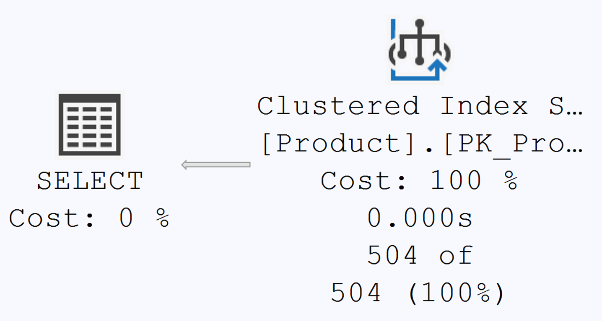  
*Hình 9-6. Kế hoạch thực thi buộc phải dùng Clustered Index Scan khi không có mệnh đề lọc*

Kết quả đo lường I/O:
```text
Table 'Product'. Scan count 1, logical reads 15
```

Bây giờ, chúng ta bổ sung mệnh đề lọc `WHERE p.ProductID = 738` trong Listing 9-7:

```sql
-- Listing 9-7. Introducing the WHERE clause
SELECT p.ProductID,
       p.NAME,
       p.StandardCost,
       p.Weight
FROM Production.Product AS p
WHERE p.ProductID = 738;
```

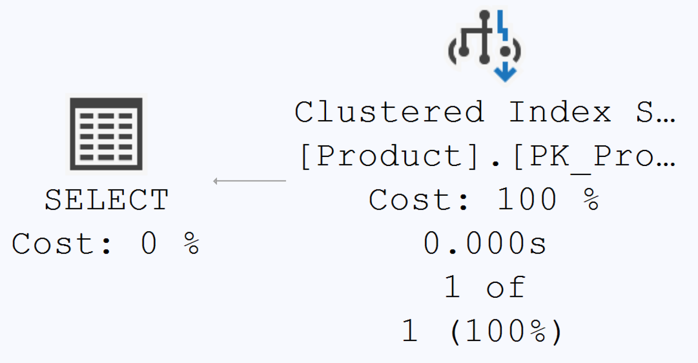  
*Hình 9-7. Kế hoạch thực thi chuyển thành Clustered Index Seek nhờ sự hiện diện của mệnh đề lọc chính xác*

Kết quả đo lường I/O và thời gian chạy:
```text
Table 'Product'. Scan count 0, logical reads 2
```
* Số lần đọc logic giảm từ **15 xuống chỉ còn 2 reads**.
* Thời gian thực thi trung bình giảm từ **534 microseconds xuống còn 132 microseconds**.

> [!NOTE]
> Khi bảng dữ liệu có kích thước quá nhỏ (toàn bộ dữ liệu nằm gọn trong duy nhất một trang 8KB), optimizer có thể vẫn lựa chọn thao tác Scan thay vì Seek, bởi vì với một trang duy nhất, quét thẳng toàn bộ trang có hiệu năng tương đương hoặc nhanh hơn việc duyệt cây chỉ mục.

---

### 3. Ưu tiên Sử dụng Chỉ mục Hẹp (Use Narrow Indexes)

Để nâng cao hiệu năng, bất kỳ khi nào có thể, hãy lựa chọn kiểu dữ liệu có **độ rộng hẹp nhất (narrowest data type)** có thể cho các cột khóa chỉ mục. "Hẹp" ở đây đồng nghĩa với dung lượng byte nhỏ nhất: Một cột kiểu `INT` (4 bytes) hẹp hơn nhiều so với `BIGINT` (8 bytes) hay một chuỗi ký tự `VARCHAR(50)` (lên tới 52 bytes).

Lợi ích của một khóa chỉ mục hẹp:
* Chứa được **nhiều dòng hơn trên mỗi trang dữ liệu 8KB**.
* Giảm thiểu đáng kể số lượng trang đĩa cần đọc, từ đó cắt giảm I/O.
* Tối ưu hóa dung lượng bộ nhớ đệm (RAM) vì ít trang phải nạp vào Buffer Pool hơn.

Để kiểm chứng tác động của độ rộng chỉ mục, Listing 9-8 tạo một bảng thử nghiệm với khóa kiểu `INT`:

```sql
-- Listing 9-8. Creating a test table and index
IF (SELECT OBJECT_ID('Test1')) IS NOT NULL
    DROP TABLE dbo.Test1;
GO

CREATE TABLE dbo.Test1
(
    C1 INT,
    C2 INT
);

WITH Nums
AS (SELECT 1 AS n
    UNION ALL
    SELECT n + 1
    FROM Nums
    WHERE n < 20)
INSERT INTO dbo.Test1
(
    C1,
    C2
)
SELECT n,
       2
FROM Nums;

CREATE INDEX iTest ON dbo.Test1 (C1);
```

Chúng ta kiểm tra kích thước vật lý của chỉ mục bằng hàm DMV `sys.dm_db_index_physical_stats` trong Listing 9-9:

```sql
-- Listing 9-9. Getting the size of the index
SELECT i.NAME,
       i.type_desc,
       ddips.page_count,
       ddips.record_count,
       ddips.index_level
FROM sys.indexes i
     JOIN sys.dm_db_index_physical_stats(DB_ID(N'AdventureWorks'), OBJECT_ID(N'dbo.Test1'), NULL, NULL, 'DETAILED') AS ddips
        ON i.index_id = ddips.index_id
WHERE i.OBJECT_ID = OBJECT_ID(N'dbo.Test1');
```

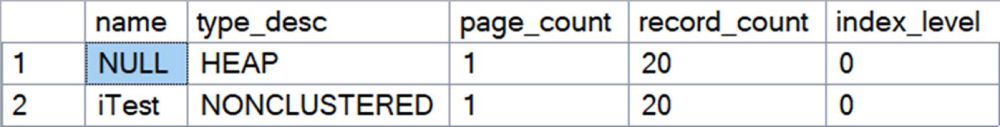  
*Hình 9-8. Chỉ mục hẹp (INT): toàn bộ 20 bản ghi nằm gọn trong duy nhất 1 trang 8KB (page_count = 1)*

Bây giờ, chúng ta thay đổi cấu trúc bảng bằng cách mở rộng kiểu dữ liệu của cột khóa `C1` thành `CHAR(500)` trong Listing 9-10:

```sql
-- Listing 9-10. Changing the data type on the existing table
DROP INDEX dbo.Test1.iTest;
ALTER TABLE dbo.Test1 ALTER COLUMN C1 CHAR(500);
CREATE INDEX iTest ON dbo.Test1 (C1);
```

Chạy lại câu lệnh kiểm tra kích thước trong Listing 9-9:

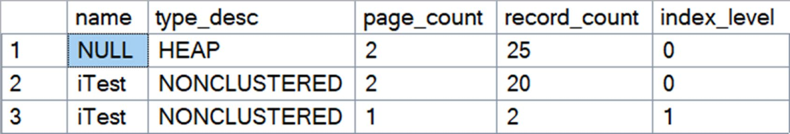  
*Hình 9-9. Chỉ mục rộng (CHAR(500)): số lượng trang đĩa tăng lên gấp nhiều lần để chứa cùng 20 bản ghi*

Số lượng trang đĩa tăng lên đồng nghĩa với việc tiêu tốn nhiều bộ nhớ RAM hơn, phát sinh nhiều I/O hơn và làm chậm hiệu năng chung. Mặc dù trong thực tế bạn không phải lúc nào cũng được tùy ý chọn kiểu dữ liệu cho cột nghiệp vụ, nhưng khi thiết kế lược đồ mới, hãy luôn ưu tiên các cột khóa có kích thước hẹp nhất.

---

### 4. Xem xét Độ chọn lọc của Dữ liệu (Consider Selectivity of the Data)

Việc đánh dấu một chỉ mục là duy nhất (**Unique Index**) có thể nâng cao hiệu năng theo nhiều cách khác nhau. Trình tối ưu hóa sẽ biết chắc chắn rằng chỉ có tối đa một dòng duy nhất có thể khớp với bất kỳ giá trị tìm kiếm nào (hoặc tổ hợp giá trị đối với khóa phức hợp). Điều này không chỉ làm thay đổi các quyết định của optimizer khi truy xuất dữ liệu, mà còn tối ưu hóa các phép toán kết nối (`JOIN`) cũng như nhiều hành vi xử lý khác bên trong kế hoạch thực thi.

Tuy nhiên, chỉ riêng tính chất duy nhất không nhất thiết làm cho một chỉ mục trở nên vượt trội. Hãy xem xét một cột như `MaritalStatus` trong bảng `HumanResources.Employee`. Cột này chỉ chứa vỏn vẹn hai giá trị: `'M'` (Married - Đã kết hôn) hoặc `'S'` (Single - Độc thân). Bạn không thể tạo một chỉ mục duy nhất trên cột này trừ khi bảng của bạn chỉ có đúng hai dòng. Một tập hợp các giá trị hạn hẹp và trùng lặp nhiều như vậy hoàn toàn không phù hợp để đánh chỉ mục đơn lẻ. Listing 9-11 minh họa cách bạn có thể phân tích một cột để xác định độ chọn lọc (**selectivity**) của nó trước khi quyết định tạo chỉ mục.

**Listing 9-11. Xác định độ chọn lọc của một cột (Determining a column’s selectivity)**

```sql
SELECT COUNT(DISTINCT E.MaritalStatus) AS DistinctColValues,
       COUNT(E.MaritalStatus) AS NumberOfRows,
       (CAST(COUNT(DISTINCT E.MaritalStatus) AS DECIMAL) / CAST(COUNT(E.MaritalStatus) AS DECIMAL)) AS Selectivity,
       (1.0 / (COUNT(DISTINCT E.MaritalStatus))) AS Density
FROM HumanResources.Employee AS E;
```

Bạn chỉ cần thay đổi tên cột và tên bảng trong đoạn mã trên để kiểm tra bất kỳ cột dữ liệu nào trong cơ sở dữ liệu của mình.

Mặc dù bản thân cột `MaritalStatus` khi đứng một mình có độ chọn lọc rất kém, nhưng khi kết hợp với một hoặc nhiều cột khác, nó lại có thể tạo thành một tổ hợp có độ chọn lọc cao. Listing 9-12 minh họa một câu truy vấn lọc trên cả hai cột `MaritalStatus` và `BirthDate`.

**Listing 9-12. Truy xuất thông tin từ bảng Employee (Retrieving information from the Employee table)**

```sql
SELECT e.BusinessEntityID,
       e.MaritalStatus,
       e.BirthDate
FROM HumanResources.Employee AS e
WHERE e.MaritalStatus = 'M'
      AND e.BirthDate = '1982-02-11';
```

Hiện tại không có chỉ mục nào trên bảng `Employee` hỗ trợ câu truy vấn này, do đó mỗi lần thực thi đều sẽ dẫn đến thao tác quét toàn bộ chỉ mục gom cụm (**Clustered Index Scan**). Chúng ta cần xây dựng một chỉ mục nếu muốn truy vấn chạy nhanh hơn. Chúng ta có thể bắt đầu thử nghiệm với chỉ mục trên cột `MaritalStatus` như trong Listing 9-13.

**Listing 9-13. Thêm chỉ mục trên cột MaritalStatus vào bảng Employee (Adding an index to the Employee table)**

```sql
CREATE INDEX IX_Employee_Test ON HumanResources.Employee (MaritalStatus);
```

Nếu chúng ta thực thi lại câu truy vấn `SELECT` trong Listing 9-12, SQL Server vẫn sẽ lựa chọn thao tác Clustered Index Scan, với thời gian thực thi là 336 microseconds và tiêu tốn 9 lượt đọc logic (logical reads). Chúng ta có thể thử ép buộc truy vấn sử dụng chỉ mục mới thông qua gợi ý truy vấn như trong Listing 9-14.

**Listing 9-14. Ép buộc sử dụng chỉ mục thông qua query hint (Forcing the index use through a query hint)**

```sql
SELECT e.BusinessEntityID,
       e.MaritalStatus,
       e.BirthDate
FROM HumanResources.Employee AS e WITH (INDEX(IX_Employee_Test))
WHERE e.MaritalStatus = 'M'
      AND e.BirthDate = '1982-02-11';
```

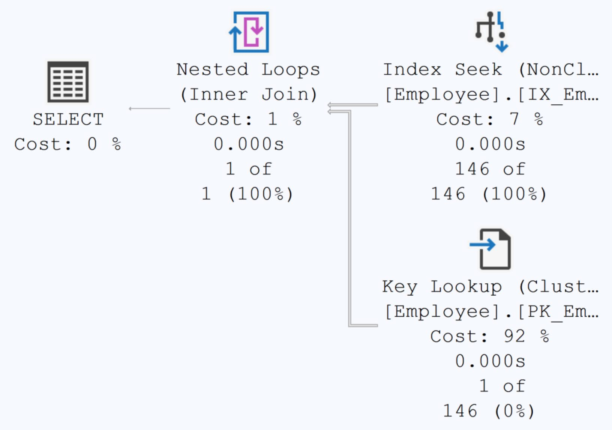

*Hình 9-10: Ép buộc thao tác tìm kiếm chỉ mục (Forcing an index seek)*

Hiệu năng thực tế đã sụt giảm nghiêm trọng: thời gian thực thi tăng lên 466 microseconds và số lượt đọc logic vọt lên tới 294 reads. Đây rõ ràng không phải là một giải pháp tối ưu. Mặc dù chúng ta đã đạt được thao tác **Index Seek** như mong muốn, nhưng chỉ mục này phải đọc tới 146 dòng chỉ để trả về 1 dòng kết quả, và nó bắt buộc phải thực hiện thêm thao tác **Key Lookup** để lấy nốt các cột dữ liệu còn lại từ bảng gốc. Tất cả những yếu tố này cộng dồn lại đã khiến số lượt đọc tăng vọt từ 9 lên 294 reads và làm suy giảm hiệu năng.

Thay vào đó, chúng ta hãy sửa đổi lại cấu trúc chỉ mục như trong Listing 9-15.

**Listing 9-15. Thay đổi cấu trúc chỉ mục IX_Employee_Test (Changing the IX_Employee_Test index)**

```sql
CREATE INDEX IX_Employee_Test
ON HumanResources.Employee (
                               BirthDate,
                               MaritalStatus
                           )
WITH DROP_EXISTING;
```

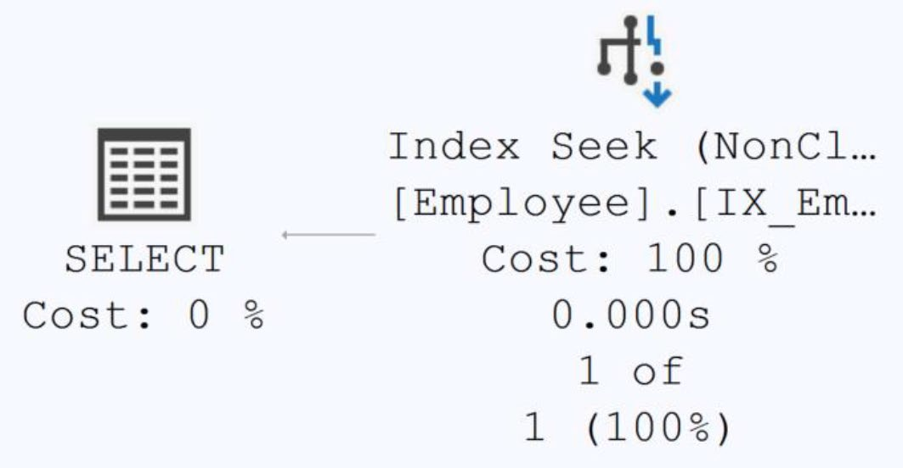

*Hình 9-11: Chỉ mục hiện đã bao phủ hoàn toàn câu truy vấn (Index is now covering the query)*

Không cần sử dụng bất kỳ query hint nào (đồng nghĩa với việc không cần can thiệp sửa đổi mã nguồn ứng dụng), việc tinh chỉnh chỉ mục để đưa cột có độ chọn lọc cao (`BirthDate`) lên đầu đã biến chỉ mục này thành một **Chỉ mục bao phủ** (*Covering Index*). Kết quả là truy vấn chạy nhanh hơn rõ rệt và số lượt đọc giảm xuống mức tối thiểu.

Như bạn thấy, một chỉ mục có độ chọn lọc cao hơn kết hợp với khả năng bao phủ dữ liệu có thể mang lại những cải thiện hiệu năng vượt bậc.

Trước khi chuyển sang phần tiếp theo, chúng ta hãy dọn dẹp chỉ mục thử nghiệm bằng Listing 9-16.

**Listing 9-16. Xóa chỉ mục thử nghiệm (Removing the test index)**

```sql
DROP INDEX IF EXISTS IX_Employee_Test ON HumanResources.Employee;
```

### 5. Xác định Kiểu dữ liệu (Determine the Data Type)

Kiểu dữ liệu của các cột tham gia vào chỉ mục đóng vai trò rất quan trọng:
* Thao tác tìm kiếm trên các khóa chỉ mục có kiểu số nguyên (**INTEGER/INT**) diễn ra cực kỳ nhanh chóng do kích thước nhỏ gọn (chỉ 4 bytes) và CPU có thể thực thi các phép toán so sánh nhị phân trực tiếp trên phần cứng.
* Các biến thể khác của kiểu số nguyên như `BIGINT`, `SMALLINT`, và `TINYINT` cũng đều mang lại hiệu quả vượt trội.
* Ngược lại, các kiểu dữ liệu chuỗi ký tự (`CHAR`, `VARCHAR`, `NCHAR`, `NVARCHAR`) đòi hỏi các phép so sánh chuỗi (string matching/collation comparison), vốn tiêu tốn tài nguyên CPU hơn rất nhiều so với so sánh số nguyên.

Giả sử bạn cần tạo một chỉ mục trên một cột và bạn có hai ứng viên: một cột có kiểu `INTEGER` và một cột có kiểu `CHAR(4)`. Mặc dù kích thước lưu trữ của cả hai kiểu dữ liệu này đều là 4 bytes, bạn vẫn nên ưu tiên lựa chọn kiểu `INTEGER`. 

Hãy nhìn vào cách thức CPU xử lý dữ liệu:
* Giá trị `1` trong kiểu `CHAR(4)` thực tế được lưu trữ dưới dạng ký tự `'1'` theo sau bởi 3 dấu cách, tương ứng với 4 bytes mã hex: `0x35, 0x20, 0x20, 0x20`. CPU không thể trực tiếp thực hiện các phép so sánh số học trên chuỗi byte này; nó bắt buộc phải chuyển đổi chuỗi sang số nguyên trước khi so sánh.
* Trong khi đó, giá trị `1` trong kiểu `INTEGER` được lưu trữ trực tiếp dưới dạng số nhị phân `0x00000001`, cho phép CPU thực thi các phép so sánh số học tức thì.

Hơn nữa, hãy luôn sử dụng đúng kiểu dữ liệu cho các cột. Mặc dù bạn hoàn toàn có thể lưu trữ số dưới dạng văn bản (text/varchar), nhưng dung lượng chiếm dụng của chúng sẽ lớn hơn rất nhiều. Một số nguyên kiểu `INT` có thể lưu trữ giá trị lên tới `2,147,483,647` chỉ trong 4 bytes, trong khi để lưu chuỗi số tương ứng trong `VARCHAR`, bạn sẽ mất tới 10 bytes. Sự phình to này sẽ làm giảm đáng kể hiệu quả của chỉ mục.

Hãy luôn ghi nhớ những nguyên lý này khi thiết kế và lựa chọn kiểu dữ liệu cho các khóa chỉ mục của bạn.

### 6. Thứ tự các Cột trong Chỉ mục (Consider Column Order)

Khi tạo một chỉ mục đa cột (composite index), **thứ tự sắp xếp của các cột trong định nghĩa chỉ mục là yếu tố sống còn**.

Hãy quan sát sự khác biệt giữa một bảng dữ liệu chưa sắp xếp (Bảng 9-2) và một chỉ mục đã được sắp xếp (Bảng 9-3):

**Bảng 9-2. Một bảng dữ liệu chưa sắp xếp (An unsorted table)**

| Column1 | Column2 |
| :--- | :--- |
| 1 | 1 |
| 3 | 1 |
| 2 | 1 |
| 3 | 2 |
| 1 | 2 |
| 2 | 2 |

**Bảng 9-3. Một chỉ mục đã được sắp xếp (A sorted index)**

| Column1 | Column2 |
| :--- | :--- |
| 1 | 1 |
| 1 | 2 |
| 2 | 1 |
| 2 | 2 |
| 3 | 1 |
| 3 | 2 |

Trong Bảng 9-3, dữ liệu được sắp xếp trước hết theo `Column1` — đóng vai trò là **cột dẫn đầu** (*leading edge*) của chỉ mục — và sau đó các dòng có cùng giá trị `Column1` mới tiếp tục được sắp xếp theo `Column2`.

Để thấy rõ thứ tự cột ảnh hưởng như thế nào đến hiệu năng thực thi truy vấn, chúng ta hãy tạo một chỉ mục trên bảng `Person.Address` như trong Listing 9-17.

**Listing 9-17. Tạo chỉ mục đa cột trên bảng Address (Creating a new index on the Address table)**

```sql
CREATE INDEX IX_Address_Test ON Person.ADDRESS (City, PostalCode);
```

Sau khi chỉ mục được tạo, chúng ta thực thi câu truy vấn trong Listing 9-18, vốn lọc dữ liệu theo cột dẫn đầu (`City`).

**Listing 9-18. Truy vấn bảng Address theo cột dẫn đầu (Querying the Address table)**

```sql
SELECT A.AddressID,
       A.City,
       A.PostalCode
FROM Person.ADDRESS AS A
WHERE A.City = 'Dresden';
```

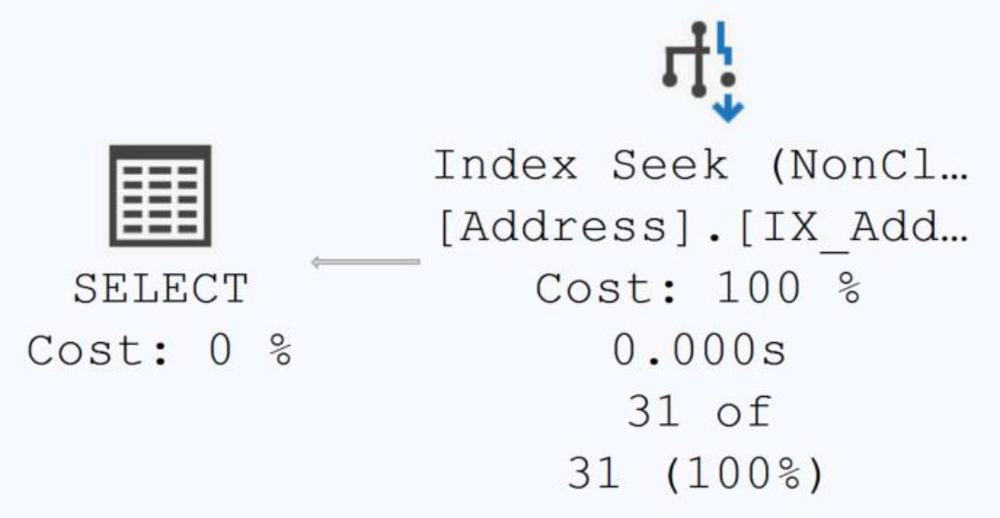

*Hình 9-12: Kế hoạch thực thi tận dụng tối đa chỉ mục vừa tạo (Execution plan that can use the index created)*

Chỉ mục cung cấp chính xác những gì câu truy vấn cần để đạt hiệu năng tối ưu: thời gian thực thi chỉ 156 microseconds và vỏn vẹn **2 lượt đọc logic**. Biểu đồ tần suất (Histogram) cung cấp số lượng dòng ước tính chính xác cho các dòng có giá trị `City = 'Dresden'`.

Bây giờ, nếu chúng ta thực thi một câu truy vấn khác trong Listing 9-19, vốn chỉ lọc theo cột thứ hai (`PostalCode`) mà không đề cập đến cột dẫn đầu (`City`):

**Listing 9-19. Một truy vấn khác trên bảng Address lọc theo cột thứ hai (A different query for the Address table)**

```sql
SELECT A.AddressID,
       A.City,
       A.PostalCode
FROM Person.ADDRESS AS A
WHERE A.PostalCode = '01071';
```

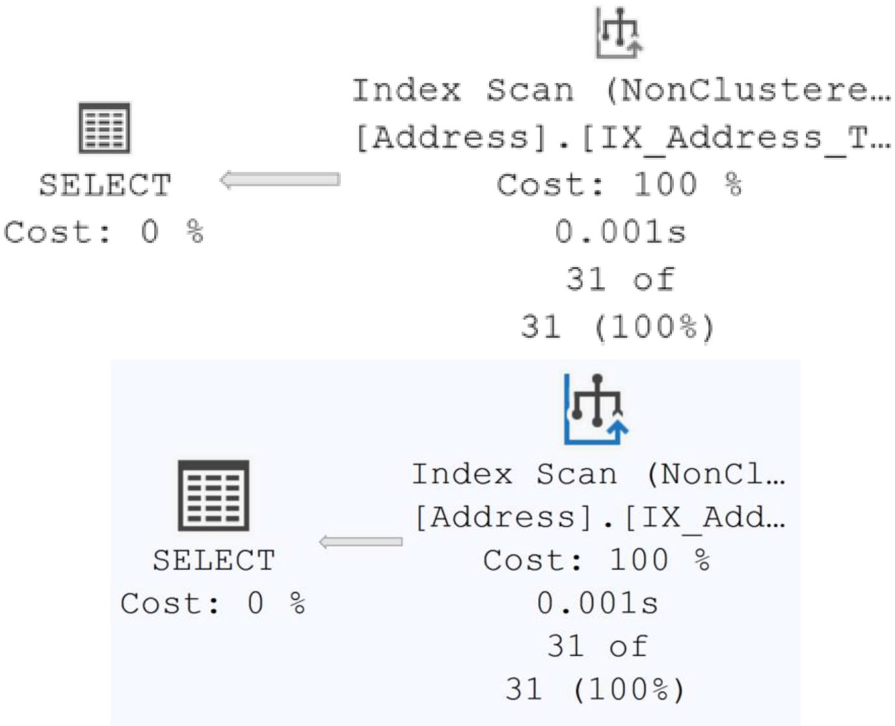

*Hình 9-13: Chỉ mục không thể được khai thác triệt để do thiếu cột dẫn đầu (The index could not be fully used)*

Thời gian thực thi vọt lên tới 2,7 giây và số lượt đọc logic tăng từ 2 lên **106 reads**. SQL Server vẫn sử dụng chỉ mục thử nghiệm `IX_Address_Test`, nhưng vì câu truy vấn không tìm kiếm theo cột dẫn đầu (`City`), cây B-Tree không thể thực hiện thao tác Seek trực tiếp mà buộc phải **quét toàn bộ các trang lá của chỉ mục** (*Index Scan*) để tìm kiếm các dòng khớp với `PostalCode`. Điều này một lần nữa minh họa rõ nét tầm quan trọng của việc đặt cột có tần suất lọc cao nhất và độ chọn lọc tốt nhất lên vị trí đầu tiên của chỉ mục.

Trước khi tiếp tục, hãy dọn dẹp chỉ mục thử nghiệm bằng Listing 9-20.

**Listing 9-20. Xóa chỉ mục thử nghiệm trên bảng Address (Dropping the test index)**

```sql
DROP INDEX IF EXISTS IX_Address_Test ON Person.ADDRESS;
```

### 7. Xác định Cơ chế Lưu trữ Dữ liệu (Determine Data Storage)

Bạn cần phải xác định cơ chế lưu trữ nào là tối ưu nhất cho dữ liệu của mình. Quyết định này phụ thuộc chủ yếu vào bản chất của các loại truy vấn chiếm ưu thế trên hệ thống:
* **Hệ thống xử lý giao dịch trực tuyến (OLTP):** Chủ yếu bao gồm các thao tác truy vấn trên các tập dữ liệu nhỏ, thậm chí chỉ từng dòng đơn lẻ, với tần suất đọc/ghi liên tục. Phong cách truy vấn này được phục vụ tối ưu nhất bởi **Rowstore Indexes** (chỉ mục lưu trữ theo dòng truyền thống).
* **Hệ thống phân tích và kho dữ liệu (Data Warehouse/Analytics):** Thường xuyên thực hiện các phép quét diện rộng và tổng hợp (aggregations) trên hàng triệu dòng dữ liệu. Dạng truy vấn này được phục vụ tốt nhất bởi **Columnstore Indexes** (chỉ mục lưu trữ theo cột).

Việc xác định đúng mô hình lưu trữ ngay từ đầu sẽ giúp bạn đưa ra lựa chọn chính xác cho chỉ mục đầu tiên trên mỗi bảng dữ liệu.

### 8. Tham khảo Sự trợ giúp từ AI (Ask an AI)

Thiết kế chỉ mục trong thực tế có thể coi là một môn nghệ thuật. Có rất nhiều khía cạnh tinh tế liên quan đến việc chọn loại chỉ mục, thứ tự cột, thuộc tính cấu hình... khiến công việc này không thể gói gọn trong một công thức cơ học cứng nhắc. 

Tuy nhiên, có những mẫu hình thiết kế (patterns) rất phổ biến và lặp đi lặp lại. Bất cứ khi nào có sự hiện diện của mẫu hình, đó là nơi mà các trợ lý AI có thể phát huy tác dụng hỗ trợ đắc lực. Bạn có thể cung cấp cả định nghĩa bảng (`CREATE TABLE`) lẫn mã lệnh truy vấn cần tối ưu cho AI để nhận về các gợi ý thiết kế chỉ mục ban đầu. Dù vậy, như một nguyên tắc bất di bất dịch, bạn luôn phải tự mình kiểm thử và xác thực kỹ lưỡng xem giải pháp đề xuất có thực sự chính xác và hiệu quả hay không.

## Hành vi của Rowstore Index (Rowstore Index Behavior)

Chỉ mục lưu trữ theo dòng (**Rowstore Index**) là loại chỉ mục truyền thống và quen thuộc nhất trong SQL Server. Do tính phổ biến này, trong thực tế chúng ta thường gọi ngắn gọn là **Clustered Index** (chỉ mục gom cụm) hoặc **Nonclustered Index** (chỉ mục không gom cụm). Chúng ta hãy cùng đi sâu phân tích hành vi của từng loại chỉ mục này.

### Chỉ mục gom cụm (Clustered Indexes)

Trong một chỉ mục gom cụm, **toàn bộ dữ liệu thực tế của bảng được lưu trữ trực tiếp tại các trang lá (leaf level)** của cây chỉ mục, và khóa của chỉ mục gom cụm (`clustering key`) đóng vai trò quyết định thứ tự sắp xếp vật lý của dữ liệu trên đĩa. Do dữ liệu vật lý chỉ có thể được sắp xếp theo đúng một thứ tự duy nhất, **mỗi bảng chỉ có thể có duy nhất một chỉ mục gom cụm**.

> [!TIP]
> Khi bạn tạo một ràng buộc khóa chính (`PRIMARY KEY`), SQL Server theo mặc định sẽ tự động tạo một chỉ mục gom cụm duy nhất (Unique Clustered Index) trên cột khóa chính đó (với điều kiện bảng chưa có clustered index từ trước). Mặc dù đây là hành vi mặc định, nhưng nó hoàn toàn không phải là quy định bắt buộc. Bạn hoàn toàn có quyền chỉ định khóa chính là `NONCLUSTERED` và dành chỉ mục gom cụm cho một hoặc nhiều cột khác phù hợp hơn với nhu cầu truy vấn thực tế.

#### Bảng Heap (Heap Tables)

Một bảng không có chỉ mục gom cụm được gọi là một **bảng Heap**. Dữ liệu trong bảng heap được lưu trữ hoàn toàn ngẫu nhiên và không theo bất kỳ thứ tự sắp xếp vật lý nào. Chính cấu trúc vô tổ chức này đã tạo nên tên gọi "heap" (đống dữ liệu). 

Khi khối lượng dữ liệu trong heap gia tăng, hệ thống sẽ phải tiêu tốn ngày càng nhiều chi phí tài nguyên để xử lý dữ liệu phi cấu trúc này. Ngoại trừ một số kịch bản đặc thù đã được kiểm thử nghiêm ngặt chứng minh tính hiệu quả (ví dụ: bảng trung gian chỉ dùng để nạp dữ liệu tốc độ cao rồi xóa bỏ), nguyên tắc thực hành tốt nhất là **luôn tạo một chỉ mục gom cụm cho mọi bảng trong cơ sở dữ liệu của bạn**.

#### Mối quan hệ giữa Clustered Index và Nonclustered Index

Một chỉ mục phi gom cụm (Nonclustered Index) chỉ lưu trữ các giá trị khóa của chính nó cùng các cột đi kèm trong mệnh đề `INCLUDE`. Để truy xuất được các cột dữ liệu còn lại trong bảng gốc, một con trỏ định vị dòng (**row locator**) bắt buộc phải được gắn kèm vào từng dòng của nonclustered index:
* **Đối với bảng Heap:** Con trỏ định vị dòng chính là **Mã định danh dòng (Row Identifier - RID)**, bao gồm số hiệu tệp, số hiệu trang và số thứ tự vị trí dòng trên trang đó.
* **Đối với bảng có Clustered Index:** Con trỏ định vị dòng chính là **Giá trị khóa của chỉ mục gom cụm (Clustered Index Key)**.

Hãy xem xét sự khác biệt này trong thực tế. Bảng `dbo.DatabaseLog` không có chỉ mục gom cụm; thay vào đó, nó có khóa chính là một nonclustered index. Listing 9-21 minh họa một câu truy vấn trên bảng heap này.

**Listing 9-21. Truy vấn trên bảng heap DatabaseLog (Querying the heap table DatabaseLog)**

```sql
SELECT dl.DatabaseLogID,
       dl.PostTime
FROM dbo.DatabaseLog AS dl
WHERE dl.DatabaseLogID = 115;
```

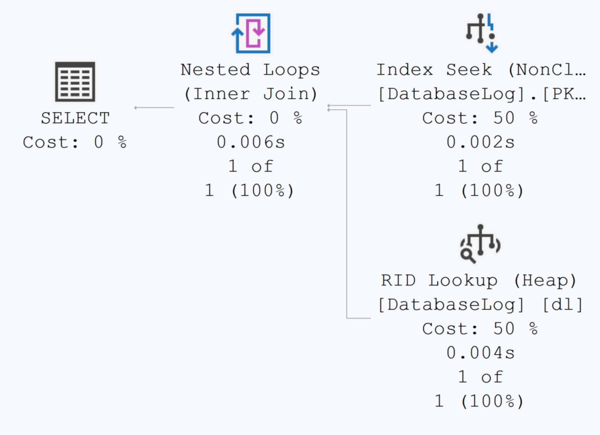

*Hình 9-14: Thao tác RID Lookup cần thiết để đáp ứng truy vấn (An RID lookup is needed to satisfy the query)*

Chỉ mục phi gom cụm (khóa chính) đã hỗ trợ câu truy vấn thông qua thao tác **Index Seek**. Tuy nhiên, vì dữ liệu cột `PostTime` không nằm trong chỉ mục, hai thao tác phụ trội bắt buộc phải xuất hiện: **RID Lookup** và **Nested Loops**. Toán tử `RID Lookup` đại diện cho việc optimizer phải điều hướng tới bảng heap để kéo dữ liệu còn thiếu về, và `Nested Loops` làm nhiệm vụ ghép nối dữ liệu từ hai nguồn lại với nhau.

Bây giờ, hãy so sánh với bảng `HumanResources.Department` — một bảng sở hữu chỉ mục gom cụm trên khóa chính — trong Listing 9-22.

**Listing 9-22. Truy vấn trên bảng có chỉ mục gom cụm (Querying a table stored on a clustered index)**

```sql
SELECT d.DepartmentID,
       d.ModifiedDate
FROM HumanResources.Department AS d
WHERE d.DepartmentID = 10;
```

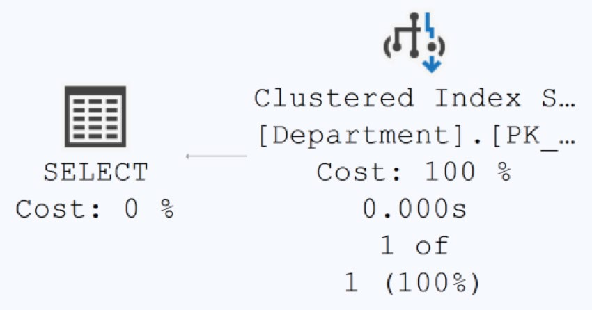

*Hình 9-15: Không cần thao tác tra cứu nào trên câu truy vấn này (No lookup required on this query)*

Cả hai truy vấn đều sử dụng khóa chính để tìm dòng tương ứng. Nhưng trên bảng có chỉ mục gom cụm, vì toàn bộ dữ liệu dòng được lưu trữ trực tiếp ngay tại trang lá của khóa, không cần thêm bất kỳ thao tác Lookup hay Nested Loops nào để hoàn tất câu truy vấn.

Mối quan hệ giữa hai loại chỉ mục này còn mang lại một lợi thế kiến trúc cực kỳ quan trọng:
* Hãy tưởng tượng một bảng có chỉ mục gom cụm đang chứa các dòng có giá trị khóa là 1, 2, 4, và 5. Khi một dòng mới với khóa là 3 được chèn vào, nếu trang dữ liệu không còn chỗ trống, hiện tượng **phân tách trang** (*page split*) sẽ diễn ra, khiến các dòng dữ liệu bị di chuyển sang một trang vật lý mới.
* Mặc dù các dòng dữ liệu đã bị di chuyển về mặt vật lý, **toàn bộ các chỉ mục phi gom cụm (nonclustered indexes) trên bảng hoàn toàn KHÔNG cần phải cập nhật lại con trỏ định vị dòng**. Con trỏ trong nonclustered index vẫn tiếp tục trỏ tới giá trị khóa logic của clustered index (`Clustering Key`), bất kể dòng dữ liệu thực tế đang nằm ở trang vật lý nào. Đây là một lợi thế khổng lồ giúp bảo vệ hiệu năng hệ thống khi một bảng sở hữu nhiều chỉ mục nonclustered.
* Ngược lại, trên bảng heap, khi một dòng bị di chuyển do cập nhật dữ liệu (`UPDATE`) làm phình to kích thước dòng vượt quá dung lượng trang, SQL Server sẽ phải tạo một **bản ghi chuyển tiếp** (*forwarding record*) tại vị trí cũ trỏ đến vị trí mới, làm phát sinh thêm nhiều thao tác I/O đọc đĩa không cần thiết.

### Các khuyến nghị thiết kế Clustered Index (Clustered Index Recommendations)

Từ các đặc tính kiến trúc nêu trên, bạn nên tuân thủ các nguyên tắc thiết kế sau đối với chỉ mục gom cụm:

#### 1. Tạo chỉ mục gom cụm trước tiên (Create the Clustered Index First)
Vì tất cả các chỉ mục nonclustered đều chứa khóa của clustered index bên trong các trang lá của chúng, thứ tự tạo chỉ mục có ảnh hưởng rất lớn đến hiệu năng:
* Nếu bạn tạo các chỉ mục nonclustered trước khi tạo clustered index, tất cả các con trỏ định vị dòng ban đầu sẽ trỏ tới địa chỉ RID của bảng heap. 
* Khi bạn tiến hành tạo clustered index sau đó, SQL Server buộc phải **xây dựng lại (rebuild) toàn bộ tất cả các chỉ mục nonclustered hiện có** trên bảng để thay thế địa chỉ RID bằng giá trị khóa của clustered index.

Do đó, hãy luôn tạo chỉ mục gom cụm trước khi tạo bất kỳ chỉ mục phi gom cụm nào.

#### 2. Giữ cho khóa chỉ mục gom cụm càng hẹp càng tốt (Keep Clustered Indexes Narrow)
Bởi vì mọi chỉ mục nonclustered đều phải mang theo giá trị khóa của clustered index, kích thước của khóa clustered index càng nhỏ thì hiệu năng tổng thể của toàn bộ hệ thống chỉ mục càng cao. Nếu bạn tạo một clustered index với kích thước khóa lên tới 500 bytes (ví dụ: `CHAR(500)`), bạn không chỉ làm giảm số dòng trên mỗi trang của clustered index mà còn gián tiếp làm phình to kích thước của **mọi chỉ mục nonclustered** trên bảng đó thêm 500 bytes trên mỗi dòng.

Chúng ta có thể kiểm chứng điều này qua Listing 9-23, Listing 9-24 và Listing 9-25.

**Listing 9-23. Tạo bảng thử nghiệm với khóa hẹp (Queries to create clustered and nonclustered indexes)**

```sql
IF
(
    SELECT OBJECT_ID('Test1')
) IS NOT NULL
    DROP TABLE dbo.Test1;
GO
CREATE TABLE dbo.Test1
(
    C1 INT,
    C2 INT
);
WITH Nums
AS (SELECT TOP (20)
           ROW_NUMBER() OVER (ORDER BY (SELECT 1)) AS n
    FROM MASTER.sys.all_columns ac1
        CROSS JOIN MASTER.sys.all_columns ac2)
INSERT INTO dbo.Test1
(
    C1,
    C2
)
SELECT n,
       n + 1
FROM Nums;
CREATE CLUSTERED INDEX iClustered ON dbo.Test1 (C2);
CREATE NONCLUSTERED INDEX iNonClustered ON dbo.Test1 (C1);
```

Chúng ta kiểm tra kích thước chiếm dụng của các chỉ mục bằng Listing 9-24.

**Listing 9-24. Đo lường kích thước chỉ mục trên bảng thử nghiệm (Getting the size of the indexes on the test table)**

```sql
SELECT i.NAME,
       i.type_desc,
       s.page_count,
       s.record_count,
       s.index_level
FROM sys.indexes i
    JOIN sys.dm_db_index_physical_stats(DB_ID(N'AdventureWorks'), OBJECT_ID(N'dbo.Test1'), NULL, NULL, 'DETAILED') AS s
        ON i.index_id = s.index_id
WHERE i.OBJECT_ID = OBJECT_ID(N'dbo.Test1');
```

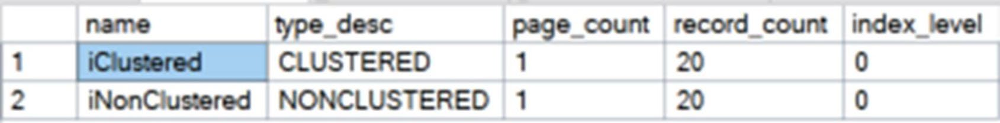

*Hình 9-16: Kích thước của các chỉ mục với khóa hẹp (The size of indexes with a narrow key)*

Bây giờ, chúng ta nới rộng kích thước của cột khóa `C2` từ `INT` (4 bytes) lên `CHAR(500)` (500 bytes) như trong Listing 9-25.

**Listing 9-25. Tăng kích thước cột khóa lên CHAR(500) (Adjusting the size of the column)**

```sql
DROP INDEX dbo.Test1.iClustered;
ALTER TABLE dbo.Test1 ALTER COLUMN C2 CHAR(500);
CREATE CLUSTERED INDEX iClustered ON dbo.Test1 (C2);
```

Sau đó chạy lại câu truy vấn đo lường trong Listing 9-24:

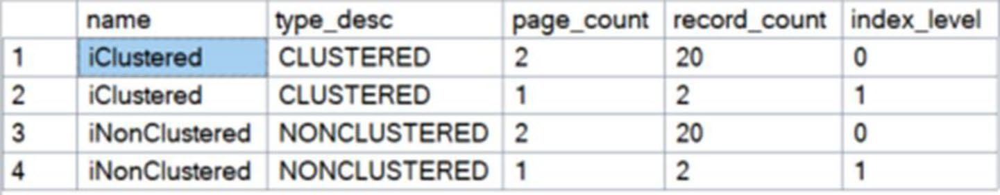

*Hình 9-17: Chỉ mục rộng hơn đồng nghĩa với việc tiêu tốn nhiều trang dữ liệu hơn (Wider indexes mean more pages)*

Chỉ một thay đổi nhỏ đối với kiểu dữ liệu của khóa clustered index đã khiến số lượng trang dữ liệu tăng lên đáng kể trên cả hai chỉ mục. Do đó, một khóa clustered index cồng kềnh sẽ gây ra những hệ lụy tiêu cực lan tỏa vượt xa ngoài phạm vi lưu trữ của chính nó.

#### 3. Tái tạo Clustered Index trong một bước nguyên tử (Rebuild the Clustered Index in a Single Step)
Nếu bạn cần tái tạo (rebuild) một chỉ mục gom cụm, việc chia thành hai câu lệnh riêng biệt `DROP INDEX` rồi sau đó `CREATE INDEX` sẽ khiến toàn bộ các chỉ mục nonclustered bị tái tạo tới **hai lần** (lần đầu chuyển về RID khi bảng thành heap, lần hai chuyển từ RID sang khóa clustered mới). 

Để tránh lãng phí tài nguyên này, hãy luôn sử dụng mệnh đề `WITH (DROP_EXISTING = ON)` trong câu lệnh `CREATE CLUSTERED INDEX`. Tùy chọn này đảm bảo quá trình tái tạo diễn ra trong một bước nguyên tử (atomic step) duy nhất và chỉ tác động đến các chỉ mục nonclustered đúng một lần.

#### 4. Luôn ưu tiên tạo Clustered Index có tính duy nhất (Where Possible, Make the Clustered Index Unique)
Vì chỉ mục gom cụm định hình cách lưu trữ vật lý của dữ liệu, mỗi dòng riêng biệt bắt buộc phải được định danh độc nhất. Khi bạn tạo một clustered index không duy nhất (`NONUNIQUE`), SQL Server sẽ buộc phải tự động thêm một giá trị phụ dài 4 bytes vào các dòng bị trùng lặp khóa, được gọi là **bộ định danh duy nhất** (*uniquifier*). Sự xuất hiện của uniquifier không chỉ làm tăng chi phí lưu trữ thêm 4 bytes trên mỗi dòng bị trùng mà còn làm phức tạp thêm việc quản lý con trỏ trong các chỉ mục nonclustered. Vì vậy, bất cứ khi nào có thể, hãy định nghĩa clustered index là `UNIQUE`.

### Khi nào nên sử dụng Clustered Index? (When to Use a Clustered Index)

Chỉ mục gom cụm phát huy hiệu quả cao nhất trong các tình huống sau:

#### 1. Truy cập trực tiếp toàn bộ dữ liệu dòng
Vì tất cả các cột của bảng đều hiện diện tại trang lá của clustered index, đây là con đường truy xuất dữ liệu toàn diện nhất. Bất cứ khi nào truy vấn cần lấy nhiều cột dữ liệu mà không thể bao phủ hết bởi một nonclustered index hẹp, clustered index sẽ giúp loại bỏ hoàn toàn các thao tác Lookup tốn kém.

#### 2. Truy xuất dữ liệu theo thứ tự sắp xếp sẵn (Retrieving Pre-sorted Data)
Clustered index cực kỳ hữu hiệu khi truy vấn yêu cầu dữ liệu trả về phải được sắp xếp theo một phạm vi giá trị (`BETWEEN`, `<`, `>`) kết hợp mệnh đề `ORDER BY`. Vì các dòng dữ liệu đã được lưu trữ vật lý theo đúng thứ tự đó trên đĩa, SQL Server có thể đọc trực tiếp các dòng mà hoàn toàn không cần phải thực hiện thao tác sắp xếp dữ liệu (Sort operator) trong bộ nhớ.

Chúng ta hãy kiểm chứng điều này qua Listing 9-26, 9-27 và 9-28.

**Listing 9-26. Tạo bảng dữ liệu thử nghiệm từ PurchaseOrderDetail (Building the od table from the PurchaseOrderDetail table)**

```sql
IF
(
    SELECT OBJECT_ID('od')
) IS NOT NULL
    DROP TABLE dbo.od;
GO
SELECT pod.PurchaseOrderID,
       pod.PurchaseOrderDetailID,
       pod.DueDate,
       pod.OrderQty,
       pod.ProductID,
       pod.UnitPrice,
       pod.LineTotal,
       pod.ReceivedQty,
       pod.RejectedQty,
       pod.StockedQty,
       pod.ModifiedDate
INTO dbo.od
FROM Purchasing.PurchaseOrderDetail AS pod;
```

Bảng `dbo.od` hiện tại là một bảng heap không có bất kỳ chỉ mục nào. Chúng ta thực thi câu truy vấn lấy dữ liệu theo khoảng và sắp xếp trong Listing 9-27.

**Listing 9-27. Truy xuất một dải dữ liệu lớn kèm sắp xếp (Retrieving a large range of rows)**

```sql
SELECT od.PurchaseOrderID,
       od.PurchaseOrderDetailID,
       od.DueDate,
       od.OrderQty,
       od.ProductID,
       od.UnitPrice,
       od.LineTotal,
       od.ReceivedQty,
       od.RejectedQty,
       od.StockedQty,
       od.ModifiedDate
FROM dbo.od
WHERE od.ProductID
BETWEEN 500 AND 510
ORDER BY od.ProductID;
```

Hiệu năng ban đầu ghi nhận: thời gian thực thi là **3.4 ms** và tiêu tốn **82 lượt đọc logic**.

Bây giờ, chúng ta tạo một chỉ mục gom cụm trên cột `ProductID` như trong Listing 9-28.

**Listing 9-28. Tạo chỉ mục gom cụm trên cột ProductID (Creating a clustered index on the table)**

```sql
CREATE CLUSTERED INDEX i1 ON od (ProductID);
```

Thực thi lại câu truy vấn trong Listing 9-27, hiệu năng thu được:
* Thời gian thực thi giảm xuống chỉ còn **988 microseconds** (giảm hơn 3 lần).
* Số lượt đọc logic giảm mạnh từ 82 xuống chỉ còn **8 reads** (giảm hơn 10 lần).

Việc dữ liệu đã được sắp xếp sẵn theo thứ tự vật lý giúp loại bỏ hoàn toàn chi phí sắp xếp và giúp việc đọc dữ liệu diễn ra liên tục, đạt tốc độ tối đa.

### Những thói quen thiết kế kém đối với Clustered Index (Poor Design Practices)

Mặc dù chỉ mục gom cụm có vai trò sống còn, việc thiết kế sai lầm có thể dẫn đến hậu quả nghiêm trọng:

#### 1. Đặt khóa Clustered Index trên các cột thường xuyên bị cập nhật (Frequently Updated Columns)
Nếu các cột cấu thành nên khóa của chỉ mục gom cụm thường xuyên bị cập nhật (`UPDATE`), điều này sẽ gây tác động tiêu cực trực tiếp đến hiệu năng:
* Khi một giá trị khóa clustered index bị thay đổi, dòng dữ liệu vật lý có thể phải di chuyển vị trí sang một trang khác.
* Quan trọng hơn, vì khóa clustered index đóng vai trò là con trỏ định vị dòng cho **tất cả** các chỉ mục nonclustered trên bảng, **mọi chỉ mục nonclustered đều bắt buộc phải được cập nhật lại con trỏ** tương ứng với mỗi thao tác sửa đổi khóa này.
* Điều này làm tiêu tốn một lượng tài nguyên khổng lồ và gây ra hiện tượng tắc nghẽn (blocking) nghiêm trọng trên hệ thống.

Chúng ta có thể kiểm chứng điều này trên bảng `Sales.SpecialOfferProduct` thông qua Listing 9-29.

**Listing 9-29. Cập nhật cột khóa trên bảng Sales.SpecialOfferProduct (Updating the key on the Sales.SpecialOfferProduct table)**

```sql
BEGIN TRAN;
SET STATISTICS IO ON;
UPDATE Sales.SpecialOfferProduct
SET ProductID = 720
WHERE SpecialOfferID = 1
      AND ProductID = 721;
SET STATISTICS IO OFF;
ROLLBACK TRAN;
```

Kết quả đo lường `STATISTICS IO`:
```
Table 'Product'. Scan count 0, logical reads 2
Table 'SalesOrderDetail'. Scan count 1, logical reads 1248
Table 'SpecialOfferProduct'. Scan count 0, logical reads 10
```

Bây giờ, chúng ta tạo thêm một chỉ mục nonclustered trên bảng này như trong Listing 9-30.

**Listing 9-30. Thêm một chỉ mục nonclustered vào bảng SpecialOfferProduct (Adding a nonclustered index to the SpecialOfferProduct table)**

```sql
CREATE NONCLUSTERED INDEX ixTest
ON Sales.SpecialOfferProduct (ModifiedDate);
```

Chạy lại câu lệnh `UPDATE` trong Listing 9-29, kết quả `STATISTICS IO` lúc này:
```
Table 'Product'. Scan count 0, logical reads 2
Table 'SalesOrderDetail'. Scan count 1, logical reads 1248
Table 'SpecialOfferProduct'. Scan count 0, logical reads 19
```

Số lượt đọc logic trên bảng `SpecialOfferProduct` đã tăng từ 10 lên **19 reads**, chỉ đơn thuần vì hệ thống phải thực hiện thêm thao tác cập nhật con trỏ trên chỉ mục nonclustered vừa tạo.

Trước khi tiếp tục, hãy xóa chỉ mục thử nghiệm bằng Listing 9-31.

**Listing 9-31. Xóa chỉ mục thử nghiệm (Dropping the ixTest index)**

```sql
DROP INDEX ixTest ON Sales.SpecialOfferProduct;
```

#### 2. Khóa Clustered Index quá rộng (Wide Keys)
Như đã chứng minh ở phần trước, khóa chỉ mục gom cụm càng rộng thì dung lượng của mọi chỉ mục nonclustered càng phình to, dẫn đến số dòng trên mỗi trang dữ liệu càng ít và tiêu tốn nhiều bộ nhớ RAM cũng như I/O đĩa hơn. Hãy luôn nỗ lực giữ cho kích thước các cột khóa chỉ mục gom cụm ở mức nhỏ nhất có thể.

---

### Chỉ mục không gom cụm (Nonclustered Indexes)

Khái niệm cốt lõi của một chỉ mục không gom cụm (nonclustered index) là cung cấp thêm các phương thức khác nhau để sắp xếp dữ liệu, từ đó mở ra nhiều khả năng tối ưu hơn cho việc truy xuất dữ liệu. Một nonclustered index hoàn toàn không làm thay đổi thứ tự vật lý của dữ liệu trên các trang bảng (table pages) bởi vì nó lưu trữ cấu trúc thông tin của mình tách biệt hoàn toàn khỏi phần còn lại của bảng. 

Một con trỏ định vị dòng (**row locator**) là thành phần bắt buộc để điều hướng từ một hàng của chỉ mục không gom cụm đến hàng dữ liệu thực tế:
- Đối với một bảng Heap (không có clustered index), row locator chính là mã định danh dòng (**RID** - Row Identifier).
- Đối với một bảng có Clustered Index, các cột khóa của clustered index sẽ đóng vai trò làm row locator.
- Khi bạn tạo một nonclustered index trên một bảng có chỉ mục columnstore gom cụm (clustered columnstore index), row locator là một giá trị 8-byte bao gồm mã nhóm dòng (`row_group_id`) của columnstore kết hợp với một giá trị độ lệch (offset).

### Bảo trì chỉ mục không gom cụm (Nonclustered Index Maintenance)

Trong một bảng dạng Heap (nơi không có clustered index), nhằm tối ưu chi phí bảo trì này khi xảy ra hiện tượng phân tách trang (page split), SQL Server sẽ thêm một con trỏ tại trang dữ liệu cũ để trỏ tới trang dữ liệu mới, thay vì phải đi cập nhật lại row locator của toàn bộ các chỉ mục không gom cụm liên quan. Mặc dù điều này giúp giảm bớt chi phí bảo trì cho nonclustered index, nó lại làm gia tăng chi phí điều hướng từ hàng chỉ mục tới hàng dữ liệu thực tế bên trong heap, do một liên kết trung gian phụ đã được thêm vào giữa trang cũ và trang mới. Do đó, việc sở hữu một clustered index đóng vai trò làm row locator sẽ giúp giảm thiểu đáng kể chi phí phụ trội này đối với các nonclustered index.

Khi bảng dữ liệu là một clustered columnstore index, vị trí lưu trữ thực tế của dữ liệu sẽ liên tục thay đổi khi chỉ mục được rebuild và dữ liệu được di chuyển từ vùng đệm **deltastore** sang vùng lưu trữ nén (**compressed storage**). Điều này đáng lẽ sẽ dẫn đến hàng loạt sự cố sai lệch vị trí, nếu không nhờ một chức năng cải tiến mới bên trong clustered columnstore index: thiết lập một bảng ánh xạ giữa vị trí mà nonclustered index cho rằng dữ liệu đang nằm ở đó với vị trí thực tế của dữ liệu. Cơ chế này được gọi là **Chỉ mục ánh xạ** (**Mapping Index**). Các giá trị sẽ được cập nhật vào Mapping Index mỗi khi vị trí dữ liệu thay đổi bên trong clustered columnstore. Cơ chế này có thể làm chậm lại một chút việc sử dụng nonclustered index khi dữ liệu bảng được chứa trong một clustered columnstore.

### Định nghĩa thao tác tra cứu (Defining the Lookup Operation)

Khi một câu truy vấn yêu cầu các cột không nằm trong nonclustered index được Query Optimizer lựa chọn, một thao tác tra cứu (**lookup**) là bắt buộc:
- Đó có thể là một thao tác **Key Lookup** khi truy vấn trên một bảng có clustered index (dù là rowstore hay columnstore).
- Hoặc một thao tác **RID Lookup** khi được thực hiện trên một bảng heap.

Thao tác tra cứu sẽ tìm và nạp hàng dữ liệu tương ứng từ bảng chính bằng cách đi theo giá trị con trỏ row locator từ hàng chỉ mục. Quá trình này đòi hỏi phải phát sinh thêm các lượt đọc logic (logical reads) trên trang dữ liệu bên cạnh các lượt đọc trên trang chỉ mục, cùng với một thao tác nối (`JOIN`) để kết hợp dữ liệu lại thành tập kết quả chung. 

Tuy nhiên, nếu toàn bộ các cột mà câu truy vấn yêu cầu đều có sẵn ngay bên trong bản thân chỉ mục đó, thì việc truy cập vào trang dữ liệu của bảng chính sẽ hoàn toàn không cần thiết. Một chỉ mục đáp ứng được điều này được gọi là **chỉ mục bao phủ** (**covering index**).

Những thao tác tra cứu (lookups) này chính là lý do vì sao các tập kết quả lớn thường được phục vụ tốt hơn rất nhiều bởi một clustered index. Một clustered index không bao giờ đòi hỏi thao tác lookup, vì các trang lá (leaf pages) và các trang dữ liệu (data pages) của clustered index chính là một. Chúng ta sẽ phân tích sâu hơn về lookups trong Chương 11.

### Các khuyến nghị cho Nonclustered Index (Nonclustered Index Recommendations)

Chỉ mục không gom cụm sinh ra là để mang lại sự linh hoạt tối đa cho việc truy xuất dữ liệu của bạn. Trong khi bạn chỉ có thể có duy nhất một clustered index trên mỗi bảng, bạn có thể tạo ra nhiều nonclustered index. Dẫu vậy, lời khuyên là hãy giữ số lượng này ở mức tối thiểu cần thiết vì chúng luôn đi kèm chi phí bảo trì khi sửa đổi dữ liệu.

#### Khi nào nên sử dụng Nonclustered Index

Một nonclustered index phát huy hiệu quả cao nhất khi nhu cầu của bạn chỉ là **truy xuất một số lượng nhỏ các hàng và các cột từ một bảng lớn**. Khi số lượng cột cần lấy tăng lên, khả năng tạo một chỉ mục bao phủ (covering index) sẽ giảm xuống. Sau đó, nếu bạn cũng đồng thời truy xuất một số lượng lớn các hàng, chi phí phụ trội của các thao tác lookup sẽ tăng lên theo tỷ lệ thuận. Để lấy ra một số lượng nhỏ các dòng từ bảng, cột được đánh chỉ mục cần phải có **độ chọn lọc cao** (**high selectivity**).

Hơn nữa, sẽ có những trường hợp không phù hợp để tạo clustered index nhưng lại rất lý tưởng cho nonclustered index:
- **Các cột thường xuyên bị cập nhật (Frequently updatable columns)**: Việc tạo nonclustered index trên một cột thường xuyên cập nhật không tốn kém bằng việc đặt clustered index trên cột đó. Mặc dù vẫn có chi phí phát sinh, nhưng chi phí đó đã được giảm thiểu đáng kể vì thao tác `UPDATE` chỉ giới hạn trên bảng gốc và chính nonclustered index đó, mà không làm ảnh hưởng đến các nonclustered index khác trên bảng.
- **Các khóa rộng (Wide keys)**: Một nonclustered index trên một cột rộng (hoặc tập hợp nhiều cột rộng) không làm tăng kích thước của bất kỳ chỉ mục nào khác, không giống như clustered index. Dẫu vậy, bạn vẫn phải luôn cẩn trọng vì việc này có thể làm tăng chi phí của các thao tác ghi dữ liệu (`INSERT`, `UPDATE`, `DELETE`).

#### Khi nào không nên sử dụng Nonclustered Index

Chỉ mục không gom cụm **không phù hợp cho các truy vấn lấy ra một lượng lớn các hàng** (tính theo tỷ lệ phần trăm kích thước của bảng). Những truy vấn như vậy sẽ được phục vụ tối ưu hơn bởi một clustered index — vốn không yêu cầu thao tác lookup tách rời để lấy hàng dữ liệu. 

Vì một thao tác lookup đòi hỏi các lượt đọc logic bổ sung để chạm tới trang dữ liệu bên cạnh lượt đọc trên trang chỉ mục, chi phí của truy vấn sử dụng nonclustered index sẽ tăng vọt đối với các tập dữ liệu lớn (chẳng hạn như khi nằm trong một vòng lặp nối Nested Loops đòi hỏi thực hiện lookup liên tục hết dòng này đến dòng khác). Query Optimizer nhận thức rất rõ chi phí này và có thể chủ động loại bỏ nonclustered index khi cần truy xuất tập kết quả lớn. 

Ngoài ra, nonclustered index cũng không tối ưu bằng columnstore index đối với các truy vấn dạng phân tích (analytics-style) đòi hỏi tính toán nhiều phép tổng hợp (aggregates).

Nếu yêu cầu của bạn là phải trích xuất một tập kết quả lớn từ bảng, việc sở hữu một nonclustered index trên cột điều kiện lọc (hoặc điều kiện `JOIN`) rất có thể sẽ không mang lại giá trị, trừ khi bạn sử dụng một loại nonclustered index đặc biệt được gọi là **chỉ mục bao phủ** (**covering index**).

---

## Hành vi của Columnstore Index (Columnstore Index Behavior)

Chúng ta đã tìm hiểu về cơ chế tổ chức lưu trữ của chỉ mục columnstore, nhưng chưa quan sát chúng hoạt động trong thực tế. Hãy bắt đầu với một truy vấn phân tích tổng hợp trên các bảng `BigAdventure` đã được tạo từ trước (Listing 9-32).

**Listing 9-32.** Truy vấn tổng hợp trên các bảng BigAdventure

```sql
SELECT bp.Name AS ProductName,
       COUNT(bth.ProductID),
       SUM(bth.Quantity),
       AVG(bth.ActualCost)
FROM dbo.bigProduct AS bp
    JOIN dbo.bigTransactionHistory AS bth
        ON bth.ProductID = bp.ProductID
GROUP BY bp.Name;
```

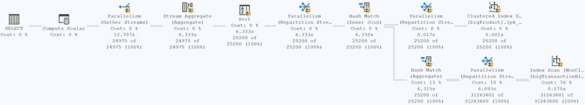

*Hình 9-18: Kế hoạch thực thi cho truy vấn tổng hợp khi chưa có columnstore index (Execution plan for an aggregate query without columnstore indexes)*

Bởi vì câu truy vấn trong Listing 9-32 không có bất kỳ điều kiện lọc nào, hệ thống buộc phải quét toàn bộ các bảng để lấy dữ liệu. Nhiều toán tử phức tạp khác — bao gồm hai toán tử **Stream Aggregate** tách biệt — là bắt buộc để gom nhóm và tính toán các hàm `SUM`, `COUNT` và `AVG`. Bạn cũng có thể nhận thấy các biểu tượng vòng tròn màu vàng nhỏ trên hầu hết các toán tử: kế hoạch này đã chuyển sang chạy song song (parallel plan).

Các chỉ số đo lường đọc đĩa chi tiết từ `STATISTICS IO` cho thấy khối lượng thông tin khổng lồ cần xử lý:
```text
Table 'bigTransactionHistory'. Scan count 1, logical reads 132815
Table 'bigProduct'. Scan count 1, logical reads 629
Table 'Worktable'. Scan count 0, logical reads 0
Table 'Worktable'. Scan count 0, logical reads 0
```
Thời gian thực thi trung bình là **4,8 giây**. Tóm lại, đây là một câu truy vấn tiêu tốn cực kỳ nhiều tài nguyên. Chúng ta có thể chuyển đổi bảng sang dạng clustered columnstore, nhưng vì hành vi chung rất tương đồng, tôi sẽ sử dụng câu lệnh trong Listing 9-33 để tạo một **chỉ mục columnstore không gom cụm** (**nonclustered columnstore index**) trên bảng `bigTransactionHistory`.

**Listing 9-33.** Tạo chỉ mục columnstore đầu tiên

```sql
CREATE NONCLUSTERED COLUMNSTORE INDEX ix_csTest
ON dbo.bigTransactionHistory (
                                 ProductID,
                                 Quantity,
                                 ActualCost
                             );
```

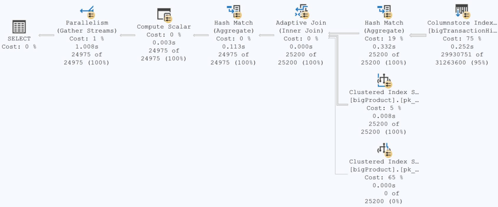

*Hình 9-19: Chỉ mục columnstore trong kế hoạch thực thi (Columnstore indexes in an execution plan)*

Có một loạt hành vi hoàn toàn mới xuất hiện ở đây. Trước khi phân tích sâu, hãy cùng xem các chỉ số `STATISTICS IO` và thời gian thực thi mới:
```text
Table 'bigTransactionHistory'. Scan count 40, logical reads 0
Table 'bigTransactionHistory'. Segment reads 49
Table 'bigProduct'. Scan count 21, logical reads 629
Table 'Worktable'. Scan count 0, logical reads 0
Table 'Worktable'. Scan count 0, logical reads 0
```
Thời gian thực thi trung bình chỉ còn **409 mili giây**!

Để nhấn mạnh sự đột phá này: chúng ta đã rút ngắn thời gian xử lý từ 4,8 giây xuống chỉ còn 409 mili giây để trả về 24.975 hàng. Không kể đến sự cắt giảm mạnh mẽ về số lượt đọc dữ liệu, tốc độ đã **nhanh hơn xấp xỉ 12 lần**!

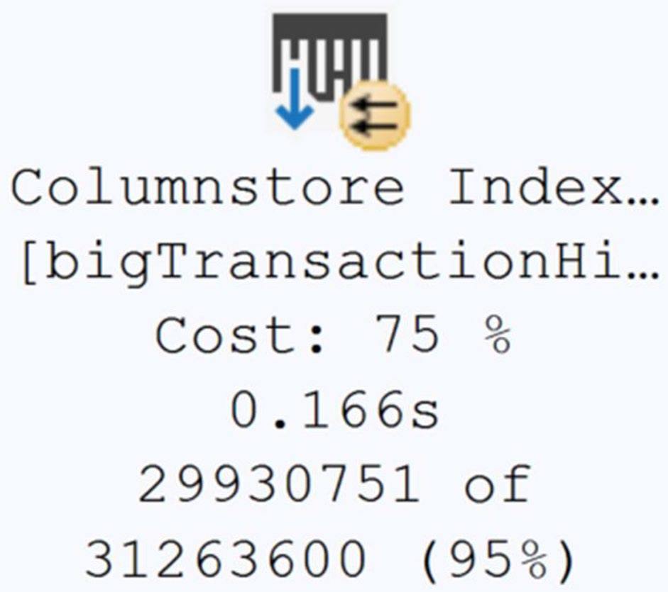

*Hình 9-20: Toán tử Columnstore Index Scan trên bảng bigTransactionHistory (Columnstore Index Scan of bigTransactionHistory)*

Toán tử **Columnstore Index Scan** là một toán tử mới được giới thiệu dành riêng cho chỉ mục columnstore. Nó thể hiện rất nhiều chức năng xử lý tối ưu hóa nội bộ. Bạn có thể thấy kế hoạch này cũng chạy song song với các biểu tượng mũi tên màu vàng.

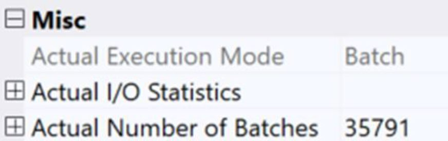

*Hình 9-21: Chế độ xử lý theo lô (Batch Mode) và số lượng lô (Batch-mode processing and the number of batches)*

Trước SQL Server 2019, chế độ xử lý theo lô (**Batch Mode**) chỉ khả dụng cho các chỉ mục columnstore. Kể từ SQL Server 2019 trở đi, các chỉ mục rowstore thông thường cũng có thể hưởng lợi từ chế độ Batch Mode trên rowstore (sẽ được tìm hiểu trong Chương 10).

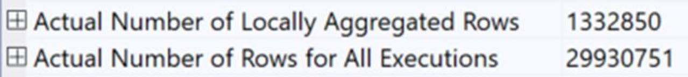

*Hình 9-22: Hiển thị thuộc tính Locally Aggregated Rows (Showing the Locally Aggregated Rows)*

Thuộc tính **Actual Number of Locally Aggregated Rows** cho thấy có tới **1.332.850 hàng** đã được tính toán tổng hợp ngay trong lúc dữ liệu đang được đọc lên từ các phân đoạn lưu trữ (cơ chế **Pushdown Aggregation** - đẩy phép tính tổng hợp xuống tầng lưu trữ). Hành vi này là một cải tiến hiệu năng vượt bậc khác của columnstore index nhằm phục vụ các truy vấn phân tích.

Khi thiết kế chỉ mục columnstore, một nguyên tắc thực hành tối ưu là: **hãy đưa bất kỳ cột nào bạn có khả năng truy vấn đến vào trong chỉ mục columnstore**. Điều này hoàn toàn không giống với việc lựa chọn cột khóa trong chỉ mục rowstore thông thường.

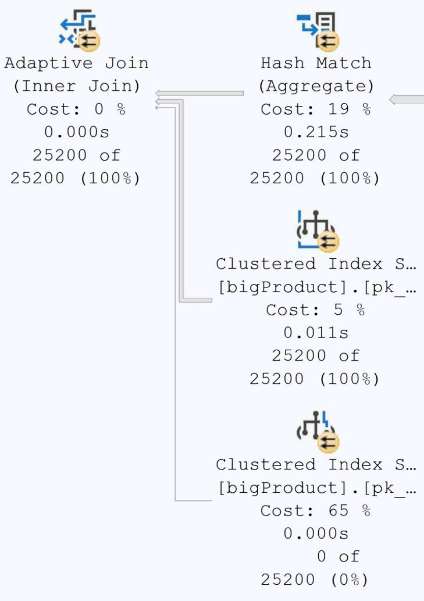

*Hình 9-23: Toán tử Adaptive Join trong thực thi (The Adaptive Join operator)*

Toán tử Phép nối thích ứng (**Adaptive Join**) là một phần thuộc bộ tính năng Tinh chỉnh thông minh (Intelligent Query Processing - IQP, sẽ phân tích chi tiết trong Chương 21). Đối với các tập dữ liệu lớn, phép nối Nested Loops hoạt động rất kém; nhưng đối với các tập dữ liệu rất nhỏ, phép nối Hash Join lại gây lãng phí tài nguyên. Toán tử Adaptive Join sẽ tự động thiết lập một ngưỡng dữ liệu động dựa trên số liệu thống kê. Nếu số dòng thực tế nằm dưới ngưỡng đó, hệ thống sẽ thực thi theo phép nối **Nested Loops**; nếu vượt qua ngưỡng, hệ thống sẽ chuyển sang thực thi theo phép nối **Hash Join**.

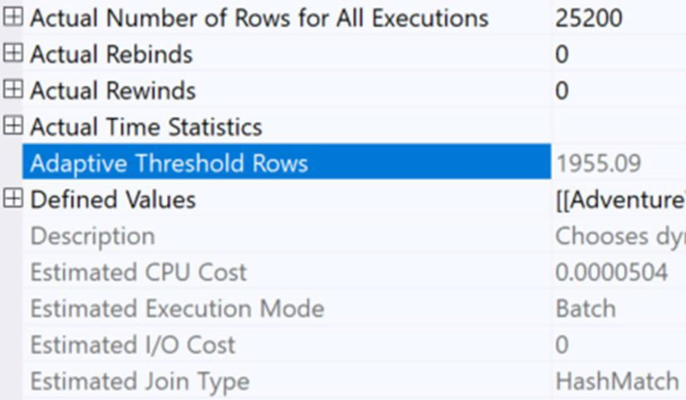

*Hình 9-24: Cửa sổ thuộc tính của toán tử Adaptive Join (Properties of the Adaptive Join operator)*

Một điểm quan trọng khác rút ra từ câu truy vấn này: bạn hoàn toàn có thể kết hợp linh hoạt cả bảng/chỉ mục columnstore và bảng/chỉ mục rowstore trong cùng một câu truy vấn duy nhất. Query Optimizer sẽ đưa ra những lựa chọn tối ưu thích hợp nhất cho từng đối tượng.

### Các khuyến nghị khi sử dụng Columnstore Index (Columnstore Recommendations)

Cần nhắc lại một nguyên tắc cốt lõi: **chỉ mục columnstore đạt hiệu quả cao nhất cho các truy vấn phân tích quy mô lớn**. Nếu khối lượng công việc của bạn mang đặc thù OLTP (giao dịch tức thời), chỉ mục rowstore truyền thống sẽ phục vụ bạn tốt hơn.

Bởi vì bạn có thể tạo nonclustered rowstore index trên một bảng clustered columnstore, và ngược lại có thể tạo nonclustered columnstore index trên một bảng clustered rowstore, bạn hoàn toàn có thể linh hoạt xử lý các tình huống nghiệp vụ ngoại lệ theo cả hai chiều. 

Mặc dù bạn sẽ gặt hái được lợi ích lớn nhất từ columnstore index khi bảng dữ liệu vượt qua ngưỡng kích thước **102.400 hàng** của một rowgroup, các bảng nhỏ hơn vẫn có thể nhận được một số lợi ích nhất định tùy thuộc vào kiểu truy vấn.

Dưới đây là một số lưu ý quan trọng khi vận hành chỉ mục columnstore:
- **Nạp dữ liệu theo lô lớn**: Hãy nạp dữ liệu vào columnstore trong một giao dịch duy nhất hoặc theo các lô có quy mô lớn hơn 102.400 dòng để dữ liệu đi thẳng vào các rowgroup nén (compressed rowgroups), tránh việc đổ vào deltastore.
- **Hạn chế cập nhật nhỏ lẻ**: Giảm thiểu tối đa các thao tác cập nhật nhỏ lẻ từng dòng bên trong columnstore nhằm tránh chi phí xử lý phụ trội trên deltastore.
- **Lên kế hoạch Rebuild chỉ mục định kỳ**: Lên lịch bảo trì rebuild định kỳ cho cả clustered và nonclustered columnstore index để dọn dẹp triệt để các hàng đã bị xóa khỏi rowgroup và chuyển dữ liệu đã sửa đổi từ deltastore vào các rowgroup nén vĩnh viễn.
- **Duy trì số liệu thống kê chuẩn xác**: Quản trị số liệu thống kê trên columnstore index tương tự như cách bạn làm với rowstore index. Dù giao diện hiển thị của chúng có phần khác biệt, chúng vẫn bắt buộc phải được bảo trì thường xuyên.

---

## Gợi ý chỉ mục bị thiếu (Missing Indexes)

Điều này có thể đã xuất hiện trong một số kế hoạch thực thi trước đó trong sách, nhưng hãy cùng xem xét câu truy vấn trong Listing 9-34.

**Listing 9-34.** Một câu truy vấn đang cần thêm chỉ mục

```sql
SELECT a.AddressID,
       a.AddressLine1,
       a.AddressLine2,
       a.City,
       sp.Name AS StateProvinceName,
       a.PostalCode
FROM Person.Address AS a
    JOIN Person.StateProvince AS sp
        ON a.StateProvinceID = sp.StateProvinceID
WHERE a.City = 'London';
```

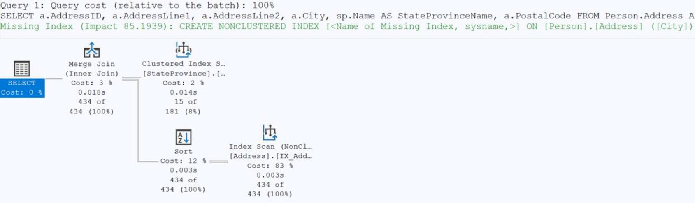

*Hình 9-25: Kế hoạch thực thi hiển thị gợi ý Missing Index (An execution plan with a Missing Index suggestion)*

Ngay bên dưới phần câu lệnh truy vấn ở góc trên cùng của kế hoạch thực thi, bạn có thể quan sát thấy đoạn văn bản màu xanh lá cây sau:
```text
Missing Index (Impact 85.1939): CREATE NONCLUSTERED INDEX [<Name of Missing Index, sysname,>] ON [Person].[Address] ([City])
```
Đây chính là một **gợi ý chỉ mục bị thiếu** (**Missing Index suggestion**) do Query Optimizer tự động đưa ra. Tùy thuộc vào câu truy vấn cụ thể, trình tối ưu hóa có thể đưa ra nhiều gợi ý khác nhau để cải thiện hiệu năng. Đầu tiên, nó ước tính mức độ tác động tiềm năng lên hiệu năng nếu chỉ mục này được tạo ra (ở đây là **85,1939%**). Sau đó, nó định nghĩa cấu trúc chỉ mục đề xuất kèm theo một tên tạm thời để bạn đặt tên sau.

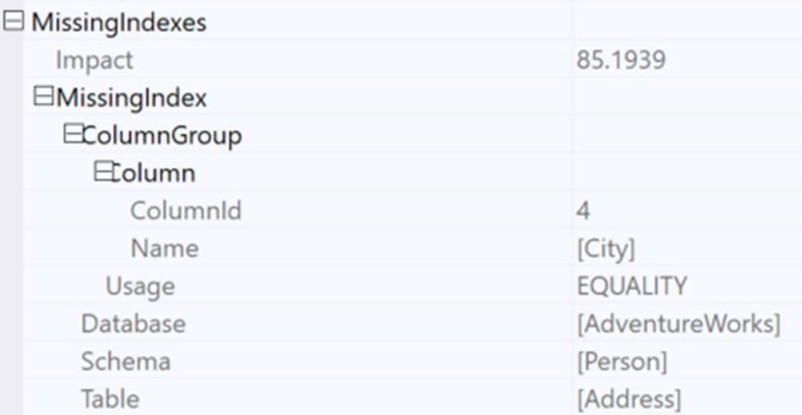

*Hình 9-26: Cửa sổ thuộc tính của Missing Index trong kế hoạch thực thi (The Missing Index properties in an execution plan)*

Có một số điểm cực kỳ quan trọng tôi cần phải nhấn mạnh về các gợi ý Missing Index này:

1. **Quan trọng nhất: Chúng chỉ là những gợi ý mang tính tham khảo**, tuyệt đối không phải là mệnh lệnh bắt buộc hay yêu cầu kỹ thuật cứng. Tôi thường sử dụng thông tin Missing Index như một điểm xuất phát gợi ý ban đầu khi tinh chỉnh truy vấn, nhưng tôi tuyệt đối không bao giờ nhắm mắt tạo ngay chỉ mục mỗi khi hệ thống đề xuất.
2. **Query Optimizer không phải lúc nào cũng đưa ra lựa chọn chỉ mục tốt nhất**: Nó sẽ không bao giờ gợi ý một chỉ mục duy nhất (Unique Index) — dù điều đó có thể mang lại cải thiện hiệu năng khổng lồ — bởi vì tính duy nhất còn liên quan đến ràng buộc toàn vẹn dữ liệu nghiệp vụ. Trình tối ưu hóa cũng không xem xét đến các chỉ mục hiện có trên bảng để kết hợp hoặc chỉnh sửa, và nó cũng sẽ không bao giờ gợi ý tạo chỉ mục columnstore.
3. **Luôn luôn đổi tên chỉ mục**: Số lần tôi bắt gặp các cơ sở dữ liệu trên môi trường thực tế tồn tại những chỉ mục có tên nguyên xi là `[<Name of Missing Index, sysname>]` là nhiều đến mức đáng báo động! Sau đó, người ta lại tiếp tục tạo ra các chỉ mục trùng tên như `[<Name of Missing Index, sysname>1]`, `[<Name of Missing Index, sysname>2]`,... Hãy luôn đặt cho chỉ mục một cái tên chuẩn mực theo quy ước của dự án.
4. **Cảnh giác với truy vấn chạy một lần**: Gợi ý Missing Index hoàn toàn có thể sinh ra từ một câu truy vấn ad hoc do ai đó chạy thử nghiệm duy nhất một lần rồi không bao giờ chạy lại nữa. Việc vội vàng tạo chỉ mục theo gợi ý đó sẽ để lại một chỉ mục thừa thãi, không bao giờ được dùng đến và trực tiếp làm chậm các thao tác ghi dữ liệu của hệ thống.

Hãy luôn ghi nhớ: Thông tin Missing Index không gì hơn ngoài một gợi ý từ trình tối ưu hóa. Hãy đối xử với nó đúng với bản chất đó!

---

## Tóm tắt chương (Summary)

Trong chương này, tôi đã giới thiệu tới bạn hai loại chỉ mục chủ đạo trong SQL Server: **Rowstore** và **Columnstore**. Tôi cũng đã dẫn dắt bạn qua tầm quan trọng của việc thấu hiểu sâu sắc cách thức dữ liệu đang được truy vấn nhằm giúp bạn lựa chọn đúng cơ chế lưu trữ phù hợp nhất cho dữ liệu của mình. 

Chúng ta đã cùng nhau khám phá những điểm mạnh, điểm yếu của từng loại chỉ mục và cách thức chúng phối hợp nhịp nhàng với nhau để hỗ trợ bạn lưu trữ và truy xuất dữ liệu một cách tối ưu nhất. Cuối cùng, chúng ta đã phân tích cách các loại chỉ mục này tác động trực tiếp đến hiệu năng truy vấn — cả ở mặt tích cực lẫn những chi phí phụ trội tiêu cực phát sinh khi lạm dụng.

Trong chương tiếp theo, chúng ta sẽ tiếp tục hành trình khám phá về chỉ mục: tìm hiểu những tinh chỉnh chuyên sâu đối với hành vi của chỉ mục cũng như một số loại hình chỉ mục chuyên biệt khác có sẵn trong SQL Server.