# CHƯƠNG 10: Các hành vi của Chỉ mục (Index Behaviors)

> **Thông tin sách gốc:**  
> © Grant Fritchey 2026  
> G. Fritchey, *SQL Server 2025 Query Performance Tuning*, https://doi.org/10.1007/979-8-8688-1865-3_10  

---

Trong chương trước, tôi đã giới thiệu các cấu trúc chỉ mục cốt lõi bên trong SQL Server, bao gồm cả Rowstore và Columnstore, dạng cụm (clustered) và không cụm (nonclustered). Chương này sẽ tiếp nối nền tảng đó để mô tả các chức năng và hành vi nâng cao liên quan đến chỉ mục. Tôi cũng sẽ giới thiệu một số kiểu chỉ mục mới trong chương này, đồng thời phân tích hàng loạt các thiết lập cấu hình chỉ mục có ảnh hưởng trực tiếp đến hành vi của chúng.

Cụ thể, trong chương này, tôi sẽ đề cập đến các chủ đề sau:
* Chỉ mục bao phủ (Covering indexes)
* Giao cắt chỉ mục (Index intersection)
* Phép nối chỉ mục (Index joins)
* Chỉ mục có bộ lọc (Filtered indexes)
* Khung nhìn có chỉ mục (Indexed views)
* Các đặc tính và tham số cấu hình chỉ mục (Index characteristics)
* Các kiểu chỉ mục đặc thù (Special index types)

---

## Chỉ mục Bao phủ (Covering Indexes)

Một **Chỉ mục Bao phủ (Covering Index)** là một chỉ mục nonclustered chứa đầy đủ tất cả các cột dữ liệu cần thiết để thỏa mãn hoàn toàn một câu truy vấn cụ thể, mà SQL Server không cần phải thực hiện thêm bất kỳ thao tác tra cứu nào về bảng Heap hay Clustered Index gốc (**không phát sinh Lookup**). Chúng ta đã gặp một số ví dụ về chỉ mục bao phủ ở các chương trước.

Hãy xem xét câu truy vấn trong Listing 10-1; cấu trúc sẵn có của bảng `Person.Address` trong AdventureWorks chưa có một chỉ mục bao phủ cho câu lệnh này:

```sql
-- Listing 10-1. A query that does not have a covering index
SELECT A.PostalCode
FROM Person.ADDRESS AS A
WHERE A.StateProvinceID = 42;
```

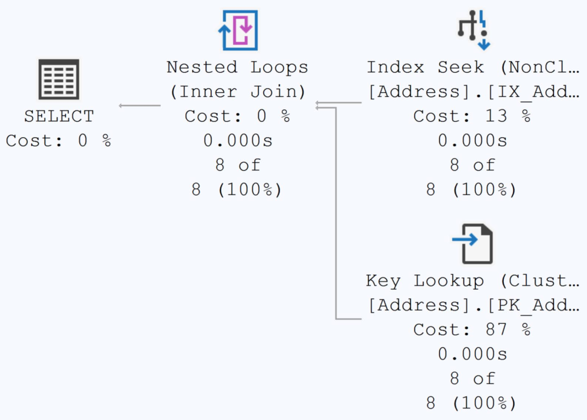  
*Hình 10-1. Kế hoạch thực thi cho truy vấn khi thiếu chỉ mục bao phủ (phát sinh Key Lookup)*

Các thông số đo lường:
* Thời gian thực thi trung bình: **316 microseconds**
* Số lần đọc logic: **19 reads**

Đây là một ví dụ kinh điển về truy vấn phát sinh thao tác tra cứu: toán tử **Key Lookup** phải đọc dữ liệu cột `PostalCode` từ Clustered Index gốc, sau đó kết nối với kết quả tìm kiếm từ toán tử **Index Seek** trên chỉ mục `IX_Address_StateProvinceID` thông qua vòng lặp lồng nhau (Nested Loops). 

Để biến chỉ mục này thành một chỉ mục bao phủ hoàn hảo, nó bắt buộc phải chứa thêm cột `PostalCode`:
1. **Thêm vào Khóa chỉ mục (Index Key):** Việc đưa cột vào khóa sẽ làm thay đổi cấu trúc cây B-Tree cơ bản của chỉ mục.
2. **Thêm vào tầng lá bằng mệnh đề `INCLUDE`:** Việc đưa cột vào tầng lá (Leaf level) thông qua `INCLUDE` chỉ làm tăng nhẹ kích thước ở tầng lá mà không làm phình to các tầng nhánh trung gian và không ảnh hưởng đến thứ tự sắp xếp của cây chỉ mục.

Listing 10-2 minh họa cách tái tạo chỉ mục với mệnh đề `INCLUDE`:

```sql
-- Listing 10-2. Recreating the IX_Address_StateProvinceID index
CREATE NONCLUSTERED INDEX IX_Address_StateProvinceID
ON Person.ADDRESS (StateProvinceID ASC)
INCLUDE (PostalCode)
WITH (DROP_EXISTING = ON);
```

Chạy lại câu truy vấn trong Listing 10-1 sau khi đã có chỉ mục bao phủ:

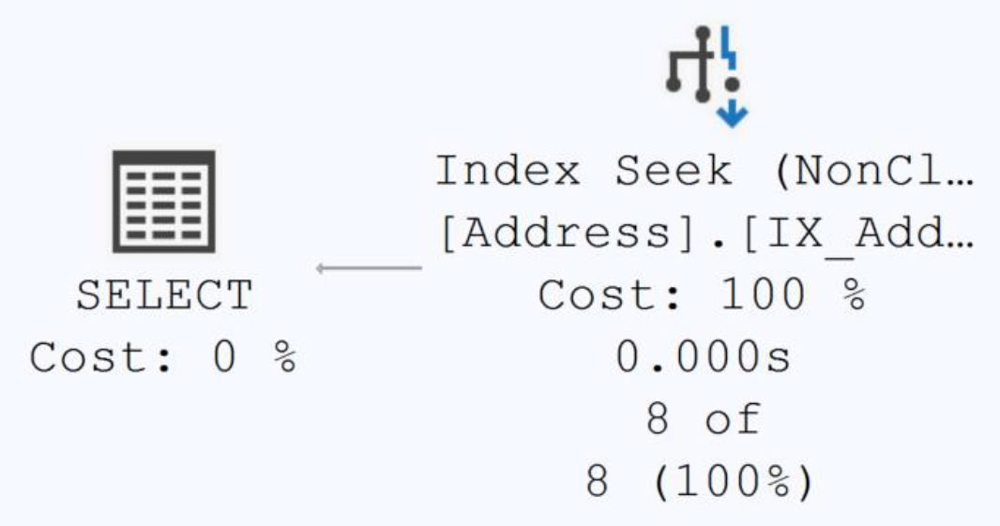  
*Hình 10-2. Kế hoạch thực thi chỉ tham chiếu duy nhất chỉ mục nonclustered (loại bỏ hoàn toàn Key Lookup)*

Các thông số đo lường sau khi tối ưu:
* Thời gian thực thi giảm một nửa: **167 microseconds**
* Số lần đọc logic giảm ngoạn mục từ 19 xuống: **2 reads**!

Toán tử Key Lookup đã biến mất hoàn toàn. Kế hoạch thực thi lúc này chỉ cần thực hiện duy nhất một thao tác Index Seek trực tiếp trên chỉ mục nonclustered. 

Việc sử dụng mệnh đề `INCLUDE` phát huy hiệu quả tối đa vì cột `PostalCode` chỉ xuất hiện trong danh sách `SELECT` chứ không tham gia vào các điều kiện lọc `WHERE`, `JOIN` hay `HAVING`. Nếu cột này cần tham gia lọc, bạn mới nên cân nhắc đưa nó vào danh sách các cột khóa chính thức của chỉ mục.

Trước khi tiếp tục, hãy khôi phục lại cấu trúc chỉ mục ban đầu bằng Listing 10-3:

```sql
-- Listing 10-3. Reverting the index to its previous shape
CREATE NONCLUSTERED INDEX IX_Address_StateProvinceID
ON Person.ADDRESS (StateProvinceID ASC)
WITH (DROP_EXISTING = ON);
```

---

### Khái niệm Chỉ mục Tựa Cụm (A Pseudoclustered Index)

Một chỉ mục bao phủ sắp xếp dữ liệu vật lý của các cột khóa theo thứ tự tuần tự nghiêm ngặt. Bất kỳ dữ liệu nào được đưa thêm vào tầng lá thông qua mệnh đề `INCLUDE` cũng sẽ tự động được sắp xếp theo các cột khóa đó. 

Điều này đồng nghĩa với việc: đối với một câu truy vấn cụ thể mà chỉ mục đó bao phủ trọn vẹn, nó hoạt động **hoàn toàn tương đương với một Clustered Index chuyên biệt cho riêng truy vấn đó** (gọi là *Pseudoclustered Index*). Trong nhiều tình huống, bạn thậm chí sẽ thấy một chỉ mục bao phủ mang lại hiệu năng vượt trội hơn cả Clustered Index gốc – ngay cả khi câu lệnh đòi hỏi dữ liệu phải được sắp xếp (`ORDER BY`) – bởi vì chỉ mục bao phủ nonclustered có kích thước bản ghi nhỏ gọn hơn rất nhiều, giúp nhét được nhiều dòng hơn trên mỗi trang 8KB.

Ngược lại, về mặt lý thuyết, bạn có thể biến một nonclustered index thành một bản sao cụm hoàn chỉnh bằng cách nhét tất cả các cột của bảng vào mệnh đề `INCLUDE`. Tuy nhiên, điều này sẽ tạo ra một chi phí phát sinh (overhead) vô cùng khủng khiếp: bất kỳ thao tác sửa đổi dữ liệu trên bất kỳ cột nào cũng sẽ buộc hệ thống phải cập nhật trên cả hai cấu trúc chỉ mục, gây suy giảm nghiêm trọng hiệu năng ghi!

---

### Các Khuyến nghị về Chỉ mục Bao phủ

Nguyên tắc vàng kinh điển khi viết truy vấn là: **Chỉ lấy đúng những dữ liệu bạn thực sự cần** – đó là lý do vì sao cộng đồng luôn kịch liệt phản đối thói quen dùng `SELECT *`. 

Nguyên tắc tương tự cũng áp dụng cho việc thiết kế chỉ mục bao phủ:
* Hãy luôn cân nhắc và chọn lọc kỹ lưỡng từng cột bạn muốn đưa vào chỉ mục (dù ở khóa chính hay qua `INCLUDE`).
* Nếu bạn đưa cột vào khóa chính của chỉ mục, bạn đang làm chỉ mục rộng ra, khiến số dòng trên mỗi trang đĩa ít đi và có thể gây phản tác dụng cho các truy vấn khác.
* Thiết kế chỉ mục luôn là một nghệ thuật cân bằng (balancing act) và đòi hỏi bạn phải có quy trình thử nghiệm đo lường thực tế trên môi trường test.

---

## Giao cắt Chỉ mục (Index Intersection)

Khi một bảng sở hữu nhiều chỉ mục nonclustered khác nhau, SQL Server có khả năng kết hợp **nhiều hơn một chỉ mục** để cùng thỏa mãn một câu truy vấn. Hệ thống sẽ trích xuất một tập dữ liệu từ chỉ mục thứ nhất, một tập dữ liệu từ chỉ mục thứ hai, rồi thực hiện phép giao (kết nối) giữa chúng để tạo ra kết quả cuối cùng. Cơ chế này được gọi là **Giao cắt chỉ mục (Index Intersection)**.

Mặc dù nghe có vẻ rất lý tưởng, nhưng trong thực tế, hiện tượng giao cắt chỉ mục khá hiếm khi xuất hiện và bạn không nên kỳ vọng nó diễn ra thường xuyên.

Hãy bắt đầu với một câu truy vấn đang chạy chậm trong Listing 10-4:

```sql
-- Listing 10-4. A query performing a Clustered Index Scan
SELECT soh.SalesPersonID,
       soh.OrderDate
FROM Sales.SalesOrderHeader AS soh
WHERE soh.SalesPersonID = 276
      AND soh.OrderDate
      BETWEEN '4/1/2013' AND '7/1/2013';
```

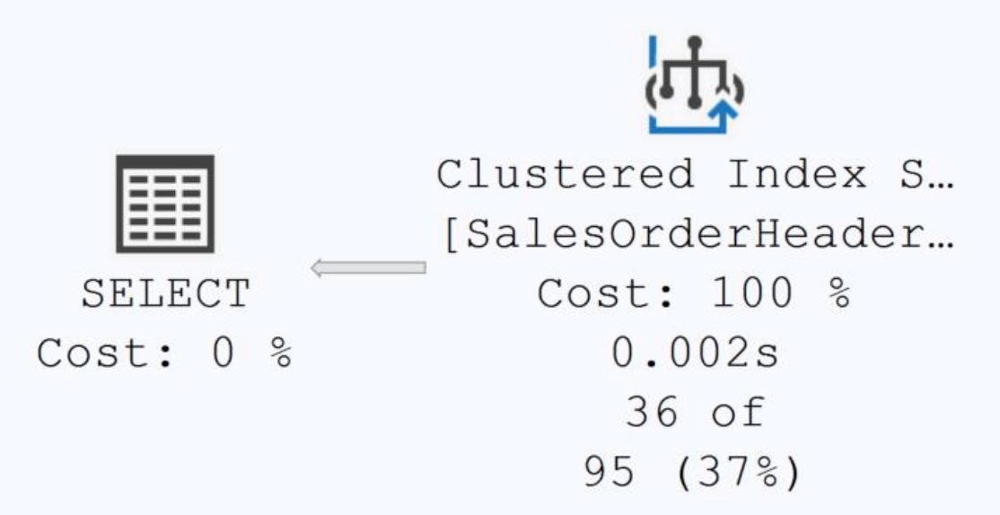  
*Hình 10-3. Kế hoạch thực thi quét toàn bộ Clustered Index do không có chỉ mục nào bao quát được cả hai điều kiện*

Các thông số ban đầu:
* Thời gian thực thi: **2.7 ms**
* Số lần đọc logic: **686 reads**

Mặc dù trên bảng có chỉ mục cho cột `SalesPersonID`, nhưng vì chúng ta lọc đồng thời cả `OrderDate`, optimizer nhận thấy chỉ mục đơn lẻ đó không mang lại nhiều lợi ích nên đã chọn giải pháp quét toàn bộ chỉ mục cụm.

Chúng ta thử tạo thêm một chỉ mục nonclustered đơn cột trên `OrderDate` bằng Listing 10-5 với kỳ vọng kích hoạt giao cắt chỉ mục:

```sql
-- Listing 10-5. Adding an index in the hopes of index intersection
CREATE NONCLUSTERED INDEX IX_Test
ON Sales.SalesOrderHeader (OrderDate ASC);
```

Chạy lại truy vấn trong Listing 10-4:

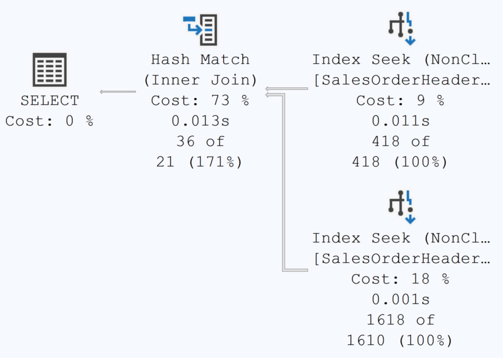  
*Hình 10-4. Giao cắt chỉ mục: Bộ tối ưu hóa kết hợp hai thao tác Index Seek qua toán tử Hash Match*

Chúng ta đã kích hoạt thành công hiện tượng giao cắt chỉ mục:
* Điểm mấu chốt ở đây là toán tử **Hash Match**. Optimizer thực hiện tìm kiếm (Seek) 418 dòng từ chỉ mục thứ nhất và 1.618 dòng từ chỉ mục thứ hai, sau đó băm (hash) chúng lại trong bộ nhớ tạm để tìm ra 36 dòng dữ liệu trùng khớp.
* Thời gian thực thi giảm từ **2.7 ms xuống 1.8 ms**.
* Số lần đọc logic giảm mạnh từ **689 reads xuống chỉ còn 10 reads**!

### Giải pháp vượt trội: Chỉ mục Kết hợp (Compound Index)
Mặc dù Index Intersection đã cải thiện hiệu năng, nhưng trong hầu hết các trường hợp, việc tạo một **Chỉ mục Kết hợp (Compound Index)** bao gồm cả hai cột sẽ mang lại hiệu quả vượt trội hơn rất nhiều. 

Hãy sửa lại chỉ mục thử nghiệm thành chỉ mục đa cột trong Listing 10-6:

```sql
-- Listing 10-6. Creating a compound key on the test index
CREATE NONCLUSTERED INDEX IX_Test
ON Sales.SalesOrderHeader (
                              SalesPersonID,
                              OrderDate ASC
                          )
WITH DROP_EXISTING;
```

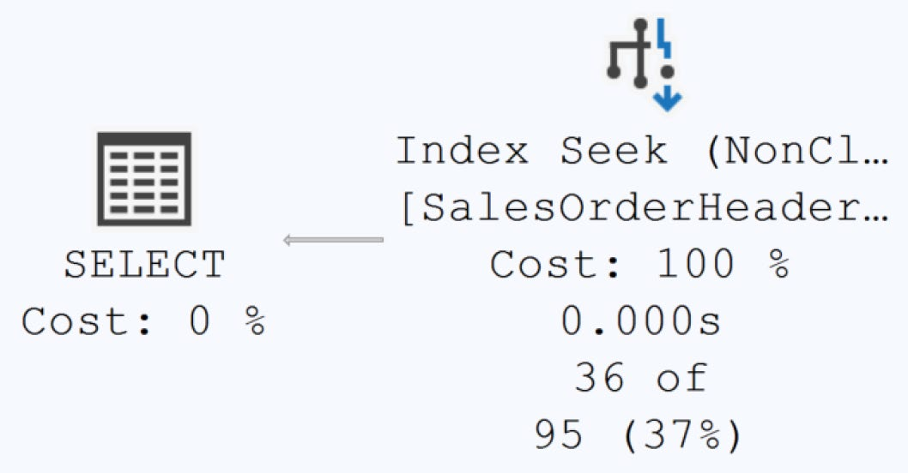  
*Hình 10-5. Chỉ mục kết hợp thay thế hoàn toàn giao cắt chỉ mục với hiệu năng vượt trội*

Kết quả sau khi đổi sang chỉ mục kết hợp:
* Thời gian thực thi giảm ngoạn mục từ 1.8 ms xuống chỉ còn: **165 microseconds**!
* Số lần đọc logic giảm từ 10 xuống còn: **2 reads**!

Mặc dù việc tạo khóa kết hợp làm thay đổi cấu trúc và làm rộng chỉ mục hơn một chút, nhưng mức độ cải thiện hiệu năng là vô cùng to lớn.

Tuy nhiên, vẫn có những trường hợp việc duy trì các chỉ mục nonclustered tách rời là lựa chọn tốt hơn:
* Khi việc thay đổi thứ tự cột trong chỉ mục hiện có sẽ gây tổn hại đến các câu truy vấn quan trọng khác.
* Khi bạn bị giới hạn về quyền chỉnh sửa các chỉ mục sẵn có.

Hãy dọn dẹp chỉ mục thử nghiệm bằng Listing 10-7:

```sql
-- Listing 10-7. Removing the test index
DROP INDEX IX_Test ON Sales.SalesOrderHeader;
```

---

## Phép nối Chỉ mục (Index Joins)

Phép nối chỉ mục (**Index Joins**) về bản chất là một biến thể nâng cao của hiện tượng giao cắt chỉ mục. Điểm khác biệt duy nhất là: thay vì phải xây dựng bảng băm tạm thời (Hash Match), optimizer sử dụng các thuật toán kết nối có trật tự như **Merge Join** hoặc **Nested Loops**.

Hãy quan sát một ví dụ thực tế trong Listing 10-8:

```sql
-- Listing 10-8. A query that will perform an index join
SELECT poh.PurchaseOrderID,
       poh.RevisionNumber
FROM Purchasing.PurchaseOrderHeader AS poh
WHERE poh.EmployeeID = 261
      AND poh.VendorID = 1500;
```

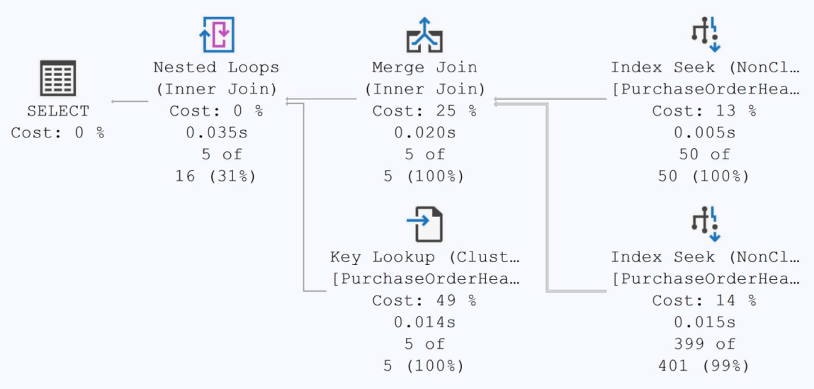  
*Hình 10-6. Kế hoạch thực thi áp dụng phép nối chỉ mục (Merge Join giữa hai Index Seek)*

Trong kế hoạch thực thi ở Hình 10-6, chúng ta thấy hai điểm kỹ thuật rất đáng chú ý:
1. **Phép nối Merge Join:** Hai chỉ mục nonclustered riêng biệt (một trên `EmployeeID` và một trên `VendorID`) đều được sử dụng để Seek dữ liệu lọc, sau đó được kết nối trực tiếp với nhau thông qua toán tử **Merge Join**.
2. **Sự xuất hiện của Key Lookup:** Do câu lệnh yêu cầu lấy thêm cột `RevisionNumber` (vốn không nằm trong hai chỉ mục nonclustered kia), nên sau khi nối hai chỉ mục, hệ thống vẫn phải thực hiện một thao tác Key Lookup về Clustered Index gốc để lấy nốt dữ liệu còn thiếu.

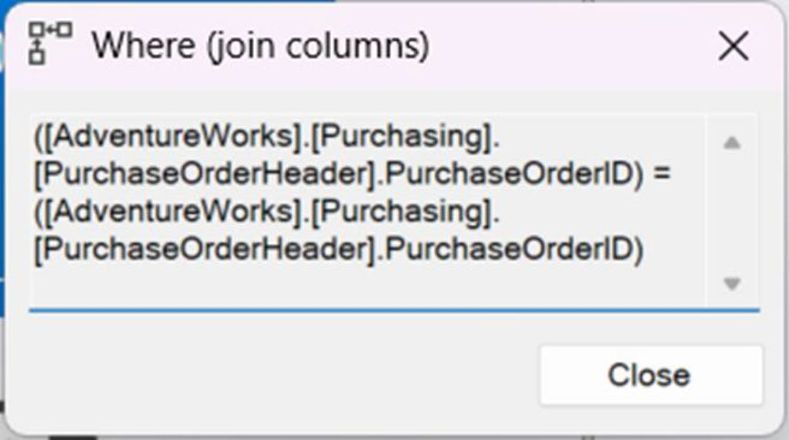  
*Hình 10-7. Cửa sổ thuộc tính Properties hiển thị các cột tham gia kết nối trong phép nối chỉ mục*

> [!NOTE]
> **Điểm khác biệt cốt lõi giữa Index Intersection và Index Join:**  
> Trong hầu hết các trường hợp, đối với **Index Intersection**, tập hợp các chỉ mục kết hợp bắt buộc phải là chỉ mục bao phủ (Covering). Ngược lại, đối với **Index Join**, hệ thống vẫn có thể linh hoạt chấp nhận các thao tác tra cứu bổ sung (**Key Lookup**) để lấy các cột còn thiếu từ bảng chính.

Đôi khi, các chỉ mục rộng mang lại hiệu năng cao nhất; nhưng trong nhiều kịch bản khác, Index Intersection và Index Join lại mở ra cơ hội giúp bạn duy trì các chỉ mục hẹp gọn gàng mà vẫn đảm bảo tốc độ xử lý tốt. Thử nghiệm và đối chuẩn thực tế luôn là chìa khóa duy nhất để tìm ra giải pháp tối ưu cho từng hệ thống.

---

## Chỉ mục có điều kiện lọc (Filtered Indexes)

Chỉ mục có điều kiện lọc (*filtered index*) là một chỉ mục lưu trữ theo dòng phi gom cụm (*nonclustered rowstore index*) sử dụng một bộ lọc — đơn giản là một mệnh đề `WHERE` — để tạo ra một chỉ mục có tính chọn lọc cao hơn. Chẳng hạn, một cột chứa một số lượng lớn các giá trị `NULL` có thể được lưu trữ dưới dạng một cột thưa (*sparse column*) nhằm giảm thiểu chi phí phụ trội của các giá trị `NULL` đó. Khi đó, việc bổ sung một chỉ mục loại trừ các giá trị `NULL` sẽ mang lại hiệu quả rất lớn.

Hãy cùng xem xét một ví dụ thực tế. Bảng `SalesOrderHeader` chứa khoảng 30.000 dòng. Trong số đó, có hơn 27.000 dòng mang giá trị `NULL` ở cả cột `PurchaseOrderNumber` lẫn cột `SalesPersonID`. Nếu muốn lấy danh sách các số đơn đặt mua hàng (*purchase order numbers*) có nhân viên kinh doanh phụ trách, bạn có thể thực thi truy vấn trong Listing 10-9.

**Listing 10-9.** Truy vấn lấy số đơn đặt mua hàng

```sql
SELECT soh.PurchaseOrderNumber,
       soh.OrderDate,
       soh.ShipDate,
       soh.SalesPersonID
FROM Sales.SalesOrderHeader AS soh
WHERE PurchaseOrderNumber LIKE 'PO5%'
      AND soh.SalesPersonID IS NOT NULL;
```

Khi thực thi truy vấn này, bạn sẽ nhận được một thao tác Quét chỉ mục gom cụm (*Clustered Index Scan*) do không có chỉ mục nào phù hợp. Bạn cũng sẽ quan sát thấy các số đo hiệu năng sau:

- **Thời gian thực thi:** 6.5 ms
- **Lượt đọc logic:** 686 reads

Để loại bỏ thao tác quét (*scan*), chúng ta có thể tạo một chỉ mục như hiển thị trong Listing 10-10.

**Listing 10-10.** Tạo chỉ mục để cải thiện hiệu năng truy vấn

```sql
CREATE NONCLUSTERED INDEX IX_Test
ON Sales.SalesOrderHeader (
                              PurchaseOrderNumber,
                              SalesPersonID
                          )
INCLUDE (
            OrderDate,
            ShipDate
        );
```

Sau khi tạo chỉ mục bao phủ này, kế hoạch thực thi thay đổi sang thao tác tìm kiếm chỉ mục (*Index Seek*) như minh họa trong Hình 10-8, kèm theo các số đo hiệu năng mới:

- **Thời gian thực thi:** 533 µs (micro giây - mcs)
- **Lượt đọc logic:** 5 reads

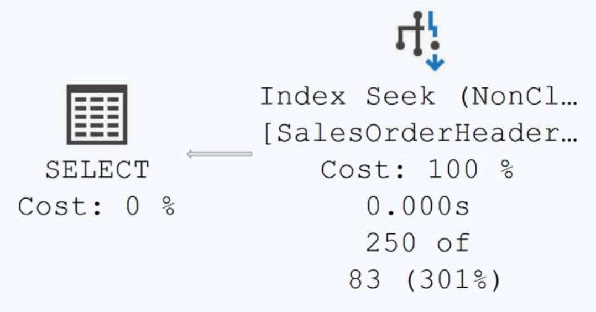

Bằng cách đảm bảo có một chỉ mục bao phủ (*covering index*), chúng ta đã giảm số lượt đọc logic từ 686 xuống chỉ còn 5, và thời gian thực thi cải thiện từ 6.5 ms xuống 533 µs. Trên nhiều hệ thống, mức độ cải thiện này đã là "đủ tốt" (*good enough*), và bạn hoàn toàn có thể tự tin kết thúc việc tối ưu. Tuy nhiên, trên một số hệ thống đòi hỏi khắt khe, việc vắt kiệt từng giọt hiệu năng cuối cùng có thể là điều bắt buộc. Để tối ưu hóa truy vấn này sâu hơn nữa, chúng ta có thể loại bỏ hoàn toàn các giá trị `NULL` ra khỏi chỉ mục. Chúng ta chỉ cần sửa đổi định nghĩa chỉ mục bằng Listing 10-11.

**Listing 10-11.** Loại bỏ các giá trị NULL khỏi chỉ mục

```sql
CREATE NONCLUSTERED INDEX IX_Test
ON Sales.SalesOrderHeader (
                              PurchaseOrderNumber,
                              SalesPersonID
                          )
INCLUDE (
            OrderDate,
            ShipDate
        )
WHERE PurchaseOrderNumber IS NOT NULL
      AND SalesPersonID IS NOT NULL
WITH (DROP_EXISTING = ON);
```

Hãy chú ý ở cuối định nghĩa chỉ mục, một mệnh đề `WHERE` đã được bổ sung. Chúng ta đang loại bỏ bất kỳ dòng nào khỏi chỉ mục mà ở đó `PurchaseOrderNumber` hoặc `SalesPersonID` mang giá trị `NULL`. Thực thi lại truy vấn, chúng ta thu được các chỉ số hiệu năng sau:

- **Thời gian thực thi:** 317 µs
- **Lượt đọc logic:** 4 reads

Tôi thừa nhận rằng đây không phải là một bước nhảy vọt quá lớn về hiệu năng. Tuy nhiên, nó vẫn là một sự cải thiện. Hãy hình dung truy vấn này được gọi hàng ngàn lần mỗi phút. Việc giảm bớt thời gian xử lý và mức tiêu thụ tài nguyên của nó rõ ràng là một thắng lợi giá trị.

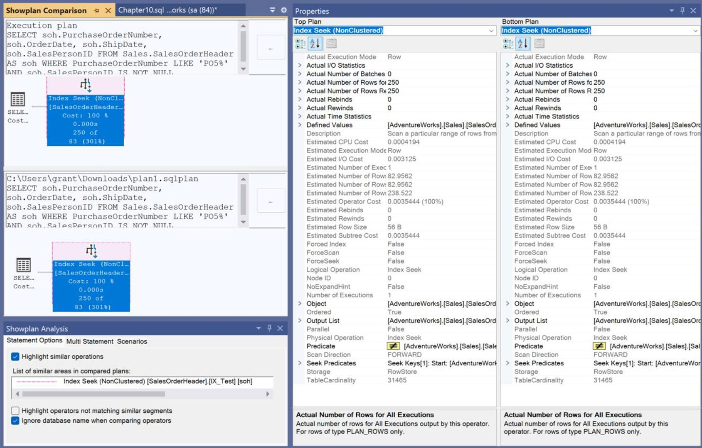

Bạn sẽ nhận thấy rằng hầu như mọi thuộc tính trong cả hai toán tử Tìm kiếm chỉ mục (*Index Seek*) đều giống hệt nhau. Tuy nhiên, có một điểm khác biệt duy nhất được làm nổi bật: đó chính là Vị từ (*Predicate*). Quá trình đơn giản hóa (*simplification process*) bên trong bộ tối ưu hóa truy vấn đã loại bỏ điều kiện `IS NOT NULL` ra khỏi truy vấn vì chỉ mục lọc đã loại bỏ sẵn các giá trị `NULL`.

Mặc dù các chỉ mục có điều kiện lọc có thể cải thiện hiệu năng, nhưng chúng không phải là không đi kèm chi phí. Bạn có thể gặp phải các vấn đề khi các truy vấn được tham số hóa (*parameterized queries*) không khớp hoàn toàn với mệnh đề `WHERE` trong chỉ mục, từ đó ngăn cản việc bộ tối ưu sử dụng chỉ mục đó. Số liệu thống kê (*statistics*) không được cập nhật riêng cho các tiêu chí lọc mà được cập nhật trên toàn bộ bảng, giống hệt như một chỉ mục thông thường. Do đó, việc kiểm thử trên chính hệ thống của bạn để đánh giá xem chỉ mục này giúp ích cho hiệu năng ở đâu và khi nào là điều bắt buộc.

Mục đích phổ biến nhất của việc sử dụng chỉ mục có điều kiện lọc chính là ví dụ chúng ta vừa xem xét: loại bỏ các giá trị `NULL`. Bạn cũng có thể cô lập các tập dữ liệu thường xuyên được truy cập bằng một chỉ mục lọc để các truy vấn nhắm vào dữ liệu đó thực thi nhanh hơn. Bạn có thể dùng mệnh đề `WHERE` để lọc dữ liệu theo những cách tương tự như khi tạo các khung nhìn được lập chỉ mục (*indexed views* — sẽ được đề cập ở phần tiếp theo) mà không phải gánh chịu những cơn đau đầu liên quan đến việc bảo trì dữ liệu phức tạp của indexed view. Việc kết hợp theo ví dụ đã nêu ở trên và biến chỉ mục lọc phi gom cụm thành một chỉ mục bao phủ (*covering index*) sẽ giúp tăng cường hiệu năng lên mức tối đa.

Bạn bắt buộc phải kích hoạt các thiết lập ANSI cụ thể khi sử dụng các chỉ mục có điều kiện lọc:

- **Bật (ON):** `ANSI_NULLS`, `ANSI_PADDING`, `ANSI_WARNINGS`, `ARITHABORT`, `CONCAT_NULL_YIELDS_NULL`, và `QUOTED_IDENTIFIER`
- **Tắt (OFF):** `NUMERIC_ROUNDABORT`

Trước khi chuyển sang phần tiếp theo, hãy xóa bỏ chỉ mục thử nghiệm này bằng Listing 10-12.

**Listing 10-12.** Xóa bỏ chỉ mục thử nghiệm

```sql
DROP INDEX IX_Test ON Sales.SalesOrderHeader;
```

---

## Khung nhìn được lập chỉ mục (Indexed Views)

Một khung nhìn (*view*) trong SQL Server về bản chất không hề lưu trữ bất kỳ dữ liệu nào. View đơn thuần chỉ là một câu lệnh `SELECT`, được lưu trữ bên trong một đối tượng cơ sở dữ liệu có tên gọi là view. View hoạt động như thể nó là một bảng, nhưng thực chất nó chỉ là một truy vấn. Bạn định nghĩa một view bằng lệnh `CREATE VIEW`. Khi đã được tạo, nó có thể được sử dụng tương tự như một bảng. Tuy nhiên, xin được nhắc lại một lần nữa: nó vẫn chỉ là một câu lệnh `SELECT`.

Tuy nhiên, bạn cũng có thể chọn một view và thực hiện một thao tác gọi là **cụ thể hóa** (*materialization*). Về cơ bản, bạn tạo ra một chỉ mục gom cụm (*clustered index*) mới dựa trên chính truy vấn định nghĩa khung nhìn đó. Đối tượng này được gọi là một **khung nhìn được lập chỉ mục** (*indexed view*) hoặc **khung nhìn cụ thể hóa** (*materialized view*). Khi bạn tạo một materialized view, dữ liệu thực sự được ghi bền vững (*persisted*) xuống đĩa và lưu trữ bên trong cơ sở dữ liệu. Tại thời điểm đó, trên mọi phương diện thực tế, nó hoạt động tương đương với một bảng vật lý. Bạn thậm chí còn có thể tạo các chỉ mục phi gom cụm (*nonclustered indexes*) trên chính khung nhìn được lập chỉ mục này.

### Lợi ích (Benefit)

Bạn có thể sử dụng khung nhìn được lập chỉ mục để tăng tốc hiệu năng truy vấn theo những cách sau:

- **Tính toán trước các phép tổng hợp (Aggregations):** Các phép toán tổng hợp có thể được tính toán sẵn và lưu trữ trong indexed view nhằm giảm thiểu các phép tính toán tốn kém tài nguyên trong quá trình thực thi truy vấn.
- **Nối sẵn các bảng (Pre-joined tables):** Các bảng có thể được thực hiện phép kết (*join*) từ trước và tập dữ liệu kết quả được cụ thể hóa lưu trữ sẵn.
- **Kết hợp cả phép nối và phép tổng hợp:** Việc kết hợp giữa các phép nối phức tạp và các phép tổng hợp cũng có thể được cụ thể hóa đồng thời.

### Chi phí phụ trội (Overhead)

Không có gì là miễn phí cả. Khung nhìn cụ thể hóa có thể gây ra chi phí phụ trội (*overhead*) rất lớn cho cơ sở dữ liệu. Một số chi phí phát sinh từ indexed views bao gồm:

- Mọi thay đổi dữ liệu trên các bảng gốc (*base tables*) đều phải được phản ánh vào khung nhìn được lập chỉ mục bằng cách thực thi lại câu lệnh `SELECT` của view đó.
- Bất kỳ thay đổi nào đối với bảng gốc mà trên đó có định nghĩa indexed view đều có thể kích hoạt một hoặc nhiều thao tác cập nhật trên các chỉ mục phi gom cụm của indexed view. Chỉ mục gom cụm cũng sẽ phải thay đổi nếu khóa gom cụm (*clustering key*) bị cập nhật.
- Indexed view làm gia tăng chi phí bảo trì liên tục cho cơ sở dữ liệu, đi kèm với các số liệu thống kê (*statistics*) cũng bắt buộc phải được duy trì.
- Đòi hỏi thêm không gian lưu trữ đĩa vật lý.

Có một số lượng đáng kể các ràng buộc và hạn chế nghiêm ngặt khi tạo một indexed view:

- Bất kể các cột khóa định nghĩa indexed view là gì, chỉ mục gom cụm đầu tiên bắt buộc phải là một **chỉ mục duy nhất** (*unique clustered index*).
- Các chỉ mục phi gom cụm trên một indexed view chỉ có thể được tạo **sau khi** chỉ mục gom cụm duy nhất đã được tạo thành công.
- Định nghĩa của view bắt buộc phải có **tính xác định** (*deterministic*) — nghĩa là nó chỉ có thể trả về một kết quả khả dĩ duy nhất cho một truy vấn cụ thể (danh sách các hàm có tính xác định và không xác định được cung cấp chi tiết trong tài liệu của SQL Server).
- Indexed view chỉ được phép tham chiếu đến các bảng gốc nằm trong cùng một cơ sở dữ liệu, không được phép tham chiếu đến các view khác.
- Indexed view bắt buộc phải được ràng buộc lược đồ (*schema bound* — thông qua tùy chọn `WITH SCHEMABINDING`) với các bảng được tham chiếu nhằm ngăn chặn việc sửa đổi cấu trúc bảng gốc (đây thường là một rào cản lớn trong quản trị hệ thống).
- Có nhiều hạn chế nghiêm ngặt về cú pháp của định nghĩa view (chẳng hạn không được dùng `COUNT(*)`, không dùng `DISTINCT`, không dùng `UNION`,... danh sách đầy đủ được cung cấp trong tài liệu của SQL Server).
- Danh sách các thiết lập `SET` bắt buộc phải được cấu hình chính xác:
  - **Bật (ON):** `ARITHABORT`, `CONCAT_NULL_YIELDS_NULL`, `QUOTED_IDENTIFIER`, `ANSI_NULLS`, `ANSI_PADDING`, và `ANSI_WARNINGS`
  - **Tắt (OFF):** `NUMERIC_ROUNDABORT`

### Kịch bản sử dụng (Usage Scenarios)

Các hệ thống chuyên dụng cho báo cáo và phân tích dữ liệu (*dedicated reporting and analysis systems*) thường là đối tượng hưởng lợi nhiều nhất từ các khung nhìn được lập chỉ mục. Ngược lại, các hệ thống xử lý giao dịch trực tuyến (*OLTP systems*) với tần suất ghi dữ liệu dày đặc thường khó có thể tận dụng được indexed view do chi phí bảo trì tăng cao khi phải cập nhật đồng thời cả các bảng bên dưới lẫn bản thân khung nhìn, tất cả đều nằm trong một giao dịch duy nhất. Mức cải thiện hiệu năng thực tế (*net performance improvement*) mà một indexed view mang lại chính là phần chênh lệch giữa tổng lượng tài nguyên tiết kiệm được khi thực thi truy vấn so với chi phí lưu trữ và duy trì cập nhật view. Việc kiểm thử cẩn trọng trong tình huống này là tối cần thiết. Cần lưu ý rằng đối với các hệ thống phân tích hiện đại, rất có thể các chỉ mục lưu trữ theo cột (*columnstore indexes*) sẽ mang lại lợi ích vượt trội hơn nhiều so với các materialized view. Dẫu vậy, materialized view vẫn là một công cụ hữu hiệu bổ sung trong kho vũ khí tối ưu hóa của bạn.

Nếu bạn đang sử dụng phiên bản SQL Server Enterprise (hoặc Developer edition), truy vấn của bạn **không cần thiết** phải tham chiếu trực tiếp đến indexed view để bộ tối ưu hóa truy vấn quyết định sử dụng nó trong quá trình thực thi. Điều này cho phép các ứng dụng hiện có có thể tự động hưởng lợi từ các indexed view mới tạo mà không cần phải can thiệp sửa đổi mã ứng dụng. Trong các phiên bản khác (như Standard), bạn bắt buộc phải tham chiếu trực tiếp tên view trong mã lệnh T-SQL kèm theo gợi ý `WITH (NOEXPAND)`. Bộ tối ưu hóa truy vấn cũng chỉ xem xét sử dụng indexed view cho các truy vấn có chi phí không hề nhỏ (*nontrivial cost*).

Để quan sát indexed view hoạt động trong thực tế, hãy bắt đầu với các truy vấn trong Listing 10-13.

**Listing 10-13.** Các truy vấn phân tích dữ liệu

```sql
SELECT p.[Name] AS ProductName,
       SUM(pod.OrderQty) AS OrderOty,
       SUM(pod.ReceivedQty) AS ReceivedOty,
       SUM(pod.RejectedQty) AS RejectedOty
FROM Purchasing.PurchaseOrderDetail AS pod
    JOIN Production.Product AS p
        ON p.ProductID = pod.ProductID
GROUP BY p.[Name];

SELECT p.[Name] AS ProductName,
       SUM(pod.OrderQty) AS OrderOty,
       SUM(pod.ReceivedQty) AS ReceivedOty,
       SUM(pod.RejectedQty) AS RejectedOty
FROM Purchasing.PurchaseOrderDetail AS pod
    JOIN Production.Product AS p
        ON p.ProductID = pod.ProductID
GROUP BY p.[Name]
HAVING (SUM(pod.RejectedQty) / SUM(pod.ReceivedQty)) > .08;

SELECT p.[Name] AS ProductName,
       SUM(pod.OrderQty) AS OrderQty,
       SUM(pod.ReceivedQty) AS ReceivedQty,
       SUM(pod.RejectedQty) AS RejectedQty
FROM Purchasing.PurchaseOrderDetail AS pod
    JOIN Production.Product AS p
        ON p.ProductID = pod.ProductID
WHERE p.[Name] LIKE 'Chain%'
GROUP BY p.[Name];
```

Cả ba truy vấn trên đều đang thực hiện tổng hợp dữ liệu từ bảng `PurchaseOrderDetail`. Một indexed view giúp tính toán trước các phép tổng hợp có thể giảm đáng kể chi phí của các truy vấn này. Tôi sẽ sử dụng `STATISTICS IO` để hiển thị chi tiết số lượt đọc dữ liệu liên quan đến các truy vấn này, và như thường lệ, sử dụng Extended Events để ghi lại thời gian thực thi:

```text
Table 'Workfile'. Scan count 0, logical reads 0
Table 'Worktable'. Scan count 0, logical reads 0
Table 'Product'. Scan count 1, logical reads 6
Table 'PurchaseOrderDetail'. Scan count 1, logical reads 66

Table 'Workfile'. Scan count 0, logical reads 0
Table 'Worktable'. Scan count 0, logical reads 0
Table 'Product'. Scan count 1, logical reads 6
Table 'PurchaseOrderDetail'. Scan count 1, logical reads 66

Table 'PurchaseOrderDetail'. Scan count 5, logical reads 894
Table 'Product'. Scan count 1, logical reads 2
```

Thời gian thực thi tương ứng đo được cho ba truy vấn là:
- Truy vấn 1: **5.6 ms**
- Truy vấn 2: **4.6 ms**
- Truy vấn 3: **1.5 ms**

Listing 10-14 cung cấp định nghĩa của khung nhìn được lập chỉ mục.

**Listing 10-14.** Tạo một khung nhìn được lập chỉ mục

```sql
CREATE OR ALTER VIEW Purchasing.IndexedView
WITH SCHEMABINDING
AS
SELECT pod.ProductID,
       SUM(pod.OrderQty) AS OrderQty,
       SUM(pod.ReceivedQty) AS ReceivedQty,
       SUM(pod.RejectedQty) AS RejectedQty,
       COUNT_BIG(*) AS COUNT
FROM Purchasing.PurchaseOrderDetail AS pod
GROUP BY pod.ProductID;
GO
CREATE UNIQUE CLUSTERED INDEX iv ON Purchasing.IndexedView (ProductID);
```

Như tôi đã đề cập trước đó, một số hàm như `AVG` không được phép sử dụng trong view vì chúng không có tính xác định (danh sách đầy đủ có trong tài liệu của SQL Server). Ngoài ra, nếu có các hàm tổng hợp xuất hiện trong view, bạn bắt buộc phải đưa thêm hàm `COUNT_BIG(*)` vào danh sách chọn theo mặc định.

Việc tạo chỉ mục gom cụm duy nhất sẽ ghi toàn bộ kết quả tính toán tổng hợp trực tiếp xuống đĩa. Giờ đây, các phép tính toán sẽ chỉ phải thực hiện khi dữ liệu trong các bảng gốc thay đổi. Các truy vấn có thể truy xuất ngay lập tức các giá trị đã được tính toán sẵn mà không tốn công tính lại. Không cần chỉnh sửa bất kỳ dòng mã nào của các truy vấn gốc trong Listing 10-13, tôi thực thi lại chúng và thu được các chỉ số I/O cùng thời gian thực thi như sau:

```text
Table 'Product'. Scan count 1, logical reads 13
Table 'IndexedView'. Scan count 1, logical reads 4

Table 'Product'. Scan count 1, logical reads 13
Table 'IndexedView'. Scan count 1, logical reads 4

Table 'IndexedView'. Scan count 0, logical reads 10
Table 'Product'. Scan count 1, logical reads 2
```

Thời gian thực thi mới tương ứng:
- Truy vấn 1: **968 µs** (giảm từ 5.6 ms)
- Truy vấn 2: **639 µs** (giảm từ 4.6 ms)
- Truy vấn 3: **290 µs** (giảm từ 1.5 ms)

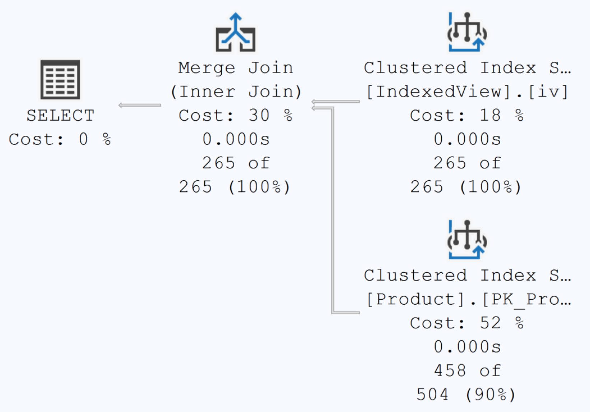

Bộ tối ưu hóa nhận biết được rằng khung nhìn được lập chỉ mục có thể đáp ứng trọn vẹn nhu cầu dữ liệu của truy vấn, vì vậy nó đã trực tiếp sử dụng indexed view thay vì phải quét và tổng hợp dữ liệu từ các bảng gốc.

Trước khi tiếp tục, tôi sẽ xóa bỏ khung nhìn được lập chỉ mục này khỏi cơ sở dữ liệu trong Listing 10-15.

**Listing 10-15.** Xóa bỏ khung nhìn được lập chỉ mục

```sql
DROP VIEW Purchasing.IndexedView;
```

---

## Nén chỉ mục (Index Compression)

Việc áp dụng cơ chế nén trên một chỉ mục đồng nghĩa với việc sử dụng các thuật toán chuyên biệt để giảm thiểu dung lượng không gian vật lý bị chiếm dụng bởi dữ liệu, nhờ đó có thể chứa được nhiều dữ liệu hơn trên mỗi trang 8KB. Càng có nhiều dữ liệu trên một trang, số lượng trang cần phải đọc từ đĩa (disk I/O) càng ít đi. Càng ít lượt đọc thì hiệu năng truy vấn càng được nâng cao. 

Hơn nữa, các trang dữ liệu đã nén cũng sẽ được lưu giữ nguyên trạng trong bộ nhớ RAM (buffer cache), giúp bạn tiết kiệm đáng kể dung lượng bộ nhớ. Đổi lại, bạn sẽ thấy mức độ tiêu thụ CPU tăng lên do máy chủ phải thực hiện các phép tính toán nén và giải nén dữ liệu liên tục. Chi phí phụ trội trên CPU này đồng nghĩa với việc nén dữ liệu sẽ không phải là giải pháp tối ưu cho mọi chỉ mục.

Theo mặc định, các chỉ mục trong SQL Server đều không được nén. Bạn bắt buộc phải chủ động khai báo tùy chọn nén khi tạo hoặc rebuild chỉ mục. 

Có hai cấp độ nén chỉ mục:
1. **Nén cấp dòng (Row-level compression - ROW):** Nhận diện các cột có thể nén được (xem chi tiết trong tài liệu kỹ thuật của Microsoft) và tiến hành nén dữ liệu trong các cột đó theo cơ chế từng dòng một.
2. **Nén cấp trang (Page-level compression - PAGE):** Thực hiện toàn bộ quy trình nén cấp dòng trước, sau đó áp dụng thêm các thuật toán nén tiền tố (prefix compression) và nén từ điển (dictionary compression) lên trên nhằm giảm thiểu tối đa dung lượng lưu trữ cho các phần tử ngoài hàng trên trang dữ liệu. Cần lưu ý rằng các trang không phải là trang lá (non-leaf pages) trong cây chỉ mục B-Tree sẽ không được áp dụng nén cấp trang.

Hãy cùng xem xét một chỉ mục mẫu trong Listing 10-16.

**Listing 10-16.** Tạo một chỉ mục thông thường không nén

```sql
CREATE NONCLUSTERED INDEX IX_Test
ON Person.ADDRESS (
                      City ASC,
                      PostalCode ASC
                  );
```

Để tiện so sánh, tôi sẽ tạo thêm hai chỉ mục nữa có cùng các cột khóa giống hệt, nhưng chúng ta sẽ lần lượt áp dụng cơ chế nén cấp dòng và nén cấp trang cho chúng (Listing 10-17).

**Listing 10-17.** Tạo các chỉ mục có áp dụng nén

```sql
CREATE NONCLUSTERED INDEX IX_CompRow_Test
ON Person.ADDRESS (
                      City,
                      PostalCode
                  )
WITH (DATA_COMPRESSION = ROW);

CREATE NONCLUSTERED INDEX IX_CompPage_Test
ON Person.ADDRESS (
                      City,
                      PostalCode
                  )
WITH (DATA_COMPRESSION = PAGE);
```

> [!NOTE]
> Cần lưu ý rõ ràng rằng ba chỉ mục này chỉ được tạo ra nhằm mục đích minh họa và so sánh. Việc duy trì ba chỉ mục có các cột khóa giống hệt nhau trên cùng một bảng chỉ làm gia tăng chi phí phụ trội cho hệ thống và có thể gây bối rối cho Query Optimizer.

Sau khi đã tạo xong các chỉ mục, chúng ta hãy cùng khảo sát các đặc tính vật lý thực tế của chúng bằng cách truy vấn DMV `sys.dm_db_index_physical_stats` như trong Listing 10-18.

**Listing 10-18.** Đếm số lượng trang và số lượng trang nén của các chỉ mục

```sql
SELECT i.NAME,
       i.type_desc,
       s.page_count,
       s.record_count,
       s.index_level,
       s.compressed_page_count
FROM sys.indexes AS i
     JOIN sys.dm_db_index_physical_stats(DB_ID(N'AdventureWorks'), OBJECT_ID(N'Person.Address'), NULL, NULL, 'DETAILED') AS s
        ON i.index_id = s.index_id
WHERE i.OBJECT_ID = OBJECT_ID(N'Person.Address');
```

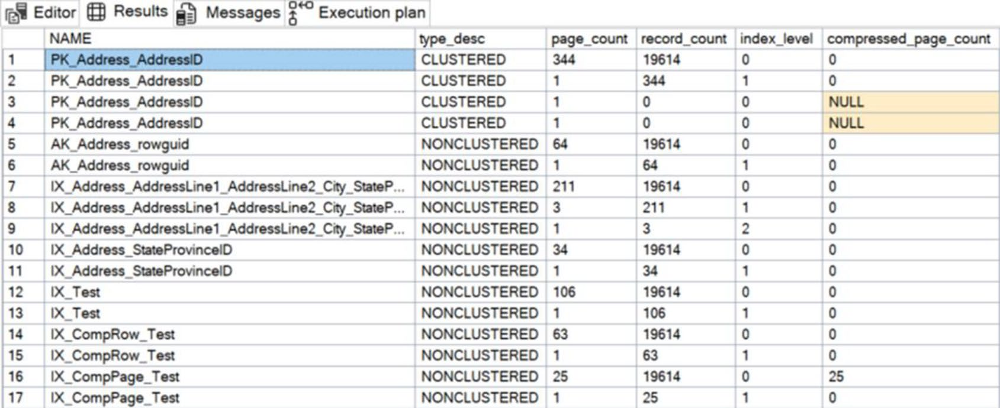

*Hình 10-11: Số trang được sử dụng bởi các chỉ mục trên bảng Address (Pages being used by indexes on the Address table)*

Chỉ mục ban đầu không nén, `IX_Test`, chiếm dụng **107 trang**. Khi áp dụng nén cấp dòng (`ROW`), dung lượng giảm xuống còn **64 trang**. Và khi áp dụng nén cấp trang (`PAGE`), tổng dung lượng chỉ còn lại **26 trang**, trong đó có 25 trang được nén hoàn toàn. Hiệu năng của các câu truy vấn sử dụng các chỉ mục nén này sẽ được cải thiện rõ rệt vì chúng chỉ phải luân chuyển ít trang dữ liệu hơn rất nhiều để đạt được cùng một tập kết quả.

Trước khi tiếp tục, tôi sẽ xóa các chỉ mục kiểm thử này bằng câu lệnh trong Listing 10-19.

**Listing 10-19.** Xóa các chỉ mục kiểm thử

```sql
DROP INDEX IX_Test ON Person.ADDRESS;
DROP INDEX IX_CompRow_Test ON Person.ADDRESS;
DROP INDEX IX_CompPage_Test ON Person.ADDRESS;
```

---

## Các đặc tính chuyên sâu của chỉ mục (Index Characteristics)

Có một loạt thuộc tính và thiết lập cấu hình nâng cao khác có sẵn trên chỉ mục có thể giúp bạn cải thiện hiệu năng trong nhiều tình huống đặc thù. Chúng ta hãy cùng điểm qua từng đặc tính một cách chi tiết:

### Thứ tự sắp xếp cột khác nhau (Different Column Sort Order)

Thứ tự sắp xếp mặc định của các cột trong chỉ mục là tăng dần (**ASC** - Ascending). Bạn hoàn toàn có thể kiểm soát thứ tự sắp xếp này khi tạo chỉ mục. Hơn nữa, bạn có thể kiểm soát riêng rẽ từng cột trong tập khóa chỉ mục để dữ liệu được tổ chức vật lý theo đúng thứ tự sắp xếp phù hợp nhất với câu truy vấn cần tối ưu. 

Nếu bạn muốn tạo một chỉ mục theo phương thức này, cú pháp sẽ tương tự như trong Listing 10-20.

**Listing 10-20.** Thay đổi thứ tự sắp xếp của các cột trong chỉ mục

```sql
CREATE NONCLUSTERED INDEX IX_Test
ON Person.ADDRESS (
                      City ASC,
                      PostalCode DESC
                  );
```

### Chỉ mục trên cột tính toán (Index on Computed Columns)

SQL Server cho phép bạn tạo chỉ mục trên các cột tính toán (computed columns). Tuy nhiên, kết quả của phép tính toán trên cột bắt buộc phải có tính **xác định** (**deterministic**) và chỉ được phép tham chiếu đến các cột nằm trên cùng một bảng dữ liệu.

### Câu lệnh CREATE INDEX được xử lý như một truy vấn (CREATE INDEX Statement Processed As a Query)

Việc khởi tạo một chỉ mục là một tiến trình tốn kém rất nhiều tài nguyên. Do đó, SQL Server sẽ đưa chính câu lệnh tạo chỉ mục qua Query Optimizer nhằm tìm kiếm phương án tối ưu nhất để xây dựng chỉ mục mới thông qua việc tận dụng các chỉ mục có sẵn khác.

Ví dụ, Listing 10-21 minh họa việc tạo một chỉ mục trên cột `City` của bảng `Address`, nhưng đặt trong một giao dịch có `ROLLBACK` để chúng ta có thể quan sát kế hoạch thực thi mà không thực sự lưu chỉ mục vào cơ sở dữ liệu.

**Listing 10-21.** Kế hoạch thực thi khi tạo một chỉ mục mới

```sql
BEGIN TRAN
CREATE NONCLUSTERED INDEX IX_Test
ON Person.Address(City);
ROLLBACK TRAN
```

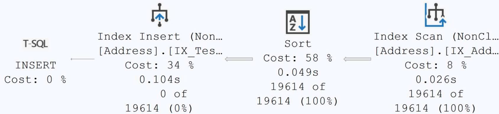

*Hình 10-12: Kế hoạch thực thi cho câu lệnh CREATE INDEX (The execution plan for a CREATE INDEX statement)*

Thay vì phải quét toàn bộ bảng Clustered Index cồng kềnh để thu thập dữ liệu, trong trường hợp này Query Optimizer đã thông minh lựa chọn quét một nonclustered index sẵn có mang tên `IX_Address_AddressLine1_AddressLine2_City_StateProvinceID_PostalCode`. Cả hai chỉ mục đều chứa đầy đủ các giá trị của cột `City`, nhưng chỉ mục không gom cụm có kích thước hẹp hơn rất nhiều, do đó số lượng trang đĩa cần phải đọc trong quá trình tạo chỉ mục mới được giảm thiểu tối đa.

### Tạo chỉ mục song song (Parallel Index Creation)

Tương tự như việc các câu truy vấn có thể chạy song song, SQL Server có khả năng khởi tạo và tái tạo chỉ mục thông qua cơ chế thực thi song song (tuy nhiên tính năng này chỉ được hỗ trợ trên phiên bản **Enterprise**). Nếu máy chủ của bạn sở hữu nhiều bộ xử lý (multiprocessor), bạn có thể huy động các CPU đó cùng tham gia vào quá trình tạo chỉ mục. 

Bạn có thể kiểm soát số lượng CPU được phép sử dụng ở cấp máy chủ thông qua thiết lập `max degree of parallelism`, hoặc kiểm soát ở cấp độ từng câu lệnh cụ thể bằng cách sử dụng gợi ý `MAXDOP` bên trong câu lệnh `CREATE INDEX`.

### Tạo chỉ mục trực tuyến (Online Index Creation)

Theo mặc định, thao tác tạo chỉ mục được thực hiện ở chế độ ngoại tuyến (**offline**). Điều này có nghĩa là các khóa độc quyền (exclusive locks) sẽ được đặt lên bảng, ngăn chặn người dùng và ứng dụng truy cập vào bảng trong suốt quá trình chỉ mục đang được xây dựng. 

Tuy nhiên, bạn hoàn toàn có thể tạo hoặc rebuild chỉ mục ở chế độ trực tuyến (**online**, bằng tùy chọn `WITH (ONLINE = ON)`). Chế độ này cho phép người dùng tiếp tục đọc và ghi dữ liệu bình thường trong khi chỉ mục đang được kiến tạo ngầm. Sự tiện lợi này phải đánh đổi bằng việc thời gian hoàn thành kéo dài hơn và tiêu tốn nhiều tài nguyên hệ thống hơn.

- Kể từ **SQL Server 2012**, các chỉ mục chứa các cột dữ liệu lớn như `varchar(max)`, `nvarchar(max)`, và `varbinary(max)` đã có thể được rebuild trực tuyến.
- Các thao tác chỉ mục Online chỉ được hỗ trợ trên phiên bản **Enterprise**.
- **SQL Server 2025** bổ sung thêm một bước tiến quan trọng: khả năng thực hiện **Rebuild trực tuyến (Online Rebuild) cho các chỉ mục Columnstore** (cả clustered và nonclustered columnstore đều được hỗ trợ).

### Cân nhắc về Database Engine Tuning Advisor (DTA)

SQL Server cung cấp một công cụ tích hợp sẵn mang tên **Database Engine Tuning Advisor** (**DTA**). Trong các ấn bản trước đây của cuốn sách, tôi đã từng dành riêng một chương để nói về công cụ này. Tuy nhiên, qua nhiều năm làm việc thực tế, tôi ngày càng mất dần niềm tin vào nó. Hiện nay, tôi không bao giờ sử dụng DTA và cũng không khuyến khích bạn sử dụng nó. 

Dẫu vậy, trong một số trường hợp, người ta vẫn thấy nó có ích trong việc gợi ý các chỉ mục cần bổ sung. Tôi cần cảnh báo rằng một số gợi ý do DTA đưa ra là không hữu ích, và thậm chí một số đề xuất còn có thể gây hại cho hệ thống. Nếu bạn vẫn quyết định sử dụng công cụ Tuning Advisor, xin vui lòng kiểm thử hết sức sâu rộng để kiểm chứng độc lập mọi kết quả mà nó đưa ra.

### Tùy chọn OPTIMIZE_FOR_SEQUENTIAL_KEY

Khi bạn sở hữu một chỉ mục trên một cột có giá trị tăng dần đều tuần tự, hiện tượng tranh chấp gay gắt tại trang cuối cùng của chỉ mục (**last-page insert contention**) là điều rất phổ biến. Nguyên nhân là vì tất cả các tiến trình chèn dữ liệu đồng thời đều cố gắng ghi vào cùng một trang dữ liệu 8KB cuối cùng đó. Các ví dụ điển hình bao gồm: cột `IDENTITY`, cột ngày giờ (`datetime`), hoặc các GUID có thứ tự (sequential GUID). 

Bắt đầu từ **SQL Server 2019** và có sẵn trên **Azure SQL Database**, bạn có thể kích hoạt tùy chọn:
```sql
WITH (OPTIMIZE_FOR_SEQUENTIAL_KEY = ON)
```
Tùy chọn này sẽ thay đổi cách thức cơ chế quản lý việc chèn dữ liệu diễn ra nhằm giải tỏa tắc nghẽn tranh chấp trên trang cuối cùng. Bạn cũng có thể thấy thiết lập này hỗ trợ đắc lực cho các chỉ mục khác đang gặp phải tình trạng tranh chấp tương tự.

### Chỉ mục và ràng buộc có thể tạm dừng (Resumable Indexes and Constraints)

Hãy tận dụng tính năng tuyệt vời cho phép việc tái tạo chỉ mục (index rebuild) có thể được **tạm dừng (pause)** và **tiếp tục (resume)** bất kỳ lúc nào. Điều này trước hết đòi hỏi bạn phải khởi tạo thao tác với tùy chọn `RESUMABLE = ON` như minh họa trong Listing 10-22.

**Listing 10-22.** Tạo một chỉ mục hỗ trợ khả năng tạm dừng và tiếp tục

```sql
CREATE NONCLUSTERED INDEX IX_Resumable
ON Person.ADDRESS (
                      City ASC,
                      PostalCode DESC
                  )
WITH (RESUMABLE = ON, ONLINE = ON);
```

Tùy chọn `RESUMABLE` là một phần mở rộng của tính năng chỉ mục `ONLINE`, do đó bạn bắt buộc phải chỉ định cả hai (`RESUMABLE = ON, ONLINE = ON`). Tính năng này không chỉ cho phép bạn chủ động tạm dừng việc rebuild chỉ mục trong khung giờ cao điểm để nhường tài nguyên cho ứng dụng, mà nó còn cho phép bạn **khôi phục và chạy tiếp các thao tác rebuild chỉ mục bị lỗi dở dang** (ví dụ khi bị đứt kết nối hoặc hết dung lượng tạm thời) thay vì phải làm lại từ đầu. 

Bạn cũng có thể thêm tùy chọn `MAX_DURATION` vào câu lệnh để chỉ định hệ thống tự động tạm dừng sau một số phút quy định.

Nếu bạn có các chỉ mục đang bị tạm dừng giữa chừng, bạn có thể kiểm tra trạng thái của chúng bằng cách truy vấn DMV `sys.index_resumable_operations` (Listing 10-23).

**Listing 10-23.** Kiểm tra thông tin các tác vụ rebuild chỉ mục đang bị tạm dừng

```sql
SELECT o.NAME AS ObjectName,
       i.NAME AS IndexName,
       iro.sql_text,
       iro.state_desc,
       iro.start_time,
       iro.last_pause_time,
       iro.total_execution_time,
       iro.percent_complete
FROM sys.index_resumable_operations AS iro
    JOIN sys.indexes AS i
        ON i.OBJECT_ID = iro.OBJECT_ID
           AND i.index_id = iro.index_id
    JOIN sys.objects AS o
        ON o.OBJECT_ID = i.OBJECT_ID;
```

Để tạm dừng một tác vụ rebuild chỉ mục đang chạy, bạn cần mở một kết nối (connection) thứ hai và thực thi câu lệnh đơn giản trong Listing 10-24.

**Listing 10-24.** Tạm dừng tác vụ rebuild chỉ mục

```sql
ALTER INDEX IX_Resumable ON Person.ADDRESS PAUSE;
```

Sau khi tạm dừng, bạn có thể chọn tiếp tục chạy tác vụ hoặc hủy bỏ nó hoàn toàn bằng mã lệnh trong Listing 10-25.

**Listing 10-25.** Khôi phục chạy tiếp hoặc hủy bỏ tác vụ rebuild chỉ mục

```sql
ALTER INDEX IX_Resumable ON Person.ADDRESS RESUME;
ALTER INDEX IX_Resumable ON Person.ADDRESS ABORT;
```

Cần lưu ý rằng cơ chế Resumable Index sẽ tiêu tốn thêm dung lượng đĩa vì cấu trúc chỉ mục đang xây dựng dở dang cần phải được lưu trữ ở đâu đó (hãy dự phòng dung lượng đĩa ít nhất tương đương với kích thước hiện tại của chỉ mục). Việc sử dụng `RESUMABLE` đồng nghĩa với việc bạn không thể dùng kèm tùy chọn `SORT_IN_TEMPDB`. Cuối cùng, bạn không thể thực thi một tác vụ chỉ mục `RESUMABLE` bên trong một giao dịch tường minh (`BEGIN TRAN ... COMMIT TRAN`).

---

## Các loại chỉ mục đặc biệt (Special Index Types)

Khi các kiểu dữ liệu và cơ chế lưu trữ đặc biệt được Microsoft liên tục bổ sung vào SQL Server, các phương pháp đánh chỉ mục tương ứng cho các kiểu dữ liệu đó cũng được phát triển song hành. Việc giải thích chi tiết toàn bộ các khía cạnh của từng loại chỉ mục đặc thù này nằm ngoài phạm vi cuốn sách. Dưới đây là các khái niệm căn bản của từng loại nhằm giúp bạn nhận diện cơ hội ứng dụng chúng để tối ưu hóa truy vấn:

### Chỉ mục toàn văn (Full-Text Indexes)

Bạn có thể lưu trữ khối lượng văn bản khổng lồ trong SQL Server bằng cách sử dụng kích thước `MAX` trong các trường dữ liệu `varchar`, `nvarchar`, `char`, và `nchar`. Một chỉ mục gom cụm hay không gom cụm thông thường đối với các trường văn bản lớn này là hoàn toàn bất khả thi vì kích thước một giá trị có thể vượt xa giới hạn trang 8KB. 

Do đó, một cơ chế lập chỉ mục văn bản hoàn toàn khác biệt được phát triển: **công cụ Full-Text Engine** (bắt buộc phải đang hoạt động để làm việc với chỉ mục toàn văn). Bạn cũng có thể tạo chỉ mục toàn văn trên các tệp tài liệu nhị phân lưu trong cột `varbinary`.

Yêu cầu bắt buộc là bảng phải có một cột duy nhất (Unique). Ứng viên tốt nhất về mặt hiệu năng là các số nguyên: `INT` hoặc `BIGINT`. Cột này kết hợp với các từ ngữ trích xuất được dùng để xác định chính xác từ đó thuộc về dòng nào trong bảng và nằm ở vị trí nào trong đoạn văn. SQL Server hỗ trợ việc cập nhật chỉ mục toàn văn theo cơ chế gia tăng (qua Change Tracking hoặc định kỳ theo thời gian) cũng như rebuild toàn diện.

Ngoài ra, SQL Server 2012 đã giới thiệu một phương thức nâng cao mang tên **Tìm kiếm ngữ nghĩa** (**Semantic Search**), sử dụng các cụm từ trong tài liệu để nhận diện các mối quan hệ ngữ nghĩa giữa các tập văn bản khác nhau được lưu trữ trong cơ sở dữ liệu.

### Chỉ mục không gian (Spatial Indexes)

Được giới thiệu từ SQL Server 2008, chỉ mục không gian cho phép lưu trữ và xử lý dữ liệu địa lý/không gian dưới hai kiểu dữ liệu: `geometry` (hình học phẳng) hoặc `geography` (hình cầu địa lý phức tạp, xác định chính xác một điểm trên bề mặt Trái Đất). Việc lập chỉ mục cho loại dữ liệu này rất phức tạp. 

SQL Server lưu trữ các chỉ mục không gian trong một cấu trúc cây B-Tree phẳng tương tự chỉ mục thông thường, nhưng kết hợp thêm một hệ thống phân cấp gồm **4 cấp lưới (grids)** liên kết với nhau. Mỗi cấp lưới có thể được gán độ phân giải mật độ (density) ở mức Low, Medium hoặc High. Cơ chế này hỗ trợ tối ưu hóa mạnh mẽ cho các câu truy vấn không gian phức tạp — chẳng hạn như tìm kiếm xem một đối tượng có nằm trong ranh giới hay ở gần một đối tượng khác hay không.

Một chỉ mục không gian chỉ có thể được tạo trên một cột có kiểu `geometry` hoặc `geography`. Bảng phải là bảng gốc (không được là indexed view) và bắt buộc phải có một Khóa chính (Primary Key). Bạn có thể tạo tối đa tới **249 chỉ mục không gian** trên một cột cụ thể của bảng.

### Chỉ mục XML (XML Indexes)

Được đưa vào từ SQL Server 2005, dữ liệu XML có thể được lưu trữ nguyên bản dưới dạng XML có cấu trúc chuẩn mực (well-formed). Dữ liệu này có thể được truy vấn thông qua ngôn ngữ XQuery. Để tăng tốc độ xử lý, một tập hợp chỉ mục XML chuyên biệt đã được thiết kế:

Một cột XML có thể sở hữu một **chỉ mục XML chính** (**Primary XML index**) và nhiều **chỉ mục XML phụ** (**Secondary XML indexes**):
- Chỉ mục Primary XML sẽ bóc tách và phân rã toàn bộ các thuộc tính, phần tử và giá trị của tài liệu XML rồi lưu trữ vào một bảng nội bộ. Bảng bắt buộc phải có Khóa chính dạng gom cụm (Clustered Primary Key) thì mới có thể tạo được Primary XML index.
- Sau khi Primary XML index được tạo lập, bạn mới có thể tạo tiếp các Secondary XML index. Các chỉ mục phụ này được chia làm ba loại chuyên biệt tùy theo cách bạn truy vấn dữ liệu XML: **PATH** (tối ưu khi lọc theo đường dẫn thẻ), **VALUE** (tối ưu khi tìm kiếm giá trị nút mà không cần biết chính xác đường dẫn), và **PROPERTY** (tối ưu khi cần lấy ra nhiều giá trị thuộc tính của một đối tượng).

### Chỉ mục Vector (Vector Indexes trong SQL Server 2025)

Cùng với kiểu dữ liệu `VECTOR` và các hàm xử lý vector mới được giới thiệu trong **SQL Server 2025**, một loại chỉ mục hoàn toàn mới đã được bổ sung: **Chỉ mục Vector** (**Vector Index**). 

Nói một cách chặt chẽ, Vector Index không giống với bất kỳ loại chỉ mục truyền thống nào chúng ta đã thảo luận trong hai chương vừa qua. Về mặt bản chất kỹ thuật, đây là một chỉ mục dựa trên thuật toán **DiskANN** (**Disk Approximate Nearest Neighbor** - Tìm kiếm láng giềng gần đúng trên đĩa). Điều này đồng nghĩa với việc: trong khi các chỉ mục thông thường tập trung vào việc tìm kiếm các giá trị chính xác tuyệt đối nhanh nhất, chỉ mục Vector lại được dùng để **tìm kiếm các giá trị gần đúng tương đồng nhất** bên trong không gian vector đa chiều (phục vụ các ứng dụng AI tạo sinh, RAG, và tìm kiếm ngữ nghĩa).

Chỉ mục Vector thế hệ đầu có một số giới hạn và ràng buộc kỹ thuật quan trọng:
- Không hỗ trợ phân vùng (partitioning) trên chỉ mục Vector.
- Khi một chỉ mục Vector được tạo lập, bảng dữ liệu sẽ chuyển sang chế độ **chỉ đọc (read-only)**.
- Bảng bắt buộc phải có Khóa chính (Primary Key) đơn cột kiểu số nguyên (`INT` hoặc `BIGINT`) và khóa chính đó phải là Clustered Index.

Khi tạo chỉ mục Vector, bạn có thể lựa chọn các cấu trúc toán học để tính toán độ tương đồng/khoảng cách láng giềng:
- **Cosine** (Độ tương đồng Cosine)
- **Euclidean** (Khoảng cách Euclid)
- **Dot** (Tích vô hướng - Dot Product)

SQL Server 2025 hỗ trợ cơ chế **truy vấn lai** (**hybrid query**). Điều này cho phép bạn kết hợp linh hoạt các câu lệnh T-SQL truyền thống với các hàm Vector hiện đại trong cùng một truy vấn. Bạn cũng hoàn toàn có thể phối hợp các chỉ mục truyền thống song hành cùng chỉ mục Vector, miễn là bảng đáp ứng đủ các tiêu chuẩn về Khóa chính đã nêu.

---

## Tóm tắt chương (Summary)

Chương này đã mở rộng toàn diện các khả năng, chức năng và cơ chế hành vi chuyên sâu của các loại chỉ mục mà chúng ta đã làm quen trong chương trước. Bất kỳ hoặc tất cả các tính năng này đều có thể giúp cải thiện vượt bậc hiệu năng trên hệ thống của bạn — nhưng hãy luôn đảm bảo rằng bạn phải kiểm thử chúng cẩn trọng, bởi vì tất cả chúng đều đi kèm với những chi phí tài nguyên phụ trội nhất định.

Trong chương tiếp theo, chúng ta sẽ cùng đào sâu khám phá chi tiết về **các thao tác tra cứu dữ liệu (Lookups)** và bàn luận về những giải pháp tối ưu nhằm triệt tiêu các điểm nghẽn hiệu năng xoay quanh chúng.