# CHƯƠNG 11: Tra cứu Khóa và Các giải pháp xử lý (Key Lookups and Solutions)

> **Thông tin sách gốc:**  
> © Grant Fritchey 2026  
> G. Fritchey, *SQL Server 2025 Query Performance Tuning*, https://doi.org/10.1007/979-8-8688-1865-3_11  

---

Chỉ mục không cụm (Nonclustered Index) hỗ trợ nâng cao hiệu năng truy vấn theo rất nhiều phương thức khác nhau. Tuy nhiên, khác với chỉ mục cụm (Clustered Index), dữ liệu của toàn bộ các cột trong bảng không được lưu trữ cùng với chỉ mục nonclustered. Do đó, một hiện tượng rất thường xuyên diễn ra là thao tác **tra cứu (Lookup)**: SQL Server buộc phải quay ngược trở về Clustered Index hoặc bảng Heap để trích xuất các cột dữ liệu không nằm trong chỉ mục nonclustered.

Trong nhiều trường hợp, đây là một hành vi hoàn toàn bình thường và vô hại. Nhưng trong những trường hợp khác, thao tác tra cứu này lại biến thành một vấn đề hiệu năng vô cùng nghiêm trọng. Nắm vững các cơ chế chẩn đoán và xử lý sự cố phổ biến này sẽ giúp ích rất nhiều cho các hệ thống của bạn.

Trong chương này, tôi sẽ đề cập đến các chủ đề sau:
* Mục đích thực sự của thao tác Lookups
* Các vấn đề hiệu năng do Lookups gây ra (Performance issues caused by lookups)
* Phân tích nguyên nhân gốc rễ phát sinh Lookups
* Các kỹ thuật chuyên sâu để loại bỏ và tối ưu hóa Lookups

---

## Mục đích của Thao tác Tra cứu (Purpose of Lookups)

Như bạn đã biết từ các chương trước, dữ liệu trong SQL Server được lưu trữ vật lý dưới dạng một bảng Heap (nếu không có chỉ mục cụm) hoặc một Clustered Index. Tiếp theo, bạn có thể tạo thêm các chỉ mục nonclustered để hỗ trợ các câu truy vấn tìm kiếm dữ liệu theo những tiêu chí khác với cách sắp xếp vật lý của bảng. 

Bộ tối ưu hóa (Query Optimizer) nhận diện các chỉ mục này dựa trên mức độ hữu dụng của chúng đối với câu lệnh đang xét, thường xoay quanh các mệnh đề `WHERE`, `JOIN` và `HAVING`. Nếu câu truy vấn tham chiếu đến những cột **không nằm trong chỉ mục nonclustered** (dù ở khóa chính hay qua `INCLUDE`), thì những cột dữ liệu thiếu đó bắt buộc phải được truy xuất từ bảng gốc. 

Tiến trình tìm kiếm và lấy dữ liệu còn thiếu từ nguồn lưu trữ gốc đó chính là bản chất của thao tác **Lookup**:
* Nếu bảng là **Heap**: Thao tác được gọi là **RID Lookup** (sử dụng Row Identifier để trích xuất dòng vật lý).
* Nếu bảng có **Clustered Index**: Thao tác được gọi là **Key Lookup** (sử dụng Clustering Key để duyệt cây B-Tree của Clustered Index).

Hãy xem xét Listing 11-1; câu truy vấn này có thể tận dụng chỉ mục nonclustered trên cột `ProductID` để lọc dữ liệu cực nhanh, nhưng vì chỉ mục đó không bao phủ (non-covering) nên thao tác Key Lookup là bắt buộc:

```sql
-- Listing 11-1. Retrieving sales data
SELECT p.NAME,
       AVG(sod.LineTotal)
FROM Sales.SalesOrderDetail AS sod
    JOIN Production.Product AS p
        ON sod.ProductID = p.ProductID
WHERE sod.ProductID = 776
GROUP BY sod.CarrierTrackingNumber,
         p.NAME
HAVING MAX(sod.OrderQty) > 1
ORDER BY MIN(sod.LineTotal);
```

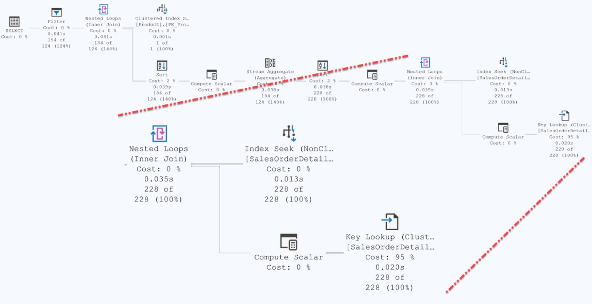  
*Hình 11-1. Kế hoạch thực thi của truy vấn phát sinh thao tác Key Lookup (Clustered)*

Trong Hình 11-1, bạn thấy nhánh trên thực hiện một thao tác **Index Seek** trên chỉ mục nonclustered `IX_SalesOrderDetail_ProductID`, sau đó kết hợp với toán tử **Key Lookup (Clustered)** thông qua một vòng lặp lồng nhau (**Nested Loops**). 

Khi quan sát thuộc tính **Output List** của toán tử Key Lookup, bạn sẽ thấy rõ danh sách các cột đang bị thiếu trong chỉ mục nonclustered mà SQL Server buộc phải tra cứu từ Clustered Index:

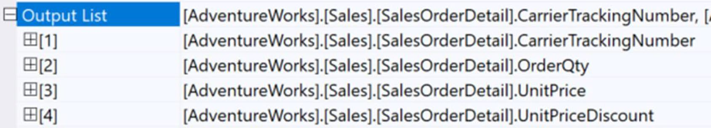  
*Hình 11-2. Cửa sổ thuộc tính Properties hiển thị danh sách Output List của toán tử Key Lookup*

---

## Các vấn đề Hiệu năng do Lookups gây ra (Performance Issues Caused by Lookups)

Một thao tác Lookup đòi hỏi hệ thống phải truy cập đồng thời cả các trang dữ liệu của chỉ mục nonclustered lẫn các trang dữ liệu của Clustered Index (hoặc Heap). Việc phải truy cập nhiều trang dữ liệu hơn hiển nhiên làm gia tăng trực tiếp số lượng thao tác đọc logic (**Logical Reads**) cho câu truy vấn.

Hơn thế nữa:
1. **Chi phí I/O ngẫu nhiên (Random I/O Overhead):** Nếu các trang dữ liệu của bảng chính chưa nằm sẵn trong bộ nhớ đệm (Buffer Cache), mỗi lần Lookup sẽ đòi hỏi một thao tác đọc đĩa ngẫu nhiên (nonsequential / random I/O) để nhảy từ trang chỉ mục sang trang dữ liệu. I/O ngẫu nhiên luôn có tốc độ chậm hơn và gây áp lực lớn hơn rất nhiều so với I/O tuần tự (Sequential I/O).
2. **Tiêu hao năng lực CPU:** Cần thêm các chu kỳ xử lý của CPU để sắp xếp, đối chiếu và ghép nối các dòng dữ liệu.
3. **Chi phí phép nối (Join Overhead):** Chi phí phát sinh từ chính toán tử Nested Loops dùng để liên kết tập dữ liệu từ chỉ mục nonclustered với kết quả trả về từ bảng Clustered Index.

Chính vì những chi phí đắt đỏ này, nguyên tắc thiết kế chuẩn mực là: **Chỉ nên cho phép thao tác Lookup diễn ra đối với các tập dữ liệu kết quả có kích thước rất nhỏ**. Khi số lượng dòng dữ liệu trả về gia tăng, chi phí tích lũy của thao tác Lookup sẽ tăng vọt theo cấp số nhân!

### Hiện tượng Điểm bùng phát (The Tipping Point)

Hãy cùng khảo sát một ví dụ thực tế. Listing 11-2 minh họa một câu truy vấn trả về một tập dữ liệu tương đối lớn và yêu cầu tất cả các cột thông qua `SELECT *`:

```sql
-- Listing 11-2. A larger data set from the SalesOrderDetail table
SELECT *
FROM Sales.SalesOrderDetail AS sod
WHERE sod.ProductID = 793;
```

Khi thực thi câu lệnh này, optimizer nhận thấy có tới hàng nghìn dòng thỏa mãn điều kiện `ProductID = 793`. Thay vì sử dụng chỉ mục nonclustered trên `ProductID` rồi thực hiện hàng nghìn lần Key Lookup, optimizer đã thông minh chuyển sang quét toàn bộ bảng:

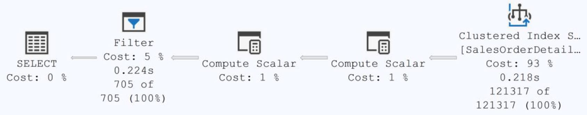  
*Hình 11-3. Bộ tối ưu hóa tự động chuyển sang Clustered Index Scan khi vượt qua Điểm bùng phát (Tipping Point)*

Thời điểm mà tại đó optimizer nhận định rằng: *"Thực hiện quét toàn bộ bảng một lần tuần tự còn rẻ hơn và nhanh hơn so với việc Seek chỉ mục rồi thực hiện lặp đi lặp lại hàng nghìn thao tác Key Lookup ngẫu nhiên"* được gọi là **Điểm bùng phát (Tipping Point)**.

Để chứng minh chi phí khủng khiếp của Key Lookup trên tập dữ liệu lớn, chúng ta có thể cưỡng bức optimizer sử dụng chỉ mục nonclustered bằng cách chèn gợi ý chỉ mục (Index Hint) như trong Listing 11-3:

```sql
-- Listing 11-3. Forcing an index to be used
SELECT *
FROM Sales.SalesOrderDetail AS sod WITH (INDEX(IX_SalesOrderDetail_ProductID))
WHERE sod.ProductID = 793;
```

Khi bị ép buộc sử dụng chỉ mục nonclustered, câu lệnh trong Listing 11-3 sẽ phải thực hiện một thao tác Index Seek kèm theo hàng nghìn lần Key Lookup lặp đi lặp lại. Số lần đọc logic và thời gian thực thi sẽ tăng vọt gấp nhiều lần so với kế hoạch quét tuần tự ở Hình 11-3! 

Điều này minh chứng rõ ràng: Mặc dù Lookup là một cơ chế cần thiết để lấy dữ liệu, nó có thể trở nên cực kỳ đắt đỏ nếu khối lượng dữ liệu vượt qua ngưỡng kiểm soát.

---

## Phân tích Nguyên nhân phát sinh Lookups (Analysis of the Causes of Lookups)

Không phải mọi thao tác Lookup đều bắt buộc phải bị loại bỏ. Có những câu truy vấn rất hiếm khi được gọi, hoặc tự thân chúng đã chạy đủ nhanh để đáp ứng SLA của người dùng. Tuy nhiên, khi một câu truy vấn có tần suất chạy cao cần được tăng tốc, việc triệt tiêu thao tác Lookup chính là "trái ngọt dễ hái nhất" (**low-hanging fruit**) để đạt được sự nhảy vọt về hiệu năng.

Hãy xem xét một câu truy vấn trong Listing 11-4 trích xuất thông tin nhân viên từ bảng `HumanResources.Employee`:

```sql
-- Listing 11-4. Retrieving basic information from the Employee table
SELECT NationalIDNumber,
       JobTitle,
       HireDate
FROM HumanResources.Employee AS E
WHERE E.NationalIDNumber = '693168613';
```

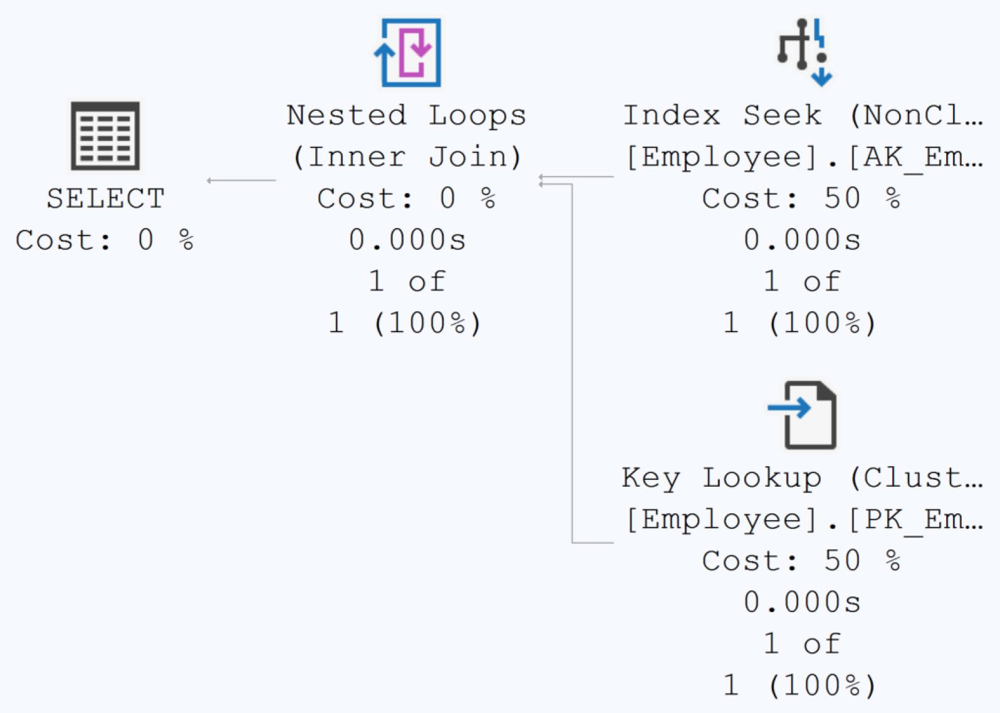  
*Hình 11-4. Kế hoạch thực thi hiển thị thao tác Key Lookup tiêu chuẩn*

Trong ví dụ đơn giản này, vì câu lệnh chỉ lấy đúng 3 cột và chúng ta biết chỉ mục nonclustered nằm trên cột `NationalIDNumber`, nên việc suy luận rằng Lookup đang diễn ra để lấy 2 cột còn lại (`JobTitle` và `HireDate`) là rất dễ dàng.

Tuy nhiên, đối với các câu truy vấn phức tạp trong thực tế – nơi có hàng chục bảng kết nối với nhau và các cột xuất hiện rải rác trong nhiều mệnh đề `SELECT`, `WHERE`, `JOIN` và `ORDER BY` – việc chỉ nhìn vào đoạn mã T-SQL để đoán xem những cột nào đang gây ra Lookup là vô cùng khó khăn. Khi đó, việc mở thuộc tính **Output List** của toán tử Key Lookup trên kế hoạch thực thi (tương tự như Hình 11-2) chính là phương pháp chuẩn xác duy nhất để chỉ mặt điểm tên các cột cần xử lý.

Để xác định chính xác những cột nào đang gây ra thao tác tra cứu, bạn có thể kiểm tra thuộc tính **Output List** (Danh sách cột đầu ra) của toán tử Key Lookup trong cửa sổ Properties (Thuộc tính) của kế hoạch thực thi, như minh họa trong Hình 11-5.

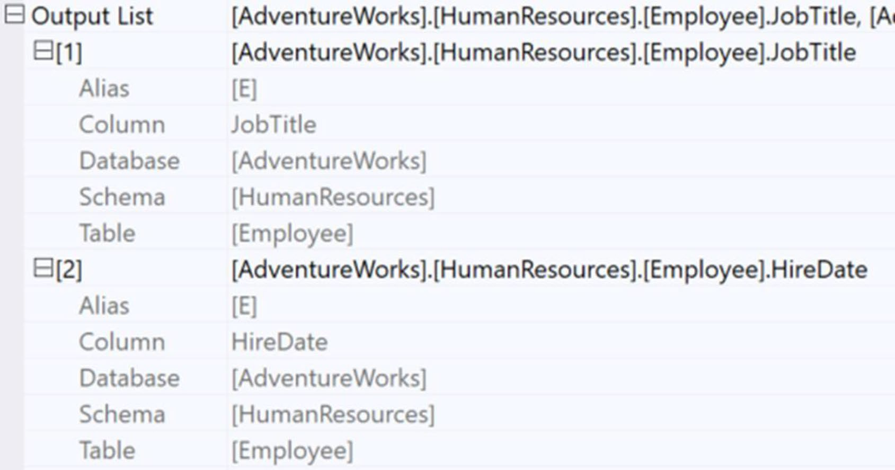

Bạn cũng có thể xem các cột này được làm nổi bật trực tiếp trong cửa sổ hiển thị thông tin chi tiết (tooltip / text window) của toán tử, như thấy trong Hình 11-6.

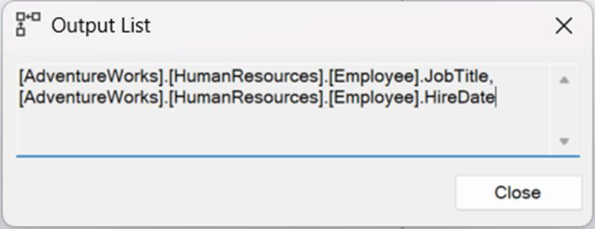

Với thông tin cụ thể về các cột cần truy xuất này, giờ đây bạn có thể đưa ra quyết định về phương án xử lý thao tác tra cứu (lookup).

---

## Các kỹ thuật giải quyết Lookup (Techniques to Resolve Lookups)

Như tôi đã đề cập từ đầu chương và điều này rất đáng được nhắc lại: không phải mọi thao tác lookup đều đòi hỏi bạn phải xử lý ngay lập tức. Việc thấu hiểu cách thức truy vấn vận hành trong toàn bộ hệ thống sẽ giúp bạn quyết định xem có thực sự cần khắc phục lookup hay không. Tuy nhiên, trong thực tế, bạn thường không để mắt tới các thao tác lookup trong những truy vấn đang chạy đủ nhanh; bạn chỉ xem xét kế hoạch thực thi của một truy vấn khi nó đang chạy chậm chạp.

Để khắc phục một thao tác lookup, bạn có ba hướng tiếp cận cơ bản:

1. **Tạo một chỉ mục gom cụm (Create a clustered index).**
2. **Sử dụng một chỉ mục bao phủ (Use a covering index).**
3. **Tận dụng phép nối chỉ mục (Take advantage of index joins).**

Hãy cùng khám phá chi tiết từng phương pháp này.

### Tạo một chỉ mục gom cụm (Create a Clustered Index)

Do các trang ở tầng lá (*leaf pages*) của một chỉ mục gom cụm chứa toàn bộ các cột dữ liệu của bảng (chỉ với một vài ngoại lệ rất nhỏ), nên khi chỉ mục gom cụm được sử dụng để truy xuất các dòng dữ liệu, hoàn toàn không cần đến bất kỳ thao tác tra cứu nào. Nếu chỉ mục được sử dụng trong Listing 11-4 trước đó được tạo lại dưới vai trò là chỉ mục gom cụm cho bảng, thao tác lookup sẽ hoàn toàn biến mất.

Tuy nhiên, trong phần lớn các trường hợp thực tế, đây không phải là một giải pháp khả thi. Bảng của bạn thường đã được thiết kế xoay quanh một chỉ mục gom cụm chuẩn mực và quan trọng khác. Bạn không thể — và trên thực tế là không nên — tùy tiện hoán đổi các chỉ mục này cho nhau, ít nhất là khi chưa trải qua quá trình kiểm thử diện rộng và toàn diện. Dù vậy, nếu bạn đang làm việc với một bảng heap (bảng không có chỉ mục gom cụm), bạn sẽ có cơ hội tạo một chỉ mục gom cụm mới, qua đó giải quyết triệt để mọi thao tác RID Lookup.

### Sử dụng một chỉ mục bao phủ (Use a Covering Index)

Trong Chương 10, tôi đã giải thích rằng một chỉ mục bao phủ (*covering index*) là chỉ mục chứa đầy đủ tất cả các cột cần thiết để đáp ứng cho một truy vấn nhất định. Điều này đồng nghĩa với việc chỉ mục sẽ không cần phải tìm kiếm ngược về nơi dữ liệu gốc được lưu trữ (bảng heap hoặc clustered index) để lấy thêm các cột còn thiếu.

Bạn có hai cơ chế để biến một chỉ mục phi gom cụm thành một chỉ mục bao phủ:

#### 1. Đưa tất cả các cột vào Khóa chỉ mục (Index Key)

Cơ chế đầu tiên là thay đổi định nghĩa khóa của chỉ mục để bao gồm tất cả các cột mà truy vấn yêu cầu. Lựa chọn này dẫn đến những hệ quả rất nghiêm trọng đối với cấu trúc chỉ mục. Trước hết, hãy cùng xem biểu đồ mật độ (*density graph*) của chỉ mục hiện tại `AK_Employee_NationalIDNumber` bằng cách thực thi lệnh trong Listing 11-5.

**Listing 11-5.** Sử dụng DBCC SHOW_STATISTICS để xem biểu đồ mật độ

```sql
DBCC SHOW_STATISTICS('HumanResources.Employee', 'AK_Employee_NationalIDNumber') WITH DENSITY_VECTOR;
```

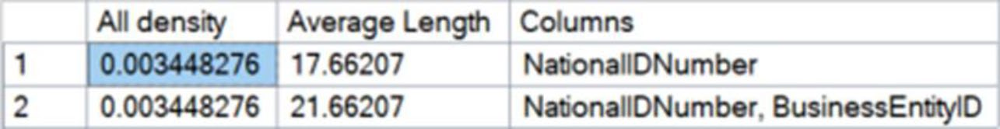

Độ dài khóa trung bình (*average key length*) của chỉ mục hiện tại — bao gồm cột được lập chỉ mục `NationalIDNumber` và bộ định danh dòng (*row identifier*, trong trường hợp này chính là khóa của chỉ mục gom cụm `BusinessEntityID`) — là **21.66** byte.

Chúng ta có thể thử xử lý thao tác lookup bằng cách sửa đổi chỉ mục hiện tại để bổ sung thêm các cột vào khóa chỉ mục như trong Listing 11-6.

**Listing 11-6.** Tạo lại chỉ mục với tập khóa mới

```sql
CREATE UNIQUE NONCLUSTERED INDEX AK_Employee_NationalIDNumber
ON [HumanResources].[Employee] (
                                   NationalIDNumber ASC,
                                   JobTitle,
                                   HireDate
                               )
WITH DROP_EXISTING;
```

Khi thực thi lại truy vấn trong Listing 11-4 với chỉ mục mới này, thao tác lookup đã hoàn toàn bị loại bỏ, như hiển thị trong Hình 11-8.

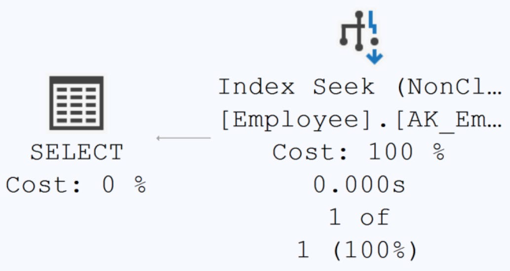

Bây giờ, hãy kiểm tra lại biểu đồ mật độ của chỉ mục mới này bằng cách chạy lại lệnh trong Listing 11-5. Kết quả được minh họa trong Hình 11-9.

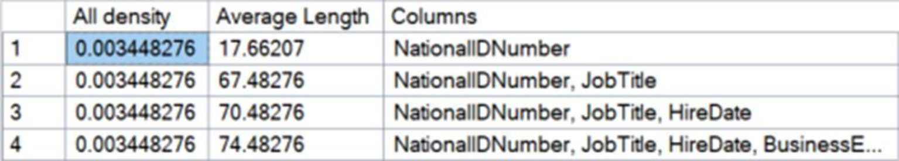

Độ dài trung bình của khóa chỉ mục đã tăng vọt từ 21.66 lên **74.48** byte — tức là lớn hơn gấp ba lần! Điều này đồng nghĩa với việc số lượng dòng dữ liệu có thể chứa trên mỗi trang chỉ mục sẽ ít đi đáng kể, và do đó số lượt đọc trang (*page reads*) sẽ tăng lên mỗi khi truy cập vào chỉ mục mới này. Đó là chưa kể đến việc hành vi tổng thể của chỉ mục giờ đây cũng sẽ bị biến đổi hoàn toàn đối với các truy vấn khác.

#### 2. Sử dụng mệnh đề INCLUDE để đưa các cột vào tầng lá

Cách thứ hai để tạo ra một chỉ mục bao phủ là giữ nguyên tập khóa chỉ mục ban đầu và chỉ đơn giản đưa thêm các cột dữ liệu bạn cần vào tầng lá (*leaf level*) của chỉ mục bằng cách sử dụng mệnh đề `INCLUDE`, như hiển thị trong Listing 11-7.

**Listing 11-7.** Sử dụng mệnh đề INCLUDE để tạo lại chỉ mục

```sql
CREATE UNIQUE NONCLUSTERED INDEX AK_Employee_NationalIDNumber
ON [HumanResources].[Employee] (NationalIDNumber ASC)
INCLUDE (
            JobTitle,
            HireDate
        )
WITH DROP_EXISTING;
```

Sau khi xây dựng lại chỉ mục bằng mệnh đề `INCLUDE`, nếu chúng ta kiểm tra lại thông tin thống kê và độ dài khóa trung bình, kết quả sẽ hiển thị như trong Hình 11-10.

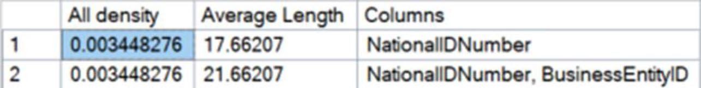

Độ dài khóa trung bình (*average key length*) đã quay trở về đúng mức ban đầu (21.66 byte). Lý do là vì dù chúng ta đã bổ sung thêm dữ liệu vào chỉ mục, các cột này được lưu trữ độc quyền ở tầng lá (*leaf level*) chứ không nằm trong cấu trúc khóa của các trang nhánh hay gốc (*intermediate/root pages*). Nhìn chung, giải pháp này sẽ mang lại hiệu năng đọc tốt hơn; tuy nhiên, đối với một khóa có kích thước nhỏ và tập dữ liệu ít dòng như trong ví dụ minh họa này, bạn có thể chưa thấy sự chênh lệch I/O rõ rệt ngay lập tức.

Trước khi chuyển sang chủ đề tiếp theo, vẫn còn một cách tiếp cận khác để biến một chỉ mục thành chỉ mục bao phủ (*covering index*). Tôi sẽ đặt lại chỉ mục trở về trạng thái ban đầu bằng lệnh trong Listing 11-8.

**Listing 11-8.** Thiết lập lại chỉ mục

```sql
CREATE UNIQUE NONCLUSTERED INDEX AK_Employee_NationalIDNumber
ON [HumanResources].[Employee] (NationalIDNumber ASC)
INCLUDE (
            JobTitle,
            HireDate
        )
WITH DROP_EXISTING;
```

> **[Ghi chú của người dịch]:** Trong nguyên bản sách, Listing 11-8 vô tình lặp lại mệnh đề `INCLUDE` của Listing 11-7. Để đưa chỉ mục trở về trạng thái nguyên bản của AdventureWorks (chỉ có khóa trên `NationalIDNumber`), câu lệnh chuẩn là:
> ```sql
> CREATE UNIQUE NONCLUSTERED INDEX AK_Employee_NationalIDNumber
> ON [HumanResources].[Employee] (NationalIDNumber ASC)
> WITH DROP_EXISTING;
> ```
> Dù chỉ mục có chứa mệnh đề `INCLUDE` hay không, thì với truy vấn kế tiếp trong Listing 11-9, chỉ mục này vẫn hoạt động như một covering index hoàn hảo. Lý do là vì `BusinessEntityID` chính là khóa phân cụm (*Clustered Key*) của bảng `Employee`, và trong SQL Server, khóa phân cụm luôn được tự động lưu trữ kèm theo tại tầng lá của mọi Nonclustered Index.

Bây giờ, nếu chúng ta sửa đổi chính câu truy vấn để thay đổi các cột cần trích xuất dữ liệu, chúng ta lại có thể quan sát thấy một covering index hoạt động. Listing 11-9 minh họa câu truy vấn đã được cập nhật.

**Listing 11-9.** Truy vấn đã được sửa đổi

```sql
SELECT NationalIDNumber,
       E.BusinessEntityID
FROM HumanResources.Employee AS E
WHERE E.NationalIDNumber = '693168613';
```

Trong trường hợp này, vì cả hai cột `NationalIDNumber` (cột khóa) và `BusinessEntityID` (khóa phân cụm) đều đã có sẵn trong chỉ mục không gom cụm, Query Optimizer không cần phải thực hiện bất kỳ thao tác Key Lookup nào mà vẫn đáp ứng trọn vẹn kết quả cho truy vấn.

---

### Tận dụng Index Joins (Take Advantage of Index Joins)

Tôi đã giới thiệu khái niệm về phép nối chỉ mục (*index join*) trong Chương 10. Như đã trình bày ở đó, các trường hợp index join xuất hiện trong thực tế là tương đối hiếm gặp, do đó việc quá trông cậy vào chúng như một chiến lược tinh chỉnh chính yếu có thể mang lại nhiều rủi ro.

Chẳng hạn, đoạn mã ban đầu mà chúng ta đã dùng để thử nghiệm xuyên suốt chương này (Listing 11-4) hoàn toàn không thể tinh chỉnh được bằng một index join. Nguyên nhân cốt lõi là vì câu truy vấn đó không có bất kỳ điều kiện lọc (*filtering criteria*) nào trên các cột còn lại; do đó, việc tạo các chỉ mục đơn lẻ trên những cột đó sẽ không mang lại bất kỳ lợi ích nào cho hiệu năng.

Để thấy rõ cơ chế hoạt động của một index join, chúng ta sẽ xem xét một ví dụ mới trong Listing 11-10.

**Listing 11-10.** Truy vấn trên bảng PurchaseOrderHeader

```sql
SELECT poh.PurchaseOrderID,
       poh.VendorID,
       poh.OrderDate
FROM Purchasing.PurchaseOrderHeader AS poh
WHERE VendorID = 1636
      AND poh.OrderDate = '2014/6/24';
```

Khi thực thi câu truy vấn này, thời gian thực thi ghi nhận là **614 µs** với **10 lần đọc logic** (*logical reads*). Kế hoạch thực thi được thể hiện trong Hình 11-11.

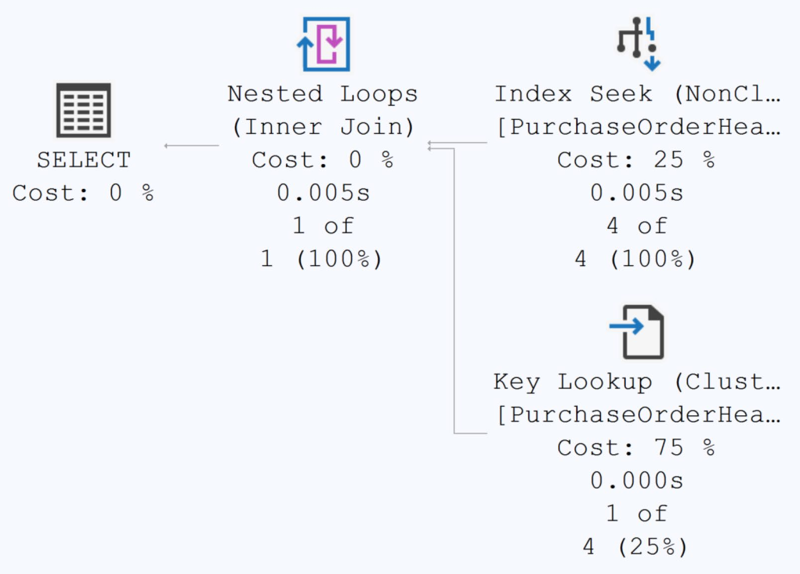

Tương tự như các truy vấn khác trong chương này, các cột được yêu cầu trong câu truy vấn không nằm trọn vẹn trong bất kỳ chỉ mục không gom cụm nào hiện có trên bảng. Điều này có nghĩa là mặc dù chỉ mục `IX_PurchaseOrderHeader_VendorID` có thể lọc dữ liệu dựa trên tiêu chí `VendorID = 1636` trong mệnh đề `WHERE`, nhưng phần còn lại của các cột (`OrderDate`) bắt buộc phải được lấy từ Clustered Index thông qua thao tác Key Lookup.

Như chúng ta đã chứng minh ở phần trước, bạn có thể sửa đổi chỉ mục hiện có và thêm cột để biến nó thành một covering index. Tuy nhiên, hành động đó sẽ làm thay đổi bản chất của chỉ mục — hoặc làm tăng độ dài khóa, hoặc làm tăng kích thước tổng thể với các cột dữ liệu ở tầng lá. Liệu việc sửa đổi một chỉ mục hiện có có nguy cơ gây ảnh hưởng tiêu cực (*negative impact*) đến các câu truy vấn khác đang sử dụng chỉ mục đó hay không?

Chúng ta có thể thử nghiệm xem liệu một **index join** có khả thi hay không bằng cách tạo thêm một chỉ mục mới trong Listing 11-11.

**Listing 11-11.** Tạo thêm một chỉ mục không gom cụm mới

```sql
CREATE NONCLUSTERED INDEX IX_TEST
ON Purchasing.PurchaseOrderHeader (OrderDate);
```

Sau khi tạo chỉ mục này, hãy thực thi lại câu truy vấn trong Listing 11-10. Thời gian thực thi giảm ngoạn mục xuống còn **4.66 µs** và số lượt đọc giảm xuống chỉ còn **4 lần đọc logic**. Kế hoạch thực thi mới được minh họa trong Hình 11-12.

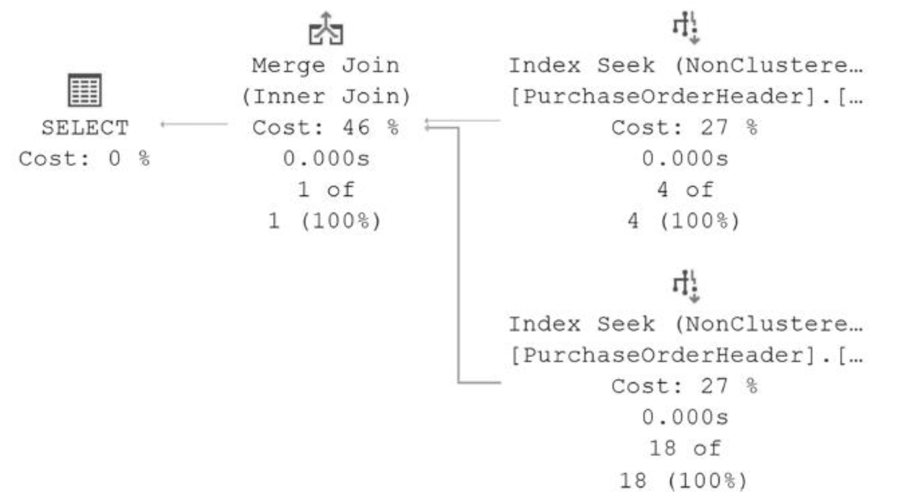

Trong kế hoạch thực thi này, cả hai chỉ mục đều được Query Optimizer sử dụng thông qua các thao tác Index Seek:
1. Một thao tác tìm kiếm trên chỉ mục `IX_PurchaseOrderHeader_VendorID` để lọc các dòng khớp với `VendorID = 1636`.
2. Một thao tác tìm kiếm trên chỉ mục mới `IX_TEST` để lọc các dòng khớp với `OrderDate = '2014/6/24'`.

Do dữ liệu đầu ra từ cả hai thao tác tìm kiếm chỉ mục này đều đã được sắp xếp theo cùng một khóa phân cụm (`PurchaseOrderID`), Query Optimizer có thể sử dụng toán tử **Merge Join** để kết hợp hai tập kết quả lại với nhau nhằm lấy ra một dòng dữ liệu duy nhất thỏa mãn cả hai điều kiện, mà không cần phải truy cập vào Clustered Index! Số lượt đọc logic giảm từ 10 xuống còn 4, và bạn cũng chứng kiến một sự cải thiện hiệu năng vượt bậc tương ứng.

Dù vậy, cần lưu ý rằng việc sửa đổi trực tiếp chỉ mục `IX_PurchaseOrderHeader_VendorID` để trở thành một covering index hoàn chỉnh (chẳng hạn dùng `INCLUDE (OrderDate)`) trên thực tế vẫn sẽ mang lại hiệu năng cao hơn giải pháp Index Join này. Lý do là vì covering index sẽ loại bỏ hoàn toàn toán tử Merge Join cũng như các lần đọc trên chỉ mục thứ hai. Tuy nhiên, như đã phân tích, trong trường hợp bạn bị ràng buộc không thể hoặc không muốn sửa đổi chỉ mục hiện hành vì lo ngại rủi ro hồi quy (*regression*), việc tận dụng một Index Join có thể là một giải pháp tình thế hữu hiệu.

---

### Khi Nào Nên Chấp Nhận Giữ Lại Key Lookup?

Mặc dù thao tác Lookup thường là đối tượng hàng đầu cần rà soát khi tối ưu hóa truy vấn, nhưng **không phải mọi thao tác lookup đều bắt buộc phải loại bỏ bằng mọi giá**. Việc loại bỏ Lookup luôn đi kèm với chi phí đánh đổi (*trade-offs*):

1. **Chi phí bảo trì chỉ mục (Index Maintenance Overhead):**
   Mỗi khi bạn bổ sung một chỉ mục mới hoặc mở rộng các cột trong mệnh đề `INCLUDE`, dung lượng lưu trữ trên đĩa và trong bộ đệm (*Buffer Pool*) sẽ tăng lên. Quan trọng hơn, mọi thao tác ghi dữ liệu (DML: `INSERT`, `UPDATE`, `DELETE`) trên bảng đều phải cập nhật thêm các trang chỉ mục phụ này. Nếu bảng có tần suất ghi cao (hệ thống OLTP), chi phí ghi gia tăng có thể làm suy giảm nghiêm trọng thông lượng tổng thể của hệ thống.

2. **Tần suất thực thi của truy vấn (Query Execution Frequency):**
   Nếu một truy vấn có thao tác Key Lookup nhưng chỉ được thực thi định kỳ một lần mỗi ngày hoặc mỗi tháng (như báo cáo tài chính cuối tháng), và thời gian chạy của nó vẫn hoàn toàn nằm trong giới hạn cam kết dịch vụ (SLA) cho phép, thì việc tạo thêm một chỉ mục hoặc mở rộng chỉ mục hiện có là một sự lãng phí tài nguyên không cần thiết.

3. **Số lượng dòng cần tra cứu rất nhỏ:**
   Khi câu truy vấn sử dụng Index Seek có độ chọn lọc cực kỳ cao (chẳng hạn chỉ trả về 1 hoặc 2 dòng dữ liệu duy nhất), chi phí cho 1–2 lần nhảy trang ngẫu nhiên của Key Lookup là vô cùng nhỏ và hoàn toàn không phải là nút thắt cổ chai (*bottleneck*) của hệ thống.

Do đó, người quản trị cơ sở dữ liệu và kỹ sư tối ưu hóa cần luôn cân nhắc giữa lợi ích tăng tốc của một câu truy vấn đơn lẻ với chi phí duy trì tổng thể của toàn bộ khối lượng công việc (*workload*) trên cơ sở dữ liệu.

---

### Tóm Tắt Chương (Summary)

Như bạn đã thấy qua các đoạn mã và ví dụ thực tế trong chương này, SQL Server cung cấp nhiều cơ chế khác nhau để xử lý các thao tác tra cứu dữ liệu (*lookups*), dù đó là trên một bảng heap (RID Lookup) hay một bảng có chỉ mục gom cụm (Key Lookup). Thao tác lookup không hề "miễn phí"; chúng tiêu tốn tài nguyên I/O ngẫu nhiên và chi phí CPU để điều phối dữ liệu. Do đó, việc loại bỏ hoặc giảm thiểu lookup luôn là một trong những lựa chọn hàng đầu và dễ đạt kết quả nhất (*low-hanging fruit*) để cải thiện đáng kể hiệu năng của một câu truy vấn cụ thể.

Quá trình phân tích bản thân thao tác lookup thực chất rất đơn giản, bởi vì toán tử lookup trên kế hoạch thực thi luôn chỉ rõ cho bạn biết chính xác những cột dữ liệu nào đang thiếu hụt và cần phải truy xuất thêm (thông qua thuộc tính *Output List*). Khi đã nắm rõ thông tin này, vấn đề chỉ còn là việc lựa chọn phương án tối ưu nhất trong số các giải pháp khả thi để xử lý:
- Tạo chỉ mục gom cụm phù hợp (đặc biệt đối với Heap table).
- Tạo Covering Index bằng cách mở rộng tập khóa hoặc sử dụng mệnh đề `INCLUDE`.
- Tận dụng Index Joins khi có các chỉ mục phù hợp trên các cột điều kiện lọc.

Trong chương tiếp theo, chúng ta sẽ cùng nhau thảo luận về một chủ đề từng gây ra rất nhiều tranh luận và quan điểm trái chiều trong cộng đồng SQL Server: **sự phân mảnh chỉ mục (Index Fragmentation)**. Chúng ta sẽ cùng phân tích xem phân mảnh có thực sự là một vấn đề nghiêm trọng hay không, khi nào nó mới bắt đầu ảnh hưởng đến hiệu năng hệ thống, và cách thức xử lý tối ưu nhất khi nó trở thành một vấn đề đáng lo ngại.