# CHƯƠNG 12: Xử lý Phân mảnh Chỉ mục (Dealing with Index Fragmentation)

> **Thông tin sách gốc:**  
> © Grant Fritchey 2026  
> G. Fritchey, *SQL Server 2025 Query Performance Tuning*, https://doi.org/10.1007/979-8-8688-1865-3_12  

---

Khi người dùng và các ứng dụng thao tác với cơ sở dữ liệu, họ liên tục thực hiện các thay đổi: chèn thêm dữ liệu mới (`INSERT`), xóa bỏ dữ liệu không còn cần thiết (`DELETE`), hoặc cập nhật sửa đổi dữ liệu hiện có (`UPDATE`). Cùng với sự biến động đó của dữ liệu, các chỉ mục của bạn – bao gồm cả Rowstore lẫn Columnstore – đều bị ảnh hưởng trực tiếp, mặc dù theo những phương thức rất khác nhau.

* Đối với **Chỉ mục Rowstore**: Các thao tác thay đổi dữ liệu có thể dẫn đến hiện tượng **phân tách trang (Page Splits)**, các trang bị đảo lộn trật tự vật lý hoặc xuất hiện nhiều khoảng trống vô ích trên trang – tất cả những điều này được gọi chung bằng thuật ngữ **Phân mảnh (Fragmentation)**.
* Đối với **Chỉ mục Columnstore**: Bạn không phải đối mặt với hiện tượng phân tách trang tương tự, nhưng bạn phải xử lý cấu trúc **Deltastore**, các bản ghi bị đánh dấu xóa logic (Deleted Rows Tombstone), hoặc các nhóm dòng (Rowgroups) ở trạng thái mở chưa được nén.

Trong một số trường hợp nhất định, phân mảnh có thể dẫn đến sự suy giảm hiệu năng nghiêm trọng. Tuy nhiên, điều trớ trêu là: **các biện pháp khắc phục phân mảnh đôi khi cũng có thể gây ra suy giảm hiệu năng không kém!**

Trong chương này, tôi sẽ đề cập đến các chủ đề sau:
* Các nguyên nhân gây phân mảnh chỉ mục Rowstore
* Các nguyên nhân gây phân mảnh chỉ mục Columnstore
* Bản chất tác động của phân mảnh lên hiệu năng thực thi truy vấn
* Phương pháp phân tích mức độ phân mảnh trên cả hai loại chỉ mục
* Các kỹ thuật chuyên sâu để giải quyết phân mảnh
* Ý nghĩa và vai trò của hệ số điền đầy (**Fill Factor**) trong việc kiểm soát phân mảnh trên Rowstore
* Các kỹ thuật tự động hóa quy trình bảo trì phân mảnh

---

## Nguyên nhân gây Phân mảnh trên Chỉ mục Rowstore (Causes of Rowstore Fragmentation)

Mọi thao tác sửa đổi dữ liệu bên trong cơ sở dữ liệu đều có thể dẫn đến phân mảnh chỉ mục. Thêm hoặc bớt một dòng qua các lệnh `INSERT` hoặc `DELETE` đều tạo ra biến động trên cả Clustered lẫn Nonclustered Index. Các lệnh `UPDATE` làm tăng kích thước bản ghi cũng là nguồn cơn phổ biến dẫn đến phân mảnh.

### Bản chất của Phân mảnh trong Chỉ mục Rowstore
Chìa khóa để thấu hiểu phân mảnh bắt nguồn từ cách thức chỉ mục lưu trữ dữ liệu. Mọi dữ liệu đều được chứa trong các **trang dữ liệu cố định 8KB (Data Pages)**:
* Xóa dữ liệu khỏi trang sẽ để lại các **khoảng trống (gaps / free space)**.
* Chèn dữ liệu vào một trang đã đầy sẽ dẫn đến nhu cầu cấp phát một trang mới.
* Sửa đổi dữ liệu trên một trang đã đầy khiến bản ghi phình to ra cũng buộc hệ thống phải tìm trang mới.

Khi các trang dữ liệu mới được cấp phát cho chỉ mục, chúng **không nhất thiết nằm kế tiếp nhau về mặt vật lý trên đĩa cứng**. Mặc dù về mặt logic, dữ liệu luôn đảm bảo duy trì đúng trật tự sắp xếp theo khóa chỉ mục (thông qua các con trỏ liên kết hai chiều Next Page / Previous Page), nhưng trật tự vật lý trên đĩa và trật tự logic trong bộ nhớ có thể hoàn toàn tách rời nhau.

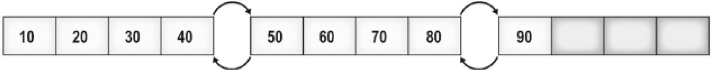  
*Hình 12-1. Các trang tầng lá nằm liên tục, trật tự vật lý khớp hoàn hảo với trật tự logic*

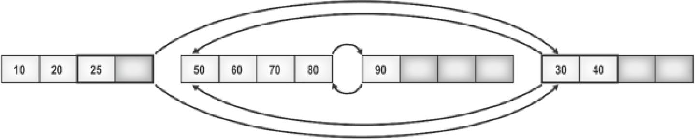  
*Hình 12-2. Các trang tầng lá bị xáo trộn trật tự vật lý trên đĩa cứng*

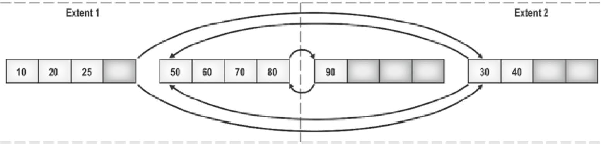  
*Hình 12-3. Các trang dữ liệu bị phân tán rải rác trên nhiều vùng cấp phát Extent khác nhau*

### Phân loại Phân mảnh:
1. **Phân mảnh ngoài (External / Extent Fragmentation):** Các trang dữ liệu của chỉ mục bị phân tán rải rác trên nhiều vùng cấp phát (Extents) không liên tục trên đĩa cứng (như trong Hình 12-3).
2. **Phân mảnh trong (Internal Fragmentation):** Mức độ khoảng trống tự do (free space) xuất hiện bên trong từng trang dữ liệu do hậu quả của việc phân tách trang hoặc xóa dòng dữ liệu để lại.

Cả hai dạng phân mảnh này đều có thể dẫn đến hiệu năng kém khi thực hiện các câu truy vấn quét vùng dữ liệu (**Range Scans**). Hãy hình dung một truy vấn tìm kiếm các giá trị từ 25 đến 90 trong Hình 12-3:
* Hệ thống phải chuyển vùng Extent để đọc giá trị 30 (nằm sau 25).
* Tiếp theo, nó phải nhảy ngược Extent để đọc giá trị 50 (nằm sau 40).
* Cuối cùng, một lần chuyển đổi Extent khác lại diễn ra để đọc giá trị 90.

Tuy nhiên, điều thú vị là: **Khoảng trống tự do trên trang (Internal Free Space) đôi khi lại là một điều tuyệt vời đối với các hệ thống giao dịch trực tuyến (OLTP) tần suất cao!** Trong ví dụ trên, nếu có một giao dịch mới chèn giá trị `26`, giá trị này có thể nhảy ngay vào khoảng trống sẵn có trên trang chứa số 25 mà không gây ra bất kỳ sự cố phân tách trang nào.

> [!WARNING]
> **Hiểm họa phân mảnh trên bảng Heap:**  
> Tình trạng phân mảnh trên bảng Heap còn tồi tệ hơn rất nhiều. Khi bạn chạy lệnh `ALTER TABLE ... REBUILD` trên một bảng Heap để dọn dẹp phân mảnh, các dòng dữ liệu vật lý sẽ được di chuyển sang vị trí mới, làm thay đổi toàn bộ mã định danh dòng (**RID**). Hậu quả là: **toàn bộ tất cả các chỉ mục Nonclustered đang tồn tại trên bảng Heap đó bắt buộc phải bị xây dựng lại hoàn toàn từ đầu** để cập nhật lại các con trỏ RID mới!

---

### Phân tách trang do Lệnh UPDATE (Page Split from an UPDATE Statement)

Hãy cùng thiết lập một kịch bản thực nghiệm để chứng kiến tận mắt hiện tượng phân tách trang. Listing 12-1 tạo một bảng dữ liệu thử nghiệm trong đó toàn bộ 8 dòng dữ liệu vừa khít trên duy nhất một trang 8KB:

```sql
-- Listing 12-1. Creating a table in support of a page split
DROP TABLE IF EXISTS dbo.SplitTest;
GO

CREATE TABLE dbo.SplitTest
(
    C1 INT,
    C2 CHAR(999),
    C3 VARCHAR(10)
);

INSERT INTO dbo.SplitTest
(
    C1,
    C2,
    C3
)
VALUES
(100, 'C2', ''),
(200, 'C2', ''),
(300, 'C2', ''),
(400, 'C2', ''),
(500, 'C2', ''),
(600, 'C2', ''),
(700, 'C2', ''),
(800, 'C2', '');

CREATE CLUSTERED INDEX iClustered ON dbo.SplitTest (C1);
```

Tính toán dung lượng vật lý:
* Cột `C1` (`INT`): 4 bytes
* Cột `C2` (`CHAR(999)`): 999 bytes
* Cột `C3` (`VARCHAR(10)`): chuỗi rỗng = 0 bytes (chưa tính overhead hàng)
* Dung lượng trung bình mỗi dòng: `4 + 999 + 0 ≈ 1.003 bytes`.

Với dung lượng tối đa một trang dữ liệu là 8.060 bytes, cả 8 dòng này vừa vặn chứa trọn trong **duy nhất 1 trang 8KB**. Chúng ta kiểm tra thông số vật lý của chỉ mục bằng `sys.dm_db_index_physical_stats` trong Listing 12-2:

```sql
-- Listing 12-2. Querying the index to get its physical layout
SELECT ddips.avg_fragmentation_in_percent,
       ddips.fragment_count,
       ddips.page_count,
       ddips.avg_page_space_used_in_percent,
       ddips.record_count,
       ddips.avg_record_size_in_bytes
FROM sys.dm_db_index_physical_stats(DB_ID('AdventureWorks'), OBJECT_ID(N'dbo.SplitTest'), NULL, NULL, 'Sampled') AS ddips;
```

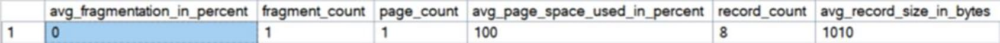  
*Hình 12-4. Trạng thái ban đầu: page_count = 1, avg_fragmentation_in_percent = 0, avg_page_space_used_in_percent ≈ 100%*

Trang dữ liệu lúc này đã được lấp đầy 100%. Bây giờ, chúng ta chạy lệnh `UPDATE` làm tăng kích thước cột `C3` trên dòng `C1 = 200` bằng Listing 12-3:

```sql
-- Listing 12-3. Updating a column in one row
UPDATE dbo.SplitTest
SET C3 = 'Add data'
WHERE C1 = 200;
```

Chạy lại câu lệnh kiểm tra vật lý từ Listing 12-2:

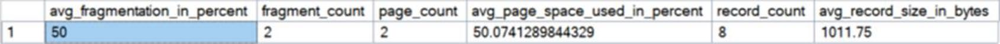  
*Hình 12-5. Sau khi UPDATE: page_count tăng lên 2, mỗi trang chỉ còn chứa khoảng 50% dữ liệu, tỷ lệ phân mảnh tăng lên 50%*

Do trang ban đầu đã chật kín không còn đủ chỗ chứa chuỗi `'Add data'`, SQL Server bắt buộc phải thực hiện **Phân tách trang (Page Split)**:
* Cấp phát thêm một trang dữ liệu 8KB mới.
* Di chuyển khoảng một nửa số dòng từ trang cũ sang trang mới.
* Cập nhật lại các con trỏ điều hướng B-Tree.

---

### Phân tách trang do Lệnh INSERT (Page Split by an INSERT Statement)

Chúng ta tái tạo lại bảng `SplitTest` từ Listing 12-1 (lúc này trang đơn đã đầy 100%). Sau đó, chúng ta thực hiện chèn thêm một dòng mới có giá trị khóa `C1 = 110` – tức rơi vào **chính giữa khoảng khóa** của trang (Listing 12-4):

```sql
-- Listing 12-4. Adding a row to SplitTest
INSERT INTO dbo.SplitTest
VALUES
(110, 'C2', '');
```

  
*Hình 12-6. Lệnh INSERT vào giữa chuỗi khóa gây phân tách trang (Page Split)*

Một lần nữa, hiện tượng phân tách trang lại xảy ra: một nửa số dòng bị đẩy sang trang mới để nhường chỗ cho dòng mới được chèn đúng trật tự sắp xếp logic.

> [!TIP]
> **Chèn dữ liệu ở cuối bảng (Monotonically Increasing Key):**  
> Điều gì xảy ra nếu bạn chèn một dòng mới có giá trị `C1 = 900` (lớn hơn giá trị lớn nhất hiện có)? SQL Server sẽ cấp phát một trang mới và đặt dòng đó lên trang mới mà **hoàn toàn KHÔNG gây ra phân tách trang (No Page Split)**. Đây là lý do vì sao các cột khóa tự tăng (`IDENTITY` hoặc `SEQUENCE`) luôn là lựa chọn hàng đầu cho Clustered Index để hạn chế tối đa phân tách trang khi ghi dữ liệu.

---

## Phân mảnh trong Chỉ mục Columnstore (How Fragmentation Occurs in Columnstore Indexes)

Chỉ mục Columnstore cũng bị phân mảnh, nhưng theo một bản chất hoàn toàn khác biệt:
* Dữ liệu trong Columnstore được nén chặt thành các phân đoạn cột bên trong các nhóm dòng (**Rowgroups**). Một khi đã được nén và đóng gói thành công, các phân đoạn này là bất biến (immutable) và hoàn toàn không bị phân tách trang.
* Khi bạn thực hiện lệnh `DELETE`, SQL Server **không thực sự xóa bỏ dữ liệu khỏi phân đoạn nén**. Thay vào đó, nó ghi nhận ID của dòng bị xóa vào một danh sách theo dõi B-Tree nội bộ gọi là **Bản ghi xóa logic (Deleted Rows Tombstone)**.
* Khi bạn thực hiện lệnh `UPDATE`, SQL Server sẽ đánh dấu dòng cũ là đã xóa (tương tự như DELETE), đồng thời chèn giá trị mới cập nhật vào bộ đệm **Deltastore**.

Hệ quả là: Một nhóm dòng ban đầu có 1.000.000 dòng, nhưng sau nhiều thao tác xóa và sửa, có thể chỉ còn 600.000 dòng thực tế có hiệu lực. Những khoảng trống do các dòng bị xóa logic này chiếm dụng chính là bản chất của **phân mảnh trong Columnstore**.

Hãy cùng kiểm chứng trên bảng `dbo.bigTransactionHistory` bằng cách chuyển nó thành Clustered Columnstore Index (Listing 12-5):

```sql
-- Listing 12-5. Creating a clustered columnstore index
ALTER TABLE dbo.bigTransactionHistory
DROP CONSTRAINT pk_bigTransactionHistory;

DROP INDEX IF EXISTS ix_csTest ON dbo.bigTransactionHistory;

CREATE CLUSTERED COLUMNSTORE INDEX cci_bigTransactionHistory
ON dbo.bigTransactionHistory;
```

Chúng ta theo dõi mức độ đầy đủ của các Rowgroup bằng cách truy vấn khung nhìn hệ thống `sys.column_store_row_groups` trong Listing 12-6:

```sql
-- Listing 12-6. Querying sys.column_store_row_groups
SELECT OBJECT_NAME(i.OBJECT_ID) AS TableName,
       i.NAME AS IndexName,
       csrg.row_group_id,
       csrg.state_description,
       csrg.total_rows,
       csrg.deleted_rows,
       100 * (total_rows - ISNULL(deleted_rows, 0)) / total_rows AS PercentFull
FROM sys.indexes AS i
    JOIN sys.column_store_row_groups AS csrg
        ON i.OBJECT_ID = csrg.OBJECT_ID
           AND i.index_id = csrg.index_id
WHERE NAME = 'cci_bigTransactionHistory'
ORDER BY OBJECT_NAME(i.OBJECT_ID),
         i.NAME,
         row_group_id;
```

Ban đầu, tỷ lệ `PercentFull` của các Rowgroup đều đạt 100%. Bây giờ, chúng ta chạy lệnh `DELETE` xóa các dòng có `Quantity = 13` bằng Listing 12-7:

```sql
-- Listing 12-7. Deleting rows in bigTransactionHistory
DELETE dbo.bigTransactionHistory
WHERE Quantity = 13;
```

Chạy lại Listing 12-6:

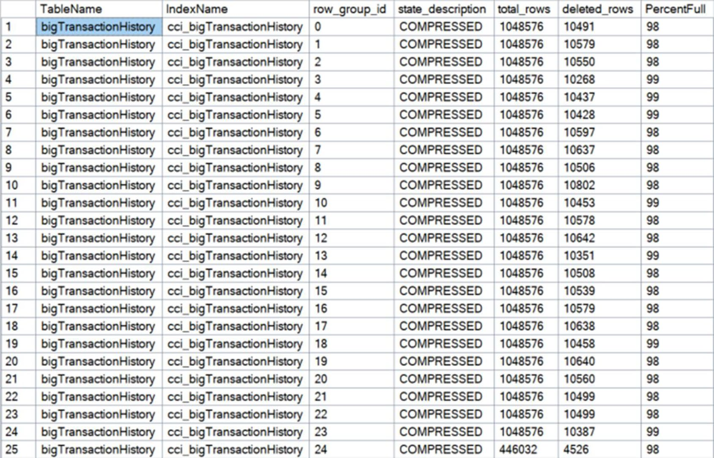  
*Hình 12-7. Cột PercentFull giảm xuống dưới 100% trên hàng loạt Rowgroups sau khi phát sinh thao tác DELETE*

Các dòng bị xóa vẫn nằm nguyên trên đĩa và trong bộ nhớ RAM, chiếm dụng tài nguyên và buộc SQL Server phải lọc bỏ chúng trong thời gian thực thi truy vấn.

---

## Chi phí Phát sinh do Phân mảnh (Fragmentation Overhead)

Phân mảnh chỉ mục gây ra chi phí tài nguyên, nhưng các biện pháp xử lý chống phân mảnh (Defragmentation) cũng tiêu tốn tài nguyên không kém:
1. **Chi phí dọn dẹp phân mảnh:** Chạy các lệnh `ALTER INDEX REBUILD` hoặc `REORGANIZE` tiêu tốn rất nhiều CPU, I/O đĩa và có thể gây tắc nghẽn (blocking) các tiến trình nghiệp vụ.
2. **Nguy cơ bão phân tách trang sau khi dọn dẹp:** Sau khi bạn Rebuild chỉ mục và nén các trang chặt chẽ 100%, các thao tác `INSERT`/`UPDATE` tiếp theo của ứng dụng sẽ lập tức gây ra hàng loạt các đợt phân tách trang dữ dội!
3. **Phần cứng hiện đại:** Trên các hệ thống lưu trữ hiện đại sử dụng ổ đĩa NVMe/SSD siêu tốc, việc đọc các trang đĩa ngẫu nhiên có tốc độ nhanh đến mức độ trễ của việc chuyển đổi extent gần như không còn đáng kể.

Do đó, quan điểm cũ cho rằng *"phải liên tục quét và dọn sạch mọi phân mảnh mỗi đêm"* ngày nay đã bị đặt dấu hỏi lớn. Nhiều tổ chức đã lựa chọn phương án chấp nhận một mức phân mảnh nhất định, hoặc thiết lập thông số **Fill Factor** hợp lý để duy trì khoảng trống đệm cho các thao tác ghi.

---

### Chi phí Phân mảnh trên Chỉ mục Rowstore (Rowstore Overhead)

* **Phân mảnh ngoài (External Fragmentation):** Khiến các trang bị đảo lộn thứ tự vật lý. Thao tác quét vùng (Range Scan) không thể tận dụng cơ chế đọc trước (**Read-Ahead**) tuần tự của hệ điều hành (vốn có thể đọc cả một Extent 64KB trong 1 lần I/O), mà buộc phải chuyển đổi liên tục giữa các trang đĩa đơn lẻ (8KB/lần I/O).
* **Phân mảnh trong (Internal Fragmentation):** Làm các dòng nằm thưa thớt trên các trang, khiến SQL Server phải nạp nhiều trang đĩa hơn vào bộ nhớ đệm Buffer Pool để lấy cùng một số lượng dòng dữ liệu, gây lãng phí RAM nghiêm trọng.
* **Ngoại lệ cho truy vấn tìm kiếm điểm (Point Lookups):** Nếu một câu truy vấn chỉ tìm kiếm duy nhất 1 dòng và nằm gọn trong 1 trang đĩa, thì mức độ phân mảnh của toàn bộ chỉ mục đó hoàn toàn không gây ảnh hưởng đến hiệu năng của câu lệnh!

#### Thực nghiệm Đo lường Tác động Hiệu năng
Chúng ta tạo bảng `dbo.FragTest` và chủ động gây phân mảnh nặng bằng Listing 12-8:

```sql
-- Listing 12-8. Fragmenting a clustered index
DROP TABLE IF EXISTS dbo.FragTest;
GO

CREATE TABLE dbo.FragTest
(
    C1 INT,
    C2 INT,
    C3 INT,
    c4 CHAR(2000)
);

CREATE CLUSTERED INDEX iClustered ON dbo.FragTest (C1);

WITH Nums
AS (SELECT TOP (10000)
           ROW_NUMBER() OVER (ORDER BY (SELECT 1)) AS n
    FROM MASTER.sys.all_columns AS ac1
        CROSS JOIN MASTER.sys.all_columns AS ac2)
INSERT INTO dbo.FragTest
(
    C1,
    C2,
    C3,
    c4
)
SELECT n,
       n,
       n,
       'a'
FROM Nums;

WITH Nums
AS (SELECT 1 AS n
    UNION ALL
    SELECT n + 1
    FROM Nums
    WHERE n < 10000)
INSERT INTO dbo.FragTest
(
    C1,
    C2,
    C3,
    c4
)
SELECT 10000 - n,
       n,
       n,
       'a'
FROM Nums
OPTION (MAXRECURSION 10000);
```

Bây giờ, chúng ta chạy hai câu truy vấn từ Listing 12-9: một câu quét phạm vi nhỏ (6 dòng) và một câu quét phạm vi lớn (quét toàn bộ 10.000 dòng):

```sql
-- Listing 12-9. Querying the FragTest table
-- Quét phạm vi hẹp: 6 dòng
SELECT ft.C1,
       ft.C2,
       ft.C3,
       ft.c4
FROM dbo.FragTest AS ft
WHERE C1 BETWEEN 21 AND 23;

-- Quét toàn bộ bảng: 10.000 dòng
SELECT ft.C1,
       ft.C2,
       ft.C3,
       ft.c4
FROM dbo.FragTest AS ft
WHERE C1 BETWEEN 1 AND 10000;
```

Kết quả đo lường khi **bị phân mảnh nặng**:
* **Truy vấn 6 dòng:** 8 reads, thời gian chạy: **886 microseconds**.
* **Truy vấn toàn bộ bảng:** 10.034 reads, thời gian chạy: **461 ms**.

Tiếp theo, chúng ta triệt tiêu hoàn toàn phân mảnh bằng lệnh `REBUILD` trong Listing 12-10:

```sql
-- Listing 12-10. Removing fragmentation in iClustered
ALTER INDEX iClustered ON dbo.FragTest REBUILD;
```

Kết quả đo lường sau khi **Rebuild sạch sẽ**:
* **Truy vấn 6 dòng:** 6 reads, thời gian chạy: **401 microseconds** (chênh lệch không đáng kể).
* **Truy vấn toàn bộ bảng:** Số lần đọc giảm từ 10.034 xuống **6.695 reads**, thời gian chạy giảm từ 461 ms xuống **303 ms (cải thiện hơn 25%!)**.

Rõ ràng, việc bảo trì chỉ mục chỉ thực sự mang lại giá trị rõ rệt cho các câu truy vấn thực hiện các thao tác quét vùng dữ liệu lớn (Large Scans), trong khi các truy vấn tìm kiếm điểm nhỏ lẻ hầu như không nhận thấy sự khác biệt.

---

### Chi phí Phân mảnh trên Chỉ mục Columnstore (Columnstore Overhead)

Trong Columnstore, khi các dòng bị đánh dấu xóa logic, mỗi khi truy xuất dữ liệu, SQL Server buộc phải thực hiện một phép nối nội bộ ngầm định (internal join) với cây B-Tree theo dõi các dòng đã xóa để loại bỏ chúng khỏi tập kết quả. Phép nối nội bộ này không hiển thị trên kế hoạch thực thi, nhưng nó phản ánh trực tiếp vào thời gian thực thi của CPU!

Hãy đo lường truy vấn tổng hợp trên `bigTransactionHistory` trong Listing 12-11:

```sql
-- Listing 12-11. Querying bigTransactionHistory
SELECT bth.Quantity,
       AVG(bth.ActualCost)
FROM dbo.bigTransactionHistory AS bth
WHERE bth.Quantity BETWEEN 8 AND 15
GROUP BY bth.Quantity;
```

Kết quả ban đầu (chưa bị phân mảnh):
* Số lần đọc logic: **154.494 reads**
* Thời gian thực thi: **104 ms**

Tiến hành xóa một khối lượng dòng lớn bằng Listing 12-12:

```sql
-- Listing 12-12. Deleting data from bigTransactionHistory
DELETE dbo.bigTransactionHistory
WHERE Quantity BETWEEN 9 AND 12;
```

Chạy lại câu truy vấn trong Listing 12-11:
* Số lần đọc logic: **154.238 reads** (gần như giữ nguyên).
* Thời gian thực thi: **tăng vọt lên 212 ms (tăng hơn gấp đôi!)**.

Số lần đọc đĩa gần như không đổi, nhưng thời gian thực thi tăng gấp 2 lần vì hệ thống phải tốn chu kỳ CPU để xử lý các phép đối chiếu loại bỏ các dòng bị xóa logic trong bộ nhớ! Mặc dù cơ chế phát sinh khác nhau, tác động tiêu cực của phân mảnh lên hiệu năng của Columnstore là hoàn toàn có thật.

---

## Phân tích mức độ phân mảnh (Analyzing the Amount of Fragmentation)

Trước đó, chúng ta đã được giới thiệu về các cơ chế để kiểm tra mức độ phân mảnh bên trong chỉ mục lưu trữ theo dòng (*rowstore*) và chỉ mục lưu trữ theo cột (*columnstore*): lần lượt là hàm động `sys.dm_db_index_physical_stats` và view hệ thống `sys.column_store_row_groups`. Mặc dù `sys.dm_db_index_physical_stats` chủ yếu được dùng cho các chỉ mục gom cụm (*clustered*) và phi gom cụm (*nonclustered*), nó cũng được sử dụng cho các bảng heap theo cách hoàn toàn tương tự.

Kết quả đầu ra của `sys.dm_db_index_physical_stats` hiển thị thông tin chi tiết về các trang dữ liệu (*pages*) và các vùng cấp phát (*extents*) của một chỉ mục (hoặc một bảng heap). Hàm này trả về một dòng cho mỗi cấp độ của cây B-Tree trong chỉ mục, và trả về một dòng đơn lẻ cho mỗi đơn vị cấp phát (*allocation unit*) trong một bảng heap.

SQL Server lưu trữ dữ liệu trên các trang có kích thước chuẩn 8 KB. Tám trang liên tiếp nhau sẽ được nhóm lại thành một vùng cấp phát (*extent*) có dung lượng 64 KB. Các bảng chứa ít hơn 64 KB dữ liệu cần thiết để chiếm dụng trọn vẹn một extent sẽ chia sẻ chung một extent với các bảng khác. Kiểu vùng cấp phát này được gọi là **vùng cấp phát hỗn hợp** (*mixed extents*), giúp SQL Server tiết kiệm không gian đĩa. Bạn không thể thực hiện khử phân mảnh trên các mixed extent.

Khi một bảng hoặc chỉ mục phát triển vượt quá 8 trang, SQL Server sẽ cấp phát một extent dành riêng cho bảng/chỉ mục đó. Loại vùng cấp phát này được gọi là **vùng cấp phát đồng nhất** (*uniform extent*). Uniform extent giúp SQL Server sắp xếp các trang của bảng/chỉ mục nằm liền kề nhau về mặt vật lý, từ đó gia tăng đáng kể hiệu năng truy xuất I/O. Mặc dù thông tin bên trong một extent vẫn có thể bị phân mảnh, nhưng bạn vẫn sẽ nhận được sự tối ưu hóa nhờ việc các trang của một extent được lưu trữ cùng nhau.

Hàm quản trị động (DMF) `sys.dm_db_index_physical_stats` thực hiện quét các trang của chỉ mục để trả về dữ liệu. Bạn có thể kiểm soát mức độ quét (*scan mode*), điều này sẽ ảnh hưởng trực tiếp đến tốc độ thực thi và độ chính xác của kết quả:

- **LIMITED (Hạn chế):** Đây là chế độ mặc định và nhanh nhất. Chế độ này chỉ quét các trang ở các cấp độ phía trên tầng lá (đối với B-Tree) mà không đọc chi tiết từng trang ở tầng lá, giúp kiểm tra nhanh mức độ phân mảnh với chi phí tài nguyên tối thiểu.
- **SAMPLED (Lấy mẫu):** Cung cấp độ chính xác cao hơn với mức suy giảm tốc độ vừa phải bằng cách quét mẫu 1% tổng số trang dữ liệu. Tuy nhiên, nếu chỉ mục có ít hơn 10.000 trang và bạn chọn chế độ SAMPLED, SQL Server sẽ tự động chuyển sang chế độ DETAILED.
- **DETAILED (Chi tiết):** Quét toàn bộ mọi trang trong chỉ mục (bao gồm tất cả các cấp độ của cây B-Tree). Chế độ này mang lại độ chính xác tuyệt đối nhưng có thể gây ảnh hưởng nghiêm trọng đến hiệu năng hệ thống tùy thuộc vào kích thước của bảng và chỉ mục.

Bằng cách chỉ định các tham số đầu vào khác nhau, bạn có thể lấy thông tin phân mảnh cho các phạm vi dữ liệu mong muốn. Nếu bạn loại bỏ hàm `OBJECT_ID` trong truy vấn và truyền vào giá trị `NULL`, hàm sẽ trả về thông tin cho tất cả các chỉ mục trong toàn bộ cơ sở dữ liệu. Đừng để bị bất ngờ bởi điều này và vô tình thực thi một lệnh quét `DETAILED` trên tất cả các chỉ mục! Bạn cũng có thể chỉ định đích danh chỉ mục cần kiểm tra hoặc thậm chí là một phân vùng cụ thể (*partition*) trong một chỉ mục phân vùng.

Kết quả trả về từ `sys.dm_db_index_physical_stats` bao gồm 24 cột khác nhau. Dưới đây là tập hợp các cột cốt lõi thường được sử dụng để xác định mức độ phân mảnh và kích thước của một chỉ mục:

- **`avg_fragmentation_in_percent`:** Con số này biểu thị mức độ phân mảnh logic trung bình cho các chỉ mục và bảng heap dưới dạng phần trăm. Nếu bảng là heap và chế độ quét là SAMPLED, giá trị này sẽ là `NULL`.
  - Nếu độ phân mảnh trung bình nhỏ hơn **10–20%** và bảng không quá đồ sộ, phân mảnh hầu như không phải là vấn đề đáng bận tâm.
  - Nếu độ phân mảnh nằm trong khoảng **20% đến 40%**, phân mảnh có thể là một vấn đề, nhưng cũng có thể không. Hãy nhớ rằng, loại bỏ phân mảnh đồng nghĩa với việc loại bỏ khoảng trống tự do (*free space*); hoàn toàn có thể việc giữ lại 20–40% khoảng trống tự do lại là một biên độ hoạt động lý tưởng cho các thao tác chèn/cập nhật sau này.
  - Phân mảnh quy mô lớn, thường là **trên 40%**, có thể cần đến thao tác tái tạo lại chỉ mục (*index rebuild*). Hệ thống của bạn có thể có những yêu cầu đặc thù khác với các con số chung này; chúng chỉ đóng vai trò là các hướng dẫn tham khảo (*guidelines*), không phải là các giá trị tuyệt đối.
- **`fragment_count`:** Số lượng các mảnh (tức là các nhóm trang dữ liệu tách rời nhau) tạo nên chỉ mục. Đây là con số hữu ích để nắm bắt cách chỉ mục được phân bổ, đặc biệt là khi so sánh với giá trị `page_count`. Cột này mang giá trị `NULL` khi dùng chế độ SAMPLED. Số lượng fragment lớn là dấu hiệu bổ sung rõ ràng của sự phân mảnh lưu trữ.
- **`page_count`:** Đếm số lượng trang dữ liệu hoặc trang chỉ mục tạo nên đối tượng. Con số này đo lường kích thước nhưng cũng giúp phát hiện phân mảnh. Nếu bạn biết kích thước của dòng dữ liệu hoặc chỉ mục, bạn có thể tính toán được bao nhiêu dòng sẽ vừa trên một trang 8 KB. Sau đó, đối chiếu với tổng số dòng trong bảng, bạn sẽ ước lượng được một giá trị gần tương đương với `page_count`. Nếu `page_count` cao hơn đáng kể so với tính toán lý thuyết, bạn đang gặp phải vấn đề phân mảnh nội bộ (*internal fragmentation*). Hãy tham chiếu thêm giá trị `avg_fragmentation_in_percent` để có số đo chính xác.
- **`avg_page_space_used_in_percent`:** Biểu thị lượng không gian trung bình được sử dụng thực tế bên trong các trang của chỉ mục. Giá trị này sẽ là `NULL` khi sử dụng chế độ quét LIMITED.
- **`record_count`:** Số lượng bản ghi được thống kê. Đối với chỉ mục, đây là số bản ghi tại cấp độ hiện tại của cây B-Tree được khảo sát bởi chế độ quét (chế độ DETAILED sẽ hiển thị tất cả các cấp độ B-Tree, chứ không chỉ riêng tầng lá). Đối với heap, con số này phản ánh số bản ghi hiện có, nhưng có thể không khớp chính xác với số dòng của bảng nếu heap có các bản ghi chuyển tiếp (*forwarded records*) sau các phép UPDATE và tách trang.
- **`avg_record_size_in_bytes`:** Đo lường kích thước trung bình (tính bằng byte) của dữ liệu lưu trữ trong một bản ghi chỉ mục hoặc heap.

Khi thực thi `sys.dm_db_index_physical_stats` với chế độ quét DETAILED, hàm sẽ trả về nhiều dòng cho một chỉ mục nhất định nếu chỉ mục đó trải rộng trên nhiều cấp độ B-Tree (tức là khi chỉ mục có kích thước lớn hơn một trang đơn lẻ). Để quan sát cấu trúc này, hãy thực thi truy vấn trong Listing 12-13.

**Listing 12-13.** Lấy thông tin quét chi tiết toàn diện của chỉ mục

```sql
--Intentionally using SELECT *
SELECT ddips.*
FROM sys.dm_db_index_physical_stats(DB_ID('AdventureWorks'), OBJECT_ID(N'dbo.FragTest'), NULL, NULL, 'Detailed') AS ddips;
```

Kết quả hoàn chỉnh từ hàm quản trị động được minh họa trong Hình 12-8.

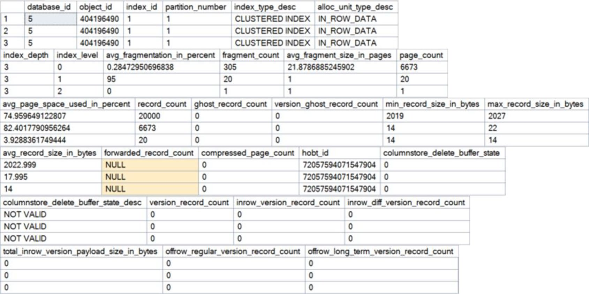

### Phân tích mức độ phân mảnh trên bảng nhỏ (Analyzing the Fragmentation of a Small Table)

Một bảng hoặc chỉ mục nhỏ có kích thước dưới 8 trang sẽ luôn được lưu trữ trên các vùng cấp phát hỗn hợp (*mixed extents*). Vùng cấp phát đó có thể chứa lẫn các trang của nhiều bảng hoặc chỉ mục khác nhau. Do đó, kết quả đầu ra từ `sys.dm_db_index_physical_stats` đối với các bảng nhỏ có thể gây hiểu lầm nghiêm trọng. Bạn rất dễ thấy tỷ lệ phân mảnh hiển thị rất cao ở một bảng nhỏ, nhưng vì kích thước của bảng quá nhỏ (chỉ vài chục KB), bạn hoàn toàn **không cần bận tâm** đến việc khử phân mảnh cho nó.

Trên thực tế, ngay cả khi bạn cố tình thực thi lệnh tái tạo chỉ mục (*rebuild*) trên một bảng nhỏ, bạn cũng sẽ thấy tỷ lệ phân mảnh không hề suy giảm một chút nào (bởi vì SQL Server vẫn tiếp tục cấp phát nó trên mixed extents). Vì lý do này, nếu bạn đang xử lý một bảng hoặc chỉ mục dưới 8 trang, đừng bao giờ tốn công sức cố gắng khử phân mảnh nó.

---

## Các giải pháp xử lý phân mảnh (Fragmentation Resolutions)

Chìa khóa cốt lõi để giải quyết vấn đề phân mảnh rowstore là sắp xếp lại các trang dữ liệu của chỉ mục sao cho thứ tự vật lý (*physical order*) và thứ tự logic (*logical order*) của chúng trùng khớp hoàn toàn với nhau. Đối với chỉ mục columnstore, mục tiêu là kích hoạt tiến trình nền **Tuple Mover** để đóng các bảng deltastore và nén chúng vào các phân đoạn nén (*compressed segments*), đồng thời sắp xếp lại dữ liệu để đạt tỷ lệ nén tối ưu nhất.

Tất cả các mục tiêu này có thể đạt được thông qua một trong bốn phương pháp sau:

1. Xóa và tạo lại chỉ mục (*Drop and recreate the index*).
2. Tạo lại chỉ mục với mệnh đề `DROP_EXISTING`.
3. Thực thi lệnh `ALTER INDEX ... REBUILD`.
4. Thực thi lệnh `ALTER INDEX ... REORGANIZE`.

### Xóa và tạo lại chỉ mục (Drop and Recreate the Index)

Việc xóa bỏ một chỉ mục rồi tạo mới lại từ đầu đảm bảo chắc chắn rằng chỉ mục sẽ được xây dựng lại với thứ tự vật lý và logic hoàn toàn trùng khớp. Tuy nhiên, phương pháp thủ công này đi kèm với những nhược điểm đặc biệt nghiêm trọng:

- **Khóa chặn (Blocking):** Việc tạo lại chỉ mục tạo ra áp lực tài nguyên rất lớn lên hệ thống và gây ra hiện tượng khóa chặn nghiêm trọng. Việc DROP và sau đó CREATE index sẽ chặn toàn bộ các yêu cầu truy vấn khác đối với bảng (hoặc đối với bất kỳ chỉ mục nào khác trên bảng). Bản thân thao tác này cũng có thể bị chặn bởi các giao dịch đang chạy khác trên bảng.
- **Thiếu hụt chỉ mục trong thời gian thao tác (Missing Index):** Trong khoảng thời gian chỉ mục đã bị DROP và đang chờ được tạo lại (hoặc đang bị chặn bởi tiến trình khác), tất cả các truy vấn chạy tới bảng sẽ hoàn toàn không có chỉ mục này để sử dụng, dẫn đến suy thoái hiệu năng đột ngột và gây biên dịch lại (*recompile*) hàng loạt kế hoạch thực thi.
- **Ảnh hưởng dây chuyền đến chỉ mục phi gom cụm:** Nếu chỉ mục bị xóa là một **chỉ mục gom cụm** (*clustered index*), thì **tất cả** các chỉ mục phi gom cụm trên bảng đó sẽ buộc phải tái tạo lại lần đầu tiên (khi clustered index bị drop, bảng biến thành heap, các con trỏ định vị dòng trong nonclustered index phải đổi thành RID), và sau đó lại bị tái tạo lần thứ hai (khi clustered index được tạo mới, con trỏ định vị dòng lại phải đổi thành Clustering Key). Điều này dẫn đến sự tê liệt hệ thống do khóa chặn kéo dài.
- **Ràng buộc duy nhất và khóa chính (Unique Constraints):** Các chỉ mục được sử dụng để định nghĩa Khóa chính (*Primary Key*) hoặc Ràng buộc duy nhất (*Unique Constraint*) không thể bị xóa bỏ bằng câu lệnh `DROP INDEX` thông thường. Hơn nữa, cả khóa chính lẫn ràng buộc duy nhất đều có thể đang được tham chiếu bởi các Ràng buộc khóa ngoại (*Foreign Key constraints*). Trước khi muốn DROP một khóa chính, bạn bắt buộc phải xóa bỏ tất cả các khóa ngoại tham chiếu đến nó trước.

Vì tất cả những lý do trên, việc xóa và tạo lại chỉ mục là một lựa chọn rất tồi tệ, trừ khi bạn có thể thực hiện nó trong các khung giờ bảo trì hệ thống định kỳ (*scheduled downtime*).

### Tạo lại chỉ mục với mệnh đề DROP_EXISTING (Recreating the Index with the DROP_EXISTING Clause)

Bạn có thể tránh được chi phí tái tạo hai lần các chỉ mục phi gom cụm khi xây dựng lại chỉ mục gom cụm nếu bạn sử dụng mệnh đề `WITH (DROP_EXISTING = ON)`. Tùy chọn này cho phép tái tạo lại chỉ mục gom cụm trong một bước nguyên tử (*single atomic step*). Listing 12-14 minh họa cú pháp này trong thực tế.

**Listing 12-14.** Tạo lại khóa chính trên bảng Person.EmailAddress

```sql
CREATE UNIQUE CLUSTERED INDEX PK_EmailAddress_BusinessEntityID_EmailAddressID
ON Person.EmailAddress (
                           BusinessEntityID,
                           EmailAddressID
                       )
WITH (DROP_EXISTING = ON);
```

Bạn có thể sử dụng mệnh đề `DROP_EXISTING` cho cả chỉ mục gom cụm lẫn phi gom cụm. Bạn thậm chí có thể dùng nó để chuyển đổi một chỉ mục phi gom cụm thành một chỉ mục gom cụm. Tuy nhiên, bạn không thể làm điều ngược lại: không thể chuyển đổi một chỉ mục gom cụm thành một chỉ mục phi gom cụm thông qua `DROP_EXISTING`.

Mặc dù khắc phục được vấn đề tái tạo chỉ mục phi gom cụm hai lần, phương pháp này vẫn tồn tại những hạn chế nặng nề:

- **Khóa chặn (Blocking):** Hầu hết các vấn đề về khóa chặn tương tự như phương pháp DROP/CREATE thủ công vẫn xuất hiện tại đây.
- **Chỉ mục đi kèm ràng buộc:** Khác với cách làm đầu tiên, câu lệnh `CREATE INDEX` đi kèm mệnh đề `DROP_EXISTING` có thể được dùng để tái tạo các chỉ mục gắn liền với ràng buộc. Tuy nhiên, nếu ràng buộc đó là khóa chính hoặc ràng buộc duy nhất đang có khóa ngoại tham chiếu, thì nếu bạn bỏ quên từ khóa `UNIQUE` trong câu lệnh `CREATE INDEX`, hệ thống sẽ trả về lỗi ngay lập tức.

### Thực thi lệnh ALTER INDEX REBUILD (Execute the ALTER INDEX REBUILD Command)

Lệnh `ALTER INDEX ... REBUILD` thực hiện tái tạo chỉ mục trong một bước nguyên tử duy nhất, tương tự như việc chạy `CREATE INDEX` với mệnh đề `DROP_EXISTING`. Khi thực thi lệnh này, SQL Server sẽ cấp phát các trang và các vùng cấp phát hoàn toàn mới, đồng thời ghi dữ liệu vào đó theo đúng thứ tự logic và vật lý chuẩn xác. Điểm ưu việt là không giống như `DROP_EXISTING`, `ALTER INDEX REBUILD` cho phép tái tạo chỉ mục mà không bắt bạn phải xử lý phức tạp với các ràng buộc khóa ngoại liên quan.

SQL Server 2025 mang đến một bước tiến lớn cho lệnh `REBUILD` đối với các chỉ mục columnstore. Trước phiên bản 2025, một lệnh `REBUILD` trên columnstore index sẽ đưa toàn bộ chỉ mục sang trạng thái ngoại tuyến (*offline*). Nó sẽ gọi Tuple Mover để dọn sạch deltastore và sắp xếp lại dữ liệu nhằm đảm bảo hiệu quả nén cao nhất. Giờ đây, trong SQL Server 2025, bạn có thể thực hiện **ONLINE REBUILD** cho columnstore index, mang lại khả năng tái cấu trúc dữ liệu tối ưu mà không hề làm gián đoạn quyền truy cập của người dùng.

Đối với các chỉ mục **rowstore**, `ALTER INDEX REBUILD` là cơ chế được khuyến nghị hàng đầu. Ngược lại, đối với các chỉ mục **columnstore**, sau khi thử nghiệm để kiểm tra xem tính năng online rebuild mới có hoạt động hiệu quả cho hệ thống của bạn hay không, phương án được ưu tiên rất có thể sẽ là `ALTER INDEX REORGANIZE` (sẽ được trình bày ở phần tiếp theo).

Việc tái tạo một chỉ mục cũng sẽ thực hiện nén gọn (*compact*) bất kỳ trang dữ liệu đối tượng lớn (*LOB pages*) nào liên kết với bảng. Bạn có thể chọn vô hiệu hóa hành vi này bằng cách chỉ định tùy chọn `LOB_COMPACTION = OFF`.

Khi bạn cấu hình thiết lập `PAD_INDEX` lúc tạo chỉ mục, nó sẽ quy định lượng khoảng trống tự do được để lại trên các trang trung gian (*intermediate pages*) của B-Tree nhằm hạn chế tình trạng phân tách trang (*page splits*). Giá trị này sẽ được áp dụng lại trong quá trình rebuild chỉ mục; các trang mới tạo sẽ được thiết lập khoảng trống theo đúng các giá trị ban đầu bạn đã chọn.

Nếu bạn không chỉ định gì thêm, hành vi mặc định của lệnh là khử phân mảnh toàn bộ các chỉ mục trên tất cả các phân vùng (*partitions*). Nếu muốn kiểm soát chi tiết, bạn chỉ cần chỉ định rõ phân vùng nào bạn muốn tái tạo.

Bạn cũng có thể sử dụng `ALTER INDEX REBUILD` để tái tạo toàn bộ tất cả các chỉ mục trên một bảng nhất định chỉ trong một câu lệnh duy nhất, như thể hiện trong Listing 12-15.

**Listing 12-15.** Tái tạo tất cả các chỉ mục trên một bảng

```sql
ALTER INDEX ALL ON dbo.FragTest REBUILD;
```

Mặc dù đây là cơ chế khử phân mảnh tối ưu nhất cho rowstore index, nó vẫn đi kèm với một số chi phí phụ trội cần lưu tâm:

- **Khóa chặn (Blocking):** Tương tự như hai phương pháp trước, `ALTER INDEX REBUILD` gây ra khóa chặn trên hệ thống. Nó chặn tất cả các truy vấn khác đang tìm cách truy cập vào bảng (hoặc bất kỳ chỉ mục nào trên bảng) và cũng có thể bị chặn bởi các truy vấn dài đang thực thi.
- **Phục hồi giao dịch (Transaction Rollback):** Vì `ALTER INDEX REBUILD` là một thao tác mang tính nguyên tử (*atomic*), nếu tiến trình bị dừng hoặc ngắt kết nối trước khi hoàn tất 100%, toàn bộ công sức và các thao tác khử phân mảnh đã thực hiện từ đầu đến thời điểm đó sẽ bị hủy bỏ hoàn toàn (*rollback*).

Bạn có thể thực thi `ALTER INDEX REBUILD` đi kèm từ khóa `ONLINE = ON`, tùy chọn này sẽ giảm thiểu đáng kể cơ chế khóa chặn tài nguyên nhưng sẽ làm tăng tổng thời gian cần thiết để hoàn tất việc tái tạo chỉ mục.

### Thực thi lệnh ALTER INDEX REORGANIZE (Execute the ALTER INDEX REORGANIZE Command)

Đối với một chỉ mục **rowstore**, lệnh `ALTER INDEX REORGANIZE` giảm thiểu phân mảnh bằng cách sắp xếp lại các trang ở tầng lá hiện có để khớp hơn với thứ tự logic của chỉ mục. Nó nén gọn các dòng dữ liệu bên trong các trang (giảm phân mảnh nội bộ) và giải phóng các trang trống phát sinh. Tuy nhiên, khi giải quyết phân mảnh rowstore, kỹ thuật REORGANIZE — mặc dù có chi phí phụ trội thấp nhất trong tất cả các phương pháp — lại là phương pháp **kém hiệu quả nhất**. Lượng tài nguyên tiêu tốn để REORGANIZE một chỉ mục không cao bằng REBUILD, nhưng nó vẫn là một thao tác tốn kém tài nguyên, đặc biệt khi so sánh với kết quả nghèo nàn thu được. Tôi **không khuyến nghị** bạn sử dụng lệnh này trên các chỉ mục rowstore của mình.

Ngược lại, đối với một chỉ mục **columnstore**, lệnh `ALTER INDEX REORGANIZE` đảm bảo rằng deltastore bên trong chỉ mục columnstore sẽ được dọn dẹp sạch sẽ và tất cả các dòng bị xóa logic (*logical deletes*) sẽ được chuyển thành các thao tác xóa vật lý thực sự. Nó thực hiện tất cả các hành động này trong khi vẫn giữ cho chỉ mục luôn ở trạng thái trực tuyến (*online*) và hoàn toàn có thể truy cập được. Bạn cũng có thể chọn ép buộc nén tất cả các rowgroup. Chức năng này rất giống với việc chạy `ALTER INDEX REBUILD`, nhưng giữ cho chỉ mục luôn sẵn sàng phục vụ truy vấn. Đó là lý do tại sao tôi khuyến nghị sử dụng `ALTER INDEX REORGANIZE` cho các chỉ mục columnstore. Tuy nhiên, với sự xuất hiện của tính năng `ONLINE REBUILD` cho columnstore trong SQL Server 2025, bạn nên kiểm thử cả hai trên hệ thống của mình để xem phương án nào mang lại hiệu quả tối ưu nhất.

Một nhược điểm lớn khác đối với chỉ mục rowstore là lệnh REORGANIZE sử dụng một cơ chế **phi nguyên tử** (*nonatomic*). Khi xử lý dữ liệu, nó chỉ yêu cầu một lượng khóa rất nhỏ trong khoảng thời gian ngắn nhất có thể. Nếu nó tìm cách truy cập vào một trang dữ liệu đang bị khóa bởi tiến trình khác, nó sẽ **bỏ qua luôn trang đó và không bao giờ quay trở lại**. Mặc dù điều này giúp REORGANIZE có mức chi phí phụ trội thấp hơn nhiều, nhưng đó cũng chính là nguyên nhân khiến kết quả khử phân mảnh của nó trở nên chắp vá và không triệt để.

Hình 12-9 minh họa trạng thái phân mảnh ban đầu của bảng `dbo.FragTest`.

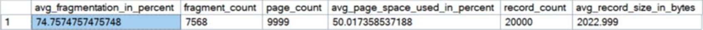

Chúng ta sử dụng Listing 12-16 để chạy lệnh REORGANIZE.

**Listing 12-16.** Sử dụng REORGANIZE trên bảng dbo.FragTest

```sql
ALTER INDEX iClustered ON dbo.FragTest REORGANIZE;
```

Kết quả sau khi chạy được thể hiện trong Hình 12-10.

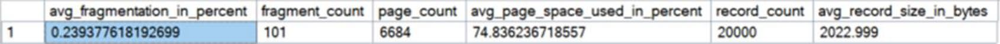

Mức độ phân mảnh đã giảm đi khá nhiều, nhưng bạn sẽ nhận thấy rằng vẫn còn sót lại một lượng phân mảnh nhất định. Tình trạng này thậm chí sẽ tồi tệ hơn nhiều nếu có các truy vấn khác cùng đang truy cập vào bảng tại thời điểm đó.

Nếu chỉ mục bị phân mảnh nghiêm trọng, lệnh `ALTER INDEX REORGANIZE` có thể mất nhiều thời gian hơn đáng kể so với việc thực hiện tái tạo lại chỉ mục (*rebuild*). Ngoài ra, nếu một chỉ mục trải rộng trên nhiều tệp dữ liệu (*multiple files*), `ALTER INDEX REORGANIZE` sẽ không thực hiện di chuyển các trang dữ liệu giữa các tệp.

---

### Khử phân mảnh Columnstore Index qua REORGANIZE

Để quan sát lệnh REORGANIZE hoạt động đối với một chỉ mục columnstore, chúng ta cần xóa thêm một số dữ liệu. Điều này là do REORGANIZE sẽ chỉ tiến hành dọn dẹp dữ liệu đã xóa khi có **hơn 10%** số dòng trong một rowgroup bị xóa. Tôi sẽ thực thi Listing 12-17 để loại bỏ thêm dữ liệu khỏi bảng.

**Listing 12-17.** Xóa dữ liệu trong bảng dbo.bigTransactionHistory

```sql
DELETE dbo.bigTransactionHistory
WHERE Quantity
BETWEEN 8 AND 17;
```

Chúng ta có thể sử dụng hàm DMV mới để truy vấn thông tin phân mảnh, tương tự như cách chúng ta đã dùng các view hệ thống trước đây, như thể hiện trong Listing 12-18.

**Listing 12-18.** Truy vấn phân mảnh từ sys.dm_db_column_store_row_group_physical_stats

```sql
SELECT OBJECT_NAME(ddcsrgps.object_id) AS TableName,
       i.name IndexName,
        100 * (ddcsrgps.total_rows - ISNULL(ddcsrgps.deleted_rows, 0)) / total_rows AS PercentFull,
       ddcsrgps.row_group_id,
       ddcsrgps.state_desc
FROM sys.dm_db_column_store_row_group_physical_stats AS ddcsrgps
    JOIN sys.indexes AS i
        ON i.object_id = ddcsrgps.object_id
           AND i.index_id = ddcsrgps.index_id
ORDER BY ddcsrgps.row_group_id ASC;
```

Kết quả hiển thị trong Hình 12-11 cho thấy một số rowgroup đã bị xóa mất hơn 10% số dòng dữ liệu.

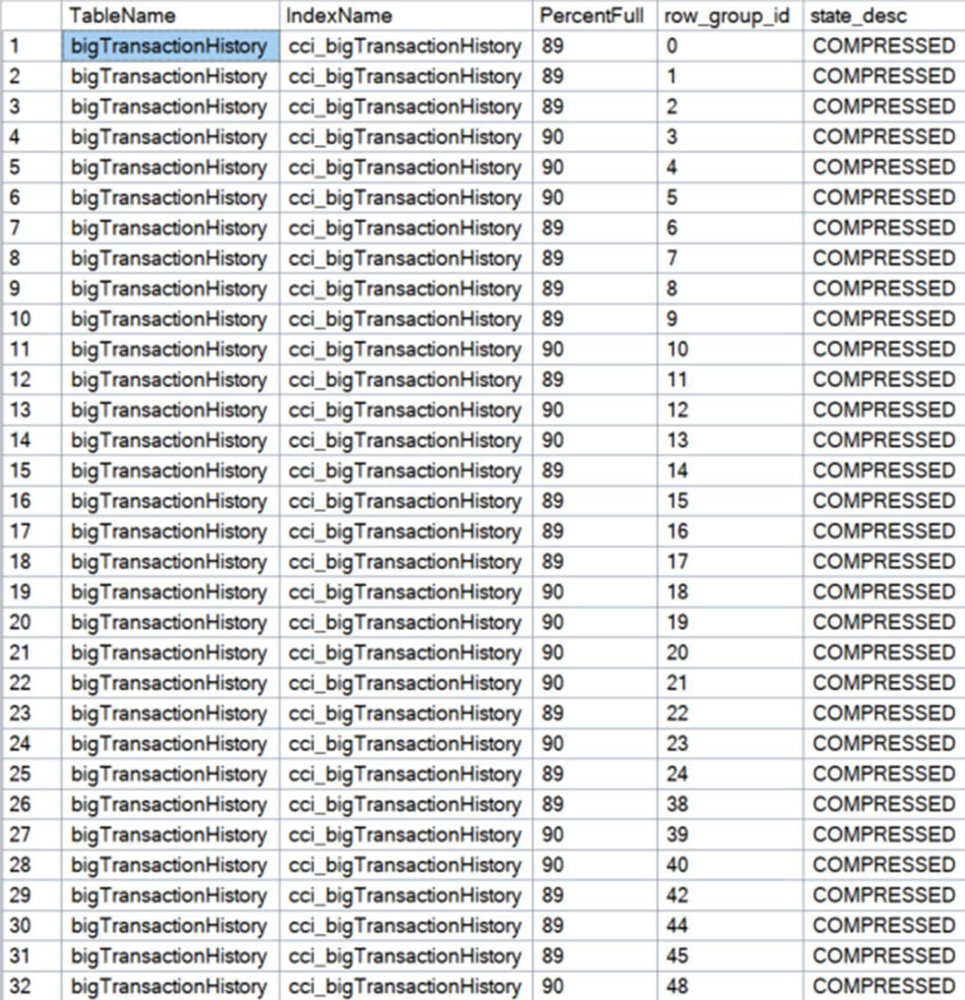

Bây giờ chúng ta có thể thực thi lệnh REORGANIZE trong Listing 12-19.

**Listing 12-19.** Tổ chức lại chỉ mục columnstore dbo.bigTransactionHistory

```sql
ALTER INDEX cci_bigTransactionHistory ON dbo.bigTransactionHistory 
REORGANIZE;
```

Kết quả sau khi chạy lệnh được hiển thị trong Hình 12-12.

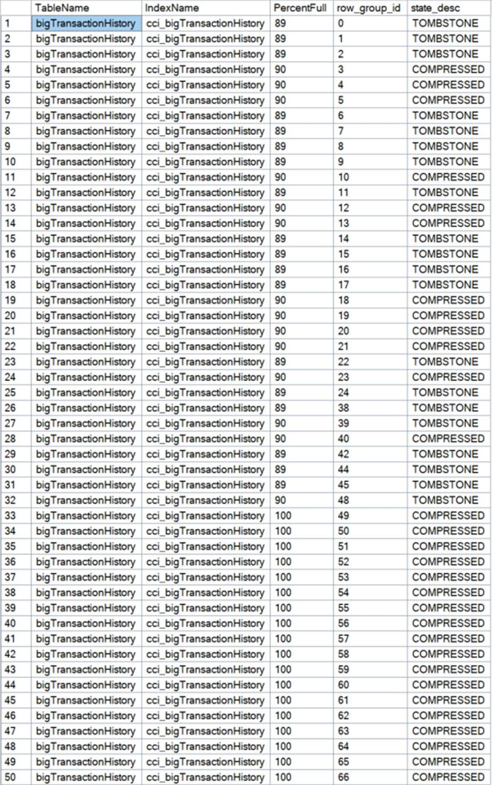

Có khá nhiều điểm quan trọng cần lưu ý tại đây:
- Đầu tiên, bạn sẽ thấy một loạt các rowgroup đã chuyển trạng thái từ `COMPRESSED` sang `TOMBSTONE`. Đó chính là kết quả của lệnh REORGANIZE.
- Một số rowgroup hiện ở trạng thái `COMPRESSED` và đạt tỷ lệ lấp đầy 100%, trong khi nhiều rowgroup trước đó bị xóa tới 89% giờ đây đã được đánh dấu là `TOMBSTONE`. Điều đó có nghĩa là dữ liệu hợp lệ đã được chuyển dời sang nơi khác, và tại một thời điểm nào đó trong tương lai, các rowgroup này sẽ được dọn dẹp và xóa bỏ hoàn toàn khỏi chỉ mục.

Hãy ghi nhớ rằng chỉ mục này hoàn toàn trực tuyến và có thể truy cập được trong suốt quá trình thao tác, vì vậy việc chúng ta chưa đạt được mức độ khử phân mảnh tuyệt đối 100% vẫn hoàn toàn có thể chấp nhận được. Bạn vẫn có thể sử dụng `ALTER INDEX REBUILD` với chỉ mục columnstore nếu muốn; tùy chọn `ONLINE` sẽ giúp giảm triệt để tình trạng khóa chặn trong khi mang lại một chỉ mục được tái tạo trọn vẹn hơn.

Chúng ta có thể đạt được mức độ khử phân mảnh cao hơn nữa nếu bổ sung tùy chọn nén dòng (*row compression*) trong Listing 12-20.

**Listing 12-20.** REORGANIZE sử dụng tùy chọn nén COMPRESS_ALL_ROW_GROUPS

```sql
ALTER INDEX cci_bigTransactionHistory
ON dbo.bigTransactionHistory
REORGANIZE
WITH (COMPRESS_ALL_ROW_GROUPS = ON);
```

Kết quả khử phân mảnh chuyên sâu hơn của chỉ mục columnstore được minh họa trong Hình 12-13.

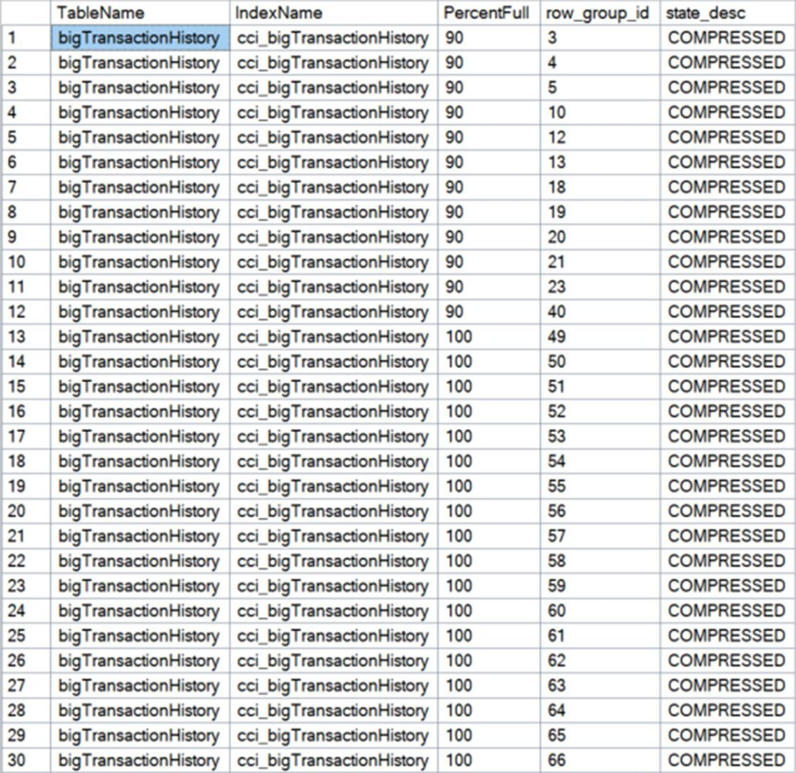

---

### Bảng đối chuẩn các kỹ thuật khử phân mảnh Rowstore

Bảng 12-1 tổng kết và so sánh toàn diện các đặc tính cũng như các vấn đề thực tế giữa bốn kỹ thuật khử phân mảnh dành cho chỉ mục rowstore.

**Bảng 12-1.** Đặc tính của các kỹ thuật khử phân mảnh rowstore

| Đặc tính / Vấn đề | Xóa và tạo lại chỉ mục (Drop & Create Index) | Tạo lại với DROP_EXISTING | ALTER INDEX REBUILD | ALTER INDEX REORGANIZE |
| :--- | :--- | :--- | :--- | :--- |
| **Tái tạo chỉ mục phi gom cụm khi phân mảnh clustered index** | Phải làm hai lần | Không | Không | Không |
| **Thiếu hụt chỉ mục trong quá trình thực hiện** | Có (bị mất index tạm thời) | Không | Không | Không |
| **Khử phân mảnh chỉ mục đi kèm ràng buộc** | Rất phức tạp (phải drop FK trước) | Phức tạp vừa phải | Dễ dàng | Dễ dàng |
| **Khử phân mảnh nhiều chỉ mục cùng lúc** | Không | Không | Có | Có |
| **Mức độ tương tranh với người dùng đồng thời** | Thấp | Thấp | Trung bình (tùy thuộc mức độ hoạt động) | Cao |
| **Hủy bỏ giữa chừng** | Rất nguy hiểm nếu không nằm trong transaction | Mất toàn bộ tiến trình đã làm (Rollback) | Mất toàn bộ tiến trình đã làm (Rollback) | Tiến trình đã làm được giữ lại (Không rollback) |
| **Mức độ khử phân mảnh đạt được** | Rất cao | Rất cao | Rất cao | Vừa phải đến thấp |
| **Áp dụng Fill Factor mới** | Có | Có | Có | Không |
| **Cập nhật lại Statistics** | Có | Có | Có | Không |

---

### Khử Phân Mảnh và Phân Vùng Dữ Liệu (Defragmentation and Partitions)

Nếu bạn quản lý những cơ sở dữ liệu khổng lồ (*massive databases*), một cơ chế tiêu chuẩn giúp quản trị dữ liệu hiệu quả là chia nhỏ bảng thành các phân vùng (*partitions*). Mặc dù kỹ thuật phân vùng trong một số ít trường hợp rất đặc thù có thể hỗ trợ hiệu năng truy vấn, nhưng mục đích đầu tiên và quan trọng nhất của nó luôn là một công cụ để **quản trị dữ liệu** (*data management*). Bạn sẽ nhận thấy trong cuốn sách này không có riêng một chương nào dành cho việc "sử dụng phân vùng để tăng tốc hiệu năng", đơn giản bởi vì phân vùng không phải là một công cụ tăng tốc hiệu năng thực sự hiệu quả.

Một trong những trở ngại lớn nhất khi xây dựng lại chỉ mục (*index rebuild*) là nó thường đưa chỉ mục vào trạng thái ngoại tuyến (*offline*) trong suốt quá trình xử lý. Tuy nhiên, nếu bạn sở hữu một chỉ mục đã được phân vùng, bạn có thể kết hợp lệnh `ONLINE = ON` để giải quyết vấn đề này như minh họa trong Listing 12-21.

**Listing 12-21.** Sử dụng tùy chọn ONLINE = ON khi rebuild chỉ mục phân vùng

```sql
ALTER INDEX i1 ON dbo.Test1 REBUILD PARTITION = ALL WITH (ONLINE = ON);
```

Câu lệnh trên sẽ xây dựng lại tất cả các phân vùng của chỉ mục nhưng vẫn giữ cho chỉ mục luôn trực tuyến để phục vụ các truy vấn khác của người dùng. Quá trình này sẽ kéo dài hơn so với một thao tác rebuild thông thường và tiêu tốn một lượng tài nguyên bổ sung đáng kể, đặc biệt là không gian đĩa và bộ nhớ trong `tempdb`. 

Để giảm thiểu chi phí tài nguyên này, bạn có thể chỉ định rõ từng phân vùng đơn lẻ cần xây dựng lại thay vì thực hiện trên toàn bộ các phân vùng, như hiển thị trong Listing 12-22.

**Listing 12-22.** Xây dựng lại một phân vùng cụ thể

```sql
ALTER INDEX i1 ON dbo.Test1 REBUILD PARTITION = 1 WITH (ONLINE = ON);
```

Giờ đây, bạn chỉ xây dựng lại duy nhất phân vùng số 1 và tiếp tục tận dụng tùy chọn `ONLINE = ON` để đảm bảo chỉ mục luôn sẵn sàng phục vụ.

Bàn về cơ chế khóa (*locking*) phát sinh trong quá trình xây dựng lại chỉ mục trên các phân vùng, SQL Server (kể từ phiên bản SQL Server 2014 trở đi) đã giới thiệu một tính năng vô cùng hữu ích. Bạn có thể can thiệp vào mức độ ưu tiên của khóa (*lock priority*) trong quá trình rebuild bằng cách điều chỉnh cú pháp lệnh `REBUILD` như trong Listing 12-23.

**Listing 12-23.** Thay đổi độ ưu tiên khóa với WAIT_AT_LOW_PRIORITY

```sql
ALTER INDEX i1
ON dbo.Test1
REBUILD PARTITION = 1
WITH (   ONLINE = ON
         (
             WAIT_AT_LOW_PRIORITY
             (
                 MAX_DURATION = 20,
                 ABORT_AFTER_WAIT = SELF
             )
         )
     );
```

Cú pháp này thiết lập khoảng thời gian tối đa mà thao tác rebuild chấp nhận chờ đợi cấp khóa (`MAX_DURATION = 20`, tính theo phút). Tiếp theo, tham số `ABORT_AFTER_WAIT` cho phép bạn quyết định tiến trình nào sẽ bị hủy bỏ (*abort*) nhằm giải phóng tài nguyên cho hệ thống: bạn có thể cấu hình để thao tác rebuild tự hủy chính nó (`SELF`) hoặc hủy các tiến trình người dùng đang gây nghẽn khóa (`BLOCKERS`). 

Điểm giá trị nhất ở đây là trong thời gian chờ đợi, tiến trình rebuild được gán mức ưu tiên thấp (*low priority*), do đó nó không tiêu tốn tài nguyên hệ thống và quan trọng nhất là **không chặn các giao dịch mới của người dùng** đang đi vào hệ thống như cơ chế khóa độc quyền thông thường.

---

### Ý Nghĩa và Vai Trò của Hệ Số Điền Đầy (Significance of the Fill Factor)

Đối với các chỉ mục Rowstore, hiệu năng truy vấn tối ưu nhất đạt được khi có càng nhiều dòng dữ liệu được lưu trữ trên một trang (*page*). Càng nhiều dòng trên một trang đồng nghĩa với việc số lượng trang dữ liệu cần phải đọc từ đĩa và nạp vào bộ nhớ đệm (*Buffer Pool*) sẽ càng ít đi. Đây chính là một trong những mục tiêu nền tảng của việc khử phân mảnh chỉ mục.

Tuy nhiên, khi các trang dữ liệu đã bị lấp đầy hoàn toàn, đặc biệt là trong các hệ thống OLTP có khối lượng giao dịch ghi chép dày đặc, bạn sẽ thường xuyên đối mặt với hiện tượng phân tách trang (*page splits*), gây suy giảm hiệu năng nghiêm trọng. Do đó, người quản trị luôn phải duy trì sự cân bằng tối ưu giữa hai mục tiêu: **tối đa hóa số lượng dòng trên một trang** và **ngăn ngừa hiện tượng phân tách trang**.

SQL Server cho phép bạn kiểm soát dung lượng không gian trống được để lại trên mỗi trang chỉ mục thông qua tùy chọn **hệ số điền đầy (Fill Factor)**:
- Nếu bạn biết trước một bảng sẽ có tần suất thêm mới và chỉnh sửa dữ liệu rất lớn, bạn có thể chủ động chừa lại không gian trống trên các trang chỉ mục bằng cách hạ thấp Fill Factor, từ đó giảm thiểu tối đa số lần phát sinh page split.
- Ngược lại, nếu dữ liệu của bảng là dữ liệu chỉ đọc (*read-only*) hoặc rất hiếm khi thay đổi, bạn có thể thiết lập Fill Factor ở mức tối đa để ép chặt dữ liệu, tiết kiệm tối đa bộ nhớ đệm và số lần đọc đĩa.

Giá trị Fill Factor mặc định của SQL Server là **0** (về mặt kỹ thuật có ý nghĩa giống hệt giá trị **100**). Khi Fill Factor là 0 hoặc 100, SQL Server sẽ đóng gói dữ liệu lấp đầy 100% dung lượng tầng lá của trang chỉ mục. 

> [!NOTE]
> Hệ số Fill Factor của một chỉ mục **chỉ được áp dụng tại thời điểm chỉ mục được khởi tạo hoặc xây dựng lại (rebuild)**. Khi các khóa mới liên tục được chèn hoặc cập nhật, mật độ dòng trong chỉ mục dần dần sẽ tự ổn định trong một phạm vi nhất định. Khi một đợt phân tách trang xảy ra (như đã phân tích ở phần trước), thông thường một nửa dữ liệu của trang ban đầu sẽ bị chuyển sang trang mới — điều này diễn ra độc lập và hoàn toàn không bị chi phối bởi thiết lập Fill Factor ban đầu của chỉ mục.

Để hiểu rõ bản chất hoạt động của Fill Factor, chúng ta hãy cùng tiến hành một thử nghiệm nhỏ với bảng dữ liệu gồm 24 dòng trong Listing 12-24.

**Listing 12-24.** Tạo bảng thử nghiệm

```sql
DROP TABLE IF EXISTS dbo.Test1;
GO
CREATE TABLE dbo.Test1
(
    C1 INT,
    C2 CHAR(999)
);
WITH Nums
AS (SELECT 1 AS n
    UNION ALL
    SELECT n + 1
    FROM Nums
    WHERE n < 24)
INSERT INTO dbo.Test1
(
    C1,
    C2
)
SELECT n * 100,
       'a'
FROM Nums;
```

Mỗi dòng dữ liệu trong bảng chiếm hơn 1.000 byte (cột `C1` là `INT` 4 byte và `C2` là `CHAR(999)`), do đó một trang dữ liệu 8 KB chuẩn chỉ có thể chứa tối đa khoảng 7 đến 8 dòng.

Bây giờ, chúng ta tối đa hóa số dòng trên mỗi trang lá bằng cách tạo một Clustered Index với hệ số Fill Factor mặc định bằng 0 trong Listing 12-25.

**Listing 12-25.** Tạo Clustered Index với Fill Factor mặc định

```sql
CREATE CLUSTERED INDEX FillIndex ON Test1(C1);
```

Sau khi tạo chỉ mục, chúng ta sử dụng DMF `sys.dm_db_index_physical_stats` để kiểm tra trạng thái trang như minh họa trong Hình 12-14.

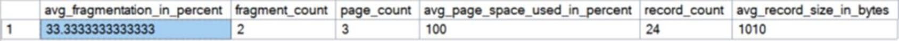

Hãy lưu ý chỉ số `avg_page_space_used_in_percent` đạt xấp xỉ mức tối đa (100%), vì Fill Factor mặc định cho phép nén số dòng tối đa vào mỗi trang. Do một trang dữ liệu không thể chứa một phần dòng (*partial row*) để lấp đầy khít 100% không gian, giá trị `avg_page_space_used_in_percent` trong thực tế thường sẽ thấp hơn 100% một chút.

Để giảm bớt tần suất phân tách trang ban đầu gây ra bởi các thao tác `INSERT` và `UPDATE`, chúng ta có thể chủ động tạo không gian trống trong các trang lá bằng cách xây dựng lại Clustered Index với giá trị Fill Factor là 75% như trong Listing 12-26.

**Listing 12-26.** Điều chỉnh chỉ mục với Fill Factor = 75

```sql
ALTER INDEX FillIndex ON dbo.Test1 REBUILD
WITH  (FILLFACTOR = 75);
```

Sau khi rebuild, hãy kiểm tra lại thông số vật lý của chỉ mục trong Hình 12-15.

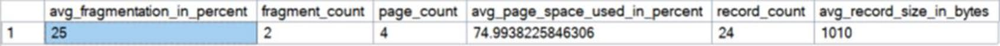

Quan sát kết quả, bạn sẽ thấy `avg_page_space_used_in_percent` giờ đây đạt xấp xỉ 75%, đúng theo thiết lập của Fill Factor. Điều này đồng nghĩa với việc mỗi trang dữ liệu hiện còn thừa đủ chỗ để tiếp nhận thêm hai dòng dữ liệu mới mà **hoàn toàn không kích hoạt hiện tượng phân tách trang**.

Chúng ta có thể chứng minh điều này bằng cách chèn thêm hai dòng dữ liệu rơi vào phạm vi của tập 6 dòng đầu tiên (`C1` từ 100 đến 600, nằm trên trang đầu tiên) trong Listing 12-27.

**Listing 12-27.** Chèn thêm hai dòng mới

```sql
INSERT  INTO dbo.Test1
VALUES  (110, 'a'),  -- Dòng thứ 25
        (120, 'a') ;  -- Dòng thứ 26
```

Kết quả sau khi chèn được thể hiện trong Hình 12-16.

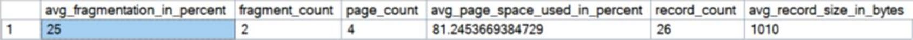

Từ kết quả đầu ra, bạn có thể thấy rõ việc thêm hai dòng mới không hề làm tăng thêm bất kỳ trang nào cho chỉ mục (số lượng trang dữ liệu vẫn giữ nguyên là 4). Tương ứng với điều đó, `avg_page_space_used_in_percent` đã tăng từ **74.99% lên 81.25%**. 

Với việc chèn thêm hai dòng này, trang đầu tiên hiện đã được lấp đầy tối đa (8 dòng). Bất kỳ thao tác thêm dòng nào tiếp theo nằm trong phạm vi của 8 dòng đầu tiên này chắc chắn sẽ dẫn đến hiện tượng phân tách trang, làm số trang của chỉ mục tăng lên 5 (Listing 12-28).

**Listing 12-28.** Chèn thêm một dòng nữa để kích hoạt phân tách trang

```sql
INSERT  INTO dbo.Test1
VALUES  (130, 'a') ;  -- Dòng thứ 27
```

Hãy kiểm tra lại thống kê trong Hình 12-17.

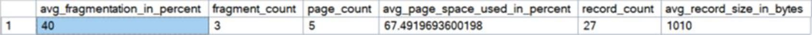

Số trang đã tăng lên 5. Hãy chú ý rằng mặc dù Fill Factor được cấu hình ban đầu là 75%, nhưng chỉ số mật độ trang trung bình (*Avg. Page Density*) lúc này đã giảm xuống chỉ còn **67.49%**, được tính toán theo công thức:

$$\text{Mật độ trang trung bình} = \frac{\text{Số dòng trung bình mỗi trang}}{\text{Số dòng tối đa trên một trang đầy}} = \frac{27 / 5}{8} = 67.5\%$$

Từ ví dụ thực nghiệm trên, bạn có thể rút ra một kết luận then chốt: **Fill Factor chỉ có ý nghĩa tại thời điểm chỉ mục được tạo lập hoặc tái tạo**. Sau đó, khi dữ liệu bị thao tác và biến đổi, thiết lập này không còn tác dụng khống chế nữa. Bất kể Fill Factor ban đầu là bao nhiêu, mỗi khi xảy ra phân tách trang, các dòng của trang gốc đều bị chia đôi sang hai trang và mức chiếm dụng không gian sẽ tự định hình lại. Do đó, nếu bạn áp dụng một hệ số Fill Factor tùy biến, bạn bắt buộc phải tái áp dụng nó định kỳ thông qua công tác bảo trì nếu muốn duy trì hiệu lực của nó.

Bạn có thể tái áp dụng Fill Factor bằng cách:
- Tạo lại chỉ mục (*recreating index*).
- Sử dụng `ALTER INDEX ... REORGANIZE`: lệnh này sẽ tôn trọng hệ số Fill Factor đã được thiết lập từ trước khi tạo chỉ mục.
- Sử dụng `ALTER INDEX ... REBUILD`: lệnh này vừa ghi nhận Fill Factor ban đầu, vừa cho phép bạn thiết lập một giá trị Fill Factor mới nếu cần.

Nếu không có hoạt động bảo trì Fill Factor định kỳ, dù bạn cấu hình giá trị mặc định hay tùy chỉnh, chỉ số `avg_page_space_used_in_percent` của bảng hoặc chỉ mục rốt cuộc cũng sẽ tự ổn định trong một biên độ hẹp do các đợt chia tách trang tự nhiên chi phối.

> [!TIP]
> Một tùy chọn khác bạn có thể cân nhắc là sử dụng thuộc tính `PAD_INDEX = ON` khi tạo chỉ mục. Tùy chọn này chỉ thị cho SQL Server áp dụng tỷ lệ phần trăm khoảng trống của Fill Factor lên cả **các trang cấp trung gian** (*intermediate level pages*) của cây chỉ mục. Mặc dù hiện tượng phân tách trang ở các tầng trung gian ít tốn kém hơn so với tầng lá, nhưng đây vẫn là một giải pháp hữu ích để giảm tải áp lực I/O trong các hệ thống đặc biệt nhạy cảm.

Có một trường phái quan điểm cho rằng: thay vì liên tục cố gắng chạy các tiến trình khử phân mảnh chỉ mục lặp đi lặp lại với tất cả những chi phí tài nguyên nặng nề đi kèm, bạn sẽ có lợi hơn nhiều nếu lựa chọn một hệ số Fill Factor hợp lý nhằm tạo ra một sự phân bổ trang ổn định lâu dài. Không ít DBA dày dạn kinh nghiệm đã áp dụng phương pháp này: **chấp nhận hy sinh một phần nhỏ dung lượng đĩa và một lượng đọc đĩa nhất định để triệt tiêu các đợt phân tách trang và những xung đột khóa/nghẽn mạng đi kèm**. Việc thử nghiệm thực tế trên chính hệ thống và khối lượng công việc cụ thể của bạn sẽ là chìa khóa duy nhất giúp bạn xác định được giá trị Fill Factor tối ưu.

---

### Bảo Trì Tự Động (Automatic Maintenance)

Như đã đề cập ở phần đầu chương, ngày càng có nhiều kỹ sư và chuyên gia cơ sở dữ liệu có xu hướng để yên các chỉ mục bị phân mảnh thay vì can thiệp dồn dập. Họ chọn cách điều chỉnh hệ số Fill Factor như chúng ta vừa thảo luận, hoặc lựa chọn mục tiêu cực kỳ chọn lọc: chỉ khử phân mảnh cho đúng những chỉ mục thực sự cần thiết với một tần suất vừa phải. Mỗi hệ thống doanh nghiệp đều sở hữu những đặc thù riêng biệt, và bạn cần xác định rõ ràng liệu hệ thống của mình có thực sự cần một tiến trình tự động hóa khử phân mảnh chỉ mục hay không.

Nếu bạn cần một bộ kịch bản tự động hóa toàn diện, đã được kiểm chứng qua thời gian và sở hữu độ tùy biến cực kỳ mạnh mẽ, tôi nhiệt liệt khuyên bạn nên sử dụng bộ giải pháp bảo trì của **Ola Hallengren** tại địa chỉ: [https://ola.hallengren.com](https://ola.hallengren.com) (hoặc liên kết rút gọn [http://bit.ly/JijaNI](http://bit.ly/JijaNI)).

Ngoài bộ kịch bản của Ola Hallengren, bạn cũng có thể sử dụng các kế hoạch bảo trì tích hợp sẵn (*Maintenance Plans*) bên trong SQL Server Management Studio (SSMS). Tuy nhiên, cá nhân tôi **không khuyến khích** sử dụng các Maintenance Plans mặc định này, bởi vì bạn phải từ bỏ quá nhiều khả năng kiểm soát chi tiết chỉ để đổi lấy một chút thuận tiện giao diện ban đầu. Bạn chắc chắn sẽ hài lòng hơn rất nhiều với kết quả và độ an toàn mà các bộ script chuyên nghiệp như của Ola Hallengren mang lại.

---

### Tóm Tắt Chương (Summary)

Qua toàn bộ nội dung của chương này, bạn đã nắm vững được bản chất của hiện tượng phân mảnh: trong một cơ sở dữ liệu có cường độ giao dịch cao, các phân tách trang (*page splits*) do lệnh `INSERT` và `UPDATE` gây ra sẽ làm các bảng và chỉ mục bị phân mảnh, từ đó gia tăng đáng kể chi phí trích xuất dữ liệu. 

Bạn có thể chủ động phòng ngừa các đợt phân tách trang này bằng cách duy trì các khoảng trống dự phòng bên trong các trang thông qua hệ số **Fill Factor**. Do Fill Factor chỉ được kích hoạt tại thời điểm tạo hoặc rebuild chỉ mục, bạn cần định kỳ tái áp dụng nó để duy trì hiệu quả bảo vệ. Mặt khác, các thao tác biến đổi dữ liệu trên các **Columnstore Index** cũng dẫn đến phân mảnh dưới dạng các dòng bị xóa ảo (*deleted rows tombstone*) và các rowgroups mở, gây suy giảm hiệu năng quét hàng loạt.

Bạn có thể đo lường và đánh giá mức độ phân mảnh của một chỉ mục (hoặc một bảng) bằng cách sử dụng DMV/DMF:
- Sử dụng hàm `sys.dm_db_index_physical_stats` cho các chỉ mục **Rowstore**.
- Sử dụng `sys.column_store_row_groups` cho các chỉ mục **Columnstore**.

Khi phát hiện mức độ phân mảnh vượt quá ngưỡng cho phép, bạn có thể linh hoạt áp dụng `ALTER INDEX ... REBUILD` hoặc `ALTER INDEX ... REORGANIZE`, tùy thuộc vào mức độ phân mảnh hiện thời, yêu cầu về tính sẵn sàng đồng thời của cơ sở dữ liệu, và việc bạn đang thao tác trên cấu trúc Rowstore hay Columnstore.

Khử phân mảnh giúp sắp xếp lại các trang dữ liệu để thứ tự vật lý trên đĩa trùng khớp với thứ tự logic của cây chỉ mục, nhờ đó cải thiện đáng kể thông lượng I/O cho các truy vấn quét tuần tự. Tuy nhiên, cần khắc ghi rằng: **trừ khi Query Optimizer lựa chọn được một kế hoạch thực thi thực sự hiệu quả, hiệu năng của truy vấn sau khi khử phân mảnh vẫn có thể tiếp tục tệ hại**. Do đó, tối ưu hóa chỉ mục phải luôn đồng hành với việc định hướng và hỗ trợ bộ tối ưu hóa tạo ra các kế hoạch thực thi có chi phí thấp nhất.

Trong chương tiếp theo, chúng ta sẽ cùng nhau mổ xẻ một vấn đề nan giải và vô cùng phổ biến trong thế giới SQL Server: **hiện tượng dò tham số không mong muốn (Bad Parameter Sniffing)** cùng các phương pháp hữu hiệu nhất để khắc chế nó.