# CHƯƠNG 13: Các truy vấn nhạy cảm với tham số: Nguyên nhân và Giải pháp (Parameter-Sensitive Queries: Causes and Solutions)

> **Thông tin sách gốc:**  
> © Grant Fritchey 2026  
> G. Fritchey, *SQL Server 2025 Query Performance Tuning*, https://doi.org/10.1007/979-8-8688-1865-3_13  

---

Thủ tục lưu trữ (Stored Procedures) và các câu lệnh đã chuẩn bị (Prepared Statements) có thể sử dụng các tham số (parameters) làm giá trị giữ chỗ. Khi kế hoạch thực thi được biên dịch lần đầu tiên, Bộ tối ưu hóa truy vấn (Query Optimizer) có thể "đọc trộm" giá trị thực tế được truyền vào tham số đó để tra cứu số liệu thống kê phân phối dữ liệu chính xác – kỹ thuật này được biết đến phổ biến với tên gọi **Parameter Sniffing (Đánh hơi tham số)**.

Trong đại đa số các trường hợp, Parameter Sniffing là một tính năng vô cùng hữu ích giúp tối ưu hóa hiệu năng. Tuy nhiên, một số câu truy vấn lại phải gánh chịu hiệu năng tệ hại bất thường bởi vì chúng quá nhạy cảm với các giá trị tham số cụ thể được dùng trong lần biên dịch ban đầu. Những câu lệnh như vậy được gọi là **Các truy vấn nhạy cảm với tham số (Parameter-Sensitive Queries)**. Xử lý và khắc phục triệt để hiện tượng này luôn là một trong những thử thách hóc búa nhất trong quản trị và tối ưu cơ sở dữ liệu.

Trong chương này, tôi sẽ đề cập đến các chủ đề sau:
* Nguyên lý vận hành của cơ chế Parameter Sniffing
* Cách nhận diện các truy vấn nhạy cảm với giá trị tham số
* Các cơ chế kỹ thuật để xử lý và khắc phục sự cố Parameter Sniffing

---

## Cơ chế hoạt động của Parameter Sniffing (How Does Parameter Sniffing Work?)

Parameter Sniffing về bản chất là một khái niệm rất đơn giản: Khi bạn thực thi một thủ tục lưu trữ hoặc một câu lệnh Prepared có tham số, **giá trị hằng số thực tế (literal value) được truyền vào tham số trong lần biên dịch đầu tiên sẽ được cung cấp trực tiếp cho Query Optimizer**. 

Optimizer truy cập giá trị này và sử dụng chính xác con số/chuỗi đó để tra cứu biểu đồ tần suất (Histogram) trong số liệu thống kê của bảng tương ứng nhằm ước tính số lượng dòng dữ liệu (**Cardinality Estimation**). Nhờ đó, trong rất nhiều tình huống, kế hoạch thực thi được sinh ra phản ánh rất sát thực tế dữ liệu của lần chạy đó – thay vì chỉ dựa trên một con số ước lượng trung bình mơ hồ.

### Sự khác biệt cốt lõi giữa Tham số (Parameters) và Biến cục bộ (Variables)
Mặc dù tham số và biến cục bộ trông rất giống nhau bên trong câu lệnh T-SQL, bản chất của chúng hoàn toàn khác biệt:
* **Tham số (Parameter):** Được định nghĩa ngay ở phần tiêu đề khai báo của thủ tục lưu trữ hoặc câu lệnh Prepared:
```sql
CREATE PROCEDURE dbo.AddressList
(
    @City VARCHAR(30),
    @PostalCode VARCHAR(15)
)
AS...
```
* **Biến cục bộ (Variable):** Được khai báo bên trong phần thân mã lệnh của batch hoặc Stored Procedure:
```sql
DECLARE @City VARCHAR(30);
```

Bởi vì biến cục bộ được định nghĩa và gán giá trị trong lúc thực thi mã, **Query Optimizer không thể biết trước giá trị nằm trong biến tại thời điểm biên dịch kế hoạch**. Do đó, biến cục bộ không bao giờ được "đánh hơi" (sniffed) tự động như tham số. Khi gặp biến cục bộ, optimizer buộc phải dựa vào giá trị mật độ trung bình (**Density**) của cột trong bảng để ước tính số dòng. 

*(Tuy nhiên, trong trường hợp xảy ra tái biên dịch ở cấp câu lệnh - Statement-level Recompile, giá trị của biến tại thời điểm đó đã xác định, nên optimizer sẽ có thể đọc được giá trị đó để đưa ra ước tính chính xác hơn).*

---

### Khảo sát Thực nghiệm về Parameter Sniffing

Để thấy rõ cơ chế Parameter Sniffing trong thực tế, chúng ta sử dụng thủ tục lưu trữ trong Listing 13-1:

```sql
-- Listing 13-1. A stored procedure with a parameter
CREATE OR ALTER PROC dbo.ProductTransactionHistoryByReference
(@ReferenceOrderID INT)
AS
BEGIN
    SELECT p.NAME,
           p.ProductNumber,
           th.ReferenceOrderID
    FROM Production.Product AS p
        JOIN Production.TransactionHistory AS th
            ON th.ProductID = p.ProductID
    WHERE th.ReferenceOrderID = @ReferenceOrderID;
END;
```

Bản thân câu lệnh bên trong thủ tục trong Listing 13-1 không có gì bất thường. Điều đặc biệt thực sự nằm ở **sự phân bổ dữ liệu bị lệch (data skew / skewed distribution)** của cột `ReferenceOrderID` trong bảng `Production.TransactionHistory`:
* Một số giá trị `ReferenceOrderID` trả về một số lượng dòng rất lớn và hoạt động tối ưu nhất với một kế hoạch thực thi dạng quét và nối băm/trộn.
* Trong khi các giá trị khác chỉ trả về rất ít dòng (1-2 dòng) và chạy nhanh nhất với một kế hoạch Index Seek kết hợp Nested Loops.

Bây giờ, chúng ta thực thi thủ tục với giá trị tham số trả về nhiều dòng (`@ReferenceOrderID = 53465`) bằng Listing 13-2:

```sql
-- Listing 13-2. Executing the ProductTransactionHistoryByReference query
EXEC dbo.ProductTransactionHistoryByReference @ReferenceOrderID = 53465;
```

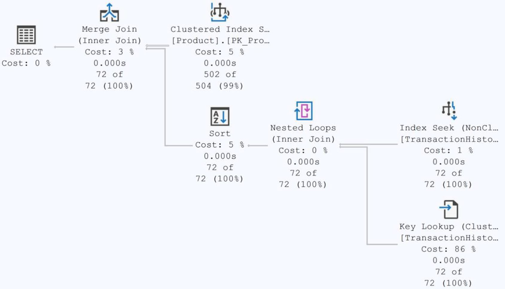  
*Hình 13-1. Kế hoạch thực thi sinh ra khi biên dịch với giá trị 53465 (trả về 72 dòng): Clustered Index Scan kết hợp Merge Join*

Các thông số đo lường:
* Thời gian thực thi: **2.2 ms**
* Số lần đọc logic: **245 reads**

Vì giá trị `53465` trả về tới 72 dòng dữ liệu, optimizer đã đánh giá rằng việc quét Clustered Index của bảng `Product` (`PK_Product_ProductID`) kết hợp với thuật toán **Merge Join** (có toán tử Sort) là phương án tối ưu nhất. Kế hoạch này được lưu vào Plan Cache.

Bây giờ, chúng ta xóa kế hoạch này khỏi bộ nhớ đệm bằng Listing 13-3:

```sql
-- Listing 13-3. Removing a single plan from cache
DECLARE @planhandle VARBINARY(64);
SELECT @planhandle = deps.plan_handle 
FROM sys.dm_exec_procedure_stats AS deps
WHERE deps.object_id = OBJECT_ID('dbo.ProductTransactionHistoryByReference');

IF @planhandle IS NOT NULL
    DBCC FREEPROCCACHE(@planhandle);
```

Tiếp theo, chúng ta chạy lại thủ tục nhưng lần này truyền vào một giá trị trả về rất ít dòng (`@ReferenceOrderID = 816` – chỉ trả về đúng 2 dòng):

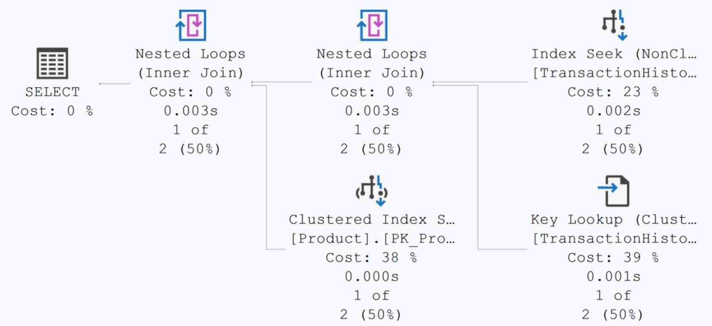  
*Hình 13-2. Kế hoạch thực thi sinh ra khi biên dịch với giá trị 816 (chỉ trả về 2 dòng): Index Seek kết hợp Nested Loops*

Kế hoạch ở Hình 13-2 hoàn toàn khác biệt: Thay vì Scan và Merge Join, optimizer đã thông minh lựa chọn **Index Seek** trên bảng `Product` và nối dữ liệu bằng **Nested Loops** – phương án hoàn hảo nhất cho tập dữ liệu cực nhỏ!

#### Hiện tượng gì xảy ra nếu thay Tham số bằng Biến cục bộ?
Nếu chúng ta chạy cùng câu lệnh đó nhưng đưa giá trị vào một biến cục bộ như trong Listing 13-4:

```sql
-- Listing 13-4. Executing the same query with a variable
DECLARE @ReferenceOrderID INT = 53465;
SELECT p.Name,
       p.ProductNumber,
       th.ReferenceOrderID
FROM Production.Product AS p
    JOIN Production.TransactionHistory AS th
        ON th.ProductID = p.ProductID
WHERE th.ReferenceOrderID = @ReferenceOrderID;
```

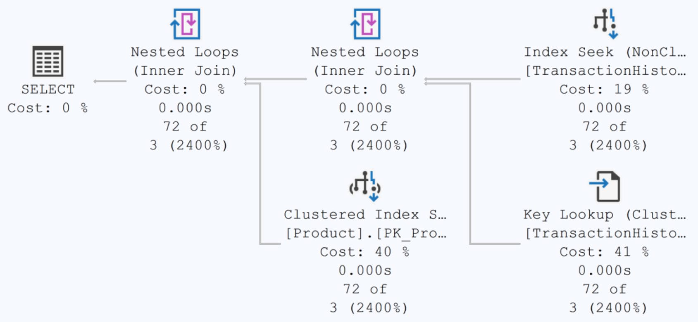  
*Hình 13-3. Kế hoạch thực thi dựa trên giá trị ước tính trung bình (Density)*

Khi dùng biến cục bộ, optimizer không "đánh hơi" được giá trị `53465` nên nó áp dụng con số phỏng đoán trung bình. Thời gian chạy là **634 microseconds** nhưng số lần đọc logic tăng vọt lên **362 reads** (so với 245 reads ban đầu).

---

### Bản chất của Sự cố Parameter Sniffing Tồi tệ (Bad Parameter Sniffing)

Sự cố thực sự bùng nổ khi: **Một truy vấn nhận một kế hoạch thực thi được tối ưu cho tập dữ liệu lớn, nhưng sau đó lại bị áp đặt để chạy cho tập dữ liệu nhỏ (hoặc ngược lại)!**

Hãy cùng quan sát qua các bước thực nghiệm:
1. Xóa cache thủ tục bằng Listing 13-3.
2. Chạy thủ tục với giá trị lớn `@ReferenceOrderID = 53465` (sinh ra Kế hoạch A tối ưu cho 72 dòng).
3. Tiếp tục chạy thủ tục với giá trị nhỏ `@ReferenceOrderID = 816` (SQL Server tái sử dụng Kế hoạch A sẵn có trong cache).
4. Đo lường hiệu năng.
5. Sau đó, xóa cache và chạy trực tiếp `@ReferenceOrderID = 816` ngay từ đầu (sinh ra Kế hoạch B tối ưu cho 2 dòng).

### Bảng 13-1. Đo lường hiệu năng của truy vấn giá trị 816 dưới hai kế hoạch khác nhau

| Kế hoạch được biên dịch với giá trị | Thời gian thực thi | Số lần đọc logic (Logical Reads) |
| :--- | :--- | :--- |
| **Kế hoạch A (Biên dịch theo giá trị 53465 - 72 dòng)** | **529 microseconds** | **11 reads** |
| **Kế hoạch B (Biên dịch theo giá trị 816 - 2 dòng)** | **271 microseconds** | **7 reads** |

Cả số lần đọc logic lẫn thời gian thực thi đều bị suy giảm (kém hơn gấp đôi) khi tập dữ liệu nhỏ phải "gánh" kế hoạch vốn được sinh ra cho tập dữ liệu lớn. Đó chính là bi kịch của **Bad Parameter Sniffing**!

---

## Nhận diện các Truy vấn Nhạy cảm với Tham số (Identifying Queries That Are Sensitive to Parameter Values)

Đối mặt với sự cố Parameter Sniffing là một trải nghiệm vô cùng khó chịu và gây bối rối cho các DBA, bởi vì: **Vấn đề hầu như luôn diễn ra chập chờn, gián đoạn (intermittent problem)**.
* Hệ thống có thể hoạt động hoàn toàn trơn tru và nhanh chóng suốt nhiều ngày.
* Rồi đột ngột, vào một thời điểm ngẫu nhiên, một thủ tục quan trọng bỗng nhiên chạy chậm chạp như rùa bò, gây nghẽn toàn bộ hệ thống.
* Nhưng rồi, trước khi bạn kịp điều tra, thủ tục đó đột ngột... chạy nhanh trở lại bình thường mà không cần bất kỳ sự can thiệp nào!

Hiện tượng kỳ lạ này xuất hiện vì: Kế hoạch thực thi bị đào thải khỏi cache (do áp lực bộ nhớ, cập nhật thống kê hoặc recompile) và một tiến trình gọi ngẫu nhiên với một tham số "lệch chuẩn" đã nạp vào cache một kế hoạch không phù hợp cho 99% các trường hợp còn lại!

Để chẩn đoán chính xác liệu một truy vấn có đang là nạn nhân của sự cố này hay không, chúng ta cần thu thập và so sánh các kế hoạch thực thi khác nhau của cùng câu lệnh đó. Chúng ta có 3 phương pháp trích xuất:

### 1. Trích xuất qua Plan Cache bằng DMV
Chúng ta có thể chụp lại kế hoạch tại thời điểm hệ thống chạy tốt và chụp lại lần nữa khi hệ thống chạy chậm bằng cách truy vấn `sys.dm_exec_procedure_stats` kết hợp `sys.dm_exec_query_plan` (Listing 13-5):

```sql
-- Listing 13-5. Using sys.dm_exec_query_plan to retrieve execution plans
SELECT deps.EXECUTION_COUNT,
       deps.total_elapsed_time,
       deps.total_logical_reads,
       deps.total_logical_writes,
       deqp.query_plan
FROM sys.dm_exec_procedure_stats AS deps
    CROSS APPLY sys.dm_exec_query_plan(deps.plan_handle) AS deqp
WHERE deps.OBJECT_ID = OBJECT_ID('dbo.ProductTransactionHistoryByReference');
```
*(Lưu ý: Phương pháp này phụ thuộc vào bộ nhớ đệm, nên bạn bắt buộc phải chụp lại trước khi kế hoạch bị xóa khỏi RAM).*

### 2. Trích xuất qua Query Store
Nếu cơ sở dữ liệu đã kích hoạt Query Store, đây là công cụ lý tưởng nhất: Query Store tự động lưu giữ **tất cả các kế hoạch thực thi khác nhau** từng được sinh ra cho truy vấn đó qua dòng thời gian. Listing 13-6 minh họa cách truy vấn:

```sql
-- Listing 13-6. Using the Query Store to retrieve execution plans
SELECT SUM(qsrs.count_executions) AS ExecutionCount,
       AVG(qsrs.avg_duration) AS AvgDuration,
       AVG(qsrs.avg_logical_io_reads) AS AvgReads,
       AVG(qsrs.avg_logical_io_writes) AS AvgWrites,
       CAST(qsp.query_plan AS XML) AS QueryPlan,
       qsp.query_id,
       qsp.plan_id
FROM sys.query_store_query AS qsq
    JOIN sys.query_store_plan AS qsp
        ON qsp.query_id = qsq.query_id
    JOIN sys.query_store_runtime_stats AS qsrs
        ON qsrs.plan_id = qsp.plan_id
WHERE qsq.OBJECT_ID = OBJECT_ID('dbo.ProductTransactionHistoryByReference')
GROUP BY qsp.query_plan,
         qsp.query_id,
         qsp.plan_id;
```

### 3. Thu thập qua Extended Events
Bạn có thể thiết lập phiên Extended Events để tự động bắt sự kiện hoàn thành và kế hoạch thực thi như trong Listing 13-7:

```sql
-- Listing 13-7. An Extended Events session to capture execution plans
CREATE EVENT SESSION [ExecutionPlans]
ON SERVER
    ADD EVENT sqlserver.query_post_execution_showplan
    (WHERE (
                [sqlserver].[equal_i_sql_unicode_string]([sqlserver].[database_name], N'AdventureWorks')
               AND [object_name] = N'ProductTransactionHistoryByReference'
           )
    ),
    ADD EVENT sqlserver.rpc_completed
    (WHERE (
                [sqlserver].[equal_i_sql_unicode_string]([sqlserver].[database_name], N'AdventureWorks')
               AND [object_name] = N'ProductTransactionHistoryByReference'
           )
    )
    ADD TARGET package0.event_file
    (SET FILENAME = N'ExecutionPlans')
WITH
(
    TRACK_CAUSALITY = ON
);
```

> [!WARNING]
> Sự kiện `query_post_execution_showplan` tiêu tốn rất nhiều tài nguyên hệ thống. Hãy luôn đặt bộ lọc thật chặt chẽ và chỉ kích hoạt phiên trong các khoảng thời gian ngắn phục vụ điều tra.

---

### Phân tích Thuộc tính Parameter List trên Kế hoạch Thực thi

Khi mở cửa sổ thuộc tính (Properties) của nút toán tử gốc (SELECT) trên kế hoạch thực thi, bạn hãy mở rộng mục **Parameter List**:

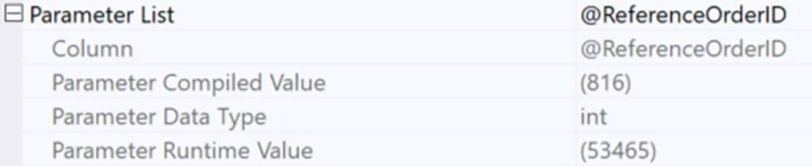  
*Hình 13-4. Thuộc tính Parameter List vạch trần giá trị biên dịch (Compiled Value) và giá trị thời gian chạy (Runtime Value)*

Tại đây, bạn sẽ thấy hai giá trị mang tính quyết định:
1. **ParameterCompiledValue:** Giá trị cụ thể được truyền vào trong lần biên dịch đầu tiên và được optimizer dùng để vạch ra toàn bộ cấu trúc kế hoạch này (trong ví dụ là `53465`).
2. **ParameterRuntimeValue:** Giá trị thực tế đang được truyền vào trong lần thực thi hiện tại.

Nếu bạn nhận thấy `ParameterRuntimeValue` có sự chênh lệch lớn về mặt bản số (trả về rất ít dòng hoặc rất nhiều dòng) so với `ParameterCompiledValue`, bạn đã bắt quả tang được thủ phạm gây ra sự cố hiệu năng!

### Đối chiếu với Biểu đồ Tần suất (Histogram)
Để hiểu vì sao optimizer lại chọn kế hoạch như vậy, chúng ta đối chiếu trực tiếp giá trị tham số với Histogram của cột thông qua hàm DMF `sys.dm_db_stats_histogram` trong Listing 13-8:

```sql
-- Listing 13-8. Identifying statistics information through a query
DECLARE @KeyValue INT = 53465;

WITH histolow
AS (SELECT ddsh.step_number,
           ddsh.range_high_key,
           ddsh.range_rows,
           ddsh.equal_rows,
           ddsh.average_range_rows
     FROM sys.dm_db_stats_histogram(OBJECT_ID('Production.TransactionHistory'), 3) AS ddsh ),
     histojoin
AS (SELECT h1.step_number,
           h1.range_high_key,
           h2.range_high_key AS range_high_key_step1,
           h1.range_rows,
           h1.equal_rows,
           h1.average_range_rows
    FROM histolow AS h1
        LEFT JOIN histolow AS h2
            ON h1.step_number = h2.step_number + 1)
SELECT hj.range_high_key,
       hj.equal_rows,
       hj.average_range_rows
FROM histojoin AS hj
WHERE hj.range_high_key >= @KeyValue
      AND
      (
          hj.range_high_key_step1 < @KeyValue
          OR hj.range_high_key_step1 IS NULL
      );
```

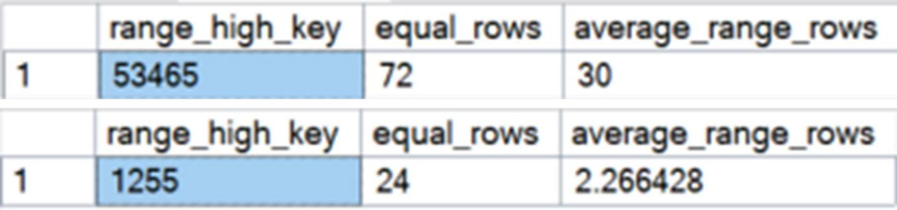  
*Hình 13-5. Kết quả tra cứu Histogram cho thấy sự chênh lệch bản số khổng lồ giữa hai giá trị tham số*

Kết quả Histogram giải thích hoàn toàn vì sao optimizer lại đưa ra hai kế hoạch khác nhau: 
* Với giá trị `53465`, số dòng dự kiến (`equal_rows`) là **72 dòng** – một con số đủ lớn để ưu tiên quét và Merge Join.
* Trong khi với giá trị `816`, số dòng chỉ là **2 dòng** – hoàn toàn phù hợp cho Index Seek và Nested Loops.

Bây giờ, chúng ta đã thấu hiểu tường tận nguồn gốc phát sinh các kế hoạch khác nhau. Bước tiếp theo là đưa ra các giải pháp kỹ thuật tối ưu nhất để xử lý triệt để sự cố Parameter Sniffing này.

---

## Các giải pháp xử lý truy vấn nhạy cảm với kế hoạch (Mechanisms for Addressing Plan-Sensitive Queries)

Có nhiều phương pháp khác nhau mà bạn có thể áp dụng để xử lý hiện tượng parameter sniffing bất lợi. Mỗi phương pháp đều đòi hỏi bạn phải đưa ra phán đoán và quyết định xem loại giải pháp nào là phù hợp nhất. Ngoại trừ tính năng Multiplan (cơ chế cuối cùng mà chúng ta sẽ tìm hiểu ở phần sau), mỗi giải pháp giải quyết parameter sniffing bất lợi đều đòi hỏi một sự đánh đổi (*trade-off*). Tôi sẽ phân tích các sự đánh đổi này khi đi vào chi tiết từng giải pháp. 

Các lựa chọn để đối phó với hiện tượng parameter sniffing bất lợi bao gồm:

- Vô hiệu hóa hoàn toàn cơ chế parameter sniffing.
- Sử dụng biến cục bộ thay cho tham số.
- Biên dịch lại truy vấn ở mỗi lần thực thi.
- Sử dụng gợi ý truy vấn `OPTIMIZE FOR`.
- Sử dụng chức năng ép buộc kế hoạch (*force plan*) của Query Store.
- Tự động tận dụng cơ chế đa kế hoạch (Multiplan) nếu truy vấn đạt các ngưỡng điều kiện.

Đối với mỗi cách tiếp cận này, bạn sẽ cần phải xem xét và đánh giá lại các truy vấn theo thời gian. Khi dữ liệu của bạn thay đổi, một giải pháp từng hoạt động rất tốt trong quá khứ hoàn toàn có thể trở thành một vấn đề phát sinh trong tương lai; vì vậy, hãy luôn ghi nhớ điều này khi áp dụng bất kỳ giải pháp khắc phục nào dưới đây. Bây giờ, chúng ta hãy cùng thảo luận về các cơ chế này và sự đánh đổi của chúng.

---

### Vô hiệu hóa Parameter Sniffing (Disable Parameter Sniffing)

Mặc dù trong phần lớn thời gian, parameter sniffing là một cơ chế vô hại hoặc mang lại lợi ích to lớn, nhưng nó thực sự có thể trở thành vấn đề nghiêm trọng khi phân phối dữ liệu bị lệch. Có hai cơ chế cho phép bạn vô hiệu hóa hoàn toàn parameter sniffing.

Cách đầu tiên là cấu hình ở cấp độ toàn máy chủ (*server-level*) bằng cách sử dụng một cờ theo vết (*trace flag*). Listing 13-9 minh họa cách thực hiện điều này.

**Listing 13-9.** Kích hoạt cờ theo vết (Trace Flag)

```sql
DBCC TRACEON (4136,-1);
```

Vấn đề cốt tử của cách tiếp cận này là nó vô hiệu hóa parameter sniffing trên **toàn bộ máy chủ**. Mặc dù bạn có thể có một cơ sở dữ liệu cụ thể đang phải chịu đựng tình trạng bad parameter sniffing, nhưng hiếm khi tất cả các cơ sở dữ liệu trên cùng máy chủ đều rơi vào tình trạng tương tự.

Giải pháp thay thế là bạn có thể tận dụng cấu hình phạm vi cơ sở dữ liệu (**Database Scoped Configuration** — có từ SQL Server 2016 trở lên cũng như Azure SQL Database) để vô hiệu hóa parameter sniffing chỉ riêng cho một cơ sở dữ liệu cụ thể, như thể hiện trong Listing 13-10.

**Listing 13-10.** Sử dụng cấu hình phạm vi cơ sở dữ liệu (Database Scoped Configuration)

```sql
ALTER DATABASE SCOPED CONFIGURATION SET PARAMETER_SNIFFING = OFF;
```

Việc sử dụng cơ chế này cho phép bạn có một cách tiếp cận có mục tiêu và thu hẹp phạm vi hơn để vô hiệu hóa parameter sniffing, nhưng bạn sẽ mất đi toàn bộ những lợi ích vượt trội mà cơ chế parameter sniffing mang lại cho các truy vấn khác trong cơ sở dữ liệu đó.

Thêm một lựa chọn nữa là tận dụng gợi ý truy vấn `USE HINT` để vô hiệu hóa parameter sniffing trên một **truy vấn đơn lẻ**. Listing 13-11 minh họa cách hoạt động của phương án này.

**Listing 13-11.** Vô hiệu hóa parameter sniffing cho một truy vấn duy nhất

```sql
CREATE OR ALTER PROC dbo.ProductTransactionHistoryByReference
(@ReferenceOrderID INT)
AS
BEGIN
    SELECT p.NAME,
           p.ProductNumber,
           th.ReferenceOrderID
    FROM Production.Product AS p
        JOIN Production.TransactionHistory AS th
            ON th.ProductID = p.ProductID
    WHERE th.ReferenceOrderID = @ReferenceOrderID
    OPTION (USE HINT ('DISABLE_PARAMETER_SNIFFING'));
END;
```

Tùy chọn này mang lại cho bạn khả năng kiểm soát parameter sniffing ở mức độ chi tiết và tinh chỉnh cao hơn nhiều so với việc tắt ở cấp độ toàn bộ máy chủ hay toàn bộ cơ sở dữ liệu (áp dụng từ SQL Server 2016 trở lên). Bạn có thể kết hợp kỹ thuật này với gợi ý Query Store (Query Store hints — đã học ở Chương 6) hoặc Plan Guide (đã học ở Chương 8), nhờ đó bạn không cần phải can thiệp trực tiếp sửa đổi mã nguồn T-SQL của ứng dụng. Tuy nhiên, trong hầu hết các tình huống thực tế, tôi nhận thấy các phương pháp khác dưới đây thường mang lại kết quả phục vụ hệ thống tốt hơn việc vô hiệu hóa hoàn toàn parameter sniffing.

---

### Sử dụng biến cục bộ (Local Variables)

Quay trở lại thời kỳ xa xưa của SQL Server 2000 trở về trước, hầu như không có cơ chế nào để giải quyết bad parameter sniffing. Vì lý do đó, trong một số tình huống, các lập trình viên thường gán tham số truyền vào sang một biến cục bộ (*local variable*) và sử dụng biến cục bộ đó trong mệnh đề truy vấn. 

Điều này có nghĩa là bộ tối ưu hóa truy vấn sẽ không thể thực hiện parameter sniffing giá trị cụ thể tại thời điểm biên dịch, mà thay vào đó nó sẽ lấy **giá trị mật độ trung bình** (*average value / density vector*) từ lược đồ thống kê (histogram). Listing 13-12 minh họa cách kỹ thuật này được triển khai bên trong một thủ tục lưu trữ (*stored procedure*).

**Listing 13-12.** Sử dụng biến cục bộ để xử lý parameter sniffing

```sql
CREATE OR ALTER PROC dbo.AddressByCity
(@City VARCHAR(30))
AS
BEGIN
    --Để xử lý các vấn đề về parameter sniffing
    DECLARE @LocalCity VARCHAR(30) = @City;
    SELECT A.AddressID,
           A.PostalCode,
           sp.NAME,
           A.City
    FROM Person.ADDRESS AS A
        JOIN Person.StateProvince AS sp
            ON sp.StateProvinceID = A.StateProvinceID
    WHERE A.City = @LocalCity;
END;
```

Chắc chắn bạn sẽ nghĩ cách viết mã này trông thật kỳ quặc. Tuy nhiên, bạn hoàn toàn có thể bắt gặp đoạn mã dạng này trong các hệ thống phần mềm cũ. Tôi đã cố tình đưa thêm chú thích vào mã để mọi người không bị bối rối khi nhìn thấy cách viết này. Hiện nay, với nhiều phương pháp hiện đại hơn để xử lý bad parameter sniffing và việc biến cục bộ cũng sẽ được lấy mẫu tương tự trong quá trình biên dịch lại, bạn sẽ hiếm khi cần dùng đến phương pháp này nữa. Tôi **hoàn toàn không khuyến nghị** cách tiếp cận này.

---

### Biên dịch lại câu lệnh ở mỗi lần thực thi (Recompile)

Vì hiện tượng parameter sniffing chỉ diễn ra khi bạn biên dịch một kế hoạch thực thi, nên nếu muốn nhận được một kế hoạch tối ưu riêng biệt cho từng giá trị tham số có thể có, bạn có thể sử dụng một gợi ý truy vấn để yêu cầu SQL Server biên dịch lại câu lệnh bên trong thủ tục ở mỗi lần chạy. Listing 13-13 cung cấp một ví dụ minh họa.

**Listing 13-13.** Biên dịch lại câu lệnh ở mỗi lần thực thi với gợi ý OPTION (RECOMPILE)

```sql
CREATE OR ALTER PROC dbo.ProductTransactionHistoryByReference
(@ReferenceOrderID INT)
AS
BEGIN
    SELECT p.NAME,
           p.ProductNumber,
           th.ReferenceOrderID
    FROM Production.Product AS p
        JOIN Production.TransactionHistory AS th
            ON th.ProductID = p.ProductID
    WHERE th.ReferenceOrderID = @ReferenceOrderID
        OPTION(RECOMPILE);
END;
```

Giờ đây, mỗi khi thủ tục lưu trữ này được thực thi, câu lệnh bên trong nó sẽ được biên dịch lại từ đầu. Điều này có nghĩa là khi giá trị tham số được lấy mẫu (*sampled*), kế hoạch được tạo ra trong mỗi lần chạy sẽ dựa trên chính xác giá trị tham số cụ thể của lần chạy đó. 

Kỹ thuật này giải quyết triệt để các vấn đề do bad parameter sniffing gây ra. Tuy nhiên, cái giá phải trả là bạn phải gánh chịu chi phí phụ trội (*overhead*) phát sinh do việc biên dịch kế hoạch thực thi ở **mỗi lần chạy**. Hơn nữa, bất kỳ truy vấn nào đi kèm gợi ý `RECOMPILE` sẽ **không được lưu trữ kế hoạch thực thi trong bộ đệm plan cache**. Mặc dù phương pháp này giải quyết được vấn đề bad parameter sniffing, nhưng bạn bắt buộc phải đánh đổi bằng chi phí CPU của quá trình biên dịch liên tục và việc mất đi khả năng tái sử dụng kế hoạch (*plan reuse*).

Bạn cũng có thể sử dụng tùy chọn `WITH RECOMPILE` khi định nghĩa thủ tục lưu trữ hoặc khi gọi thực thi thủ tục. Tuy nhiên, hãy lưu ý rằng khác với mã trong Listing 13-13 (chỉ biên dịch lại duy nhất câu lệnh có vấn đề), tùy chọn `WITH RECOMPILE` ở cấp độ thủ tục sẽ khiến **mọi câu lệnh** bên trong thủ tục đều bị biên dịch lại. Trong hầu hết các kịch bản, tôi luôn ưu tiên cách tiếp cận có mục tiêu chính xác ở cấp độ câu lệnh như trong Listing 13-13.

---

### Gợi ý truy vấn OPTIMIZE FOR (OPTIMIZE FOR Query Hint)

Một cách tiếp cận rất mạnh mẽ khác để giải quyết bad parameter sniffing là sử dụng gợi ý truy vấn `OPTIMIZE FOR`. Gợi ý này đi kèm với hai tùy chọn chính: bạn có thể yêu cầu tạo kế hoạch dựa trên một giá trị tham số cụ thể, hoặc bạn có thể hướng dẫn bộ tối ưu hóa chỉ luôn luôn sử dụng giá trị trung bình từ dữ liệu thống kê.

Như tôi đã phân tích ở phần trước, thông qua quá trình đối chuẩn, bạn thường sẽ xác định được một kế hoạch thực thi hoạt động tốt và ổn định nhất đối với phần lớn dữ liệu trong hệ thống. Khi bạn đã nắm được giá trị dữ liệu đặc thù đó và muốn cố định kế hoạch cho trường hợp đó, bạn có thể sửa đổi truy vấn như minh họa trong Listing 13-14.

**Listing 13-14.** Áp dụng gợi ý truy vấn OPTIMIZE FOR với một giá trị cụ thể

```sql
CREATE OR ALTER PROC dbo.ProductTransactionHistoryByReference
(@ReferenceOrderID INT)
AS
BEGIN
    SELECT p.NAME,
           p.ProductNumber,
           th.ReferenceOrderID
    FROM Production.Product AS p
        JOIN Production.TransactionHistory AS th
            ON th.ProductID = p.ProductID
    WHERE th.ReferenceOrderID = @ReferenceOrderID
    OPTION (OPTIMIZE FOR (@ReferenceOrderID = 53465));
END;
```

Nếu tôi sửa đổi thủ tục lưu trữ theo cách này, thì khi tôi thực thi thủ tục — ngay cả khi tôi truyền vào một giá trị mà tôi biết chắc nó sẽ tạo ra một kế hoạch khác — tôi vẫn sẽ luôn nhận được kế hoạch thực thi tối ưu hóa dành cho giá trị `53465`. Listing 13-15 minh họa việc gọi thực thi thủ tục với giá trị `816`.

**Listing 13-15.** Thực thi truy vấn để tạo kế hoạch

```sql
EXEC dbo.ProductTransactionHistoryByReference @ReferenceOrderID = 816;
```

Kế hoạch thực thi thu được được hiển thị trong Hình 13-6.

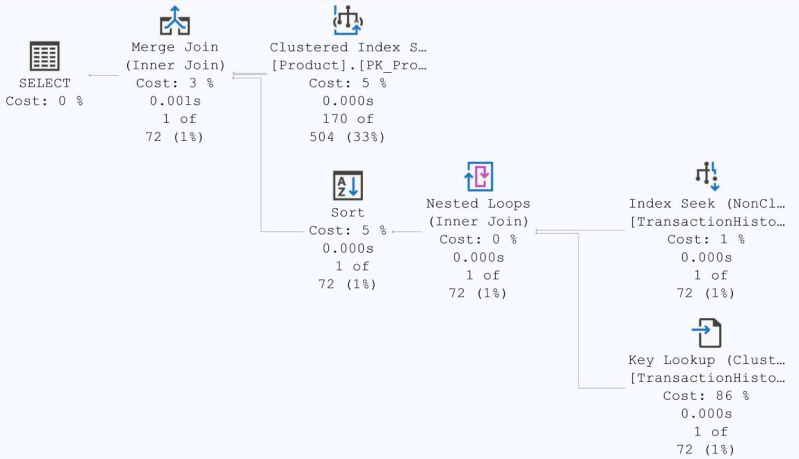

Mặc dù chúng ta thực thi truy vấn với giá trị runtime là `816`, nhưng giá trị được chỉ định trong gợi ý truy vấn (`53465`) đã được sử dụng để biên dịch kế hoạch, như được minh chứng qua các thuộc tính của kế hoạch trong Hình 13-7.

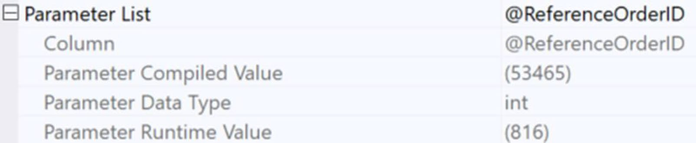

Nếu bạn có nhiều hơn một giá trị tham số muốn tham chiếu trong `OPTIMIZE FOR`, bạn chỉ cần phân tách chúng bằng dấu phẩy.

Một cách sử dụng khác của `OPTIMIZE FOR` là không chỉ định một giá trị cụ thể nào, mà thay vào đó yêu cầu bộ tối ưu hóa giả định rằng không có giá trị nào được biết trước bằng từ khóa `UNKNOWN`. Listing 13-16 minh họa cách chỉnh sửa truy vấn theo hướng này.

**Listing 13-16.** Sử dụng tùy chọn UNKNOWN trong OPTIMIZE FOR

```sql
CREATE OR ALTER PROC dbo.ProductTransactionHistoryByReference
(@ReferenceOrderID INT)
AS
BEGIN
    SELECT p.NAME,
           p.ProductNumber,
           th.ReferenceOrderID
    FROM Production.Product AS p
        JOIN Production.TransactionHistory AS th
            ON th.ProductID = p.ProductID
    WHERE th.ReferenceOrderID = @ReferenceOrderID
    OPTION (OPTIMIZE FOR (@ReferenceOrderID UNKNOWN));
END;
```

Khi kiểm tra thuộc tính của kế hoạch thực thi trong Hình 13-8, bạn sẽ thấy không còn giá trị tham số tại thời điểm biên dịch (*ParameterCompiledValue*).

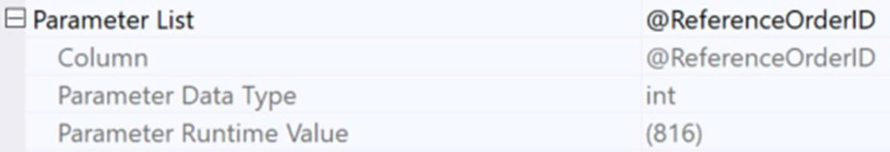

Gợi ý `OPTIMIZE FOR` mang lại cho bạn sự linh hoạt vượt trội: tạo kế hoạch dựa trên một giá trị tham số điển hình mang lại độ an toàn cao nhất, hoặc tạo kế hoạch dựa trên giá trị trung bình thống kê như thể hoàn toàn không diễn ra quá trình parameter sniffing. Tương tự như các gợi ý khác, bạn có thể chỉnh sửa trực tiếp mã T-SQL hoặc áp dụng thông qua Plan Guide hoặc Query Store hints mà không cần can thiệp mã nguồn ứng dụng.

---

### Ép buộc kế hoạch (Force Plan)

Trong Chương 6, tôi đã trình bày chi tiết cách sử dụng **Query Store** để ép buộc một kế hoạch thực thi (*force plan*). Dựa trên kết quả phân tích truy vấn và các kế hoạch thu thập được, chúng ta sẽ chọn ra kế hoạch hoạt động hiệu quả và ổn định nhất xuyên suốt các lần chạy quan trọng. Đó có thể là kế hoạch được sử dụng với tần suất nhiều nhất, hoặc kế hoạch mang lại tốc độ chạy nhanh nhất đối với các giá trị phổ biến. 

Bạn sẽ cần đưa ra quyết định này trên từng trường hợp cụ thể. Tuy nhiên, một khi đã xác định được kế hoạch ưng ý, bạn chỉ đơn giản thực hiện ép buộc kế hoạch thông qua giao diện hoặc thủ tục lưu trữ `sp_query_store_force_plan` như đã học ở Chương 6. Tương tự như các tùy chọn khác, bạn nên định kỳ đánh giá lại các kế hoạch bị ép buộc này khi dữ liệu và cấu trúc chỉ mục trong hệ thống biến đổi theo thời gian.

---

### Đa Kế Hoạch (Multiplan)

Được giới thiệu lần đầu trong SQL Server 2022 và tích hợp sẵn trên Azure SQL Database, một cơ chế thông minh mới được cung cấp để xử lý các tình huống truy vấn bị ảnh hưởng tiêu cực bởi parameter sniffing có tên gọi là **Multiplan** (Cơ chế Đa kế hoạch). Về cơ bản, SQL Server sẽ tự động tạo và lưu trữ nhiều hơn một kế hoạch thực thi cho cùng một câu truy vấn nếu nó nhận diện được sự chênh lệch hiệu năng quá lớn giữa các kế hoạch thực thi khả dĩ khác nhau.

Bên trong Multiplan gồm có hai cơ chế cốt lõi hoạt động song hành:
1. **Tối ưu hóa kế hoạch nhạy cảm với tham số (PSP Optimization - Parameter-Sensitive Plan Optimization):** Điểm tuyệt vời nhất của tính năng PSP là nó hoạt động **hoàn toàn tự động**. Bạn không cần phải thay đổi bất kỳ dòng mã T-SQL nào, không cần thêm gợi ý truy vấn (*query hints*), và cũng không cần phải ép buộc kế hoạch (*plan forcing*) qua Query Store. Cơ sở dữ liệu của bạn chỉ cần được thiết lập ở mức độ tương thích (*compatibility level*) **160** (SQL Server 2022) trở lên, đồng thời bạn không được vô hiệu hóa tính năng parameter sniffing ở cấp máy chủ, cơ sở dữ liệu hay truy vấn. Khi đó, SQL Server có thể lưu trữ đồng thời nhiều kế hoạch thực thi trong bộ nhớ đệm. Nhằm tránh làm phình bộ đệm kế hoạch (*plan cache bloat*), số lượng kế hoạch biến thể tối đa cho mỗi truy vấn được giới hạn ở con số **3**, tương ứng với các ngưỡng số lượng dòng (*cardinality*): thấp, trung bình và cao.
2. **Tối ưu hóa tham số tùy chọn (OPO - Optional Parameter Optimization):** Đây là một kịch bản chuyên biệt được bổ sung trong **SQL Server 2025** nhằm giải quyết bài toán muôn thuở của các tham số tùy chọn (*optional parameters*) có thể nhận giá trị `NULL`. Listing 13-17 minh họa một mẫu truy vấn điển hình mà OPO được thiết kế để giải cứu hiệu năng.

**Listing 13-17.** Stored procedure với tham số tùy chọn

```sql
CREATE OR ALTER PROCEDURE dbo.OptionalParameter @ReferenceOrderID 
INT = NULL
AS
BEGIN
    SELECT p.ProductNumber
    FROM Production.Product AS p
        JOIN Production.TransactionHistory AS th
            ON th.ProductID = p.ProductID
    WHERE th.ReferenceOrderID = @ReferenceOrderID
          OR @ReferenceOrderID IS NULL;
END;
```

Nếu một giá trị cụ thể được truyền vào cho `@ReferenceOrderID`, câu truy vấn hoàn toàn có thể tận dụng thao tác tìm kiếm chỉ mục (*Index Seek*) nếu cột `th.ReferenceOrderID` có một chỉ mục tốt. Tuy nhiên, trước phiên bản SQL Server 2025 (khi chưa có OPO), bạn gần như chắc chắn sẽ nhận được một kế hoạch thực thi sử dụng thao tác quét (*Index/Table Scan*) do sự hiện diện của toán tử `OR` nhằm xử lý trường hợp tham số mang giá trị `NULL`. Giờ đây, tính năng Multiplan sẽ hỗ trợ bằng cách tự động sinh ra nhiều kế hoạch thực thi riêng biệt cho mẫu truy vấn này.

---

#### Tối Ưu Hóa Kế Hoạch Nhạy Cảm Với Tham Số (PSP Optimization)

Microsoft không công bố các ngưỡng số lượng dòng cụ thể bắt buộc để kích hoạt tính năng PSP Optimization. Tuy nhiên, qua nhiều thử nghiệm thực tế tính đến thời điểm cuốn sách này xuất bản, tôi có thể khẳng định rằng các ngưỡng tập dữ liệu xấp xỉ **100.000 dòng** và **1.000.000 dòng** chính là các cột mốc phân định mà một truy vấn cần phải chạm tới để bạn có thể chứng kiến PSP hoạt động.

Để thử nghiệm tính năng PSP, tôi đã biến đổi dữ liệu trong bảng `dbo.bigTransactionHistory` từ bộ script *MakeBigAdventure* nhằm tạo ra một giá trị có hơn 100.000 dòng dữ liệu, đồng thời thêm một dòng đơn lẻ vào bảng `dbo.bigProduct`. Tôi cũng tạo một chỉ mục mới và một stored procedure tương ứng, toàn bộ được thể hiện trong Listing 13-18.

**Listing 13-18.** Kịch bản thử nghiệm Parameter-Sensitive Plan Optimization

```sql
-- Chỉnh sửa dữ liệu để tạo ra giá trị có 100K dòng
UPDATE dbo.bigTransactionHistory
SET ProductID = 1319
WHERE ProductID IN ( 28417, 28729, 11953, 35521, 11993, 29719, 20431, 
29531, 29749, 7913, 29947, 10739, 26921, 20941,
27767, 27941, 47431, 31847, 32411, 39383, 39511, 35531, 28829, 35759, 
29713, 29819, 16001, 29951, 10453, 34967, 16363, 41347, 39719, 39443, 
39829, 38917, 41759, 16453, 16963, 17453, 16417, 17473, 17713, 10729, 
21319, 21433, 21473, 29927, 21859, 16477
);
GO
-- Thêm một dòng đơn lẻ vào cả hai bảng
INSERT INTO dbo.bigProduct
(
    ProductID,
    Name,
    ProductNumber,
    SafetyStockLevel,
    ReorderPoint,
    DaysToManufacture,
    SellStartDate,
    MakeFlag,
    FinishedGoodsFlag,
    StandardCost,
    ListPrice
)
VALUES
(43, 'FarbleDing', 'CA-2222-1000', 0, 0, 0, GETDATE(), 1, 1, 42, 54);
INSERT INTO dbo.bigTransactionHistory
(
    TransactionID,
    ProductID,
    TransactionDate,
    Quantity,
    ActualCost
)
VALUES
(31263602, 42, GETDATE(), 42, 42);
GO
-- Tạo chỉ mục phục vụ thử nghiệm
CREATE INDEX ProductIDTransactionDate
ON dbo.bigTransactionHistory (
                                 ProductID,
                                 TransactionDate
                             );
GO
-- Tạo stored procedure
CREATE OR ALTER PROC dbo.TransactionInfo
(@ProductID INT)
AS
BEGIN
    SELECT bp.Name,
           bp.ProductNumber,
           bth.TransactionDate
    FROM dbo.bigTransactionHistory AS bth
        JOIN dbo.bigProduct AS bp
            ON bp.ProductID = bth.ProductID
    WHERE bth.ProductID = @ProductID;
END;
```

*(Bạn có thể cần phải điều chỉnh câu lệnh cập nhật đầu tiên tùy thuộc vào phiên bản script MakeBigAdventure mà bạn đã khởi tạo trên máy).*

Sau khi chuẩn bị xong dữ liệu và cấu trúc, tôi sẽ thực thi thủ tục này hai lần với hai giá trị tham số khác nhau như trong Listing 13-19: một lần với `@ProductID = 1319` (tương ứng với hơn 100.000 dòng) và một lần với `@ProductID = 42` (chỉ có duy nhất 1 dòng).

**Listing 13-19.** Thực thi thủ tục TransactionInfo

```sql
EXEC dbo.TransactionInfo @ProductID = 1319;
EXEC dbo.TransactionInfo @ProductID = 42;
```

Kết quả của hai lần thực thi được hiển thị trong Hình 13-9.

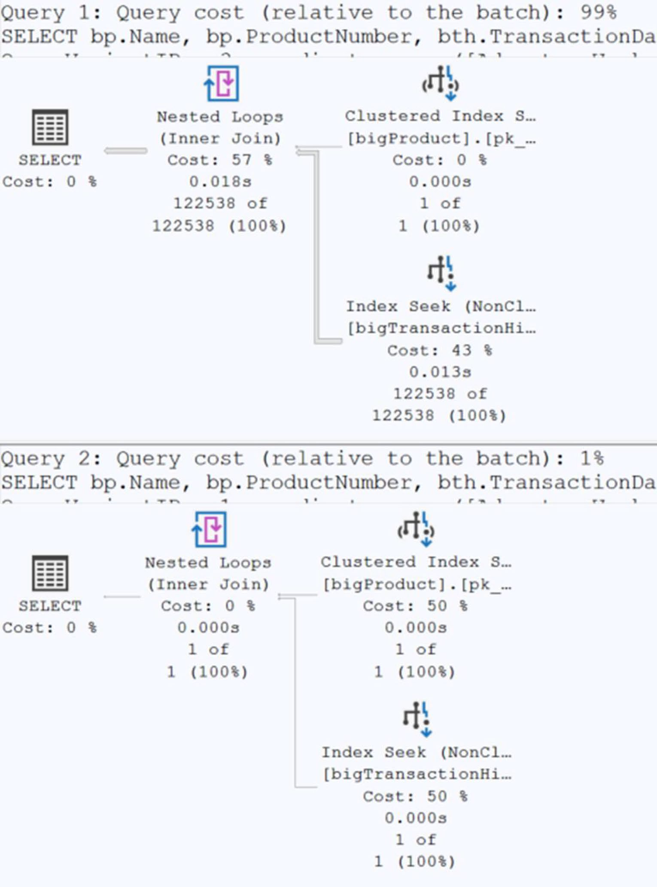

Mặc dù hình thái tổng thể (*overall shape*) của hai kế hoạch thực thi này trông tương tự nhau, bạn có thể nhận thấy kế hoạch bên trên ước lượng 122.538 dòng và trả về đúng số lượng dòng đó. Kế hoạch bên dưới ước lượng 1 dòng và trả về 1 dòng. Đây là **hai kế hoạch thực thi hoàn toàn tách biệt** (*two distinct execution plans*). 

Điều kỳ diệu là tôi **không hề biên dịch lại** (*recompile*) truy vấn hay thủ tục giữa hai lần thực thi đó. Thay vào đó, bộ tối ưu hóa đã sử dụng cơ chế Multiplan để kích hoạt tính năng PSP Optimization, từ đó duy trì đồng thời hai kế hoạch thực thi tối ưu độc lập cho hai phạm vi tham số khác nhau.

Nếu mở cửa sổ thuộc tính (*Properties*) của kế hoạch thực thi, bạn sẽ thấy xuất hiện các thuộc tính mới như trong Hình 13-10.

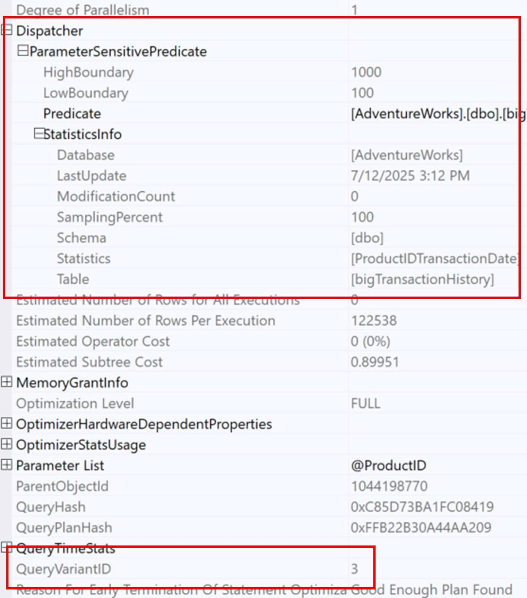

Các thuộc tính mới này cung cấp thông tin về cách mà bộ tối ưu hóa đưa ra quyết định lựa chọn kế hoạch nào để vận hành:
- Ở phần trên là các thiết lập của bộ điều phối (**Dispatcher settings**), hiển thị ranh giới phân định (*boundary*) và vị từ đang được đánh giá (`@ProductID`).
- Ở phần dưới là dấu hiệu nhận diện biến thể truy vấn nào đang được sử dụng (**QueryVariantID**).

Sự phân tách này là cần thiết bởi vì như một phần của cơ chế hoạt động, SQL Server đã tự động điều chỉnh nội tại phần văn bản truy vấn. Chúng ta có thể sử dụng câu truy vấn trong Listing 13-20 để trích xuất thông tin từ bộ đệm kế hoạch (*plan cache*) cho hai kế hoạch này.

**Listing 13-20.** Truy vấn sys.dm_exec_query_stats để kiểm tra thông tin PSP

```sql
SELECT deqs.query_hash,
       deqs.query_plan_hash,
       dest.text,
       deqp.query_plan
FROM sys.dm_exec_query_stats AS deqs
    CROSS APPLY sys.dm_exec_query_plan(deqs.plan_handle) AS deqp
    CROSS APPLY sys.dm_exec_sql_text(deqs.sql_handle) AS dest
WHERE dest.text LIKE '%SELECT bp.Name,
           bp.ProductNumber,
           bth.TransactionDate
    FROM dbo.bigTransactionHistory AS bth%';
```

Kết quả kiểm tra bộ nhớ đệm được minh họa trong Hình 13-11.

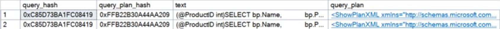

Hãy chú ý rằng giá trị `query_hash` của cả hai dòng là hoàn toàn giống nhau (vì cùng xuất phát từ một câu truy vấn gốc), nhưng giá trị `plan_handle` lại khác nhau — mỗi `plan_handle` đại diện cho một kế hoạch thực thi riêng rẽ. Nội dung văn bản câu truy vấn thực tế được lưu trữ bên trong hệ thống như sau:

```sql
(@ProductID int)SELECT bp.Name,             bp.
ProductNumber,             bth.TransactionDate      FROM dbo.
bigTransactionHistory AS bth          JOIN dbo.bigProduct AS 
bp              ON bp.ProductID = bth.ProductID      WHERE bth.ProductID 
= @ProductID option (PLAN PER VALUE(QueryVariantID = 3, predicate_
range([AdventureWorks].[dbo].[bigTransactionHistory].[ProductID] = @
ProductID, 100.0, 1000.0)))
```

Như bạn có thể thấy, Query Optimizer đã tự động thêm gợi ý nội bộ `option (PLAN PER VALUE(...))` để chỉ định rõ `QueryVariantID = 3` kèm dải ranh giới vị từ (*predicate range*) nhằm phục vụ cơ chế PSP.

Nếu vì bất kỳ lý do gì mà bạn muốn tắt tính năng PSP Optimization, bạn có thể thực hiện thông qua cấu hình phạm vi cơ sở dữ liệu (*Database Scoped Configuration*) trong Listing 13-21.

**Listing 13-21.** Vô hiệu hóa tính năng Parameter-Sensitive Plan Optimization

```sql
ALTER DATABASE SCOPED CONFIGURATION SET PARAMETER_SENSITIVE_PLAN_OPTIMIZATION = OFF;
```

#### Giám Sát PSP Qua Query Store

Tính năng PSP cũng được tích hợp chặt chẽ vào **Query Store**, như thể hiện trong Hình 13-12.

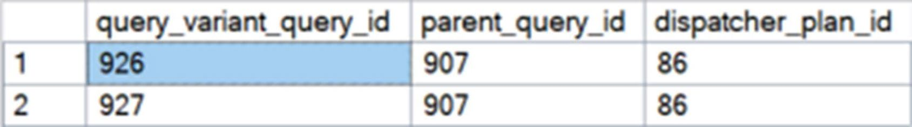

Trong Query Store, bạn có thể sử dụng cột `query_variant_query_id` để tìm ra các biến thể khác nhau của kế hoạch thực thi. Cột `parent_query_id` dĩ nhiên sẽ trỏ ngược về truy vấn gốc ban đầu. Điều này giúp bạn dễ dàng theo dõi hiệu năng của từng biến thể kế hoạch mà không cần phải viết những câu truy vấn phức tạp dùng toán tử `LIKE` trên DMV như trong Listing 13-20. Thuộc tính `dispatcher_plan_id` đại diện cho kế hoạch điều phối, có nhiệm vụ căn cứ vào số lượng dòng dữ liệu ước lượng tại thời điểm thực thi để quyết định xem biến thể kế hoạch nào sẽ được giao quyền vận hành.

Các kế hoạch được sinh ra thông qua cơ chế PSP vẫn tuân thủ đầy đủ các quy luật quản lý bộ đệm thông thường: chúng vẫn bị xóa mòn theo thời gian (*aging out of cache*), bị biên dịch lại (*recompilation*), và chịu tác động của các sự kiện hệ thống như bất kỳ kế hoạch thực thi nào khác được mô tả trong cuốn sách này.

---

#### Tối Ưu Hóa Tham Số Tùy Chọn (Optional Parameter Optimization - OPO)

Để quan sát tính năng OPO hoạt động, chúng ta sẽ thực thi stored procedure `dbo.OptionalParameter` đã tạo trong Listing 13-17. Tương tự như với thử nghiệm PSP, tôi sẽ thực thi thủ tục hai lần như trong Listing 13-22: lần đầu tiên truyền vào một giá trị cụ thể (`@ReferenceOrderID = 1319`), và lần thứ hai gọi thủ tục mà không truyền tham số (để tham số nhận giá trị mặc định `NULL`).

**Listing 13-22.** Thực thi thủ tục OptionalParameter

```sql
EXEC dbo.OptionalParameter @ReferenceOrderID = 1319;
EXEC dbo.OptionalParameter;
```

Kế hoạch thực thi của hai lần chạy được hiển thị trong Hình 13-13.

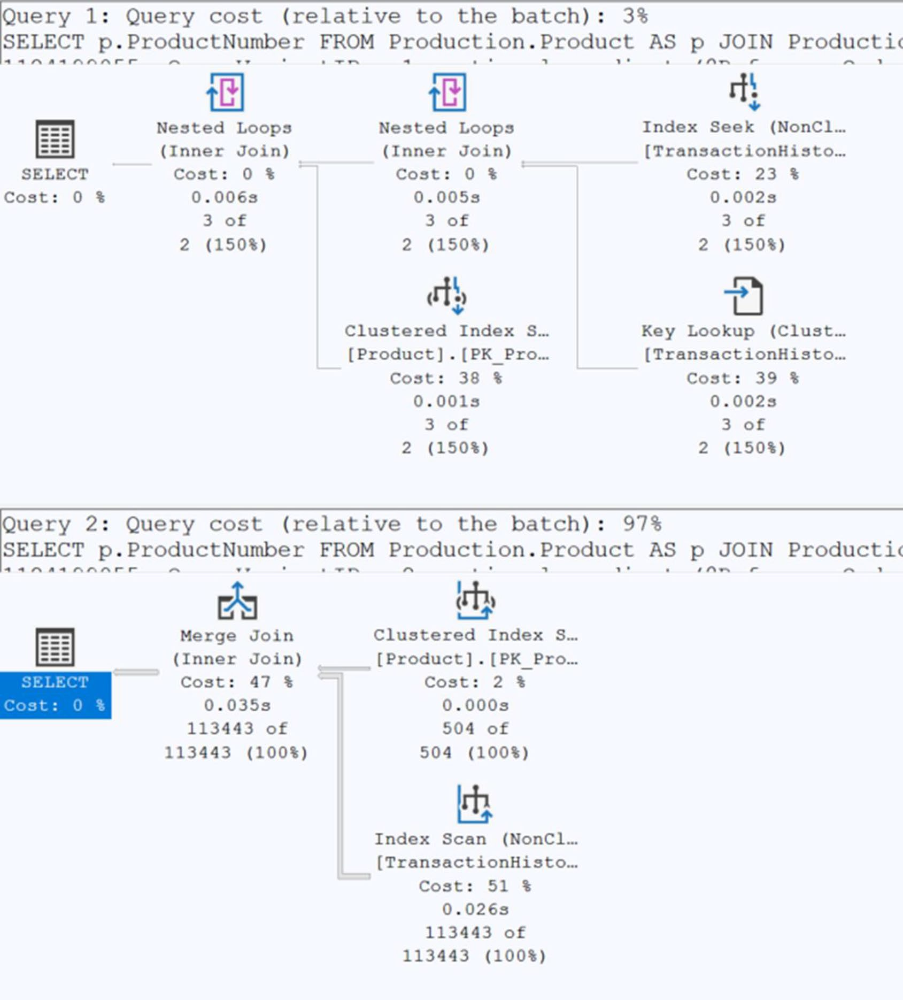

Trong trường hợp này, sự khác biệt giữa hai kế hoạch thực thi là vô cùng rõ rệt:
- Khi truyền giá trị cụ thể (`1319`), hệ thống sử dụng một kế hoạch tối ưu cho việc trả về ít dòng (sử dụng Index Seek).
- Khi không truyền giá trị (`NULL`), hệ thống sử dụng một kế hoạch quét toàn bộ để phục vụ cho việc trả về khối lượng dòng rất lớn.

Một lần nữa, tôi không hề xóa kế hoạch khỏi bộ đệm hay yêu cầu recompile. Hai kế hoạch riêng biệt đã cùng tồn tại trong cache để phục vụ tùy theo cách thức truy vấn được triệu gọi.

Khi xem xét thuộc tính của kế hoạch, thuộc tính Dispatcher sẽ thể hiện rõ vị từ OPO như minh họa trong Hình 13-14.

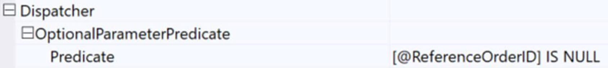

Cơ chế Multiplan cũng tự động biến đổi câu lệnh SQL nội bộ như sau:

```sql
SELECT p.ProductNumber
    FROM Production.Product AS p
        JOIN Production.TransactionHistory AS th
            ON th.ProductID = p.ProductID
    WHERE th.ReferenceOrderID = @ReferenceOrderID
           OR @ReferenceOrderID IS NULL option (PLAN PER VALUE(ObjectID 
= 1124199055, QueryVariantID = 2, optional_predicate(@
ReferenceOrderID IS NULL)))
```

Tính năng Optional Parameter Optimization (OPO) được **bật mặc định** trong SQL Server 2025. Để sử dụng tính năng này, cơ sở dữ liệu của bạn bắt buộc phải được thiết lập ở mức độ tương thích **170** (SQL Server 2025). Nếu muốn tắt tính năng OPO, bạn có thể sử dụng cấu hình phạm vi cơ sở dữ liệu trong Listing 13-23.

**Listing 13-23.** Vô hiệu hóa tính năng Optional Parameter Optimization

```sql
ALTER DATABASE SCOPED CONFIGURATION SET OPTIONAL_PARAMETER_OPTIMIZATION = OFF;
```

Cũng giống như với PSP, mọi hành vi lưu trữ, xóa mòn và biên dịch lại của các kế hoạch OPO đều hoàn toàn đồng nhất với các kế hoạch thực thi khác trong hệ thống.

---

### Tóm Tắt Chương (Summary)

Dò tham số (*Parameter Sniffing*) vốn là một tính năng thiết yếu giúp Query Optimizer tạo ra các kế hoạch thực thi phù hợp nhất với dữ liệu đầu vào. Tuy nhiên, khi dữ liệu phân bổ không đồng đều (*skewed data distribution*), việc "đánh hơi" trúng một giá trị cá biệt có thể khiến một kế hoạch thực thi sai lệch bị lưu vào cache, từ đó làm tê liệt hiệu năng của hàng loạt lần thực thi tiếp theo.

Chìa khóa để giải quyết vấn đề không phải là vội vã tắt bỏ tính năng dò tham số trên toàn hệ thống, mà là nhận diện chính xác những câu truy vấn nào thực sự nhạy cảm với giá trị tham số, sau đó áp dụng biện pháp khắc phục phù hợp nhất:
- **Giải pháp thủ công:** 
  + Sử dụng biến cục bộ (*Local Variables*) hoặc `OPTIMIZE FOR UNKNOWN` để ép Query Optimizer tạo ra kế hoạch trung bình (*average plan*) dựa trên mật độ thống kê.
  + Sử dụng `OPTION (RECOMPILE)` khi chi phí biên dịch là không đáng kể so với lợi ích của một kế hoạch thực thi hoàn hảo cho từng giá trị.
  + Sử dụng `OPTIMIZE FOR (@param = value)` khi có một giá trị tham số chiếm ưu thế tuyệt đối trong khối lượng công việc.
  + Ép buộc kế hoạch tối ưu ổn định (*Force Plan*) thông qua Query Store.
  + Vô hiệu hóa parameter sniffing ở cấp độ truy vấn (`DISABLE_PARAMETER_SNIFFING`) hoặc cơ sở dữ liệu khi hệ thống gặp lỗi diện rộng.
- **Giải pháp tự động thông minh (Multiplan):**
  + Kể từ **SQL Server 2022**, tính năng **PSP Optimization** tự động giải quyết vấn đề parameter sniffing bằng cách lưu trữ tối đa 3 biến thể kế hoạch cho các dải số lượng dòng khác nhau mà không đòi hỏi bất kỳ sự can thiệp mã nào từ lập trình viên.
  + Kể từ **SQL Server 2025**, tính năng **OPO (Optional Parameter Optimization)** tiếp tục đột phá khi tự động tạo các kế hoạch riêng biệt cho mẫu câu truy vấn chứa tham số tùy chọn (`@param IS NULL`), chấm dứt triệt để nỗi ám ảnh về các thao tác quét bảng không cần thiết.

Trong chương tiếp theo, chúng ta sẽ cùng nhau tìm hiểu về **phân tích thiết kế truy vấn (Query Design Analysis)**, nhận diện các "dấu hiệu mã có mùi" (*code smells*) phổ biến và phương pháp tái cấu trúc mã lệnh T-SQL để đạt hiệu năng tối ưu nhất.