# CHƯƠNG 14: Phân tích Thiết kế Truy vấn (Query Design Analysis)

Mặc dù một phần đáng kể hiệu năng hệ thống được quyết định bởi phần cứng, bậc dịch vụ đám mây (cloud service tier), các thiết lập cấu hình máy chủ, hệ thống chỉ mục (indexes) cùng các cấu trúc lưu trữ dữ liệu khác, song khía cạnh quan trọng và mang tính quyết định nhất đối với hiệu năng của Microsoft SQL Server chính là câu truy vấn của bạn. Nếu mã T-SQL của bạn được thiết kế kém hoặc tiềm ẩn lỗi cấu trúc, thì trong phần lớn các trường hợp, không một cấu hình phần cứng hay tính năng nâng cao nào có thể cứu vãn được hiệu năng suy giảm. 

Có rất nhiều vấn đề lập trình phổ biến – thường được gọi là các "code smells" (dấu hiệu nhận biết mã nguồn có vấn đề) – dẫn đến hiệu năng truy vấn tồi tệ. Thậm chí bạn có thể bắt gặp những truy vấn cố gắng thao tác và xử lý dữ liệu theo kiểu dòng-theo-dòng (row-by-row) – một hội chứng mà chuyên gia Jeff Moden đã đặt tên rất hình ảnh là RBAR (*Row By Agonizing Row* - Từng dòng một cách đau đớn). Việc tập trung rà soát và chuẩn hóa mã T-SQL chính là hành động đơn lẻ có tác động mạnh mẽ nhất mà bạn có thể thực hiện nhằm nâng cao toàn diện hiệu năng cơ sở dữ liệu.

Trong chương này, chúng ta sẽ lần lượt tìm hiểu các chủ đề sau:
* Các "code smells" phổ biến thường gặp trong T-SQL.
* Các thiết kế truy vấn giúp đảm bảo khai thác chỉ mục hiệu quả.
* Sử dụng hợp lý các gợi ý tối ưu hóa (optimizer hints).
* Tác động của các ràng buộc cơ sở dữ liệu (database constraints) đối với hiệu năng thực thi.

---

## Các khuyến nghị thiết kế truy vấn (Query Design Recommendations)

T-SQL là một ngôn ngữ truy vấn rất mạnh mẽ và linh hoạt. Thông thường, có nhiều cách viết câu truy vấn khác nhau mà vẫn trả về cùng một tập kết quả chính xác. Tuy nhiên, một số cấu trúc truy vấn nhất định sẽ đem lại hiệu năng vượt trội hơn hẳn các cách viết khác. Một số cấu trúc cú pháp có thể can thiệp tiêu cực, ngăn cản bộ tối ưu hóa truy vấn (Query Optimizer) tìm ra kế hoạch thực thi (execution plan) tối ưu nhất. Bên cạnh đó, có những cơ chế truy vấn vốn dĩ tiêu tốn nhiều tài nguyên phần cứng hơn các giải pháp thay thế tương đương. Chúng ta sẽ xem xét sâu hơn các cơ chế đó trong chương tiếp theo. 

Trong chương này, tôi muốn thảo luận về các khuyến nghị cốt lõi sau:
* **Giữ tập kết quả (result sets) càng nhỏ càng tốt.**
* **Sử dụng chỉ mục một cách hiệu quả.**
* **Hạn chế tối đa việc lạm dụng gợi ý tối ưu hóa (optimizer hints).**
* **Duy trì và thực thi toàn vẹn tham chiếu (referential integrity).**

Mặc dù tất cả các khuyến nghị được đưa ra ở đây đều đã được kiểm nghiệm thực tế kỹ lưỡng, nhưng tùy theo từng tình huống cụ thể, chúng có thể hoạt động khác nhau trên khối lượng công việc và môi trường đặc thù của bạn. Bạn hãy luôn duy trì thói quen kiểm thử và đánh giá định lượng (test and validate) mọi thay đổi mã nguồn trước khi áp dụng vào môi trường sản xuất. Hãy tận dụng toàn bộ kiến thức đã được trình bày từ đầu cuốn sách đến nay – từ việc thu thập các chỉ số hiệu năng truy vấn cho đến kỹ năng đọc hiểu kế hoạch thực thi – để nắm rõ hành vi thực tế của các truy vấn trong hệ thống của bạn.

---

## Giữ tập kết quả nhỏ nhất có thể (Keep Your Result Sets Small)

Có một câu danh ngôn kinh điển, có lẽ lâu đời ngang với lịch sử ngành khoa học máy tính:

> *"Chỉ di chuyển dữ liệu bạn thực sự cần, và chỉ di chuyển khi bạn thực sự cần di chuyển nó."*  
> (*Move only the data you need and only when you need to move it.*)

Mặc dù câu nói này ban đầu ra đời trong bối cảnh hạ tầng mạng thuở sơ khai rất dễ bị nghẽn bởi những luồng truyền tải dữ liệu khiêm tốn, nhưng nguyên lý cốt lõi của nó cho đến nay vẫn hoàn toàn chuẩn xác. Bằng cách chủ động chỉ chọn lọc (SELECT) những cột dữ liệu thực sự cần thiết, bạn có thể cắt giảm đáng kể tải trọng tài nguyên và chi phí xử lý (overhead) trên toàn hệ thống. Hơn nữa, việc giới hạn số lượng dòng dữ liệu luân chuyển cho phép bạn tận dụng tối đa sức mạnh của chỉ mục để gia tăng hiệu năng. Hãy tuân thủ hai nguyên tắc chỉ đạo sau:
* **Giới hạn danh sách các cột trong mệnh đề SELECT.**
* **Lọc dữ liệu chặt chẽ thông qua mệnh đề WHERE.**

Trong thực tế doanh nghiệp, chúng ta rất thường xuyên nghe thấy yêu cầu nghiệp vụ đại loại như: *"Báo cáo này bắt buộc phải trả về 100.000 dòng"*. Tuy nhiên, khi đi sâu phân tích yêu cầu này, bạn sẽ nhận ra người dùng thực chất chỉ cần xem các giá trị tổng hợp (aggregates), số liệu thống kê hoặc một tập con dữ liệu đã được phân nhóm. Con người về mặt sinh học đơn giản là không thể đọc hiểu và xử lý trực tiếp 100.000 dòng dữ liệu thô cùng một lúc. Hãy đảm bảo rằng bạn chỉ chuyển vận đúng lượng dữ liệu mà ứng dụng và người dùng thực sự đòi hỏi.

---

### Giới hạn các cột trong danh sách SELECT (Limit the Columns in Your SELECT List)

Xét về mặt kỹ thuật thuần túy, việc sử dụng cú pháp `SELECT *` để lấy về toàn bộ các cột của bảng không nhất thiết lúc nào cũng gây ra sự cố hiệu năng nghiêm trọng ngay tức thì. Tuy nhiên, việc lấy thừa toàn bộ các cột đồng nghĩa với việc bạn sẽ đánh mất hoàn toàn cơ hội khai thác **Chỉ mục bao phủ (Covering Index)** – tức loại chỉ mục chứa đầy đủ mọi cột mà câu truy vấn cần để hoàn thành thao tác mà không phải đọc lại bảng gốc.

Listing 14-1 minh họa một câu truy vấn với danh sách cột được chọn lọc tối thiểu.

#### Listing 14-1. Truy vấn với danh sách cột được giới hạn
```sql
SELECT NAME,
       TerritoryID
FROM Sales.SalesTerritory AS st
WHERE st.Name = 'Australia';
```

Khi thực thi câu truy vấn trên, các chỉ số hiệu năng ghi nhận được như sau:
* **Reads:** 2 logical reads
* **Duration:** 127 µs (microsecond)

Kế hoạch thực thi tương ứng được thể hiện trong Hình 14-1.

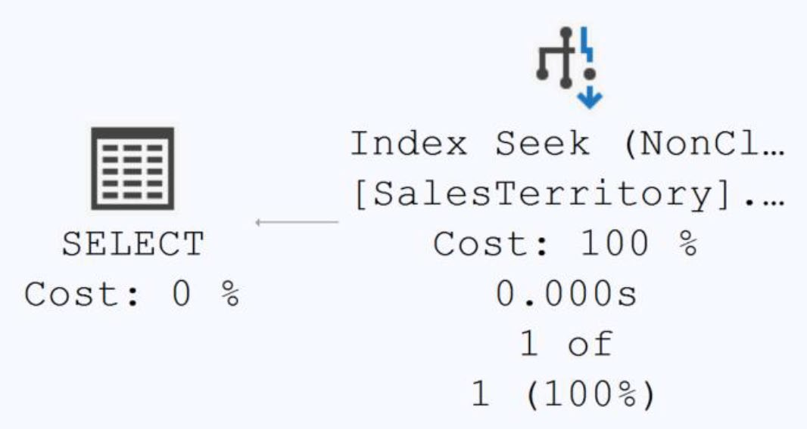

*Hình 14-1. Kế hoạch thực thi minh họa chỉ mục bao phủ hoạt động*

Trong kịch bản này, chỉ mục phi cụm (nonclustered index) trên cột `Name` đã bao gồm sẵn cột khóa cụm `TerritoryID`, do đó toàn bộ dữ liệu cần thiết được đáp ứng hoàn toàn từ cây chỉ mục mà không phát sinh thêm bất kỳ thao tác đọc dữ liệu nào khác.

Bây giờ, nếu chúng ta thay đổi truy vấn và sử dụng cú pháp `SELECT *`:
* **Reads:** 4 logical reads
* **Duration:** 331 µs

Kế hoạch thực thi lúc này thay đổi rõ rệt như thể hiện trong Hình 14-2.

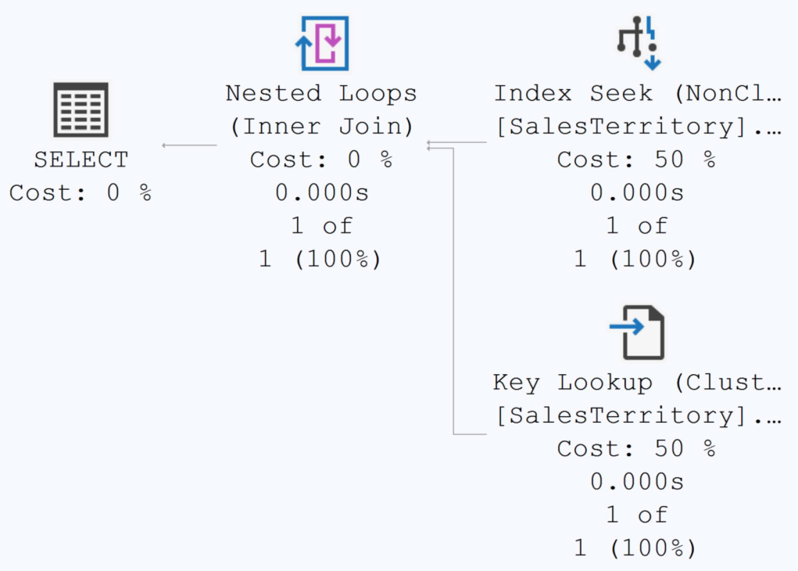

*Hình 14-2. Truy vấn không còn được hưởng lợi từ chỉ mục bao phủ*

Như có thể thấy trên Hình 14-2, truy vấn không còn nhận được lợi ích từ chỉ mục bao phủ nữa. Công việc bổ sung phát sinh bao gồm: thực hiện toán tử **Key Lookup** để truy xuất các cột còn lại từ chỉ mục cụm (clustered index), sau đó thực hiện toán tử **Nested Loops** để kết hợp hai tập kết quả lại với nhau. Kết quả là số lượt đọc logic tăng gấp đôi (từ 2 lên 4 reads), đồng thời thời gian thực thi trung bình của truy vấn cũng tăng hơn gấp đôi (từ 127 µs lên 331 µs).

Nói tóm lại, hãy rèn luyện thói quen chỉ lựa chọn đúng những cột dữ liệu mà bạn thực sự cần tại thời điểm hiện tại.

---

### Lọc dữ liệu thông qua mệnh đề WHERE (Filter Your Data Through a WHERE Clause)

Để có thể thụ hưởng trọn vẹn những lợi ích từ một chỉ mục khi thực hiện tìm kiếm dữ liệu – điều này áp dụng cho cả câu lệnh `UPDATE` và `DELETE` khi chúng phải xác định các dòng dữ liệu cần chỉnh sửa, câu lệnh `INSERT` khi kích hoạt quá trình kiểm tra toàn vẹn tham chiếu (referential integrity check), và dĩ nhiên là tất cả các câu lệnh `SELECT` – thì mệnh đề `WHERE` bắt buộc phải hiện diện.

Hơn thế nữa, như đã giải thích ở các chương trước, độ chọn lọc (selectivity) của cột (hoặc các cột) được tham chiếu trong các mệnh đề `WHERE`, `ON` và `HAVING` sẽ trực tiếp quyết định cách thức mà chỉ mục đó được bộ tối ưu hóa vận dụng. Trong khả năng tối đa, các truy vấn của bạn cần phải lọc dữ liệu thông qua các mệnh đề này. Bất cứ khi nào có thể, hãy ưu tiên lọc trên những cột có độ chọn lọc cao nhất (tức cột có số lượng giá trị phân biệt lớn, tỷ lệ trùng lặp thấp).

Đại đa số các ứng dụng vận hành kinh doanh (OLTP) đều hoạt động dựa trên các tập kết quả nhỏ và tập trung. Mặc dù đôi khi bạn có thể cần thực hiện các tác vụ di chuyển hoặc tổng hợp dữ liệu liên quan đến toàn bộ bảng hoặc một tập con dữ liệu rất lớn, nhưng nhìn chung, bạn chỉ nên thấy các tập dữ liệu nhỏ được truy xuất thường xuyên. Trường hợp ngoại lệ dĩ nhiên là các truy vấn phân tích (analytical queries / OLAP); tuy nhiên, bạn có thể hỗ trợ tốt hơn rất nhiều cho kiểu truy vấn phân tích thông qua việc triển khai các chỉ mục Columnstore (Columnstore Indexes). Trong trường hợp hệ thống của bạn thường xuyên bắt buộc phải di chuyển các tập dữ liệu khổng lồ, bạn có thể sẽ cần cân nhắc đến các quy trình xử lý ngoại vi (external batch processes) và nâng cấp kiến trúc phần cứng chuyên dụng để cải thiện hiệu năng tổng thể.

---

## Sử dụng chỉ mục hiệu quả (Use Indexes Effectively)

Nếu một câu truy vấn được thiết kế với cấu trúc kém, nó có thể hoàn toàn vô hiệu hóa khả năng khai thác các chỉ mục sẵn có của hệ thống. Vì chỉ mục chính là công cụ hiệu quả nhất khi tinh chỉnh hiệu năng cơ sở dữ liệu, nên trách nhiệm hàng đầu của người thiết kế truy vấn là phải đảm bảo cấu trúc T-SQL cho phép Query Optimizer sử dụng chỉ mục một cách tối ưu.

Để nâng cao hiệu quả sử dụng chỉ mục, tôi khuyến nghị bạn áp dụng các nguyên tắc sau:
1. **Sử dụng các điều kiện tìm kiếm hiệu quả (Search Conditions - SARGability).**
2. **Tránh thực hiện các phép toán hoặc hàm biến đổi trên các cột thuộc mệnh đề WHERE, ON và HAVING.**
3. **Thận trọng tối đa khi xây dựng và sử dụng các hàm vô hướng do người dùng định nghĩa (Custom Scalar UDFs).**

Chúng ta sẽ phân tích chi tiết từng nguyên tắc này trong các phần tiếp theo.

---

### Sử dụng điều kiện tìm kiếm hiệu quả (Use Effective Search Conditions)

Các điều kiện tìm kiếm bên trong mệnh đề `WHERE`, `ON` hoặc `HAVING` có thể sử dụng rất nhiều toán tử logic khác nhau. Một số toán tử logic hoạt động cực kỳ hiệu quả, cho phép truy vấn phối hợp hoàn hảo với các chỉ mục và thống kê (statistics) để thực hiện thao tác tìm kiếm chỉ mục (Index Seek). Ngược lại, một số toán tử khác lại kém hiệu quả và chủ động ngăn cản việc sử dụng chỉ mục tối ưu, buộc hệ thống phải quét toàn bộ dữ liệu (Index Scan hoặc Table Scan).

Theo thuật ngữ chuyên ngành kinh điển, chúng ta gọi các điều kiện hoạt động hiệu quả là có tính **"SARGable"** (viết tắt từ cụm từ *"Search ARGument ABLE"* – có khả năng tận dụng đối số tìm kiếm).

> [!NOTE]
> Mặc dù việc sử dụng các điều kiện sargable áp dụng cho cả ba mệnh đề `HAVING`, `ON` và `WHERE`, nhưng thay vì phải lặp lại cả ba mệnh đề mỗi lần đề cập, tôi sẽ chỉ gọi ngắn gọn là mệnh đề `WHERE`. Bạn hãy ngầm hiểu rằng nguyên lý này áp dụng tương đương cho cả ba mệnh đề.

Cũng cần lưu ý rằng có một số điều kiện tìm kiếm được bổ sung trong các phiên bản SQL Server gần đây không tuân thủ hoàn toàn theo các quy tắc truyền thống này. Ví dụ: các toán tử `SOME/ANY` và `ALL` phụ thuộc rất lớn vào câu truy vấn con (subquery) định nghĩa chúng. Nếu bạn sử dụng một điều kiện non-sargable bên trong truy vấn con đó, bạn chắc chắn sẽ gặp vấn đề về hiệu năng.

Bảng 14-1 tóm tắt các điều kiện tìm kiếm sargable và non-sargable phổ biến nhất.

#### Bảng 14-1. Các điều kiện tìm kiếm sargable và non-sargable phổ biến

| Loại điều kiện (Type) | Các điều kiện tìm kiếm (Search Conditions) |
| :--- | :--- |
| **Sargable** | Các điều kiện bao hàm (Inclusion conditions): `=`, `>`, `>=`, `<`, `<=`, `BETWEEN`, và một số điều kiện `LIKE` có ký tự tiền tố xác định như `LIKE '<literal>%'` |
| **Non-sargable** | Các điều kiện loại trừ (Exclusion conditions): `<>`, `!=`, `!>`, `!<`, `NOT EXISTS`, `NOT IN`, `NOT LIKE`, cùng các điều kiện `LIKE` có ký tự đại diện ở đầu như `LIKE '%<literal>'` hoặc `LIKE '%<literal>%'` |

Các điều kiện non-sargable được liệt kê ở trên sẽ ngăn chặn Query Optimizer khai thác hiệu quả các chỉ mục. Thay vì thực hiện thao tác Seek chính xác vào các trang lá, bạn sẽ thấy xuất hiện thao tác Scan trên phần lớn hoặc toàn bộ chỉ mục khi sử dụng các điều kiện này. Điều này đặc biệt đúng với các toán tử phủ định logic như `<>`, `!=` và `NOT LIKE`. Việc sử dụng các toán tử này hầu như luôn dẫn đến việc phải quét qua toàn bộ các dòng dữ liệu để sàng lọc những bản ghi thỏa mãn điều kiện loại trừ.

Bất cứ nơi nào có thể, hãy chủ động tìm kiếm các giải pháp viết lại (workarounds) cho các điều kiện non-sargable này để nâng cao hiệu năng. Trong nhiều trường hợp, bạn hoàn toàn có thể viết lại logic truy vấn để sử dụng các phép toán bao hàm (inclusion) thay vì phép toán loại trừ (exclusion). Bạn sẽ cần phải thử nghiệm các cơ chế khác nhau để đánh giá xem giải pháp nào hoạt động tối ưu nhất trong từng bối cảnh cụ thể. Đồng thời, đừng quên rằng việc bổ sung các điều kiện lọc phụ trợ có thể giúp thu hẹp phạm vi quét khi có nhiều cột từ một bảng cùng tham gia trong mệnh đề `WHERE`. Kiểm thử định lượng luôn là người bạn đồng hành tin cậy nhất khi bạn phải xử lý các tình huống phức tạp dạng này.

---

### So sánh BETWEEN với IN và OR (BETWEEN vs. IN/OR)

Listing 14-2 minh họa một câu truy vấn điển hình sử dụng toán tử `IN`.

#### Listing 14-2. Truy vấn sử dụng điều kiện IN
```sql
SELECT sod.CarrierTrackingNumber,
       sod.OrderQty
FROM Sales.SalesOrderDetail AS sod
WHERE sod.SalesOrderID IN ( 51825, 51826, 51827, 51828 );
```

Về mặt logic toán học, câu truy vấn này hoàn toàn tương đương với việc sử dụng chuỗi các điều kiện `OR` nối tiếp như thể hiện trong Listing 14-3.

#### Listing 14-3. Truy vấn sử dụng điều kiện OR
```sql
SELECT sod.CarrierTrackingNumber,
       sod.OrderQty
FROM Sales.SalesOrderDetail AS sod
WHERE sod.SalesOrderID = 51825
      OR sod.SalesOrderID = 51826
      OR sod.SalesOrderID = 51827
      OR sod.SalesOrderID = 51828;
```

Vì các giá trị tìm kiếm trong trường hợp cụ thể này là một dải các số nguyên liên tiếp nhau (`51825, 51826, 51827, 51828`), nên một cách viết logic tương đương khác là sử dụng mệnh đề `BETWEEN` như trong Listing 14-4.

#### Listing 14-4. Truy vấn sử dụng điều kiện BETWEEN
```sql
SELECT sod.CarrierTrackingNumber,
       sod.OrderQty
FROM Sales.SalesOrderDetail AS sod
WHERE sod.SalesOrderID
BETWEEN 51825 AND 51828;
```

Khi quan sát kế hoạch thực thi đồ họa của ba câu truy vấn này (Hình 14-3), thoạt nhìn chúng ta thấy chúng có cấu trúc biểu tượng hoàn toàn giống nhau.

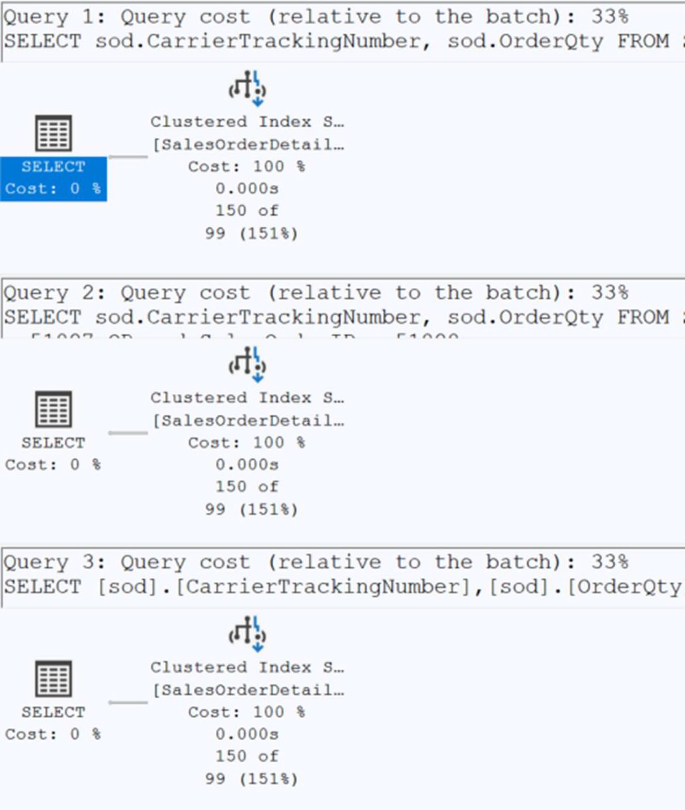

*Hình 14-3. Ba kế hoạch thực thi nhìn bề ngoài hoàn toàn giống nhau*

Tuy nhiên, dù các kế hoạch trông giống hệt nhau về mặt trực quan, nhưng khi đi sâu xem xét các chỉ số đo lường hiệu năng thực tế, chúng ta sẽ thấy sự khác biệt đáng kể:

* **Sử dụng `IN`:**
  * **Duration:** 193 µs
  * **Reads:** 18 logical reads
* **Sử dụng `OR`:**
  * **Duration:** 165 µs
  * **Reads:** 18 logical reads
* **Sử dụng `BETWEEN`:**
  * **Duration:** 172 µs
  * **Reads:** 6 logical reads

Sự khác biệt rõ nét này tiếp tục được khẳng định khi so sánh chi tiết thuộc tính của hai kế hoạch trong cửa sổ Properties (Hình 14-4).

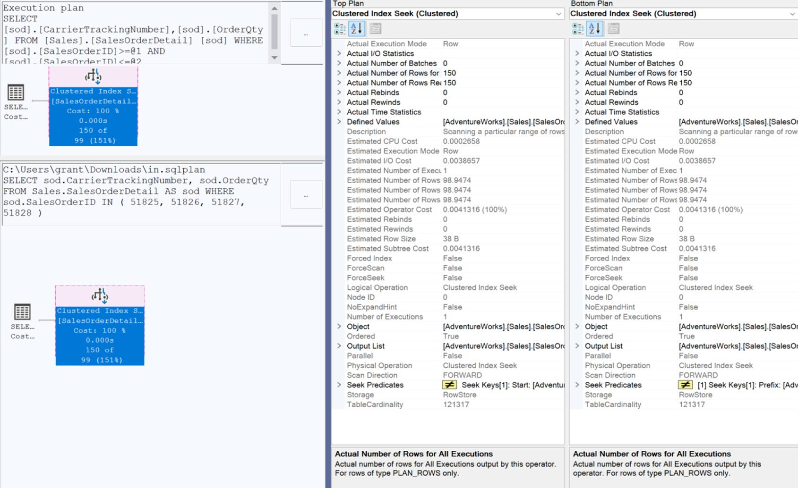

*Hình 14-4. Sự khác biệt giữa hai kế hoạch thực thi*

Sự khác biệt thực chất nằm ở giá trị của thuộc tính **Seek Predicates**. 

Dưới đây là biểu thức vị từ tìm kiếm (Seek Predicate) cho cả hai truy vấn `IN` và `OR` trong Listing 14-2 và Listing 14-3:

```text
[1] Seek Keys[1]: Prefix: [AdventureWorks].[Sales].[SalesOrderDetail].SalesOrderID = Scalar Operator((51825)), 
[2] Seek Keys[1]: Prefix: [AdventureWorks].[Sales].[SalesOrderDetail].SalesOrderID = Scalar Operator((51826)), 
[3] Seek Keys[1]: Prefix: [AdventureWorks].[Sales].[SalesOrderDetail].SalesOrderID = Scalar Operator((51827)), 
[4] Seek Keys[1]: Prefix: [AdventureWorks].[Sales].[SalesOrderDetail].SalesOrderID = Scalar Operator((51828))
```

Trong khi đó, đây là biểu thức vị từ tìm kiếm cho truy vấn `BETWEEN` trong Listing 14-4:

```text
Seek Keys[1]: Start: [AdventureWorks].[Sales].[SalesOrderDetail].SalesOrderID >= Scalar Operator([@1]), 
              End:   [AdventureWorks].[Sales].[SalesOrderDetail].SalesOrderID <= Scalar Operator([@2])
```

Phân tích cơ chế:
1. Thứ nhất, Query Optimizer đã quyết định áp dụng cơ chế **Tham số hóa đơn giản (Simple Parameterization)** cho truy vấn `BETWEEN`, thể hiện qua các tham số nội bộ `@1` và `@2` trong biểu thức vị từ.
2. Thứ hai, thay vì duy trì một toán tử `BETWEEN` phức tạp, hệ thống đã thông minh thay thế bằng một cặp điều kiện biên `>=` (Start) và `<=` (End).
3. Kết quả là cách tiếp cận này chỉ cần một dải tìm kiếm duy nhất, dẫn đến số lần đọc logic (logical reads) giảm mạnh từ 18 xuống còn 6. Trên một hệ thống sản xuất đang chịu tải cao, việc giảm tới 66% số lượt đọc I/O chắc chắn sẽ đem lại sự cải thiện hiệu năng vượt trội.

Khi bật cờ theo dõi `STATISTICS IO` (`SET STATISTICS IO ON;`) cho hai câu truy vấn, chúng ta có được cái nhìn rõ ràng và sâu sắc hơn về hành vi I/O bên dưới:

* **Đối với truy vấn sử dụng `OR`:**
  ```text
  Table 'SalesOrderDetail'. Scan count 4, logical reads 18
  ```
* **Đối với truy vấn sử dụng `BETWEEN`:**
  ```text
  Table 'SalesOrderDetail'. Scan count 1, logical reads 6
  ```

Số liệu cho thấy rõ: hệ thống đã phải thực hiện 4 lần quét riêng biệt (Scan count = 4, mỗi lần quét định vị một giá trị tương ứng với 4 khóa Seek Keys) để thỏa mãn điều kiện `OR` (hoặc `IN`), trong khi chỉ cần đúng 1 lần quét phạm vi duy nhất (Scan count = 1) để lấy toàn bộ dải dữ liệu liên tục cho điều kiện `BETWEEN`.

Điều này không có nghĩa là bạn sẽ luôn luôn thấy `BETWEEN` đạt hiệu năng tốt hơn `IN` hay `OR` trong mọi tình huống (chẳng hạn khi các giá trị không liên tục hoặc khoảng cách giữa các giá trị quá lớn). Tuy nhiên, ví dụ này chứng minh rằng mặc dù ba câu truy vấn có vẻ giống nhau về mặt logic, việc lựa chọn cơ chế toán tử khác nhau có thể dẫn tới sự chênh lệch lớn về hiệu năng. Chìa khóa then chốt nằm ở việc chủ động kiểm thử và sử dụng các công cụ đo lường để đánh giá bản chất hoạt động. Các toán tử khác nhau có thể – và thực tế sẽ – vận dụng chỉ mục theo những cách thức hoàn toàn khác biệt.

Đây cũng là một minh chứng xuất sắc cho thấy `STATISTICS IO` có thể cung cấp thêm những thông tin giá trị mà đôi khi không hiển thị rõ ràng ngay trong Extended Events. Bạn không nhất thiết phải bật `STATISTICS IO` mọi lúc mọi nơi, nhưng hãy luôn ghi nhớ công cụ này khi bạn cần đào sâu tìm hiểu nguyên nhân gốc rễ gây ra sự khác biệt về hành vi giữa các câu truy vấn.

---

### Điều kiện LIKE (LIKE Condition)

Tìm kiếm theo chuỗi văn bản trong cơ sở dữ liệu là một nhu cầu cực kỳ phổ biến. Bất cứ khi nào có thể, bạn nên cố gắng tránh đặt các ký tự đại diện (wildcards, chẳng hạn dấu `%` hoặc `_`) ở phần đầu của chuỗi tìm kiếm (leading edge).

Khi một điều kiện tìm kiếm bắt đầu bằng ký tự đại diện (ví dụ `LIKE '%ice'`), Query Optimizer hoàn toàn không thể sử dụng biểu đồ phân phối tần suất (Histogram) trong thống kê (Statistics) để xác định phạm vi các dòng thỏa mãn. Hệ quả tất yếu là hệ thống bắt buộc phải quét toàn bộ chỉ mục (Index Scan) hoặc toàn bộ bảng để đối chiếu từng chuỗi một.

Đồng thời, việc cung cấp càng nhiều ký tự xác định ở phần đầu chuỗi tìm kiếm trong mệnh đề `LIKE` càng giúp bộ tối ưu hóa dễ dàng khoanh vùng các dải giá trị tiềm năng. Ngoài ra, Query Optimizer còn thực hiện các biến đổi cấu trúc nội bộ đối với các câu truy vấn sử dụng `LIKE`. Hãy xem xét ví dụ trong Listing 14-5.

#### Listing 14-5. Sử dụng điều kiện LIKE với ký tự dẫn đầu
```sql
SELECT C.CurrencyCode
FROM Sales.Currency AS C
WHERE C.NAME LIKE 'Ice%';
```

Query Optimizer đã tự động biến đổi vị từ này, và chúng ta có thể quan sát trực tiếp thấy điều đó trong kế hoạch thực thi:

```text
Seek Keys[1]: Start: [AdventureWorks].[Sales].[Currency].Name >= Scalar Operator(N'Ice'), 
              End:   [AdventureWorks].[Sales].[Currency].Name <  Scalar Operator(N'Icf')
```
*(Ghi chú: Giá trị biên kết thúc được tối ưu hóa thành toán tử `<` với ký tự liền kề tiếp theo theo thứ tự sắp xếp).*

Toán tử `LIKE` đã được tự động chuyển đổi thành một cặp điều kiện sargable gồm `>=` và `<`. Nếu bạn tự tay viết lại truy vấn sử dụng trực tiếp các toán tử `>=` và `<` này, thì hiệu năng thu được – bao gồm cả số lượt đọc logic – sẽ hoàn toàn tương đương. Điều này khẳng định rằng việc cung cấp các ký tự dẫn đầu trong mệnh đề `LIKE` cho phép Query Optimizer đưa ra các quyết định tối ưu chính xác và tận dụng hoàn hảo các thao tác Seek trên cây chỉ mục của bảng.

---

### So sánh điều kiện !< và >= (!< Condition vs. >= Condition)

Mặc dù cả hai toán tử `!<` (không nhỏ hơn) và `>=` (lớn hơn hoặc bằng) hoàn toàn tương đương nhau về mặt logic và sẽ trả về tập kết quả giống hệt nhau, nhưng về mặt nguyên lý sơ khởi, Query Optimizer có thể triển khai kế hoạch thực thi khác nhau đối với hai toán tử này.

Bản chất nằm ở toán tử đẳng thức/so sánh trực tiếp trong `>=`. Dấu `>=` cung cấp cho bộ tối ưu hóa một điểm xuất phát vững chắc (starting point / lower bound) trên cây B-Tree để tiến hành tìm kiếm chỉ mục (Index Seek). Ngược lại, một toán tử phủ định loại trừ như `!<` về mặt lý thuyết không có điểm bắt đầu tự nhiên, thường khiến toàn bộ chỉ mục hoặc toàn bộ bảng phải bị quét qua (Scan).

Tuy nhiên, như tôi đã chứng minh qua nhiều ví dụ xuyên suốt cuốn sách, Query Optimizer có khả năng can thiệp và tự động tái cấu trúc một số biểu thức mã T-SQL mà bạn gửi tới. Hãy xem xét cặp truy vấn sử dụng hai toán tử này trong Listing 14-6.

#### Listing 14-6. So sánh điều kiện !< và >=
```sql
SELECT poh.TotalDue,
       poh.Freight
FROM Purchasing.PurchaseOrderHeader AS poh
WHERE poh.PurchaseOrderID >= 2975;

SELECT poh.TotalDue,
       poh.Freight
FROM Purchasing.PurchaseOrderHeader AS poh
WHERE poh.PurchaseOrderID !< 2975;
```

Khi so sánh kế hoạch thực thi của hai câu truy vấn này trên Hình 14-5, chúng ta nhận thấy chúng hoàn toàn đồng nhất.

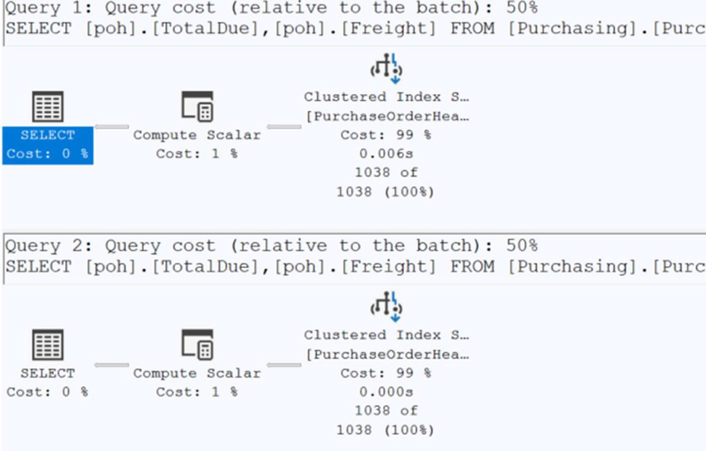

*Hình 14-5. Các kế hoạch thực thi giống hệt nhau*

Trên thực tế, Query Optimizer đã sử dụng chung một kế hoạch thực thi duy nhất cho cả hai câu lệnh. Bạn có thể hiểu rõ cơ chế bên dưới khi xem xét chuỗi T-SQL được lưu kèm với kế hoạch:
1. Đầu tiên, trong giai đoạn chuẩn hóa và đơn giản hóa truy vấn (Query Simplification phase), Query Optimizer đã tự động chuyển đổi toán tử `!<` thành toán tử tương đương thuận lợi hơn là `>=`.
2. Thứ hai, nó áp dụng cơ chế tham số hóa đơn giản (Simple Parameterization), từ đó cho phép hai câu truy vấn dùng chung (reuse) cùng một kế hoạch đã được biên dịch lưu trong bộ đệm (Plan Cache).

Đây là một ví dụ tiêu biểu cho thấy khi mã nguồn tương đương nhau về mặt logic, bộ tối ưu hóa thông minh của SQL Server có thể chủ động bù đắp và tối ưu hóa hiệu năng thay cho bạn. Dẫu vậy, việc chủ động viết mã tường minh với các toán tử sargable chuẩn mực (như `>=`) luôn là phương pháp thực hành lập trình tốt nhất cần được duy trì.

---

### Tránh thực hiện phép toán hoặc hàm trên cột (Avoid Operations on Columns)

Các phép tính toán như toán tử số học hoặc các hàm xử lý dữ liệu (chẳng hạn như `DATEPART`) khi áp dụng trực tiếp lên các cột trong mệnh đề `WHERE` sẽ triệt tiêu khả năng sử dụng số liệu thống kê (*statistics*) và vô hiệu hóa các thao tác tìm kiếm chỉ mục (*index seeks*). Thuật ngữ chuyên môn gọi nguyên lý này là tính **SARGable** (*Search Argument Able* — khả năng tận dụng đối số tìm kiếm của chỉ mục). Một biểu thức áp dụng hàm hoặc phép tính lên cột sẽ trở thành **Non-SARGable**.

Listing 14-7 minh họa một phép tính số học được áp dụng trực tiếp lên cột dữ liệu trong mệnh đề `WHERE`.

**Listing 14-7.** Thực hiện phép tính toán trên một cột

```sql
SELECT poh.EmployeeID,
       poh.OrderDate
FROM Purchasing.PurchaseOrderHeader AS poh
WHERE poh.PurchaseOrderID * 2 = 3400;
```

Kế hoạch thực thi kết quả được thể hiện trong Hình 14-6.

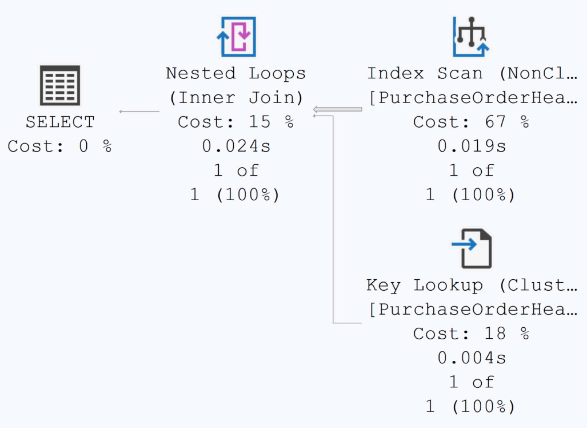

Mặc dù có sẵn một chỉ mục trên cột `PurchaseOrderID`, nhưng bộ tối ưu hóa buộc phải thực hiện thao tác **Quét chỉ mục** (*Index Scan*) trên chỉ mục đó thay vì quét Clustered Index (do chỉ mục phi gom cụm có kích thước nhỏ hơn). Sau đó, thao tác quét này kéo theo việc phải truy xuất các cột còn thiếu từ khóa gom cụm thông qua toán tử **Key Lookup** và một phép nối.

Các chỉ số hiệu năng đo được của truy vấn:
- **Lượt đọc logic (Reads):** 11
- **Thời gian thực thi (Duration):** 2.15 ms

Trong Listing 14-8, tôi chuyển phép tính toán ra khỏi cột dữ liệu và áp dụng nó lên giá trị hằng số cố định ở vế phải.

**Listing 14-8.** Thay đổi truy vấn để không tính toán trên cột dữ liệu

```sql
SELECT poh.EmployeeID,
       poh.OrderDate
FROM Purchasing.PurchaseOrderHeader AS poh
WHERE poh.PurchaseOrderID = 3400 / 2;
```

Khi loại bỏ phép tính khỏi cột, bộ tối ưu hóa có thể đánh giá biểu thức vế phải trước và thực hiện thao tác **Tìm kiếm chỉ mục** (*Index Seek*) trực tiếp trên cây chỉ mục, như thể hiện trong Hình 14-7.

- **Lượt đọc logic (Reads):** 2 (giảm từ 11)
- **Thời gian thực thi (Duration):** 177 µs (giảm từ 2.15 ms — nhanh gấp hơn 12 lần!)

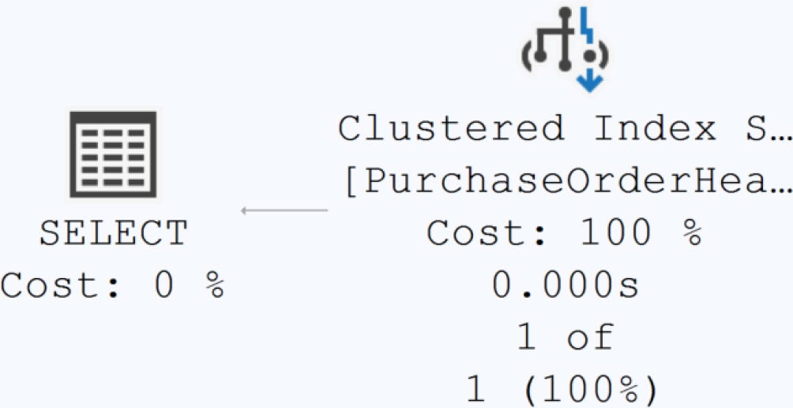

Thậm chí các công cụ AI hiện đại như Perplexity AI cũng dễ dàng nhận diện và giải thích nguyên nhân gây suy giảm hiệu năng này cùng hướng khắc phục, như minh họa trong Hình 14-8.

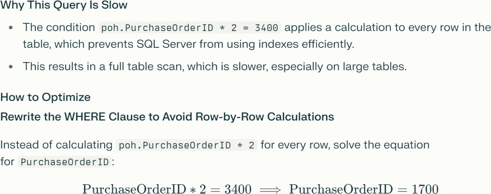

Nguyên lý này cũng áp dụng tương tự đối với các **hàm** (*functions*). Một vấn đề kinh điển thường gặp là việc sử dụng kiểu dữ liệu `DATETIME` khi bạn chỉ thực sự quan tâm đến phần ngày tháng. Một sai lầm thậm chí còn tồi tệ hơn là việc lưu trữ thông tin ngày giờ dưới dạng chuỗi ký tự (`VARCHAR` hoặc `CHAR`) chỉ vì muốn định dạng sẵn. 

Để dựng kịch bản thử nghiệm, tôi sẽ tạo một chỉ mục trên bảng `Sales.SalesOrderHeader` như trong Listing 14-9.

**Listing 14-9.** Tạo chỉ mục trên một cột kiểu DATETIME

```sql
IF EXISTS
(
    SELECT *
    FROM sys.indexes
    WHERE OBJECT_ID = OBJECT_ID(N'[Sales].[SalesOrderHeader]')
          AND NAME = N'IndexTest'
)
    DROP INDEX IndexTest ON Sales.SalesOrderHeader;
GO
CREATE INDEX IndexTest ON Sales.SalesOrderHeader (OrderDate);
```

Bây giờ tôi sẽ truy vấn dữ liệu từ bảng `SalesOrderHeader` để lấy các đơn hàng diễn ra trong tháng 4 năm 2008 bằng cách sử dụng hàm `DATEPART`, như thể hiện trong Listing 14-10.

**Listing 14-10.** Truy vấn các thành phần của ngày tháng bằng hàm DATEPART

```sql
SELECT soh.SalesOrderID,
       soh.OrderDate
FROM Sales.SalesOrderHeader AS soh
    JOIN Sales.SalesOrderDetail AS sod
        ON soh.SalesOrderID = sod.SalesOrderID
WHERE DATEPART(yy, soh.OrderDate) = 2008
      AND DATEPART(mm, soh.OrderDate) = 4;
```

Các số đo hiệu năng ghi nhận được:
- **Lượt đọc logic (Reads):** 73
- **Thời gian thực thi (Duration):** 2.48 ms

Kế hoạch thực thi hiển thị trong Hình 14-9 cho thấy hàm `DATEPART` đã biến thao tác tìm kiếm thành một thao tác **Quét chỉ mục** (*Index Scan*) trên toàn bộ bảng vì SQL Server buộc phải gọi hàm này trên từng dòng dữ liệu để so sánh.

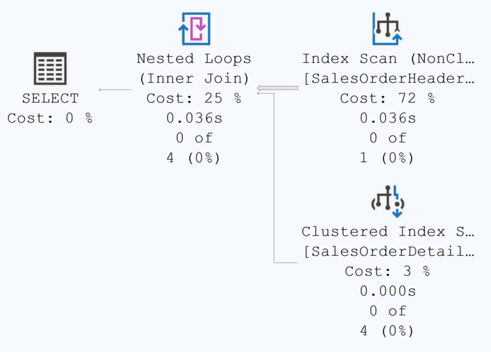

Vấn đề là chúng ta hoàn toàn có thể đối xử với dữ liệu ngày tháng đúng bản chất là ngày tháng bằng cách dùng một khoảng giá trị (*range query*), từ đó thu được cùng một tập kết quả mà vẫn duy trì tính SARGable, như thể hiện trong Listing 14-11.

**Listing 14-11.** Sửa đổi logic so sánh ngày tháng để duy trì SARGability

```sql
SELECT soh.SalesOrderID,
       soh.OrderDate
FROM Sales.SalesOrderHeader AS soh
    JOIN Sales.SalesOrderDetail AS sod
        ON soh.SalesOrderID = sod.SalesOrderID
WHERE soh.OrderDate >= '2008-04-01'
      AND soh.OrderDate < '2008-05-01';
```

Chỉ số hiệu năng đo được mới:
- **Lượt đọc logic (Reads):** 2 (giảm từ 73)
- **Thời gian thực thi (Duration):** 239 µs (giảm từ 2.48 ms — cải thiện gấp hơn 10 lần!)

Hình 14-10 thể hiện kế hoạch thực thi mới: thao tác tìm kiếm chỉ mục (*Index Seek*) đã được phục hồi hoàn hảo.

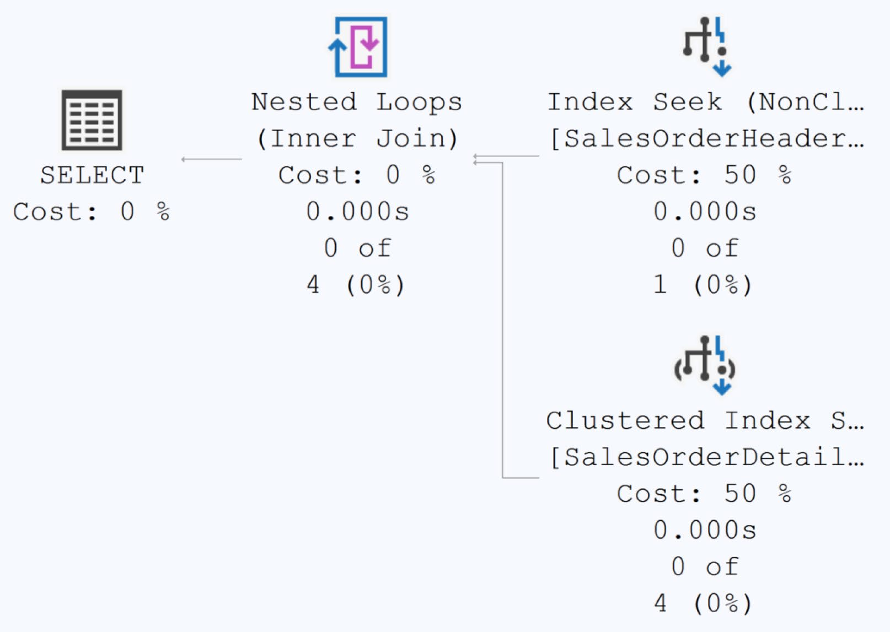

Sự chênh lệch về hiệu năng là không thể bàn cãi. Trong cả hai ví dụ trên, việc thay đổi logic câu lệnh để tránh thực hiện các phép toán hoặc hàm trên các cột đã mang lại những bước nhảy vọt đáng kinh ngạc về hiệu năng.

Listing 14-12 thực hiện dọn dẹp chỉ mục thử nghiệm.

**Listing 14-12.** Dọn dẹp chỉ mục sau khi thử nghiệm

```sql
DROP INDEX Sales.SalesOrderHeader.IndexTest;
```

---

### Hàm vô hướng người dùng tự định nghĩa (Custom Scalar UDF)

Các hàm vô hướng người dùng tự định nghĩa (*Scalar User-Defined Functions - Scalar UDFs*) là một phương thức tái sử dụng mã nguồn rất hấp dẫn đối với các lập trình viên, đặc biệt khi bạn chỉ cần tính toán và trả về một giá trị đơn lẻ. Tuy nhiên, mặc dù bạn có thể sử dụng chúng để truy xuất dữ liệu, bạn sẽ thường xuyên chứng kiến hiệu năng suy thoái thảm hại vì việc truy xuất dữ liệu trong truy vấn tập hợp không phải là mục đích sử dụng lý tưởng của Scalar UDF. Chúng gây ra vấn đề xử lý dòng-theo-dòng cực kỳ chậm chạp, thường được biết đến với thuật ngữ RBAR (*Row-By-Agonizing-Row*).

Để quan sát điều này trong thực tế, Listing 14-13 định nghĩa một hàm vô hướng dùng để lấy giá thành tiêu chuẩn của sản phẩm.

**Listing 14-13.** Hàm vô hướng để lấy giá thành sản phẩm

```sql
CREATE OR ALTER FUNCTION dbo.ProductStandardCost
(
    @ProductID INT
)
RETURNS MONEY
AS
BEGIN
    DECLARE @Cost MONEY;
    SELECT TOP 1
           @Cost = pch.StandardCost
    FROM Production.ProductCostHistory AS pch
    WHERE pch.ProductID = @ProductID
    ORDER BY pch.StartDate DESC;
    IF @Cost IS NULL
        SET @Cost = 0;
    RETURN @Cost;
END;
```

Listing 14-14 gọi sử dụng hàm vô hướng này trong một truy vấn đơn giản.

**Listing 14-14.** Sử dụng hàm vô hướng trong truy vấn

```sql
SELECT p.NAME,
       dbo.ProductStandardCost(p.ProductID)
FROM Production.Product AS p
WHERE p.ProductNumber LIKE 'HL%';
```

Số đo hiệu năng thu được:
- **Lượt đọc logic (Reads):** 14
- **Thời gian thực thi (Duration):** 316 µs

Kế hoạch thực thi hiển thị trong Hình 14-11.

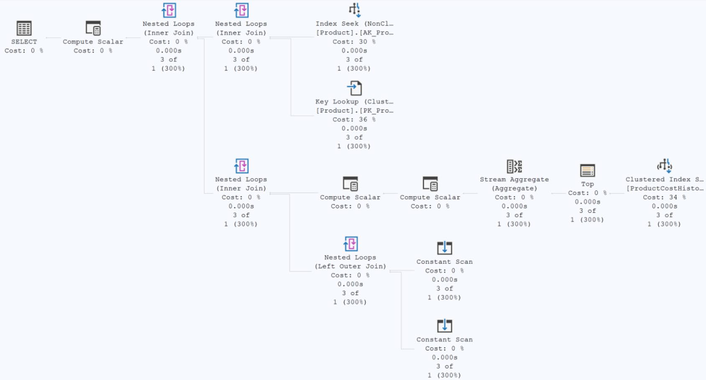

Kế hoạch thực thi này tương đối phức tạp và khó nhìn bao quát, vì vậy chúng ta sẽ chia tách nó thành từng thành phần nhỏ hơn. Các phiên bản SQL Server cũ hơn sẽ không hiển thị mức độ chi tiết này bên trong kế hoạch thực thi thực tế mà sẽ ẩn giấu toàn bộ hoạt động của hàm vô hướng bên trong một toán tử đơn lẻ có tên là `Compute Scalar`. Việc thu thập một kế hoạch ước tính (*estimated plan*) trong các phiên bản cũ (trước SQL Server 2022) sẽ bóc tách tất cả thông tin như bạn đang thấy ở đây.

Hình 14-12 thể hiện phần truy xuất dữ liệu bên trong hàm vô hướng.

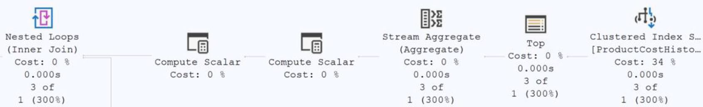

Hàm có thể sử dụng thao tác `Clustered Index Seek` để lấy dữ liệu. Sau đó, bạn thấy nó thực hiện các thao tác cần thiết để chuẩn bị dữ liệu: dùng toán tử `Top` để phục vụ mệnh đề `TOP 1` và một toán tử `Stream Aggregate` để xác định các giá trị trả về. Các toán tử `Compute Scalar` chỉ đơn thuần đảm bảo các kiểu dữ liệu được định dạng chính xác.

Hình 14-13 minh họa cách câu lệnh `IF` bên trong hàm được biểu diễn trong kế hoạch thực thi.

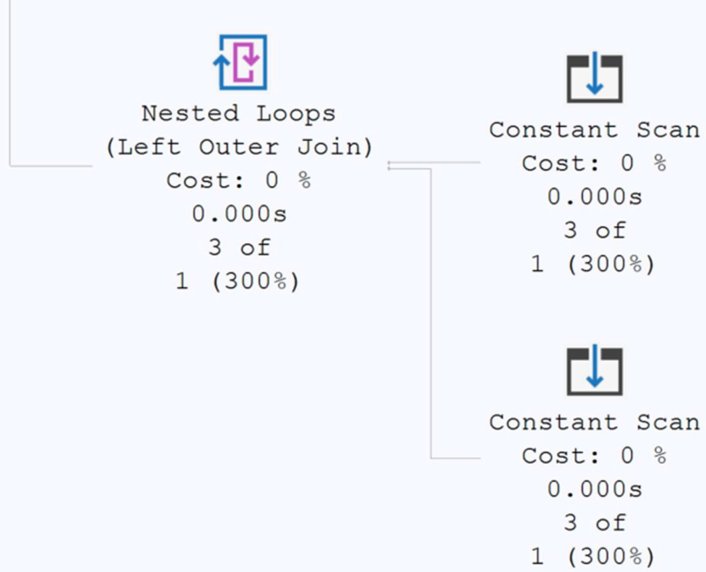

Các toán tử `Constant Scan` được sử dụng để đánh giá xem giá trị `@Cost` có bị `NULL` hay không. Phép nối (*join*) sẽ đảm bảo một giá trị được trả về — hoặc là giá trị `@Cost`, hoặc là giá trị `0`. Giá trị này sau đó được kết nối với đầu ra của thao tác truy xuất dữ liệu trong toán tử vô hướng.

Hình 14-14 minh họa cách phần còn lại của truy vấn chính được đáp ứng.

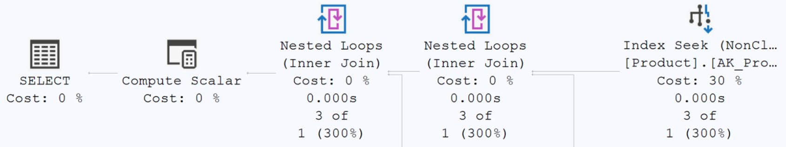

Toán tử `Index Seek` thực hiện lọc dữ liệu từ mệnh đề `WHERE`, sau đó cột `Name` được lấy lên thông qua `Key Lookup`. Dữ liệu này sau đó được nối và tiếp tục nối lại với dữ liệu trả về từ hàm vô hướng.

Mặc dù truy vấn này đang chạy tương đối nhanh (316 micro giây trên tập dữ liệu nhỏ), nhưng bạn hoàn toàn có thể viết lại truy vấn để loại bỏ hoàn toàn hàm vô hướng bằng cách sử dụng toán tử `CROSS APPLY` (hoặc chuyển thành Inline Table-Valued Function), như minh họa trong Listing 14-15.

**Listing 14-15.** Thay thế hàm vô hướng bằng phép toán CROSS APPLY

```sql
SELECT p.NAME,
       pc.StandardCost
FROM Production.Product AS p
    CROSS APPLY
(
    SELECT TOP 1
           pch.StandardCost
    FROM Production.ProductCostHistory AS pch
    WHERE pch.ProductID = p.ProductID
    ORDER BY pch.StartDate DESC
) AS pc
WHERE p.ProductNumber LIKE 'HL%';
```

Kế hoạch thực thi sau khi tối ưu hóa được thể hiện trong Hình 14-15.

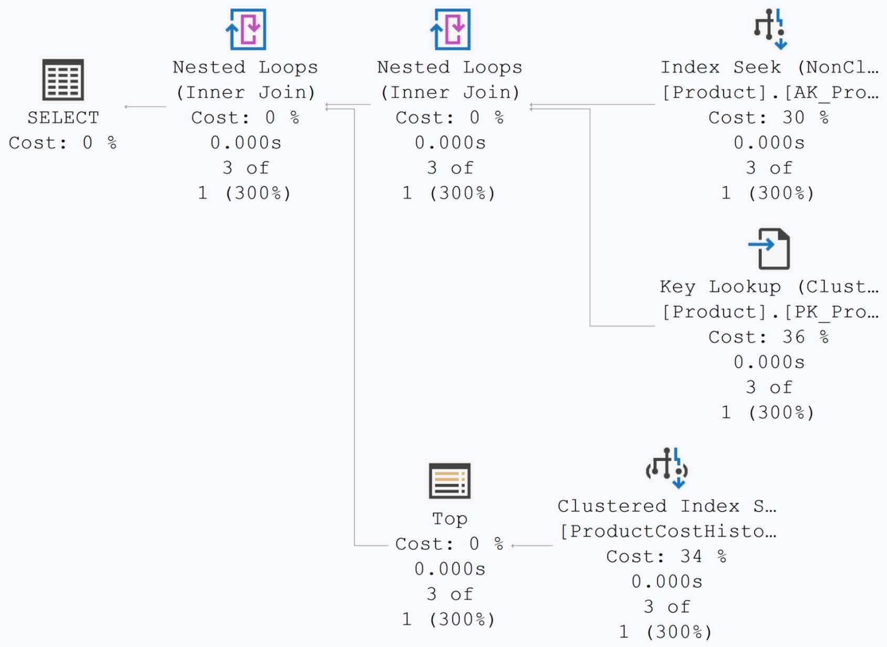

Nếu so sánh kế hoạch này với kế hoạch trước đó, bạn sẽ thấy hầu hết các chức năng nghiệp vụ tương tự vẫn được đáp ứng đầy đủ. Tuy nhiên, do số lượng toán tử và các bước xử lý trung gian được tinh giản đi rất nhiều, tốc độ truy vấn đã được gia tăng đáng kể và hoàn toàn tránh được rủi ro phân mảnh dòng-theo-dòng (RBAR) khi khối lượng dữ liệu phình to.

---

## Hạn chế tối đa gợi ý tối ưu hóa (Minimize Optimizer Hints)

Trong phần lớn các tình huống thực tế, Query Optimizer sẽ cung cấp cho bạn một kế hoạch thực thi "đủ tốt" (*good enough plan*) cho câu truy vấn cần xử lý. Tuy nhiên, tương tự như trong trường hợp parameter sniffing gặp sự cố (đã thảo luận ở Chương 13), các lựa chọn của bộ tối ưu hóa đôi khi có thể dưới mức tối ưu. Như tôi đã chứng minh, một giải pháp để khắc phục tình trạng parameter sniffing sai lệch là sử dụng các gợi ý truy vấn (*query hints*), chẳng hạn như `OPTIMIZE FOR`. 

Tuy nhiên, bạn cần phải hiểu một nguyên lý cực kỳ quan trọng: **một gợi ý (hint) không đơn thuần là một lời đề xuất hay gợi mở mang tính tham khảo, mà nó thực chất là một mệnh lệnh bắt buộc (*command*) ép bộ tối ưu hóa phải hành xử theo một khuôn mẫu nhất định**. Trong đại đa số trường hợp, tôi luôn coi hints là giải pháp cứu cánh cuối cùng (*last resort*) khi mọi kỹ thuật cải thiện hiệu năng khác đều bất lực. Dù vậy, việc thấu hiểu bản chất của hints và cách thức vận dụng chúng một cách có kiểm soát khi thực sự cần thiết vẫn là điều hết sức quan trọng.

Cuốn sách này không có đủ dung lượng để trình bày chi tiết mọi gợi ý hiện có trong SQL Server. Tôi đã đề cập đến một số gợi ý ở các chương trước và sẽ tiếp tục giới thiệu thêm ở các chương sau. Tại đây, tôi muốn minh họa sâu vào hai nhóm gợi ý rất phổ biến: **JOIN hint** và **INDEX hint**.

---

### Gợi ý nối bảng (JOIN Hints)

Bảng 14-2 tóm lược các kiểu toán tử JOIN vật lý được SQL Server hỗ trợ cùng các điều kiện hoạt động đặc trưng của chúng.

**Bảng 14-2.** Các kiểu JOIN được SQL Server hỗ trợ

| Kiểu JOIN | Yêu cầu chỉ mục trên cột tham gia JOIN | Kích thước thông thường của các bảng | Yêu cầu dữ liệu phải sắp xếp |
| :--- | :--- | :--- | :--- |
| **Nested Loops** | Bảng bên trong (*Inner table*) bắt buộc phải có chỉ mục; bảng bên ngoài (*Outer table*) nên có chỉ mục | Nhỏ | Không bắt buộc (*Optional*) |
| **Merge** | Cả hai bảng bắt buộc phải có chỉ mục sắp xếp theo khóa nối | Lớn | Bắt buộc (*Yes*) |
| **Hash** | Bảng bên trong không có chỉ mục | Bất kỳ | Không (*No*) |
| **Adaptive** | Sử dụng linh hoạt Hash hoặc Loops, do đó phụ thuộc vào điều kiện của từng kiểu nối | Thường rất lớn | Tùy thuộc vào kiểu JOIN được lựa chọn |

Tương ứng với các kiểu JOIN trên, SQL Server cung cấp các gợi ý JOIN như liệt kê trong Bảng 14-3.

**Bảng 14-3.** Các gợi ý JOIN

| Kiểu JOIN | Gợi ý JOIN tương ứng |
| :--- | :--- |
| **Nested Loops** | `LOOP` |
| **Merge** | `MERGE` |
| **Hash** | `HASH` |
| *(Phép nối từ xa)* | `REMOTE` |

> [!NOTE]
> Có 4 gợi ý JOIN nhưng chỉ có 3 kiểu JOIN nội bộ cơ bản, bởi vì gợi ý `REMOTE` chỉ được kích hoạt độc quyền khi một trong các bảng tham gia phép nối nằm trên một cơ sở dữ liệu khác hoặc máy chủ liên kết (*linked server*).

Listing 14-16 minh họa một câu truy vấn thực hiện nối nhiều bảng khác nhau mà không áp dụng bất kỳ gợi ý nào.

**Listing 14-16.** Nối nhiều bảng trong một truy vấn

```sql
SELECT s.NAME AS StoreName,
       p.LastName + ', ' + p.FirstName
FROM Sales.Store AS s
    JOIN Sales.SalesPerson AS sp
        ON s.SalesPersonID = sp.BusinessEntityID
    JOIN HumanResources.Employee AS E
        ON sp.BusinessEntityID = E.BusinessEntityID
    JOIN Person.Person AS p
        ON E.BusinessEntityID = p.BusinessEntityID;
```

Khi thực thi câu truy vấn này ở trạng thái nguyên bản, hệ thống ghi nhận các chỉ số hiệu năng:
- **Số lần đọc logic (Logical Reads):** 2.364
- **Thời gian thực thi (Duration):** 2.81 ms

Kế hoạch thực thi mặc định do Query Optimizer lựa chọn được hiển thị trong Hình 14-16.

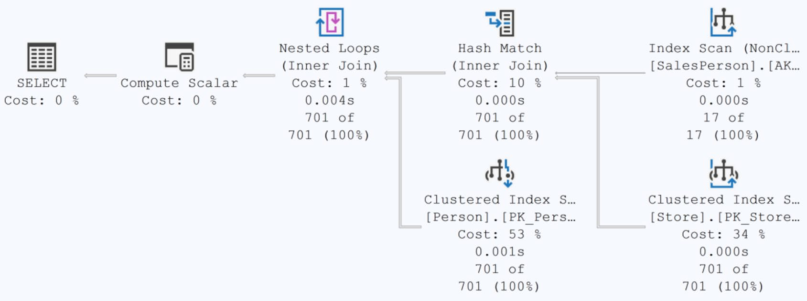

Bây giờ, hãy thử can thiệp vào quyết định của bộ tối ưu hóa bằng cách bổ sung gợi ý `OPTION (LOOP JOIN)` ở cuối truy vấn như trong Listing 14-17.

**Listing 14-17.** Bổ sung gợi ý JOIN hint ở cấp độ truy vấn

```sql
SELECT s.NAME AS StoreName,
       p.LastName + ',   ' + p.FirstName
FROM Sales.Store AS s
    JOIN Sales.SalesPerson AS sp
        ON s.SalesPersonID = sp.BusinessEntityID
    JOIN HumanResources.Employee AS E
        ON sp.BusinessEntityID = E.BusinessEntityID
    JOIN Person.Person AS p
        ON E.BusinessEntityID = p.BusinessEntityID
OPTION (LOOP JOIN);
```

Kế hoạch thực thi mới sau khi ép buộc toán tử Nested Loops được minh họa trong Hình 14-17.

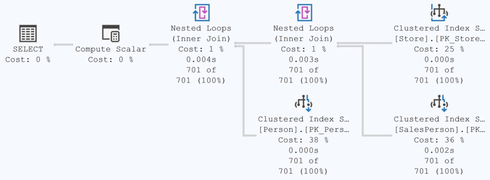

Các thông số hiệu năng sau khi áp dụng gợi ý:
- **Số lần đọc logic:** 3.740
- **Thời gian thực thi:** 3.6 ms

Kết quả này cho thấy truy vấn chạy **chậm hơn gần 25%** và phát sinh **nhiều hơn gần 50% số lượt đọc trang đĩa**! Tóm lại, chúng ta đã nhận được chính xác những gì chúng ta đã yêu cầu: tất cả các phép nối đều biến thành Nested Loops, nhưng cái giá phải trả là hiệu năng bị tụt lùi rõ rệt.

Mọi chuyện vẫn có thể tồi tệ hơn. Trong ví dụ trên, chúng ta đã chỉ thị cho bộ tối ưu hóa sử dụng Nested Loops cho toàn bộ mọi phép nối trong truy vấn. Nhưng điều gì sẽ xảy ra nếu chúng ta chỉ muốn ép buộc toán tử nối cho riêng một bảng đơn lẻ, chẳng hạn sử dụng `INNER LOOP JOIN` như trong Listing 14-18?

**Listing 14-18.** Ép buộc kiểu JOIN cho một phép nối cụ thể

```sql
SELECT s.NAME AS StoreName,
       p.LastName + ',   ' + p.FirstName
FROM Sales.Store AS s
    INNER LOOP JOIN Sales.SalesPerson AS sp
        ON s.SalesPersonID = sp.BusinessEntityID
    JOIN HumanResources.Employee AS E
        ON sp.BusinessEntityID = E.BusinessEntityID
    JOIN Person.Person AS p
        ON E.BusinessEntityID = p.BusinessEntityID;
```

Kế hoạch thực thi mới được hiển thị trong Hình 14-18.

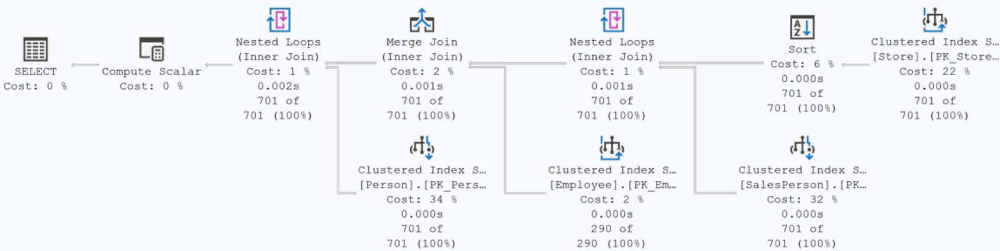

Các thông số thu được:
- **Số lần đọc logic:** 3.749
- **Thời gian thực thi:** 4.0 ms

Hiệu năng hoàn toàn không được cải thiện qua những thử nghiệm ép buộc này, thậm chí còn trở nên tệ hơn. Mặc dù chắc chắn luôn có những ngoại lệ hy hữu, nhưng về mặt nguyên tắc chung, **việc để cho Query Optimizer tự do lựa chọn giải pháp tối ưu nhất để kết hợp các bảng luôn mang lại hiệu năng vượt trội**. 

Việc lạm dụng gợi ý có thể dẫn đến những tác hại nghiêm trọng:
- Triệt tiêu khả năng đơn giản hóa kế hoạch thực thi (*Elimination of simplification*).
- Ngăn chặn cơ chế tự động tham số hóa (*Prevent auto-parameterization*).
- Tước đoạt quyền hạn của bộ tối ưu hóa trong việc linh hoạt quyết định thứ tự thực hiện các phép nối (*Join order*) dựa trên thống kê thực tế.

Do đó, dù gợi ý đôi khi có thể giúp ích trong một số trường hợp khẩn cấp, nhưng đó tuyệt đối không phải là một sự bảo đảm. Chỉ nên sử dụng chúng sau khi bạn đã tiến hành kiểm thử và đo lường cực kỳ kỹ lưỡng.

---

### Gợi ý chỉ mục (INDEX Hints)

Bởi vì bộ tối ưu hóa phụ thuộc hoàn toàn vào số liệu thống kê (*statistics*), nên hoàn toàn có khả năng một chỉ mục có ích cho câu truy vấn lại bị bỏ qua do thống kê cũ hoặc lỗi thời. Dù vậy, trong phần lớn trường hợp, quyết định của bộ tối ưu hóa vẫn là chuẩn xác. 

Tuy nhiên, các lập trình viên vẫn thường cố gắng "khôn ngoan hơn" bộ tối ưu hóa. Hãy nhớ lại ví dụ trước đó về phép toán trên cột trong Listing 14-7. Trên bảng có sẵn chỉ mục `PK_PurchaseOrderHeader_PurchaseOrderID`, và nếu không có phép tính nhân trên cột, chỉ mục này chắc chắn đã được dùng để tìm kiếm dữ liệu. Listing 14-19 minh họa cách ép buộc bộ tối ưu hóa sử dụng chỉ mục thông qua gợi ý `WITH (INDEX(...))`.

**Listing 14-19.** Ép buộc lựa chọn chỉ mục qua gợi ý truy vấn

```sql
SELECT poh.EmployeeID,
       poh.OrderDate
FROM Purchasing.PurchaseOrderHeader AS poh WITH (INDEX(PK_PurchaseOrderHeader_PurchaseOrderID))
WHERE poh.PurchaseOrderID * 2 = 3400;
```

Khi thực thi, chúng ta thu được kết quả:
- **Số lần đọc logic:** 44 (so với 11 lần đọc của kế hoạch ban đầu)
- **Thời gian thực thi:** 682 µs (thực tế đo lường nội bộ là 434 µs so với 2.15 ms ban đầu)

Kế hoạch thực thi được thể hiện trong Hình 14-19.

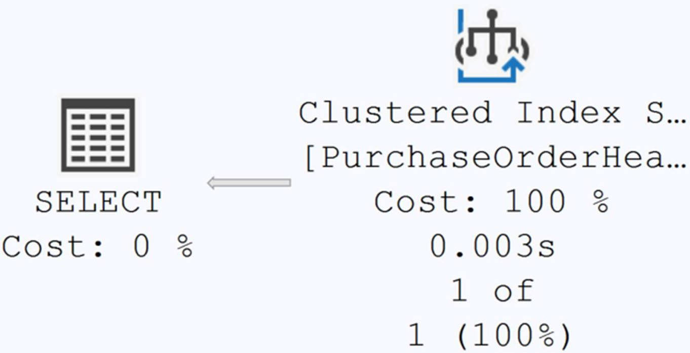

Đây là một kết quả mang tính hai mặt (*mixed result*): số lượt đọc trang logic tăng từ 11 lên 44 (do phải quét toàn bộ cây Clustered Index thay vì một chỉ mục không gom cụm nhỏ gọn hơn). Tuy nhiên, thời gian thực thi lại giảm đáng kể từ 2.15 ms xuống còn khoảng 434 µs. 

Dù vậy, giải pháp ép chỉ mục này vẫn chậm hơn rất nhiều so với việc chỉ đơn giản là sửa lại câu lệnh T-SQL để loại bỏ phép tính khỏi cột (viết lại thành `poh.PurchaseOrderID = 3400 / 2`, chỉ mất **177 µs** và chỉ tốn đúng **2 lượt đọc**). **Sửa chữa mã nguồn luôn là sự lựa chọn vượt trội tuyệt đối theo mọi tiêu chuẩn đánh giá**. Dù vậy, gợi ý `INDEX` hint vẫn có thể coi là một công cụ thử nghiệm hữu ích trong quá trình chẩn đoán sự cố.

---

## Tận dụng miền giá trị và toàn vẹn tham chiếu (Using Domain and Referential Integrity)

Mặc dù mục đích nguyên thủy hàng đầu của việc thiết lập ràng buộc miền giá trị (*domain integrity*) và toàn vẹn tham chiếu (*referential integrity*) là để bảo đảm tính đúng đắn và sạch sẽ của dữ liệu, nhưng **Query Optimizer cũng có thể tận dụng triệt để các ràng buộc này để tối ưu hóa hiệu năng truy vấn**. 

Khi bộ tối ưu hóa biết chắc chắn rằng một ràng buộc khóa ngoại hay miền giá trị đang được thực thi nghiêm ngặt, nó có thể điều chỉnh các ước lượng số dòng (*cardinality estimates*) và đưa ra những quyết định kế hoạch thông minh hơn rất nhiều.

Chúng ta sẽ cùng phân tích ba trường hợp cụ thể:
1. Ràng buộc `NOT NULL`.
2. Ràng buộc kiểm tra người dùng tự định nghĩa (`CHECK` constraint).
3. Toàn vẹn tham chiếu khai báo (DRI - Declarative Referential Integrity).

---

### Ràng buộc NOT NULL (NOT NULL Constraint)

Ràng buộc `NOT NULL` bảo đảm rằng một cột dữ liệu cụ thể sẽ không bao giờ chứa các giá trị `NULL`. SQL Server thực thi việc kiểm tra này theo thời gian thực mỗi khi dữ liệu được chèn hoặc cập nhật vào bảng. Bộ tối ưu hóa sử dụng thông tin "không có giá trị NULL" này để tinh gọn kế hoạch và tăng tốc độ xử lý của các truy vấn hướng vào cột đó.

Listing 14-20 chứa hai truy vấn nhắm vào hai cột có kích thước và tập dữ liệu tương đồng nhau trong bảng `Person.Person`: cột `FirstName` (ràng buộc `NOT NULL`) và cột `MiddleName` (cho phép chứa `NULL`).

**Listing 14-20.** Truy vấn trên bảng Person.Person

```sql
SELECT p.FirstName
FROM Person.Person AS p
WHERE p.FirstName < 'B'
      OR p.FirstName >= 'C';

SELECT p.MiddleName
FROM Person.Person AS p
WHERE p.MiddleName < 'B'
      OR p.MiddleName >= 'C';
```

Kế hoạch thực thi của hai câu truy vấn này được thể hiện trong Hình 14-20.

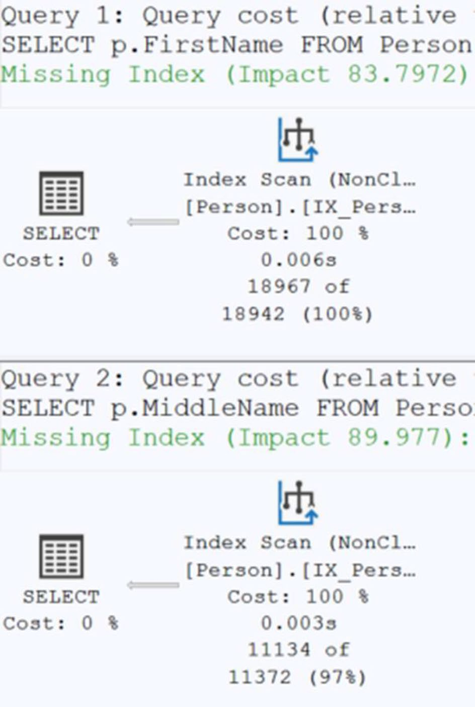

Điểm khác biệt duy nhất nằm ở số lượng dòng: truy vấn đầu tiên trả về 18.967 dòng (ước lượng 18.942 dòng), trong khi truy vấn thứ hai trả về 11.134 dòng (ước lượng 11.372 dòng). Cả hai đều phải quét chỉ mục `IX_Person_LastName_FirstName_MiddleName`.

Hơn nữa, trong câu truy vấn thứ hai, bởi vì cột `MiddleName` có chứa các giá trị `NULL` (mà theo định nghĩa logic ba giá trị của SQL, `NULL` không thỏa mãn bất kỳ phép so sánh `< 'B'` hay `>= 'C'` nào), nên nếu bạn muốn lấy đầy đủ dữ liệu người dùng, bạn bắt buộc phải bổ sung điều kiện `OR p.MiddleName IS NULL` như trong Listing 14-21.

**Listing 14-21.** Sửa đổi logic câu truy vấn thứ hai để bao gồm giá trị NULL

```sql
SELECT p.MiddleName
FROM Person.Person AS p
WHERE p.MiddleName < 'B'
      OR p.MiddleName >= 'C'
      OR p.MiddleName IS NULL;
```

Để tối ưu hóa hai câu truy vấn này, tôi tạo thêm hai chỉ mục chuyên biệt dựa trên gợi ý chỉ mục thiếu (*Missing Index*) trong Listing 14-22.

**Listing 14-22.** Tạo chỉ mục hỗ trợ truy vấn

```sql
CREATE INDEX TestIndex1 ON Person.Person (MiddleName);
CREATE INDEX TestIndex2 ON Person.Person (FirstName);
```

Hãy quan sát kế hoạch thực thi mới trong Hình 14-21.

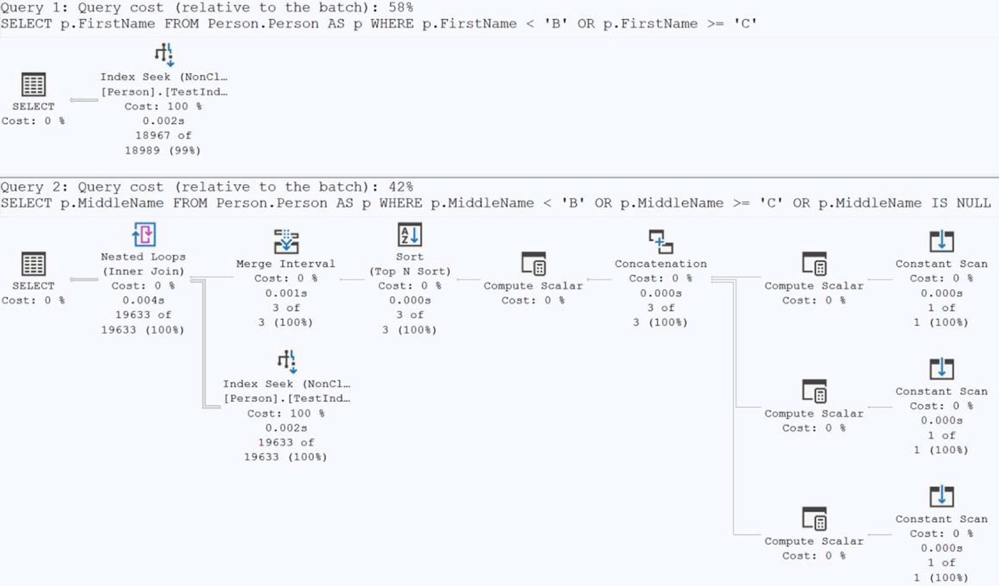

Sự tương phản là cực kỳ sâu sắc:
- Truy vấn đầu tiên trên cột `FirstName` chỉ đơn giản thực hiện một thao tác tìm kiếm chỉ mục duy nhất để trích xuất dữ liệu.
- Trong khi đó, ở truy vấn thứ hai trên cột `MiddleName`, do sự xuất hiện của mệnh đề `IS NULL`, cấu trúc kế hoạch thực thi đã phải phình to phức tạp một cách bất thường để thỏa mãn toàn bộ tiêu chí: hệ thống phải sinh ra ba giá trị thông qua 3 toán tử **Constant Scan** và **Compute Scalar** (tương ứng với ba điều kiện trong mệnh đề `WHERE`), sau đó đưa qua các toán tử **Sort**, **Merge Join** để kết hợp tập dữ liệu đã lọc!

Một chi tiết thú vị là kế hoạch đầu tiên có chi phí ước tính cao hơn, nhưng trên thực tế nó chạy hết 4.35 ms, còn kế hoạch thứ hai chạy hết 3.05 ms. 

> [!TIP]
> Bạn có thể thử nghiệm tạo một chỉ mục có bộ lọc (*Filtered Index*) đối với các cột có nhiều giá trị NULL (`WHERE MiddleName IS NOT NULL`), hoặc sử dụng thuộc tính cột thưa (*Sparse Columns*) để tối ưu dung lượng lưu trữ cho các bảng phân tích có tỷ lệ NULL áp đảo.

Trước khi chuyển sang nội dung tiếp theo, chúng ta tiến hành xóa bỏ các chỉ mục thử nghiệm này trong Listing 14-23.

**Listing 14-23.** Xóa bỏ các chỉ mục thử nghiệm

```sql
DROP INDEX TestIndex1 ON Person.Person;
DROP INDEX TestIndex2 ON Person.Person;
```

---

### Ràng buộc kiểm tra người dùng tự định nghĩa (CHECK Constraints)

Ràng buộc `CHECK` là một bức tường vững chắc bảo vệ tính toàn vẹn nghiệp vụ của dữ liệu. Nhưng bên cạnh vai trò kiểm soát dữ liệu, **Query Optimizer có thể sử dụng các ràng buộc CHECK để loại bỏ hoàn toàn các thao tác truy cập dữ liệu không cần thiết**.

Xét một ràng buộc kiểm tra sẵn có trong cơ sở dữ liệu AdventureWorks ở Listing 14-24.

**Listing 14-24.** Ràng buộc bảo đảm đơn giá luôn lớn hơn hoặc bằng không

```sql
ALTER TABLE Sales.SalesOrderDetail WITH CHECK
ADD CONSTRAINT CK_SalesOrderDetail_UnitPrice CHECK ((
                                                         UnitPrice >= (0.00)
                                                    ));
```

Nếu chúng ta thực thi câu truy vấn trong Listing 14-25, chúng ta đều biết chắc chắn rằng nó sẽ trả về 0 dòng, vì điều kiện yêu cầu `UnitPrice < $0.0`.

**Listing 14-25.** Truy vấn với điều kiện mâu thuẫn với ràng buộc CHECK

```sql
SELECT soh.OrderDate,
       soh.ShipDate,
       sod.OrderQty,
       sod.UnitPrice,
       p.Name AS ProductName
FROM Sales.SalesOrderHeader AS soh
    JOIN Sales.SalesOrderDetail AS sod
        ON sod.SalesOrderID = soh.SalesOrderID
    JOIN Production.Product AS p
        ON p.ProductID = sod.ProductID
WHERE p.Name = 'Water Bottle - 30 oz.'
      AND sod.UnitPrice < $0.0;
```

Kế hoạch thực thi của truy vấn này được thể hiện trong Hình 14-22.

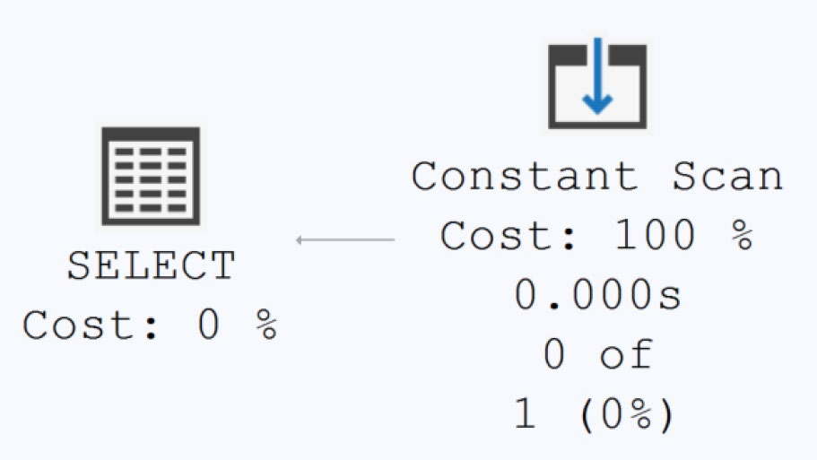

Toán tử **Constant Scan** vốn chỉ là một toán tử giữ chỗ (*placeholder*) mà bộ tối ưu hóa dùng để xây dựng tập kết quả tĩnh. Nhưng trong trường hợp này, **toàn bộ kế hoạch thực thi chỉ chứa duy nhất một toán tử Constant Scan mà không hề có bất kỳ toán tử đọc bảng hay chỉ mục nào**! 

Nếu kiểm tra thuộc tính *Output List* của toán tử Constant Scan trong Hình 14-23, bạn sẽ thấy nó trực tiếp trả về một tập kết quả rỗng.

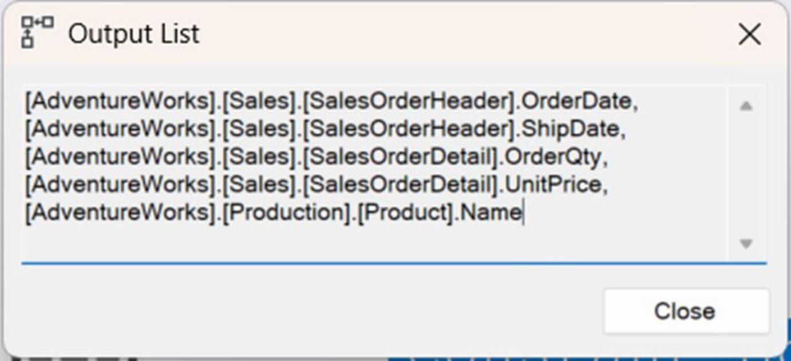

Hiện tượng này được gọi là **phát hiện mâu thuẫn (Contradiction Detection)**. Nếu bộ tối ưu hóa không có khả năng đọc và hiểu ràng buộc `CHECK`, do bảng không có chỉ mục nào phục vụ điều kiện trên, SQL Server sẽ buộc phải thực hiện một thao tác quét toàn bộ Clustered Index trên hàng trăm nghìn dòng chỉ để phát hiện ra... không có dòng nào thỏa mãn! Nhờ vào ràng buộc `CHECK`, bộ tối ưu hóa đã cứu hệ thống khỏi một cú sốc I/O vô ích.

> [!IMPORTANT]
> Bộ tối ưu hóa chỉ có thể tin tưởng và tận dụng ràng buộc `CHECK` nếu ràng buộc đó được tạo lập hoặc kích hoạt với tùy chọn `WITH CHECK` (được gọi là **Trusted Constraint**). Nếu bạn tạo ràng buộc với tùy chọn `WITH NOCHECK`, ràng buộc sẽ bị đánh dấu là "không tin cậy" (*untrusted*) do dữ liệu cũ chưa được thẩm định, và Query Optimizer sẽ hoàn toàn phớt lờ nó trong quá trình lập kế hoạch thực thi!

---

### Toàn vẹn tham chiếu khai báo (Declarative Referential Integrity - DRI)

Toàn vẹn tham chiếu khai báo (DRI) thông qua ràng buộc **khóa ngoại (FOREIGN KEY)** là cơ chế phổ biến nhất để bảo đảm dữ liệu giữa bảng cha (*parent table*) và bảng con (*child table*) luôn nhất quán: một dòng trong bảng con chỉ có thể tồn tại nếu dòng tương ứng đã có sẵn trong bảng cha (ngoại trừ trường hợp cột khóa ngoại chứa giá trị NULL).

Khi mối quan hệ DRI được thiết lập và cột khóa ngoại ở bảng con được định nghĩa là `NOT NULL`, bộ tối ưu hóa biết chắc chắn rằng với mỗi dòng ở bảng con, **luôn luôn tồn tại một dòng tương ứng ở bảng cha**. Bộ tối ưu hóa có thể tận dụng kiến thức này để loại bỏ hoàn toàn việc truy cập vào bảng cha nếu câu truy vấn không đòi hỏi bất kỳ cột dữ liệu nào khác từ bảng cha đó — kỹ thuật này được gọi là **loại bỏ bảng / loại bỏ khóa ngoại (Table Elimination / Foreign Key Elimination)**.

Để chứng minh điều này, chúng ta hãy chạy lệnh trong Listing 14-26 để tạm thời gỡ bỏ ràng buộc khóa ngoại giữa hai bảng `Person.Address` và `Person.StateProvince`.

**Listing 14-26.** Gỡ bỏ ràng buộc khóa ngoại

```sql
IF EXISTS
(
    SELECT *
    FROM sys.foreign_keys
    WHERE OBJECT_ID = OBJECT_ID(N'[Person].[FK_Address_StateProvince_StateProvinceID]')
          AND parent_object_id = OBJECT_ID(N'[Person].[Address]')
)
    ALTER TABLE Person.ADDRESS
    DROP CONSTRAINT FK_Address_StateProvince_StateProvinceID;
```

Sau khi gỡ bỏ ràng buộc, chúng ta thực thi hai câu truy vấn gần như giống hệt nhau trong Listing 14-27: truy vấn thứ nhất chọn `sp.StateProvinceID` (cột từ bảng cha `StateProvince`), còn truy vấn thứ hai chọn `A.StateProvinceID` (cột từ bảng con `Address`).

**Listing 14-27.** Hai câu truy vấn gần như giống hệt nhau

```sql
SELECT A.AddressID,
       sp.StateProvinceID
FROM Person.ADDRESS AS A
    JOIN Person.StateProvince AS sp
        ON A.StateProvinceID = sp.StateProvinceID
WHERE A.AddressID = 27234;

-- Lưu ý: Lấy Address.StateProvinceID thay vì sp.StateProvinceID
SELECT A.AddressID,
       A.StateProvinceID
FROM Person.ADDRESS AS A
    JOIN Person.StateProvince AS sp
        ON A.StateProvinceID = sp.StateProvinceID
WHERE A.AddressID = 27234;
```

So sánh kế hoạch thực thi của hai truy vấn này trong Hình 14-24.

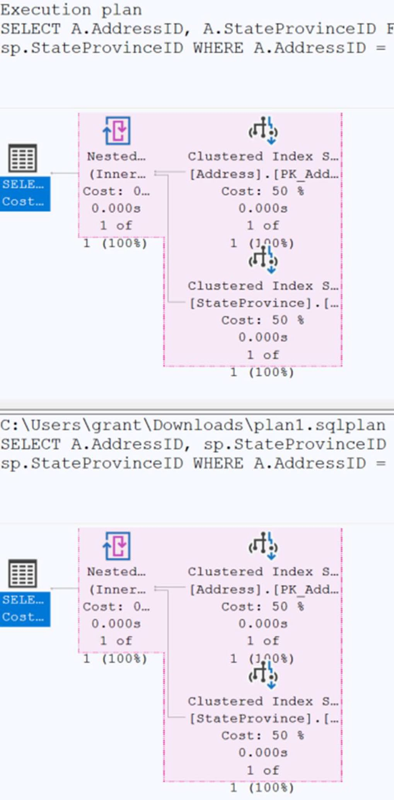

Khi sử dụng tính năng so sánh kế hoạch (*Compare ShowPlan*), các phần cấu trúc trùng khớp được tô sáng. Bạn có thể thấy cả hai kế hoạch đều thực hiện thao tác nối Nested Loops giữa hai bảng. Do không có khóa ngoại bảo đảm, bộ tối ưu hóa không thể biết chắc dòng `StateProvinceID` ở bảng `Address` có thực sự tồn tại bên bảng `StateProvince` hay không, do đó nó bắt buộc phải truy cập vào bảng `StateProvince` để kiểm tra tính hợp lệ của phép nối.

Bây giờ, chúng ta tái thiết lập lại ràng buộc khóa ngoại với tùy chọn `WITH CHECK` trong Listing 14-28.

**Listing 14-28.** Tạo lại ràng buộc khóa ngoại với tùy chọn WITH CHECK

```sql
ALTER TABLE Person.ADDRESS WITH CHECK
ADD CONSTRAINT FK_Address_StateProvince_StateProvinceID
    FOREIGN KEY (StateProvinceID)
    REFERENCES Person.StateProvince (StateProvinceID);
```

Hãy thực thi lại hai câu truy vấn trong Listing 14-27 và so sánh kế hoạch mới trong Hình 14-25.

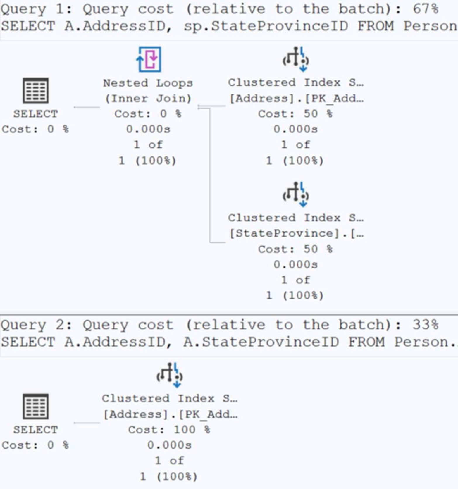

Sự khác biệt là vô cùng ngoạn mục:
- Truy vấn đầu tiên vẫn phải thực hiện phép nối vì nó yêu cầu lấy cột trực tiếp từ bảng cha `StateProvince`.
- Nhưng ở truy vấn thứ hai, bởi vì mọi cột được chọn đều nằm sẵn trên bảng con `Address`, và nhờ có ràng buộc khóa ngoại đáng tin cậy (`WITH CHECK`), bộ tối ưu hóa biết chắc rằng dòng tương ứng ở bảng cha chắc chắn tồn tại 100%. Do đó, **bộ tối ưu hóa đã loại bỏ hoàn toàn bảng StateProvince ra khỏi kế hoạch thực thi**! Phép JOIN bị triệt tiêu hoàn toàn, tiết kiệm một nửa số lần truy xuất dữ liệu và mang lại hiệu năng vượt trội.

---

## Tóm tắt chương (Summary)

Dù cấu trúc chỉ mục và bảng biểu của bạn có được thiết kế công phu đến đâu, những sai lầm trong việc viết mã T-SQL hoàn toàn có thể phá hủy hiệu năng của hệ thống nghiêm trọng không kém gì việc bạn chưa từng bảo trì hay tối ưu cơ sở dữ liệu. 

Query Optimizer là một bộ máy suy luận cực kỳ tinh vi và hiệu quả trong việc tìm kiếm con đường tối ưu để trích xuất dữ liệu, nhưng câu truy vấn của bạn phải được thiết kế để "hợp tác" (*work with*) thay vì chống lại bộ tối ưu hóa:
- **Thiết kế tập kết quả nhỏ gọn:** Tránh lạm dụng `SELECT *`, chỉ truy vấn đúng các cột cần thiết để tận dụng Covering Index; xây dựng mệnh đề `WHERE` chặt chẽ với các vị từ có khả năng tìm kiếm (*SARGable*).
- **Tránh các phép toán và hàm trên cột được lọc:** Phép tính số học hay các hàm xử lý chuỗi/ngày tháng đặt trên cột trong mệnh đề `WHERE` sẽ tước đoạt khả năng Index Seek và biến truy vấn thành Index Scan.
- **Loại bỏ bẫy hiệu năng của Scalar UDF:** Nhận diện vấn đề xử lý dòng-theo-dòng (RBAR) của hàm vô hướng người dùng tự định nghĩa và chủ động tái cấu trúc bằng `JOIN` hoặc Inline TVF.
- **Hạn chế tối đa Query Hints:** Hints là mệnh lệnh mang tính cưỡng chế, có thể gây triệt tiêu quá trình tối ưu hóa động và khóa chặt kế hoạch vào những cấu trúc kém linh hoạt. Chỉ dùng hint làm giải pháp tình thế cuối cùng sau khi đã kiểm thử thấu đáo.
- **Tận dụng tối đa các ràng buộc toàn vẹn dữ liệu:** Các ràng buộc `NOT NULL`, `CHECK` constraints (với tính năng Contradiction Detection) và `FOREIGN KEY` (với tính năng Table Elimination) không chỉ bảo vệ dữ liệu sạch mà còn là những công cụ tăng tốc truy vấn vô giá cho Query Optimizer.

Trong chương tiếp theo, chúng ta sẽ cùng nhau tập trung vào các giải pháp chuyên sâu nhằm **giảm thiểu việc sử dụng tài nguyên (bộ nhớ, CPU và I/O) trong các câu truy vấn**.
