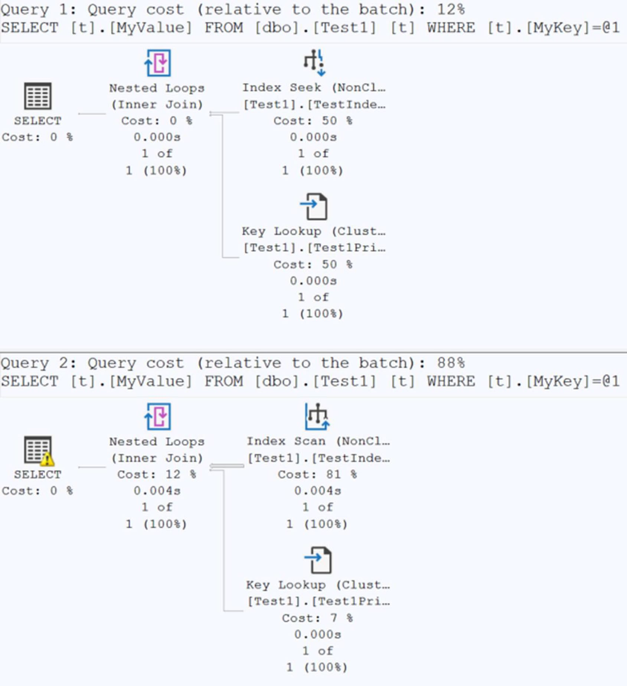
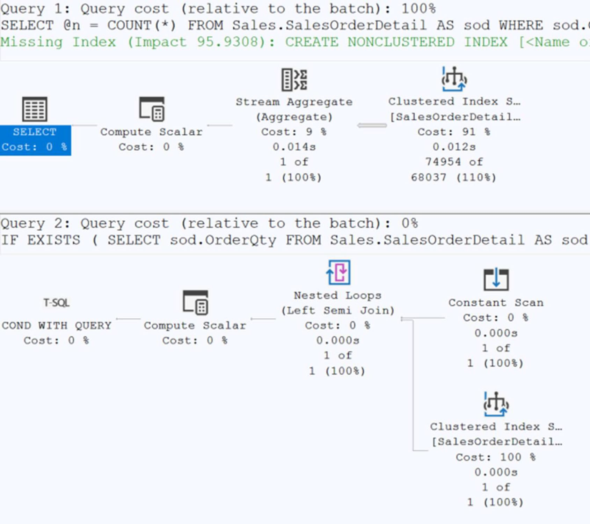
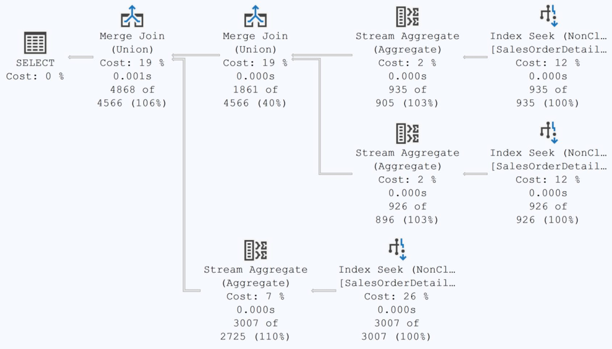
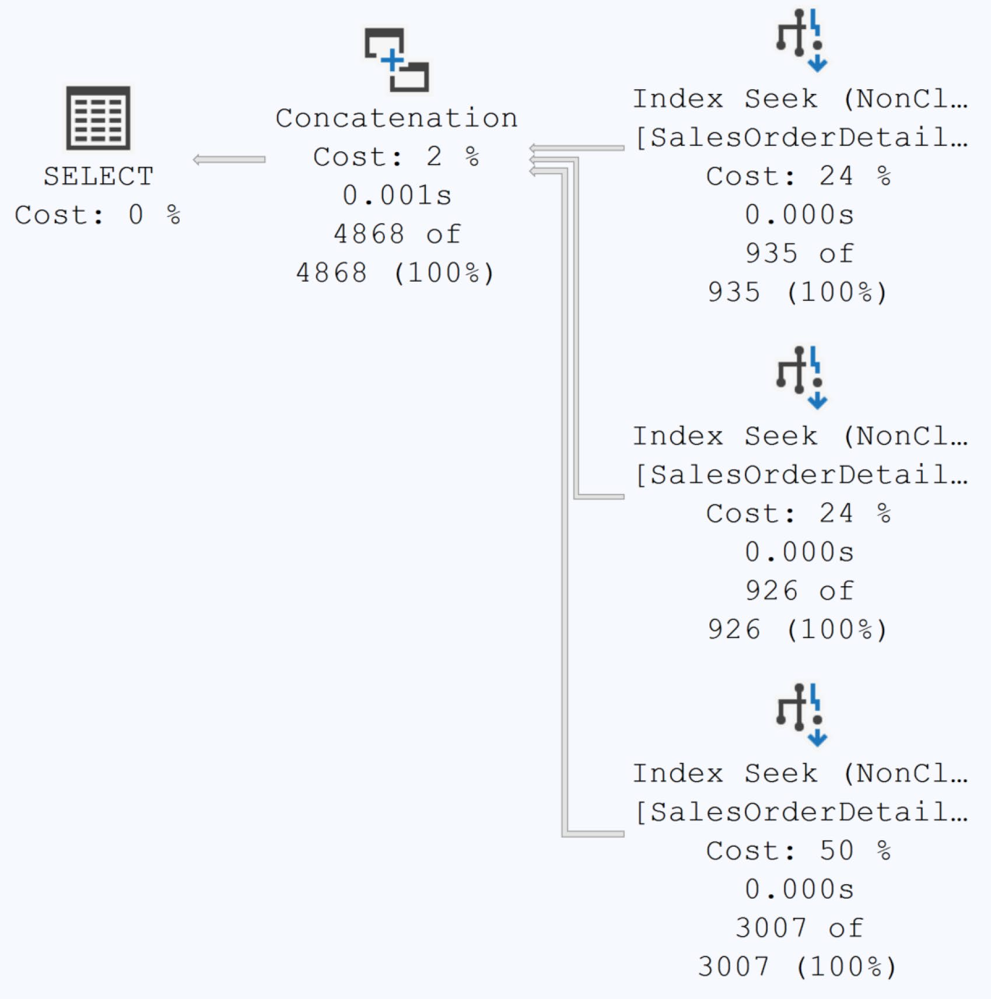
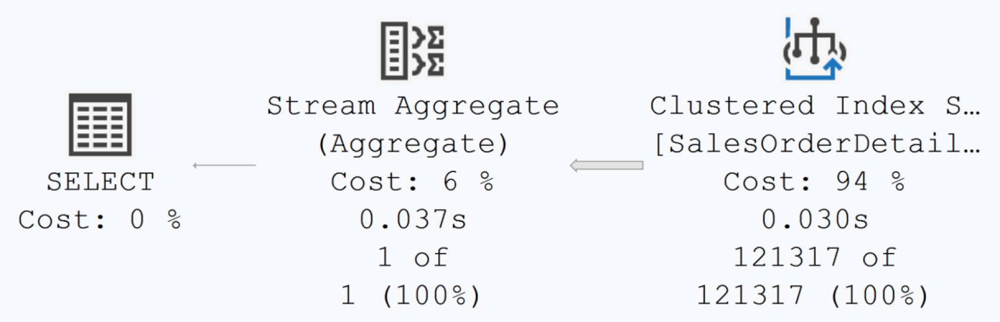
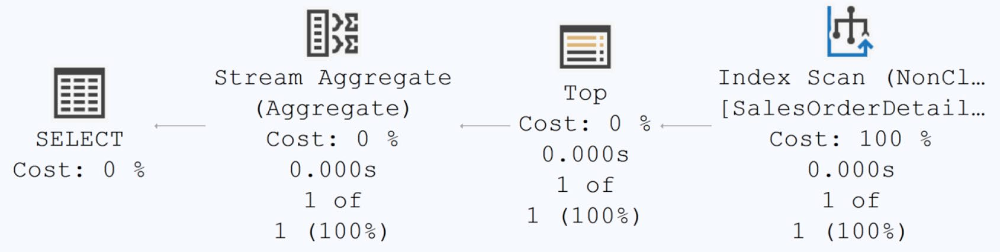
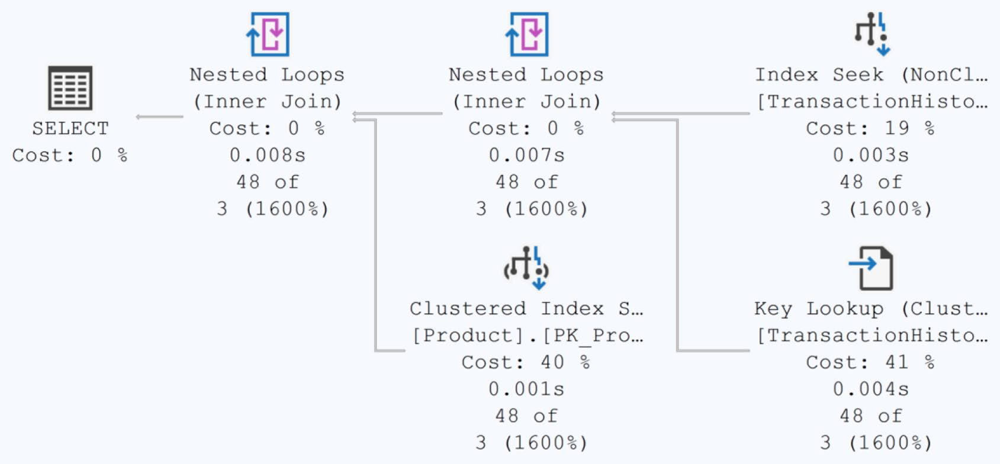
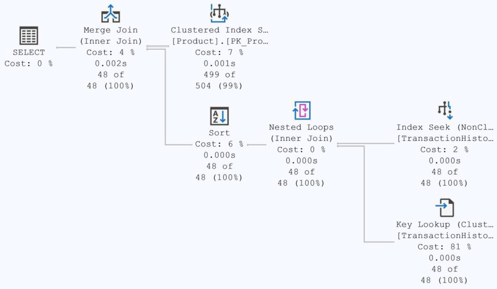

# CHƯƠNG 15: Cắt giảm Mức sử dụng Tài nguyên của Truy vấn (Reduce Query Resource Use)

Chương trước đã tập trung vào việc đảm bảo các câu truy vấn có khả năng tận dụng tối đa hệ thống chỉ mục trong cơ sở dữ liệu. Trong chương này, chúng ta sẽ chuyển hướng trọng tâm sang việc cắt giảm mức độ tiêu hao tài nguyên phần cứng (resource use) của các câu truy vấn. 

Trong T-SQL tồn tại những cơ chế và cấu trúc cú pháp rất dễ tiêu tốn quá mức bộ nhớ đệm (RAM/memory), chu kỳ xử lý của CPU và thông lượng vào/ra dữ liệu (I/O). Việc tập trung thiết kế và chuẩn hóa truy vấn theo hướng tiết kiệm tài nguyên không chỉ mang lại lợi ích cho chính câu truy vấn đơn lẻ đó, mà còn giúp giảm tải áp lực đáng kể cho toàn bộ hệ thống máy chủ, cho phép phục vụ nhiều người dùng đồng thời hơn với độ ổn định cao hơn.

Chúng ta sẽ cùng nghiên cứu nhiều kỹ thuật khác nhau xoay quanh các chủ đề cốt lõi sau:
* Các thiết kế truy vấn giúp giảm thiểu mức sử dụng tài nguyên phần cứng.
* Các cơ chế nâng cao hiệu quả khai thác bộ đệm kế hoạch thực thi (Plan Cache).
* Cắt giảm chi phí và độ trễ đường truyền mạng (network overhead) bất cứ khi nào có thể.
* Các kỹ thuật làm giảm chi phí giao dịch (transaction cost) của một truy vấn.

---

## Tránh các truy vấn ngốn tài nguyên (Avoiding Resource-Intensive Queries)

Hầu như với bất kỳ yêu cầu nghiệp vụ nào, bạn cũng có nhiều cách viết câu truy vấn T-SQL khác nhau để đáp ứng. Rất nhiều cách tiếp cận trong số đó vẫn hoạt động hoàn toàn bình thường và trả về kết quả dữ liệu chính xác. Tuy nhiên, một số cách viết lại có nguy cơ gây ảnh hưởng tiêu cực và ngốn tài nguyên hệ thống nặng nề hơn rất nhiều so với các giải pháp khác.

Dưới đây là một số cơ chế quan trọng giúp cắt giảm mức độ sử dụng tài nguyên của các câu truy vấn:
* **Sử dụng kiểu dữ liệu phù hợp (Use appropriate data types).**
* **Ưu tiên kiểm tra sự tồn tại của dữ liệu bằng `EXISTS` thay vì `COUNT(*)`.**
* **Ưa chuộng `UNION ALL` hơn `UNION`.**
* **Đảm bảo chỉ mục được tận dụng tối đa trong các thao tác gom cụm (aggregation) và sắp xếp (sort).**
* **Cẩn trọng khi sử dụng biến cục bộ (local variables) trong các truy vấn theo lô (batch queries).**
* **Cách đặt tên Stored Procedure thực sự có ý nghĩa quan trọng.**

---

### Sử dụng kiểu dữ liệu phù hợp (Use Appropriate Data Types)

SQL Server hỗ trợ một số lượng rất lớn các kiểu dữ liệu khác nhau. Đồng thời, SQL Server cũng hỗ trợ cơ chế tự động chuyển đổi từ kiểu dữ liệu này sang kiểu dữ liệu khác khi cần thiết (tùy thuộc vào khả năng tương thích giữa các kiểu dữ liệu). Hiện tượng này được gọi là **Chuyển đổi kiểu ngầm định (Implicit Conversion)**.

Đây là một tình huống mà SQL Server tỏ ra "tốt bụng" nhằm giúp cuộc sống của lập trình viên trở nên dễ dàng hơn, nhưng sự tiện lợi này lại phải trả giá đắt bằng các sự cố nghiêm trọng về mặt hiệu năng. Để duy trì hiệu năng ở mức tối ưu, bạn phải luôn đảm bảo rằng các tham số (parameters), biến (variables) và các hằng số (constants) được khai báo cùng một kiểu dữ liệu với cột dữ liệu mà bạn đang đem ra so sánh.

Để thấy rõ những tác động tiêu cực của chuyển đổi ngầm định trong thực tế, hãy xem xét ví dụ trong Listing 15-1.

**Listing 15-1.** Tạo bảng thử nghiệm, chèn dữ liệu và chạy các truy vấn đối chiếu
```sql
DROP TABLE IF EXISTS dbo.Test1;
CREATE TABLE dbo.Test1
(
    Id INT IDENTITY(1, 1),
    MyKey VARCHAR(50),
    MyValue VARCHAR(50)
);

CREATE UNIQUE CLUSTERED INDEX Test1PrimaryKey ON dbo.Test1 (ID ASC);
CREATE UNIQUE NONCLUSTERED INDEX TestIndex ON dbo.Test1 (MyKey);

WITH Tally
AS (SELECT ROW_NUMBER() OVER (ORDER BY (SELECT NULL)) AS num
    FROM MASTER.dbo.syscolumns AS A
        CROSS JOIN MASTER.dbo.syscolumns AS B)
INSERT INTO dbo.Test1
(
    MyKey,
    MyValue
)
SELECT TOP 10000
       'UniqueKey' + CAST(Tally.num AS VARCHAR),
       'Description'
FROM Tally;

-- Truy vấn 1: Sử dụng hằng số chuỗi chuẩn VARCHAR
SELECT t.MyValue
FROM dbo.Test1 AS t
WHERE t.MyKey = 'UniqueKey333';

-- Truy vấn 2: Sử dụng hằng số chuỗi Unicode NVARCHAR (có tiền tố N)
SELECT t.MyValue
FROM dbo.Test1 AS t
WHERE t.MyKey = N'UniqueKey333';
```

Hai câu truy vấn ở cuối Listing 15-1 trả về cùng một kết quả giống hệt nhau, nhưng kế hoạch thực thi của chúng lại có sự khác biệt rất lớn như thể hiện trong Hình 15-1.



*Hình 15-1. Hai kế hoạch thực thi minh họa chuyển đổi ngầm định hoạt động*

Mặc dù hình dạng tổng quan của hai kế hoạch có phần tương tự, nhưng có hai điểm khác biệt cốt lõi đập ngay vào mắt chúng ta:
1. Thứ nhất, ở kế hoạch thứ hai, chúng ta thấy xuất hiện một biểu tượng cảnh báo hình tam giác màu vàng (warning indicator) ngay tại toán tử đầu tiên ở phía bên trái – toán tử `SELECT`.
2. Thứ hai, cũng ở kế hoạch thứ hai, hệ thống đã phải thực hiện thao tác **Index Scan** trên chỉ mục phi cụm (nonclustered index) thay vì thực hiện thao tác **Index Seek** chính xác và hiệu quả như ở kế hoạch thứ nhất.

Toàn bộ nguyên nhân của sự suy thoái này bắt nguồn từ việc SQL Server bắt buộc phải chuyển đổi kiểu dữ liệu của truy vấn. Cột `MyKey` trong bảng được định nghĩa là kiểu `VARCHAR(50)`, trong khi giá trị hằng số gán cứng lại được chỉ định dưới dạng chuỗi Unicode `NVARCHAR` thông qua ký tự tiền tố `N` đặt trước chuỗi văn bản (`N'UniqueKey333'`).

Theo quy tắc độ ưu tiên kiểu dữ liệu (Data Type Precedence) của SQL Server, kiểu `NVARCHAR` có mức ưu tiên cao hơn `VARCHAR`. Do đó, SQL Server không thể chuyển đổi giá trị hằng số đơn lẻ sang `VARCHAR`, mà bắt buộc phải áp dụng hàm chuyển đổi ngầm định `CONVERT_IMPLICIT` lên từng dòng của cột `MyKey` trong chỉ mục.

Biểu tượng cảnh báo thông báo cho chúng ta biết rằng có một dấu hiệu bất thường cần kiểm tra bên trong kế hoạch thực thi. Đó có thể là một vấn đề không đáng ngại, hoặc cũng có thể là một thông tin sống còn giúp cải thiện hiệu năng. Khi nhìn vào sự chênh lệch lớn giữa các giá trị ước lượng và chi phí của hai kế hoạch, bạn có thể khẳng định ngay đây là thông tin vô cùng hệ trọng.

Kiểm tra cửa sổ thuộc tính (Properties) của toán tử `SELECT`, chúng ta thấy rõ nội dung cảnh báo chi tiết:

```text
Type conversion in expression (CONVERT_IMPLICIT(nvarchar(50),[t].[MyKey],0)=[@1]) 
may affect "SeekPlan" in query plan choice, 
Type conversion in expression (CONVERT_IMPLICIT(nvarchar(50),[t].[MyKey],0)=N'UniqueKey333') 
may affect "SeekPlan" in query plan choice
```

Hậu quả của việc chuyển đổi ngầm định này đối với hiệu năng là rất nặng nề:
* Mặc dù hai tập kết quả trả về là hoàn toàn giống nhau, thời gian thực thi trung bình đã tăng vọt từ **266 µs** lên tới **4.185 µs** (chậm hơn gần 16 lần).
* Số lượt đọc dữ liệu logic (logical reads) tăng vọt từ **4** reads lên **38** reads (gấp gần 10 lần).

Cần lưu ý cơ chế so sánh giá trị: Quá trình so sánh bắt buộc phải đối chiếu với các giá trị thực tế đang lưu trữ trong bảng hoặc chỉ mục. Do quy tắc ưu tiên kiểu dữ liệu, phép chuyển đổi ngầm định bị áp lên cột dữ liệu, biến điều kiện thành non-sargable và triệt tiêu hoàn toàn khả năng sử dụng Index Seek.

Như bạn thấy, mặc dù tiến trình chuyển đổi ngầm định diễn ra hoàn toàn tự động, lặng lẽ ở hậu trường và đem lại sự thuận tiện tức thời, nhưng nó lại là một "kẻ giết chết hiệu năng" cực kỳ nguy hiểm. Giải pháp tối ưu và chuẩn mực nhất là luôn luôn đảm bảo các giá trị hằng số, biến và tham số truyền vào phải khớp hoàn toàn về kiểu dữ liệu với cột tương ứng trong cơ sở dữ liệu.

---

### Kiểm tra sự tồn tại của dữ liệu: Ưu tiên EXISTS thay vì COUNT(*) (Test EXISTS Over COUNT(*) to Verify Data Existence)

Một cách tiếp cận rất phổ biến mà nhiều lập trình viên thường dùng để kiểm tra xem dữ liệu có tồn tại trong bảng hay không là viết câu lệnh tương tự như trong Listing 15-2.

**Listing 15-2.** Xác thực sự tồn tại của dữ liệu bằng COUNT(*)
```sql
DECLARE @n INT;
SELECT @n = COUNT(*)
FROM Sales.SalesOrderDetail AS sod
WHERE sod.OrderQty = 1;

IF @n > 0
    PRINT 'Record Exists';
```

Để đáp ứng điều kiện trong mệnh đề `WHERE` kết hợp với thao tác đếm `COUNT(*)`, hệ thống bắt buộc phải thực hiện quét toàn bộ (complete scan) để tìm kiếm và đếm đủ tất cả các dòng dữ liệu thỏa mãn điều kiện lọc. 

Tuy nhiên, trong hầu hết mọi trường hợp nghiệp vụ, kiểu xác thực tồn tại này có thể được thực hiện nhẹ nhàng và hiệu quả hơn rất nhiều thông qua toán tử `EXISTS` như thể hiện trong Listing 15-3.

**Listing 15-3.** Xác thực sự tồn tại của dữ liệu bằng EXISTS
```sql
IF EXISTS
(
    SELECT sod.OrderQty
    FROM Sales.SalesOrderDetail AS sod
    WHERE sod.OrderQty = 1
)
    PRINT 'Record Exists';
```

So sánh các chỉ số hiệu năng đo lường được giữa hai cách viết:
* **Sử dụng `COUNT(*)`:**
  * **Reads:** 1.248 logical reads
  * **Duration:** 9,7 ms
* **Sử dụng `EXISTS`:**
  * **Reads:** 29 logical reads
  * **Duration:** 1,66 ms

Kế hoạch thực thi của hai phương pháp này được minh họa trên Hình 15-2.



*Hình 15-2. Sự khác biệt về kế hoạch thực thi giữa COUNT và EXISTS*

Tại sao `EXISTS` lại vượt trội đến vậy? Bản chất nằm ở cơ chế đánh giá ngắt sớm (**short-circuit evaluation**). Với `EXISTS`, Query Optimizer đưa vào toán tử **Top (Top 1)**. Ngay khi hệ thống định vị được bản ghi hợp lệ đầu tiên thỏa mãn điều kiện lọc trong chỉ mục, toán tử Top sẽ lập tức phát tín hiệu dừng thực thi và trả về kết quả `TRUE`. Hệ thống không cần phải tốn công đọc tiếp các trang dữ liệu còn lại. Ngược lại, `COUNT(*)` buộc phải duyệt qua toàn bộ dữ liệu thỏa mãn để tính ra con số tổng cộng chính xác, dẫn đến việc tiêu tốn tới 1.248 lần đọc logic thay vì chỉ 29 lần đọc.

Dù đây là một chiến thắng hiển nhiên về mặt hiệu năng, nhưng bạn cũng cần lưu ý: trong trường hợp kiểm tra dữ liệu không tồn tại (negative test – khi không có bất kỳ dòng nào thỏa mãn điều kiện), cả hai phương pháp đều sẽ phải quét toàn bộ phạm vi dữ liệu, do đó thời gian thực thi có thể tương đương hoặc thậm chí `EXISTS` chỉ nhỉnh hơn một chút. Đó là lý do vì sao tôi luôn khuyên bạn nên kiểm thử kỹ lưỡng cách tiếp cận này trên hệ thống của mình. Nhưng rõ ràng, việc cắt giảm từ 1.248 reads xuống chỉ còn 29 reads là một sự cải thiện vô cùng to lớn.

Cũng đáng chú ý là bộ tối ưu hóa có đề xuất một chỉ mục còn thiếu (missing index) cho câu truy vấn đầu tiên trong Listing 15-3. Việc tạo theo gợi ý chỉ mục đó có thể giúp tăng hiệu năng thêm một chút, nhưng chắc chắn không thể mang lại bước nhảy vọt ngoạn mục như việc chuyển sang sử dụng `EXISTS`.

---

### Ưa chuộng UNION ALL hơn UNION (Favor UNION ALL Over UNION)

Mệnh đề `UNION` cho phép bạn kết hợp kết quả từ nhiều câu truy vấn thành một tập kết quả hợp nhất duy nhất. Tuy nhiên, về bản chất hoạt động, `UNION` là một thao tác gom cụm và sắp xếp loại trừ (aggregate/distinct operation). 

Listing 15-4 minh họa một ví dụ kết hợp kết quả sử dụng toán tử `UNION`.

**Listing 15-4.** Kết hợp các tập kết quả thông qua UNION
```sql
SELECT sod.ProductID,
       sod.SalesOrderID
FROM Sales.SalesOrderDetail AS sod
WHERE sod.ProductID = 934
UNION
SELECT sod.ProductID,
       sod.SalesOrderID
FROM Sales.SalesOrderDetail AS sod
WHERE sod.ProductID = 932
UNION
SELECT sod.ProductID,
       sod.SalesOrderID
FROM Sales.SalesOrderDetail AS sod
WHERE sod.ProductID = 708;
```

Kế hoạch thực thi của truy vấn sử dụng `UNION` được thể hiện trong Hình 15-3.



*Hình 15-3. Kế hoạch thực thi của truy vấn UNION*

Trong trường hợp này, Query Optimizer đã lựa chọn đáp ứng truy vấn bằng cách sử dụng các toán tử **Stream Aggregate**. Bạn sẽ nhận thấy rằng mặc dù mỗi tập dữ liệu trong số ba truy vấn con đều được truy xuất rất nhanh thông qua các thao tác **Index Seek**, nhưng sau đó chúng bắt buộc phải được xử lý qua các toán tử Stream Aggregate để tiến hành sắp xếp và loại bỏ các dòng dữ liệu trùng lặp (deduplication). Kết quả sau khi khử trùng lặp tiếp tục được hợp nhất thông qua hai toán tử **Merge Join (Concatenation)**.

Bây giờ, nếu bạn biết chắc chắn rằng dữ liệu giữa các truy vấn con không hề bị trùng lặp (ví dụ ở đây lọc theo các `ProductID` hoàn toàn khác biệt: 934, 932 và 708), hoặc nếu logic nghiệp vụ chấp nhận giữ nguyên các dòng dữ liệu giống nhau, chúng ta hãy thay thế `UNION` bằng `UNION ALL`.

Kế hoạch thực thi tương ứng của `UNION ALL` được minh họa trong Hình 15-4.



*Hình 15-4. Kế hoạch thực thi của UNION ALL*

Sự khác biệt thể hiện rõ rệt: Các toán tử gom cụm loại trừ dữ liệu trùng lặp (Stream Aggregate) cùng các toán tử kết nối (Merge Join) phức tạp đã hoàn toàn biến mất. Thay vào đó, kế hoạch chỉ còn lại các thao tác truy xuất dữ liệu cơ bản bằng **Index Seek**, sau đó các tập dữ liệu được ghép nối trực tiếp với nhau thông qua một toán tử duy nhất là **Concatenation**.

Kế hoạch thực thi trở nên đơn giản, tinh gọn hơn rất nhiều, và thời gian thực thi tổng thể giảm từ **2,4 ms** xuống còn **1,56 ms**. Mặc dù trong ví dụ với dữ liệu mẫu nhỏ này, mức chênh lệch tuyệt đối có vẻ chưa quá lớn, nhưng khi khối lượng dòng dữ liệu phình to lên hàng triệu bản ghi, mức độ cải thiện sẽ trở nên cực kỳ rõ rệt. 

Điều thú vị là số lượt đọc dữ liệu logic (logical reads) vẫn giữ nguyên ở mức 20 reads cho cả hai câu truy vấn. Khối lượng công việc bổ sung mà `UNION` tiêu tốn thực chất nằm ở chu kỳ xử lý của CPU và việc cấp phát bộ nhớ làm việc (Workspace Memory Grant) để phục vụ cho các thao tác sắp xếp và so sánh dữ liệu trùng lặp. Việc chuyển sang `UNION ALL` giúp giải phóng hoàn toàn gánh nặng CPU này.

---

### Đảm bảo chỉ mục hỗ trợ tốt các thao tác tổng hợp và sắp xếp (Ensure Indexes Are Used for Aggregate and Sort Operations)

Cách tối ưu nhất để cải thiện vượt bậc hiệu năng của các hàm tổng hợp như `MIN` hoặc `MAX` là tận dụng các chỉ mục lưu trữ theo cột (*columnstore indexes*). Tuy nhiên, ngay cả các chỉ mục lưu trữ theo dòng (*rowstore indexes*) truyền thống cũng có thể mang lại những cải thiện hiệu năng rất đáng kể cho các truy vấn tổng hợp. Việc thiếu vắng các chỉ mục hỗ trợ cho truy vấn chắc chắn sẽ dẫn đến các thao tác quét toàn bộ bảng (*table scan*) hoặc quét chỉ mục (*index scan*). 

Chẳng hạn, Listing 15-5 thực hiện một phép tính tổng hợp đơn giản để tìm giá bán nhỏ nhất (`MIN`).

**Listing 15-5.** Tìm giá trị nhỏ nhất của UnitPrice

```sql
SELECT MIN(sod.UnitPrice)
FROM Sales.SalesOrderDetail AS sod;
```

Các số đo hiệu năng ghi nhận được:
- **Lượt đọc logic (Reads):** 1.248
- **Thời gian thực thi (Duration):** 15.2 ms

Kế hoạch thực thi hiển thị trong Hình 15-5.



Để trả về một giá trị đơn lẻ — giá trị `UnitPrice` nhỏ nhất — SQL Server đã phải thực hiện tới 1.248 lượt đọc dữ liệu cũng như thực thi thao tác tính toán tổng hợp thông qua toán tử **Stream Aggregate**. Bạn thậm chí có thể nhận thấy điều này một cách trực quan khi nhìn vào đường mũi tên rất dày đi ra từ toán tử Quét chỉ mục gom cụm (*Clustered Index Scan*), trong khi chỉ có một đường mũi tên mảnh mai đi ra từ toán tử Stream Aggregate.

Để cải thiện hiệu năng, tôi sẽ thêm một chỉ mục trên cột `UnitPrice` như thể hiện trong Listing 15-6.

**Listing 15-6.** Thêm chỉ mục trên cột UnitPrice

```sql
CREATE INDEX TestIndex ON Sales.SalesOrderDetail (UnitPrice ASC);
```

Sau khi có chỉ mục, chúng ta thực thi lại truy vấn và thu được kết quả:
- **Lượt đọc logic (Reads):** 3 (giảm từ 1.248)
- **Thời gian thực thi (Duration):** 389 µs (giảm từ 15.2 ms — nhanh gấp gần 40 lần!)

Kế hoạch thực thi mới được minh họa trong Hình 15-6.



Mặc dù kế hoạch thực thi này trông có vẻ phức tạp hơn về mặt thị giác do chứa nhiều toán tử hơn, nhưng các chỉ số hiệu năng đã nói lên tất cả. Chỉ mục được quét, nhưng đó là một thao tác quét có giới hạn (*limited scan*) chỉ duy nhất đúng một dòng đầu tiên (nhờ cây B-Tree đã được sắp xếp sẵn theo thứ tự tăng dần `ASC`). Toán tử **Top** xuất hiện nhằm đảm bảo chỉ có duy nhất một giá trị được lấy ra. Toán tử **Stream Aggregate** ở đây đơn thuần chỉ đóng vai trò hình thức để hợp thức hóa kết quả trả về.

Bạn cũng sẽ quan sát thấy các hành vi hoàn toàn tương tự đối với các mệnh đề `ORDER BY` khi có chỉ mục hỗ trợ. Tất cả đều quy về một nguyên lý cốt lõi: dữ liệu đã được lưu trữ sẵn theo một thứ tự cụ thể trên đĩa để đáp ứng ngay lập tức nhu cầu của truy vấn. Nhìn chung, đối với các truy vấn phân tích tổng hợp, bạn vẫn sẽ nhận được những cải thiện hiệu năng vượt trội nhất từ các chỉ mục columnstore, nhưng bạn cũng hoàn toàn có thể gặt hái được những lợi ích rất lớn từ các chỉ mục rowstore truyền thống.

Trước khi tiếp tục, Listing 15-7 sẽ dọn dẹp chỉ mục thử nghiệm này.

**Listing 15-7.** Xóa bỏ chỉ mục thử nghiệm

```sql
DROP INDEX IF EXISTS TestIndex ON dbo.Test1;
```

---

### Thận trọng khi sử dụng biến cục bộ trong truy vấn theo lô (Be Cautious with Local Variables in a Batch Query)

Việc thực thi nhiều câu lệnh thông qua một tiến trình theo lô (*batch process*) là điều cực kỳ phổ biến trong lập trình CSDL. Phổ biến không kém là thói quen sử dụng các biến cục bộ (*local variables*) để truyền dẫn giá trị qua lại giữa các câu lệnh bên trong khối lệnh đó. Tuy nhiên, việc sử dụng các biến cục bộ trong các tiêu chí lọc dữ liệu (`WHERE`) đôi khi có thể dẫn đến những quyết định lựa chọn kế hoạch rất tồi tệ từ bộ tối ưu hóa truy vấn (*Query Optimizer*).

Để giữ cho ví dụ đơn giản và dễ hiểu, thay vì dùng một lô lệnh lớn, chúng ta sẽ chỉ xem xét hành vi trên một câu lệnh đơn lẻ. Các nguyên lý vận hành hoàn toàn tương tự trong một tập hợp truy vấn lớn hơn. Listing 15-8 minh họa một truy vấn sử dụng biến cục bộ.

**Listing 15-8.** Sử dụng biến cục bộ để truyền giá trị

```sql
DECLARE @Id INT = 67260;
SELECT p.Name,
       p.ProductNumber,
       th.ReferenceOrderID
FROM Production.Product AS p
    JOIN Production.TransactionHistory AS th
        ON th.ProductID = p.ProductID
WHERE th.ReferenceOrderID = @Id;
```

Kế hoạch thực thi của truy vấn này được thể hiện trong Hình 15-7.



Chúng ta đang lọc dữ liệu bằng biến cục bộ `@Id` trên cột `ReferenceOrderID` của bảng `TransactionHistory`. Một toán tử `Index Seek` trên chỉ mục phi gom cụm đã được sử dụng. Tuy nhiên, điều này đồng nghĩa với việc các cột bổ sung còn thiếu phải được truy xuất từ chỉ mục gom cụm thông qua thao tác `Key Lookup` kết hợp với phép nối `Nested Loops`. Phần dữ liệu còn lại của truy vấn đến từ thao tác `Clustered Index Seek` trên bảng `Product` và một phép nối `Nested Loops` khác để kết hợp chúng lại với nhau.

Nếu chúng ta sửa đổi mã lệnh để sử dụng một giá trị hằng số cố định (*hard-coded value*), chúng ta sẽ có đoạn mã như trong Listing 15-9.

**Listing 15-9.** Thay thế biến cục bộ bằng giá trị hằng số cố định

```sql
SELECT p.Name,
       p.ProductNumber,
       th.ReferenceOrderID
FROM Production.Product AS p
    JOIN Production.TransactionHistory AS th
        ON th.ProductID = p.ProductID
WHERE th.ReferenceOrderID = 67260;
```

Kế hoạch thực thi đã có sự biến đổi rõ rệt như trong Hình 15-8.



Mặc dù chúng ta đang truy xuất cùng một tập dữ liệu chính xác, nhưng bộ tối ưu hóa đã đưa ra những lựa chọn hoàn toàn mới về cách đáp ứng truy vấn tốt nhất. Một phần hình thái kế hoạch vẫn giống nhau: việc truy cập dữ liệu trên bảng `TransactionHistory` vẫn thông qua `Index Seek` phi gom cụm và `Key Lookup`. Tuy nhiên, phần còn lại của kế hoạch đã khác biệt: phép nối **Merge Join** được sử dụng thay vì Nested Loops, kết hợp với một thao tác **Index Scan** trên clustered index của bảng `Product`. Nếu bạn xem xét thuộc tính của phép Scan, bạn sẽ thấy đó là một thao tác quét có thứ tự (*ordered scan*), đáp ứng điều kiện tiên quyết của phép Merge Join là dữ liệu đầu vào phải được sắp xếp. Toán tử bổ sung khác xuất hiện là **Sort**, cần thiết để sắp xếp dữ liệu từ bảng `TransactionHistory` theo đúng thứ tự.

Mọi thứ thực sự trở nên thú vị khi chúng ta so sánh các số đo hiệu năng:

- **Truy vấn gốc dùng biến cục bộ (Listing 15-8):**
  - Reads: 242
  - Duration: 333 µs
- **Truy vấn dùng giá trị cố định (Listing 15-9):**
  - Reads: 170
  - Duration: 723 µs

Điểm khác biệt cốt lõi khi sử dụng giá trị cố định là bộ tối ưu hóa có thể sử dụng **lược đồ thống kê** (*histogram*) để biết chính xác số lượng dòng sẽ được trả về ứng với giá trị `67260`. Giá trị ước tính từ histogram là 48 dòng — trùng khớp chính xác với số dòng thực tế trả về. Bộ tối ưu hóa đã quyết định rằng việc thực hiện 48 lần thao tác Index Seek lặp đi lặp lại thông qua phép nối Nested Loops sẽ tốn kém chi phí hơn so với việc quét có thứ tự chỉ mục và sắp xếp kết quả dữ liệu ban đầu từ bảng `TransactionHistory`.

Ngược lại, khi bạn sử dụng một **biến cục bộ**, bộ tối ưu hóa không thể "đánh hơi" (*sniff*) giá trị của biến tại thời điểm biên dịch câu lệnh. Do đó, nó buộc phải sử dụng ước tính mật độ trung bình (**Density Vector**) từ dữ liệu thống kê thay vì lược đồ histogram.

Tuy nhiên, tôi không hề cổ súy việc bạn sử dụng các giá trị hằng số cố định trong mã lệnh. Điều đó sẽ dẫn đến hàng loạt cơn ác mộng về bảo trì mã nguồn. Thay vào đó, bạn nên xem xét khả năng chuyển đổi biến cục bộ thành một **tham số** (*parameter*) chính thức của thủ tục lưu trữ để nó có thể được bộ tối ưu hóa lấy mẫu tại thời điểm biên dịch thông qua cơ chế parameter sniffing (mặc dù điều này lại mở ra các vấn đề về phân phối dữ liệu bị lệch như chúng ta đã tìm hiểu ở Chương 13).

Thật đáng tiếc là không phải lúc nào cũng có một câu trả lời đúng duy nhất trong tối ưu hóa truy vấn. Tuy nhiên, việc nắm vững kiến thức về cách thức và quan trọng hơn là **lý do tại sao** các truy vấn của bạn lại được bộ tối ưu hóa lựa chọn kế hoạch như vậy sẽ giúp bạn đưa ra những quyết định thiết kế sáng suốt hơn.

---

### Tên thủ tục lưu trữ thực sự quan trọng (Stored Procedure Names Actually Matter)

Dù bạn có tin hay không, cách bạn đặt tên cho các thủ tục lưu trữ có thể tạo ra một tác động nhất định đến hiệu năng hệ thống, mặc dù mức độ ảnh hưởng là rất nhỏ.

Một quy ước đặt tên rất phổ biến đối với các đối tượng cơ sở dữ liệu là sử dụng từ viết tắt, chẳng hạn như dùng `sp` cho `stored procedure`. Một thói quen thường thấy tiếp theo là phân tách tiền tố này với tên đối tượng bằng một dấu gạch dưới: `sp_`. 

Quy ước đặt tên này phổ biến đến mức Microsoft thực chất đã áp dụng nó từ trước đó: đây chính là tiền tố được sử dụng để định danh các **thủ tục lưu trữ hệ thống** (*system stored procedures*). Khi bắt gặp một thủ tục có tiền tố `sp_`, SQL Server mặc định giả định rằng thủ tục lưu trữ đó nằm trong cơ sở dữ liệu hệ thống `master`. Trên thực tế, thứ tự tìm kiếm đối tượng của SQL Server sẽ diễn ra như sau:

1. Tìm kiếm trong cơ sở dữ liệu `master`.
2. Tìm kiếm trong cơ sở dữ liệu hiện tại dựa trên các định danh hợp lệ (tên cơ sở dữ liệu và/hoặc chủ sở hữu - owner).
3. Tìm kiếm trong cơ sở dữ liệu hiện tại bằng cách sử dụng `dbo` làm lược đồ mặc định nếu không có schema nào được chỉ định.

Sự suy giảm hiệu năng do việc tìm kiếm này gây ra là rất nhỏ, gần như không thể đo lường được trong các tác vụ đơn lẻ. Tuy nhiên, trên các hệ thống có tần suất giao dịch cực kỳ dày đặc (hàng chục ngàn lượt gọi mỗi giây), bạn đang vô tình bổ sung thêm một khoản chi phí phụ trội (*overhead*) hoàn toàn không cần thiết vào chu kỳ xử lý của CPU.

Một vấn đề nghiêm trọng hơn phát sinh khi bạn vô tình tạo một thủ tục trong cơ sở dữ liệu cục bộ của mình trùng tên với một thủ tục hệ thống của SQL Server. Khi ứng dụng cố gắng thực thi truy vấn đó, đặc biệt nếu thủ tục của bạn có tập hợp tham số khác biệt, hệ thống sẽ ưu tiên gọi thủ tục trong `master` và trả về lỗi thực thi ngay lập tức.

---

## Giảm tải trọng mạng bất cứ khi nào có thể (Reducing Network Overhead Where Possible)

Trong thực tế triển khai hệ thống, rất hiếm khi một tiến trình xử lý, báo cáo, tác vụ phân tích hay ứng dụng người dùng lại chạy cục bộ trên cùng một máy chủ vật lý với cơ sở dữ liệu. Mạng máy tính (*network*) luôn là cầu nối trung gian chịu trách nhiệm luân chuyển dữ liệu từ SQL Server về phía ứng dụng khách. Do đó, bên cạnh việc tập trung tối ưu hóa logic của từng câu truy vấn đơn lẻ, bạn còn phải tư duy thấu đáo về cách thức phối hợp và đóng gói các truy vấn thành các gói thực thi (*batches*). 

Hai phương pháp tiếp cận sau đây có thể giúp bạn giảm thiểu đáng kể chi phí truyền thông qua mạng:
- Thực thi nhiều truy vấn theo tập hợp (*Execute multiple queries in sets*).
- Sử dụng lệnh `SET NOCOUNT ON`.

Chúng ta hãy cùng phân tích chi tiết hai phương pháp tiếp cận này.

---

### Thực thi nhiều truy vấn theo tập hợp (Execute Multiple Queries in Sets)

Mặc dù mọi giải pháp đều cần được kiểm chứng qua đo lường thực tế, nhưng về mặt nguyên lý chung, việc gom các nhóm câu truy vấn có liên quan mật thiết vào trong cùng một khối lệnh (*batch*) hoặc một stored procedure luôn là một chiến lược thiết kế đúng đắn. 

Thay vì liên tục mở kết nối tới máy chủ và phát sinh hàng loạt chu kỳ truyền nhận khứ hồi lắt nhắt qua mạng (*network round-trips*) cho từng dòng dữ liệu, ứng dụng chỉ cần thực hiện một lệnh gọi duy nhất để hoàn thành toàn bộ khối lượng công việc và trích xuất đúng những gì cần thiết. Để hiện thực hóa điều này, bạn cần bảo đảm rằng mã ứng dụng của bạn có khả năng:
- Xử lý đồng thời nhiều tập kết quả trả về (*multiple result sets*).
- Tận dụng định dạng JSON hoặc các cơ chế truyền nhận dữ liệu theo khối (*table-valued parameters*) thay vì thực hiện các thao tác chèn (`INSERT`) hay cập nhật (`UPDATE`) đơn lẻ từng dòng.

---

### Sử dụng lệnh SET NOCOUNT ON

Theo mặc định, sau khi thực thi bất kỳ câu truy vấn hành động nào bên trong một khối lệnh hoặc stored procedure, SQL Server sẽ tự động gửi trả một thông điệp thông báo số lượng dòng bị tác động về cho ứng dụng khách:

```text
(<Number> row(s) affected)
```

Thông tin thông báo này bắt buộc phải được đóng gói và truyền tải qua mạng cho **từng câu lệnh riêng lẻ**. Bạn hoàn toàn có thể hình dung được rằng: mặc dù thông điệp này có kích thước rất nhỏ, nhưng khi tích tụ qua hàng triệu lượt giao dịch, nó sẽ tạo thành một tải trọng mạng (*network overhead*) vô cùng lãng phí và không cần thiết.

Để ngăn chặn hành vi mặc định này, bạn hãy đặt câu lệnh T-SQL trong Listing 15-10 vào ngay đầu khối mã của mình.

**Listing 15-10.** Sử dụng lệnh SET NOCOUNT

```sql
SET NOCOUNT ON;
```

Bạn cũng có thể thiết lập `SET NOCOUNT OFF` nếu thực sự cần nhận lại thông điệp đó. Việc đặt lệnh `SET NOCOUNT ON` ở đầu một chuỗi truy vấn hoặc trong một stored procedure hoàn toàn không gây ra hiện tượng biên dịch lại (*recompiles*). Lệnh này chỉ đơn giản là chặn việc gửi các thông báo đếm dòng qua mạng. Đây là một chi tiết nhỏ nhưng là một **thói quen lập trình chuẩn mực** (*good coding practice*) mà mọi kỹ sư SQL Server đều nên tuân thủ.

---

## Các kỹ thuật giảm chi phí giao dịch của một truy vấn (Techniques to Reduce Transaction Cost of a Query)

Giao dịch (*Transactions*) là nền tảng cốt lõi giúp SQL Server bảo vệ tính toàn vẹn và tính nhất quán của dữ liệu theo chuẩn ACID. Mọi câu truy vấn hành động làm biến đổi dữ liệu — bao gồm `INSERT`, `UPDATE`, `DELETE` hay `MERGE` — đều được SQL Server thực thi như một hành động nguyên tử (*atomic action*) nhằm duy trì dữ liệu ở một trạng thái nhất quán, đồng nghĩa với việc các thay đổi phải được commit thành công trọn vẹn. Bạn không thể tắt bỏ hành vi nguyên tử hóa này.

Nếu quá trình chuyển dịch trạng thái dữ liệu đòi hỏi phải phối hợp qua nhiều câu truy vấn khác nhau, thì tính nguyên tử trên toàn bộ chuỗi truy vấn đó bắt buộc phải được duy trì thông qua các giao dịch tường minh (*explicit database transactions*). Trạng thái trước và sau của mỗi hành động nguyên tử đều được ghi nhận chi tiết vào tệp nhật ký giao dịch (*Transaction Log*) trên đĩa cứng để bảo đảm tính bền vững (*durability*), cam kết rằng kết quả của giao dịch sẽ không bao giờ bị mất mát một khi đã báo thành công. Đồng thời, trong suốt thời gian thực thi, hành động nguyên tử này được cô lập (*isolated*) khỏi các hành động khác của cơ sở dữ liệu thông qua cơ chế khóa (*database locks*).

Dựa trên các đặc tính cấu thành nên một giao dịch, chúng ta có hai khuyến nghị chiến lược để giảm thiểu chi phí tài nguyên giao dịch:
- Giảm chi phí ghi nhật ký giao dịch (*Reduce logging overhead*).
- Giảm chi phí quản lý khóa (*Reduce lock overhead*).

---

### Giảm chi phí ghi nhật ký giao dịch (Reduce Logging Overhead)

Một thủ tục lưu trữ hay khối lệnh của bạn có thể bao gồm một chuỗi dài các câu truy vấn hành động liên tiếp. Nếu bạn để SQL Server tự động duy trì tính nguyên tử cho từng câu lệnh riêng rẽ (cơ chế autocommit), bạn sẽ phát sinh một lượng rất lớn các thao tác ghi độc lập vào tệp Transaction Log, từ đó gia tăng áp lực tranh chấp tài nguyên đĩa tại đây.

Để chứng minh điều này, chúng ta hãy xem xét kịch bản chèn 10.000 dòng dữ liệu vào một bảng thử nghiệm trong Listing 15-11.

**Listing 15-11.** Chèn 10.000 dòng dữ liệu bằng vòng lặp WHILE với giao dịch ngầm định

```sql
DROP TABLE IF EXISTS dbo.Test1;
CREATE TABLE dbo.Test1
(
    C1 TINYINT
);
GO
DBCC SQLPERF(LOGSPACE);
-- Chèn 10.000 dòng
DECLARE @Count INT = 1;
WHILE @Count <= 10000
BEGIN
    INSERT INTO dbo.Test1
    (
        C1
    )
    VALUES
    (@Count % 256);
    SET @Count = @Count + 1;
END;
DBCC SQLPERF(LOGSPACE);
```

Lệnh `DBCC SQLPERF(LOGSPACE)` là một công cụ cực kỳ trực quan và tiện lợi để giám sát dung lượng không gian Transaction Log đang bị tiêu thụ. Trước khi chạy lệnh, tệp log của cơ sở dữ liệu AdventureWorks có dung lượng khá nhỏ, khoảng 7.9 MB và chỉ mới sử dụng 5% không gian. 

Khi thực thi đoạn mã trong Listing 15-11, quá trình xử lý mất tới **39 giây**! Đồng thời, nó khiến tệp nhật ký giao dịch bị thổi phồng lên tới khoảng **72 MB** và mức độ chiếm dụng tăng vọt lên **24%**. Đối với một bảng thử nghiệm nhỏ, đây là một sự lãng phí tài nguyên vô cùng nặng nề.

Một biện pháp khắc phục tức thì cho tình trạng này là bao bọc toàn bộ khối vòng lặp vào trong **một giao dịch tường minh duy nhất**, như minh họa trong Listing 15-12.

**Listing 15-12.** Đưa toàn bộ thao tác vào một giao dịch tường minh

```sql
DECLARE @Count INT = 1;
DBCC SQLPERF(LOGSPACE);
BEGIN TRANSACTION;
WHILE @Count <= 10000
BEGIN
    INSERT INTO dbo.Test1
    (
        C1
    )
    VALUES
    (@Count % 256);
    SET @Count = @Count + 1;
END;
COMMIT;
DBCC SQLPERF(LOGSPACE);
```

Giờ đây, thay vì phát sinh 10.000 giao dịch độc lập, hệ thống chỉ phải quản lý duy nhất **một giao dịch**. Kích thước của tệp log được giữ nguyên hoàn toàn (không bị nở thêm), tỷ lệ sử dụng log giảm xuống rõ rệt khi các giao dịch cũ bị xóa mòn (trong chế độ Simple Recovery). Đặc biệt nhất, thời gian thực thi giảm ngoạn mục từ 39 giây xuống chỉ còn **83 ms**! 

Chỉ riêng việc gom nhóm giao dịch đã mang lại một bước nhảy vọt về hiệu năng. Tuy nhiên, chúng ta vẫn có thể cải thiện kết quả này vượt bậc hơn nữa. Vòng lặp `WHILE` về bản chất là một tư duy lập trình dòng-theo-dòng (RBAR) kém hiệu quả khi xử lý dữ liệu quan hệ. Bằng cách chuyển đổi sang một thao tác thuần tập hợp (*set-based operation*) như trong Listing 15-13, chúng ta sẽ tối ưu hóa tài nguyên ở mức triệt để nhất.

**Listing 15-13.** Chuyển đổi sang thao tác chèn theo tập hợp và loại bỏ vòng lặp WHILE

```sql
DBCC SQLPERF(LOGSPACE);
BEGIN TRANSACTION;
WITH Tally
AS (SELECT ROW_NUMBER() OVER (ORDER BY (SELECT NULL)) AS num
    FROM master.dbo.syscolumns AS A
        CROSS JOIN master.dbo.syscolumns AS B)
INSERT INTO dbo.Test1
(
    C1
)
SELECT TOP 10000
       (Tally.num % 256)
FROM Tally;
COMMIT;
DBCC SQLPERF(LOGSPACE);
```

*(Lưu ý: Đoạn mã sử dụng `TOP 10000` để chèn đúng 10.000 bản ghi tương đương với hai ví dụ trước).*

Bởi vì toàn bộ 10.000 dòng được chèn qua một câu lệnh SQL duy nhất bên trong một giao dịch, kích thước tệp log hoàn toàn không biến động, tỷ lệ không gian log chỉ nhích nhẹ từ 6.29% lên 6.44%, và thời gian thực thi giảm sâu xuống chỉ còn **68.7 ms**! Chúng ta đã biến một tác vụ làm phình đĩa log và ngốn mất 39 giây thành một thao tác gần như "vô hình" về mặt tài nguyên và hoàn tất chỉ trong tích tắc.

> [!WARNING]
> Mặc dù gom nhóm giao dịch giúp tiết kiệm log và tăng tốc đáng kể, bạn vẫn cần hết sức thận trọng: **việc nhồi nhét quá nhiều công việc vào một giao dịch duy nhất có thể biến nó thành một giao dịch chạy dài (long-running transaction)**. Các giao dịch kéo dài sẽ chiếm giữ tài nguyên và gây ra hiện tượng phong tỏa/tắc nghẽn khóa (*blocking*, sẽ được đào sâu trong Chương 16). Hơn nữa, giao dịch dài có thể làm gia tăng thời gian khôi phục cơ sở dữ liệu (*crash recovery time*) khi khởi động lại hệ thống (mặc dù tính năng Accelerated Database Recovery - ADR trong các phiên bản SQL Server mới đã khắc phục phần lớn trở ngại này).

---

### Giảm chi phí quản lý khóa (Reduce Lock Overhead)

Theo mặc định, mọi câu lệnh T-SQL đều phải sử dụng một cấp độ khóa nhất định để cô lập tác vụ của mình khỏi các tác vụ xung đột khác. Bộ máy quản lý khóa (*Lock Manager*) của SQL Server đòi hỏi tài nguyên CPU và bộ nhớ để duy trì các cấu trúc khóa này. Do đó, việc giảm thiểu số lượng khóa cần thiết để hoàn tất một truy vấn sẽ trực tiếp tăng tốc độ xử lý của câu lệnh đó. Hơn thế nữa, giảm thiểu khóa ở truy vấn này sẽ gián tiếp giúp các truy vấn khác trong hệ thống chạy nhanh hơn nhờ giảm thời gian phải xếp hàng chờ đợi tài nguyên.

Mặc dù khóa và tắc nghẽn là một đề tài lớn sẽ được phân tích toàn diện trong Chương 16, nhưng khi bàn về việc tiết kiệm tài nguyên, tôi muốn cung cấp một vài giải pháp cốt lõi để giảm tải áp lực khóa.

SQL Server mặc định ưu tiên sử dụng khóa ở cấp độ dòng (*row-level lock*). Tuy nhiên, khi một câu truy vấn thao tác trên một số lượng lớn các dòng dữ liệu, việc cấp phát và duy trì hàng trăm nghìn khóa dòng riêng lẻ sẽ tạo ra chi phí quản lý bộ nhớ cực lớn. Khi đó, SQL Server sẽ tự động kích hoạt cơ chế nâng cấp khóa (*lock escalation*) để chuyển đổi lên khóa cấp trang (*page-level lock*) hoặc khóa toàn bảng (*table-level lock*). Quá trình này diễn ra hoàn toàn tự động và thông minh. Dù vậy, bạn vẫn có thể can thiệp trực tiếp bằng cách cung cấp gợi ý khóa (*lock hint*) như trong Listing 15-14.

**Listing 15-14.** Mã giả định chỉ định gợi ý khóa cấp trang

```sql
SELECT * FROM <TableName> WITH(PAGLOCK);  -- Sử dụng khóa ở cấp độ trang
```

Đối với các câu lệnh `SELECT`, SQL Server sử dụng các loại khóa ít xâm lấn hơn (chủ yếu là khóa chia sẻ - *Shared Locks*) so với các lệnh ghi dữ liệu (`INSERT`, `UPDATE`, `DELETE`). Điều này cho phép các lệnh đọc có thể truy cập song song vào các vùng dữ liệu không bị sửa đổi. 

Trong những kịch bản mà dữ liệu của bạn có tính chất tĩnh hoặc rất hiếm khi bị biến động, bạn có thể triệt tiêu hoặc giảm bớt đáng kể chi phí khóa của các lệnh `SELECT` thông qua ba giải pháp sau:
1. Đánh dấu cơ sở dữ liệu ở chế độ `READ_ONLY`.
2. Sử dụng chế độ cô lập Snapshot (*Snapshot Isolation*).
3. Ngăn các câu lệnh `SELECT` yêu cầu cấp phát khóa chia sẻ.

---

#### 1. Đánh dấu cơ sở dữ liệu là READ_ONLY

Giải pháp này cực kỳ hoàn hảo cho các cơ sở dữ liệu dùng để tra cứu lịch sử, kho lưu trữ dữ liệu hoặc báo cáo tĩnh — nơi mà dữ liệu hoàn toàn không nhận các thao tác cập nhật trong suốt phiên làm việc. Bạn có thể kích hoạt bằng câu lệnh trong Listing 15-15.

**Listing 15-15.** Chuyển cơ sở dữ liệu sang chế độ READ_ONLY

```sql
ALTER DATABASE <DatabaseName> SET READ_ONLY;
```

Khi ở chế độ này, người dùng vẫn có thể thoải mái đọc dữ liệu, nhưng mọi thao tác ghi đều bị khóa triệt để. Thiết lập này có hiệu lực tức thì. Vì cơ sở dữ liệu không thể bị thay đổi, SQL Server không cần phải cấp phát các khóa chia sẻ để bảo vệ tính nhất quán khi đọc.

Nếu định kỳ cần nạp thêm dữ liệu mới, bạn có thể tạm thời chuyển cơ sở dữ liệu quay trở lại chế độ `READ_WRITE` bằng Listing 15-16, thực hiện nạp dữ liệu, rồi sau đó đặt lại về `READ_ONLY`.

**Listing 15-16.** Chuyển cơ sở dữ liệu trở lại chế độ đọc/ghi

```sql
ALTER DATABASE <DatabaseName> SET READ_WRITE;
```

---

#### 2. Sử dụng chế độ cô lập Snapshot (Snapshot Isolation)

SQL Server cung cấp cơ chế kiểm soát tương tranh đa phiên bản (**Row Versioning**): mỗi khi một giao dịch ghi sửa đổi dữ liệu, phiên bản cũ của dòng dữ liệu sẽ được sao chép và lưu trữ tạm thời trong `tempdb`. Khi các câu lệnh `SELECT` đọc dữ liệu, chúng sẽ đọc phiên bản nhất quán đã được commit từ `tempdb` thay vì phải chờ đợi giao dịch ghi giải phóng khóa. 

Kỹ thuật này giúp **người đọc không chặn người ghi và người ghi không chặn người đọc**, loại bỏ gần như toàn bộ chi phí khóa chia sẻ và hiện tượng tắc nghẽn. Bạn có thể kích hoạt chế độ Read Committed Snapshot Isolation (RCSI) ở cấp cơ sở dữ liệu bằng lệnh trong Listing 15-17.

**Listing 15-17.** Kích hoạt Read Committed Snapshot Isolation

```sql
ALTER DATABASE AdventureWorks SET READ_COMMITTED_SNAPSHOT ON;
```

> [!NOTE]
> Bật RCSI sẽ làm gia tăng tải trọng I/O và dung lượng lưu trữ trên `tempdb` do phải duy trì kho phiên bản dòng (*version store*), ngoại trừ khi cơ sở dữ liệu của bạn kích hoạt tính năng Accelerated Database Recovery (ADR) — lúc này kho phiên bản sẽ được duy trì nội bộ ngay trong chính cơ sở dữ liệu đó.

---

#### 3. Ngăn câu lệnh SELECT yêu cầu khóa (NOLOCK Hint)

Thành thật mà nói, tôi vô cùng ngần ngại khi phải nhắc đến gợi ý `WITH (NOLOCK)` hay mức độ cô lập `READ UNCOMMITTED`. Rất nhiều lập trình viên xem `NOLOCK` như một "chiếc công tắc thần kỳ" có khả năng làm mọi câu truy vấn chạy nhanh hơn tức thì. **Thực tế hoàn toàn không phải như vậy!**

Gợi ý `NOLOCK` chỉ thị cho SQL Server không yêu cầu bất kỳ khóa chia sẻ nào khi đọc dữ liệu, và nó cũng phớt lờ mọi khóa độc quyền (*Exclusive Locks*) do các giao dịch khác đang nắm giữ. Gợi ý này chỉ có thể áp dụng cho các câu lệnh `SELECT`. Mặc dù bạn không thể đặt trực tiếp `NOLOCK` lên các bảng đích của câu lệnh hành động (`INSERT`, `UPDATE`, `DELETE`), nhưng bạn có thể đặt nó trên các bảng tham gia vào phần trích xuất dữ liệu của câu lệnh đó, như minh họa trong Listing 15-18.

**Listing 15-18.** Sử dụng gợi ý NOLOCK trong câu lệnh DELETE

```sql
DELETE Sales.SalesOrderDetail
FROM Sales.SalesOrderDetail AS sod WITH (NOLOCK)
    JOIN Production.Product AS p WITH (NOLOCK)
        ON sod.ProductID = p.ProductID
           AND p.ProductID = 0;
```

> [!CAUTION]
> Bạn bắt buộc phải ý thức sâu sắc rằng: **việc sử dụng `NOLOCK` sẽ dẫn thẳng tới hiện tượng đọc dữ liệu bẩn (Dirty Reads)**. Đọc bẩn không chỉ khiến bạn đọc phải những dữ liệu chưa hề được commit (và có thể bị rollback ngay sau đó), mà còn có thể gây ra hiện tượng **trùng lặp dòng dữ liệu** (*duplicate rows*) hoặc **bỏ sót hoàn toàn nhiều dòng dữ liệu** (*missing rows*) do sự dịch chuyển trang dữ liệu trong quá trình phân tách trang (*page splits*).
> 
> Vì lý do đó, `NOLOCK` chỉ nên được coi là giải pháp đường cùng trong những tình huống bất khả kháng. Việc lạm dụng nó là cực kỳ nguy hiểm và tiềm ẩn rủi ro sai lệch dữ liệu nghiêm trọng cho doanh nghiệp. Lựa chọn văn minh và an toàn hơn nhiều luôn là chuyển cơ sở dữ liệu sang chế độ `READ_ONLY` hoặc áp dụng các mức cô lập Snapshot.

*(Nếu bạn đã thực hiện các thay đổi thử nghiệm trên cơ sở dữ liệu ở phần này, tôi khuyến nghị bạn nên khôi phục lại cơ sở dữ liệu từ bản sao lưu ban đầu).*

---

## Tóm tắt chương (Summary)

Tinh chỉnh hiệu năng truy vấn không đơn thuần chỉ dừng lại ở việc chọn lựa một chỉ mục chính xác rồi bảo đảm câu lệnh SQL sử dụng được chỉ mục đó. Như bạn đã thấy xuyên suốt chương này, việc chủ động **giảm thiểu lượng tài nguyên phần cứng (CPU, bộ nhớ, I/O đĩa, tải trọng mạng và nhật ký giao dịch) mà câu truy vấn tiêu thụ** cũng đóng vai trò quan trọng không kém trong nghệ thuật tối ưu hóa.

Việc thử nghiệm các cách tiếp cận logic khác nhau cho cùng một bài toán truy vấn có thể mang lại những bước nhảy vọt ngoạn mục về hiệu năng, hoặc đơn giản là giải tỏa áp lực cho những tài nguyên phần cứng đang là điểm nghẽn cổ chai của toàn hệ thống:
- Lựa chọn đúng kiểu dữ liệu để triệt tiêu chuyển đổi ngầm định `CONVERT_IMPLICIT`.
- Ưu tiên toán tử `EXISTS` thay vì `COUNT(*)` để tận dụng cơ chế đánh giá ngắn mạch (*short-circuit*).
- Sử dụng `UNION ALL` thay cho `UNION` để tránh các toán tử sắp xếp loại bỏ trùng lặp (*Distinct Sort*) tốn RAM.
- Thiết kế chỉ mục hỗ trợ sắp xếp và tổng hợp để ưu tiên toán tử Stream Aggregate nhẹ nhàng thay vì Hash Aggregate.
- Giữ tải trọng mạng ở mức tối thiểu với `SET NOCOUNT ON` và xử lý theo khối.
- Gom nhóm các thao tác ghi dữ liệu vào các giao dịch tường minh và chuyển đổi hoàn toàn sang tư duy xử lý theo tập hợp (*set-based*) thay vì vòng lặp `WHILE`.
- Giải phóng áp lực khóa thông qua cơ chế Snapshot Isolation hoặc cấu hình `READ_ONLY`.

Khi tài nguyên hệ thống bị chiếm dụng kéo dài, bạn sẽ bắt đầu phải đối mặt với một vấn đề hiệu năng vô cùng nhức nhối: **hiện tượng tắc nghẽn và tranh chấp tài nguyên (Blocking)**. Trong chương tiếp theo, chúng ta sẽ cùng nhau phân tích chi tiết cơ chế khóa, bản chất của Blocking và các phương pháp giải quyết triệt để tình trạng tắc nghẽn trong SQL Server.
