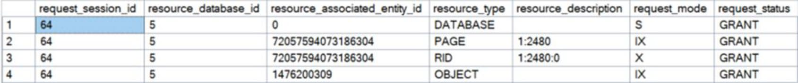
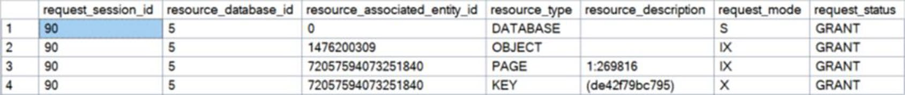
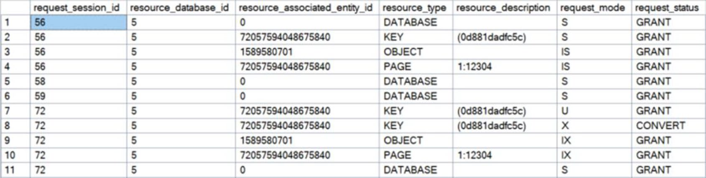
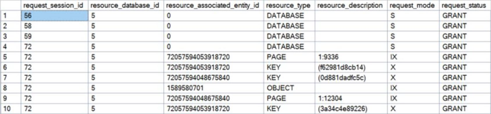
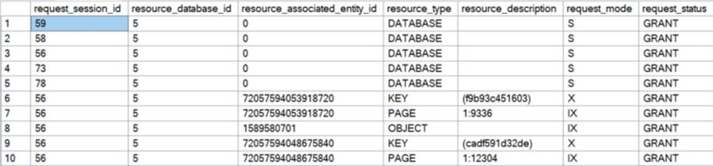
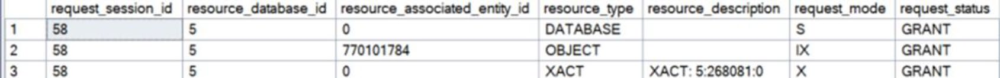
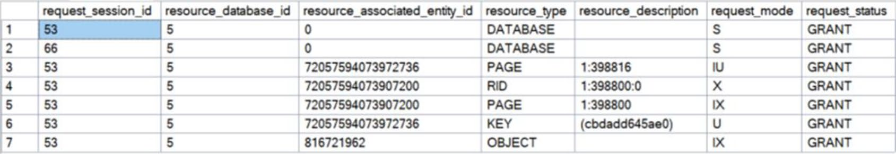
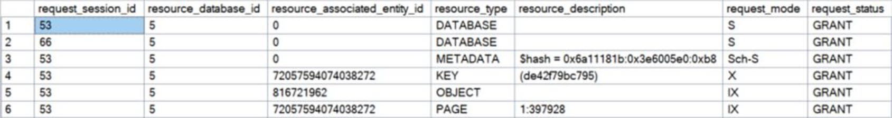
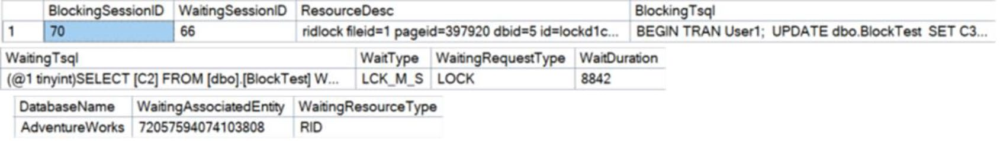
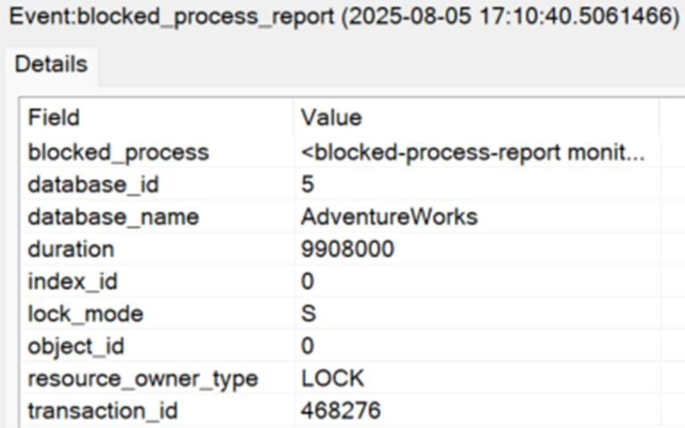

# CHƯƠNG 16: Tắc nghẽn và Các Tiến trình bị Chặn (Blocking and Blocked Processes)

SQL Server luôn đảm bảo tính toàn vẹn và an toàn tuyệt đối cho dữ liệu của bạn ngay cả trong quá trình dữ liệu đang bị thay đổi liên tục bởi nhiều người dùng đồng thời. Hệ thống thực hiện được điều này thông qua một cơ chế cốt lõi gọi là **Khóa (Locking)**. 

Tuy nhiên, ngay khi SQL Server thiết lập các khóa tài nguyên bên trong hệ thống I/O nhằm phục vụ cho các thao tác thay đổi dữ liệu, nó sẽ đồng thời dẫn đến hiện tượng được gọi là **Tắc nghẽn (Blocking)** do sự tranh chấp (contention) các tài nguyên đó giữa các phiên làm việc khác nhau. Khi số lượng người dùng đồng thời trên hệ thống của bạn tăng cao, hiệu năng truy vấn sẽ suy giảm tương ứng khi họ phải xếp hàng chờ đợi lẫn nhau. Để hiểu rõ cách thức kiểm soát và xử lý tắc nghẽn, trước hết bạn cần phải nắm vững cơ chế và lý do tại sao khóa lại phát sinh.

Trong chương này, tôi sẽ lần lượt trình bày các chủ đề sau:
* Các nguyên lý căn bản về hiện tượng tắc nghẽn (blocking) trong SQL Server.
* Các thuộc tính ACID của một cơ sở dữ liệu giao dịch.
* Các mức độ cô lập giao dịch (isolation levels) trong SQL Server.
* Cơ chế Khóa tối ưu hóa (Optimized Locking).
* Tác động của chỉ mục đối với hành vi khóa.
* Các thông tin cần thiết để phân tích và chẩn đoán tắc nghẽn.
* Các khuyến nghị thực tế nhằm giảm thiểu tối đa hiện tượng tắc nghẽn.

---

## Khái niệm cơ bản về Tắc nghẽn (Blocking Fundamentals)

Một mức độ tắc nghẽn nhất định là điều hoàn toàn không thể tránh khỏi trong các hệ thống cơ sở dữ liệu quan hệ. Đơn giản là không có bất kỳ cách nào để thiết lập hay duy trì một hệ thống hiện đại với số lượng người dùng khổng lồ cùng khối lượng dữ liệu đồ sộ mà lại hoàn toàn không phát sinh tắc nghẽn. 

SQL Server nắm quyền kiểm soát và quản lý toàn bộ các khóa cần thiết thông qua một thành phần nội tại gọi là **Trình quản lý khóa (Lock Manager)**. Chính các khóa được thiết lập để bảo vệ tính toàn vẹn và tính nhất quán của dữ liệu là nguyên nhân trực tiếp dẫn tới hiện tượng chặn và tắc nghẽn.

---

### Phân định rõ ràng về thuật ngữ (A Short Discussion of Terminology)

Tôi muốn dành một chút thời gian để làm rõ một vấn đề thường xuyên gây nhầm lẫn. Trong SQL Server có ba thuật ngữ nghe có vẻ rất giống nhau và trên thực tế chúng có mối quan hệ gắn kết chặt chẽ với nhau. Tuy nhiên, ba khái niệm này đại diện cho ba tiến trình và hiện tượng hoàn toàn tách biệt trong SQL Server:
* **Khóa (Locking)**
* **Tắc nghẽn / Chặn (Blocking)**
* **Bế tắc / Khóa chết (Deadlocking)**

**Locking (Khóa)** là một phần không thể tách rời trong tiến trình của SQL Server nhằm quản lý đồng thời nhiều phiên làm việc cùng lúc đang tìm cách đọc hoặc sửa đổi dữ liệu. Khi một phiên làm việc cần truy cập vào một đơn vị dữ liệu nhất định, loại khóa thích hợp sẽ được cấp phát và đặt lên đơn vị dữ liệu đó.

**Blocking (Chặn / Tắc nghẽn)** xảy ra khi một phiên làm việc đang nắm giữ một khóa tài nguyên mà một phiên làm việc khác lại đang có nhu cầu sử dụng. Khi đó, phiên làm việc thứ hai được coi là đang bị chặn (blocked). Trong trạng thái bị chặn, phiên thứ hai sẽ phải tạm dừng thực thi và chờ đợi cho đến khi phiên thứ nhất – tức phiên gây tắc nghẽn (blocking session) – hoàn tất công việc của nó. Tại thời điểm đó, phiên thứ nhất giải phóng khóa, và tình trạng tắc nghẽn kết thúc. Đây là hai thuật ngữ rất rạch ròi, mô tả hai hành vi hoàn toàn khác nhau nhưng có liên quan mật thiết với nhau trong SQL Server.

Cuối cùng, một tình huống có thể phát sinh khi hai phiên làm việc mỗi bên đang nắm giữ một khóa trên hai phần dữ liệu khác nhau, và mỗi phiên lại đồng thời yêu cầu quyền truy cập vào phần dữ liệu đang bị khóa bởi phiên kia. Hai phiên làm việc này rơi vào trạng thái chặn lẫn nhau trong một tình thế được ví von là "cái ôm chết chóc" (*deadly embrace*). Không bên nào có thể nhả khóa hiện tại cho đến khi nhận được khóa trên phần dữ liệu còn lại, và cả hai sẽ phải chờ đợi vô tận. Tình huống này được gọi là **Deadlock (Bế tắc / Khóa chết)**. Chúng ta sẽ tìm hiểu chi tiết về Deadlock trong Chương 17.

Thông tin tối quan trọng mà tôi muốn bạn thấu hiểu và ghi nhớ là: Mặc dù ba thuật ngữ này có mối quan hệ mật thiết với nhau, nhưng chúng không hề đồng nhất. Khóa dẫn đến tắc nghẽn, và cả khóa lẫn tắc nghẽn đều đóng vai trò cấu thành nên bế tắc. Tuy nhiên, chúng là ba cơ chế hoàn toàn riêng biệt. Việc phân định rõ ràng các khái niệm này trong tư duy sẽ hỗ trợ bạn đắc lực khi phải đối mặt với các bài toán hiệu năng. Hơn nữa, khi bạn cần sự trợ giúp từ cộng đồng hoặc đồng nghiệp về các vấn đề liên quan đến khóa, việc sử dụng chính xác thuật ngữ sẽ đảm bảo mọi người hiểu đúng bản chất sự cố đang diễn ra.

---

### Giới thiệu về Hiện tượng Tắc nghẽn (Introducing Blocking)

Một kết nối tới cơ sở dữ liệu được mở ra để thực thi các câu truy vấn được gọi là một **phiên làm việc (session)** và được gán kèm một mã định danh duy nhất gọi là **Session ID (SPID)**. Các phiên làm việc này có thể bắt nguồn từ một hoặc nhiều người dùng thuộc một hoặc nhiều ứng dụng khác nhau; đối với SQL Server bên dưới, tất cả đều được đối xử như nhau. 

Khi một phiên làm việc cần truy xuất dữ liệu – cho dù là ghi dữ liệu thông qua các lệnh `INSERT`, `UPDATE`, `DELETE` hay đọc dữ liệu qua câu lệnh `SELECT` – thì một loại khóa nào đó bắt buộc phải được thiết lập trên đối tượng dữ liệu đó, có thể là một dòng (row), một trang (page), một vùng cấp phát (extent) hoặc toàn bộ bảng (table).

Khi hai phiên làm việc cùng tìm cách sửa đổi cùng một đơn vị dữ liệu, dĩ nhiên một trong hai phiên sẽ đến trước. Phiên đến trước sẽ giành được quyền khóa tài nguyên đó. Phiên làm việc thứ hai buộc phải đứng chờ cho đến khi khóa đó được giải phóng thì mới có thể xin cấp khóa cho riêng mình. Đây chính là tình huống mà chúng ta gọi là **Blocking (Tắc nghẽn)**: một phiên làm việc phải chờ đợi một phiên làm việc khác.

Ngược lại, khi hai phiên làm việc cùng chỉ có nhu cầu đọc (SELECT) một đơn vị dữ liệu, cả hai đều có thể đọc đồng thời. Mặc dù các khóa đọc vẫn được thiết lập, nhưng chúng có tính tương thích và hợp tác với các khóa đọc khác trên cùng dữ liệu đó. Vì vậy, hai phiên làm việc chỉ đọc dữ liệu sẽ không bao giờ gây tắc nghẽn lẫn nhau.

Các tiến trình khóa và tắc nghẽn diễn ra liên tục từng giây từng phút bên trong SQL Server khi các câu truy vấn vận hành. Trong phần lớn thời gian, hiện tượng này diễn ra cực nhanh và gần như không thể nhận thấy. Tuy nhiên, khi tải trọng hệ thống tăng cao, hoặc khi xuất hiện các chỉ mục thiết kế kém/thiếu chỉ mục, hoặc mã T-SQL được viết không tối ưu, hoặc các giao dịch được cấu hình cẩu thả – vì bất kỳ lý do nào trong số đó – các khóa tài nguyên sẽ bị nắm giữ lâu hơn bình thường. 

Khi các khóa bị giữ càng lâu, tắc nghẽn xuất hiện và kéo dài thời gian chờ. Khi tắc nghẽn lan rộng, các phiên làm việc mới liên tục kéo tới và cũng đòi hỏi cấp khóa trên cùng những tài nguyên đó. Những phiên mới này lại tiếp tục phải xếp hàng sau các phiên đang bị chặn. Kết quả là hiện tượng tắc nghẽn ngày một trầm trọng, tạo thành hiệu ứng domino làm tê liệt hệ thống.

Chính vì lý do đó, bạn bắt buộc phải chủ động giảm thiểu tối đa hiện tượng tắc nghẽn trên các máy chủ của mình để hệ thống có thể đáp ứng năng lực phục vụ số lượng lớn người dùng đồng thời.

> [!NOTE]
> Bảng tối ưu hóa bộ nhớ (Memory-optimized tables), hay còn gọi là bảng trong bộ nhớ (in-memory tables), mang lại một số thay đổi căn bản trong cơ chế hoạt động của khóa và tắc nghẽn. Tôi sẽ trình bày chi tiết về chúng trong Chương 19.

---

## Giao dịch và các thuộc tính ACID (Transactions and ACID Properties)

Mọi câu truy vấn thực thi trong SQL Server trên thực tế đều là một phần của một **Giao dịch (Transaction)**. 
* Đó có thể là một giao dịch tự động hoàn tất (**Auto-commit transaction**), nơi bạn chỉ đơn thuần kết nối vào SQL Server và thực thi một câu lệnh riêng lẻ.
* Đó cũng có thể là một giao dịch tường minh (**Explicit transaction**), nơi bạn chủ động dùng lệnh `BEGIN TRANSACTION` và sau đó bắt buộc phải sử dụng `COMMIT TRANSACTION` để xác nhận hoàn tất các thay đổi, hoặc `ROLLBACK TRANSACTION` để hủy bỏ toàn bộ các thao tác đã thực hiện.

Để đảm bảo toàn bộ cơ chế này vận hành chính xác và an toàn xuyên suốt hàng nghìn giao dịch đồng thời đến từ nhiều ứng dụng và người dùng khác nhau, một bộ quy chuẩn nền tảng đã được thiết lập. Các quy chuẩn này đảm bảo dữ liệu của bạn được lưu trữ chuẩn xác và nhất quán trên đĩa. Chúng ta gọi đó là các thuộc tính **ACID**:
* **Atomicity (Tính nguyên tử)**
* **Consistency (Tính nhất quán)**
* **Isolation (Tính cô lập)**
* **Durability (Tính bền vững)**

Việc đảm bảo thỏa mãn tuyệt đối các thuộc tính này chính là nguyên nhân cơ bản giải thích tại sao hiện tượng tắc nghẽn lại xảy ra trong cơ sở dữ liệu quan hệ. Hãy cùng đi sâu phân tích từng thuộc tính.

---

### Tính nguyên tử (Atomicity)

Thuộc tính đầu tiên đòi hỏi rằng bất kỳ một đơn vị công việc logic nào (logical unit of work) cũng phải được hoàn thành một cách trọn vẹn 100%, hoặc toàn bộ các thay đổi phải được hủy bỏ và quay lui (**rollback**) về trạng thái ban đầu như chưa từng xảy ra. Đây được gọi là một **thao tác nguyên tử (atomic operation)**. Yêu cầu này nhằm đảm bảo tính toàn vẹn: không bao giờ có chuyện một thao tác ghi dữ liệu chỉ được thực hiện dang dở một nửa.

Listing 16-1 minh họa một ví dụ về thao tác mang tính nguyên tử.

#### Listing 16-1. Thêm dữ liệu trong một giao dịch nguyên tử
```sql
DROP TABLE IF EXISTS dbo.ProductTest;
GO
CREATE TABLE dbo.ProductTest
(
    ProductID INT
        CONSTRAINT ValueEqualsOne CHECK (ProductID = 1)
);
GO

-- Toàn bộ ProductID được thêm vào ProductTest như một đơn vị công việc logic duy nhất
INSERT INTO dbo.ProductTest
SELECT p.ProductID
FROM Production.Product AS p;
GO

SELECT pt.ProductID
FROM dbo.ProductTest AS pt; -- Trả về 0 dòng
```

Bảng `dbo.ProductTest` được tạo ra với một ràng buộc kiểm tra (`CHECK`), chỉ cho phép các giá trị `ProductID = 1` được ghi vào bảng. Sau đó, tôi thực hiện câu lệnh `INSERT` để nạp dữ liệu từ bảng `Production.Product` (vốn chứa hàng trăm sản phẩm với nhiều ID khác nhau). Đương nhiên một lỗi vi phạm ràng buộc sẽ phát sinh, và câu lệnh `SELECT` cuối cùng trả về chính xác **0 dòng**.

Thao tác `INSERT` này là hoàn toàn nguyên tử: hoặc toàn bộ các dòng được nạp thành công, hoặc không một dòng nào được phép lọt vào bảng. Dù trong bảng `Production.Product` thực tế có tồn tại đúng một bản ghi có giá trị `ProductID = 1` (thỏa mãn ràng buộc), nhưng vì SQL Server đòi hỏi tính nguyên tử cho toàn bộ câu lệnh, bản ghi đó cũng không được thêm vào. Tất cả cùng thành công, hoặc tất cả cùng thất bại.

Tuy nhiên, nếu chúng ta có nhiều câu lệnh riêng biệt bên trong một khối giao dịch, hành vi mặc định sẽ có đôi chút khác biệt như thể hiện trong Listing 16-2.

#### Listing 16-2. Nhiều câu lệnh bên trong một giao dịch
```sql
BEGIN TRAN;
-- Bắt đầu: Đơn vị công việc logic
-- Câu lệnh thứ nhất:
INSERT INTO dbo.ProductTest
SELECT p.ProductID
FROM Production.Product AS p;

-- Câu lệnh thứ hai:
INSERT INTO dbo.ProductTest
VALUES
(1);

COMMIT; -- Kết thúc: Đơn vị công việc logic
GO
```

Listing 16-2 định nghĩa một giao dịch tường minh. Khi thực thi khối lệnh này, câu lệnh thứ nhất vẫn gặp lỗi vi phạm ràng buộc tương tự như Listing 16-1. Tuy nhiên, câu lệnh thứ hai – chỉ thêm một giá trị đơn lẻ `(1)` hoàn toàn hợp lệ theo ràng buộc – lại được thực thi thành công và được `COMMIT` vào bảng!

Điều này cho thấy: Mặc dù các câu lệnh cùng nằm trong một giao dịch, nhưng theo thiết lập mặc định của SQL Server, từng câu lệnh riêng lẻ vẫn là các đơn vị nguyên tử độc lập. Một phần của giao dịch có thể bị thất bại trong khi các phần khác vẫn thành công nếu lỗi không thuộc mức độ nghiêm trọng làm hủy phiên làm việc.

Vì thuộc tính nguyên tử đòi hỏi mọi hành động của một đơn vị công việc logic phải hoàn tất trọn vẹn hoặc bị hủy bỏ hoàn toàn, SQL Server buộc phải sử dụng cơ chế cô lập công việc. Các quyền độc quyền (**exclusive rights**) bắt buộc phải được cấp phát trên các tài nguyên bị tác động trong suốt quá trình thao tác nguyên tử đang diễn ra. Chính những quyền độc quyền này là nguyên nhân trực tiếp dẫn đến việc ngăn chặn (blocking) tất cả các giao dịch khác không được chạm vào những tài nguyên đó. Tính nguyên tử là điều kiện bắt buộc để bảo vệ dữ liệu, nhưng nó tự động kéo theo tác dụng phụ không mong muốn là tắc nghẽn.

Có hai thiết lập quan trọng tác động trực tiếp đến hành vi của tính nguyên tử:
1. `SET XACT_ABORT ON`
2. Hủy bỏ giao dịch tường minh (Explicit Rollback) kết hợp khối `TRY...CATCH`.

---

#### Thiết lập SET XACT_ABORT ON

Chúng ta có thể thay đổi hoàn toàn hành vi mặc định của Listing 16-2 bằng cách kích hoạt thiết lập hủy giao dịch tự động: `SET XACT_ABORT ON`, như minh họa trong Listing 16-3.

#### Listing 16-3. Thay đổi hành vi giao dịch bằng SET XACT_ABORT ON
```sql
SET XACT_ABORT ON;
GO
BEGIN TRAN;
-- Bắt đầu: Đơn vị công việc logic
-- Câu lệnh thứ nhất:
INSERT INTO dbo.ProductTest
SELECT p.ProductID
FROM Production.Product AS p;

-- Câu lệnh thứ hai:
INSERT INTO dbo.ProductTest
VALUES
(1);

COMMIT;
-- Kết thúc: Đơn vị công việc logic
GO
SET XACT_ABORT OFF;
GO
```

Khi tùy chọn `SET XACT_ABORT ON` được bật, ngay khi bất kỳ câu lệnh nào trong giao dịch phát sinh lỗi thời gian chạy (runtime error), SQL Server sẽ lập tức hủy bỏ và quay lui (**rollback**) toàn bộ giao dịch đó, biến toàn bộ khối giao dịch thành một đơn vị công việc nguyên tử thực thụ. 

Thiết lập mặc định của `XACT_ABORT` trong SQL Server là `OFF`. Do đó, nếu bạn muốn đảm bảo hành vi nguyên tử nghiêm ngặt trên toàn bộ giao dịch gồm nhiều câu lệnh, bạn sẽ cần phải chủ động cấu hình thiết lập này trong mã T-SQL hoặc trong chuỗi kết nối ứng dụng (connection string).

---

#### Hủy bỏ giao dịch tường minh với khối TRY/CATCH (Explicit Rollback)

Bạn có thể chủ động kiểm soát tính nguyên tử một cách linh hoạt và chủ động hơn thông qua cơ chế bẫy lỗi `BEGIN TRY...BEGIN CATCH`. Cách tiếp cận này thậm chí còn đóng vai trò như một giải pháp gián tiếp cải thiện hiệu năng.

Bất kỳ câu lệnh nào bên trong khối `TRY` gặp sự cố sẽ lập tức làm ngắt luồng thực thi và chuyển quyền điều khiển sang khối `CATCH`. Listing 16-4 minh họa cách xử lý này.

#### Listing 16-4. Bẫy lỗi và rollback tường minh với TRY/CATCH
```sql
BEGIN TRY
    BEGIN TRAN;
    -- Bắt đầu: Đơn vị công việc logic
    -- Câu lệnh thứ nhất:
    INSERT INTO dbo.ProductTest
    SELECT p.ProductID
    FROM Production.Product AS p;

    -- Câu lệnh thứ hai:
    INSERT INTO dbo.ProductTest
    (
        ProductID
    )
    VALUES
    (1);

    COMMIT; -- Kết thúc: Đơn vị công việc logic
END TRY
BEGIN CATCH
    ROLLBACK;
    PRINT 'An error occurred';
    RETURN;
END CATCH;
```

Khi câu lệnh thứ nhất gặp lỗi, hệ thống lập tức nhảy vào khối `CATCH`. Câu lệnh đầu tiên trong khối `CATCH` là `ROLLBACK`, đồng nghĩa với việc toàn bộ công việc của giao dịch bị hủy bỏ ngay tức khắc. Quan trọng hơn, hệ thống hoàn toàn không mất thời gian thử thực thi câu lệnh `INSERT` thứ hai nữa. 

Điều này giúp rút ngắn đáng kể thời gian giao dịch bị treo và nắm giữ khóa, từ đó giải phóng tài nguyên sớm hơn cho các tiến trình khác và gián tiếp giảm thiểu tắc nghẽn. Bản thân `TRY/CATCH` không phải là một công cụ tối ưu hóa tốc độ, nhưng việc giải phóng khóa sớm là một tác dụng phụ rất có lợi khi áp dụng cấu trúc này.

---

### Tính nhất quán (Consistency)

Thuộc tính tiếp theo ảnh hưởng trực tiếp đến giao dịch, và do đó ảnh hưởng đến khóa và tắc nghẽn, chính là yêu cầu cơ sở dữ liệu phải luôn ở trạng thái **nhất quán**. Điều này có nghĩa là khi một giao dịch kết thúc, dữ liệu bắt buộc phải được ghi trọn vẹn hoặc bị phục hồi về trạng thái ban đầu; hệ thống tuyệt đối không bao giờ được phép tồn tại ở một trạng thái lấp lửng, không xác định (indeterminant state).

SQL Server đảm bảo tính nhất quán thông qua một chuỗi các hành động chặt chẽ:
1. Khi bạn sửa đổi một cấu trúc dữ liệu, tất cả các chỉ mục, ràng buộc toàn vẹn và các đối tượng phụ thuộc có thể bị tác động đều được bộ máy nhận diện đầy đủ.
2. Quá trình tối ưu hóa đảm bảo mọi thay đổi dữ liệu thứ cấp bắt buộc – ví dụ: thêm hoặc sửa một dòng trong chỉ mục phi cụm sau khi chỉ mục cụm bị thay đổi – đều được đưa vào kế hoạch thực thi và xử lý đồng bộ.

Mặc dù tính nhất quán logic của dữ liệu được bảo vệ bởi engine của SQL Server, nhưng chính thiết kế cơ sở dữ liệu và yêu cầu nghiệp vụ của ứng dụng mới là yếu tố định hình cấu trúc đó. Để đảm bảo tất cả các ràng buộc này được duy trì chuẩn xác, các quyền độc quyền (exclusive rights) lại bắt buộc phải được thiết lập trên các đối tượng liên quan, trực tiếp làm phát sinh thêm các khóa và nguy cơ tắc nghẽn.

---

### Tính cô lập (Isolation)

Trong môi trường đa người dùng của SQL Server, việc hàng trăm giao dịch cùng thực thi đồng thời là điều hiển nhiên. **Tính cô lập (Isolation)** là hành động dựng lên các bức tường ngăn cách giữa các giao dịch đang chạy song song, đảm bảo rằng các hành động của giao dịch này không trực tiếp gây xáo trộn hoặc làm sai lệch kết quả của các giao dịch khác.

Mức độ cô lập thực tế là một thiết lập cấu hình trong cơ sở dữ liệu và có thể được kiểm soát linh hoạt. Chúng ta sẽ thảo luận sâu về vấn đề này trong phần *Mức độ cô lập giao dịch (Isolation Levels)*.

Khi dữ liệu đang bị thao tác bởi một giao dịch cụ thể, SQL Server phải đảm bảo giao dịch đó hoàn tất các thao tác của mình trước khi một giao dịch khác được phép bắt đầu thay đổi cùng dữ liệu đó. Nguyên lý căn bản là: Hai tiến trình tuyệt đối không thể cùng sửa đổi một mẩu dữ liệu giống hệt nhau tại cùng một thời điểm.

Tính cô lập chính là một trong những yếu tố tác động tiêu cực mạnh nhất đến hiệu năng hệ thống. Các khóa cần thiết để bảo vệ dữ liệu trong suốt quá trình biến đổi đồng nghĩa với việc các giao dịch khác sẽ hoàn toàn bị chặn và không thể tiếp cận dữ liệu đó, ngay cả khi giao dịch thứ hai chỉ có nhu cầu đơn thuần là đọc dữ liệu (SELECT) dưới mức cô lập mặc định.

---

### Tính bền vững (Durability) và Tính bền vững trì hoãn (Delayed Durability)

Khi một giao dịch hoàn tất và phát tín hiệu `COMMIT`, toàn bộ dữ liệu phải được ghi nhận an toàn vào đĩa lưu trữ, hay nói ngắn gọn là phải đạt được **tính bền vững**. Nếu bạn đột ngột ngắt nguồn điện máy chủ ngay một phần nghìn giây sau khi giao dịch kết thúc, dữ liệu của giao dịch đó vẫn phải được bảo toàn trọn vẹn khi máy chủ khởi động lại. Các giao dịch đang dở dang (chưa commit) dĩ nhiên sẽ phải bị rollback tự động trong quá trình khôi phục sự cố (crash recovery).

Bản thân tính bền vững không trực tiếp gây ra tắc nghẽn như các thuộc tính khác của ACID. Tuy nhiên, quy trình bắt buộc phải ghi tuần tự vào tệp nhật ký giao dịch (Transaction Log - `ldf`), kết hợp với các thao tác ghi dữ liệu, sẽ kéo dài thời gian thực thi của một giao dịch, và do đó gián tiếp kéo dài thời gian mà các khóa tài nguyên bị chiếm giữ.

Trong một số kịch bản cho phép chấp nhận rủi ro mất một lượng nhỏ dữ liệu cực ngắn khi máy chủ sập nguồn, bạn có thể kích hoạt tính năng **Tính bền vững trì hoãn (Delayed Durability)**. Tính năng này cho phép giao dịch phát tín hiệu hoàn tất ngay lập tức cho ứng dụng trước khi bản ghi nhật ký kịp được xả (flush) xuống đĩa cứng, từ đó rút ngắn đáng kể thời gian giữ khóa của giao dịch.

---

## Các loại khóa và cấp độ khóa (Lock Types and Granularity)

Để thực sự làm chủ hiện tượng tắc nghẽn, trước hết bạn phải hiểu rõ gốc rễ của nó: **Khóa (Locks)**. Ngoại trừ một số dữ liệu đang xử lý trong luồng bộ nhớ và bảng In-Memory (sẽ bàn trong Chương 19), toàn bộ dữ liệu của SQL Server đều được lưu trữ trên đĩa vật lý. Nhằm thỏa mãn các thuộc tính ACID, các tài nguyên sẽ được cấp phát cho các giao dịch dưới dạng độc quyền (exclusive) hoặc chia sẻ (shared).

SQL Server xây dựng một hệ thống cấp bậc khóa theo độ mịn (locking granularity), trải dài từ mức độ cực kỳ chi tiết ở từng dòng đơn lẻ cho đến mức bao quát toàn bộ cơ sở dữ liệu. Dưới đây là các cấp độ khóa được sắp xếp theo thứ tự độ mịn từ nhỏ đến lớn (kèm mã định danh tương ứng trong ngoặc đơn mà bạn sẽ bắt gặp trong các DMV và bảng hệ thống):
* **Row (RID):** Khóa dòng đơn lẻ bên trong một bảng Heap (không có chỉ mục cụm).
* **Key (KEY):** Khóa một khóa/dòng đơn lẻ bên trong một cấu trúc cây chỉ mục (B-Tree).
* **Page (PAG / PAGE):** Khóa một trang dữ liệu hoặc trang chỉ mục kích thước 8 KB.
* **Extent (EXT / EXTENT):** Khóa một vùng cấp phát gồm 8 trang liên tục (64 KB).
* **Heap or B-Tree (HoBT):** Khóa toàn bộ một bảng Heap hoặc một cây B-Tree (thường áp dụng cho từng phân vùng dữ liệu riêng lẻ - Partition).
* **Rowgroup:** Khóa một nhóm dòng bên trong chỉ mục Columnstore.
* **Table (TAB / OBJECT):** Khóa toàn bộ một bảng dữ liệu, bao gồm cả bảng gốc lẫn toàn bộ các chỉ mục liên quan.
* **File (FIL):** Khóa một tệp dữ liệu vật lý của cơ sở dữ liệu.
* **Application (APP):** Khóa do ứng dụng tự định nghĩa và quản lý (thông qua `sp_getapplock`).
* **Metadata (MDT):** Khóa thông tin siêu dữ liệu của hệ thống.
* **Allocation unit (AU):** Khóa đơn vị cấp phát bộ nhớ.
* **Transaction (XACT):** Khóa giao dịch (tính năng mới nổi bật trong SQL Server 2025 Optimized Locking).
* **Database (DB):** Khóa cấp cơ sở dữ liệu.

Các loại khóa này gắn liền trực tiếp với kiến trúc lưu trữ vật lý của SQL Server. Chúng ta sẽ phân tích sâu các hành vi của những loại khóa quan trọng nhất.

---

### Khóa cấp dòng (Row Locks - RID)

Ở cấp độ lưu trữ thấp nhất và chi tiết nhất của một bảng Heap chính là từng dòng dữ liệu riêng lẻ. Do đó, đây là mức độ khóa có độ mịn (granularity) cao nhất mà bạn có thể đạt được trong SQL Server. Đối với các thao tác thay đổi dữ liệu trên một dòng đơn lẻ trong bảng Heap, đây là loại khóa phổ biến nhất. 

Listing 16-5 minh họa việc quan sát một khóa cấp dòng đang hoạt động.

#### Listing 16-5. Quan sát khóa cấp dòng (RID) khi xóa dữ liệu
```sql
DROP TABLE IF EXISTS dbo.LockTest;
CREATE TABLE dbo.LockTest
(
    C1 INT
);
INSERT INTO dbo.LockTest
VALUES
(1);
GO

BEGIN TRAN;
DELETE dbo.LockTest
WHERE C1 = 1;

SELECT dtl.request_session_id,
       dtl.resource_database_id,
       dtl.resource_associated_entity_id,
       dtl.resource_type,
       dtl.resource_description,
       dtl.request_mode,
       dtl.request_status
FROM sys.dm_tran_locks AS dtl
WHERE dtl.request_session_id = @@SPID;

ROLLBACK;
```

Kết quả truy vấn DMV `sys.dm_tran_locks` được minh họa trên Hình 16-1.



*Hình 16-1. Khóa cấp dòng (RID) cho câu lệnh DELETE*

Phân tích chi tiết trên Hình 16-1:
* Tại dòng thứ 3, cột `resource_type` hiển thị giá trị **`RID`**, xác nhận đây là một khóa dòng (Row ID) trên bảng Heap.
* Cột `request_mode` mang giá trị **`X`** (Exclusive - Độc quyền), cho biết câu lệnh `DELETE` đã thiết lập một khóa độc quyền trên chính xác dòng dữ liệu đó để xóa nó.
* Cột `resource_database_id` cho biết mã ID của cơ sở dữ liệu nơi thao tác đang diễn ra.
* Cột `resource_description` hiển thị tọa độ vật lý chính xác của dòng bị khóa dưới dạng: `1:2480:0`. Định dạng chuẩn này đại diện cho:
  $$\text{FileID} : \text{PageID} : \text{Slot(row)}$$
  Cụ thể: `FileID = 1` (tệp dữ liệu chính primary data file `.mdf`), `PageID = 2480` (trang dữ liệu số 2480 của bảng), và `Slot = 0` (vị trí khe cắm dòng đầu tiên trên trang đó).
* Cột `resource_associated_entity_id` liên kết với đối tượng trong bảng. Với dòng có `resource_type = OBJECT`, bạn có thể lấy tên đối tượng bằng hàm hệ thống như trong Listing 16-6.

#### Listing 16-6. Truy xuất tên đối tượng từ giá trị Object ID
```sql
SELECT OBJECT_NAME(1476200309),
       DB_NAME(5);
```

Về mặt hiệu năng, không có loại khóa nào là "cao cấp" hơn loại khóa nào; mỗi loại phục vụ một mục đích kiến trúc khác nhau. Tuy nhiên, trong kịch bản xóa một dòng đơn lẻ, việc chỉ khóa đúng dòng đó (RID) mang lại mức độ đồng thời (concurrency) cao nhất cho hệ thống vì không ảnh hưởng đến các dòng khác trên cùng trang dữ liệu.

---

### Khóa khóa chỉ mục (Key Locks - KEY)

Khóa **KEY** xuất hiện bên trong cấu trúc cây chỉ mục, đóng vai trò tương tự như khóa RID trên bảng Heap. 

Như đã giải thích trong Chương 9, một chỉ mục cụm (clustered index) trực tiếp định hình cách sắp xếp lưu trữ vật lý của bảng, giữ toàn bộ dữ liệu thực tế tại tầng lá (leaf level) của cây chỉ mục. Khi bạn cần sửa đổi một dòng đơn lẻ (hoặc một dải dòng hữu hạn) trên một bảng có chỉ mục cụm, giá trị khóa của chỉ mục sẽ được sử dụng để định vị dòng đó, và một khóa **KEY** sẽ được thiết lập trong suốt quá trình thao tác dữ liệu. Nguyên lý hoàn toàn tương tự cũng áp dụng cho các chỉ mục phi cụm (nonclustered index) khi bạn sửa đổi các cột nằm trong cây chỉ mục hoặc trong mệnh đề `INCLUDE`.

Hãy chuyển bảng `LockTest` ở Listing 16-5 thành một bảng có chỉ mục cụm bằng Listing 16-7.

#### Listing 16-7. Tạo chỉ mục cụm trên bảng LockTest
```sql
CREATE CLUSTERED INDEX TestIndex ON dbo.LockTest (C1);
```

Sau khi chỉ mục cụm đã sẵn sàng, chúng ta thực hiện lại câu lệnh `DELETE` trong Listing 16-8.

#### Listing 16-8. Xóa dữ liệu trên bảng có chỉ mục cụm
```sql
BEGIN TRAN;
DELETE dbo.LockTest
WHERE C1 = 1;

SELECT dtl.request_session_id,
       dtl.resource_database_id,
       dtl.resource_associated_entity_id,
       dtl.resource_type,
       dtl.resource_description,
       dtl.request_mode,
       dtl.request_status
FROM sys.dm_tran_locks AS dtl
WHERE dtl.request_session_id = @@SPID;

ROLLBACK;
```

Kết quả hiển thị trong Hình 16-2.



*Hình 16-2. Khóa KEY khi DELETE dữ liệu trên chỉ mục cụm*

Cột `resource_type` lúc này hiển thị giá trị **`KEY`**, và `request_mode` là **`X`**, thể hiện việc thiết lập khóa độc quyền trên chính khóa chỉ mục cụm đại diện cho dòng dữ liệu cần xóa.

---

### Khóa cấp trang (Page Locks - PAGE / PAG)

Khi một truy vấn cần thao tác trên nhiều dòng dữ liệu hoặc nhiều giá trị khóa nằm rải rác trên cùng một trang, việc SQL Server phải quản lý hàng trăm khóa dòng riêng lẻ sẽ trở nên tốn kém tài nguyên. Khi đó, việc thiết lập một khóa duy nhất trên toàn bộ trang 8 KB – ký hiệu là khóa **PAGE** (hoặc **PAG**) – sẽ trở nên hiệu quả hơn rất nhiều.

Query Optimizer cung cấp các ước lượng về số lượng dòng sẽ bị tác động, và từ đó bộ máy Lock Manager sẽ quyết định mức độ khóa thích hợp nhất nhằm giữ số lượng khóa ở mức tối thiểu. Lý do là mỗi khóa tài nguyên được tạo ra đều ngốn một lượng bộ nhớ RAM (khoảng 96 byte mỗi lock struct) và chu kỳ CPU nhất định. Do đó, khi số lượng khóa cấp thấp tăng cao, việc chuyển sang một khóa cấp cao hơn sẽ giúp cắt giảm mức tiêu hao tài nguyên phần cứng, dù độ mịn của khóa bị giảm xuống.

Tuy nhiên, đây luôn là một sự đánh đổi: Mặc dù khóa trang giúp truy vấn của bạn chạy nhanh hơn và tốn ít RAM quản lý khóa hơn, nhưng **mức độ đồng thời (concurrency) của hệ thống sẽ bị suy giảm**, vì toàn bộ các dòng dữ liệu khác nằm chung trên trang đó (dù không liên quan đến truy vấn) cũng sẽ bị khóa chặn.

---

### Khóa vùng cấp phát (Extent Locks - EXT / EXTENT)

Một vùng cấp phát (extent) là một tập hợp gồm 8 trang dữ liệu hoặc trang chỉ mục liên tục nhau (tổng dung lượng 64 KB). Khóa vùng cấp phát – ký hiệu là **EXTENT** – là khóa bao trùm toàn bộ cụm 8 trang đó. 

Tương tự như cách mà số lượng khóa dòng/khóa key quá lớn dẫn đến khóa trang, sự gia tăng của số lượng khóa trang khi thao tác trên các khối dữ liệu lớn sẽ thúc đẩy SQL Server cân nhắc thiết lập khóa Extent (thường gặp trong các thao tác cấp phát không gian lưu trữ mới hoặc giải phóng không gian).

---

### Khóa Bảng Heap hoặc Cây B-Tree (HoBT Locks)

Khóa **HoBT** (*Heap or B-Tree*) được sử dụng để mô tả một khóa bao phủ toàn bộ một cấu trúc đối tượng dữ liệu: hoặc là một bảng Heap không có thứ tự, hoặc là một cây B-Tree của chỉ mục. 

Thuật ngữ này thường được áp dụng phổ biến nhất khi nói về **Phân vùng dữ liệu (Partitions)**. Vì các phân vùng của một bảng có thể được phân bổ trên các nhóm tệp (filegroups) hoàn toàn khác nhau, mỗi phân vùng bắt buộc phải có một định nghĩa cấp phát dữ liệu độc lập riêng biệt. Đây chính là lúc khóa HoBT phát huy tác dụng: Nó hoạt động tương tự như một khóa cấp bảng (table-level lock), nhưng chỉ giới hạn phạm vi hiệu lực trên một phân vùng cụ thể thay vì phong tỏa toàn bộ bảng.

---

### Khóa nhóm dòng (Rowgroup Locks)

Khi làm việc với các chỉ mục **Columnstore**, bạn vẫn phải đối mặt với bài toán khóa tài nguyên khi dữ liệu bị thay đổi. Tuy nhiên, thay vì bận tâm đến từng dòng hay từng trang 8 KB, Columnstore tập trung vào đơn vị lưu trữ cốt lõi là **Rowgroup** (mỗi rowgroup chứa tối đa khoảng 1.048.576 dòng). 

Khi dữ liệu được chuyển dịch từ vùng lưu trữ tạm dạng hàng (Deltastore) sang cấu trúc nén cột vĩnh viễn thông qua tiến trình Tuple Mover, các khóa cấp Rowgroup sẽ được thiết lập để bảo vệ dữ liệu trong suốt quá trình dịch chuyển đó.

---

### Khóa cấp bảng (Table Locks - TAB / OBJECT)

SQL Server hoàn toàn có thể khóa toàn bộ một bảng thông qua khóa **TAB** (hoặc `OBJECT`). Khi khóa này được kích hoạt, nó phong tỏa không chỉ toàn bộ dữ liệu của bảng gốc mà còn bao gồm tất cả các chỉ mục liên quan tới bảng đó.

Tương tự như các cấp độ trước, khi có quá nhiều khóa cấp thấp được sinh ra, việc chuyển đổi thành một khóa duy nhất trên toàn bảng sẽ giúp tiết kiệm tài nguyên bộ nhớ một cách triệt để. Trong cột `resource_description` của `sys.dm_tran_locks`, bạn sẽ chỉ thấy một giá trị duy nhất là Object ID của bảng. 

Mặc dù khóa bảng chỉ tiêu tốn tài nguyên quản lý khóa ít ỏi ngang với một khóa KEY đơn lẻ, nhưng **mức độ đồng thời của hệ thống bị triệt tiêu nghiêm trọng**, khiến mọi truy vấn khác muốn tiếp cận bảng đều có nguy cơ bị chặn đứng hoàn toàn.

---

### Khóa giao dịch (Transaction Locks - XACT) trong SQL Server 2025

Được giới thiệu như một bước đột phá lớn trong SQL Server 2025, khóa **XACT** là một phần cốt lõi của tính năng **Khóa tối ưu hóa (Optimized Locking)** (sẽ được trình bày chi tiết ở phần sau của chương này). 

Khi tính năng Optimized Locking được kích hoạt trên cơ sở dữ liệu:
* Các khóa tài nguyên sẽ được thiết lập dựa trực tiếp trên mã định danh giao dịch (**Transaction ID - TID / `xactid`**) thay vì phải cấp phát hàng nghìn khóa cấp dòng (RID) và cấp trang (PAGE) riêng lẻ như truyền thống.
* Nhờ cơ chế này, mức tiêu hao bộ nhớ RAM dành cho việc quản lý khóa được cắt giảm một cách đáng kinh ngạc, đồng thời ngăn chặn gần như triệt để hiện tượng leo thang khóa (Lock Escalation).

Khi tính năng Phục hồi cơ sở dữ liệu tăng tốc (**Accelerated Database Recovery - ADR**) được bật, hoặc khi bất kỳ mức độ cô lập dựa trên phiên bản dòng (Row-versioning) nào được sử dụng, mỗi dòng trong cơ sở dữ liệu đều được gắn kèm một giá trị Transaction ID của giao dịch đã thực hiện sửa đổi nó gần nhất. Giá trị TID này chính là chìa khóa được sử dụng cho các khóa giao dịch XACT.

---

### Khóa cấp cơ sở dữ liệu (Database Locks - DB)

Bất kỳ kết nối nào được mở ra và trỏ tới một cơ sở dữ liệu trên máy chủ của bạn đều sẽ tự động thiết lập một khóa chia sẻ cấp cơ sở dữ liệu (**Shared Database Lock - S**) trên cơ sở dữ liệu đó. Khóa này nhằm mục đích bảo vệ cơ sở dữ liệu: ngăn không cho người khác xóa (`DROP DATABASE`) hoặc ghi đè cơ sở dữ liệu thông qua thao tác khôi phục sao lưu (`RESTORE DATABASE`) trong khi vẫn đang có người dùng kết nối.

---

## Thao tác khóa và Chế độ khóa (Lock Operations and Modes)

Việc quản lý khóa không chỉ đơn giản là xác định xem dữ liệu nào đang bị sửa đổi rồi tự động áp dụng loại khóa ở cấp thấp nhất. Thay vào đó, SQL Server phải thực thi một tập hợp các quyết định logic tương đối phức tạp: không chỉ xác định loại đối tượng cần khóa, mà còn phải quyết định chế độ khóa (lock mode) phù hợp và liên tục giám sát hiện tượng **leo thang khóa (lock escalation)**.

---

### Leo thang khóa (Lock Escalation)

Như đã đề cập, các khóa trong SQL Server được phân cấp từ mức cực kỳ chi tiết (RID, KEY) cho tới mức khái quát (TABLE, DATABASE). 

Ban đầu, SQL Server đưa ra một ước tính sơ khởi về loại khóa cần thiết. Trong quá trình câu truy vấn thực thi thực tế, thành phần Lock Manager liên tục theo dõi số lượng khóa mà truy vấn đó đang đòi hỏi. Nếu số lượng khóa vượt qua các **ngưỡng nội bộ** (ngưỡng thông thường là khoảng **5.000 khóa** trên một cấu trúc bảng/chỉ mục đơn lẻ, hoặc khi hệ thống chịu áp lực cạn kiệt bộ nhớ - memory pressure), hiện tượng **Leo thang khóa (Lock Escalation)** sẽ được kích hoạt:
* Toàn bộ hàng nghìn khóa cấp thấp (Key/Page) sẽ được chuyển đổi gộp thành một khóa duy nhất ở cấp bảng (**TABLE lock**).
* Ngay sau đó, tất cả các tài nguyên bộ nhớ đang giữ cho các khóa cấp thấp được giải phóng hoàn toàn về cho hệ điều hành.

Mặc dù leo thang khóa làm suy giảm nghiêm trọng tính đồng thời trên bảng, nhưng nó lại giúp bảo toàn tài nguyên bộ nhớ cho các phiên làm việc khác trên máy chủ, ngăn chặn nguy cơ máy chủ bị cạn kiệt RAM. Cơ chế quản lý khóa linh hoạt này giúp các câu truy vấn lớn chạy nhanh hơn.

Tuy nhiên, bạn hoàn toàn có thể can thiệp và kiểm soát hành vi leo thang khóa trên từng bảng thông qua câu lệnh `ALTER TABLE` như minh họa trong Listing 16-9.

#### Listing 16-9. Kiểm soát leo thang khóa trên bảng
```sql
ALTER TABLE schema.table
SET (LOCK_ESCALATION = DISABLE);
```

Các tùy chọn cấu hình cho `LOCK_ESCALATION` bao gồm:
* **`DISABLE`:** Vô hiệu hóa gần như toàn bộ hiện tượng leo thang khóa tự động lên cấp bảng (ngoại trừ một số kịch bản đặc thù rất hiếm gặp).
* **`TABLE`:** Đây là giá trị mặc định cho các bảng thông thường. Khi vượt ngưỡng leo thang, hệ thống sẽ chuyển thẳng lên khóa cấp toàn bảng (TABLE lock).
* **`AUTO`:** Tùy chọn lý tưởng dành cho các bảng có phân vùng (partitioned tables). Khi xảy ra leo thang khóa, hệ thống sẽ chỉ leo thang lên cấp phân vùng (**HoBT lock**) thay vì khóa toàn bộ bảng, từ đó bảo vệ tính đồng thời cho các phân vùng còn lại.

> [!WARNING]
> Việc vô hiệu hóa leo thang khóa (`LOCK_ESCALATION = DISABLE`) chỉ nên được thực hiện sau khi đã kiểm thử kỹ lưỡng. Nếu một truy vấn sửa đổi hàng triệu dòng mà không được phép leo thang khóa, nó có thể làm tiêu tốn hàng trăm megabyte bộ nhớ chỉ để lưu trữ cấu trúc khóa, dẫn đến nguy cơ lỗi cạn bộ nhớ trên toàn máy chủ.

Ngoài ra, SQL Server còn cung cấp hai cờ theo dõi (Trace Flags) ở cấp độ toàn máy chủ:
* **Trace Flag 1224:** Vô hiệu hóa việc leo thang khóa dựa trên số lượng khóa tích lũy (ngưỡng 5.000 khóa), nhưng vẫn cho phép leo thang khóa khi máy chủ rơi vào trạng thái áp lực bộ nhớ (memory pressure).
* **Trace Flag 1211:** Vô hiệu hóa hoàn toàn leo thang khóa bất kể số lượng khóa hay áp lực bộ nhớ. Đây là một cờ cực kỳ nguy hiểm và có thể gây lỗi hệ thống nếu bộ nhớ khóa cạn kiệt, bạn tuyệt đối không nên kích hoạt nếu không có sự chỉ dẫn đặc biệt từ chuyên gia.

---

### Các chế độ khóa (Lock Modes)

Không phải mọi khóa được thiết lập đều là khóa độc quyền (Exclusive). Trên thực tế, có rất nhiều chế độ khóa khác nhau tương ứng với mục đích sử dụng tài nguyên:
* **Shared (S):** Khóa chia sẻ (dùng cho thao tác đọc).
* **Update (U):** Khóa cập nhật (dùng cho giai đoạn đọc chuẩn bị ghi).
* **Exclusive (X):** Khóa độc quyền (dùng cho thao tác thay đổi dữ liệu).
* **Intent Locks (Khóa ý định):** Báo hiệu ý định thiết lập khóa ở các cấp độ mịn hơn bên dưới:
  * **Intent Shared (IS)**
  * **Intent Exclusive (IX)**
  * **Shared with Intent Exclusive (SIX)**
* **Schema Locks (Khóa lược đồ):**
  * **Schema Modification (Sch-M):** Khóa sửa đổi lược đồ (khi thực thi DDL như `ALTER TABLE`).
  * **Schema Stability (Sch-S):** Khóa ổn định lược đồ (khi biên dịch và thực thi truy vấn để đảm bảo cấu trúc bảng không bị sửa đổi giữa chừng).
* **Bulk Update (BU):** Khóa nạp dữ liệu hàng loạt (khi dùng `bcp` hoặc `BULK INSERT` với gợi ý `TABLOCK`).
* **Key-Range Locks:** Khóa dải khóa (dùng trong mức độ cô lập `SERIALIZABLE` để ngăn chặn bóng ma dữ liệu - phantom reads).

Dưới đây là chi tiết về hai chế độ khóa nền tảng đầu tiên:

---

#### Chế độ Khóa chia sẻ (Shared Mode - S)

Chế độ khóa chia sẻ (**S**) được sử dụng độc quyền cho các truy vấn chỉ có nhu cầu đọc dữ liệu, tiêu biểu là câu lệnh `SELECT`. 

Đặc điểm cốt lõi của khóa chia sẻ là nó **không ngăn cản** các truy vấn đọc khác cùng truy cập vào dữ liệu đó tại cùng một thời điểm. Lý do là việc nhiều phiên cùng đọc một mẩu dữ liệu hoàn toàn không làm suy suyển hay ảnh hưởng đến tính toàn vẹn của dữ liệu. 

Tuy nhiên, các truy vấn sửa đổi dữ liệu đồng thời (INSERT, UPDATE, DELETE) sẽ chủ động bị chặn đứng lại để bảo vệ tính nhất quán. Dưới mức độ cô lập mặc định `READ COMMITTED`, khóa **(S)** sẽ được giải phóng ngay lập tức ngay sau khi thao tác đọc trên dòng hoặc trang dữ liệu đó vừa kết thúc.

Ngay cả khi câu lệnh `SELECT` nằm bên trong một khối giao dịch lớn gồm nhiều câu lệnh, thì từng khóa (S) riêng lẻ vẫn được nhả ra ngay khi việc đọc dữ liệu của dòng/trang đó hoàn tất (chứ không giữ cho đến hết giao dịch). Bạn chỉ có thể kéo dài thời gian giữ khóa (S) cho đến hết giao dịch bằng cách nâng mức độ cô lập lên `REPEATABLE READ` hoặc sử dụng các gợi ý khóa như `WITH (HOLDLOCK)`.

---

#### Chế độ Khóa cập nhật (Update Mode - U)

Chế độ khóa cập nhật (**U**) trên thực tế mô tả một **thao tác đọc**, nhưng thao tác đọc này được thực hiện với chủ đích rõ ràng là **sắp sửa sửa đổi dữ liệu đó**.

Bản chất của một câu lệnh `UPDATE` bao gồm hai giai đoạn tuần tự:
1. Giai đoạn 1: Đọc và quét dữ liệu để xác định những dòng nào thỏa mãn điều kiện trong mệnh đề `WHERE`.
2. Giai đoạn 2: Tiến hành thay đổi dữ kiện thực tế trên các dòng đã tìm thấy.

Để ngăn ngừa hiện tượng bế tắc (deadlock) thường gặp khi hai phiên cùng dùng khóa Shared (S) rồi cùng lúc đòi nâng cấp lên Exclusive (X), SQL Server sử dụng khóa **(U)** trong giai đoạn đọc. Tại một thời điểm, chỉ duy nhất một phiên làm việc được phép nắm giữ khóa (U) trên một tài nguyên cụ thể.

Cơ chế chuyển đổi diễn ra như sau:
* Khi một dòng dữ liệu đang được đọc trong quá trình chuẩn bị cập nhật, khóa **(U)** được thiết lập.
* Nếu dòng dữ liệu đó thỏa mãn điều kiện `WHERE` và thực sự chuẩn bị bị sửa đổi, khóa **(U)** sẽ được nâng cấp trực tiếp thành khóa độc quyền **(X)**.
* Nếu dòng dữ liệu đó không thỏa mãn điều kiện cần cập nhật, khóa **(U)** sẽ được giải phóng ngay lập tức.

---

Để quan sát trực quan cơ chế chuyển đổi khóa (*lock conversion*) từ khóa Cập nhật (U) sang khóa Độc quyền (X) cũng như hiện tượng tắc nghẽn (*blocking*), chúng ta có thể thực thi các đoạn mã theo thứ tự trong ba cửa sổ kết nối T-SQL riêng biệt như mô tả trong Bảng 16-1.

**Bảng 16-1.** Kịch bản thực thi trên nhiều cửa sổ T-SQL để tạo hiện tượng tiến trình bị chặn

| Thứ tự | Cửa sổ 1 (Kết nối 1) | Cửa sổ 2 (Kết nối 2) | Cửa sổ 3 (Kết nối 3) |
| :--- | :--- | :--- | :--- |
| **Bước 1** | ```sql<br>BEGIN TRANSACTION LockTran2;<br>-- Giữ khóa (S) trên tài nguyên<br>SELECT *<br>FROM Sales.Currency AS c WITH (REPEATABLEREAD)<br>WHERE c.CurrencyCode = 'EUR';<br>-- Chờ 10 giây trước khi commit<br>WAITFOR DELAY '00:00:10';<br>COMMIT;<br>``` | | |
| **Bước 2** | | ```sql<br>BEGIN TRANSACTION LockTran1;<br>UPDATE Sales.Currency<br>SET Name = 'Euro'<br>WHERE CurrencyCode = 'EUR';<br>-- Lưu ý: Chưa thực hiện COMMIT<br>``` | |
| **Bước 3** | | | ```sql<br>SELECT dtl.request_session_id,<br>       dtl.resource_database_id,<br>       dtl.resource_associated_entity_id,<br>       dtl.resource_type,<br>       dtl.resource_description,<br>       dtl.request_mode,<br>       dtl.request_status<br>FROM sys.dm_tran_locks AS dtl<br>ORDER BY dtl.request_session_id;<br>``` |
| **Bước 4** | *(Đợi hết 10 giây và tự động commit)* | | |
| **Bước 5** | | | ```sql<br>-- Truy vấn lại sys.dm_tran_locks<br>SELECT dtl.request_session_id,<br>       dtl.resource_database_id,<br>       dtl.resource_associated_entity_id,<br>       dtl.resource_type,<br>       dtl.resource_description,<br>       dtl.request_mode,<br>       dtl.request_status<br>FROM sys.dm_tran_locks AS dtl<br>ORDER BY dtl.request_session_id;<br>``` |
| **Bước 6** | | ```sql<br>COMMIT;<br>``` | |

Bạn có thể chỉnh sửa khoảng thời gian trong lệnh `WAITFOR DELAY` dài hơn nếu bạn cần thêm thời gian để chuyển đổi qua lại giữa các cửa sổ truy vấn.

- **Bước 1** đọc dữ liệu và giữ khóa Shared (S) nhờ gợi ý `WITH (REPEATABLEREAD)`.
- **Bước 2** thực hiện lệnh `UPDATE` trên cùng dòng dữ liệu đó, do đó nó bị chặn (blocking) trong khi bước 1 đang chờ 10 giây.
- **Bước 3** cho phép sử dụng `sys.dm_tran_locks` để xem các khóa đang được nắm giữ bởi hai truy vấn. Kết quả hiển thị trong Hình 16-3.



Trọng tâm ở đây là khóa **U** (*UPDATE*) được yêu cầu bởi `session_id` 72 trên khóa lưu trữ dòng dữ liệu. Tuy nhiên, như bạn thấy ở cột `request_status`, trạng thái của nó là `CONVERT` — nghĩa là nó đang chờ chuyển đổi thành khóa Độc quyền (**X** - *Exclusive*) để thực hiện ghi dữ liệu nhưng bị chặn bởi khóa S của kết nối 1.

Sau khi bước 1 kết thúc và commit (Bước 4), chúng ta kiểm tra lại `sys.dm_tran_locks` ở Bước 5. Kết quả trong Hình 16-4 cho thấy khóa U đã được chuyển đổi thành công thành khóa X độc quyền và câu lệnh UPDATE của kết nối 2 đã hoàn tất thao tác sửa đổi. Cuối cùng, Bước 6 commit giao dịch.



Lý do SQL Server sử dụng khóa U là vì các tiến trình khác vẫn có thể tiếp tục **đọc** dữ liệu một cách an toàn cho đến khi các thay đổi thực sự được ghi. Điều này đồng nghĩa với việc chừng nào khóa X chưa thực sự cần thiết, các tiến trình đọc khác vẫn có thể truy cập, từ đó gia tăng mức độ tương tranh (*concurrency*) của hệ thống. Tuy nhiên, một khi một tài nguyên đã bị cấp khóa U, chỉ duy nhất một khóa U được phép tồn tại trên tài nguyên đó tại một thời điểm: các tiến trình khác có thể đọc, nhưng không có bất kỳ tiến trình nào khác được phép bắt đầu sửa đổi dữ liệu cho đến khi giao dịch đầu tiên hoàn tất.

---

#### Chế độ khóa độc quyền (Exclusive - X)

Mục đích cốt lõi của chế độ khóa Độc quyền (**X**) là độc chiếm một tài nguyên trong cơ sở dữ liệu trong khi quá trình thao tác dữ liệu (*DML*) diễn ra. Không có bất kỳ giao dịch đồng thời nào khác được phép truy cập vào tài nguyên đó, nhằm đảm bảo tuân thủ nghiêm ngặt các thuộc tính ACID. Trong khi câu lệnh `UPDATE` sử dụng cơ chế chuyển đổi khóa (*lock conversion*) để tối đa hóa tính tương tranh, thì các câu lệnh `INSERT` và `DELETE` sẽ **ngay lập tức** áp đặt khóa độc quyền (X) lên các tài nguyên cần thiết.

Khóa độc quyền phục vụ hai mục đích cơ bản:
1. Ngăn chặn các giao dịch khác truy cập vào tài nguyên trong khi dữ liệu đang được sửa đổi, đảm bảo rằng các tiến trình khác chỉ có thể đọc dữ liệu trước khi thay đổi hoặc sau khi thay đổi đã hoàn tất, tuyệt đối không đọc dữ liệu dở dang.
2. Cung cấp cơ chế để khôi phục giao dịch (*rollback*) một cách an toàn mà không làm hỏng dữ liệu, vì không có tiến trình nào khác có quyền can thiệp vào dữ liệu cho đến khi giao dịch kết thúc.

---

#### Các chế độ khóa ý định: IS, IX, và SIX

Các chế độ khóa ý định (*Intent modes*) chỉ báo cho hệ thống biết rằng truy vấn dự định sẽ áp đặt các khóa tương ứng ở **các cấp độ thấp hơn** trong hệ phân cấp khóa. Để quan sát cơ chế này trong thực tế, hãy xem xét đoạn mã trong Listing 16-10.

**Listing 16-10.** Câu lệnh DELETE và truy vấn kiểm tra khóa bên trong một giao dịch

```sql
BEGIN TRAN;
DELETE Sales.Currency
WHERE CurrencyCode = 'ALL';
SELECT tl.request_session_id,
       tl.resource_database_id,
       tl.resource_associated_entity_id,
       tl.resource_type,
       tl.resource_description,
       tl.request_mode,
       tl.request_status
FROM sys.dm_tran_locks AS tl;
ROLLBACK TRAN;
```

Kết quả trả về được minh họa trong Hình 16-5.



Khóa ý định ở đây là **IX** (*Intent Exclusive*) ở cấp độ trang (**PAGE**). Điều này có nghĩa là câu lệnh dự định sẽ khóa ở cấp độ dòng (*RID*) hoặc khóa (*KEY*) bên trong trang đó. Bạn cũng thấy một khóa IX thứ hai trên một đối tượng khác — một chỉ mục phi gom cụm trên bảng đang diễn ra thao tác DELETE.

Khóa ý định đóng vai trò tối quan trọng: chúng đảm bảo rằng trong khi một khóa cấp thấp (dòng, khóa) đang được nắm giữ, **không có bất kỳ tiến trình nào khác có thể áp đặt một khóa cấp cao hơn** (như khóa bảng TAB) bao trùm lên chính tài nguyên đó. Nếu không có cơ chế khóa ý định, một tiến trình muốn xin khóa toàn bảng sẽ buộc phải duyệt quét toàn bộ hàng ngàn khóa dòng riêng lẻ để kiểm tra xem có dòng nào đang bị khóa hay không. Nhờ có khóa ý định ở cấp bảng và cấp trang, SQL Server tối ưu hóa việc kiểm tra tương thích khóa chỉ trong nháy mắt.

Đối với khóa **SIX** (*Shared with Intent Exclusive*), chỉ duy nhất một khóa SIX được phép tồn tại trên một tài nguyên. Các tiến trình khác vẫn có thể đặt các khóa ý định chia sẻ (**IS**) ở các cấp độ thấp hơn trong khi khóa SIX đang hiện diện.

---

#### Các chế độ khóa lược đồ: Sch-M và Sch-S

Các khóa Sửa đổi lược đồ (**Sch-M** - *Schema Modification*) và Ổn định lược đồ (**Sch-S** - *Schema Stability*) được yêu cầu bởi các câu lệnh SQL phụ thuộc vào cấu trúc lược đồ của bảng:

- **Khóa Sch-M:** Được xin cấp bởi các câu lệnh DDL (chẳng hạn như `ALTER TABLE`). Khóa này ngăn chặn hoàn toàn tất cả các giao dịch khác truy cập vào bảng dưới bất kỳ hình thức nào.
- **Khóa Sch-S:** Được xin cấp cho các hoạt động cần đảm bảo lược đồ bảng không bị thay đổi trong quá trình thực hiện, chẳng hạn như quá trình biên dịch truy vấn (*query compilation*). Khóa Sch-S ngăn cản việc cấp khóa Sch-M trên bảng, nhưng cho phép tất cả các khóa khác (như S, U, X trên dữ liệu) cùng hoạt động bình thường.

Do trên các cơ sở dữ liệu môi trường sản xuất (*production*), các thao tác thay đổi lược đồ diễn ra rất hiếm khi, nên khóa Sch-M thường không phải là nguyên nhân gây tắc nghẽn phổ biến. Và vì khóa Sch-S không chặn các khóa khác ngoại trừ Sch-M, nên tính tương tranh hầu như không bị ảnh hưởng bởi khóa Sch-S.

---

#### Chế độ khóa cập nhật hàng loạt (Bulk Update - BU)

Chế độ khóa Cập nhật hàng loạt (**BU**) là chế độ đặc thù dành riêng cho các thao tác nạp dữ liệu khối lượng lớn (*bulk load*), bao gồm tiện ích cổ điển `bcp`, câu lệnh `BULK INSERT`, và các lệnh chèn từ `OPENROWSET` sử dụng tùy chọn `BULK`. Để tăng tốc tối đa các tiến trình này, bạn có thể chỉ định gợi ý `TABLOCK` hoặc cấu hình bảng để tự động khóa khi nạp dữ liệu lớn. 

Điểm mấu chốt của chế độ khóa BU là nó cho phép **nhiều luồng nạp dữ liệu hàng loạt song song** cùng ghi vào một bảng đích, trong khi ngăn chặn mọi thao tác truy cập thông thường khác trong thời gian tiến trình nạp dữ liệu đang chạy.

---

#### Chế độ khóa phạm vi khóa (Key-Range Mode)

Chế độ khóa phạm vi khóa (*Key-Range mode*) chỉ xuất hiện khi mức cô lập giao dịch được thiết lập là **Serializable**. Khóa phạm vi khóa được áp dụng lên một chuỗi hoặc một dải các giá trị khóa dữ liệu được truy cập lặp đi lặp lại trong khi giao dịch đang mở. Việc khóa một phạm vi nhằm đảm bảo các giao dịch khác không thể chèn thêm các dòng mới vào giữa dải giá trị đó, qua đó ngăn chặn hiện tượng tập kết quả bị biến đổi bên trong giao dịch — hiện tượng này gọi là **đọc bóng ma** (*phantom read*). 

Để cơ chế khóa Key-Range hoạt động được, bắt buộc phải có một chỉ mục hỗ trợ để xác định các giá trị bên trong phạm vi đó.

---

#### Tính tương thích của khóa (Lock Compatibility)

SQL Server cung cấp sự cô lập cho một giao dịch bằng cách ngăn chặn các giao dịch khác truy cập cùng một tài nguyên theo cách thức không tương thích. Tuy nhiên, nếu một giao dịch khác thực hiện một tác vụ có tính tương thích trên cùng tài nguyên đó, thì để gia tăng tính tương tranh, nó sẽ không bị chặn. Chẳng hạn, một khóa Shared (S) được nắm giữ bởi một giao dịch vẫn cho phép các giao dịch khác cùng xin cấp khóa Shared (S). Ngược lại, một khóa Schema Modification (Sch-M) sẽ chặn đứng hoàn toàn mọi yêu cầu xin cấp khóa khác trên tài nguyên đó.

---

## Các mức cô lập giao dịch (Transaction Isolation Levels)

Mục đích của các loại khóa và chế độ khóa được mô tả ở trên gắn liền chặt chẽ với việc đảm bảo tính nhất quán dữ liệu thông qua việc tuân thủ các thuộc tính ACID. Khi bạn cần điều chỉnh cách thức kiểm soát của các tiến trình khóa nhằm cân bằng giữa tính toàn vẹn dữ liệu và hiệu năng tương tranh, bạn sẽ sử dụng các **mức cô lập giao dịch** (*isolation levels*) trong SQL Server.

Có tổng cộng sáu mức cô lập giao dịch trong SQL Server. Bốn mức đầu tiên là các mức chuẩn ANSI/ISO:
1. **Read Uncommitted**
2. **Read Committed**
3. **Repeatable Read**
4. **Serializable**

Hai mức cô lập tiếp theo là cơ chế đặc thù được SQL Server phát triển dựa trên kỹ thuật **phiên bản hóa dòng** (*row versioning*), lưu trữ các bản sao phiên bản dữ liệu trong `tempdb` để các tiến trình đọc có thể bỏ qua các khóa độc quyền (X) mà không bị chặn:
5. **Snapshot**
6. **Read Committed Snapshot (RCSI)** (về mặt kỹ thuật là một biến thể triển khai của mức Read Committed)

Bốn mức cô lập đầu tiên được sắp xếp theo mức độ cô lập tăng dần. Các mức cô lập có thể được thiết lập ở cấp độ toàn cơ sở dữ liệu, cấp độ kết nối (`SET TRANSACTION ISOLATION LEVEL`), hoặc cấp độ câu lệnh thông qua các gợi ý bảng (*table hints*). Thiết lập ở cấp độ kết nối sẽ được duy trì trong suốt phiên làm việc trừ khi có lệnh `SET` khác thay đổi.

---

### Read Uncommitted

Read Uncommitted là mức cô lập ít hạn chế nhất trong bốn mức chuẩn. Mức này cho phép các câu lệnh `SELECT` truy xuất dữ liệu mà **hoàn toàn không cần xin cấp khóa Shared (S)**. Vì không xin khóa S, nên các truy vấn đọc không hề xung đột với các lệnh DML đang giữ khóa Exclusive (X), và ngược lại, các thao tác đọc cũng không hề bị chặn bởi các khóa X đó. Nói tóm lại, bạn có thể đọc dữ liệu đang trong quá trình bị chỉnh sửa dở dang — đây chính là hiện tượng **đọc bẩn** (*dirty read*).

Định nghĩa phổ biến của việc đọc bẩn là: một cột đang lưu giá trị "Cat" và đang được cập nhật thành "Dog"; một thao tác đọc bẩn có thể nhận về giá trị "Cat" hoặc "Dog". Tuy nhiên, thực tế rủi ro còn nghiêm trọng hơn thế rất nhiều: dữ liệu có thể đang bị xóa nhưng bạn vẫn đọc ra, hoặc trong trường hợp quét chỉ mục ở tầng lá, các thao tác phân tách trang (*page splits*) có thể khiến các dòng dữ liệu bị đẩy lên phía trước hoặc lùi về sau vị trí quét của con trỏ, dẫn đến việc bạn có thể **đọc trùng lặp dữ liệu** hoặc **bị bỏ sót dòng**.

Hiện tượng đọc bẩn có thể dẫn đến ba hệ lụy nghiêm trọng:
- **Dữ liệu sai lệch (Incorrect data)**
- **Dữ liệu bị trùng lặp (Duplicate data)**
- **Dữ liệu bị bỏ sót (Missing data)**

Mặc dù nhiều người xem mức cô lập Read Uncommitted (chủ yếu thông qua gợi ý `NOLOCK`) như một chiếc đũa thần "giúp truy vấn chạy nhanh hơn", nhưng đây là một quan niệm sai lầm nguy hại. Bạn chỉ nên áp dụng Read Uncommitted cho các hệ thống có yêu cầu rất thấp về độ chính xác dữ liệu; các ứng dụng ngân hàng hay thương mại điện tử tuyệt đối không được phép sử dụng.

Để thiết lập mức cô lập này cho một phiên kết nối, bạn dùng Listing 16-11.

**Listing 16-11.** Thiết lập mức cô lập Read Uncommitted cho một kết nối

```sql
SET TRANSACTION ISOLATION LEVEL READ UNCOMMITTED;
```

---

### Read Committed

Read Committed là mức cô lập mặc định của SQL Server. Ở mức này, SQL Server sẽ xin cấp khóa Shared (S) khi đọc dữ liệu, đảm bảo rằng truy vấn **chỉ đọc các dữ liệu đã được commit hoàn tất**, hoàn toàn loại trừ hiện tượng đọc bẩn. Cú pháp thiết lập được hiển thị trong Listing 16-12.

**Listing 16-12.** Thiết lập Read Committed cho một kết nối

```sql
SET TRANSACTION ISOLATION LEVEL READ COMMITTED;
```

Vì các thao tác đọc yêu cầu khóa S, bạn sẽ thường xuyên chứng kiến sự cạnh tranh và tắc nghẽn giữa các tiến trình đọc và các tiến trình ghi.

Một giải pháp tuyệt vời để giải quyết sự cạnh tranh này là kích hoạt mức cô lập **Read Committed Snapshot (RCSI)** ở cấp cơ sở dữ liệu. Khi RCSI được bật, các thao tác ghi dữ liệu sẽ tự động tạo các phiên bản dòng (*row versions*) trong `tempdb`. Các câu lệnh `SELECT` sẽ đọc từ phiên bản snapshot này cho đến khi giao dịch ghi hoàn tất, nhờ đó các tiến trình đọc không còn bị chặn bởi các tiến trình ghi và ngược lại. Khác với Azure SQL Database (nơi RCSI được bật theo mặc định), trong SQL Server on-premises, bạn phải chủ động kích hoạt nó như trong Listing 16-13.

**Listing 16-13.** Kích hoạt Read Committed Snapshot cho cơ sở dữ liệu

```sql
ALTER DATABASE AdventureWorks SET READ_COMMITTED_SNAPSHOT ON;
```

*Lưu ý: Để thực thi câu lệnh trên, không được có bất kỳ kết nối nào khác đang truy cập vào cơ sở dữ liệu.*

Hãy quan sát cách RCSI loại bỏ tắc nghẽn qua một ví dụ. Trong cửa sổ 1, chúng ta mở giao dịch và đọc dữ liệu bằng Listing 16-14.

**Listing 16-14.** Đọc dữ liệu Color từ bảng Production.Product

```sql
BEGIN TRANSACTION;
SELECT p.Color
FROM Production.Product AS p
WHERE p.ProductID = 711;
```

Truy vấn trả về giá trị "Blue". Chúng ta chưa commit giao dịch này. 

Bây giờ, tại cửa sổ thứ hai (kết nối 2), chúng ta cập nhật giá trị màu sắc bằng Listing 16-15.

**Listing 16-15.** Sửa đổi dữ liệu Color trong bảng Production.Product

```sql
BEGIN TRANSACTION;
UPDATE Production.Product
SET Color = 'Coyote'
WHERE ProductID = 711;
-- Kiểm tra thay đổi nội bộ
SELECT p.Color
FROM Production.Product AS p
WHERE p.ProductID = 711;
```

Bên trong kết nối 2, giá trị trả về là "Coyote". Bây giờ, nếu quay lại kết nối 1 và thực thi lại câu lệnh `SELECT`, câu lệnh này **hoàn toàn không bị chặn** bởi giao dịch chưa commit ở kết nối 2; giá trị nó nhận được vẫn là "Blue" nhờ đọc từ bản ghi phiên bản trong `tempdb`. Chỉ sau khi kết nối 2 chạy `COMMIT`, lần đọc tiếp theo của kết nối 1 mới trả về giá trị "Coyote".

Listing 16-16 tắt tùy chọn RCSI sau khi thử nghiệm.

**Listing 16-16.** Tắt Read Committed Snapshot ở cấp cơ sở dữ liệu

```sql
ALTER DATABASE AdventureWorks SET READ_COMMITTED_SNAPSHOT OFF;
```

*Lưu ý quan trọng về tempdb: Nếu ổ đĩa chứa tempdb bị đầy, các thao tác ghi vẫn diễn ra bình thường, nhưng các thao tác đọc sử dụng row versioning có thể bị phát sinh lỗi do không thể cấp phát thêm không gian cho kho lưu trữ phiên bản.*

---

### Repeatable Read

Trong mức cô lập Read Committed, khóa Shared (S) được giải phóng ngay lập tức sau khi câu lệnh đọc dữ liệu hoàn tất, bất kể giao dịch đã kết thúc hay chưa. Ngược lại, mức cô lập **Repeatable Read** sẽ **giữ chặt khóa Shared (S) cho đến tận khi toàn bộ giao dịch được COMMIT hoặc ROLLBACK**. Điều này đảm bảo rằng không có bất kỳ giao dịch nào khác có thể sửa đổi dữ liệu đã được đọc, đảm bảo tính nhất quán: tất cả các lần đọc dữ liệu bên trong cùng một giao dịch đều sẽ trả về kết quả giống hệt nhau.

Để chứng minh sự cần thiết của Repeatable Read, hãy xem xét kịch bản sau: chúng ta tạo một bảng sản phẩm thử nghiệm trong Listing 16-17.

**Listing 16-17.** Tạo bảng thử nghiệm MyProduct và dữ liệu

```sql
DROP TABLE IF EXISTS dbo.MyProduct;
GO
CREATE TABLE dbo.MyProduct
(
    ProductID INT,
    Price MONEY
);
INSERT INTO dbo.MyProduct
VALUES
(1, 15.0),
(2, 22.0),
(3, 9.99);
```

Bây giờ, chúng ta có hai giao dịch chạy đồng thời trên hai kết nối như trong Listing 16-18:
- Giao dịch 1 muốn giảm giá $10 cho sản phẩm có `ProductID = 1` nếu giá hiện tại lớn hơn 10.
- Giao dịch 2 muốn áp dụng chiết khấu 40% cho tất cả sản phẩm có giá lớn hơn 10.

**Listing 16-18.** Áp dụng chiết khấu giá trong bảng MyProduct

```sql
DECLARE @Price INT;
BEGIN TRAN NormailizePrice;
SELECT @Price = mp.Price
FROM dbo.MyProduct AS mp
WHERE mp.ProductID = 1;
/*Cho phép transaction 2 thực thi trong lúc chờ*/
WAITFOR DELAY '00:00:10';
IF @Price > 10
    UPDATE dbo.MyProduct
    SET Price = Price - 10
    WHERE ProductID = 1;
COMMIT;

-- Transaction 2 từ Connection 2
BEGIN TRAN ApplyDiscount;
UPDATE dbo.MyProduct
SET Price = Price * 0.6 -- Chiết khấu 40%
WHERE Price > 10;
COMMIT;
```

Nếu chạy hai giao dịch này dưới mức mặc định Read Committed, giá trị `Price` của `ProductID = 1` sẽ kết thúc ở mức **-1.0**! Nguyên nhân là vì giao dịch 2 đã can thiệp sửa đổi giá giữa chừng sau khi giao dịch 1 đọc giá trị ban đầu nhưng trước khi giao dịch 1 thực hiện phép trừ.

Để ngăn chặn vấn đề này, giao dịch 1 bắt buộc phải sử dụng mức cô lập **Repeatable Read** như minh họa trong Listing 16-19.

**Listing 16-19.** Sử dụng Repeatable Read cho giao dịch thứ nhất

```sql
SET TRANSACTION ISOLATION LEVEL REPEATABLE READ;
GO
-- Transaction 1 từ Connection 1
DECLARE @Price INT;
BEGIN TRAN NormalizePrice;
SELECT @Price = Price
FROM dbo.MyProduct AS mp
WHERE mp.ProductID = 1;
/*Cho phép transaction 2 thực thi*/
WAITFOR DELAY '00:00:10';
IF @Price > 10
    UPDATE dbo.MyProduct
    SET Price = Price - 10
    WHERE ProductID = 1;
COMMIT;
GO
SET TRANSACTION ISOLATION LEVEL READ COMMITTED; -- Quay lại mặc định
GO
```

Giờ đây, nhờ mức cô lập Repeatable Read, giao dịch 2 sẽ bị chặn lại cho đến khi giao dịch 1 hoàn tất, ngăn chặn hoàn toàn lỗi nghiệp vụ trên.

---

### Serializable

Serializable là mức cô lập cao nhất và nghiêm ngặt nhất. Thay vì chỉ khóa các dòng dữ liệu được truy cập, các giao dịch dưới mức cô lập Serializable sẽ sử dụng cơ chế **khóa phạm vi** (*Key-Range locks*) để khóa toàn bộ dải giá trị khóa. Điều này ngăn cản tuyệt đối việc các giao dịch khác có thể chèn thêm các dòng mới vào giữa phạm vi đang được khóa, từ đó triệt tiêu hoàn toàn hiện tượng **đọc bóng ma** (*phantom reads*).

Listing 16-20 khởi tạo bảng `dbo.MyEmployees` để thử nghiệm.

**Listing 16-20.** Tạo bảng MyEmployees và dữ liệu thử nghiệm

```sql
DROP TABLE IF EXISTS dbo.MyEmployees;
GO
CREATE TABLE dbo.MyEmployees
(
    EmployeeID INT,
    GroupID INT,
    Salary MONEY
);
CREATE CLUSTERED INDEX i1 ON dbo.MyEmployees (GroupID);
INSERT INTO dbo.MyEmployees
VALUES
(1, 10, 1000),
(2, 10, 1000),
(3, 20, 1000),
(4, 9, 1000);
```

Listing 16-21 minh họa tình huống chia đều quỹ thưởng $100 cho các nhân viên thuộc nhóm 10, đồng thời một giao dịch khác chèn thêm một nhân viên mới vào nhóm 10.

**Listing 16-21.** Chia quỹ thưởng và chèn thêm nhân viên mới

```sql
-- Transaction 1 từ Connection 1
DECLARE @Fund MONEY = 100,
        @Bonus MONEY,
        @NumberOfEmployees INT;
BEGIN TRAN PayBonus;
SELECT @NumberOfEmployees = COUNT(*)
FROM dbo.MyEmployees
WHERE GroupID = 10;
/*Cho phép transaction 2 thực thi*/
WAITFOR DELAY '00:00:10';
IF @NumberOfEmployees > 0
BEGIN
    SET @Bonus = @Fund / @NumberOfEmployees;
    UPDATE dbo.MyEmployees
    SET Salary = Salary + @Bonus
    WHERE GroupID = 10;
    PRINT 'Fund balance = ' + CAST((@Fund - (@@ROWCOUNT * @Bonus)) AS VARCHAR(6)) + '   $';
END;
COMMIT;

-- Transaction 2 từ Connection 2
BEGIN TRAN NewEmployee;
INSERT INTO MyEmployees
VALUES
(5, 10, 1000);
COMMIT;
```

Khi chạy hai giao dịch này, số dư quỹ thưởng cuối cùng bị âm: `$-50`! Sự xuất hiện của nhân viên mới (phantom row) đã làm thấu chi quỹ thưởng. Giải pháp triệt để là chuyển mức cô lập sang **Serializable** để khóa chặn toàn bộ dải khóa của `GroupID = 10`, ngăn không cho phép chèn thêm nhân viên mới vào nhóm này cho đến khi việc chia thưởng kết thúc.

---

Có một số điểm cốt lõi cần cân nhắc khi làm việc với tất cả các mức cô lập khóa này. Một mặt, việc giảm thiểu khóa tối đa có thể giúp cải thiện hiệu năng, song cái giá phải trả là sự suy giảm tính nhất quán của dữ liệu và tính nhất quán trong hành vi ứng dụng. Mặt khác, việc siết chặt khóa có thể ngăn chặn triệt để các hiện tượng bất thường này nhưng lại làm gia tăng tranh chấp (contention) và làm tổn hại đến hiệu năng. Tóm lại, đây luôn là một bài toán cân bằng giữa tính nhất quán và hiệu năng.

### Snapshot Isolation

Mức cô lập **Snapshot** là mức cô lập thứ hai sử dụng cơ chế phiên bản hóa dòng (*row versioning*) có từ SQL Server 2005. Khác với Read Committed Snapshot (vốn áp dụng ngầm định trên toàn cơ sở dữ liệu), mức cô lập Snapshot yêu cầu phải kích hoạt tùy chọn ở cấp cơ sở dữ liệu (`ALLOW_SNAPSHOT_ISOLATION ON`) đồng thời phải được gọi tường minh bằng lệnh `SET TRANSACTION ISOLATION LEVEL SNAPSHOT` khi bắt đầu giao dịch.

Snapshot Isolation cung cấp tính nhất quán đọc ở cấp độ **toàn bộ giao dịch** (*transaction-level read consistency*) thay vì chỉ ở cấp độ từng câu lệnh như RCSI. Khi một giao dịch Snapshot tìm cách sửa đổi dữ liệu, nó sẽ kiểm tra xem dữ liệu đó có bị sửa đổi bởi một giao dịch khác kể từ thời điểm giao dịch Snapshot bắt đầu hay không. Nếu có xung đột sửa đổi (*update conflict*), giao dịch Snapshot sẽ tự động thất bại và bị rollback ngay lập tức. Điều này khiến Snapshot Isolation trở thành lựa chọn lý tưởng cho các hệ thống đòi hỏi tính toán tài chính phức tạp mà vẫn muốn duy trì mức độ tương tranh tối đa.

---

## Khóa tối ưu hóa (Optimized Locking - Tính năng hiện đại trong SQL Server 2025)

Được giới thiệu chính thức trong **SQL Server 2025** và tích hợp sẵn trên Azure SQL Database cũng như Fabric SQL Database (nhưng chưa có trên Azure SQL Managed Instance), **Khóa tối ưu hóa (Optimized Locking)** là một cải tiến mang tính cách mạng, làm thay đổi sâu sắc các nguyên lý khóa nền tảng bên trong SQL Server.

Optimized Locking được bật mặc định trên môi trường Azure. Để có thể kích hoạt tính năng này trên phiên bản SQL Server 2025 cài đặt cục bộ (on-premises), trước tiên bạn bắt buộc phải bật tính năng **Phục hồi cơ sở dữ liệu tăng tốc (Accelerated Database Recovery - ADR)**. ADR là cơ chế tối ưu hóa thời gian khôi phục khi xảy ra sự cố chuyển vùng dự phòng (*failover*), phục hồi bản sao lưu (*restore*) hoặc rollback các giao dịch lớn. Sau khi bật ADR, chúng ta có thể kích hoạt Optimized Locking như trong Listing 16-22.

**Listing 16-22.** Kích hoạt tính năng Optimized Locking trong SQL Server 2025

```sql
ALTER DATABASE AdventureWorks SET ACCELERATED_DATABASE_RECOVERY = ON;
ALTER DATABASE AdventureWorks SET OPTIMIZED_LOCKING = ON;
```

Optimized Locking bổ sung hai cơ chế hành vi then chốt vào cách thức SQL Server quản lý khóa trong các câu truy vấn làm thay đổi dữ liệu (chẳng hạn như `INSERT`, `UPDATE` hay `DELETE`):
1. **Khóa theo định danh giao dịch (TransactionID Locking).**
2. **Khóa sau khi thẩm định vị từ (Lock After Qualification - LAQ).**

Hai quy trình tiên tiến này giúp **cắt giảm triệt để số lượng khóa** cần phải duy trì trong suốt vòng đời của giao dịch. Điều này không chỉ tăng tốc vượt bậc hiệu năng truy vấn mà còn giải phóng đáng kể bộ nhớ cho bộ quản lý khóa (*Lock Manager*). Chúng ta hãy cùng phân tích chi tiết từng cơ chế.

---

### Khóa theo định danh giao dịch (TransactionID Locking)

Khi cơ sở dữ liệu của bạn sử dụng một trong các mức cô lập Snapshot hoặc đã bật Accelerated Database Recovery (ADR), mỗi dòng dữ liệu trong cơ sở dữ liệu sẽ được gắn kèm một định danh giao dịch (**TransactionID**). Tính năng Optimized Locking tận dụng chính TransactionID này để tái định nghĩa cơ chế khóa.

Thay vì phải cấp phát và duy trì hàng loạt khóa độc quyền (`X`) trên từng dòng (`KEY`/`RID`) và khóa chủ đích (`IX`) trên từng trang dữ liệu trong suốt thời gian giao dịch diễn ra, SQL Server chỉ thiết lập **một khóa độc quyền (`X`) duy nhất trên giá trị TransactionID** (loại tài nguyên khóa là `XACT`). Sau đó, các khóa dòng hoặc khóa trang riêng lẻ chỉ được lấy ra trong tích tắc khi dòng đó đang được ghi đè, và **lập tức được giải phóng ngay sau khi thao tác trên dòng đó hoàn tất**! Các khóa dòng này không còn bị giam giữ cho đến khi toàn bộ giao dịch kết thúc (`COMMIT`/`ROLLBACK`) như trong kiến trúc truyền thống. Duy nhất chỉ có khóa `XACT` trên TransactionID là được duy trì.

Chúng ta có thể chứng kiến cơ chế này hoạt động qua câu lệnh `DELETE` xóa 121 dòng từ bảng `ProductCostHistory` trong Listing 16-23.

**Listing 16-23.** Xóa dữ liệu để kiểm chứng cơ chế Optimized Locking

```sql
BEGIN TRAN;
DELETE Production.ProductCostHistory
WHERE StandardCost < 50;

SELECT dtl.request_session_id,
       dtl.resource_database_id,
       dtl.resource_associated_entity_id,
       dtl.resource_type,
       dtl.resource_description,
       dtl.request_mode,
       dtl.request_status
FROM sys.dm_tran_locks AS dtl
WHERE dtl.request_session_id = @@SPID;
ROLLBACK;
```

Kết quả truy vấn DMV khóa được thể hiện trong Hình 16-6.



Thay vì xuất hiện một danh sách dài dằng dặc hàng trăm khóa dòng, chúng ta về cơ bản chỉ thấy một khóa duy nhất: khóa **XACT** với chế độ `X` trên giá trị TransactionID. Sự tinh gọn này không chỉ tiết kiệm bộ nhớ máy chủ mà còn giảm thiểu tối đa nguy cơ xung đột khóa giữa các câu truy vấn. Thời gian thực thi trung bình ghi nhận giảm từ 1.9 ms xuống còn 1.7 ms. Dĩ nhiên số lượt đọc và ghi đĩa không đổi vì các dòng dữ liệu vẫn phải được tìm kiếm và xử lý, nhưng chi phí phụ trợ cho việc quản lý khóa đã giảm đáng kể.

> [!TIP]
> Khuyến nghị hiện tại của Microsoft là bạn nên bật đồng thời **Read Committed Snapshot Isolation (RCSI)** khi kích hoạt Optimized Locking. Sự kết hợp này mang lại hiệu quả tối thượng vì các tiến trình đọc (*readers*) sẽ hoàn toàn không yêu cầu khóa chia sẻ. Đồng thời, bạn nên tránh sử dụng các gợi ý khóa (*locking hints*) trên truy vấn, vì một gợi ý khóa cưỡng bức có thể vô hiệu hóa hoàn toàn cơ chế TransactionID Locking. Về mặt giám sát, bạn cũng sẽ bắt gặp các kiểu chờ mới liên quan đến khóa `XACT`.

---

### Khóa sau khi thẩm định vị từ (Lock After Qualification - LAQ)

Bên cạnh TransactionID Locking, một sự thay đổi đột phá thứ hai trong Optimized Locking chính là cơ chế **Lock After Qualification (LAQ)**.

Trước khi có Optimized Locking, theo quy trình khóa truyền thống, khi một dòng dữ liệu có khả năng bị sửa đổi bởi một câu lệnh `UPDATE`, SQL Server sẽ lập tức đặt một khóa cập nhật (**Update Lock - U**) lên dòng đó. Sau khi khóa U đã được thiết lập thành công, bộ máy mới kiểm tra xem dòng đó có thực sự thỏa mãn vị từ trong mệnh đề `WHERE` hay không; nếu thỏa mãn, khóa U mới được nâng cấp thành khóa độc quyền (`X`). Những khóa này bị giữ chặt cho đến khi giao dịch kết thúc, vô tình chặn đứng các phiên làm việc khác truy cập vào những dòng dữ liệu vốn dĩ không hề bị cập nhật!

Khi cả Optimized Locking và RCSI được kích hoạt đồng thời, một quy trình hoàn toàn mới sẽ thay thế:
1. Thao tác kiểm tra vị từ trong mệnh đề `WHERE` được thực hiện **trước tiên dưới dạng một thao tác đọc không khóa** (nhờ RCSI).
2. Chỉ khi một dòng dữ liệu đã được xác nhận là **hoàn toàn thỏa mãn điều kiện lọc** (*qualified*), SQL Server mới cấp phát khóa độc quyền (`X`) trên dòng đó.
3. Khóa này chỉ được giữ trong khoảng thời gian siêu ngắn đủ để hoàn tất việc sửa đổi dòng, sau đó lập tức được giải phóng.

Đó chính là ý nghĩa của cụm từ **Lock After Qualification**: *Khóa chỉ được lấy sau khi đã thẩm định xong điều kiện*. Cơ chế này giúp giải tỏa hiện tượng tắc nghẽn khóa trên các hệ thống có lưu lượng giao dịch cao một cách ngoạn mục.

Để chứng minh, chúng ta hãy xem xét đoạn mã trong Listing 16-24.

**Listing 16-24.** Kịch bản kiểm thử tính năng Lock After Qualification

```sql
-- Chuẩn bị môi trường thử nghiệm
DROP TABLE IF EXISTS dbo.LAQTest;
GO
CREATE TABLE dbo.LAQTest
(
    LAQID INT,
    LAQValue VARCHAR(25)
);
GO
INSERT INTO dbo.LAQTest
(
    LAQID,
    LAQValue
)
VALUES
(1, 'Value 1'),
(2, 'Value 2'),
(3, 'Value 3');

-- Thực thi trên Kết nối 1:
BEGIN TRAN
UPDATE dbo.LAQTest
SET LAQValue = 'Value 1a'
WHERE LAQID = 1;

-- Thực thi trên Kết nối 2 (trong khi Kết nối 1 chưa commit):
BEGIN TRAN
UPDATE dbo.LAQTest
SET LAQValue = 'Value 2a'
WHERE LAQID = 2;
```

Trong chế độ khóa truyền thống (chưa bật Optimized Locking và RCSI), câu lệnh ở Kết nối 1 sẽ **chặn đứng hoàn toàn** câu lệnh ở Kết nối 2. Mặc dù hai giao dịch cập nhật hai dòng dữ liệu hoàn toàn khác nhau (`LAQID = 1` và `LAQID = 2`), nhưng vì bảng không có chỉ mục nên câu lệnh thứ hai phải quét bảng và vấp phải khóa của câu lệnh thứ nhất, buộc phải chờ đợi.

Ngược lại, khi cả Optimized Locking và RCSI cùng được bật, câu lệnh ở Kết nối 2 **hoàn tất ngay lập tức mà không hề bị tắc nghẽn**! Lý do là vì Kết nối 1 không còn giam giữ khóa U trên toàn bộ các dòng của bảng nữa, và Kết nối 2 thẩm định thấy dòng `LAQID = 1` không thuộc phạm vi cập nhật của mình nên bỏ qua mà không cần xin cấp khóa.

#### Các giới hạn của Lock After Qualification

LAQ hoạt động theo cơ chế lạc quan (*optimistic approach*), do đó nó có một số giới hạn và sẽ tự động không áp dụng trong các trường hợp sau:
- Câu lệnh `MERGE`.
- Khi câu truy vấn có chứa các gợi ý khóa xung đột (*conflicting locking hints*).
- Bảng bị sửa đổi có chứa chỉ mục Columnstore.
- Câu truy vấn có chứa phép gán biến (*variable assignment*).
- Câu lệnh có chứa mệnh đề `OUTPUT`.
- Kế hoạch thực thi đòi hỏi nhiều hơn một toán tử Seek hoặc Scan để định vị các dòng cần thiết (chẳng hạn như cơ chế Index Join).

Ngoài ra, SQL Server sở hữu một thuật toán phỏng đoán (*heuristics*) nội bộ: nếu các truy vấn sử dụng LAQ thường xuyên bị hủy bỏ (*aborted*) và phải khởi động lại do xung đột, SQL Server sẽ tự động tạm dừng tính năng LAQ cho đến khi khối lượng trang sửa đổi hạ nhiệt dưới ngưỡng an toàn. Bạn có thể theo dõi hiện tượng này qua Extended Event `lock_after_qual_stmt_abort`.

Để bảo đảm tính nhất quán cho các ví dụ tiếp theo trong chương, chúng ta sẽ tạm thời tắt bỏ Optimized Locking và RCSI bằng lệnh trong Listing 16-25.

**Listing 16-25.** Tắt bỏ tính năng Optimized Locking

```sql
ALTER DATABASE AdventureWorks SET SINGLE_USER WITH ROLLBACK IMMEDIATE;
ALTER DATABASE AdventureWorks SET OPTIMIZED_LOCKING = OFF;
ALTER DATABASE AdventureWorks SET READ_COMMITTED_SNAPSHOT OFF;
ALTER DATABASE AdventureWorks SET MULTI_USER;
```

---

## Tác động của chỉ mục đối với hành vi khóa (Effect of Indexes on Locking)

Nếu một bảng là một Heap (không có Clustered Index), nó chỉ có thể tiếp nhận một tập hợp các loại khóa rất hạn chế: khóa dòng trên Heap (`RID`), khóa trang (`PAG`) và khóa bảng (`TAB`). Việc bổ sung các chỉ mục vào bảng sẽ làm thay đổi căn bản những tài nguyên nào có thể — và bắt buộc phải — bị khóa nhằm bảo vệ tính toàn vẹn của các giao dịch.

### Tác động của chỉ mục không gom cụm (Nonclustered Index)

Mặc dù chỉ mục không gom cụm được lưu trữ tách biệt hoàn toàn khỏi các trang dữ liệu của bảng, SQL Server vẫn bắt buộc phải cấp phát các khóa trên chính các trang và dòng của chỉ mục không gom cụm đó để ngăn ngừa hiện tượng sai lệch cấu trúc.

Listing 16-26 tạo một bảng thử nghiệm kèm theo một chỉ mục không gom cụm trên cột `C1`.

**Listing 16-26.** Tạo bảng và chỉ mục không gom cụm

```sql
DROP TABLE IF EXISTS dbo.LockTest;
GO
CREATE TABLE dbo.LockTest
(
    C1 INT,
    C2 DATETIME
);
INSERT INTO dbo.LockTest
VALUES
(1, GETDATE());

CREATE NONCLUSTERED INDEX iTest ON dbo.LockTest (C1);
```

Bây giờ, chúng ta thực thi một giao dịch cập nhật dữ liệu và sử dụng gợi ý `WITH (REPEATABLEREAD)` để buộc SQL Server giữ lại toàn bộ các khóa đã thu thập trong suốt thời gian chờ 10 giây (Listing 16-27).

**Listing 16-27.** Thực thi giao dịch giữ khóa để quan sát hành vi

```sql
BEGIN TRAN LockBehavior;
UPDATE dbo.LockTest WITH (REPEATABLEREAD) -- Giữ lại toàn bộ khóa thu thập được
SET C2 = GETDATE()
WHERE C1 = 1;
-- Quan sát thông tin khóa từ một kết nối khác
WAITFOR DELAY '00:00:10';
COMMIT;
```

Thông tin các khóa được hệ thống cấp phát được thể hiện trong Hình 16-7.



Giao dịch trên (phiên làm việc SPID 53) đã thu thập tổng cộng 5 loại khóa khác nhau:
1. Khóa **Intent Update (`IU`)** trên trang chỉ mục không gom cụm chứa dòng khóa.
2. Khóa **Update (`U`)** trực tiếp trên dòng của chỉ mục không gom cụm bên trong trang chỉ mục.
3. Khóa **Intent Exclusive (`IX`)** trên bảng.
4. Khóa **Intent Exclusive (`IX`)** trên trang dữ liệu chứa dòng dữ liệu thực tế.
5. Khóa **Exclusive (`X`)** trực tiếp trên dòng dữ liệu bên trong trang dữ liệu.

Như vậy, sự hiện diện của chỉ mục không gom cụm đã làm tăng thêm chi phí phụ trợ cho việc quản lý khóa. Dù vậy, điều này hoàn toàn không có nghĩa là chúng ta nên hạn chế tạo chỉ mục không gom cụm, bởi lợi ích tăng tốc truy vấn mà chúng mang lại là vượt trội hơn rất nhiều.

> [!WARNING]
> Bạn có thể can thiệp vào hành vi khóa của chỉ mục bằng cú pháp trong Listing 16-28:
> ```sql
> ALTER INDEX TestIndex ON dbo.LockTest SET (ALLOW_ROW_LOCKS = OFF, ALLOW_PAGE_LOCKS = OFF);
> ```
> Cách tiếp cận này **vô cùng nguy hiểm** vì bạn đã tước bỏ quyền tự động điều phối linh hoạt của SQL Server. Khi tắt cả khóa dòng và khóa trang, SQL Server bắt buộc phải chuyển sang khóa toàn bảng (`TAB`), làm gia tăng đột biến tình trạng tắc nghẽn trên toàn bộ hệ thống!

---

### Tác động của chỉ mục gom cụm (Clustered Index)

Do tầng lá của một Clustered Index chính là các trang dữ liệu thực tế của bảng, việc sử dụng Clustered Index trên thực tế sẽ **đòi hỏi ít khóa hơn** so với khi sử dụng Nonclustered Index trên một bảng Heap. 

Chúng ta thay thế chỉ mục không gom cụm bằng một Clustered Index trong Listing 16-29.

**Listing 16-29.** Thay thế bằng Clustered Index

```sql
CREATE CLUSTERED INDEX iTest ON dbo.LockTest (C1) WITH DROP_EXISTING;
```

Thực thi lại câu lệnh cập nhật từ Listing 16-27 và kiểm tra danh sách khóa trong Hình 16-8.



Giao dịch giờ đây chỉ còn thu thập đúng 3 khóa:
1. Khóa **`IX`** trên toàn bảng.
2. Khóa **`IX`** trên trang Clustered Index.
3. Khóa **`X`** trên dòng Clustered Index.

Bởi vì các trang lá của chỉ mục gom cụm và các trang dữ liệu là một, các khóa trên dòng và trang chỉ mục gom cụm cũng đồng thời đóng vai trò là khóa trên dòng và trang dữ liệu. Do đó, Clustered Index giúp cắt giảm đáng kể tải trọng quản lý khóa so với Nonclustered Index trên bảng Heap — đây là một lợi ích kiến trúc to lớn khác của việc luôn thiết kế Clustered Index cho các bảng dữ liệu.

---

## Thu thập thông tin tắc nghẽn (Capturing Blocking Information)

Khóa là cơ chế thiết yếu để bảo đảm tính đúng đắn của dữ liệu, nhưng **tắc nghẽn kéo dài (*excessive blocking*)** bắt nguồn từ các khóa này lại là một vấn đề nghiêm trọng đe dọa trực tiếp đến tính sẵn sàng của ứng dụng.

Để chẩn đoán thấu đáo một kịch bản tắc nghẽn, bạn cần thu thập ba nhóm thông tin cốt lõi:
- Thông tin phiên kết nối của cả **tiến trình gây nghẽn** (*blocking session*) và **tiến trình bị nghẽn** (*blocked session*).
- Chi tiết về tài nguyên và chế độ khóa mà hai bên đang tranh chấp.
- Câu lệnh T-SQL cụ thể mà mỗi phiên làm việc đang thực thi.

Bạn có thể thu thập các thông tin này thông qua hai phương tiện mạnh mẽ và linh hoạt nhất: **câu truy vấn T-SQL kết hợp các DMV** và **sự kiện Extended Events `blocked_process_report`**.

---

### Thu thập thông tin tắc nghẽn bằng T-SQL và DMV

Các Dynamic Management Views (DMV) có sẵn trên mọi môi trường SQL Server, từ Azure SQL đến các máy ảo và máy chủ vật lý. Listing 16-30 cung cấp một câu truy vấn toàn diện để trích xuất bức tranh tắc nghẽn chi tiết theo thời gian thực.

**Listing 16-30.** Truy vấn các DMV để bắt trọn thông tin tiến trình bị nghẽn và tiến trình gây nghẽn

```sql
SELECT der.blocking_session_id AS BlockingSessionID,
       dtl.request_session_id AS WaitingSessionID,
       dowt.resource_description AS ResourceDesc,
       deib.event_info AS BlockingTsql,
       dest.text AS WaitingTsql,
       der.wait_type AS WaitType,
       dtl.request_type AS WaitingRequestType,
       dowt.wait_duration_ms AS WaitDuration,
       DB_NAME(dtl.resource_database_id) AS DatabaseName,
       dtl.resource_associated_entity_id AS WaitingAssociatedEntity,
       dtl.resource_type AS WaitingResourceType
FROM sys.dm_tran_locks AS dtl
    JOIN sys.dm_os_waiting_tasks AS dowt
        ON dtl.lock_owner_address = dowt.resource_address
    JOIN sys.dm_exec_requests AS der
        ON der.session_id = dtl.request_session_id
    CROSS APPLY sys.dm_exec_sql_text(der.sql_handle) AS dest
    CROSS APPLY sys.dm_exec_input_buffer(der.blocking_session_id, 0) AS deib;
```

Để thử nghiệm câu truy vấn này, chúng ta tạo một bảng dữ liệu trong Listing 16-31.

**Listing 16-31.** Tạo bảng thử nghiệm BlockTest

```sql
DROP TABLE IF EXISTS dbo.BlockTest;
GO
CREATE TABLE dbo.BlockTest
(
    C1 INT,
    C2 INT,
    C3 DATETIME
);
INSERT INTO dbo.BlockTest
VALUES
(11, 12, GETDATE()),
(21, 22, GETDATE());
```

Tiếp theo, chúng ta mở hai cửa sổ kết nối riêng biệt để chạy hai đoạn mã trong Listing 16-32.

**Listing 16-32.** Hai đoạn script tạo ra tình huống tắc nghẽn

```sql
-- Kết nối 1: Thực thi trước và cố tình để mở giao dịch
BEGIN TRAN User1;
UPDATE dbo.BlockTest
SET C3 = GETDATE();

-- Kết nối 2: Thực thi sau (sẽ rơi vào trạng thái chờ đợi)
BEGIN TRAN User2;
SELECT C2
FROM dbo.BlockTest
WHERE C1 = 11;
COMMIT;
```

Bởi vì giao dịch `User1` đã bắt đầu nhưng chưa hề được `COMMIT` hay `ROLLBACK`, nó giữ chặt các khóa độc quyền trên bảng `BlockTest` và chặn đứng giao dịch `User2`. 

Bây giờ, hãy mở một cửa sổ kết nối thứ ba và chạy câu lệnh giám sát từ Listing 16-30. Kết quả thu được hiển thị trong Hình 16-9.



Bảng kết quả chỉ rõ:
- `BlockingSessionID`: Định danh phiên đang gây tắc nghẽn (Kết nối 1).
- `WaitingSessionID`: Định danh phiên đang phải chờ đợi (Kết nối 2).
- `ResourceDesc`: Tài nguyên cụ thể đang bị tranh chấp (ở đây là khóa dòng RID trên bảng Heap).
- `BlockingTsql` và `WaitingTsql`: Nội dung câu lệnh SQL chính xác của cả hai bên.
- `WaitDuration`: Thời gian đã phải chờ đợi tính bằng mili-giây.

*(Sau khi hoàn tất kiểm tra, bạn hãy nhớ thực hiện `COMMIT` hoặc `ROLLBACK` cho Kết nối 1).*

---

### Thu thập bằng Extended Events và sự kiện blocked_process_report

Bên trong Extended Events tích hợp sẵn sự kiện chuyên dụng **`blocked_process_report`**. Sự kiện này được kích hoạt dựa trên một thiết lập cấp hệ thống có tên là **ngưỡng tiến trình bị nghẽn (blocked process threshold)**. 

Giá trị mặc định của ngưỡng này là **0**, đồng nghĩa với việc tính năng ghi nhận báo cáo tắc nghẽn hoàn toàn bị tắt. Chúng ta có thể cấu hình ngưỡng thời gian này (tính theo giây) thông qua thủ tục hệ thống `sp_configure` trong Listing 16-33.

**Listing 16-33.** Thiết lập ngưỡng kích hoạt blocked process threshold là 5 giây

```sql
EXEC sp_configure 'show advanced option', '1';
RECONFIGURE;
EXEC sp_configure 'blocked process threshold', 5;
RECONFIGURE;
```

Với cấu hình trên, bất kỳ tiến trình nào bị tắc nghẽn vượt quá 5 giây sẽ tự động kích hoạt sự kiện `blocked_process_report`. Tùy thuộc vào bản chất của từng hệ thống mà bạn lựa chọn ngưỡng phù hợp (từ vài giây đối với hệ thống tài chính trực tuyến đến hàng chục giây đối với hệ thống kho dữ liệu).

Tiếp theo, chúng ta tạo một phiên Extended Events để lắng nghe sự kiện này trong Listing 16-34.

**Listing 16-34.** Tạo phiên Extended Events theo dõi sự kiện blocked_process_report

```sql
CREATE EVENT SESSION BlockedProcess
ON SERVER
    ADD EVENT sqlserver.blocked_process_report;
```

Khi tái hiện lại kịch bản tắc nghẽn từ Listing 16-32, phiên sự kiện sẽ ghi nhận dữ liệu như hiển thị trong Hình 16-10.



Chi tiết thực sự giá trị nằm trong cấu trúc XML của trường dữ liệu `blocked_process`:

```xml
<blocked-process-report monitorLoop="10061">
 <blocked-process>
  <process id="processd15cc6478" taskpriority="0" logused="0" 
waitresource="RID: 5:1:397920:0" waittime="9908" ownerId="468276" 
transactionname="User2" lasttranstarted="2025-08-05T22:10:30.593" 
XDES="0xd15d00450" lockMode="S" schedulerid="12" kpid="736" 
status="suspended" spid="66" sbid="0" ecid="0" priority="0" 
trancount="1" lastbatchstarted="2025-08-05T22:10:30.593" 
clientapp="Microsoft SQL Server Management Studio - Query" 
hostname="NECESSARY" loginname="sa" isolationlevel="read committed (2)" 
currentdbname="AdventureWorks">
   <executionStack>
     <frame line="2" stmtstart="24" stmtend="118" sqlhandle="..." />
   </executionStack>
   <inputbuf>
BEGIN TRAN User2;
SELECT C2
FROM dbo.BlockTest
WHERE C1 = 11;
COMMIT;
   </inputbuf>
  </process>
 </blocked-process>
 <blocking-process>
  <process status="sleeping" spid="70" trancount="1" 
clientapp="Microsoft SQL Server Management Studio - Query" 
hostname="NECESSARY" loginname="sa" isolationlevel="read committed (2)" 
currentdbname="AdventureWorks">
   <executionStack />
   <inputbuf>
BEGIN TRAN User1;
UPDATE dbo.BlockTest
SET C3 = GETDATE();   </inputbuf>
  </process>
 </blocking-process>
</blocked-process-report>
```

Tài liệu XML này cung cấp mọi manh mối cần thiết: SPID của tiến trình bị chặn (`spid="66"`), SPID của tiến trình gây chặn (`spid="70"`), tài nguyên tranh chấp (`RID`), chế độ khóa yêu cầu (`lockMode="S"`), thời gian chờ đợi (`waittime="9908"` ms), và toàn bộ văn bản câu lệnh SQL gốc nằm trong thẻ `<inputbuf>`.

---

## Các khuyến nghị thực tiễn giảm thiểu tắc nghẽn (Recommendations to Reduce Blocking)

Khóa và tắc nghẽn là một phần tất yếu của quá trình vận hành cơ sở dữ liệu quan hệ. Tuy nhiên, khi tắc nghẽn diễn ra trên diện rộng và kéo dài, nó sẽ làm tê liệt toàn bộ hệ thống. Nguyên lý bất di bất dịch để giảm thiểu tắc nghẽn là: **càng khóa ít tài nguyên và thời gian giữ khóa càng ngắn, mức độ tương tranh sẽ càng cao**.

Dưới đây là các khuyến nghị vàng giúp bạn kiểm soát và dập tắt tình trạng tắc nghẽn:
1. **Giữ các giao dịch càng ngắn càng tốt:** Luôn thực hiện `COMMIT` hoặc `ROLLBACK` ngay khi hoàn tất thao tác ghi dữ liệu.
2. **Tối giản các bước logic bên trong giao dịch:** Chỉ bao bọc những thao tác biến đổi dữ liệu thực sự cần bảo vệ tính nguyên tử bên trong `BEGIN TRAN ... COMMIT`.
3. **Tuyệt đối không thực hiện các tác vụ ngoại vi tốn kém trong giao dịch:** Tránh xa việc gửi email, gọi web service/API từ xa, hoặc chờ đợi phản hồi từ người dùng cuối bên trong một giao dịch mở.
4. **Tối ưu hóa các câu truy vấn:** Câu truy vấn chạy càng nhanh thì thời gian chiếm giữ khóa càng ngắn.
5. **Thiết kế chỉ mục hợp lý:** Bảo đảm các câu truy vấn có chỉ mục hỗ trợ để chuyển đổi các đợt quét bảng (Table/Index Scan với hàng nghìn khóa) thành các đợt tìm kiếm mục tiêu (Index Seek với số lượng khóa tối thiểu).
6. **Tránh đặt Clustered Index trên các cột thường xuyên bị cập nhật:** Việc cập nhật giá trị khóa gom cụm bắt buộc SQL Server phải khóa cả bảng Clustered Index lẫn toàn bộ các chỉ mục không gom cụm liên quan (vì row locator của mọi Nonclustered Index đều chứa khóa gom cụm).
7. **Sử dụng Covering Index:** Chỉ mục bao phủ cho phép các câu lệnh `SELECT` đọc dữ liệu độc lập trên cây chỉ mục phụ mà không cần chạm tới Clustered Index đang bị các lệnh ghi chiếm giữ.
8. **Thiết lập thời gian chờ truy vấn (Query Timeouts) hoặc Resource Governor:** Ngăn ngừa các câu truy vấn chạy lạc lối (*runaway queries*) làm tắc nghẽn tài nguyên vô thời hạn.
9. **Kiểm soát chặt chẽ phạm vi giao dịch trong mã ứng dụng:** Tránh tình trạng ứng dụng gặp lỗi ngoại lệ nhưng quên đóng giao dịch, để lại các phiên giao dịch "mồ côi" âm thầm giam giữ khóa trong cơ sở dữ liệu.
10. **Luôn sử dụng `SET XACT_ABORT ON`:** Bảo đảm rằng mọi lỗi phát sinh trong câu lệnh T-SQL sẽ tự động kích hoạt cơ chế rollback toàn bộ giao dịch, không để giao dịch bị treo lơ lửng.
11. **Xử lý triệt để trong khối CATCH:** Luôn bổ sung đoạn mã kiểm tra `IF @@TRANCOUNT > 0 ROLLBACK` trong khối xử lý lỗi của stored procedure hoặc ứng dụng.
12. **Sử dụng mức cô lập giao dịch thấp nhất mà bài toán nghiệp vụ cho phép.**
13. **Áp dụng cơ chế kiểm soát phiên bản dòng:** Kích hoạt Read Committed Snapshot Isolation (RCSI) hoặc Snapshot Isolation để người đọc không chặn người ghi và người ghi không chặn người đọc.
14. **Thử nghiệm và kích hoạt Khóa tối ưu hóa (Optimized Locking):** Tận dụng sức mạnh của TransactionID Locking và Lock After Qualification trong SQL Server 2025 để đưa hiệu năng tương tranh lên một tầm cao mới.

---

## Tóm tắt chương (Summary)

Tắc nghẽn (*Blocking*) là một hiện tượng tự nhiên và không thể tránh khỏi trong bất kỳ hệ thống cơ sở dữ liệu quan hệ nào tuân thủ nghiêm ngặt các thuộc tính ACID. Tuy nhiên, việc nắm vững bản chất của các cấp độ khóa, chế độ khóa, mức độ cô lập giao dịch, và đặc biệt là những cải tiến mang tính đột phá của **Optimized Locking (TransactionID Locking và Lock After Qualification)** trong SQL Server 2025 sẽ trao cho bạn chiếc chìa khóa để kiểm soát và giảm thiểu tối đa hiện tượng này.

Bên cạnh đó, việc thành thạo kỹ năng sử dụng các DMV và sự kiện Extended Events `blocked_process_report` sẽ giúp bạn nhanh chóng "bắt tận tay" các tiến trình gây nghẽn và đưa ra những giải pháp tinh chỉnh kiến trúc chuẩn xác nhất.

Khi tình trạng tranh chấp khóa không được xử lý và leo thang đến mức nghiêm trọng, hai hoặc nhiều tiến trình có thể rơi vào một cái bẫy khóa chéo luẩn quẩn không lối thoát — một thảm họa hiệu năng kinh điển được gọi là **Deadlock (Tắc nghẽn chết chóc)**. Trong chương tiếp theo, chúng ta sẽ cùng nhau tìm hiểu sâu về Deadlock, cách thức phát hiện và các chiến lược toàn diện để hóa giải nó.
