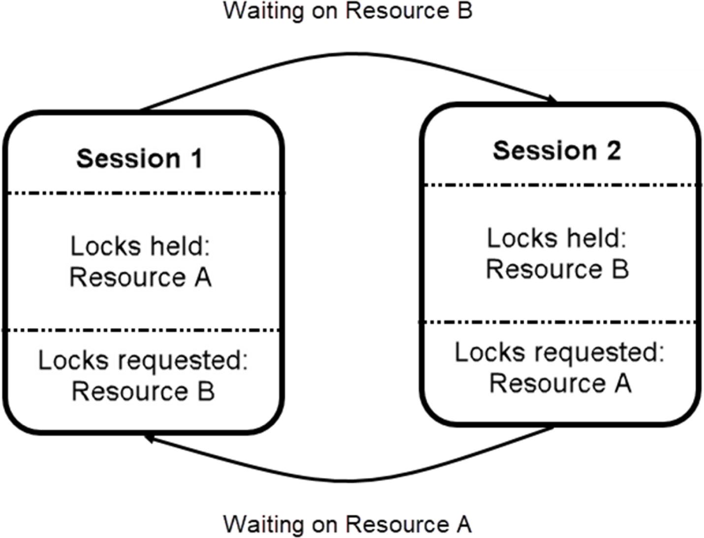
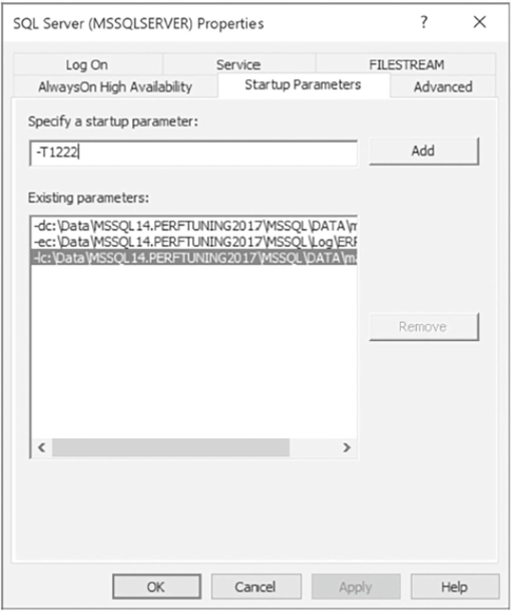
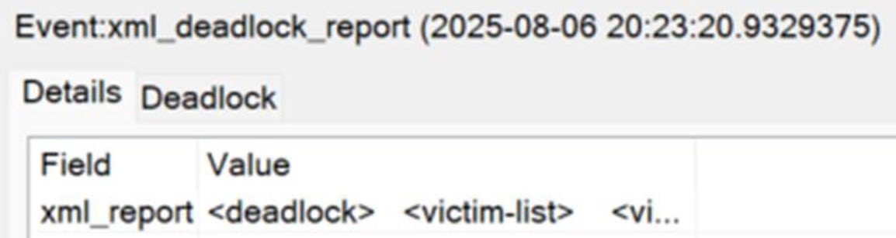
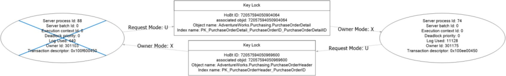
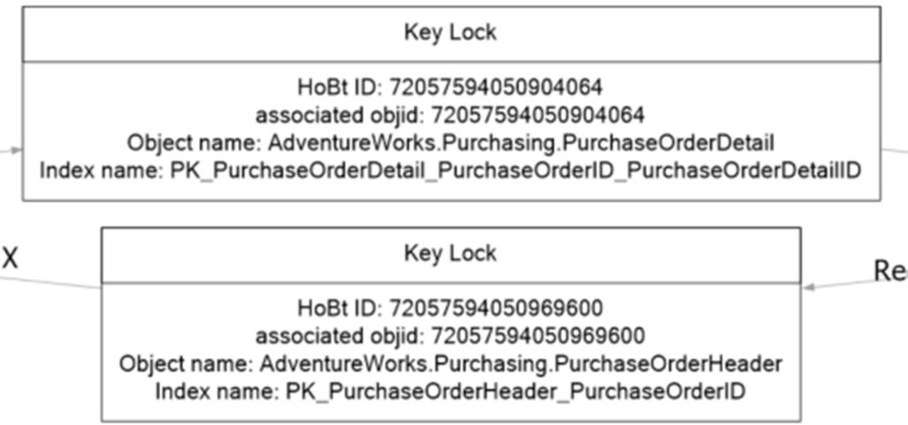
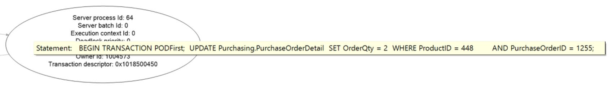
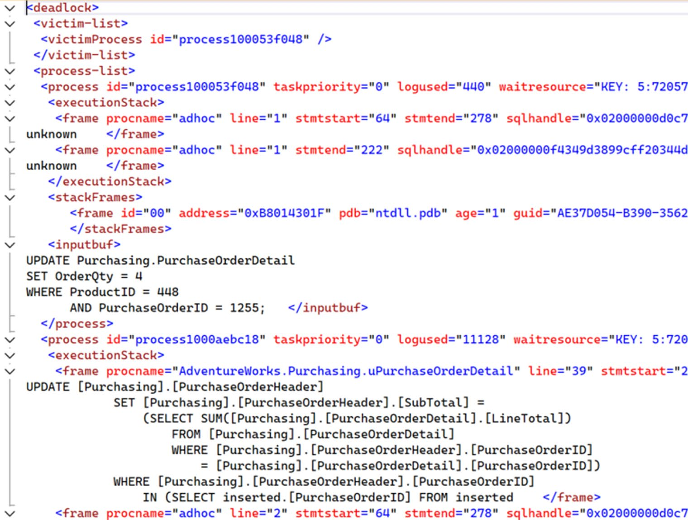

# CHƯƠNG 17: Nguyên nhân và Giải pháp Xử lý Deadlock (Causes and Solutions for Deadlocks)

**Deadlock (Bế tắc / Khóa chết)** là một dạng đặc biệt của hiện tượng tắc nghẽn (blocking), xảy ra khi từ hai giao dịch trở lên đồng thời nắm giữ các khóa tài nguyên mà giao dịch kia đang có nhu cầu sử dụng. Vì không giao dịch nào có thể giải phóng các khóa tài nguyên của mình cho đến khi bản thân nó hoàn tất trọn vẹn, hệ thống rơi vào trạng thái bế tắc tuyệt đối. Khi đó, SQL Server bắt buộc phải chủ động can thiệp bằng cách cưỡng chế hủy bỏ và quay lui (**rollback**) một trong các giao dịch. 

Một thông báo lỗi sẽ được trả về cho ứng dụng, chỉ định rõ giao dịch bị quay lui là **"nạn nhân của deadlock" (deadlock victim)**. Về mặt bản chất, deadlock là một vấn đề nghiêm trọng về hiệu năng; sự cố này còn trở nên tồi tệ hơn bởi chi phí tài nguyên bị lãng phí để rollback giao dịch, tiếp sau đó ứng dụng phải gửi lại câu truy vấn để xử lý từ đầu lần thứ hai. Việc đối phó và giải quyết triệt để các vấn đề deadlock luôn là một thử thách đầy cam go đối với các kỹ sư cơ sở dữ liệu.

Trong chương này, tôi sẽ lần lượt trình bày các nội dung sau:
* Các nguyên lý căn bản về Deadlock.
* Phân tích nguyên nhân gốc rễ gây ra Deadlock.
* Xử lý lỗi (Error handling) khi xảy ra Deadlock.
* Các cơ chế và giải pháp phòng ngừa Deadlock.

---

## Khái niệm cơ bản về Deadlock (Deadlock Fundamentals)

Hình 17-1 minh họa trực quan cấu trúc của một vòng bế tắc kinh điển giữa hai phiên làm việc.



*Hình 17-1. Biểu diễn trực quan về hiện tượng deadlock*

Một con đường khác rất phổ biến dẫn đến deadlock là khi các tiến trình tìm cách **leo thang hoặc chuyển đổi khóa (convert/escalate locks)** trên cùng một tài nguyên dữ liệu. Tình huống này thường khởi đầu bằng việc cả hai phiên làm việc đều cùng nắm giữ khóa chia sẻ (**Shared lock - S**) trên một tài nguyên, sau đó cả hai phiên lại đồng thời muốn nâng cấp khóa của mình từ Shared lên khóa độc quyền (**Exclusive lock - X**). 

Thế nhưng, tình thế bế tắc tương tự lập tức nảy sinh: không phiên nào có thể nâng cấp lên khóa độc quyền chừng nào phiên kia vẫn đang nắm giữ khóa chia sẻ, trong khi không phiên nào chịu giải phóng khóa chia sẻ trước. Kết quả là một trong hai phiên bắt buộc phải bị chọn làm nạn nhân để hy sinh.

Ngoài ra, còn một trường hợp deadlock khác có thể xảy ra ngay trong một phiên làm việc đơn lẻ khi câu truy vấn được xử lý song song (**Intra-query parallelism deadlocks**). Khi đó, một luồng (thread) xử lý có thể đang giữ khóa trên Tài nguyên A và chờ đợi Tài nguyên B do một luồng khác nắm giữ, trong khi luồng thứ hai lại đang chờ đợi Tài nguyên A. Dẫu vậy, xác suất bạn gặp phải loại deadlock luồng này trên thực tế là cực kỳ thấp, bởi Microsoft đã viết lại và tối ưu hóa sâu bộ máy thực thi của SQL Server trong các phiên bản hiện đại để triệt tiêu hiện tượng này.

Bản chất cốt lõi của deadlock là nếu không có sự can thiệp từ bên ngoài, các tiến trình sẽ nằm im chờ đợi nhau vô tận. Để phá vỡ vòng lặp phụ thuộc luẩn quẩn này, SQL Server triển khai một tiến trình ngầm chuyên trách gọi là **Trình giám sát khóa (Lock Monitor)**.

Lock Monitor chạy tuần tra định kỳ (mặc định mỗi 5 giây một lần; tần suất này có thể tự động rút ngắn xuống chỉ còn 100 mili-giây nếu phát hiện deadlock xảy ra liên tục) để săn tìm sự hiện diện của các vòng lặp phụ thuộc giữa các tiến trình. Ngay khi phát hiện ra deadlock, một trong các phiên làm việc sẽ bị Lock Monitor lựa chọn để rollback.

Về mặt kỹ thuật, phiên làm việc bị chọn để quay lui được gọi là **Deadlock Victim (Nạn nhân)**. Theo nguyên tắc mặc định, Lock Monitor sẽ chọn phiên làm việc có **chi phí ước tính thấp nhất (smallest estimated cost)**. Về mặt lý thuyết, tiến trình có chi phí thấp nhất sẽ tiêu tốn ít tài nguyên nhất và có quá trình rollback diễn ra nhanh nhất, giảm thiểu tối đa gánh nặng nhật ký giao dịch (transaction log).

Về căn bản, deadlock là một bài toán hiệu năng. Nếu các câu truy vấn của bạn chạy đủ nhanh, thiết lập lượng khóa tối thiểu và giải phóng khóa nhanh nhất có thể, bạn sẽ hiếm khi – hoặc thậm chí không bao giờ – nhìn thấy deadlock xuất hiện. Đó là lý do tại sao các cải tiến kiến trúc như **Optimized Locking** (đã trình bày trong Chương 16) lại mang lại tác động tích cực to lớn đến vậy. 

Mặt khác, việc rollback một giao dịch cũng tiêu tốn rất nhiều chu kỳ CPU và I/O của máy chủ, gây ra tải phụ trội (overhead) không đáng có. Thêm vào đó, trong phần lớn các ứng dụng, người dùng hoặc dịch vụ ở đầu bên kia khi nhận được lỗi deadlock sẽ lập tức gửi lại câu truy vấn, đồng nghĩa với việc tiêu hao tài nguyên hệ thống thêm một lần nữa để hoàn thành công việc. Tổng hợp tất cả các yếu tố trên cho thấy việc giảm thiểu – hoặc triệt tiêu hoàn toàn nếu có thể – hiện tượng deadlock là một mục tiêu tối thượng trong tối ưu hóa cơ sở dữ liệu.

---

## Cơ chế lựa chọn nạn nhân Deadlock (Choosing the Deadlock Victim)

Theo mặc định, sự lựa chọn nạn nhân của SQL Server dựa trên chi phí tài nguyên mà giao dịch đã tiêu tốn (thường dựa trên lượng log đã sử dụng - `logused`). Một chi phí thấp hơn đồng nghĩa với việc hoàn tác giao dịch sẽ nhẹ nhàng và nhanh chóng hơn; do đó, giao dịch có chi phí lớn hơn sẽ được ưu tiên tiếp tục thực thi.

Tuy nhiên, bạn hoàn toàn có thể can thiệp và định hướng sự lựa chọn này từ trong mã ứng dụng bằng cách thiết lập mức độ ưu tiên deadlock cho kết nối thông qua lệnh `SET DEADLOCK_PRIORITY` như thể hiện trong Listing 17-1.

#### Listing 17-1. Thay đổi mức độ ưu tiên deadlock
```sql
SET DEADLOCK_PRIORITY LOW;
```

Khi bạn thiết lập giá trị này thành `LOW`:
* Phiên làm việc hiện tại và các truy vấn bên trong nó sẽ có xác suất rất cao bị chọn làm nạn nhân đầu tiên nếu rơi vào vòng bế tắc với các phiên khác.
* Dĩ nhiên không có gì đảm bảo tuyệt đối 100% trong mọi trường hợp phức tạp, nhưng đây là mức ưu tiên thấp nhất.
* Bạn cũng có thể thiết lập mức ưu tiên thành `NORMAL` (đây là giá trị mặc định của mọi kết nối) hoặc `HIGH`. Khi đặt thành `HIGH`, tiến trình hầu như sẽ không bao giờ bị chọn làm nạn nhân khi đối đầu với các phiên có mức ưu tiên thấp hơn hoặc bình thường.

Ngoài các từ khóa định danh, bạn còn có thể sử dụng các giá trị số nguyên trong dải từ **`-10` đến `10`** (tương ứng từ mức ưu tiên thấp nhất đến cao nhất). Điều này cung cấp khả năng kiểm soát độ mịn rất cao nếu bạn có những tiến trình phân cấp nghiệp vụ phức tạp:
* `LOW` tương đương với giá trị `-5`.
* `NORMAL` tương đương với giá trị `0`.
* `HIGH` tương đương với giá trị `5`.

Thông thường trong thực tế, tôi khuyên bạn không nên lạm dụng việc can thiệp vào `DEADLOCK_PRIORITY`. Nếu có sử dụng, bạn chỉ nên áp dụng mức `HIGH` cho các tác vụ nghiệp vụ tối quan trọng có giá trị thương mại lớn hoặc các giao dịch tài chính phức tạp mà việc bị rollback sẽ gây hậu quả nghiêm trọng.

Nếu hai tiến trình rơi vào deadlock có cùng mức ưu tiên (`DEADLOCK_PRIORITY` bằng nhau), SQL Server sẽ quay về quy tắc mặc định: Tiến trình nào có chi phí rollback ước tính thấp hơn sẽ bị chọn làm nạn nhân. Đáng chú ý là có một số tiến trình đặc thù được đánh dấu trong biểu đồ deadlock (deadlock graph) là **không thể bị chọn làm nạn nhân**; trường hợp phổ biến nhất của loại này là những tiến trình bản thân nó đang trong quá trình thực hiện rollback.

---

## Phân tích nguyên nhân gây ra Deadlock (Analyzing the Causes of Deadlocks)

Chìa khóa vàng để ngăn chặn và dập tắt deadlock chính là thấu hiểu nguyên nhân gốc rễ bên dưới. Để có thể giải phẫu toàn diện một vụ deadlock, bạn bắt buộc phải thu thập được ba mảnh ghép thông tin sống còn:
1. **Các phiên làm việc (Sessions / SPIDs)** tham gia trực tiếp vào vòng deadlock.
2. **Các tài nguyên (Resources)** đang bị tranh chấp gay gắt ở cả hai phía của vòng lặp bế tắc.
3. **Các câu truy vấn (Queries)** chính xác mà mỗi phiên làm việc đang thực thi tại thời điểm xảy ra sự cố.

---

### Thu thập thông tin Deadlock (Capturing Deadlock Information)

Trong SQL Server, chúng ta có 4 cơ chế khác nhau để bắt và ghi nhận thông tin deadlock. Dưới đây là danh sách được sắp xếp theo thứ tự ưu tiên khuyến nghị sử dụng:
1. **Extended Events**
2. **Trace Flag 1222**
3. **SQL Trace Events (Profiler / Server Side Trace)**
4. **Trace Flag 1204**

Thứ tự ưu tiên này được đúc kết từ nhiều lý do thực tiễn:
* Thứ nhất, **Extended Events** là kiến trúc thu thập dữ liệu hiện đại, nhẹ nhất và hiệu quả nhất trong SQL Server. Hơn nữa, trên mọi phiên bản SQL Server kể từ SQL Server 2008 trở đi, luôn có sẵn một phiên Extended Events mặc định mang tên **`system_health`**. Phiên này luôn được kích hoạt tự động ở chế độ chạy ngầm và đã bao gồm sẵn việc chụp lại biểu đồ deadlock cơ bản. Bạn hoàn toàn không cần phải tốn công cấu hình hay bật bất kỳ thứ gì; nó luôn sẵn sàng ở đó để bạn truy vấn.
* Thứ hai, **Trace Flag 1222** được ưu tiên vượt trội so với **Trace Flag 1204** vì nó trả về định dạng thông tin chi tiết, có cấu trúc XML rõ ràng hơn rất nhiều, mặc dù cách thức kích hoạt của cả hai là tương tự. Đồng thời, Trace Flag 1222 nhẹ hơn rất nhiều so với SQL Trace Events, do đó Trace Events bị xếp ở vị trí thứ ba vì tải phụ trội (overhead) quá lớn. Cuối cùng, Trace Flag 1204 xếp chót bảng do thông tin cung cấp quá vắn tắt và khó đọc.

Tôi sẽ phân tích chi tiết dữ liệu nhận được từ cả Extended Events lẫn Trace Flag 1222 trong phần tiếp theo (*Phân tích Biểu đồ Deadlock Graph*). Bây giờ, chúng ta hãy cùng xem cách cấu hình kích hoạt các cơ chế này.

---

#### Sử dụng Trace Flag (1222 và 1204)

Các cờ theo dõi (Trace Flags) rất dễ kích hoạt. Tuy nhiên, bạn phải đảm bảo rằng chúng được bật trên máy chủ, nếu không thông tin deadlock sẽ không được ghi nhận ra nhật ký. Listing 17-2 minh họa cách bật Trace Flag 1222 trên phạm vi toàn máy chủ (global).

#### Listing 17-2. Kích hoạt Trace Flag 1222
```sql
DBCC TRACEON (1222, -1);
```

Lệnh trên sẽ bật Trace Flag 1222 ngay lập tức trên máy chủ hiện tại mà không cần khởi động lại. Tuy nhiên, nếu xảy ra sự cố chuyển vùng dự phòng (failover) hoặc khi dịch vụ SQL Server khởi động lại, cờ này sẽ bị tắt. 

Một phương pháp thực hành tốt phổ biến là cấu hình để Trace Flag này tự động kích hoạt mỗi khi SQL Server khởi động. Bạn có thể thiết lập tham số khởi động `-T1222` thông qua công cụ **SQL Server Configuration Manager** theo các bước sau:
1. Mở hộp thoại **Properties** của phiên bản (instance) SQL Server tương ứng.
2. Chuyển sang thẻ **Startup Parameters**.
3. Nhập chuỗi `-T1222` vào ô *"Specify a startup parameter"*.
4. Nhấn nút **Add**.
5. Nhấn nút **OK** để lưu cấu hình.

Giao diện cấu hình được thể hiện trong Hình 17-2.



*Hình 17-2. Cửa sổ SQL Server Configuration Manager thiết lập tham số khởi động*

Khi phiên bản SQL Server này khởi động lại, Trace Flag 1222 sẽ tự động có hiệu lực. Ngoài ra, bạn cũng có thể sử dụng PowerShell để chỉnh sửa Registry, hoặc sử dụng thủ tục mở rộng không tài liệu hóa `xp_instance_regaddvalue` (không khuyến khích nhưng khả dụng). Trong môi trường vùng chứa (Docker / Container), bạn có thể truyền cờ khởi động thông qua biến môi trường `MSSQL_OPTS="-T1222"`.

Toàn bộ thông tin deadlock thu thập bởi Trace Flag sẽ được xuất thẳng ra **SQL Server Error Log**. Bạn sẽ mở và đọc báo cáo từ đó.

---

#### Sử dụng Extended Events và Phiên system_health

Phương pháp đơn giản, thuận tiện và mạnh mẽ nhất để thu thập thông tin deadlock là tận dụng phiên Extended Events mặc định **`system_health`**. Phiên này được tích hợp sẵn, tự động chạy ngầm trên tất cả các phiên bản SQL Server và hoàn toàn không tạo thêm bất kỳ gánh nặng tài nguyên nào cho hệ thống.

Bạn có thể truy vấn trực tiếp dữ liệu biểu đồ deadlock từ các tệp lưu trữ của `system_health` bằng đoạn mã T-SQL trong Listing 17-3.

#### Listing 17-3. Truy vấn biểu đồ deadlock từ phiên Extended Events system_health
```sql
DECLARE @path NVARCHAR(260);
-- Truy xuất đường dẫn cục bộ chứa các tệp system_health
SELECT @path = dosdlc.path
FROM sys.dm_os_server_diagnostics_log_configurations AS dosdlc;

SELECT @path = @path + N'system_health_*';

WITH fxd
AS (SELECT CAST(fx.event_data AS XML) AS Event_Data
    FROM sys.fn_xe_file_target_read_file(@path, NULL, NULL, NULL) AS fx )
SELECT dl.deadlockgraph
FROM
(
    SELECT dl.query('.') AS deadlockgraph
    FROM fxd
        CROSS APPLY event_data.nodes('(/event/data/value/deadlock)') AS d(dl)
) AS dl;
```

Kết quả trả về khi nhấp vào cột XML trong SSMS được thể hiện trên Hình 17-3.


*Hình 17-3. Kết quả truy vấn biểu đồ deadlock từ phiên system_health*

Cần lưu ý rằng phiên `system_health` sử dụng một số lượng tệp lưu trữ giới hạn với dung lượng cố định và hoạt động theo cơ chế cuốn chiếu (rollover – khi đầy tệp mới sẽ ghi đè tệp cũ nhất). Tùy thuộc vào mức độ tải và số lượng sự kiện trên máy chủ của bạn, các sự kiện deadlock xảy ra từ lâu có thể đã bị ghi đè mất. 

Đồng thời, trên hệ thống thử nghiệm của tôi, truy vấn chỉ trả về một biểu đồ deadlock đơn lẻ; nhưng trên một hệ thống sản xuất lớn chịu tải cao, câu lệnh này có thể trả về một lượng rất lớn các biểu đồ deadlock. Do đó, mặc dù `system_health` là giải pháp thuận tiện nhất, nhưng trong nhiều môi trường chuyên biệt, bạn có thể muốn tự tạo một phiên Extended Events tùy chỉnh riêng chỉ chuyên chụp các sự kiện deadlock.

Khi xây dựng phiên Extended Events chuyên biệt để bắt deadlock, bạn có hai sự kiện chính cần lưu tâm:
* **`xml_deadlock_report`:** Sự kiện chuẩn cung cấp toàn bộ biểu đồ deadlock graph hoàn chỉnh, bao gồm chi tiết các câu lệnh SQL đang thực thi.
* **`xml_deadlock_report_filtered`:** Phiên bản biểu đồ deadlock đã được lược bỏ toàn bộ văn bản câu truy vấn nhằm bảo vệ dữ liệu nhạy cảm của khách hàng, đáp ứng các tiêu chuẩn khắt khe về quyền riêng tư như Quy định chung về bảo vệ dữ liệu của Liên minh Châu Âu (**GDPR**) hay Đạo luật về quyền riêng tư của California (**CPRA**). 

Mặc dù sự kiện `xml_deadlock_report_filtered` gây ra một số khó khăn nhất định cho kỹ sư hiệu năng (bởi câu truy vấn là một trong ba thông tin sống còn để gỡ deadlock), nhưng tùy theo ràng buộc pháp lý bảo mật của từng doanh nghiệp, nó có thể là sự lựa chọn bắt buộc.

---

### Phân tích biểu đồ Deadlock (Analyzing the Deadlock Graph)

#### Tái hiện kịch bản Deadlock trong thực tế

Để quan sát một deadlock diễn ra trong thực tế, tôi sẽ sử dụng các tập lệnh sau, được thực thi từ hai kết nối riêng biệt như được chú thích trong Listing 17-4.

**Listing 17-4.** Các truy vấn gây ra tình trạng deadlock

```sql
-- Chạy từ Kết nối 1
BEGIN TRANSACTION PODSecond;
UPDATE Purchasing.PurchaseOrderHeader
SET Freight = Freight * 0.9 -- Chiết khấu 9% phí vận chuyển
WHERE PurchaseOrderID = 1255;

-- Chạy từ Kết nối 2
BEGIN TRANSACTION PODFirst;
UPDATE Purchasing.PurchaseOrderDetail
SET OrderQty = 2
WHERE ProductID = 448
      AND PurchaseOrderID = 1255;

-- Chạy tiếp từ Kết nối 1
UPDATE Purchasing.PurchaseOrderDetail
SET OrderQty = 4
WHERE ProductID = 448
      AND PurchaseOrderID = 1255;
```

Bạn có thể thấy chúng ta đang tạo ra hai giao dịch: `PODSecond` và `PODFirst`. Trong đó:
1. Giao dịch `PODSecond` (Kết nối 1) sửa đổi bảng `PurchaseOrderHeader`, do đó nó giữ khóa Độc quyền (X) trên dòng tương ứng của bảng này.
2. Giao dịch `PODFirst` (Kết nối 2) ngay lập tức cập nhật bảng `PurchaseOrderDetail`, chiếm giữ khóa Độc quyền (X) trên dòng đó của bảng `PurchaseOrderDetail`. Đồng thời, một trigger trên bảng này được kích hoạt và tìm cách cập nhật ngược lại bảng `PurchaseOrderHeader`, nhưng bị chặn lại bởi giao dịch `PODSecond`.
3. Khi câu lệnh tiếp theo của giao dịch `PODSecond` (Kết nối 1) được thực thi để cập nhật bảng `PurchaseOrderDetail`, nó lại bị chặn bởi giao dịch `PODFirst`.

Lúc này, một vòng lặp phụ thuộc luẩn quẩn xuất hiện (vòng ôm chết chóc - *deadly embrace*). Bộ giám sát Deadlock Monitor của SQL Server sẽ phát hiện tình trạng này trong vòng vài giây, chọn một trong hai giao dịch làm nạn nhân (*deadlock victim*) và hủy bỏ nó, trả về thông báo lỗi 1205:

```text
Msg 1205, Level 13, State 51, Line 7
Transaction (Process ID 56) was deadlocked on lock resources with another process and has been chosen as the deadlock victim. Rerun the transaction.
```

Hình 17-4 minh họa thông tin sự kiện `xml_deadlock_report` thu thập được trong Extended Events.



---

#### Đọc hiểu biểu đồ Deadlock Graph trên giao diện đồ họa

Khi bạn mở tệp báo cáo deadlock trong SQL Server Management Studio (SSMS), bạn sẽ nhận được một biểu diễn trực quan dạng đồ thị (Deadlock Graph) như trong Hình 17-5.



Chúng ta ngay lập tức nhìn thấy hai trong số ba thông tin cốt lõi cần thiết để đánh giá nguyên nhân của deadlock:
- **Nút tiến trình (Process nodes):** Nằm ở phía bên trái và bên phải của đồ thị, đại diện cho hai phiên làm việc (SPID) tham gia vào deadlock.
- **Nạn nhân (Victim):** Tiến trình được chọn làm nạn nhân chính là nút bên trái có dấu chữ "X" lớn màu đỏ đè lên trên.

Hình 17-6 phóng to chi tiết các tài nguyên và loại khóa liên quan ở trung tâm của đồ thị.



Ký hiệu **HoBt** là viết tắt của *"Heap or B-tree"* (Bảng heap hoặc cây chỉ mục B-tree). Dãy số ID đi kèm chính là định danh của đối tượng lưu trữ dữ liệu vật lý. Trên giao diện SSMS, bạn đã có thể nhìn thấy tên của đối tượng và chỉ mục. Tuy nhiên, nếu bạn chỉ có dữ liệu thô dạng văn bản và cần tra cứu từ HoBt ID, bạn có thể thực thi truy vấn trong Listing 17-5.

**Listing 17-5.** Lấy tên đối tượng từ HoBt ID thông qua sys.partitions

```sql
SELECT OBJECT_NAME(object_id)
FROM sys.partitions
WHERE hobt_id = 72057594050969600;
```

Khi bạn di chuột qua các nút tiến trình trong SSMS, một cửa sổ chú giải (tooltip) sẽ hiển thị chi tiết câu lệnh truy vấn SQL đang được thực thi bởi phiên làm việc đó, như thể hiện trong Hình 17-7.



---

#### Đọc hiểu cấu trúc XML của Deadlock Report

Đằng sau giao diện đồ họa đẹp mắt của SSMS thực chất là một tài liệu XML hoàn chỉnh chứa đựng tất cả các chi tiết kỹ thuật sâu sắc nhất của deadlock. Hình 17-8 minh họa một phần nội dung XML này.



Trong tài liệu XML, bạn có thể xem xét mọi mã định danh đối tượng, giá trị khóa (*key values*), các câu lệnh truy vấn, cùng toàn bộ các thông tin cần thiết khác để hiểu rõ nguyên nhân gốc rễ dẫn đến deadlock.

Nếu kiểm tra kỹ cấu trúc XML, bạn sẽ nhận thấy có những đoạn mã T-SQL không hề nằm trong các câu lệnh mà bạn đã gõ ở Listing 17-4. Đó là bởi vì trên bảng `PurchaseOrderDetail` có một **trigger** mang tên `uPurchaseOrderDetail`. Trigger này đã tự động kích hoạt như một phần của giao dịch để cập nhật trường `SubTotal` trên bảng `PurchaseOrderHeader`.

Bạn cũng có nhiều thông tin bổ sung cực kỳ giá trị:
- **`sqlhandle`:** Nếu câu truy vấn vẫn còn nằm trong bộ đệm cache hoặc trong Query Store, bạn có thể sử dụng `sqlhandle` này để xem lại toàn bộ khối lệnh truy vấn (*batch*) tham gia vào deadlock.
- **Kế hoạch thực thi (Execution Plans):** Kế hoạch thực thi của các truy vấn đã được xây dựng và lưu trữ trong bộ đệm plan cache cũng như Query Store từ trước thời điểm giao dịch bị chọn làm nạn nhân, cho phép bạn phân tích sâu hơn về các toán tử truy cập dữ liệu.

Bảng 17-1 giải thích chi tiết các phần tử XML chính tạo nên một báo cáo deadlock.

**Bảng 17-1.** Chi tiết cấu trúc dữ liệu XML của Deadlock Graph

| Phần tử XML | Mô tả kỹ thuật |
| :--- | :--- |
| `<deadlock>`<br>`<victim-list>` | Điểm bắt đầu của tài liệu deadlock. Báo cáo ngay lập tức liệt kê danh sách các tiến trình nạn nhân. |
| `<victimProcess id="process1300416ca8" />` | Địa chỉ vùng nhớ vật lý của tiến trình được bộ điều phối chọn làm nạn nhân để rollback. |
| `<process-list>` | Danh sách toàn bộ các tiến trình tham gia vào vòng tròn deadlock. Có thể có nhiều hơn hai tiến trình (trong ví dụ này chỉ có hai tiến trình). |
| `<process id="process1300416ca8"...>` | Chứa toàn bộ thông tin chi tiết về tiến trình: SPID, thời gian bắt đầu, lượng log đã ghi (`logused`), tài nguyên đang phải chờ (`waitresource`), chế độ khóa đang xin cấp (`lockMode`), tên ứng dụng kết nối, tên đăng nhập (`loginname`), và mức cô lập giao dịch (`isolationlevel`). |
| `<stackFrames>`<br>`<executionStack>` | Ngăn xếp lệnh đang thực thi của tiến trình, chỉ rõ thủ tục lưu trữ hoặc khối ad-hoc đang chạy kèm theo `sqlhandle` và vị trí dòng lệnh chính xác. |
| `<inputbuf>` | Chứa nội dung câu lệnh T-SQL thô thực tế mà ứng dụng vừa gửi lên máy chủ trước khi xảy ra deadlock. |
| `<resource-list>` | Danh sách các tài nguyên khóa mà các tiến trình đang tranh chấp. Bao gồm loại khóa (`<keylock>`, `<pagelock>`,...), HoBt ID, tên bảng, tên chỉ mục, danh sách tiến trình đang nắm giữ khóa (`<owner-list>`) và danh sách tiến trình đang phải chờ cấp khóa (`<waiter-list>`). |

Tóm lại, ví dụ trên là một minh chứng kinh điển cho hiện tượng **vòng ôm chết chóc** (*deadly embrace*). Thoạt nhìn ban đầu, nguyên nhân gây ra deadlock có thể không hiển hiện rõ ràng, nhưng thực chất nó bắt nguồn từ trigger:
1. Khi giá trị `OrderQty` được cập nhật trên bảng `PurchaseOrderDetail`, trigger được kích hoạt và tìm cách cập nhật ngược lại bảng `PurchaseOrderHeader`.
2. Khi hai câu lệnh đầu tiên của hai kết nối được thực thi, đó đơn thuần mới chỉ là một tình trạng **tắc nghẽn (blocking)** thông thường: kết nối 2 phải tạm dừng chờ kết nối 1 giải phóng khóa trên `PurchaseOrderHeader`.
3. Tuy nhiên, khi câu lệnh tiếp theo của kết nối 1 được thực thi để cập nhật chính bảng `PurchaseOrderDetail`, nó lập tức bị chặn bởi kết nối 2. Hai tiến trình rơi vào thế khóa chéo lẫn nhau, tạo thành deadlock. SQL Server bắt buộc phải chọn một tiến trình làm nạn nhân và rollback toàn bộ các thay đổi của tiến trình đó.

---

## Xử lý lỗi Deadlock trong ứng dụng (Error Handling for Deadlocks)

Mỗi khi phát hiện và xử lý một vụ deadlock, SQL Server sẽ ném ra một thông báo lỗi với mã lỗi tiêu chuẩn là **1205**:

```text
Msg 1205, Level 13, State 51, Line X
Transaction (Process ID X) was deadlocked on lock resources with another process and has been chosen as the deadlock victim. Rerun the transaction.
```

Sự hiện diện của mã lỗi định danh này đồng nghĩa với việc bạn hoàn toàn có thể sử dụng cấu trúc `TRY...CATCH` trong T-SQL (hoặc khối xử lý ngoại lệ tương ứng trong mã nguồn ứng dụng như C#, Java, Python) để chủ động đánh chặn lỗi. 

Vì SQL Server bắt buộc phải bảo vệ tính toàn vẹn của cơ sở dữ liệu, nó sẽ lập tức tự động rollback giao dịch bị chọn làm nạn nhân. Về phía tầng ứng dụng, phản ứng tự nhiên và hợp lý nhất là **chủ động thử lại giao dịch (*retry logic*)**. Tuy nhiên, xét dưới góc độ tối ưu hóa hiệu năng, tôi đặc biệt khuyến nghị bạn chỉ nên thử lại một vài lần có giới hạn, trước khi chấp nhận dừng lại và trả thông báo lỗi về cho người dùng.

Listing 17-6 minh họa một khuôn mẫu chuẩn mực để bẫy và tự động thử lại khi gặp lỗi deadlock bằng T-SQL.

**Listing 17-6.** Bẫy lỗi deadlock và thực hiện cơ chế thử lại

```sql
DECLARE @retry AS TINYINT = 1,
        @retrymax AS TINYINT = 2,
        @retrycount AS TINYINT = 0;
WHILE @retry = 1 AND @retrycount <= @retrymax
BEGIN
    SET @retry = 0;
    BEGIN TRY
        UPDATE HumanResources.Employee
        SET LoginID = '54321'
        WHERE BusinessEntityID = 100;
    END TRY
    BEGIN CATCH
        IF (ERROR_NUMBER() = 1205)
        BEGIN
            SET @retrycount = @retrycount + 1;
            SET @retry = 1;
            -- Khuyến nghị: Bổ sung khoảng chờ ngẫu nhiên ngắn (jitter) trước khi thử lại
            -- WAITFOR DELAY '00:00:00.050';
        END;
        ELSE
        BEGIN
            -- Nếu là lỗi khác, ném lại lỗi để xử lý bình thường
            THROW;
        END;
    END CATCH;
END;
```

Ý tưởng cốt lõi của đoạn mã này rất mạch lạc:
1. Bạn biết chắc chắn rằng mã lỗi của deadlock luôn là **1205**.
2. Kiểm tra hàm `ERROR_NUMBER()` trong khối `CATCH`; nếu đúng là lỗi 1205, tăng biến đếm `@retrycount` và kích hoạt vòng lặp thử lại.
3. Giới hạn số lần thử lại tối đa (ở đây là 2 lần, cá nhân tôi khuyên không bao giờ nên vượt quá 3 lần). Lý do là vì mỗi lần thử lại đều tiêu tốn thêm thời gian, CPU, I/O và bộ nhớ. Hơn nữa, người dùng phía trước màn hình đang phải chờ đợi; nếu thời gian chờ quá lâu, họ có thể sẽ hủy kết nối hoặc liên tục nhấn F5 gửi lại yêu cầu, khiến áp lực tranh chấp trên máy chủ càng thêm trầm trọng.

Mặc dù cơ chế thử lại tự động là một tấm lá chắn tuyệt vời giúp ứng dụng có khả năng tự phục hồi (*resilience*), nhưng phương pháp tiếp cận căn cơ và chuyên nghiệp nhất vẫn phải là: **phân tích biểu đồ Deadlock Graph và triệt tiêu tận gốc nguyên nhân gây ra deadlock**.

---

## Các cơ chế phòng ngừa Deadlock (Mechanisms to Prevent Deadlocks)

Việc thỉnh thoảng xuất hiện một vài trường hợp deadlock hy hữu trên một hệ thống có tải giao dịch lớn là điều hoàn toàn bình thường. Tuy nhiên, đại đa số các trường hợp deadlock đều có thể chủ động phòng ngừa hoặc giải quyết dứt điểm nếu bạn áp dụng đúng các kỹ thuật thiết kế kiến trúc sau đây:
- Truy cập các tài nguyên theo cùng một thứ tự nhất quán.
- Giảm thiểu số lượng tài nguyên bị truy cập.
- Giảm thiểu mức độ tranh chấp khóa.
- Tinh chỉnh câu truy vấn.

---

### 1. Truy cập các tài nguyên theo cùng một thứ tự nhất quán (Access Resources in the Same Order)

Như đã chứng minh trong ví dụ ở Listing 17-4, con đường ngắn nhất và phổ biến nhất dẫn tới deadlock là khi hai giao dịch khác nhau cố gắng xin cấp phát khóa trên các tài nguyên theo **thứ tự đảo ngược nhau**:
- Giao dịch A khóa tài nguyên X trước, sau đó yêu cầu tài nguyên Y.
- Giao dịch B khóa tài nguyên Y trước, sau đó yêu cầu tài nguyên X.

Nếu bạn quy chuẩn hóa kiến trúc để **mọi giao dịch trong toàn bộ hệ thống luôn luôn truy cập các bảng và đối tượng theo một thứ tự duy nhất** (ví dụ: luôn truy cập bảng `PurchaseOrderHeader` trước rồi mới đến bảng `PurchaseOrderDetail`), thì vòng tròn khóa chéo sẽ hoàn toàn bị triệt tiêu! Ngay khi Giao dịch A lấy được khóa độc quyền trên tài nguyên đầu tiên (`PurchaseOrderHeader`), Giao dịch B khi muốn thao tác cũng sẽ yêu cầu khóa trên chính tài nguyên đó và lập tức rơi vào trạng thái xếp hàng chờ đợi (*normal blocking*). Giao dịch B sẽ không có bất kỳ cơ hội nào để chạm tay vào tài nguyên thứ hai, và do đó hiện tượng deadlock sẽ vĩnh viễn không thể xảy ra.

> [!WARNING]
> Một điểm đặc biệt cần lưu ý trong thực tế là mã lệnh T-SQL tự động sinh ra từ các thư viện ORM phổ biến như **Entity Framework** hay **NHibernate**. Các công cụ này đôi khi tạo ra các lô lệnh cập nhật dữ liệu với thứ tự truy cập bảng và chỉ mục rất lộn xộn. Bạn cần làm việc chặt chẽ với đội ngũ phát triển phần mềm để chuẩn hóa cấu hình ánh xạ (*mapping*), hoặc chủ động đóng gói các thao tác nghiệp vụ phức tạp vào bên trong các Stored Procedure được kiểm soát thứ tự chặt chẽ.

---

### 2. Giảm thiểu khối lượng tài nguyên bị truy cập (Decrease the Amount of Resources Accessed)

Một vụ deadlock luôn đòi hỏi sự tham gia của ít nhất hai tài nguyên riêng biệt. Nếu bạn có thể loại bỏ sự phụ thuộc vào một tài nguyên trung gian ở một trong hai giao dịch, bạn sẽ bẻ gãy mắt xích của vòng lặp bế tắc. Hai kỹ thuật chỉ mục sau đây sẽ hỗ trợ đắc lực cho mục tiêu này:

#### Chuyển đổi chỉ mục không gom cụm thành chỉ mục gom cụm (Convert to Clustered Index)
Trên một bảng Heap (không có Clustered Index), khi một câu truy vấn thao tác dữ liệu thông qua một Nonclustered Index, SQL Server bắt buộc phải duy trì cùng lúc hai loại khóa: một khóa trên dòng dữ liệu thực tế (khóa `RID`) và một khóa trên dòng của chỉ mục không gom cụm. 

Ngược lại, trên một bảng có Clustered Index, do tầng lá của chỉ mục chính là các trang dữ liệu thực tế, SQL Server chỉ cần thiết lập duy nhất một khóa trên chính dòng chỉ mục gom cụm đó. Việc chuyển đổi các bảng Heap thành bảng có Clustered Index chuẩn mực (luôn là khuyến nghị hàng đầu trong thiết kế cơ sở dữ liệu) sẽ làm giảm một nửa số lượng khóa phát sinh, từ đó thu hẹp đáng kể xác suất xảy ra xung đột khóa chéo.

#### Sử dụng chỉ mục bao phủ (Use a Covering Index)
Chỉ mục bao phủ (*Covering Index*) chứa đựng đầy đủ mọi cột dữ liệu mà câu truy vấn cần trích xuất. Khi một truy vấn `SELECT` có thể được phục vụ trọn vẹn bởi một Covering Index, Query Optimizer sẽ chỉ cần xin cấp các khóa chia sẻ (`S`) trên cấu trúc của chỉ mục phụ đó mà **hoàn toàn không cần phải thực hiện thao tác Key Lookup để xin thêm khóa trên Clustered Index hay bảng chính**. Điều này giúp các lệnh đọc dữ liệu hoàn toàn "vô hình" trước các lệnh ghi (`UPDATE`/`DELETE`) đang thao tác trên bảng chính, triệt tiêu nguy cơ hình thành deadlock giữa luồng đọc và luồng ghi.

---

### 3. Giảm thiểu tranh chấp khóa (Minimize Lock Contention)

Bởi vì bản chất của deadlock xuất phát từ sự tranh chấp các cấu trúc khóa, nên bất kỳ giải pháp nào giúp làm giảm mật độ khóa trên hệ thống cũng sẽ trực tiếp làm giảm nguy cơ phát sinh deadlock.

Trong khi các thao tác ghi dữ liệu bắt buộc phải nắm giữ khóa độc quyền (`X`) để duy trì tính toàn vẹn, thì các thao tác đọc dữ liệu hoàn toàn có thể được tối ưu hóa để loại bỏ việc xin cấp khóa chia sẻ (`S`) thông qua các kỹ thuật sau:

#### Áp dụng cơ chế kiểm soát phiên bản dòng (Implement Row Versioning)
Kích hoạt cơ chế kiểm soát phiên bản dòng — đặc biệt là **Read Committed Snapshot Isolation (RCSI)** hoặc **Snapshot Isolation** — là một trong những giải pháp hữu hiệu và hiện đại nhất để dập tắt deadlock giữa các lệnh đọc và lệnh ghi. Dưới cơ chế này, các câu lệnh `SELECT` đọc dữ liệu lịch sử nhất quán từ kho phiên bản (*version store*) trong `tempdb` mà hoàn toàn không xin cấp bất kỳ khóa chia sẻ nào. **Người đọc không chặn người ghi, và người ghi không chặn người đọc**, do đó nguy cơ deadlock giữa tác vụ đọc và ghi sẽ hoàn toàn biến mất.

#### Hạ thấp mức cô lập giao dịch (Decrease the Isolation Level)
Trong một số tình huống, các mức cô lập quá ngặt nghèo như `REPEATABLE READ` hay `SERIALIZABLE` giữ các khóa chia sẻ và khóa dải khóa (*Key-Range Locks*) cho tới tận khi giao dịch kết thúc, tạo điều kiện thuận lợi cho vòng tròn bế tắc hình thành. Nếu nghiệp vụ không bắt buộc phải chống bóng ma (*phantom reads*), việc đưa mức cô lập về mức `READ COMMITTED` (hoặc RCSI) sẽ giúp các khóa đọc được giải phóng tức thì ngay sau khi đọc xong trang dữ liệu.

#### Kích hoạt khóa tối ưu hóa trong SQL Server 2025 (Enable Optimized Locking)
Như đã phân tích sâu ở Chương 16, tính năng **Optimized Locking** trong SQL Server 2025 mang lại hai đột phá:
- **TransactionID Locking:** Thay thế hàng nghìn khóa dòng bằng một khóa `XACT` duy nhất trên định danh giao dịch.
- **Lock After Qualification (LAQ):** Chỉ xin cấp khóa độc quyền sau khi đã thẩm định dòng dữ liệu thực sự khớp với điều kiện lọc, đồng thời giải phóng khóa dòng ngay lập tức sau khi sửa đổi xong.

Nhờ việc số lượng khóa bị cắt giảm xuống mức tối thiểu và thời gian chiếm giữ khóa chỉ diễn ra trong tích tắc, cửa sổ cơ hội để hai tiến trình có thể khóa chéo lẫn nhau gần như bị triệt tiêu hoàn toàn.

#### Thận trọng với gợi ý khóa (NOLOCK / READUNCOMMITTED)
Mặc dù việc thêm gợi ý `WITH (NOLOCK)` giúp câu lệnh `SELECT` tránh hoàn toàn việc xin cấp khóa chia sẻ, cá nhân tôi **cực kỳ phản đối** việc lạm dụng cách tiếp cận này. Cái giá phải trả bằng việc đọc phải dữ liệu rác (*dirty reads*), dữ liệu bị trùng lặp hoặc mất mát dòng dữ liệu là quá đắt đỏ đối với các hệ thống nghiệp vụ nghiêm túc. Hãy ưu tiên chuyển đổi sang RCSI thay vì rải gợi ý `NOLOCK` một cách vô tội vạ.

---

### 4. Tinh chỉnh câu truy vấn (Tune the Queries)

Hãy luôn ghi nhớ một chân lý cốt lõi: **Deadlock thực chất là một biểu hiện cực đoan của vấn đề hiệu năng và thời gian chiếm giữ tài nguyên**. 

Một câu truy vấn được tinh chỉnh tối ưu — chạy trong 5 mili-giây thay vì 5 giây, chỉ đọc 10 trang đĩa thay vì quét 100.000 trang đĩa — sẽ chỉ chiếm giữ khóa trong một phần nhỏ của cái chớp mắt rồi lập tức commit và giải phóng tài nguyên cho hệ thống. Nếu mọi câu truy vấn đều hoàn tất siêu tốc trước khi các phiên làm việc khác kịp gửi yêu cầu khóa, thì xác suất để hai giao dịch kịp "ôm nhau" trong một vòng lặp bế tắc trên thực tế sẽ bằng **không**.

---

## Tóm tắt chương (Summary)

Xuyên suốt nội dung của chương này, bạn đã thấu hiểu tường tận bản chất của "vòng ôm chết chóc" (*deadly embrace*) tạo nên hiện tượng Deadlock trong SQL Server. Hãy nhớ rằng mục tiêu trọng tâm ban đầu trong công tác xử lý sự cố luôn là **nhận diện chính xác các câu truy vấn gốc rễ tham gia vào vòng lặp bế tắc**.

Phương tiện tối ưu và tiện lợi nhất để thu thập thông tin này là thông qua phiên Extended Events mặc định **`system_health`** có sẵn trên máy chủ, hoặc bằng cách tự xây dựng một phiên giám sát chuyên biệt lắng nghe sự kiện **`xml_deadlock_report`**. Việc phân tích thành thạo biểu đồ Deadlock Graph (trên giao diện đồ họa SSMS lẫn cấu trúc XML) sẽ giúp bạn nhanh chóng giải mã các nút tiến trình (*process nodes*), các nút tài nguyên khóa (*resource nodes*) và xác định rõ ai là nạn nhân, ai là kẻ chiến thắng.

Để phòng ngừa và loại trừ triệt để deadlock, bạn có thể linh hoạt phối hợp nhiều giải pháp:
- Chuẩn hóa thứ tự truy cập tài nguyên trên toàn bộ hệ thống.
- Thiết kế Clustered Index và Covering Index để giảm thiểu số lượng khóa phụ trợ.
- Kích hoạt các cơ chế hiện đại như RCSI, Snapshot Isolation và Optimized Locking (SQL Server 2025).
- Tinh chỉnh câu truy vấn để giảm thiểu thời gian thực thi và giải phóng khóa trong tích tắc.
- Xây dựng cơ chế bẫy mã lỗi 1205 và thử lại tự động (*retry logic*) có kiểm soát ở tầng ứng dụng.

Khi các giao dịch của bạn đã được tối ưu hóa về mặt tương tranh và kiểm soát khóa, một mối đe dọa hiệu năng kinh điển khác mà bất kỳ DBA hay lập trình viên SQL Server nào cũng phải dè chừng chính là **xử lý dữ liệu dòng-theo-dòng thông qua Con Trỏ (Cursors)**. Trong chương tiếp theo, chúng ta sẽ cùng nhau "mổ xẻ" các loại con trỏ, đo lường tác hại khủng khiếp của chúng đối với tài nguyên hệ thống, và học cách viết lại mã lệnh theo tư duy tập hợp thuần túy để đạt hiệu năng đỉnh cao.
