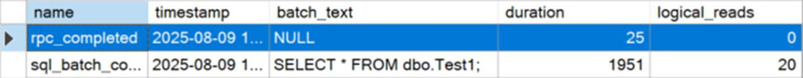

# CHƯƠNG 18: Xử lý Từng dòng từ Con trỏ Cursor và các Nguyên nhân khác (Row-by-Row Processing from Cursors and Other Causes)

Phương thức tối ưu nhất để thao tác và xử lý dữ liệu bên trong Microsoft SQL Server luôn là các thao tác dựa trên tập hợp (**Set-based operations**). Tuy nhiên, về mặt bản năng tư duy, con người chúng ta lại có xu hướng nhìn nhận và giải quyết các vấn đề dữ liệu theo từng dòng đơn lẻ (**Row-by-row**). 

Đúng là trong hệ quản trị cơ sở dữ liệu Oracle, người ta sử dụng một cấu trúc gọi là **Con trỏ (Cursor)** để hỗ trợ truy cập dữ liệu rất nhanh chóng nhờ kiến trúc bên dưới được thiết kế đặc thù cho việc đó. Nhưng trong SQL Server, câu chuyện hoàn toàn không giống như vậy. Khi truy xuất dữ liệu bằng con trỏ trong SQL Server, xử lý từng dòng một là một trong những cách làm việc với dữ liệu chậm chạp và kém hiệu quả nhất. 

Chuyên gia Jeff Moden đã đặt cho kiểu xử lý này một cái tên châm biếm rất nổi tiếng là **"ree-bar"**, viết tắt của **RBAR** (*Row By Agonizing Row* – Xử lý từng dòng một cách đau đớn), nhằm nhấn mạnh sự chậm chạp khủng khiếp của nó. Dẫu vậy, đôi khi trong thực tế vẫn tồn tại những mục đích nghiệp vụ hoặc tác vụ quản trị hợp lệ đòi hỏi phải sử dụng con trỏ. Vì vậy, điều tốt nhất chúng ta có thể làm là hiểu rõ bản chất và cố gắng sử dụng chúng theo cách chuẩn xác nhất.

Chương này sẽ lần lượt bao gồm các chủ đề sau:
* Các nguyên lý căn bản về con trỏ (Cursor Fundamentals).
* Phân tích chi phí tài nguyên giữa các cơ chế khác nhau bên trong con trỏ.
* Ưu và nhược điểm của tập kết quả mặc định (Default Result Set) so với con trỏ.
* Các khuyến nghị thực tế nhằm giảm thiểu tối đa chi phí tải phụ trội (overhead) của con trỏ.

---

## Nguyên lý cơ bản của Con trỏ (Cursor Fundamentals)

Một con trỏ (cursor) trong T-SQL là một cơ chế cho phép tập hợp một tập dữ liệu từ câu truy vấn nhằm mục đích duyệt qua từng dòng một cách tuần tự. Thông thường, quy trình tạo lập và sử dụng một con trỏ chuẩn mực sẽ trải qua 5 bước sau:

1. **Khai báo con trỏ (DECLARE cursor):** Định nghĩa tên con trỏ, liên kết nó với một câu lệnh `SELECT` cụ thể, đồng thời thiết lập các đặc tính hoạt động của con trỏ.
2. **Mở con trỏ (OPEN cursor):** Thực thi câu truy vấn liên kết để nạp hoặc thiết lập quyền truy cập vào tập dữ liệu.
3. **Trích xuất dòng dữ liệu (FETCH cursor):** Lấy một dòng dữ liệu từ con trỏ vào các biến cục bộ. Bạn có thể tùy chọn chỉnh sửa dòng dữ liệu đó thông qua con trỏ nếu cấu hình cho phép.
4. **Duyệt qua các dòng tiếp theo:** Sử dụng vòng lặp (thường là vòng lặp `WHILE @@FETCH_STATUS = 0`) để tuần tự di chuyển qua toàn bộ các dòng còn lại trong tập kết quả.
5. **Đóng và giải phóng con trỏ (CLOSE / DEALLOCATE cursor):** Khi quá trình xử lý hoàn tất, bạn bắt buộc phải đóng con trỏ và giải phóng nó để trả lại toàn bộ tài nguyên bộ nhớ và khóa mà con trỏ đã chiếm dụng.

> [!TIP]
> Bạn hoàn toàn có thể chủ động đóng con trỏ (`CLOSE`) bất kỳ lúc nào ngay khi đạt được mục đích nghiệp vụ, mà không nhất thiết phải duyệt qua hết toàn bộ các dòng trong tập dữ liệu.

Con trỏ có thể được tạo lập trực tiếp bằng cú pháp T-SQL hoặc thông qua các cơ chế truy cập dữ liệu bên ngoài SQL Server (tầng ứng dụng). Các con trỏ được khởi tạo từ tầng truy cập dữ liệu bên ngoài thường được gọi là **Con trỏ phía máy khách (Client-side Cursors)**. Các con trỏ được viết và thực thi trực tiếp bằng T-SQL được gọi là **Con trỏ phía máy chủ (Server-side Cursors)**.

Yếu tố then chốt quyết định lượng tải phụ trội và chi phí tài nguyên mà một con trỏ tiêu tốn chính là **các đặc tính của con trỏ (Cursor Characteristics)**. Có ba nhóm đặc tính lớn cấu thành nên một con trỏ:
* **Vị trí con trỏ (Cursor Location):** Con trỏ được khởi tạo và lưu trữ siêu dữ liệu (metadata) ở đâu.
* **Mức độ đồng thời (Cursor Concurrency):** Mức độ cô lập và tính đồng bộ của con trỏ đối với dữ liệu nền bên dưới.
* **Loại con trỏ (Cursor Type):** Các đặc tính hành vi duyệt dữ liệu chuyên biệt của từng loại con trỏ.

---

## Vị trí con trỏ (Cursor Location)

Dựa trên nơi khởi tạo và quản lý, con trỏ được phân loại thành con trỏ phía máy khách (client-side) hoặc con trỏ phía máy chủ (server-side). Các con trỏ viết bằng T-SQL luôn luôn là con trỏ phía máy chủ. Ngược lại, các con trỏ được tạo từ ứng dụng khách có thể là client-side hoặc server-side tùy thuộc vào thư viện và mã nguồn mà ứng dụng đó sử dụng.

---

### Con trỏ phía máy khách (Client-Side Cursors)

Con trỏ phía máy khách mang các đặc tính sau:
* Chúng được khởi tạo và quản lý hoàn toàn bên ngoài máy chủ cơ sở dữ liệu.
* Siêu dữ liệu (metadata) cùng toàn bộ bộ đệm dữ liệu của con trỏ được duy trì trong bộ nhớ của tiến trình ứng dụng client.
* Chúng hoạt động trên hầu hết các tầng truy cập dữ liệu phổ biến như OLE DB hoặc ODBC (ví dụ con trỏ client của ADO / ADO.NET).
* Chúng chỉ có thể được định nghĩa dưới hai dạng duy nhất: **Forward-Only** (chỉ tiến) hoặc **Static** (tĩnh).

---

### Con trỏ phía máy chủ (Server-Side Cursors)

Con trỏ phía máy chủ được khởi tạo trực tiếp trên phiên bản (instance) SQL Server và có các đặc tính sau:
* Chúng được tạo lập và vận hành bên trong instance hoặc cơ sở dữ liệu của SQL Server.
* Toàn bộ siêu dữ liệu và cấu trúc quản lý con trỏ được lưu trữ và duy trì trực tiếp trên tài nguyên máy chủ.
* Chúng có thể được tạo bằng cú pháp T-SQL hoặc thông qua các hàm API của tầng truy cập dữ liệu.
* Con trỏ phía máy chủ hỗ trợ đầy đủ tất cả các loại con trỏ và chế độ đồng thời khác nhau.

Toàn bộ các ví dụ và phân tích trong cuốn sách này đều tập trung vào **con trỏ phía máy chủ (server-side cursors)**.

---

## Mức độ đồng thời của con trỏ (Cursor Concurrency)

Tùy thuộc vào cách khai báo, một con trỏ có thể tương tác trực tiếp với dữ liệu trong các bảng cơ sở. Điều này quyết định mức độ cô lập (isolation) hoặc tính đồng bộ (synchronization) của con trỏ với dữ liệu thực tế. 

Có ba mô hình đồng thời chính:
* **Read-Only (Chỉ đọc):** Con trỏ hoàn toàn không thể cập nhật dữ liệu.
* **Optimistic (Lạc quan):** Con trỏ cho phép cập nhật dữ liệu và áp dụng mô hình đồng thời lạc quan – nghĩa là không giữ bất kỳ khóa dài hạn nào trên các dòng dữ liệu cơ sở cho đến khi thao tác cập nhật thực sự diễn ra.
* **Scroll Locks (Khóa cuộn):** Con trỏ cho phép cập nhật dữ liệu và chủ động nắm giữ các khóa cập nhật trên dữ liệu cơ sở trong suốt quá trình duyệt.

---

### Con trỏ Chỉ đọc (Read-Only)

Một con trỏ chỉ đọc không thể thực hiện bất kỳ thao tác chỉnh sửa dữ liệu nào, và không có khóa độc quyền nào được duy trì trên các bảng cơ sở. 

Trong quá trình trích xuất từng dòng (`FETCH`), việc có thiết lập khóa chia sẻ (**Shared lock - S**) trên dòng cơ sở hay không hoàn toàn phụ thuộc vào mức độ cô lập (isolation level) của kết nối hiện tại và các gợi ý khóa (locking hints) trong câu lệnh `SELECT`. Tuy nhiên, ngay sau khi dòng dữ liệu được nạp vào con trỏ, theo mặc định, các khóa này sẽ được giải phóng ngay lập tức. 

Listing 18-1 minh họa cách khai báo một con trỏ `READ_ONLY`.

#### Listing 18-1. Khai báo con trỏ ở chế độ READ_ONLY
```sql
DECLARE MyCursor CURSOR READ_ONLY FOR
SELECT adt.NAME
FROM Person.AddressType AS adt
WHERE adt.AddressTypeID = 1;
```

Vì con trỏ chỉ đọc hầu như không phát sinh và duy trì các khóa tài nguyên, đây là loại con trỏ **nhanh nhất, nhẹ nhất và an toàn nhất** để sử dụng. Bạn chỉ cần ghi nhớ rằng: Bạn đang đánh đổi khả năng chỉnh sửa dữ liệu để lấy tốc độ và mức độ đồng thời cao nhất cho hệ thống.

---

### Con trỏ Lạc quan (Optimistic)

Khi khai báo một con trỏ với tùy chọn `OPTIMISTIC`, bạn có quyền cập nhật dữ liệu thông qua con trỏ đó. Theo mặc định, trong suốt thời gian bạn chỉ duyệt và chưa thực hiện sửa đổi, con trỏ lạc quan hoạt động tương tự như một con trỏ chỉ đọc: Nó chỉ thiết lập các khóa chia sẻ (S) tạm thời khi đọc dữ liệu rồi nhả ra ngay.

Con trỏ lạc quan sử dụng một trong hai cơ chế để kiểm tra xem dòng dữ liệu cơ sở có bị một phiên làm việc khác thay đổi trong khoảng thời gian từ lúc fetch đến lúc cập nhật hay không:
1. **Cơ chế ROWVERSION:** Bảng cơ sở có sẵn một cột kiểu `ROWVERSION` (hoặc `TIMESTAMP`).
2. **Cơ chế so sánh toàn bộ giá trị:** So sánh toàn bộ các giá trị của dòng trong con trỏ với các giá trị hiện thời trong bảng cơ sở.

Trong hai cơ chế trên, việc sử dụng cột `ROWVERSION` mang lại hiệu năng vượt trội hơn hẳn nhờ bản chất kiến trúc của kiểu dữ liệu này:
* `ROWVERSION` là một chuỗi nhị phân (binary 8 byte) phản ánh thứ tự tương đối của các thao tác sửa đổi trên dòng dữ liệu. Mỗi khi một dòng có cột `ROWVERSION` bị thay đổi, SQL Server sẽ tự động gán giá trị mới nhất của biến toàn cục `@@DBTS` cho cột đó và tự động tăng giá trị của `@@DBTS`.
* Trước khi tiến hành cập nhật qua con trỏ, bộ máy sẽ kiểm tra xem giá trị `ROWVERSION` trong con trỏ có còn khớp với giá trị trong bảng hay không. Nếu khớp, thao tác sửa đổi được chấp thuận. Nếu không khớp (nghĩa là đã có người khác sửa dòng này), một thông báo lỗi sẽ phát sinh, và bạn buộc phải nạp lại (refresh) dữ liệu con trỏ.

Ngược lại, nếu bảng không có cột `ROWVERSION`, SQL Server buộc phải đối chiếu từng cột dữ liệu một giữa con trỏ và bảng cơ sở. Thao tác này tiêu tốn rất nhiều CPU và I/O. Do đó, để đạt hiệu năng tốt với con trỏ lạc quan, bạn nên chủ động bổ sung cột `ROWVERSION` vào các bảng liên quan.

Listing 18-2 minh họa cách khai báo con trỏ `OPTIMISTIC`.

#### Listing 18-2. Khai báo con trỏ ở chế độ OPTIMISTIC
```sql
DECLARE MyCursor CURSOR OPTIMISTIC FOR
SELECT adt.NAME
FROM Person.AddressType AS adt
WHERE adt.AddressTypeID = 1;
```

---

### Con trỏ Khóa cuộn (Scroll Locks)

Khi một con trỏ được định nghĩa với tùy chọn `SCROLL_LOCKS`, bạn được phép cập nhật dữ liệu qua con trỏ. Tuy nhiên, khác với mô hình lạc quan, con trỏ này sẽ thiết lập một **khóa cập nhật (Update lock - U)** trực tiếp lên dòng dữ liệu cơ sở ngay khi dòng đó được fetch, và **giữ nguyên khóa đó** cho đến khi một dòng khác được fetch hoặc con trỏ được đóng lại.

Hành động này ngăn chặn hoàn toàn tất cả các người dùng khác không thể sửa đổi hoặc xóa dòng dữ liệu đó trong khi bạn đang duyệt. Listing 18-3 minh họa cách khai báo con trỏ với `SCROLL_LOCKS`.

#### Listing 18-3. Khai báo con trỏ với tùy chọn SCROLL_LOCKS
```sql
DECLARE MyCursor CURSOR SCROLL_LOCKS FOR
SELECT adt.NAME
FROM Person.AddressType AS adt
WHERE adt.AddressTypeID = 1;
```

Triết lý ở đây là bạn đặt độ ưu tiên cho việc đảm bảo cập nhật dữ liệu thành công lên trên hết, chấp nhận hy sinh hiệu năng. Đương nhiên, sự đánh đổi là **tính đồng thời (concurrency) của toàn bộ cơ sở dữ liệu sẽ bị kéo giảm đáng kể**, và nguy cơ gây tắc nghẽn (blocking) cho các người dùng khác là rất lớn.

---

## Các loại con trỏ (Cursor Types)

Bên cạnh việc kiểm soát tính đồng thời, bạn còn có thể kiểm soát các hành vi duyệt và quản lý tập dữ liệu của con trỏ thông qua các **Loại con trỏ (Cursor Types)**:
* **Forward-only (Chỉ tiến)**
* **Static (Tĩnh)**
* **Keyset-driven (Dựa trên tập khóa)**
* **Dynamic (Động)**
* **Vòng lặp WHILE (WHILE loop - giải pháp thay thế con trỏ)**

---

### Con trỏ Chỉ tiến (Forward-Only Cursors) và Tùy chọn FAST_FORWARD

Nguyên lý cốt lõi của con trỏ chỉ tiến rất đơn giản: Bạn chỉ có thể duyệt tuần tự từ đầu đến cuối (`FETCH NEXT`), tuyệt đối không thể cuộn ngược lại hay nhảy cóc ngẫu nhiên.

Con trỏ Forward-Only mang các đặc tính sau:
* Con trỏ thao tác trực tiếp trên các bảng cơ sở.
* Dữ liệu từ các bảng cơ sở thông thường chỉ được đọc khi câu lệnh `FETCH` được gọi. (Ngoại lệ: một số con trỏ API phía máy khách hoặc con trỏ server chỉ đọc có thể nạp toàn bộ dữ liệu trong một bước duy nhất).
* Chúng chỉ hỗ trợ một thao tác cuộn duy nhất là `FETCH NEXT`.
* Chúng cho phép thực hiện các thao tác sửa đổi (`INSERT`, `UPDATE`, `DELETE`) thông qua con trỏ, đồng thời các thay đổi diễn ra trên bảng cơ sở cũng sẽ được phản ánh khi con trỏ duyệt tới.

Cú pháp T-SQL cung cấp một loại con trỏ chỉ tiến đặc biệt có tên là **`FAST_FORWARD`**. Tùy chọn này được mệnh danh là **"chiếc vòi rồng cứu hỏa" (fire hose)** vì nó là con đường nhanh nhất và được tối ưu hóa tốt nhất để di chuyển dữ liệu thông qua một con trỏ trong SQL Server. Mặc dù vậy, bạn hãy luôn nhớ rằng chiếc "vòi rồng" này vẫn không thể nào so bì được về tốc độ với các thao tác xử lý theo tập hợp (set-based).

Listing 18-4 minh họa cách khai báo con trỏ `FAST_FORWARD`.

#### Listing 18-4. Khai báo con trỏ FAST_FORWARD
```sql
DECLARE MyCursor CURSOR FAST_FORWARD FOR
SELECT adt.NAME
FROM Person.AddressType AS adt
WHERE adt.AddressTypeID = 1;
```

---

### Con trỏ Tĩnh (Static Cursors)

Một con trỏ tĩnh (**Static Cursor**) tạo ra một bản chụp nhanh (**Snapshot**) toàn bộ dữ liệu tại thời điểm mở con trỏ và có các đặc tính sau:
* Con trỏ sử dụng cơ sở dữ liệu tạm thời **`tempdb`** để lưu trữ toàn bộ dữ liệu được định nghĩa bởi câu truy vấn, tách biệt hoàn toàn dữ liệu của con trỏ khỏi các bảng cơ sở bên dưới.
* Toàn bộ dữ liệu được nạp từ các bảng cơ sở vào `tempdb` một lần duy nhất ngay khi con trỏ được thực thi lệnh `OPEN`.
* Hỗ trợ đầy đủ tất cả các tùy chọn cuộn tự do: `FETCH FIRST`, `FETCH NEXT`, `FETCH PRIOR`, `FETCH LAST`, `FETCH ABSOLUTE n`, và `FETCH RELATIVE n`.
* Dữ liệu bên trong con trỏ tĩnh **luôn luôn là chỉ đọc (read-only)**.
* Mọi thao tác thêm, sửa, xóa diễn ra trên các bảng cơ sở sau thời điểm mở con trỏ đều **hoàn toàn không được phản ánh** vào con trỏ này.

Trong một số tình huống đặc thù, bạn có thể nhận thấy con trỏ tĩnh chạy thậm chí còn nhanh hơn cả con trỏ forward-only vì nó không phải liên tục đọc lại bảng cơ sở. Việc kiểm thử định lượng trong môi trường thực tế luôn là ý tưởng tuyệt vời. Listing 18-5 minh họa cách khai báo con trỏ tĩnh.

#### Listing 18-5. Khai báo con trỏ STATIC
```sql
DECLARE MyCursor CURSOR STATIC FOR
SELECT adt.NAME
FROM Person.AddressType AS adt
WHERE adt.AddressTypeID = 1;
```

---

### Con trỏ Dựa trên tập khóa (Keyset-Driven Cursors)

Con trỏ Keyset sử dụng một tập hợp các khóa định danh duy nhất (keyset) để quản lý việc truy cập dữ liệu, mang các đặc tính sau:
* Tập khóa (keyset) được xây dựng từ một hoặc nhiều cột có khả năng định danh duy nhất từng dòng dữ liệu trong tập kết quả của con trỏ.
* Dữ liệu của tập khóa được lưu trữ bên trong **`tempdb`**.
* Tương tự như con trỏ tĩnh, danh sách các khóa (chứ không phải toàn bộ dữ liệu) được nạp vào con trỏ ngay khi câu lệnh `OPEN` được thực thi.
* Khi thực hiện lệnh `FETCH` một dòng, con trỏ sẽ lấy giá trị khóa từ `tempdb`, sau đó dùng khóa đó để truy xuất dòng dữ liệu thực tế tương ứng từ bảng cơ sở.
* Hỗ trợ đầy đủ tất cả các tùy chọn cuộn dữ liệu linh hoạt.
* Cho phép thực hiện các thao tác chỉnh sửa dữ liệu thông qua con trỏ.

Hành vi dữ liệu của Keyset cursor:
* Nếu có dữ liệu mới được chèn thêm (`INSERT`) vào bảng cơ sở bởi các phiên khác, chúng sẽ **không xuất hiện** trong con trỏ vì tập khóa đã được cố định trong `tempdb`.
* Nếu bạn chèn dữ liệu thông qua chính con trỏ, dữ liệu mới sẽ được nối vào cuối tập con trỏ.
* Nếu một dòng trong bảng cơ sở bị xóa đi bởi phiên khác, khi con trỏ dùng khóa tương ứng để fetch, hệ thống sẽ báo lỗi không tìm thấy dữ liệu (`@@FETCH_STATUS = -2`).
* Các thao tác cập nhật (`UPDATE`) trên bảng cơ sở sẽ được con trỏ phản ánh chính xác khi duyệt tới.

Listing 18-6 minh họa việc khai báo một con trỏ `KEYSET`.

#### Listing 18-6. Khai báo con trỏ KEYSET
```sql
DECLARE MyCursor CURSOR KEYSET FOR
SELECT adt.NAME
FROM Person.AddressType AS adt
WHERE adt.AddressTypeID = 1;
```

---

### Con trỏ Động (Dynamic Cursors)

Con trỏ động (**Dynamic Cursor**) tương tác trực tiếp với các bảng cơ sở tại mọi thời điểm và mang các đặc tính sau:
* **Không có danh sách thành viên cố định:** Dữ liệu hoàn toàn phụ thuộc vào trạng thái thời gian thực của các bảng cơ sở bên dưới.
* Tương tự con trỏ chỉ tiến, các dòng từ bảng cơ sở chỉ thực sự được nạp khi câu lệnh `FETCH` được gọi.
* Hỗ trợ hầu hết các tùy chọn cuộn dữ liệu, **ngoại trừ tùy chọn `FETCH ABSOLUTE n`** (vì tập thành viên liên tục biến động nên không thể xác định vị trí tuyệt đối thứ $n$).
* Cho phép thực hiện mọi thao tác chỉnh sửa thông qua con trỏ. Đồng thời, mọi thay đổi dữ liệu từ bên ngoài diễn ra trên các bảng cơ sở đều được phản ánh ngay lập tức vào con trỏ.

Tuy nhiên, con trỏ động không hỗ trợ một số thuộc tính và phương thức API chuyên biệt như `AbsolutePosition`, `Bookmark`, `RecordCount`, `Clone` hay `Resync`. Nếu bạn cần các tính năng đó, hãy cân nhắc sử dụng con trỏ Keyset.

Listing 18-7 minh họa cách khai báo một con trỏ động.

#### Listing 18-7. Khai báo con trỏ DYNAMIC
```sql
DECLARE MyCursor CURSOR DYNAMIC FOR
SELECT adt.NAME
FROM Person.AddressType AS adt
WHERE adt.AddressTypeID = 1;
```

> [!CAUTION]
> Con trỏ động là loại con trỏ **chậm nhất và ngốn tài nguyên nhất** trong tất cả các loại con trỏ của SQL Server. Nó đòi hỏi nhiều khóa tài nguyên nhất và thời gian chiếm giữ khóa luôn lâu nhất, gây nguy cơ tắc nghẽn cực kỳ nghiêm trọng.

---

### Vòng lặp WHILE thay thế cho Cursor (Using a WHILE Loop as a Cursor Substitute)

Xét về mặt kỹ thuật T-SQL thuần túy, vòng lặp `WHILE` hoàn toàn không phải là một con trỏ cursor. Tuy nhiên, đây lại là một phương thức kinh điển khác thường được các lập trình viên áp dụng để duyệt qua dữ liệu theo kiểu từng-dòng-một. 

Vòng lặp `WHILE` hoàn toàn đáp ứng đầy đủ tiêu chuẩn định nghĩa về hội chứng **RBAR** (*Row By Agonizing Row*) của Jeff Moden. Mặc dù vậy, tùy theo từng tình huống cụ thể, một vòng lặp `WHILE` được thiết kế tốt có thể mang lại hiệu năng cao hơn so với việc khai báo một con trỏ T-SQL truyền thống.

Một vòng lặp `WHILE` không có các đặc tính phức tạp như con trỏ; thay vào đó, bạn chỉ đơn giản thực hiện lặp đi lặp lại một khối lệnh cho đến khi thỏa mãn một điều kiện dừng. 

Thách thức cốt lõi khi dùng vòng lặp `WHILE` là bạn phải định nghĩa được một cơ chế đếm hoặc giới hạn biên rõ ràng cho các bước lặp. Sau đó, bạn phải có một câu truy vấn có khả năng định vị chính xác từng dòng dữ liệu đơn lẻ tương ứng với từng bước lặp đó.

Listing 18-8 trình bày một ví dụ hoàn chỉnh về cách sử dụng vòng lặp `WHILE` để duyệt qua dữ liệu từng dòng một.

#### Listing 18-8. Sử dụng vòng lặp WHILE thay thế cho con trỏ
```sql
-- Tạo biến bảng để đánh chỉ số liên tục cho các giá trị SalesOrderDetailID
DECLARE @LoopTable TABLE
(
    LoopID INT IDENTITY(1, 1),
    SalesOrderDetailID INT
);

-- Nạp tập dữ liệu cần xử lý vào biến bảng
INSERT INTO @LoopTable
(
    SalesOrderDetailID
)
SELECT sod.SalesOrderDetailID
FROM Sales.SalesOrderDetail AS sod
WHERE sod.OrderQty > 23
ORDER BY sod.SalesOrderDetailID DESC;

DECLARE @MaxRow INT,
        @Count INT,
        @SalesOrderDetailID INT;

-- Xác định giới hạn tổng số dòng cần duyệt
SELECT @MaxRow = MAX(lt.LoopID),
       @Count = 1
FROM @LoopTable AS lt;

-- Bắt đầu vòng lặp duyệt qua từng dòng kết quả
WHILE @Count <= @MaxRow
BEGIN
    SELECT @SalesOrderDetailID = lt.SalesOrderDetailID
    FROM @LoopTable AS lt
    WHERE lt.LoopID = @Count;

    -- Thực hiện xử lý nghiệp vụ trên từng dòng riêng lẻ
    SELECT sod.OrderQty
    FROM Sales.SalesOrderDetail AS sod
    WHERE sod.SalesOrderDetailID = @SalesOrderDetailID;

    SET @Count += 1;
END;
```

Trong thực tế, có nhiều khía cạnh kỹ thuật cần bàn luận quanh đoạn mã trên:
* Việc sử dụng một bảng tạm cục bộ (`#temp table`) đôi khi có thể mang lại hiệu năng vượt trội hơn so với biến bảng (`@table variable`) khi số lượng dòng lớn.
* Việc bổ sung chỉ mục trên cột khóa của biến bảng/bảng tạm cũng có thể gia tăng tốc độ tìm kiếm.

Tuy nhiên, về mặt nguyên lý tổng thể, đây chính là cách mà một vòng lặp `WHILE` đóng vai trò thay thế cho một con trỏ. Bạn bắt buộc phải xác định giới hạn trên (biến `@MaxRow`), sau đó dùng một biến đếm tăng dần (`@Count`) để tương ứng trực tiếp với cột danh tính liên tục `LoopID INT IDENTITY(1, 1)` nhằm truy xuất từng mã `SalesOrderDetailID`. Chúng ta bắt buộc phải dùng cột `LoopID` tăng tuần tự bởi vì các giá trị khóa thực tế trong bảng kinh doanh thường có các khoảng trống (gaps – ví dụ các số bị xóa ngắt quãng), khiến việc nhảy bước bằng chính khóa nghiệp vụ là bất khả thi.

Mặc dù giải pháp này có vẻ phức tạp và cồng kềnh, nhưng trong một số trường hợp cụ thể, nó vẫn sẽ vận hành nhanh hơn đáng kể so với việc khởi tạo một con trỏ T-SQL đầy đủ.

---

## So sánh chi phí giữa các loại con trỏ (Cursor Cost Comparison)

Sau khi đã nắm vững các loại con trỏ khả dụng và cách thức hoạt động của chúng, bây giờ chúng ta hãy cùng phân tích sâu xem những khác biệt về hành vi đó ảnh hưởng như thế nào đến mức tiêu hao tài nguyên phần cứng (CPU, RAM, I/O, tempdb) trên máy chủ. Trong những tình huống bắt buộc không thể tránh khỏi việc phải sử dụng con trỏ, bạn nên luôn luôn nỗ lực lựa chọn cấu hình con trỏ nhẹ nhàng và tinh gọn nhất có thể.

---

### So sánh chi phí dựa trên Vị trí (Location)

Sự khác biệt về mặt kiến trúc giữa con trỏ phía máy khách (*Client-side cursors*) và con trỏ phía máy chủ (*Server-side cursors*) tạo ra tác động rất lớn đến tổng chi phí tài nguyên của hệ thống.

#### Con trỏ phía máy khách (Client-Side Cursors)

Con trỏ phía máy khách mang lại những ưu điểm vượt trội sau so với con trỏ máy chủ:
- **Khả năng mở rộng cao hơn (Higher Scalability):** Do toàn bộ quá trình quản lý và duyệt dòng của con trỏ được thực hiện bên ngoài máy chủ cơ sở dữ liệu, máy chủ SQL Server sẽ tiêu tốn ít tài nguyên bộ nhớ và CPU hơn, giúp hệ thống mở rộng phục vụ được nhiều người dùng đồng thời hơn.
- **Ít vòng truyền tải qua mạng hơn (Fewer Network Round Trips):** Toàn bộ tập kết quả được nạp một lần duy nhất về máy khách (nơi con trỏ được duy trì), do đó giảm thiểu đáng kể số lượng các gói tin yêu cầu fetch qua lại trên đường truyền mạng.
- **Tốc độ cuộn dữ liệu nhanh hơn (Faster Scrolling):** Vì mã ứng dụng trên máy khách trực tiếp điều khiển con trỏ cục bộ trong bộ nhớ RAM của chính nó, việc di chuyển tới/lui giữa các dòng diễn ra gần như tức thì mà không cần hỏi lại máy chủ.
- **Khả năng tương thích và chuyển đổi cao (Highly Portable):** Nhờ cơ chế con trỏ được hiện thực hóa ở tầng thư viện client (như ADO, ODBC, OLEDB), giải pháp này hỗ trợ đồng nhất trên nhiều hệ quản trị CSDL khác nhau (SQL Server, Oracle, PostgreSQL,...) mà không bị phụ thuộc vào cú pháp T-SQL độc quyền.

Tuy nhiên, con trỏ phía máy khách cũng tồn tại những nhược điểm cố hữu:
- **Áp lực tài nguyên đè nặng lên máy khách:** Không có gì là miễn phí cả. Việc giảm tải cho máy chủ thực chất chỉ là chuyển dịch gánh nặng tài nguyên sang phía client. Nếu ứng dụng chạy trên một máy chủ web trung gian (*web server*) có lưu lượng truy cập lớn mà lại sử dụng nhiều client-side cursor, bạn sẽ chứng kiến tình trạng cạn kiệt bộ nhớ nghiêm trọng trên web server.
- **Hạn chế về loại con trỏ hỗ trợ:** Con trỏ client không hỗ trợ các loại con trỏ động (*dynamic*) hoặc con trỏ dựa trên tập khóa (*keyset-driven*).
- **Chỉ có một câu lệnh con trỏ hoạt động trên một kết nối:** Trong khi con trỏ client đang duyệt dữ liệu, kết nối đó sẽ bị chiếm dụng và không thể thực thi đồng thời các câu lệnh SQL khác (trừ khi bật tính năng MARS).

#### Con trỏ phía máy chủ (Server-Side Cursors)

Con trỏ phía máy chủ sở hữu các ưu điểm:
- **Nhiều câu lệnh con trỏ hoạt động trên cùng kết nối:** Một phiên kết nối đơn lẻ có thể kích hoạt và quản lý nhiều tiến trình con trỏ đồng thời.
- **Xử lý dữ liệu ngay tại nguồn:** Việc xử lý diễn ra ngay tại nơi dữ liệu được lưu trữ giúp loại bỏ độ trễ mạng của các gói tin trung gian. Điều này đặc biệt có lợi nếu con trỏ thực hiện các thao tác sửa đổi dữ liệu (INSERT/UPDATE/DELETE) lên các bảng khác trong cùng CSDL.
- **Giảm áp lực tài nguyên cho máy khách:** Giúp máy khách nhẹ tải vì mọi công việc quản lý tập dòng đều do SQL Server đảm nhận.
- **Hỗ trợ đầy đủ mọi loại con trỏ:** Bạn có toàn quyền sử dụng tất cả các loại con trỏ nâng cao (Forward-Only, Static, Keyset, Dynamic).

Ngược lại, chi phí phát sinh từ server-side cursors là rất lớn:
- **Khả năng mở rộng của máy chủ bị suy giảm nghiêm trọng:** Càng nhiều tài nguyên CPU, bộ nhớ đệm và tempdb bị con trỏ chiếm dụng thì lượng tài nguyên còn lại dành cho các truy vấn OLTP thông thường khác càng ít đi.
- **Nhiều vòng truyền tải qua mạng (Network Round Trips):** Nếu ứng dụng liên tục gửi các lệnh `FETCH NEXT` từ xa về máy chủ, lưu lượng mạng và độ trễ tích lũy sẽ tăng vọt.
- **Kém linh hoạt khi chuyển đổi nền tảng:** Các con trỏ viết bằng cú pháp T-SQL sẽ không thể tái sử dụng nguyên vẹn trên các CSDL phi Microsoft.

---

### So sánh chi phí dựa trên Độ đồng thời (Concurrency)

Một mô hình con trỏ có tính đồng thời (*concurrency*) càng cao thì càng tạo ra ít hiện tượng tắc nghẽn khóa (*blocking*), giúp hệ thống mở rộng linh hoạt hơn.

#### Mô hình Read-Only

Mô hình chỉ đọc (*read-only*) mang lại lợi ích chi phí tối ưu nhất:
- **Chi phí khóa thấp nhất:** Mô hình read-only tạo ra ít chi phí khóa và đồng bộ hóa nhất cho cơ sở dữ liệu. Sau khi một dòng dữ liệu của con trỏ được fetch thành công, khóa Shared (S) trên dòng gốc lập tức được giải phóng, hoàn toàn không chặn các người dùng khác truy cập vào dòng đó. Thậm chí bạn có thể loại bỏ hoàn toàn khóa (S) trong lúc fetch bằng cách dùng gợi ý `NOLOCK` (nếu bạn chấp nhận rủi ro đọc dữ liệu bẩn).
- **Tính đồng thời cao nhất:** Không giữ khóa kéo dài, giúp loại bỏ triệt để hiện tượng blocking trên các bảng bên dưới.
- **Nhược điểm duy nhất:** Con trỏ hoàn toàn không thể cập nhật (*nonupdatable*) dữ liệu của bảng gốc thông qua mệnh đề `WHERE CURRENT OF`.

#### Mô hình Optimistic (Đồng thời lạc quan)

Mô hình này cho phép con trỏ có thể cập nhật dữ liệu nhưng giả định rằng xung đột sửa đổi giữa các người dùng là hiếm khi xảy ra:
- **Ưu điểm:** Tương tự như mô hình read-only, nó không duy trì khóa (S) sau khi dòng đã được fetch xong. Khóa Độc quyền (X) chỉ được xin cấp tức thời tại thời điểm câu lệnh cập nhật dòng thông qua con trỏ thực sự diễn ra.
- **Chi phí phụ trội phát sinh:**
  - **So sánh phiên bản dòng (Row Versioning Check):** Để ngăn chặn việc con trỏ vô tình ghi đè lên dữ liệu đã bị người dùng khác sửa đổi sau thời điểm dòng được fetch, SQL Server bắt buộc phải thực hiện thao tác so sánh kiểm tra trước khi ghi.
  - **Kiểm soát dựa trên ROWVERSION vs Dựa trên giá trị:** Nếu bảng có sẵn một cột kiểu `ROWVERSION` (hoặc `TIMESTAMP`), việc so sánh phiên bản diễn ra cực kỳ nhanh chóng và hiệu quả. Ngược lại, nếu bảng không có cột `ROWVERSION`, SQL Server buộc phải chuyển sang cơ chế so sánh giá trị (*value-based concurrency control*): nó phải đối chiếu toàn bộ giá trị của tất cả các cột của dòng hiện tại với giá trị lúc đọc ban đầu. Cả hai cơ chế này đều tạo thêm gánh nặng phụ trội đáng kể cho `tempdb`.

#### Mô hình Scroll Locks (Khóa cuộn - Khóa bi quan)

- **Ưu điểm:** Loại bỏ hoàn toàn chi phí so sánh phiên bản dữ liệu phức tạp của mô hình optimistic. Ứng dụng không bao giờ phải lo lắng về việc gặp lỗi xung đột phiên bản dòng (*concurrency violation / mismatch error*).
- **Chi phí phụ trội nặng nề:**
  - **Chi phí khóa cao nhất:** Mang đặc tính của cơ chế khóa bi quan (*pessimistic locking*). Một khóa Cập nhật (**U**) được giữ liên tục trên dòng dữ liệu vừa fetch cho đến tận khi dòng tiếp theo được fetch hoặc cho đến khi con trỏ được đóng lại.
  - **Tính đồng thời thấp nhất:** Do khóa U được giữ dai dẳng, tất cả các tiến trình khác đang muốn xin khóa U hoặc khóa Độc quyền (X) trên dòng đó đều sẽ bị **chặn đứng hoàn toàn (blocking)**. Điều này bóp nghẹt khả năng xử lý song song của hệ thống. Bạn nên tuyệt đối tránh xa mô hình này trừ khi thực sự bắt buộc.

---

### So sánh chi phí dựa trên Loại con trỏ (Cursor Types)

Mỗi loại trong số bốn loại con trỏ cơ bản mang lại một mức chi phí tài nguyên hoàn toàn khác biệt trên máy chủ:

#### 1. Con trỏ Forward-Only
- **Lợi ích:** Mở con trỏ rất nhanh vì dữ liệu không bị sao chép vào `tempdb` tại thời điểm `OPEN CURSOR`. Chi phí cuộn cực thấp vì chỉ hỗ trợ duy nhất một thao tác `FETCH NEXT`. Không gây áp lực lên `tempdb`.
- **Hạn chế:** Mỗi lần fetch một dòng, SQL Server lại phải truy cập vào bảng gốc và xin khóa tùy theo mô hình đồng thời đã chọn, có thể gây blocking cho người khác. Không hỗ trợ cuộn ngược về phía trước.

#### 2. Con trỏ Fast-Forward-Only
- Đây là loại con trỏ **nhanh nhất, nhẹ nhất và ít tốn kém tài nguyên nhất** trong toàn bộ SQL Server. Nó là một con trỏ kết hợp giữa `FORWARD_ONLY` và `READ_ONLY` được bộ tối ưu hóa tinh chỉnh đặc biệt. Bất cứ khi nào bạn bắt buộc phải dùng con trỏ trong T-SQL, hãy **luôn luôn ưu tiên lựa chọn con trỏ FAST_FORWARD**.

#### 3. Con trỏ Static
- **Lợi ích:** Chi phí truy xuất (`FETCH`) rất thấp vì một bản sao ảnh chụp dữ liệu (*snapshot*) hoàn chỉnh đã được tạo sẵn trong `tempdb` ngay khi mở con trỏ. Các thao tác fetch chỉ truy cập vào `tempdb` mà không hề đụng chạm hay xin khóa trên bảng gốc, hoàn toàn không gây blocking cho người dùng khác. Hỗ trợ cuộn tới lui thoải mái.
- **Hạn chế:** Chi phí mở con trỏ (`OPEN`) cực kỳ đắt đỏ và chậm chạp do phải đọc toàn bộ tập dữ liệu từ bảng gốc và ghi hết xuống `tempdb`. Tạo áp lực rất lớn lên dung lượng đĩa và I/O của `tempdb` nếu tập dữ liệu lớn.

#### 4. Con trỏ Keyset-Driven
- **Lợi ích:** Chi phí mở con trỏ nhanh hơn con trỏ static vì SQL Server chỉ ghi danh sách các khóa định danh (*keyset*), chứ không sao chép toàn bộ các cột dữ liệu vào `tempdb`. Chiếm dụng ít dung lượng `tempdb` hơn so với static cursor. Hỗ trợ cuộn dữ liệu hai chiều và có thể cập nhật được dòng gốc.
- **Hạn chế:** Chi phí mở vẫn đắt hơn forward-only và dynamic. Đặc biệt, **chi phí mỗi lần fetch dòng là đắt nhất** trong tất cả các loại con trỏ: với mỗi dòng cần fetch, SQL Server phải đọc khóa trong `tempdb` trước, sau đó dùng khóa đó tra cứu ngược lại dòng dữ liệu thực tế trong bảng gốc của cơ sở dữ liệu người dùng. Việc liên tục truy cập qua lại giữa cả `tempdb` và database người dùng khiến chi phí I/O và khóa tăng gấp đôi.

#### 5. Con trỏ Dynamic
- **Lợi ích:** Chi phí mở con trỏ nhanh vì nó mở trực tiếp trên bảng gốc mà không ghi chép bất kỳ thứ gì vào `tempdb`. Không tạo áp lực lên `tempdb`. Hỗ trợ cuộn hai chiều và phản ánh tức thì mọi thay đổi dữ liệu từ các người dùng khác.
- **Hạn chế:** **Chi phí khóa và nguy cơ blocking cao nhất**. Mỗi thao tác fetch dòng trong con trỏ dynamic thực chất là thực thi lại câu lệnh `SELECT` trên bảng gốc để tìm dòng tiếp theo phù hợp với điều kiện ban đầu. Các thao tác fetch động rất tốn CPU và I/O vì câu lệnh truy vấn có thể phải được thẩm định lại liên tục.

---

### Bảng tổng kết so sánh các loại con trỏ

Bảng 18-1 tóm tắt toàn diện các mặt ưu điểm và nhược điểm thực tế của từng loại con trỏ trong SQL Server.

**Bảng 18-1.** So sánh các loại con trỏ trong SQL Server

| Loại con trỏ (Cursor Type) | Ưu điểm cốt lõi (Positives) | Nhược điểm / Chi phí phụ trội (Negatives) |
| :--- | :--- | :--- |
| **Forward-only** | Chi phí mở thấp, chi phí cuộn thấp, không tạo áp lực lên `tempdb`. | Tính đồng thời thấp hơn (phụ thuộc khóa), không hỗ trợ cuộn ngược. |
| **Fast-forward-only** | Con trỏ nhanh nhất, chi phí tài nguyên thấp nhất, nhẹ tải nhất cho hệ thống. | Không hỗ trợ cuộn ngược, chỉ đọc (không cho phép cập nhật dữ liệu). |
| **Static** | Chi phí fetch dòng thấp, hoàn toàn không gây blocking trên bảng gốc, hỗ trợ cuộn 2 chiều. | Chi phí mở (`OPEN`) rất chậm, chiếm dụng nhiều bộ nhớ và I/O trong `tempdb`. |
| **Keyset-driven** | Chi phí mở nhanh hơn static, tốn ít dung lượng tempdb hơn static, hỗ trợ cuộn 2 chiều và cập nhật. | Chi phí fetch dòng đắt nhất (phải đọc tempdb rồi lookup bảng gốc), chi phí khóa cao. |
| **Dynamic** | Mở nhanh tức thì, không gây áp lực lên `tempdb`, hỗ trợ cuộn 2 chiều và cập nhật dòng trực tiếp. | Chi phí khóa và nguy cơ blocking cao nhất, chi phí tính toán fetch dòng rất đắt. |

---

## Tập kết quả mặc định so với Con trỏ (The Default Result Set vs. Cursors)

Kiểu con trỏ mặc định được cấu hình trong các tầng truy cập dữ liệu phổ biến (chẳng hạn như ADO, OLE DB và ODBC) là kiểu **chỉ tiến và chỉ đọc** (*forward-only và read-only*). Về mặt kỹ thuật, con trỏ mặc định do các tầng truy cập dữ liệu này tạo ra không phải là một con trỏ thực sự (*not a true cursor*), mà thực chất là một luồng dữ liệu liên tục truyền trực tiếp từ máy chủ về máy khách — cơ chế này thường được gọi là **Tập kết quả mặc định (Default Result Set)** hay **Fast-Forward-Only Cursor** (được khởi tạo bởi tầng truy cập dữ liệu), hoặc đôi khi còn được gọi theo thuật ngữ dân gian là "con trỏ vòi cứu hỏa" (*Firehose Cursor*).

Trong môi trường ADO.NET, đối tượng điều khiển `SqlDataReader` sở hữu trọn vẹn các đặc tính forward-only và read-only, và nó chính là hiện thân tiêu biểu của tập kết quả mặc định trong thế giới .NET.

SQL Server sẽ tự động kích hoạt cơ chế xử lý theo tập kết quả mặc định này khi thỏa mãn các điều kiện sau:
- Ứng dụng thông qua các tầng truy cập dữ liệu (ADO, OLE DB, ODBC) giữ nguyên toàn bộ các thiết lập đặc tính con trỏ ở giá trị mặc định (yêu cầu một con trỏ forward-only và read-only).
- Ứng dụng gửi một câu lệnh `SELECT` thông thường thay vì thực thi một khối lệnh khai báo con trỏ tường minh `DECLARE CURSOR`.

> [!NOTE]
> Bởi vì kiến trúc cốt lõi của SQL Server được thiết kế và tối ưu hóa tối thượng để làm việc với các **tập hợp dữ liệu** (*sets of data*), chứ không phải để duyệt qua từng bản ghi đơn lẻ, nên **tập kết quả mặc định luôn luôn có tốc độ thực thi nhanh hơn bất kỳ loại con trỏ nào khác**.

Trong cơ chế này, yêu cầu duy nhất mà máy khách gửi lên SQL Server là câu lệnh truy vấn SQL. SQL Server thực thi câu truy vấn, đóng gói các dòng của tập kết quả vào các gói mạng (*network packets* — cố gắng lấp đầy dung lượng của từng gói ở mức tối đa), rồi truyền các gói mạng này về máy khách. Những gói mạng này sẽ được lưu tạm trong bộ đệm mạng của máy khách (*client-network buffers*). SQL Server sẽ đẩy nhanh tối đa số lượng dòng dữ liệu về cho client cho đến khi bộ đệm mạng của client đạt mức dung lượng tối đa mà nó có thể chứa. Khi ứng dụng máy khách yêu cầu lấy từng dòng dữ liệu một (thông qua hàm `.Read()`), tầng truy cập dữ liệu trên máy khách sẽ trực tiếp trích xuất dòng đó ra từ bộ đệm mạng cục bộ và chuyển giao cho ứng dụng mà không cần gửi thêm bất kỳ yêu cầu nào lên máy chủ.

Dưới đây là phân tích chi tiết về các ưu điểm và hạn chế của tập kết quả mặc định.

---

### Ưu điểm của tập kết quả mặc định (Benefits)

Tập kết quả mặc định nhìn chung luôn là con đường tốt nhất và có hiệu năng cao nhất để trích xuất dữ liệu từ SQL Server, xuất phát từ các nguyên nhân sau:
- **Tối thiểu hóa số vòng truyền nhận qua mạng (Minimum Network Round Trips):** Do toàn bộ tập kết quả do SQL Server trả về được lưu trữ trực tiếp trong bộ đệm mạng của máy khách, ứng dụng không cần phải liên tục phát sinh các yêu cầu khứ hồi qua mạng chỉ để lấy từng dòng dữ liệu đơn lẻ. SQL Server gom tối đa số dòng có thể vào một gói mạng và truyền tải liên tục về bộ đệm client.
- **Tối thiểu hóa chi phí phụ trợ trên máy chủ (Minimum Server Overhead):** Do SQL Server không phải lưu trữ trạng thái hay duy trì các bảng tạm phục vụ con trỏ trên máy chủ, tải trọng bộ nhớ và tài nguyên máy chủ được cắt giảm xuống mức thấp nhất.

---

### Đa tập kết quả hoạt động (Multiple Active Result Sets - MARS)

Kể từ phiên bản SQL Server 2005, Microsoft đã giới thiệu tính năng **Multiple Active Result Sets (MARS)**. Tính năng này cho phép một kết nối logic duy nhất tới cơ sở dữ liệu có thể tiếp nhận và vận hành nhiều khối lệnh (*batches*) chạy song song tại cùng một thời điểm. 

Trong các phiên bản trước đây, một tập kết quả bắt buộc phải được client xử lý xong hoặc đóng lại hoàn toàn thì kết nối mới có thể gửi yêu cầu tiếp theo. MARS cho phép gửi nhiều yêu cầu đồng thời qua cùng một chuỗi kết nối. 

Cần lưu ý một số đặc điểm kiến trúc của MARS:
- MARS luôn được bật sẵn ở phía máy chủ SQL Server, nhưng nó chỉ có hiệu lực với một phiên làm việc nếu chuỗi kết nối của ứng dụng máy khách chỉ định rõ thuộc tính này (ví dụ: `MultipleActiveResultSets=True`).
- Các giao dịch trên kết nối MARS phải được quản lý chặt chẽ ở cấp độ ứng dụng khách và phải được khai báo, commit hoặc rollback tường minh. 
- Nếu một câu lệnh trong kết nối MARS có một giao dịch chưa được commit mà kết nối bị đóng lại đột ngột, **tất cả các giao dịch khác đang hoạt động trên cùng kết nối đó cũng sẽ tự động bị rollback toàn bộ**.

---

### Nhược điểm của tập kết quả mặc định (Drawbacks)

Mặc dù sở hữu những ưu thế vượt trội về hiệu năng luồng, tập kết quả mặc định vẫn có những hạn chế nhất định đòi hỏi sự lưu tâm trong thiết kế:
- **Không hỗ trợ các phương thức và thuộc tính điều hướng tùy ý:** Các thuộc tính như `AbsolutePosition`, `Bookmark`, `RecordCount`, cũng như các phương thức điều hướng con trỏ tự do như `Clone`, `MoveLast`, `MovePrevious`, `Resync` đều hoàn toàn không được hỗ trợ.
- **Nguy cơ chiếm giữ khóa trên tài nguyên bảng gốc:** SQL Server truyền các dòng dữ liệu về máy khách nhanh nhất có thể cho tới khi bộ đệm mạng của client bị đầy. Nếu tập kết quả quá lớn mà ứng dụng client xử lý quá chậm chạp, bộ đệm mạng sẽ không thể tiếp nhận thêm dữ liệu. Khi đó, SQL Server buộc phải tạm dừng việc truyền gói mạng và **tiếp tục nắm giữ các khóa chia sẻ trên các trang dữ liệu tiếp theo của bảng gốc** mà chưa kịp gửi đi!

Để minh họa trực quan các khái niệm này, chúng ta hãy tạo một bảng thử nghiệm trong Listing 18-9.

**Listing 18-9.** Tạo bảng thử nghiệm phục vụ kiểm tra con trỏ phía máy khách

```sql
DROP TABLE IF EXISTS dbo.Test1;
GO
CREATE TABLE dbo.Test1
(
    C1 INT,
    C2 CHAR(996)
);
CREATE CLUSTERED INDEX Test1Index ON dbo.Test1 (C1);
INSERT INTO dbo.Test1
VALUES
(1, '1'),
(2, '2');
```

Tiếp theo, chúng ta sử dụng một đoạn mã kịch bản PowerShell trong Listing 18-10 để mô phỏng một ứng dụng khách kết nối và đọc dữ liệu qua đối tượng `SqlDataReader`.

**Listing 18-10.** Kịch bản PowerShell mô phỏng con trỏ phía máy khách

```powershell
$SqlConnection = New-Object System.Data.SqlClient.SqlConnection
$SqlConnection.ConnectionString = 'Server=localhost;Database=AdventureWorks;trusted_connection=false;user=sa;password=*cthulhu1988'
$SqlCommand = New-Object System.Data.SqlClient.SqlCommand
$SqlCommand.CommandText = "SELECT * FROM dbo.Test1;"
$SqlCommand.Connection = $SqlConnection
$SqlConnection.Open()
$Reader = $SqlCommand.ExecuteReader()
while ($Reader.Read()) {
    $C1 = $Reader["C1"]
    $C2 = $Reader["C2"]
    Write-Output "C1 = $C1 and C2 = $C2"
}
$Reader.Close()
$SqlConnection.Close()
```

Bảng `Test1` ở cấu hình hiện tại có 2 dòng dữ liệu, mỗi dòng chiếm đúng 1.000 byte (4 byte cho `INT` và 996 byte cho `CHAR(996)`), chưa tính chi phí header nội bộ. Tổng dung lượng tập kết quả trả về chỉ vỏn vẹn khoảng 2.000 byte. Các chỉ số hiệu năng truy vấn được ghi nhận như trong Hình 18-1.



Để quan sát hành vi của hệ thống khi đối mặt với một tập dữ liệu lớn hơn nhiều, chúng ta tiến hành nạp thêm 100.000 dòng dữ liệu vào bảng trong Listing 18-11.

**Listing 18-11.** Chèn 100.000 dòng dữ liệu vào bảng thử nghiệm

```sql
SELECT TOP 100000
       IDENTITY(INT, 1, 1) AS n
INTO #Tally
FROM MASTER.dbo.syscolumns AS scl,
     MASTER.dbo.syscolumns AS sc2;

INSERT INTO dbo.Test1
(
    C1,
    C2
)
SELECT n,
       n
FROM #Tally AS t;
```

Khi tập dữ liệu trở nên khổng lồ, bộ đệm mạng của máy khách chỉ có thể lưu trữ tạm một phần nhỏ của kết quả. Khi câu lệnh truy vấn được thực thi, tập kết quả mặc định ở máy khách sẽ chỉ tiếp nhận phần dữ liệu đầu tiên. SQL Server ở đầu bên kia sẽ rơi vào trạng thái chờ đợi để truyền tiếp dữ liệu, và trong suốt khoảng thời gian chờ đợi đó, nó **tiếp tục giam giữ các khóa chia sẻ trên tài nguyên** như hiển thị trong Hình 18-2.


Khóa Intent Shared (`IS`) trên bảng sẽ chặn đứng mọi giao dịch khác đang cố gắng xin cấp khóa độc quyền (`X`) để cập nhật hoặc xóa dữ liệu trên bảng đó. Để triệt tiêu nguy cơ tắc nghẽn này, bạn cần tuân thủ hai quy tắc vàng:
1. **Xử lý toàn bộ các dòng trong tập kết quả mặc định ngay lập tức:** Đọc và đóng `DataReader` càng nhanh càng tốt, không lồng ghép các logic xử lý nghiệp vụ nặng nề hay tương tác người dùng bên trong vòng lặp `.Read()`.
2. **Luôn giữ tập kết quả nhỏ gọn nhất có thể:** Sử dụng mệnh đề `WHERE` chặt chẽ và chỉ trích xuất đúng các cột cần thiết để bảo đảm toàn bộ dữ liệu có thể nằm gọn trong bộ đệm mạng mà không phải giữ khóa trên máy chủ.

---

## Đo lường chi phí thực tế giữa Con trỏ và Xử lý theo tập hợp (Cursor Overhead: Cursor vs. Set-Based)

Nếu bạn bắt buộc phải sử dụng con trỏ trong mã lệnh T-SQL, bạn có thể tận dụng các sự kiện chuyên dụng trong Extended Events để theo dõi và đo lường chi tiết hành vi của chúng:
- `cursor_open`: Ghi nhận thời điểm con trỏ được mở.
- `cursor_close`: Ghi nhận thời điểm con trỏ bị đóng.
- `cursor_execute`: Đo lường chi phí thực thi câu truy vấn tạo con trỏ.
- `cursor_prepare`: Đo lường chi phí chuẩn bị kế hoạch cho con trỏ.

Bây giờ, chúng ta hãy cùng khảo sát một bài toán nghiệp vụ kinh điển để thấy rõ sự chênh lệch khủng khiếp về mặt tài nguyên giữa việc xử lý dòng-theo-dòng (RBAR) bằng Cursor so với xử lý thuần tập hợp (*Set-based*).

Giả sử doanh nghiệp đưa ra một yêu cầu nghiệp vụ gồm 4 bước:
1. Xác định toàn bộ các sản phẩm trong bảng `Production.WorkOrder` đã bị loại bỏ/phế phẩm (*scrapped products*).
2. Với mỗi sản phẩm bị phế phẩm, tính toán số tiền bị thiệt hại (bằng số lượng phế phẩm nhân với đơn giá niêm yết của sản phẩm).
3. Tính toán tổng số tiền thiệt hại lũy kế của toàn bộ các sản phẩm.
4. Căn cứ vào tổng thiệt hại, đánh giá tình trạng tài chính của doanh nghiệp: nếu tổng thiệt hại vượt quá $5.000 thì báo động `'We are bankrupt!'` (Phá sản), ngược lại thông báo `'We are safe!'` (An toàn).

Cụm từ "với mỗi sản phẩm" (*for each product*) trong yêu cầu thứ hai rất dễ cám dỗ các lập trình viên nghĩ ngay đến việc sử dụng một Cursor. Listing 18-12 định nghĩa một Stored Procedure giải quyết bài toán này bằng cách sử dụng con trỏ T-SQL.

**Listing 18-12.** Định nghĩa thủ tục lưu trữ sử dụng con trỏ (TotalLossCursorBased)

```sql
CREATE OR ALTER PROC dbo.TotalLossCursorBased
AS
DECLARE ScrappedProducts CURSOR FOR
SELECT p.ProductID,
       wo.ScrappedQty,
       p.ListPrice
FROM Production.WorkOrder AS wo
    JOIN Production.ScrapReason AS sr
        ON wo.ScrapReasonID = sr.ScrapReasonID
    JOIN Production.Product AS p
        ON wo.ProductID = p.ProductID;

-- Mở con trỏ để xử lý từng sản phẩm một
OPEN ScrappedProducts;

DECLARE @MoneyLostPerProduct MONEY = 0,
        @TotalLoss MONEY = 0;

-- Tính toán số tiền thiệt hại từng dòng một
DECLARE @ProductId INT,
        @UnitsScrapped SMALLINT,
        @ListPrice MONEY;

FETCH NEXT FROM ScrappedProducts
INTO @ProductId,
     @UnitsScrapped,
     @ListPrice;

WHILE @@FETCH_STATUS = 0
BEGIN
    SET @MoneyLostPerProduct = @UnitsScrapped * @ListPrice; -- Tính thiệt hại
    SET @TotalLoss = @TotalLoss + @MoneyLostPerProduct;
    FETCH NEXT FROM ScrappedProducts
    INTO @ProductId,
         @UnitsScrapped,
         @ListPrice;
END;

-- Đánh giá trạng thái
IF (@TotalLoss > 5000)
    SELECT 'We are bankrupt!' AS STATUS;
ELSE
    SELECT 'We are safe!' AS STATUS;

-- Đóng con trỏ và giải phóng tài nguyên
CLOSE ScrappedProducts;
DEALLOCATE ScrappedProducts;
GO
```

Chúng ta thực thi thủ tục này bằng câu lệnh trong Listing 18-13.

**Listing 18-13.** Thực thi thủ tục TotalLossCursorBased

```sql
EXEC dbo.TotalLossCursorBased;
```

Kết quả đo lường hiệu năng runtime ghi nhận:
- **Thời gian thực thi (Duration):** 193 ms
- **Số lần đọc logic (Logical Reads):** **8.888 lần**

Hãy dừng lại một chút để suy ngẫm con số này: toàn bộ bảng `Production.Product` chỉ có 6.196 trang dữ liệu và bảng `Production.WorkOrder` chỉ có 926 trang dữ liệu. Việc một thủ tục đơn giản phải tiêu tốn tới **8.888 lần đọc đĩa** cho thấy vòng lặp duyệt từng dòng của con trỏ đã gây ra một sự lãng phí I/O vô cùng lớn!

Trong phần lớn mọi tình huống thực tế, bạn hoàn toàn có thể loại bỏ con trỏ bằng cách tư duy theo hướng **tập hợp dữ liệu**. Yêu cầu nghiệp vụ trên hoàn toàn có thể được giải quyết trọn vẹn chỉ bằng một câu truy vấn tổng hợp duy nhất bên trong Stored Procedure ở Listing 18-14.

**Listing 18-14.** Định nghĩa thủ tục TotalLoss thuần tập hợp (Set-Based)

```sql
CREATE OR ALTER PROC dbo.TotalLoss
AS
SELECT CASE -- Xác định trạng thái dựa trên kết quả tính toán
           WHEN SUM(MoneyLostPerProduct) > 5000 THEN
               'We are bankrupt!'
           ELSE
               'We are safe!'
       END AS STATUS
FROM
( -- Tính toán tổng tiền thiệt hại cho tất cả các sản phẩm bị phế phẩm
    SELECT SUM(wo.ScrappedQty * p.ListPrice) AS MoneyLostPerProduct
    FROM Production.WorkOrder AS wo
        JOIN Production.ScrapReason AS sr
            ON wo.ScrapReasonID = sr.ScrapReasonID
        JOIN Production.Product AS p
            ON wo.ProductID = p.ProductID
    GROUP BY p.ProductID
) AS DiscardedProducts;
GO
```

Thay vì phải nhọc nhằn duyệt qua từng dòng một cách cơ học, chúng ta sử dụng các hàm tổng hợp (`SUM`) và mệnh đề gom nhóm (`GROUP BY`) để giao toàn quyền tối ưu hóa luồng dữ liệu cho Query Optimizer. 

Kết quả trả về giữa hai thủ tục là giống hệt nhau 100%, nhưng hãy nhìn vào các chỉ số hiệu năng thực tế của giải pháp thuần tập hợp:
- **Thời gian thực thi (Duration):** **50 ms** *(nhanh hơn gần 4 lần!)*
- **Số lần đọc logic (Logical Reads):** **603 lần** *(giảm hơn 93% số lần đọc!)*

Từ 193 ms giảm xuống còn 50 ms, và từ 8.888 lượt đọc rơi thẳng xuống chỉ còn 603 lượt đọc. Sự vượt trội tuyệt đối của tư duy xử lý theo tập hợp quan hệ so với con trỏ RBAR đã được chứng minh một cách không thể thuyết phục hơn!

---

## Các khuyến nghị thực tiễn giảm thiểu chi phí con trỏ (Cursor Recommendations)

Việc sử dụng con trỏ thiếu kiểm soát có thể tàn phá hiệu năng ứng dụng bằng cách phát sinh hàng loạt chu kỳ truyền nhận mạng dư thừa và đè nặng áp lực lên tài nguyên CPU/bộ nhớ của máy chủ. Nếu trong những trường hợp đặc thù bất khả kháng mà bạn vẫn bắt buộc phải sử dụng con trỏ, hãy nghiêm ngặt tuân thủ các nguyên tắc thiết kế sau đây:

1. **Ưu tiên tuyệt đối các câu lệnh SQL theo tập hợp:** SQL Server sinh ra để làm việc với các tập hợp dữ liệu. Luôn tìm cách viết lại logic bằng các hàm cửa sổ (*Window Functions*), biểu thức bảng phổ biến (*CTE*) hay các phép nối trước khi nghĩ tới Cursor.
2. **Sử dụng loại con trỏ nhẹ nhất có thể:**
   - Khi sử dụng con trỏ T-SQL nội bộ, luôn luôn chỉ định kiểu **`FAST_FORWARD`**.
   - Khi sử dụng các API con trỏ qua ADO, OLE DB hoặc ODBC, hãy sử dụng kiểu con trỏ mặc định (**Default Result Set**).
   - Khi phát triển trên nền tảng .NET / ADO.NET, luôn sử dụng đối tượng **`SqlDataReader`**.
3. **Giảm thiểu tối đa tác động lên tài nguyên máy chủ:**
   - Sử dụng con trỏ phía máy khách (*Client-side cursors*) cho các API con trỏ để chuyển tải bộ nhớ sang máy trạm.
   - Tuyệt đối không thực hiện các thao tác cập nhật hay xóa dữ liệu phức tạp ngược trở lại các bảng gốc thông qua con trỏ (`WHERE CURRENT OF`).
   - **Luôn đóng (`CLOSE`) và giải phóng (`DEALLOCATE`) con trỏ ngay lập tức** khi hoàn tất duyệt dữ liệu để trả lại tài nguyên cho `tempdb` và bộ nhớ đệm.
   - Tối ưu hóa câu lệnh `SELECT` của con trỏ: chỉ lọc lấy tập dòng tối thiểu và các cột thực sự cần thiết, loại bỏ hoàn toàn `SELECT *`.
   - Đối với con trỏ động (*Dynamic Cursors*), hãy bổ sung một cột kiểu `ROWVERSION` trên bảng để tận dụng cơ chế kiểm soát tương tranh dựa trên phiên bản dòng siêu nhẹ thay vì phải so sánh toàn bộ giá trị của mọi cột.
4. **Giảm thiểu áp lực tranh chấp lên TempDB:**
   - Tránh xa các loại con trỏ **Static** và **Keyset-driven** vì chúng bắt buộc SQL Server phải khởi tạo các bảng tạm snapshot khổng lồ trong `tempdb`. Nếu `tempdb` của bạn đang chịu tải cao, việc lạm dụng hai loại con trỏ này sẽ trực tiếp gây nghẽn toàn bộ máy chủ.
5. **Giảm thiểu tình trạng tắc nghẽn khóa (Blocking):**
   - Ưu tiên sử dụng Default Result Set, Fast-Forward Cursors hoặc Static Cursors (nếu không thể tránh).
   - Đọc và xử lý toàn bộ dữ liệu của con trỏ với tốc độ nhanh nhất có thể.
   - Tuyệt đối tránh sử dụng các loại khóa bi quan như **Scroll Locks** (`SCROLL_LOCKS`).
6. **Tối thiểu hóa số vòng truyền nhận khứ hồi qua mạng khi dùng API Cursors:**
   - Tận dụng thuộc tính `CacheSize` trong ADO để nạp nhiều dòng dữ liệu cùng một lúc trong một vòng mạng.
   - Sử dụng các tập bản ghi ngắt kết nối (*Disconnected Recordsets*).

---

## Tóm tắt chương (Summary)

Xuyên suốt chương này, bạn đã hiểu rằng con trỏ (Cursor) thực chất là một cơ chế mở rộng tự nhiên của tập kết quả do SQL Server trả về, cho phép ứng dụng triệu gọi có thể điều hướng và xử lý từng dòng dữ liệu đơn lẻ. Tuy nhiên, sự thuận tiện bề ngoài đó luôn phải trả giá bằng một chi phí tài nguyên vô cùng đắt đỏ và sự sụt giảm nghiêm trọng về mặt hiệu năng.

Nguyên tắc bất di bất dịch của mọi chuyên gia tinh chỉnh hiệu năng SQL Server là: **luôn tìm mọi cách để loại bỏ con trỏ và thay thế bằng các giải pháp thuần tập hợp (*set-based*)**. Giải pháp tập hợp luôn mang lại tốc độ vượt trội trong hầu như mọi kịch bản. Dù vậy, nếu bài toán nghiệp vụ bắt buộc phải sử dụng con trỏ, bạn cần lựa chọn sự kết hợp tối ưu nhất giữa vị trí con trỏ (Location), độ đồng thời (Concurrency), loại con trỏ (Type) và dung lượng bộ đệm (Cache Size) để kìm hãm chi phí tài nguyên ở mức thấp nhất có thể.

Trong chương tiếp theo, chúng ta sẽ bước sang một cảnh giới hoàn toàn mới của kiến trúc cơ sở dữ liệu hiện đại: **công nghệ bảng trong bộ nhớ (In-Memory OLTP)**, các thủ tục lưu trữ được biên dịch gốc (*Natively Compiled Stored Procedures*) và các cấu trúc dữ liệu tối ưu hóa bộ nhớ chuyên sâu.
