# CHƯƠNG 19: Bảng và Thủ tục lưu trữ Tối ưu hóa Bộ nhớ trong OLTP (Memory-Optimized OLTP Tables and Procedures)

Một trong những nhu cầu căn bản và sống còn nhất trong các hệ thống xử lý giao dịch trực tuyến (**Online Transaction Processing - OLTP**) là đạt được tốc độ thực thi nhanh nhất có thể nhằm phục vụ đồng thời một khối lượng giao dịch khổng lồ. 

Một số hệ thống đơn giản là không thể nào đáp ứng nổi tải trọng giao dịch đòi hỏi do vấp phải những giới hạn vật lý về tốc độ truy xuất của ổ đĩa và bộ điều khiển đĩa (disk controllers). Để giải quyết bài toán hóc búa này, Microsoft đã giới thiệu công nghệ **Tối ưu hóa bộ nhớ (Memory-Optimized)** – hay còn được gọi phổ biến là **In-Memory OLTP** (tên mã dự án ban đầu là *Hekaton*) – bên trong Microsoft SQL Server và Azure SQL Database.

Mặc dù các công cụ tối ưu hóa bộ nhớ cực kỳ hữu hiệu, nhưng chúng cũng là những tính năng mang tính chuyên biệt hóa rất cao. Do đó, bạn cần tiếp cận và triển khai chúng với sự thận trọng nhất định. Tuy nhiên, trên những hệ thống máy chủ được trang bị dung lượng bộ nhớ RAM dồi dào và thích hợp, các bảng tối ưu hóa bộ nhớ (**In-Memory Tables**) cùng các thủ tục lưu trữ biên dịch gốc (**Natively Compiled Stored Procedures**) sẽ mang lại tốc độ xử lý nhanh như chớp.

Trong chương này, tôi sẽ lần lượt trình bày các chủ đề sau:
* Các nguyên lý căn bản về cách thức vận hành của bảng trong bộ nhớ (In-Memory Tables).
* Nâng cao hiệu năng vượt bậc bằng cách biên dịch gốc các thủ tục lưu trữ (Natively Compiled Stored Procedures).
* Phân tích ưu và nhược điểm của thủ tục biên dịch gốc và bảng trong bộ nhớ.
* Các khuyến nghị thực tế về thời điểm nên áp dụng các công nghệ In-Memory.

---

## Nguyên lý căn bản của In-Memory OLTP (In-Memory OLTP Fundamentals)

Ổ cứng, bộ điều khiển đĩa và toàn bộ kiến trúc xung quanh việc lưu trữ vĩnh viễn dữ liệu mà SQL Server quản lý đã trải qua những cuộc cách mạng công nghệ sâu sắc trong những năm gần đây (như chuẩn lưu trữ NVMe PCIe siêu tốc). Nhờ đó, các hệ thống lưu trữ ngày nay có tốc độ cực nhanh. Thế nhưng, các hệ thống cơ sở dữ liệu vẫn hoàn toàn có thể gặp phải các điểm nghẽn cổ chai (bottlenecks) trên chính các hệ thống lưu trữ đó khi tải giao dịch tăng vọt.

Đồng thời, các thao tác xử lý trên bộ nhớ RAM cũng phát triển nhảy vọt không kém. Dung lượng bộ nhớ RAM có thể trang bị trên một máy chủ vật lý ngày nay đã tăng lên mức khổng lồ hàng terabyte, với tốc độ truy xuất nhanh hơn ổ đĩa cứng hàng bậc độ lớn. Tuy nhiên, bạn hãy luôn nhớ rằng: Bộ nhớ RAM về bản chất vật lý chỉ là **vùng lưu trữ tạm thời (volatile storage)**. Nếu bạn muốn dữ liệu của mình được bảo toàn bền vững qua các sự cố mất điện hay khởi động lại, dữ liệu bắt buộc phải có con đường để ghi nhận an toàn xuống đĩa cứng.

Sẽ ra sao nếu chúng ta có thể ghi mọi thứ vào bộ nhớ RAM trước, rồi sau đó, vào thời điểm thích hợp, mới đồng bộ dữ liệu ra vùng lưu trữ vĩnh viễn trên đĩa? Liệu điều đó có giúp tăng tốc độ hệ thống lên vượt bậc không? 

Đó chính là một phần triết lý cốt lõi cấu thành nên các bảng OLTP tối ưu hóa bộ nhớ, dù kiến trúc thực tế bên dưới còn sâu sắc hơn thế rất nhiều. Bạn có thể định nghĩa các bảng In-Memory theo các cấp độ bền vững sau:
* **Bền vững (Durable):** Dữ liệu được ghi nhận bền vững xuống đĩa cứng (`SCHEMA_AND_DATA`), đảm bảo toàn vẹn theo chuẩn ACID.
* **Bền vững trì hoãn (Delayed Durability):** Dữ liệu sẽ được ghi xuống đĩa cứng sau một khoảng trễ nhỏ (bất đồng bộ); đây là cơ chế nhanh thứ hai nhưng có thể chấp nhận rủi ro mất một lượng dữ liệu cực nhỏ nếu mất điện đột ngột.
* **Không bền vững (Nondurable):** Dữ liệu chỉ được lưu trữ duy nhất trong bộ nhớ RAM và hoàn toàn không bao giờ ghi xuống đĩa (`SCHEMA_ONLY`). Đây là cơ chế nhanh nhất nhưng kém an toàn nhất về mặt lưu trữ vĩnh viễn (toàn bộ dữ liệu bảng sẽ bị xóa sạch khi dịch vụ SQL Server khởi động lại).

---

### Loại bỏ tranh chấp khóa bằng cơ chế Lock-Free / Latch-Free

Microsoft nhận thấy rằng để khiến các giao dịch chạy nhanh hơn gấp nhiều lần, họ bắt buộc phải **loại bỏ các khóa bi quan (pessimistic locks)** truyền thống trên dữ liệu. 

Các bảng In-Memory áp dụng một mô hình kiểm soát đồng thời hoàn toàn khác biệt:
1. **Kiểm soát đồng thời đa phiên bản không dùng khóa (Lock-free / Latch-free Multi-Version Concurrency Control - MVCC):** Bảng In-Memory không hề sử dụng các cấu trúc khóa (locks) hay chốt bộ nhớ (latches) truyền thống. Khi một giao dịch sửa đổi dữ liệu, hệ thống tạo ra một phiên bản mới của dòng dữ liệu đó trong RAM với nhãn thời gian tương ứng. Điều này triệt tiêu hoàn toàn hiện tượng tắc nghẽn (blocking) giữa các tiến trình đọc và ghi.
2. **Ghi nhật ký giao dịch bất đồng bộ (Asynchronous Log Writes):** Thay vì bắt buộc mọi giao dịch phải chờ đợi cho đến khi bản ghi nhật ký được xả tuần tự xuống tệp log (`.ldf`) mới cho phép hoàn tất, hệ thống áp dụng giả định rằng đa số các giao dịch đều sẽ thành công, từ đó tối ưu hóa đường truyền ghi log cho các bảng In-Memory.
3. **Mô hình nhất quán tối hậu (Eventually Consistent Model) và Giải quyết xung đột:** Quá trình quản lý bộ nhớ sử dụng cơ chế phát hiện xung đột ở giai đoạn commit; nếu phát hiện hai giao dịch cùng tranh chấp sửa đổi một phiên bản dữ liệu, hệ thống sẽ rollback giao dịch vi phạm mà không bao giờ để một giao dịch phải đứng chờ (block) giao dịch kia. Nhờ đó, mọi thao tác bên trong bảng tối ưu bộ nhớ đều diễn ra với tốc độ cực nhanh.
4. **Tối ưu hóa quét bộ đệm:** Ở tầng sâu bên dưới, SQL Server đã thiết kế lại cách thức hoạt động của vùng đệm để tối ưu hóa các thao tác quét trên các máy chủ có dung lượng RAM khổng lồ, ngăn chặn việc chuyển dịch điểm nghẽn từ đĩa cứng sang bộ nhớ.

---

### Các cải tiến đột phá trong SQL Server 2025

Trong phiên bản **SQL Server 2025**, Microsoft đã mang lại những cải tiến vượt bậc cho cơ chế **Thu gom rác (Garbage Collection - GC)** nhằm dọn dẹp các phiên bản dòng dữ liệu cũ hoặc đã bị xóa:
* Cơ chế GC cải tiến giúp cắt giảm độ trễ (latency) trên các thao tác ghi dữ liệu của bảng In-Memory.
* Quan trọng hơn, tiến trình thu gom rác thế hệ mới này hoàn toàn không còn bị chặn bởi các giao dịch chạy dài (**long-running transactions**), giúp bảo toàn hiệu năng ổn định cho hệ thống ngay cả khi có những phiên làm việc tồn tại lâu.
* Đồng thời, trong SQL Server 2025, quy trình hợp nhất các tệp checkpoint (**file merging processes**) được cải tiến để việc ghi dữ liệu của các bảng bền vững xuống đĩa diễn ra mượt mà và hiệu quả hơn, giải phóng bộ nhớ và giảm thiểu tối đa hiện tượng tranh chấp tài nguyên.

Cuối cùng, bên cạnh các tối ưu hóa truy xuất dữ liệu, Microsoft còn cung cấp **Thủ tục lưu trữ biên dịch gốc (Natively Compiled Stored Procedures)**. Đây là mã T-SQL được bộ biên dịch chuyển đổi trực tiếp thành mã máy C/C++ và biên dịch thành tệp thư viện liên kết động (`.dll`), sau đó nạp thẳng vào không gian tiến trình của SQL Server OS. Mặc dù quá trình biên dịch lần đầu diễn ra lâu hơn và tiêu tốn CPU hơn, nhưng tốc độ thực thi sau đó là nhanh vượt trội, đặc biệt là khi kết hợp trực tiếp với các bảng In-Memory.

Điều tuyệt vời nhất là phần lớn thời gian, bạn có thể tương tác với các bảng tối ưu bộ nhớ gần như tương tự các bảng truyền thống, dù vẫn có một số giới hạn cú pháp và yêu cầu phần cứng đặc thù.

---

## Yêu cầu hệ thống (System Requirements)

Các yêu cầu hệ thống dành cho In-Memory OLTP trên thực tế tương đối rõ ràng:
* **Bộ vi xử lý 64-bit hiện đại:** Kiến trúc CPU đa nhân mạnh mẽ.
* **Dung lượng đĩa trống tối thiểu gấp 2 lần:** Lượng không gian đĩa cứng còn trống phải tối thiểu gấp đôi kích thước dữ liệu mà bạn dự định nạp vào bộ nhớ RAM (để phục vụ cho các tệp Checkpoint và tệp Pair delta/data).
* **Dung lượng bộ nhớ RAM dồi dào:** Bạn có thể chạy bảng tối ưu bộ nhớ trên một hệ thống có ít RAM miễn là đủ để nạp bảng vào bộ nhớ (nếu không đủ RAM nạp bảng, hệ thống sẽ báo lỗi ngay lập tức). Tuy nhiên, để tính năng này vận hành hiệu quả nhất, bạn bắt buộc phải có rất nhiều RAM. Hãy nhớ rằng: Toàn bộ lượng RAM thông thường mà SQL Server cần để duy trì bộ đệm đệm (Buffer Pool), bộ đệm kế hoạch và phục vụ khối lượng công việc hiện tại vẫn phải được đảm bảo nguyên vẹn; sau đó bạn phải trang bị thêm một lượng RAM độc lập bổ sung chuyên biệt để nạp các bảng In-Memory.

---

## Thiết lập cơ bản: Filegroup và Container (Basic Setup)

Để bắt đầu sử dụng các bảng trong bộ nhớ, bạn bắt buộc phải cấu hình lại cơ sở dữ liệu của mình bằng cách bổ sung một nhóm tệp đặc biệt có thuộc tính `CONTAINS MEMORY_OPTIMIZED_DATA`.

> [!WARNING]
> Trước phiên bản SQL Server 2025, một khi bạn đã thêm một nhóm tệp `MEMORY_OPTIMIZED_DATA` vào cơ sở dữ liệu, bạn **vĩnh viễn không thể xóa bỏ** nhóm tệp đó ra khỏi database. Tuyệt đối không thử nghiệm tùy tiện nhóm tệp này trên các hệ thống sản xuất chạy các phiên bản SQL Server cũ.

Thông thường, bạn sẽ muốn các bảng In-Memory của mình được ghi bền vững xuống đĩa cứng (loại bảng Durable) để bảo vệ dữ liệu khi máy chủ khởi động lại hoặc failover. Việc lưu trữ đĩa của In-Memory OLTP sử dụng cấu trúc container chuyên biệt (các cặp tệp Data và Delta), do đó một filegroup riêng biệt bắt buộc phải được tạo ra. 

Listing 19-1 minh họa cách thiết lập filegroup và container lưu trữ cho cơ sở dữ liệu `AdventureWorks`.

#### Listing 19-1. Thêm nhóm tệp MEMORY_OPTIMIZED_DATA vào cơ sở dữ liệu
```sql
ALTER DATABASE AdventureWorks
ADD FILEGROUP InMemoryData
CONTAINS MEMORY_OPTIMIZED_DATA;

ALTER DATABASE AdventureWorks
ADD FILE
    (
        NAME = 'InMemoryFile',
        FILENAME = '/var/opt/mssql/data/inmemoryfile.ndf'
    )
TO FILEGROUP InMemoryData;
```

Sau khi chạy lệnh trên, cơ sở dữ liệu `AdventureWorks` đã sẵn sàng hỗ trợ các bảng tối ưu bộ nhớ. 

Bắt đầu từ **SQL Server 2025**, Microsoft đã chính thức cho phép bạn gỡ bỏ nhóm tệp này nếu không còn nhu cầu sử dụng. Tuy nhiên, trước tiên bạn bắt buộc phải xóa (`DROP`) toàn bộ các bảng tối ưu bộ nhớ và các thủ tục biên dịch gốc liên quan ra khỏi cơ sở dữ liệu. Sau khi các đối tượng đã được dọn sạch, Listing 19-2 minh họa cách xóa bỏ tệp và nhóm tệp In-Memory.

#### Listing 19-2. Xóa nhóm tệp MEMORY_OPTIMIZED_DATA khỏi cơ sở dữ liệu (SQL Server 2025+)
```sql
ALTER DATABASE AdventureWorks REMOVE FILE InMemoryFile;
ALTER DATABASE AdventureWorks REMOVE FILEGROUP InMemoryData;
```

---

### Các giới hạn khi sử dụng Filegroup Tối ưu hóa Bộ nhớ

Có một số hạn chế quan trọng mà bạn cần nắm rõ khi một cơ sở dữ liệu chứa nhóm tệp `MEMORY_OPTIMIZED_DATA`:
* **`DBCC CHECKDB`:** Lệnh kiểm tra tính nhất quán vẫn chạy bình thường trên các bảng truyền thống nhưng sẽ tự động bỏ qua các bảng In-Memory. Nếu bạn cố tình chạy lệnh `DBCC CHECKTABLE` trực tiếp trên một bảng In-Memory, hệ thống sẽ báo lỗi.
* **`AUTO_CLOSE`:** Tùy chọn này dù được hỗ trợ nhưng bị khuyến cáo tắt tuyệt đối, vì việc đóng và mở lại cơ sở dữ liệu liên tục sẽ buộc hệ thống phải nạp lại toàn bộ dữ liệu vào RAM từ đầu, gây sụt giảm hiệu năng nghiêm trọng.
* **Ảnh chụp nhanh cơ sở dữ liệu (Database Snapshot):** Hoàn toàn **không được hỗ trợ** trên các database chứa nhóm tệp In-Memory.
* **`ATTACH_REBUILD_LOG`:** Hoàn toàn không được hỗ trợ.
* **Phản chiếu cơ sở dữ liệu (Database Mirroring):** Không thể thiết lập Database Mirroring cho database có chứa filegroup `MEMORY_OPTIMIZED_DATA`. Tuy nhiên, giải pháp hiện đại hơn là **Always On Availability Groups** lại hoạt động hoàn hảo và tương thích 100%.

---

## Tạo Bảng Tối ưu hóa Bộ nhớ (Creating Tables)

Quy trình tạo một bảng In-Memory về cơ bản tương tự như các bảng thông thường, nhưng có một số điểm khác biệt mang tính quyết định trong cú pháp. Listing 19-3 minh họa việc tạo một phiên bản bảng tối ưu bộ nhớ mô phỏng lại bảng `Person.Address`.

#### Listing 19-3. Tạo bảng tối ưu bộ nhớ Address
```sql
CREATE TABLE dbo.ADDRESS
(
    AddressID INT IDENTITY(1, 1) NOT NULL PRIMARY KEY NONCLUSTERED HASH
                                          WITH (BUCKET_COUNT = 50000),
    AddressLine1 NVARCHAR(60) NOT NULL,
    AddressLine2 NVARCHAR(60) NULL,
    City NVARCHAR(30) NOT NULL,
    StateProvinceID INT NOT NULL,
    PostalCode NVARCHAR(15) NOT NULL,
    --SpatialLocation geography NULL,
    --rowguid uniqueidentifier ROWGUIDCOL NOT NULL CONSTRAINT DF_Address_rowguid DEFAULT (newid()),
    ModifiedDate DATETIME NOT NULL
        CONSTRAINT DF_Address_ModifiedDate
            DEFAULT (GETDATE())
)
WITH (MEMORY_OPTIMIZED = ON, DURABILITY = SCHEMA_AND_DATA);
```

Phân tích cú pháp chuyên sâu:
1. **Mệnh đề `WITH`:** 
   * `MEMORY_OPTIMIZED = ON`: Khai báo bảng này thuộc cấu trúc tối ưu bộ nhớ, định tuyến lưu trữ vào nhóm tệp `MEMORY_OPTIMIZED_DATA`.
   * `DURABILITY = SCHEMA_AND_DATA`: Thiết lập độ bền vững hoàn toàn, đảm bảo cả lược đồ bảng lẫn dữ liệu đều được bảo toàn an toàn trên đĩa cứng khi gặp sự cố.
2. **Yêu cầu về Chỉ mục:** Một bảng In-Memory bắt buộc phải có ít nhất một chỉ mục đóng vai trò khóa chính (Primary Key). Trong ví dụ này, chúng ta sử dụng chỉ mục băm phi cụm: `PRIMARY KEY NONCLUSTERED HASH WITH (BUCKET_COUNT = 50000)`. Đây là loại chỉ mục chuyên biệt độc quyền của In-Memory OLTP.
3. **Các kiểu dữ liệu không được hỗ trợ:** Trong Listing 19-3, các cột `SpatialLocation` và `rowguid` đã bị chú thích (comment) vì kiểu dữ liệu không gian (`GEOGRAPHY`) và một số kiểu dữ liệu đặc thù không được hỗ trợ trên bảng In-Memory.

Danh sách đầy đủ các kiểu dữ liệu **KHÔNG được hỗ trợ** trên bảng In-Memory:
* `GEOGRAPHY` / `GEOMETRY`
* `XML`
* `DATETIMEOFFSET`
* `ROWVERSION` (`TIMESTAMP`)
* `HIERARCHYID`
* `SQL_VARIANT`
* Các kiểu dữ liệu người dùng tự định nghĩa (User-defined data types / CLR UDTs)

Ngoại trừ các kiểu trên, tất cả các kiểu dữ liệu phổ biến khác đều được hỗ trợ đầy đủ. Kể từ SQL Server 2016 trở đi, các bảng In-Memory đã hỗ trợ toàn diện các ràng buộc khóa ngoại (Foreign Keys), ràng buộc kiểm tra (`CHECK`), ràng buộc duy nhất (`UNIQUE`), đồng thời hỗ trợ các cột nằm ngoài dòng (off-row columns), cho phép kích thước của một dòng dữ liệu vượt qua giới hạn 8.060 byte.

Listing 19-4 thực hiện nạp dữ liệu từ bảng nguồn `Person.Address` vào bảng tối ưu bộ nhớ vừa tạo.

#### Listing 19-4. Nạp dữ liệu vào bảng dbo.Address
```sql
INSERT dbo.ADDRESS
(
    AddressLine1,
    AddressLine2,
    City,
    StateProvinceID,
    PostalCode
)
SELECT A.AddressLine1,
       A.AddressLine2,
       A.City,
       A.StateProvinceID,
       A.PostalCode
FROM Person.Address AS a;
```

Một giới hạn khác cần lưu ý là các bảng tối ưu bộ nhớ **không thể tham gia vào các truy vấn hoặc giao dịch liên cơ sở dữ liệu (Cross-database transactions)**. Tuy nhiên, nếu bạn thực sự cần đưa dữ liệu tối ưu bộ nhớ vào một truy vấn đa cơ sở dữ liệu, bạn có thể sử dụng giải pháp thay thế là **Biến bảng tối ưu bộ nhớ (Memory-Optimized Table Variables)** vì chúng không tham gia vào phạm vi giao dịch.

Để chuẩn bị môi trường thử nghiệm đa dạng hơn, Listing 19-5 tạo và nạp dữ liệu cho hai bảng bổ trợ: bảng In-Memory `dbo.StateProvince` và bảng đĩa truyền thống `dbo.CountryRegion`.

#### Listing 19-5. Thiết lập môi trường bảng hỗn hợp
```sql
CREATE TABLE dbo.StateProvince
(
    StateProvinceID INT IDENTITY(1, 1) NOT NULL PRIMARY KEY NONCLUSTERED HASH
                                                WITH (BUCKET_COUNT = 10000),
    StateProvinceCode NCHAR(3) COLLATE Latin1_General_100_BIN2 NOT NULL,
    CountryRegionCode NVARCHAR(3) NOT NULL,
    NAME VARCHAR(50) NOT NULL,
    TerritoryID INT NOT NULL,
    ModifiedDate DATETIME NOT NULL
        CONSTRAINT DF_StateProvince_ModifiedDate
            DEFAULT (GETDATE())
)
WITH (MEMORY_OPTIMIZED = ON);

CREATE TABLE dbo.CountryRegion
(
    CountryRegionCode NVARCHAR(3) NOT NULL,
    NAME VARCHAR(50) NOT NULL,
    ModifiedDate DATETIME NOT NULL
        CONSTRAINT DF_CountryRegion_ModifiedDate
            DEFAULT (GETDATE()),
    CONSTRAINT PK_CountryRegion_CountryRegionCode
        PRIMARY KEY CLUSTERED (CountryRegionCode ASC)
);
GO

INSERT dbo.StateProvince
(
    StateProvinceCode,
    CountryRegionCode,
    NAME,
    TerritoryID
)
SELECT StateProvinceCode,
       CountryRegionCode,
       NAME,
       TerritoryID
FROM Person.StateProvince AS sp;

INSERT dbo.CountryRegion
(
    CountryRegionCode,
    NAME
)
SELECT cr.CountryRegionCode,
       cr.NAME
FROM Person.CountryRegion AS cr;
```

---

## Truy vấn bảng Memory-Optimized thông qua Interop (Querying Memory-Optimized Tables)

Bây giờ chúng ta có thể thực thi một câu truy vấn kết hợp giữa các bảng tối ưu bộ nhớ và bảng đĩa truyền thống thông qua cơ chế truy cập diễn dịch (**Interpreted T-SQL / Interop**) trong Listing 19-6.

#### Listing 19-6. Truy vấn kết hợp bảng tối ưu bộ nhớ và bảng truyền thống
```sql
SELECT A.AddressLine1,
       A.City,
       A.PostalCode,
       sp.NAME AS StateProvinceName,
       cr.NAME AS CountryName
FROM dbo.ADDRESS AS A
    JOIN dbo.StateProvince AS sp
        ON sp.StateProvinceID = A.StateProvinceID
    JOIN dbo.CountryRegion AS cr
        ON cr.CountryRegionCode = sp.CountryRegionCode
WHERE A.AddressID = 42;
```

Kế hoạch thực thi đồ họa tương ứng được minh họa trong Hình 19-1.

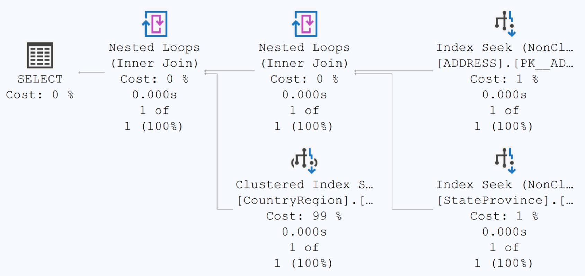

*Hình 19-1. Kế hoạch thực thi minh họa sự kết hợp giữa các loại bảng*

Điểm thú vị nhất là: Bộ tối ưu hóa đánh giá rằng thao tác **Clustered Index Seek** (để lấy đúng một dòng duy nhất) trên bảng đĩa truyền thống `dbo.CountryRegion` chiếm tới **99% tổng chi phí** của toàn bộ câu truy vấn! Các thao tác Index Seek trên các bảng In-Memory nhẹ và nhanh đến mức chi phí của chúng gần như biến mất trên biểu đồ.

Điều quan trọng cần nhấn mạnh là: Kế hoạch thực thi này hoạt động hoàn toàn tự nhiên và quen thuộc. Dù nó thực hiện tìm kiếm trên một chỉ mục băm phi cụm (Nonclustered Hash Index) thay vì các cây B-Tree truyền thống, nhưng nguyên lý toán tử Seek vẫn tương tự.

Bảng 19-1 đối chiếu các chỉ số hiệu năng khi thực thi câu truy vấn này giữa môi trường In-Memory và bảng truyền thống trên cơ sở dữ liệu `AdventureWorks`.

#### Bảng 19-1. So sánh hiệu năng cho câu truy vấn SELECT đơn giản

| Cơ sở dữ liệu | Thời gian thực thi (Duration) | Số lượt đọc (Reads) |
| :--- | :--- | :--- |
| **InMemoryTest** | 148 µs | 2 |
| **AdventureWorks** | 192 µs | 6 |

Mặc dù đây chỉ là một ví dụ quy mô nhỏ trả về 1 dòng dữ liệu đơn lẻ, nhưng thời gian thực thi đã nhanh hơn xấp xỉ **22%**, đồng thời số lượt đọc logic giảm tới **66%**.

> [!IMPORTANT]
> **Lưu ý cốt lõi về chỉ số "Reads" đối với Bảng In-Memory:**  
> Chỉ số reads mà chúng ta thường theo dõi xuyên suốt cuốn sách không mang cùng ý nghĩa vật lý khi áp dụng cho bảng In-Memory. Đối với bảng tối ưu bộ nhớ, hoàn toàn không có dữ liệu nào được đọc từ đĩa cứng (ngoại trừ giai đoạn khôi phục dữ liệu lúc máy chủ khởi động). Dữ liệu In-Memory được tổ chức thành các chuỗi dòng liên kết trong RAM chứ không lưu trữ theo các trang 8 KB truyền thống. Do đó, bạn không thể so sánh trực tiếp số lượng reads giữa bảng đĩa và bảng In-Memory. **Thời gian thực thi (Duration)** mới chính là thước đo chuẩn xác và khách quan nhất để đánh giá hiệu quả cải thiện hiệu năng.

---

## Biến bảng tối ưu bộ nhớ (In-Memory Table Variables)

Như đã đề cập, bạn hoàn toàn có thể tạo lập các **biến bảng tối ưu bộ nhớ (Memory-Optimized Table Variables)**. 

Giá trị thực tế lớn nhất của chúng là mang lại hiệu năng vượt trội cho các tác vụ trung gian. Bản chất của các biến bảng truyền thống là những cấu trúc lưu trữ cực kỳ ngắn hạn; tuy nhiên, trong kiến trúc mặc định của SQL Server, các biến bảng truyền thống lại được tạo ra và ghi dữ liệu trực tiếp vào cơ sở dữ liệu hệ thống **`tempdb`**, dẫn đến nguy cơ tắc nghẽn I/O và tranh chấp chốt phân trang (latch contention trên các trang PFS/GAM/SGAM). Việc chuyển đổi biến bảng sang lưu trữ trong bộ nhớ In-Memory sẽ loại bỏ hoàn toàn các gánh nặng này của `tempdb`.

Để sử dụng biến bảng In-Memory, trước tiên bạn bắt buộc phải tạo một kiểu dữ liệu bảng người dùng định nghĩa (**User-Defined TABLE TYPE**) có gắn tùy chọn `MEMORY_OPTIMIZED = ON` như minh họa trong Listing 19-7.

#### Listing 19-7. Khai báo kiểu bảng tối ưu bộ nhớ
```sql
CREATE TYPE dbo.PostalCodeType AS TABLE
(
    ID INT NOT NULL PRIMARY KEY NONCLUSTERED,
    City NVARCHAR(30) NOT NULL,
    PostalCode NVARCHAR(15) NOT NULL,
    INDEX CityIndex HASH (City) WITH (BUCKET_COUNT = 100)
)
WITH (MEMORY_OPTIMIZED = ON);
```

Yêu cầu bắt buộc khi khai báo kiểu bảng In-Memory: Bạn phải định nghĩa ít nhất một chỉ mục (chỉ mục B-Tree phi cụm hoặc chỉ mục Băm). Trong Listing 19-7, chúng ta kết hợp cả hai loại chỉ mục trên các cột tương ứng.

Sau khi TYPE đã sẵn sàng, chúng ta sử dụng nó trong mã T-SQL hệt như một biến bảng thông thường. Listing 19-8 minh họa việc khai báo và nạp dữ liệu vào biến bảng In-Memory.

#### Listing 19-8. Nạp dữ liệu vào biến bảng In-Memory
```sql
DECLARE @PostalCode AS dbo.PostalCodeType;
INSERT INTO @PostalCode
(
    City,
    PostalCode
)
SELECT DISTINCT
       a.City,
       a.PostalCode
FROM Person.Address AS a;
```

Để thấy rõ sự tương phản, Listing 19-9 thể hiện cùng một tác vụ nhưng sử dụng biến bảng truyền thống trong `tempdb`.

#### Listing 19-9. Nạp dữ liệu vào biến bảng truyền thống
```sql
DECLARE @OldPostalCode AS TABLE
(
    id INT IDENTITY NOT NULL PRIMARY KEY NONCLUSTERED,
    City NVARCHAR(30) NOT NULL,
    PostalCode NVARCHAR(15) NOT NULL,
    INDEX CityIndex NONCLUSTERED (City)
);
INSERT INTO @OldPostalCode
(
    City,
    PostalCode
)
SELECT DISTINCT
       a.City,
       a.PostalCode
FROM Person.Address AS a;
```

Sự khác biệt về hiệu năng nạp dữ liệu là vô cùng rõ rệt:
* Biến bảng In-Memory hoàn tất việc nạp dữ liệu chỉ trong **15,1 ms**.
* Biến bảng truyền thống mất tới **25,8 ms** (chậm hơn gần 70%).

Sự vượt trội tiếp tục được thể hiện khi thực hiện truy vấn trích xuất dữ liệu từ biến bảng như minh họa trong Listing 19-10.

#### Listing 19-10. Truy vấn dữ liệu từ biến bảng
```sql
DECLARE @PostalCode AS dbo.PostalCodeType;
INSERT INTO @PostalCode
(
    City,
    PostalCode
)
SELECT DISTINCT
       a.City,
       a.PostalCode
FROM Person.Address AS a;

SELECT * FROM @PostalCode AS pc
WHERE pc.City = 'London';
```

Khi đối chiếu câu lệnh `SELECT` cuối cùng giữa hai giải pháp:
* Câu lệnh `SELECT` trên biến bảng In-Memory thực thi chỉ mất **118 µs**.
* Trong khi câu lệnh `SELECT` tương đương trên biến bảng truyền thống mất tới **339 µs** (chậm hơn gần gấp 3 lần).

Tóm lại, việc áp dụng các biến bảng tối ưu bộ nhớ mang lại một bước nhảy vọt to lớn về hiệu năng so với các biến bảng truyền thống, đồng thời giúp giải tỏa áp lực tranh chấp chốt tài nguyên trên `tempdb`.

---

## Chỉ mục trên bảng tối ưu bộ nhớ (In-Memory Indexes)

Mỗi bảng tối ưu bộ nhớ (*memory-optimized table*) bắt buộc phải có ít nhất một chỉ mục. Do dữ liệu dòng được lưu trữ dưới dạng một đơn vị độc lập bên trong bộ nhớ RAM, bắt buộc phải có một chỉ mục để định hình và truy cập cấu trúc bảng. Dữ liệu không được tổ chức trên các trang dữ liệu 8 KB thông thường, đó là lý do tại sao các chỉ số đọc logic (reads) không hề giống với bảng trên đĩa. Cũng nhờ cơ chế lưu trữ này, bạn hoàn toàn **không phải bận tâm về vấn đề phân mảnh chỉ mục**. Một thao tác `UPDATE` trong In-Memory OLTP thực chất bao gồm một thao tác `DELETE` logic và một thao tác `INSERT` phiên bản mới; một tiến trình nền sau đó sẽ thu dọn các bản ghi cũ (*garbage collection*).

Trước phiên bản SQL Server 2017, bạn bị giới hạn tối đa 8 chỉ mục cho mỗi bảng. Giờ đây, giới hạn đã được nâng lên 999 chỉ mục (tuy nhiên hãy nhớ rằng, đây là giới hạn trần, không phải mục tiêu phấn đấu).

Các chỉ mục trên bảng tối ưu bộ nhớ tồn tại hoàn toàn trong bộ nhớ RAM tương tự như bản thân bảng đó. Mức độ bền vững (*durability*) của chỉ mục sẽ luôn khớp với độ bền vững của bảng mà nó được tạo ra (`SCHEMA_AND_DATA` hoặc `SCHEMA_ONLY`).

Chúng ta hãy cùng khám phá chi tiết các loại chỉ mục In-Memory này.

---

### Chỉ mục băm (Hash Index)

Chỉ mục băm (*hash index*) hoàn toàn khác biệt so với tất cả các loại chỉ mục truyền thống khác trong SQL Server. Một chỉ mục băm sử dụng một thuật toán băm nội tại để tính toán ra một giá trị băm (*hash value*) từ khóa chỉ mục. Các giá trị băm này được lưu trữ trong một mảng các xô băm (*hash buckets*). Thuật toán băm là một hàm xác định bất biến: đối với cùng một giá trị khóa đầu vào nhất định, hàm sẽ luôn luôn tính toán ra cùng một giá trị băm tương ứng.

Bảng băm hoạt động cực kỳ hiệu quả. Giá trị băm là phương thức tuyệt vời để truy xuất tức thời một dòng đơn lẻ (*point lookup*). Tuy nhiên, khi bắt đầu xuất hiện nhiều dòng dữ liệu có cùng một giá trị băm (hiện tượng va chạm băm - *hash collision*), hiệu quả truy xuất sẽ bắt đầu suy giảm.

Bí quyết cốt lõi để giúp chỉ mục băm đạt hiệu năng tối ưu là thiết lập sự phân phối hợp lý trên các xô băm (*hash buckets*). Khi tạo chỉ mục, bạn bắt buộc phải cung cấp tham số `BUCKET_COUNT`. Trong ví dụ ở Listing 19-3 trước đó, tôi đã cung cấp giá trị `BUCKET_COUNT = 50000`. Khi xét thấy bảng hiện tại có khoảng 19.000 dòng, số lượng xô băm này là quá đủ để chứa dữ liệu hiện có và để dành biên độ tăng trưởng dữ liệu trong tương lai.

Số lượng xô băm phải đủ lớn, nhưng không được quá lớn:
- Nếu `BUCKET_COUNT` quá nhỏ: nhiều giá trị khác nhau sẽ rơi vào chung một xô, làm chuỗi liên kết dài ra và khiến chỉ mục kém hiệu quả.
- Nếu `BUCKET_COUNT` quá lớn: bạn sẽ có rất nhiều xô rỗng (*empty buckets*). Khi một thao tác quét (*scan*) diễn ra, SQL Server buộc phải duyệt qua tất cả các xô này kể cả khi chúng rỗng, làm chậm tốc độ quét.

Hình 19-2 minh họa sự phân phối các giá trị băm trong các xô theo dạng phân phối nông (*shallow*) và phân phối sâu (*deep*).

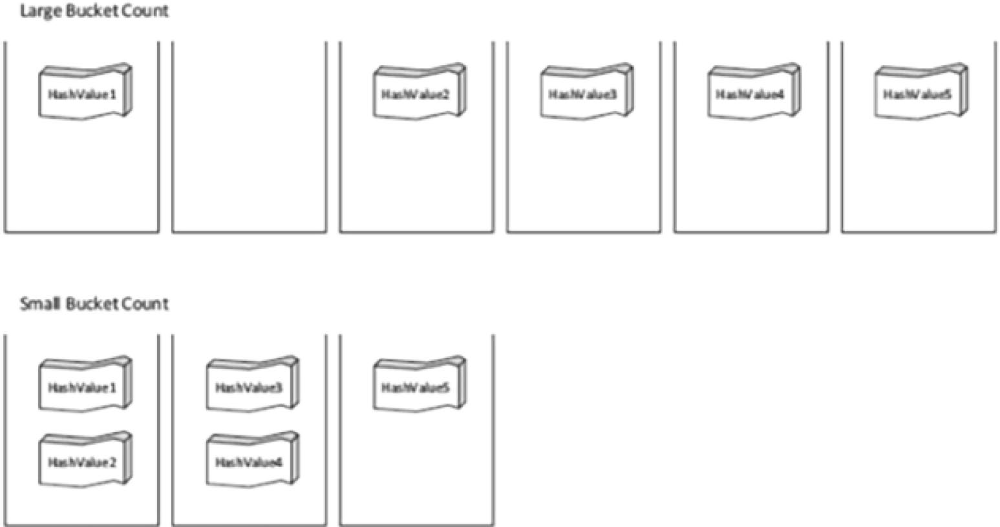

- Với **phân phối nông** (*shallow distribution*): các thao tác tìm kiếm điểm (*point lookups*) cho từng dòng đơn lẻ diễn ra cực kỳ nhanh chóng, nhưng thao tác quét sẽ chậm hơn do nhiều xô rỗng.
- Với **phân phối sâu** (*deep distribution*): thao tác tìm kiếm điểm sẽ chậm hơn một chút vì phải duyệt qua chuỗi liên kết va chạm, nhưng thao tác quét sẽ nhanh hơn. Tuy nhiên, nếu bạn nhận thấy các truy vấn của mình thường xuyên phải thực hiện thao tác quét trên bảng tối ưu bộ nhớ, bạn nên cân nhắc chuyển trở lại bảng thông thường trên đĩa.

Khuyến nghị thiết lập `BUCKET_COUNT`:
- Nếu bạn không dự kiến dữ liệu tăng trưởng: thiết lập số xô bằng chính xác số dòng của bảng.
- Nếu dữ liệu tăng trưởng theo thời gian: thiết lập số xô gấp **1 đến 2 lần** số lượng dòng dự kiến. Đừng quá lo lắng về điều này; ngay cả khi số lượng xô hơi thừa hoặc hơi thiếu một chút, hiệu năng vẫn thường rất xuất sắc. Chỉ cần nhớ rằng: bạn càng cấp phát nhiều bucket thì lượng bộ nhớ RAM tiêu tốn càng tăng.

Bạn cũng cần lưu ý đến tính duy nhất của giá trị khóa. Các chỉ mục duy nhất (*Unique indexes*) và Khóa chính (*Primary Keys*) là những ứng viên hoàn hảo cho hash index vì giá trị của chúng là duy nhất. Khuyến nghị chung là tỷ lệ giữa tổng số dòng trên số giá trị duy nhất nên **nhỏ hơn 10**.

Giá trị băm thực chất chỉ là một con trỏ trỏ tới xô băm. Nếu có nhiều dòng trùng giá trị băm, chúng sẽ được xâu chuỗi lại với nhau thành một danh sách liên kết đơn (*singly linked list*), mỗi dòng trỏ tới dòng kế tiếp. Khi tìm thấy xô, bạn đã tìm thấy dòng đầu tiên trong chuỗi; sau đó bạn phải duyệt quét qua chuỗi liên kết để tìm ra dòng dữ liệu thực tế cần lấy. Điều này đồng nghĩa với việc thao tác point lookup bị biến thành một thao tác quét chuỗi vi mô — đó là lý do tại sao cần hạn chế tối đa số lượng giá trị trùng lặp trong chỉ mục băm.

Bạn có thể kiểm tra sự phân phối dữ liệu bên trong chỉ mục băm thông qua DMV `sys.dm_db_xtp_hash_index_stats` trong Listing 19-11.

**Listing 19-11.** Truy vấn sys.dm_db_xtp_hash_index_stats để kiểm tra chỉ mục băm

```sql
SELECT i.NAME AS [index name],
       hs.total_bucket_count,
       hs.empty_bucket_count,
       hs.avg_chain_length,
       hs.max_chain_length
FROM sys.dm_db_xtp_hash_index_stats AS hs
    JOIN sys.indexes AS i
        ON hs.OBJECT_ID = i.OBJECT_ID
           AND hs.index_id = i.index_id
WHERE OBJECT_NAME(hs.OBJECT_ID) = 'Address';
```

Kết quả trả về được thể hiện trong Hình 19-3.

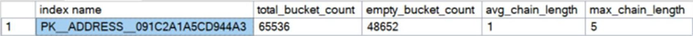

Có một vài thông số rất quan trọng cần lưu ý:
- `total_bucket_count` hiển thị giá trị **65.536**: mặc dù tôi yêu cầu 50.000 bucket, SQL Server đã tự động làm tròn lên lũy thừa của 2 kế tiếp ($2^{16} = 65.536$).
- `empty_bucket_count` có khoảng 48.652 xô rỗng (chiếm tỷ lệ hơi cao, nhưng chấp nhận được nếu đang dự phòng cho sự tăng trưởng).
- `avg_chain_length` (độ dài chuỗi va chạm trung bình) là **1**, đây là mức lý tưởng tuyệt đối.
- `max_chain_length` (độ dài chuỗi va chạm tối đa) là **5**, mức rất tốt (dưới ngưỡng cảnh báo 10).

Nếu số lượng xô rỗng quá nhiều, độ dài chuỗi trung bình vượt quá 5, và chuỗi tối đa vượt quá 10, đó là lúc bạn nên cân nhắc chuyển sang sử dụng chỉ mục phi gom cụm (*nonclustered index*) cho bảng tối ưu bộ nhớ.

---

### Chỉ mục phi gom cụm (Nonclustered Indexes)

Một chỉ mục phi gom cụm trên bảng tối ưu bộ nhớ (sử dụng cấu trúc cây **Bw-tree** không chốt / *latch-free*) hoạt động hoàn toàn tương tự như chỉ mục phi gom cụm truyền thống, ngoại trừ việc nó nằm hoàn toàn trên RAM. Mức độ bền vững của chỉ mục cũng tuân theo độ bền vững của bảng.

Hãy xem xét truy vấn trong Listing 19-12.

**Listing 19-12.** Một truy vấn đang thiếu chỉ mục hỗ trợ

```sql
SELECT A.AddressLine1,
       A.City,
       A.PostalCode,
       sp.NAME AS StateProvinceName,
       cr.NAME AS CountryName
FROM dbo.ADDRESS AS A
    JOIN dbo.StateProvince AS sp
        ON sp.StateProvinceID = A.StateProvinceID
    JOIN dbo.CountryRegion AS cr
        ON cr.CountryRegionCode = sp.CountryRegionCode
WHERE A.City = 'Walla Walla';
```

Do mệnh đề `WHERE` trên cột `City` không có chỉ mục nào hỗ trợ, chúng ta nhận được một thao tác quét toàn bộ bảng (*scan*) `dbo.Address`, như thể hiện trong Hình 19-4.

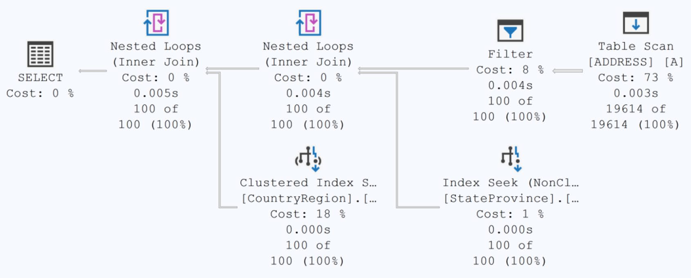

Mặc dù thao tác quét trên bảng In-Memory diễn ra nhanh hơn nhiều so với trên đĩa, nhưng nó vẫn là một vấn đề suy thoái hiệu năng nghiêm trọng.

Bạn không thể thực thi lệnh `CREATE INDEX` độc lập thông thường trên bảng tối ưu bộ nhớ. Thay vào đó, bạn phải tạo lại bảng hoặc sử dụng lệnh `ALTER TABLE` để bổ sung chỉ mục, như minh họa trong Listing 19-13.

**Listing 19-13.** Sử dụng ALTER TABLE để thêm chỉ mục phi gom cụm

```sql
ALTER TABLE dbo.ADDRESS ADD INDEX nci (City);
```

Kế hoạch thực thi sau khi bổ sung chỉ mục được hiển thị trong Hình 19-5.

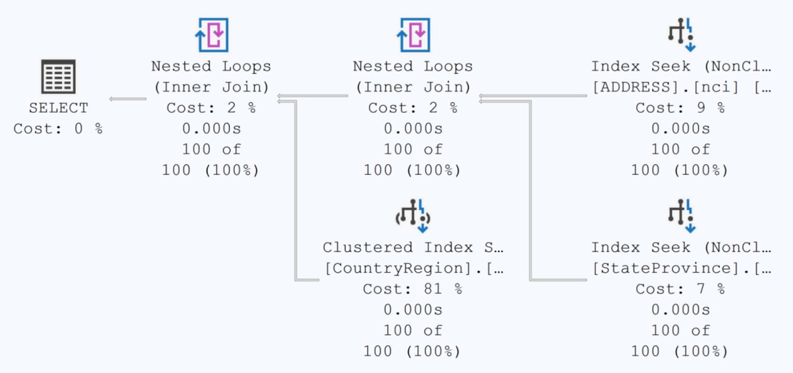

Thao tác tìm kiếm chỉ mục (*Index Seek*) đã thay thế hoàn toàn thao tác quét. Do cách thức lưu trữ dữ liệu dòng hoàn chỉnh trong bảng tối ưu bộ nhớ, **hoàn toàn không cần đến thao tác Key Lookup**. Thời gian thực thi truy vấn đã giảm ngoạn mục từ 3.8 ms xuống chỉ còn **947 µs**!

---

### Chỉ mục Columnstore trên bảng In-Memory

Không có sự khác biệt lớn giữa bảng tối ưu bộ nhớ và bảng thông thường khi áp dụng chỉ mục columnstore. Bạn bị giới hạn duy nhất ở loại **Clustered Columnstore Index**. Bạn bắt buộc phải có đủ dung lượng bộ nhớ RAM để đáp ứng lượng dữ liệu được nén trong chỉ mục. Ngoài các yếu tố đó, nó hoạt động tương tự như một columnstore index tiêu chuẩn.

---

### Duy trì số liệu thống kê (Statistics Maintenance)

Các bảng tối ưu bộ nhớ vẫn sở hữu các số liệu thống kê (*statistics*) và các thống kê này bắt buộc phải được duy trì cập nhật. Thông tin thống kê có thể được thu thập bằng các công cụ tiêu chuẩn. Listing 19-14 truy vấn thuộc tính thống kê trên bảng `Address`.

**Listing 19-14.** Truy vấn sys.dm_db_stats_properties trên bảng tối ưu bộ nhớ

```sql
SELECT s.NAME,
       s.stats_id,
       ddsp.last_updated,
       ddsp.ROWS,
       ddsp.rows_sampled,
       ddsp.unfiltered_rows,
       ddsp.persisted_sample_percent,
       ddsp.steps
FROM sys.STATS AS s
     CROSS APPLY sys.dm_db_stats_properties(s.OBJECT_ID, s.stats_id) AS ddsp
WHERE s.OBJECT_ID = OBJECT_ID('Address');
```

Kết quả trả về được minh họa trong Hình 19-6.

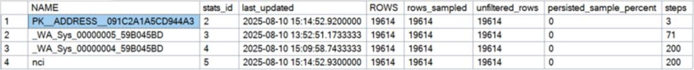

Như bạn thấy, các đối tượng thống kê tự động được tạo ra cho các chỉ mục trên bảng, cùng với các thống kê do hệ thống tự sinh trên các cột được truy vấn. Bạn cũng có thể xem lược đồ tần suất (*histogram*) cho các chỉ mục (kể cả hash index) bằng hàm `sys.dm_db_stats_histogram` trong Listing 19-15.

**Listing 19-15.** Truy vấn sys.dm_db_stats_histogram của chỉ mục băm

```sql
SELECT ddsh.step_number,
       ddsh.range_high_key,
       ddsh.range_rows,
       ddsh.equal_rows,
       ddsh.distinct_range_rows,
       ddsh.average_range_rows
FROM sys.dm_db_stats_histogram(OBJECT_ID('Address'), 2) AS ddsh;
```

Kết quả histogram được thể hiện trong Hình 19-7.

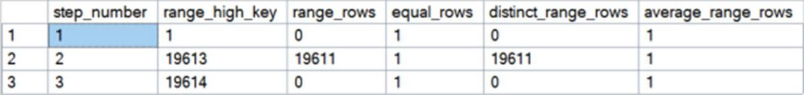

Từ SQL Server 2016 trở lên (với mức tương thích cơ sở dữ liệu từ 130 trở lên), số liệu thống kê trên bảng tối ưu bộ nhớ được **tự động duy trì và cập nhật** giống như bảng trên đĩa. Với các phiên bản cũ hơn (như SQL Server 2014), bạn bắt buộc phải cập nhật thống kê thủ công bằng câu lệnh `UPDATE STATISTICS` đi kèm tùy chọn `WITH FULLSCAN, NORECOMPUTE` như trong Listing 19-16, nếu không hệ thống sẽ báo lỗi.

**Listing 19-16.** Cập nhật thống kê thủ công trong SQL Server 2014

```sql
UPDATE STATISTICS dbo.ADDRESS
WITH FULLSCAN,
     NORECOMPUTE;
```

Ngoại trừ lưu ý lịch sử đó, cơ chế thống kê của bảng In-Memory hoàn toàn tương đồng với những gì đã trình bày trong Chương 5.

---

### Chuẩn bị dữ liệu cho thủ tục lưu trữ biên dịch gốc

Nếu hiệu năng vượt bậc của các bảng tối ưu bộ nhớ vẫn chưa đủ đáp ứng yêu cầu khắt khe của hệ thống, bạn có thể tiến thêm một bước nữa: **biên dịch các thủ tục lưu trữ thành mã máy C/DLL trực tiếp** để chúng thực thi ngay bên trong nhân hệ thống con của SQL Server.

Tất cả các bảng được tham chiếu bên trong một thủ tục biên dịch gốc (*natively compiled stored procedure*) bắt buộc phải là các bảng tối ưu bộ nhớ (*memory-optimized*). Để chuẩn bị cho thủ tục biên dịch gốc sắp tạo ở phần tiếp theo, Listing 19-17 thực hiện tái tạo lại bảng `CountryRegion` thành một bảng In-Memory.

**Listing 19-17.** Tái tạo bảng CountryRegion thành bảng tối ưu bộ nhớ

```sql
DROP TABLE IF EXISTS dbo.CountryRegion;
GO
CREATE TABLE dbo.CountryRegion
(
    CountryRegionCode NVARCHAR(3) NOT NULL,
    NAME VARCHAR(50) NOT NULL,
    ModifiedDate DATETIME NOT NULL
        CONSTRAINT DF_CountryRegion_ModifiedDate
            DEFAULT (GETDATE()),
    CONSTRAINT PK_CountryRegion_CountryRegionCode
        PRIMARY KEY NONCLUSTERED (CountryRegionCode ASC)
)
WITH (MEMORY_OPTIMIZED = ON);
GO
INSERT dbo.CountryRegion
(
    CountryRegionCode,
    NAME
)
SELECT cr.CountryRegionCode,
       cr.Name
FROM Person.CountryRegion AS cr;
```

---

## Thủ tục lưu trữ biên dịch gốc (Natively Compiled Stored Procedures)

Bên cạnh các bảng tối ưu hóa bộ nhớ, đỉnh cao thứ hai trong bộ công nghệ In-Memory OLTP chính là **Thủ tục lưu trữ biên dịch gốc (Natively Compiled Stored Procedures)**. 

Trong kiến trúc SQL Server truyền thống, khi một Stored Procedure được thực thi, công cụ truy vấn (Query Engine) sẽ diễn dịch (*interpret*) từng câu lệnh T-SQL, tìm kiếm kế hoạch thực thi trong bộ nhớ đệm hoặc gọi trình tối ưu hóa để biên dịch kế hoạch thành mã thực thi nội bộ. Quá trình này tiêu tốn chu kỳ CPU và phát sinh độ trễ nhất định.

Ngược lại, một thủ tục lưu trữ biên dịch gốc sẽ được **biên dịch trực tiếp sang mã nguồn C, rồi sau đó được trình biên dịch C tích hợp sẵn trong SQL Server biên dịch thành một thư viện liên kết động (DLL mã máy) ngay tại thời điểm thủ tục được khởi tạo** (`CREATE PROCEDURE`). Khi ứng dụng triệu gọi thủ tục, mã máy DLL sẽ được nạp trực tiếp vào không gian bộ nhớ của tiến trình và thực thi ở tốc độ phần cứng, loại bỏ hoàn toàn tầng diễn dịch T-SQL trung gian!

Để một Stored Procedure có thể biên dịch gốc, tất cả các bảng mà nó tham chiếu bắt buộc phải là các bảng tối ưu hóa bộ nhớ (*Memory-Optimized Tables*). Ở cuối phần trước, chúng ta đã chuyển đổi bảng `CountryRegion` thành bảng tối ưu bộ nhớ trong Listing 19-17, do đó toàn bộ 3 bảng (`dbo.Address`, `dbo.StateProvince`, `dbo.CountryRegion`) hiện đều đã nằm trên cấu trúc bộ nhớ. Listing 19-18 minh họa cú pháp khai báo và khởi tạo một thủ tục lưu trữ biên dịch gốc.

**Listing 19-18.** Khởi tạo thủ tục lưu trữ biên dịch gốc

```sql
CREATE PROC dbo.AddressDetails @City NVARCHAR(30)
WITH NATIVE_COMPILATION, SCHEMABINDING, EXECUTE AS OWNER AS
BEGIN ATOMIC WITH (TRANSACTION ISOLATION LEVEL = SNAPSHOT, LANGUAGE = N'us_english')
    SELECT A.AddressLine1,
           A.City,
           A.PostalCode,
           sp.NAME AS StateProvinceName,
           cr.NAME AS CountryName
    FROM dbo.ADDRESS AS A
        JOIN dbo.StateProvince AS sp
            ON sp.StateProvinceID = A.StateProvinceID
        JOIN dbo.CountryRegion AS cr
            ON cr.CountryRegionCode = sp.CountryRegionCode
    WHERE A.City = @City;
END;
```

Khi thực thi thủ tục biên dịch gốc này với tham số `@City = 'Walla Walla'` tương tự như trong Listing 19-12, thời gian thực thi đo lường được là **893 µs**, nhanh hơn đáng kể so với mức **947 µs** của câu truy vấn diễn dịch (Interpreted query) trước đó.

Quan sát mã lệnh trong Listing 19-18, bạn sẽ nhận thấy hàng loạt yêu cầu cú pháp và ràng buộc bắt buộc:
1. **Mệnh đề `WITH NATIVE_COMPILATION`:** Chỉ thị cho SQL Server biết đây là thủ tục cần được biên dịch gốc sang DLL mã máy.
2. **Mệnh đề `SCHEMABINDING`:** Bắt buộc phải liên kết lược đồ với các bảng bên dưới, bảo đảm cấu trúc của các bảng không thể bị thay đổi khi thủ tục đang tồn tại.
3. **Mệnh đề `EXECUTE AS`:** Bắt buộc phải chỉ định rõ ngữ cảnh bảo mật thực thi (ở đây là `EXECUTE AS OWNER`).
4. **Khối lệnh `BEGIN ATOMIC WITH (...)`:** Toàn bộ nội dung của thủ tục biên dịch gốc bắt buộc phải nằm gọn bên trong một **khối nguyên tử (Atomic Block)**. Khối nguyên tử bảo đảm tính toàn vẹn: hoặc mọi câu lệnh bên trong thành công trọn vẹn, hoặc toàn bộ giao dịch sẽ bị rollback. 
   - Bên trong khối ATOMIC, bạn bắt buộc phải định nghĩa mức cô lập giao dịch (`TRANSACTION ISOLATION LEVEL = SNAPSHOT`, `REPEATABLEREAD`, hoặc `SERIALIZABLE`).
   - Bắt buộc phải định nghĩa ngôn ngữ (`LANGUAGE = N'us_english'`).
5. **Ràng buộc về kiểu tham số:** Các tham số đầu vào không được phép chấp nhận giá trị `NULL` nếu không được định nghĩa rõ ràng.

### Phân tích kế hoạch thực thi của thủ tục biên dịch gốc

Kế hoạch thực thi của thủ tục biên dịch gốc được thể hiện trong Hình 19-8.

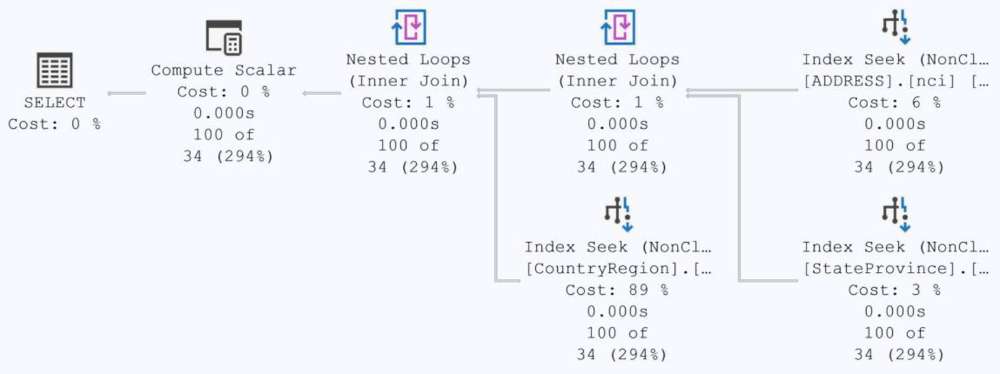

Nếu kiểm tra cửa sổ thuộc tính (*Properties*) của toán tử `SELECT` trong Hình 19-9, bạn sẽ nhận thấy phần lớn các thuộc tính runtime quen thuộc của T-SQL thông thường đều hoàn toàn biến mất hoặc không áp dụng.

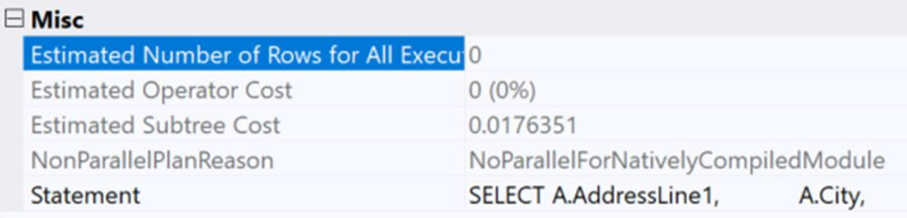

Nguyên nhân là do thủ tục này được thực thi trực tiếp dưới dạng mã máy trong không gian hệ điều hành (thông qua engine XTP), thoát ly khỏi bộ máy diễn dịch T-SQL truyền thống. 

Tuy nhiên, bạn vẫn nên sử dụng kế hoạch thực thi để rà soát các cơ hội tối ưu hóa chỉ mục (tìm kiếm các thao tác quét không mong muốn). 

> [!IMPORTANT]
> Một đặc tính kiến trúc cực kỳ quan trọng cần khắc ghi: **Tất cả các phép nối (Join) bên trong một thủ tục lưu trữ biên dịch gốc bắt buộc phải là Nested Loops Join**. Các toán tử Hash Join hay Merge Join hoàn toàn không được engine biên dịch gốc hỗ trợ.

---

## Các khuyến nghị triển khai In-Memory OLTP (Recommendations)

Mặc dù bước nhảy vọt về hiệu năng của bảng tối ưu hóa bộ nhớ và thủ tục biên dịch gốc là vô cùng to lớn, bạn **tuyệt đối không nên chuyển đổi cơ sở dữ liệu và các đối tượng của mình sang In-Memory một cách mù quáng**. Công nghệ này đòi hỏi những tiêu chuẩn phần cứng khắt khe và chỉ phát huy sức mạnh tối đa trên đúng các khối lượng công việc phù hợp.

Dưới đây là những khuyến nghị sống còn trước khi bạn quyết định triển khai:

### 1. Xây dựng đường cơ sở hiệu năng (Baselines)
Điều đầu tiên bạn bắt buộc phải có trong tay là bức tranh toàn diện và số liệu đo lường chuẩn xác về hiệu năng cũng như hành vi của hệ thống hiện tại. Hãy sử dụng Extended Events và các DMV để xác định xem: **Liệu hệ thống của bạn có thực sự đang gặp điểm nghẽn tại cơ chế khóa (locking) và chốt bộ nhớ (latching) hay không?** Nếu câu trả lời là có, In-Memory OLTP với cơ chế không khóa (*lock-free*) sẽ là vị cứu tinh hoàn hảo.

### 2. Lựa chọn đúng khối lượng công việc (Correct Workload)
Tên gọi của công nghệ này là **In-Memory OLTP** — nó được kiến trúc và tôi luyện dành riêng cho các hệ thống **Xử lý giao dịch trực tuyến (Online Transaction Processing)** với cường độ ghi/đọc dữ liệu tần suất cao và độ trễ cực thấp.
- Nếu hệ thống của bạn chủ yếu là tác vụ đọc phân tích, xuất báo cáo tổng hợp, hoặc chỉ có lưu lượng giao dịch thấp, thì công nghệ này **hoàn toàn không phù hợp**. Bạn sẽ phải bỏ ra một khối lượng công sức tái cấu trúc khổng lồ chỉ để thu về một sự cải thiện hiệu năng hết sức mờ nhạt.

---

## Công cụ cố vấn tối ưu hóa bộ nhớ trong SSMS (Memory Optimization Advisor)

SQL Server Management Studio (SSMS) tích hợp sẵn một công cụ đồ họa tuyệt vời có tên là **Memory Optimization Advisor** nhằm hỗ trợ DBA thẩm định khả năng di chuyển một bảng truyền thống sang cấu trúc tối ưu bộ nhớ.

Để khởi động công cụ, bạn nhấp chuột phải vào bảng cần kiểm tra trong cửa sổ *Object Explorer* và chọn **Memory Optimization Advisor**.

Trong thử nghiệm đầu tiên, nếu chúng ta chạy công cụ đối với bảng `Person.Address` nguyên bản của AdventureWorks, kết quả kiểm tra sẽ trả về thất bại như trong Hình 19-10.

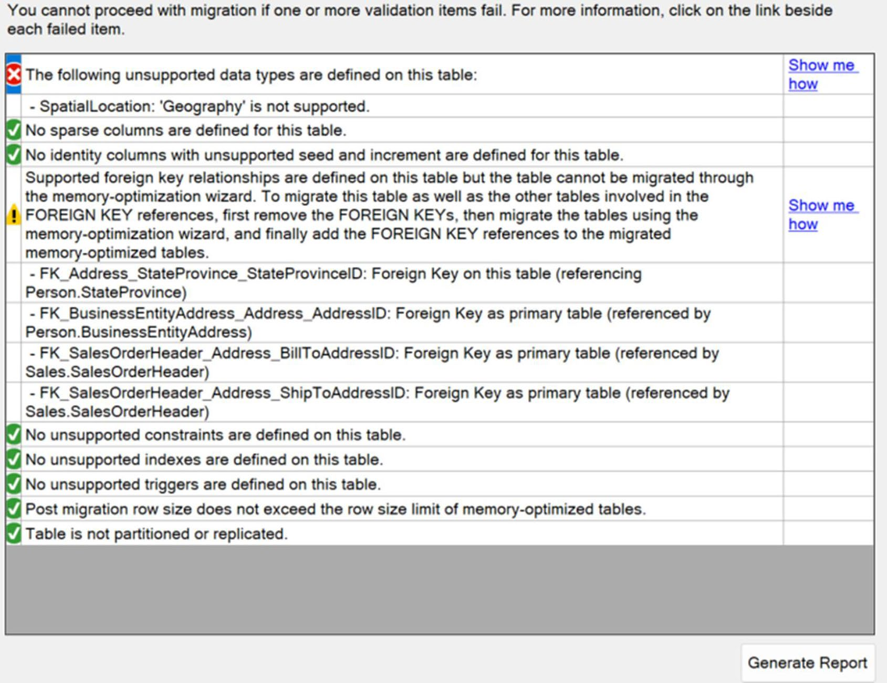

Nguyên nhân thất bại là do bảng `Person.Address` có chứa cột kiểu dữ liệu không gian (`geography`) — một kiểu dữ liệu **không được hỗ trợ** trong các bảng tối ưu bộ nhớ. Ngoài ra, công cụ cũng đưa ra cảnh báo rằng các mối quan hệ khóa ngoại (*Foreign Keys*) trỏ tới các bảng khác sẽ phải được gỡ bỏ trong quá trình di chuyển.

Để theo dõi các bước di chuyển tiếp theo của công cụ, chúng ta sử dụng đoạn mã trong Listing 19-19 để tạo một bảng thử nghiệm tương thích hoàn toàn trong cơ sở dữ liệu `InMemory`.

**Listing 19-19.** Tạo bảng tương thích dbo.AddressMigrate phục vụ di chuyển

```sql
CREATE TABLE dbo.AddressMigrate
(
    AddressID INT NOT NULL IDENTITY(1, 1) PRIMARY KEY,
    AddressLine1 NVARCHAR(60) NOT NULL,
    AddressLine2 NVARCHAR(60) NULL,
    City NVARCHAR(30) NOT NULL,
    StateProvinceID INT NOT NULL,
    PostalCode NVARCHAR(15) NOT NULL
);
```

Chạy lại công cụ Memory Optimization Advisor trên bảng `dbo.AddressMigrate`, toàn bộ các bài kiểm tra xác thực đều vượt qua thành công như hiển thị trong Hình 19-11.

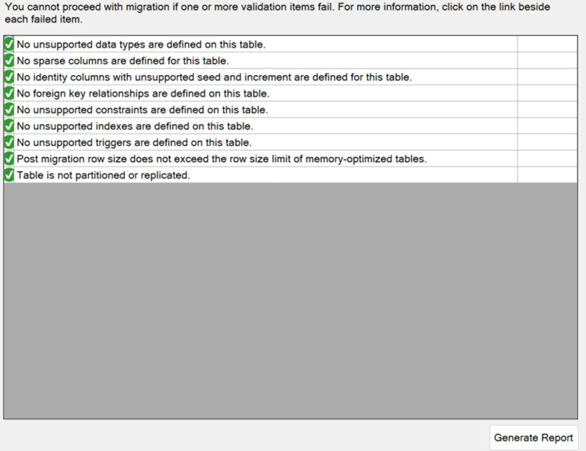

Nhấn **Next**, công cụ sẽ hiển thị màn hình cảnh báo về những đặc tính có thể bị biến đổi khi đưa bảng vào cấu trúc lưu trữ in-memory trong Hình 19-12.

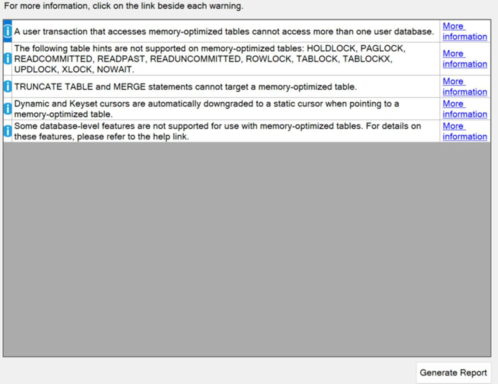

Ở bước tiếp theo trong Hình 19-13, bạn có thể chỉ định tên cho bảng mới, đổi tên bảng cũ thành bảng sao lưu, và tích chọn tùy chọn **Migrate table data** để công cụ tự động sao chép toàn bộ dữ liệu hiện có sang bảng mới.

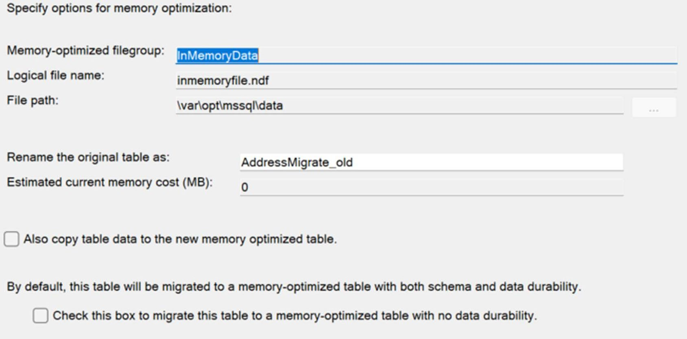

Tiếp theo trong Hình 19-14, công cụ cho phép bạn cấu hình chỉ mục cho bảng in-memory: lựa chọn giữa **Nonclustered Hash Index** (cần nhập số lượng xô băm `Bucket count`) hoặc **Nonclustered Index** (Bw-tree).

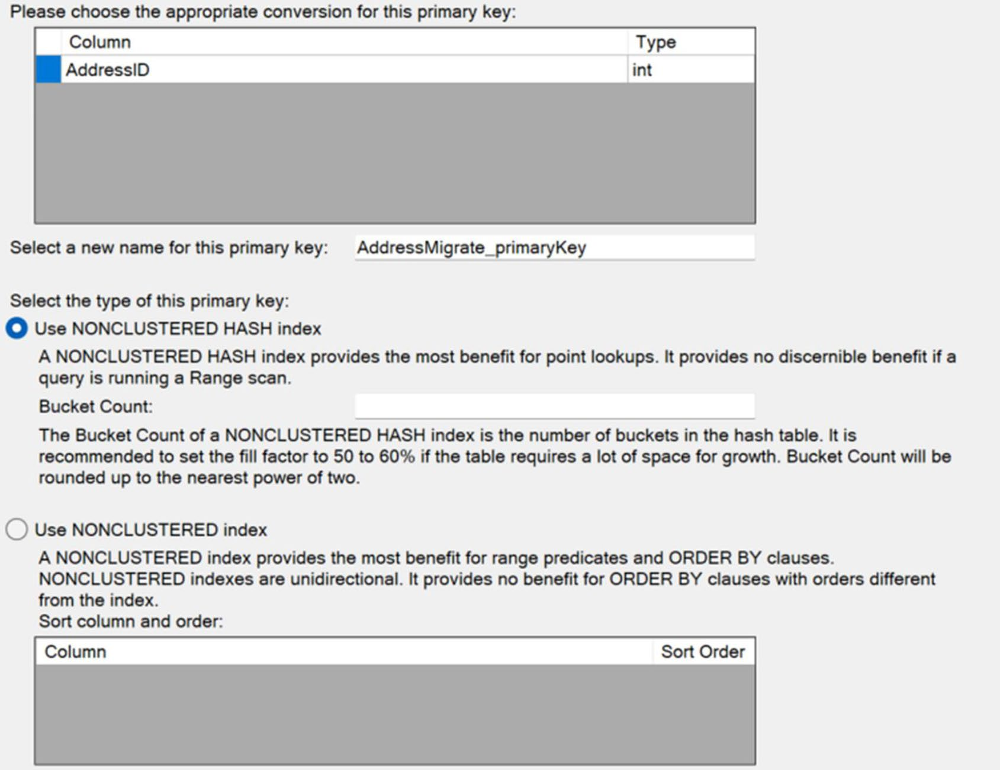

Sau khi hoàn tất quá trình, màn hình báo cáo trong Hình 19-15 xác nhận bảng đã được di chuyển thành công vào bộ lưu trữ tối ưu bộ nhớ.

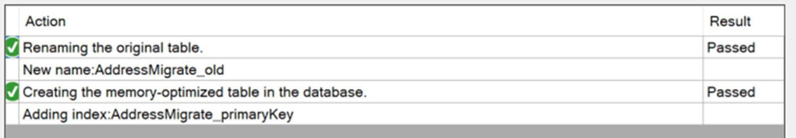

> [!NOTE]
> Mặc dù công cụ Cố vấn hỗ trợ bạn chuyển đổi một bảng cụ thể sang in-memory rất thuận tiện, nhưng nó **không thể giúp bạn quyết định xem bảng nào trong hệ thống thực sự nên di chuyển**. Bạn bắt buộc phải tự mình phân tích khối lượng công việc và điểm nghẽn của hệ thống để đưa ra quyết định kiến trúc chuẩn xác.

---

## Công cụ cố vấn biên dịch gốc (Native Compilation Advisor)

Tương tự như công cụ đánh giá bảng, SSMS cũng cung cấp công cụ **Native Compilation Advisor** để thẩm định xem một Stored Procedure có thỏa mãn đầy đủ các điều kiện khắt khe để chuyển đổi sang thủ tục biên dịch gốc hay không.

Listing 19-20 định nghĩa hai thủ tục lưu trữ: thủ tục `dbo.FailWizard` (chứa các yếu tố không tương thích) và thủ tục `dbo.PassWizard` (chuẩn mực).

**Listing 19-20.** Các thủ tục kiểm thử công cụ Native Compilation Advisor

```sql
-- Thủ tục sẽ thất bại khi kiểm tra
CREATE OR ALTER PROCEDURE dbo.FailWizard
(@City NVARCHAR(30))
AS
SELECT A.AddressLine1,
       A.City,
       A.PostalCode,
       sp.NAME AS StateProvinceName,
       cr.NAME AS CountryName
FROM dbo.ADDRESS AS A
    JOIN dbo.StateProvince AS sp
        ON sp.StateProvinceID = A.StateProvinceID
    JOIN dbo.CountryRegion AS cr WITH (NOLOCK)
        ON cr.CountryRegionCode = sp.CountryRegionCode
WHERE A.City = @City;
GO

-- Thủ tục sẽ vượt qua kiểm tra thành công
CREATE OR ALTER PROCEDURE dbo.PassWizard
(@City NVARCHAR(30))
AS
SELECT A.AddressLine1,
       A.City,
       A.PostalCode,
       sp.NAME AS StateProvinceName,
       cr.NAME AS CountryName
FROM dbo.ADDRESS AS A
    JOIN dbo.StateProvince AS sp
        ON sp.StateProvinceID = A.StateProvinceID
    JOIN dbo.CountryRegion AS cr
        ON cr.CountryRegionCode = sp.CountryRegionCode
WHERE A.City = @City;
GO
```

Nhấp chuột phải vào `dbo.FailWizard` và chọn **Native Compilation Advisor**, công cụ sẽ lập tức báo lỗi đỏ như hiển thị trong Hình 19-16.

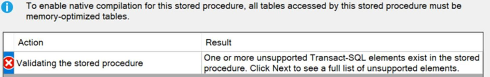

Nhấn **Next**, màn hình báo cáo trong Hình 19-17 giải thích chi tiết nguyên nhân thất bại: **Gợi ý bảng `WITH (NOLOCK)` hoàn toàn không được hỗ trợ trong các thủ tục biên dịch gốc**!

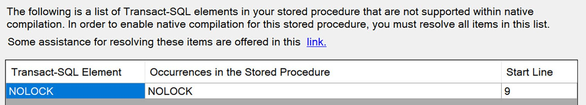

Ngược lại, nếu chạy công cụ trên thủ tục `dbo.PassWizard`, hệ thống sẽ xác nhận thủ tục hoàn toàn sạch sẽ và sẵn sàng để chuyển đổi. 

Khác với công cụ Cố vấn bảng, Native Compilation Advisor **không có trình thuật sĩ (Wizard) tự động viết lại mã T-SQL cho bạn**; bạn bắt buộc phải tự tay chỉnh sửa mã nguồn, bổ sung các mệnh đề `WITH NATIVE_COMPILATION`, `SCHEMABINDING` và khối `BEGIN ATOMIC` như đã hướng dẫn trong Listing 19-18.

---

## Tóm tắt chương (Summary)

Qua toàn bộ nội dung của chương này, bạn đã được khai mở các khái niệm nền tảng và kỹ thuật chuyên sâu xoay quanh **Bảng tối ưu hóa bộ nhớ (Memory-Optimized Tables)** và **Thủ tục lưu trữ biên dịch gốc (Natively Compiled Stored Procedures)** thuộc bộ giải pháp công nghệ In-Memory OLTP (Hekaton).

Đây là một bộ tính năng chuyên biệt hóa cao độ, có khả năng mang lại sự bứt phá vượt bậc về mặt thông lượng giao dịch và triệt tiêu độ trễ cho các hệ thống OLTP khắt khe nhất:
- **Loại bỏ hoàn toàn cơ chế khóa và chốt (Lock-free & Latch-free):** Sử dụng cơ chế kiểm soát tương tranh đa phiên bản (MVCC) trên bộ nhớ để người đọc và người ghi không bao giờ cản trở nhau.
- **Cấu trúc chỉ mục chuyên biệt:** Lựa chọn giữa **Hash Indexes** (tối ưu tuyệt đối cho tìm kiếm đẳng thức với `BUCKET_COUNT` hợp lý) và **Memory-Optimized Nonclustered Indexes** (cấu trúc Bw-tree không chốt cho tìm kiếm dải và sắp xếp).
- **Thủ tục biên dịch gốc:** Biên dịch T-SQL trực tiếp thành DLL mã máy để thực thi ở tốc độ vi xử lý phần cứng.
- **Tận dụng các công cụ Cố vấn trong SSMS:** Sử dụng Memory Optimization Advisor và Native Compilation Advisor để thẩm định tính khả thi và dẫn đường cho quá trình di chuyển.

Tuy nhiên, hãy luôn ghi nhớ rằng In-Memory OLTP đi kèm với rất nhiều ràng buộc khắt khe về mặt kiểu dữ liệu, các toán tử T-SQL hỗ trợ, cũng như đòi hỏi cấu hình phần cứng RAM tương xứng. Việc đánh giá kỹ lưỡng đường cơ sở hiệu năng và đặc thù khối lượng công việc sẽ là chìa khóa quyết định sự thành công của dự án.

Trong chương tiếp theo, chúng ta sẽ cùng nhau bước sang một chủ đề hiện đại và vô cùng hấp dẫn khác của SQL Server: **Bảng Đồ Thị (Graph Tables)**, cú pháp truy vấn đồ thị `MATCH` và các vấn đề hiệu năng cần lưu tâm khi thao tác với dữ liệu quan hệ dạng mạng lưới phức tạp.
