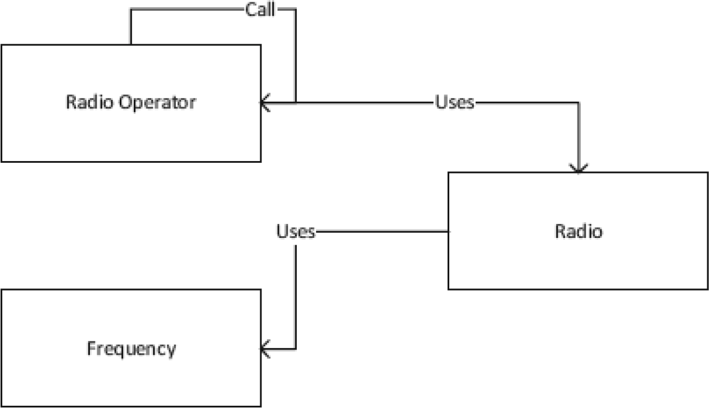
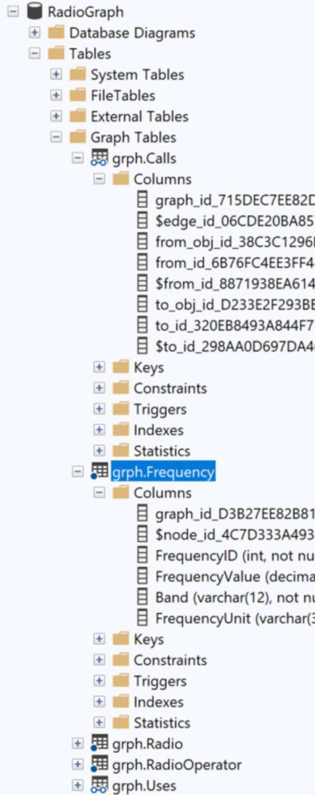
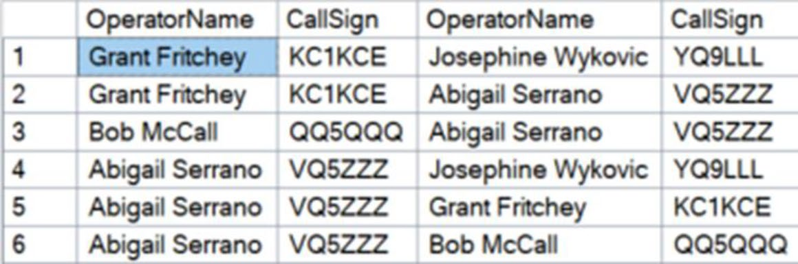
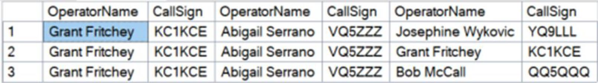
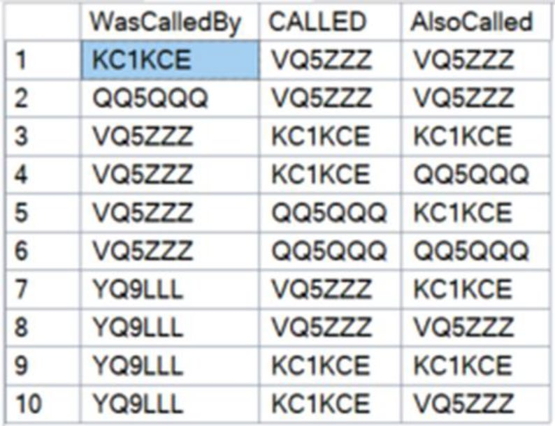
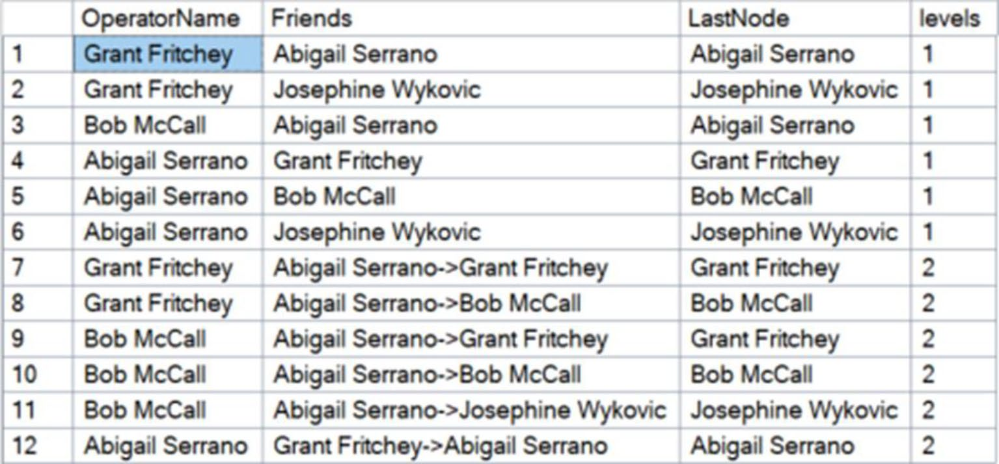
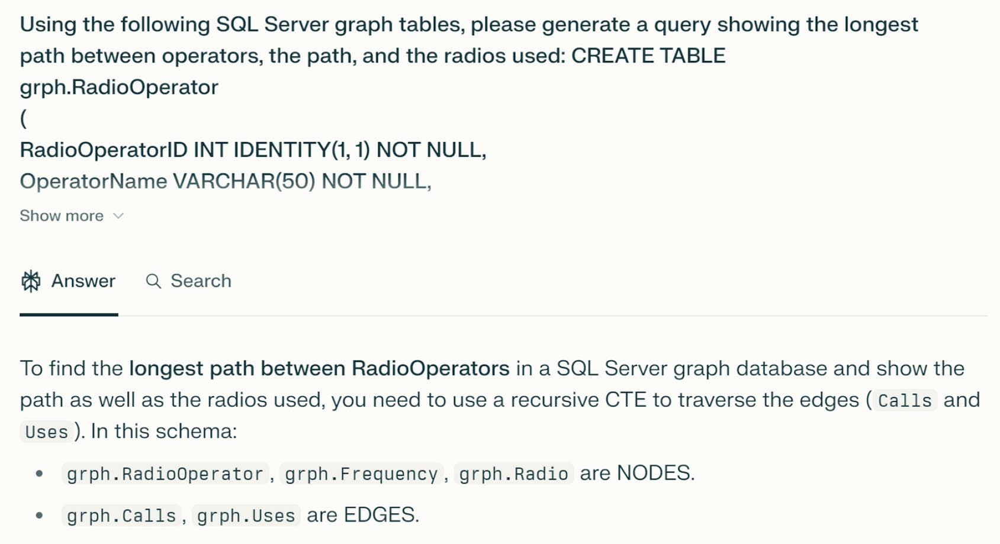
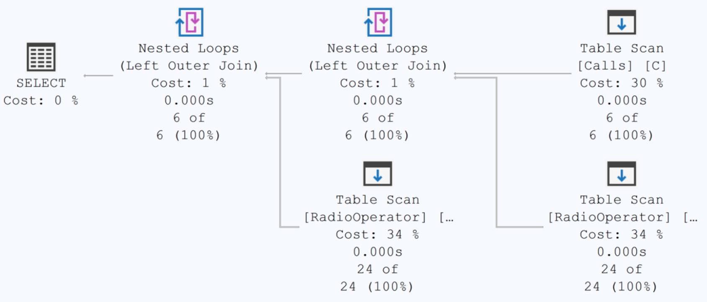
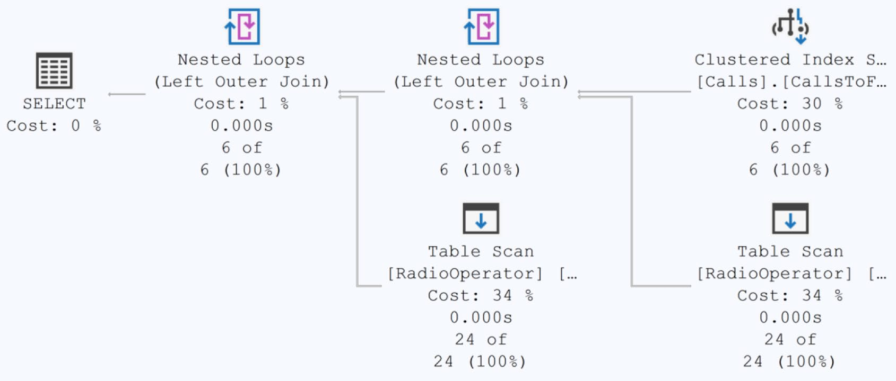

# CHƯƠNG 20: Cơ sở dữ liệu Đồ thị (Graph Databases)

Được chính thức giới thiệu từ phiên bản SQL Server 2017, tính năng **Cơ sở dữ liệu đồ thị (Graph Database)** cho phép lưu trữ các nút (**Nodes** - đỉnh) và các cạnh (**Edges** - mối quan hệ/cung) ngay bên trong kiến trúc quan hệ của SQL Server, đồng thời cho phép bạn sử dụng cú pháp mở rộng của T-SQL để truy vấn dữ liệu đồ thị một cách trực quan và tối ưu.

Dữ liệu đồ thị được định hướng chuyên biệt xung quanh các **mối quan hệ nhiều-nhiều (many-to-many relationships)** phức tạp. Loại dữ liệu này vốn không thực sự phù hợp với các cấu trúc chuẩn hóa quan hệ truyền thống (thường đòi hỏi rất nhiều bảng liên kết trung gian và các phép nối nhiều tầng cồng kềnh), mà thay vào đó tập trung giải quyết các bài toán về cấu trúc cây phân cấp (hierarchies), đồ thị mạng lưới và các mối liên hệ đa chiều vượt ra ngoài ranh giới của các bảng quan hệ thông thường.

Dữ liệu đồ thị được phân tách rạch ròi với các khối lượng công việc khác:
* Dữ liệu phân tích báo cáo truyền thống (OLAP) được phục vụ tối ưu nhất bởi các **chỉ mục Columnstore**.
* Các hệ thống giao dịch nghiệp vụ thông thường (OLTP) được hỗ trợ tốt nhất bởi các **chỉ mục Rowstore (B-Tree)**.
* Tuy nhiên, khi bạn sở hữu một tập dữ liệu bao gồm các cấu trúc phân cấp mạng lưới phức tạp và trọng tâm phân tích nằm ở chính **các mối quan hệ qua lại giữa các thực thể dữ liệu**, đó là lúc cơ sở dữ liệu đồ thị phát huy sức mạnh vượt trội.

Trong chương này, tôi sẽ lần lượt trình bày các nội dung sau:
* Giới thiệu tổng quan về cơ sở dữ liệu đồ thị trong SQL Server.
* Kỹ thuật truy vấn dữ liệu đồ thị (cú pháp hàm `MATCH` và `SHORTEST_PATH`).
* Các cân nhắc chuyên sâu về mặt hiệu năng khi làm việc với dữ liệu đồ thị.

---

## Giới thiệu về Cơ sở dữ liệu Đồ thị (Introduction to Graph Databases)

Mô hình đồ thị cơ bản bao gồm hai thành phần cấu tạo cốt lõi:
1. **Nút (Node):** Đại diện cho một thực thể độc lập (ví dụ: một con người, một địa điểm, một thiết bị phần cứng, một tổ chức).
2. **Cạnh (Edge):** Đại diện cho một mối quan hệ có hướng kết nối giữa hai nút với nhau.

Hình 20-1 minh họa một mô hình quan hệ đồ thị trực quan với các đỉnh và các cung liên kết.



*Hình 20-1. Mối quan hệ đồ thị với các nút và cạnh*

Trong kịch bản ví dụ được xây dựng xuyên suốt chương này, chúng ta sẽ có **3 bảng Nút (Node)** đại diện cho các đối tượng thực thể:
* **`RadioOperator`:** Các nhà khai thác vô tuyến / Người vận hành đài radio (Amateur Radio Operators).
* **`Frequency`:** Các dải tần số sóng vô tuyến.
* **`Radio`:** Các thiết bị máy thu phát vô tuyến.

Đồng thời, chúng ta sẽ có **2 bảng Cạnh (Edge)** đại diện cho các mối quan hệ:
* **`Calls`:** Hành động phát tín hiệu gọi / liên lạc giữa các nhà khai thác với nhau.
* **`Uses`:** Hành động sử dụng (nhà khai thác sử dụng thiết bị radio, hoặc thiết bị radio hoạt động trên một tần số nhất định).

Nói ngắn gọn: Nhiều nhà khai thác vô tuyến sẽ sử dụng nhiều tần số thông qua các thiết bị radio khác nhau để gọi và thiết lập các phiên liên lạc đa chiều với nhau.

Mặc dù thuật ngữ gọi là *"tạo một cơ sở dữ liệu đồ thị"*, trên thực tế bên dưới hệ điều hành SQL Server, chúng ta chỉ đơn thuần làm việc với các **bảng Nút (Node tables)** và **bảng Cạnh (Edge tables)** – chúng vận hành tương tự như các bảng dữ liệu thông thường nhưng được gắn thêm các siêu dữ liệu đồ thị chuyên dụng. 

Chúng ta hoàn toàn có thể xây dựng một cấu trúc quan hệ truyền thống (sử dụng các bảng khóa ngoại và bảng nối trung gian) để lưu trữ tập dữ liệu này. Tuy nhiên, các truy vấn đồ thị cung cấp cho chúng ta một cơ chế cú pháp tinh gọn và bộ máy thực thi hiệu quả hơn rất nhiều để khai thác dữ liệu đó. 

Thông qua mô hình đồ thị, bạn có thể dễ dàng khám phá các mối liên hệ tầng sâu ẩn giấu trong dữ liệu – ví dụ: xác định số bước nhảy liên lạc trung gian (**degrees of separation / hops**) giữa hai nhà khai thác vô tuyến chưa từng nói chuyện trực tiếp với nhau nhưng có mối liên hệ bắc cầu thông qua những người khác.

---

### Thiết lập Cơ sở dữ liệu Đồ thị (Database Setup)

Để bắt đầu làm việc, chúng ta sẽ tạo một cơ sở dữ liệu mới cùng với các schema chuyên biệt để chứa cấu trúc bảng đồ thị và bảng quan hệ đối chứng. Listing 20-1 khởi tạo môi trường này.

#### Listing 20-1. Tạo cơ sở dữ liệu cho dữ liệu đồ thị
```sql
CREATE DATABASE RadioGraph;
GO
USE RadioGraph;
GO

-- Tạo các schema để chứa các cấu trúc khác nhau
CREATE SCHEMA grph;
GO
CREATE SCHEMA rel;
GO
```

Hãy chú ý rằng bản thân cơ sở dữ liệu `RadioGraph` không hề có bất kỳ thuộc tính hay cờ cấu hình đặc biệt nào ở cấp database. Toàn bộ tính năng đồ thị đều được kích hoạt và quản lý ở cấp độ bảng và các câu lệnh T-SQL.

Chúng ta tạo ra hai schema độc lập:
* **`grph`:** Dùng để lưu trữ toàn bộ các bảng Nút và bảng Cạnh theo chuẩn Graph Database.
* **`rel`:** Dùng để lưu trữ các bảng quan hệ truyền thống tương đương, phục vụ cho việc đối chiếu và so sánh hiệu năng truy vấn ở các phần sau.

---

### Bảng Nút (Node Tables)

Để tạo một bảng Nút trong SQL Server, bạn chỉ cần sử dụng cú pháp khai báo bảng thông thường và bổ sung thêm mệnh đề **`AS NODE`** ở cuối câu lệnh `CREATE TABLE`.

Listing 20-2 minh họa việc tạo 3 bảng Nút đại diện cho 3 thực thể: Nhà khai thác (`RadioOperator`), Tần số (`Frequency`), và Thiết bị vô tuyến (`Radio`).

#### Listing 20-2. Khởi tạo các bảng Nút (Node Tables)
```sql
CREATE TABLE grph.RadioOperator
(
    RadioOperatorID INT IDENTITY(1, 1) NOT NULL,
    OperatorName VARCHAR(50) NOT NULL,
    CallSign VARCHAR(9) NOT NULL
) AS NODE;

CREATE TABLE grph.Frequency
(
    FrequencyID INT IDENTITY(1, 1) NOT NULL,
    FrequencyValue DECIMAL(6, 3) NOT NULL,
    Band VARCHAR(12) NOT NULL,
    FrequencyUnit VARCHAR(3) NOT NULL
) AS NODE;

CREATE TABLE grph.Radio
(
    RadioID INT IDENTITY(1, 1),
    RadioName VARCHAR(50) NOT NULL
) AS NODE;
```

Như bạn thấy trong Listing 20-2, điểm đặc biệt duy nhất khi tạo bảng chính là việc chỉ định mệnh đề `AS NODE`. Ngoài mệnh đề này, bạn hoàn toàn có thể khai báo các cột, các ràng buộc và kiểu dữ liệu hệt như các bảng thông thường.

Khi một bảng được tạo với mệnh đề `AS NODE`, SQL Server sẽ tự động bổ sung một cột hệ thống ẩn đặc biệt có tên là **`$node_id`**:
* Cột `$node_id` là một chuỗi định danh toàn cầu duy nhất (GUID/JSON) đại diện cho chính xác nút đó trong cơ sở dữ liệu.
* Giá trị của `$node_id` có định dạng JSON nội bộ dạng: `{"type":"node","schema":"grph","table":"RadioOperator","id":0}`.
* Cột này được sinh tự động và bạn không cần (và không được phép) tự gán giá trị khi chèn dữ liệu. Đồng thời, một chỉ mục duy nhất (Unique Index) sẽ tự động được tạo trên cột `$node_id` để tăng tốc độ tìm kiếm.

---

### Bảng Cạnh (Edge Tables)

Việc khởi tạo các bảng Cạnh (Edge Tables) có cú pháp rất khác biệt và thú vị, như thể hiện trong Listing 20-3.

#### Listing 20-3. Khởi tạo các bảng Cạnh (Edge Tables)
```sql
CREATE TABLE grph.Calls AS EDGE;
CREATE TABLE grph.Uses AS EDGE;
```

Trong Listing 20-3, chúng ta không cần khai báo bất kỳ cột dữ liệu người dùng nào mà chỉ đơn thuần khai báo `CREATE TABLE ... AS EDGE`. 

Khi một bảng được tạo với tùy chọn `AS EDGE`, SQL Server sẽ tự động tạo ra ba cột hệ thống ẩn bắt buộc để quản lý mối quan hệ đồ thị:
1. **`$edge_id`:** Mã định danh duy nhất (dạng JSON) cho chính cạnh đó.
2. **`$from_id`:** Lưu trữ giá trị `$node_id` của nút xuất phát (nút nguồn / điểm đầu của cung).
3. **`$to_id`:** Lưu trữ giá trị `$node_id` của nút đích (nút kết thúc / điểm đến của cung).

Dĩ nhiên, nếu nghiệp vụ đòi hỏi, bạn hoàn toàn có thể bổ sung thêm các cột dữ liệu người dùng vào bảng Cạnh (ví dụ: ngày giờ cuộc gọi `CallDate`, thời lượng cuộc gọi `Duration`, hoặc trạng thái kết nối). Trong ví dụ cơ bản này, chúng ta chỉ cần hai bảng Cạnh thuần túy để liên kết các thực thể.

Hình 20-2 minh họa cấu trúc các bảng bên trong cơ sở dữ liệu đồ thị khi xem trong Object Explorer của SQL Server Management Studio (SSMS).



*Hình 20-2. Các bảng bên trong cơ sở dữ liệu đồ thị hiển thị trong SSMS*

Trong giao diện SSMS, các bảng Node và bảng Edge được phân biệt rõ ràng bằng các biểu tượng đồ thị trực quan, giúp người quản trị dễ dàng nhận biết vai trò của từng bảng trong mô hình.

---

### Nạp dữ liệu vào Bảng Nút (Adding Data to Node Tables)

Quy trình nạp dữ liệu vào các bảng Nút diễn ra hoàn toàn tương tự như việc chèn dữ liệu vào các bảng quan hệ truyền thống thông qua câu lệnh `INSERT INTO ... VALUES`.

Listing 20-4 thực hiện nạp dữ liệu mẫu vào cả 3 bảng Nút: `grph.RadioOperator`, `grph.Frequency`, và `grph.Radio`.

#### Listing 20-4. Thêm dữ liệu vào các bảng Nút
```sql
INSERT INTO grph.RadioOperator
(
    OperatorName,
    CallSign
)
VALUES
('Grant Fritchey', 'KC1KCE'),
('Bob McCall', 'QQ5QQQ'),
('Abigail Serrano', 'VQ5ZZZ'),
('Josephine Wykovic', 'YQ9LLL');

INSERT INTO grph.Frequency
(
    FrequencyValue,
    Band,
    FrequencyUnit
)
VALUES
(14.250, '20 Meters', 'MHz'),
(145.520, '2 Meters', 'MHz'),
(478, '630 Meters', 'kHz'),
(14.225, '20 Meters', 'MHz'),
(14.3, '20 Meters', 'MHz'),
(7.18, '40 Meters', 'MHz');

INSERT INTO grph.Radio
(
    RadioName
)
VALUES
('Yaesu FT-3'),
('Baofeng UV5'),
('Icom 7300'),
('Raddiodity GD-88'),
('Xiegu G90');
```

Điểm mấu chốt bạn cần lưu ý trong Listing 20-4 là chúng ta hoàn toàn không cần (và không được) chèn dữ liệu vào cột `$node_id`. Tương tự như cột có thuộc tính `IDENTITY`, SQL Server sẽ tự động khởi tạo và gán một giá trị định danh `$node_id` duy nhất cho mỗi bản ghi được nạp vào.

> [!NOTE]
> Để bạn đọc hiểu thêm về bối cảnh ví dụ: Hô hiệu radio (call sign) `KC1KCE` của tác giả Grant Fritchey là hô hiệu thực tế ngoài đời của ông trong cộng đồng vô tuyến nghiệp dư (Ham Radio). Ba hô hiệu cùng tên của các nhân vật còn lại trong danh sách là các dữ liệu giả định được tạo ra cho mục đích thử nghiệm.

---

### Nạp dữ liệu vào Bảng Cạnh (Adding Data to Edge Tables)

Để thiết lập một mối quan hệ (cạnh) giữa hai nút, chúng ta bắt buộc phải cung cấp giá trị `$node_id` của nút xuất phát cho cột `$from_id`, và giá trị `$node_id` của nút đích cho cột `$to_id`. 

Listing 20-5 minh họa cách nạp một mối quan hệ đơn lẻ vào bảng Cạnh `grph.Uses`.

#### Listing 20-5. Thêm một mối quan hệ vào bảng Cạnh Uses
```sql
INSERT INTO grph.Uses
(
    $from_id,
    $to_id
)
VALUES
(
    (
        SELECT $node_id FROM grph.RadioOperator AS ro WHERE ro.RadioOperatorID = 1
    ),
    (
        SELECT $node_id FROM grph.Radio AS r WHERE r.RadioID = 1
    )
);
```

Đây là điểm mà cơ sở dữ liệu đồ thị đòi hỏi sự cẩn trọng cao độ từ người lập trình: Bạn có toàn quyền quyết định cách định nghĩa `$from_id` và `$to_id`, nhưng bạn **bắt buộc phải thực hiện nó một cách nhất quán tuyệt đối**.

Trong kịch bản của chúng ta, chúng ta quy ước mối quan hệ có hướng là: **Một Nhà khai thác (`RadioOperator`) SỬ DỤNG (`Uses`) một Thiết bị vô tuyến (`Radio`)**. Do đó:
* Cột `$from_id` phải là `$node_id` trích xuất từ bảng `RadioOperator` (ở đây là người có `RadioOperatorID = 1`).
* Cột `$to_id` phải là `$node_id` trích xuất từ bảng `Radio` (ở đây là thiết bị có `RadioID = 1`).

Chúng ta có thể lưu trữ nhiều loại mối quan hệ khác nhau bên trong cùng một bảng Cạnh `Uses`. Trong các đoạn mã tiếp theo, chúng ta cũng sẽ thiết lập mối quan hệ giữa các thiết bị radio và tần số (tức một thiết bị Radio *sử dụng* một Frequency). Tuy nhiên, bạn phải luôn duy trì tính nhất quán về mặt ngữ nghĩa có hướng. Nếu bạn vô tình đảo ngược vị trí của `$from_id` và `$to_id`, bạn đang tạo ra một loại quan hệ hoàn toàn khác về mặt logic đồ thị.

Listing 20-6 tiến hành nạp toàn bộ các mối quan hệ còn lại vào các bảng Cạnh `grph.Uses` và `grph.Calls`.

#### Listing 20-6. Nạp toàn bộ dữ liệu còn lại vào các bảng Cạnh
```sql
-- Thiết lập các cạnh: Nhà khai thác vô tuyến SỬ DỤNG thiết bị Radio
INSERT INTO grph.Uses
(
    $from_id,
    $to_id
)
VALUES
(
    (
        SELECT $node_id FROM grph.RadioOperator AS ro WHERE ro.RadioOperatorID = 1
    ),
    (
        SELECT $node_id FROM grph.Radio AS r WHERE r.RadioID = 2
    )
),
(
    (
        SELECT $node_id FROM grph.RadioOperator AS ro WHERE ro.RadioOperatorID = 1
    ),
    (
        SELECT $node_id FROM grph.Radio AS r WHERE r.RadioID = 3
    )
),
(
    (
        SELECT $node_id FROM grph.RadioOperator AS ro WHERE ro.RadioOperatorID = 2
    ),
    (
        SELECT $node_id FROM grph.Radio AS r WHERE r.RadioID = 2
    )
),
(
    (
        SELECT $node_id FROM grph.RadioOperator AS ro WHERE ro.RadioOperatorID = 3
    ),
    (
        SELECT $node_id FROM grph.Radio AS r WHERE r.RadioID = 4
    )
),
(
    (
        SELECT $node_id FROM grph.RadioOperator AS ro WHERE ro.RadioOperatorID = 1
    ),
    (
        SELECT $node_id FROM grph.Radio AS r WHERE r.RadioID = 5
    )
),
(
    (
        SELECT $node_id FROM grph.RadioOperator AS ro WHERE ro.RadioOperatorID = 3
    ),
    (
        SELECT $node_id FROM grph.Radio AS r WHERE r.RadioID = 1
    )
),
(
    (
        SELECT ro.$node_id FROM grph.RadioOperator AS ro WHERE ro.RadioOperatorID = 4
    ),
    (
        SELECT r.$node_id FROM grph.Radio AS r WHERE r.RadioID = 1
    )
);

-- Thiết lập các cạnh: Thiết bị Radio SỬ DỤNG Tần số
INSERT INTO grph.Uses
(
    $from_id,
    $to_id
)
VALUES
(
    (
        SELECT $node_id FROM grph.Radio AS r WHERE r.RadioID = 1
    ),
    (
        SELECT $node_id FROM grph.Frequency AS F WHERE F.FrequencyID = 2
    )
),
(
    (
        SELECT $node_id FROM grph.Radio AS r WHERE r.RadioID = 2
    ),
    (
        SELECT $node_id FROM grph.Frequency AS F WHERE F.FrequencyID = 2
    )
),
(
    (
        SELECT $node_id FROM grph.Radio AS r WHERE r.RadioID = 1
    ),
    (
        SELECT $node_id FROM grph.Radio AS r WHERE r.RadioID = 2
    )
);

-- Thiết lập các cạnh: Cuộc gọi LIÊN LẠC (Calls) giữa các Nhà khai thác vô tuyến
INSERT INTO grph.Calls
(
    $from_id,
    $to_id
)
VALUES
(
    (
        SELECT $node_id FROM grph.RadioOperator AS ro WHERE ro.RadioOperatorID = 1
    ),
    (
        SELECT $node_id FROM grph.RadioOperator AS ro WHERE ro.RadioOperatorID = 4
    )
),
(
    (
        SELECT $node_id FROM grph.RadioOperator AS ro WHERE ro.RadioOperatorID = 1
    ),
    (
        SELECT $node_id FROM grph.RadioOperator AS ro WHERE ro.RadioOperatorID = 3
    )
),
(
    (
        SELECT $node_id FROM grph.RadioOperator AS ro WHERE ro.RadioOperatorID = 2
    ),
    (
        SELECT $node_id FROM grph.RadioOperator AS ro WHERE ro.RadioOperatorID = 3
    )
),
(
    (
        SELECT $node_id FROM grph.RadioOperator AS ro WHERE ro.RadioOperatorID = 3
    ),
    (
        SELECT $node_id FROM grph.RadioOperator AS ro WHERE ro.RadioOperatorID = 4
    )
),
(
    (
        SELECT $node_id FROM grph.RadioOperator AS ro WHERE ro.RadioOperatorID = 3
    ),
    (
        SELECT $node_id FROM grph.RadioOperator AS ro WHERE ro.RadioOperatorID = 1
    )
),
(
    (
        SELECT $node_id FROM grph.RadioOperator AS ro WHERE ro.RadioOperatorID = 3
    ),
    (
        SELECT $node_id FROM grph.RadioOperator AS ro WHERE ro.RadioOperatorID = 2
    )
);
```

Mặc dù đây không phải là một tập dữ liệu quá lớn, nhưng đoạn mã thiết lập các cạnh liên kết đòi hỏi khá nhiều không gian cú pháp. 

Sau khi toàn bộ dữ liệu Nút và Cạnh đã được nạp hoàn tất, cấu trúc đồ thị mạng lưới liên lạc giữa các nhà khai thác, thiết bị vô tuyến và tần số đã chính thức hình thành, sẵn sàng cho các kỹ thuật truy vấn đồ thị chuyên sâu bằng hàm `MATCH` và phân tích hiệu năng trong các phần tiếp theo.

---

## Truy vấn bảng đồ thị bằng mệnh đề MATCH (Querying Graph Tables Using MATCH)

Sau khi dữ liệu cho các bảng nút (*node tables*) và bảng cạnh (*edge tables*) đã được định nghĩa và nạp đầy đủ, chúng ta có thể tiến hành truy vấn thông tin đồ thị. Truy vấn trong Listing 20-7 sẽ cho chúng ta biết những toán tử viên vô tuyến nào đã thực hiện cuộc gọi tới những toán tử viên khác.

**Listing 20-7.** Truy vấn các bảng đồ thị bằng mệnh đề MATCH

```sql
SELECT Calling.OperatorName,
       Calling.CallSign,
       Called.OperatorName,
       Called.CallSign
FROM grph.RadioOperator AS Calling,
     grph.Calls AS C,
     grph.RadioOperator AS Called
WHERE MATCH(Calling-(C)->Called);
```

Kết quả trả về được minh họa trong Hình 20-3.



Đây chỉ là một ví dụ cơ bản về cách thức hoạt động của cơ sở dữ liệu đồ thị. Tuy nhiên, ví dụ này thoạt nhìn chưa thể hiện hết sự đột phá. Nếu chúng ta sử dụng Listing 20-8 để tạo và nạp dữ liệu vào các bảng quan hệ truyền thống, tôi có thể tái tạo hành vi tương tự.

---

### So sánh mô hình Đồ thị với Mô hình Quan hệ truyền thống

**Listing 20-8.** Xây dựng bảng quan hệ truyền thống để thực hiện cùng một chức năng

```sql
CREATE TABLE rel.RadioOperator
(
    RadioOperatorID int IDENTITY(1, 1) NOT NULL,
    OperatorName varchar(50) NOT NULL,
    CallSign varchar(9) NOT NULL
);

CREATE TABLE rel.RadioOperatorCall
(
    CallingOperatorID INT NOT NULL,
    CalledOperatorID INT NOT NULL
);

INSERT INTO rel.RadioOperator
(
    OperatorName,
    CallSign
)
VALUES
('Grant Fritchey', 'KC1KCE'),
('Bob McCall', 'QQ5QQQ'),
('Abigail Serrano', 'VQ5ZZZ');

INSERT INTO rel.RadioOperatorCall
(
    CallingOperatorID,
    CalledOperatorID
)
VALUES
(1, 2),
(1, 3),
(2, 3),
(3, 1),
(3, 2),
(3, 4);
```

Với cùng một tập dữ liệu được nạp vào mối quan hệ nhiều-nhiều (*many-to-many relationship*) truyền thống, chúng ta có thể viết một truy vấn sử dụng các phép nối `JOIN` như trong Listing 20-9.

**Listing 20-9.** Truy vấn bảng quan hệ truyền thống bằng nhiều phép JOIN

```sql
SELECT Calling.OperatorName,
       calling.CallSign,
       CALLED.OperatorName,
       CALLED.CallSign
FROM rel.RadioOperator AS Calling
    JOIN rel.RadioOperatorCall AS roc
        ON Calling.RadioOperatorID = roc.CallingOperatorID
    JOIN rel.RadioOperator AS CALLED
        ON roc.CalledOperatorID = CALLED.RadioOperatorID;
```

Kết quả trả về từ Listing 20-7 (đồ thị) và Listing 20-9 (quan hệ) là hoàn toàn giống hệt nhau. Tuy nhiên, hiệu năng thực thi lại có sự chênh lệch đáng kể: truy vấn đồ thị chạy chỉ mất **247 µs**, trong khi truy vấn quan hệ truyền thống mất hơn **1.1 ms** — tức là chậm hơn gấp gần 5 lần!

---

### Khai thác cú pháp truy vấn dữ liệu đồ thị

Ví dụ trong Listing 20-7 mới chỉ là bước khởi đầu cho những gì bạn có thể làm với dữ liệu đồ thị. Cú pháp truy vấn đồ thị tương đối trực quan và dễ tiếp cận. Như đã chứng minh, không có thay đổi đáng kể nào đối với các mệnh đề `SELECT` và `FROM`. Điểm khác biệt thực sự duy nhất là bạn không cần sử dụng mệnh đề `ON` phức tạp để ghép nối các mối quan hệ giữa các bảng. Thay vào đó, bên trong mệnh đề `WHERE`, bạn sử dụng hàm `MATCH` mới kết hợp với cú pháp trực quan dạng nghệ thuật ASCII (*ASCII-art*) để định nghĩa mối quan hệ.

Hãy cùng nhìn lại mệnh đề `WHERE` đó:

```sql
WHERE MATCH(Calling-(C)->Called);
```

Ở đây, tôi đang định nghĩa mối quan hệ từ nút nguồn `Calling` tới nút đích `Called` thông qua bảng cạnh `C` (*Calls*). Chiều của mối quan hệ được biểu diễn bằng một dấu gạch ngang ở mỗi bên của bảng cạnh, kèm theo một mũi tên chỉ hướng của mối quan hệ ở phía đích. Tôi hoàn toàn có thể viết lại theo chiều ngược lại như sau:

```sql
WHERE MATCH(Called<-(C)-Calling);
```

Việc sử dụng các ký tự mũi tên trực quan này chính là điều tôi gọi là "nghệ thuật ASCII". Bạn thậm chí có thể mở rộng các mối quan hệ qua nhiều bước nhảy (*multi-hop relationships*) và kết hợp thêm các bộ lọc. 

Chẳng hạn, Listing 20-10 minh họa một truy vấn hiển thị tất cả những người mà tôi đã gọi, đồng thời hiển thị luôn cả những người mà họ đã gọi tiếp theo.

**Listing 20-10.** Truy vấn nhiều mối quan hệ (Multi-hop relationships)

```sql
SELECT Calling.OperatorName,
       Calling.CallSign,
       CALLED.OperatorName,
       CALLED.CallSign,
       TheyCalled.OperatorName,
       TheyCalled.CallSign
FROM grph.RadioOperator AS Calling,
     grph.Calls AS C,
     grph.RadioOperator AS CALLED,
     grph.Calls AS C2,
     grph.RadioOperator AS TheyCalled
WHERE MATCH(Calling-(C)->CALLED-(C2)->TheyCalled)
      AND Calling.RadioOperatorID = 1;
```

Kết quả của truy vấn đa bước nhảy này được thể hiện trong Hình 20-4.



---

### Mối quan hệ đa chiều và đa hướng (Multidirectional Relationships)

Bạn cũng có thể viết một truy vấn để tìm kiếm tất cả những người cùng gọi tới một người cụ thể, bằng cách định hình các mũi tên quan hệ hội tụ về cùng một nút đích, như thể hiện trong Listing 20-11.

**Listing 20-11.** Biểu diễn các mối quan hệ theo nhiều hướng khác nhau trong MATCH

```sql
SELECT AllCalled.CallSign AS WasCalledBy,
       WeCalled.CallSign AS CALLED,
       TheyCalled.CallSign AS AlsoCalled
FROM grph.RadioOperator AS AllCalled,
     grph.RadioOperator AS WeCalled,
     grph.RadioOperator AS TheyCalled,
     grph.Calls AS C,
     grph.Calls AS C2
WHERE MATCH(Wecalled-(C)->Allcalled<-(C2)-TheyCalled)
ORDER BY WasCalledBy ASC;
```

Kết quả trả về hiển thị trong Hình 20-5.



Qua các ví dụ trên, chúng ta thấy mệnh đề `MATCH` cung cấp một phương tiện cực kỳ thanh lịch và mạnh mẽ để duyệt qua các mạng lưới quan hệ phức tạp mà không làm rối rắm mã nguồn bằng hàng loạt phép `JOIN` lồng nhau.

---

### Tìm Đường Đi Ngắn Nhất Với SHORTEST_PATH (Implementing SHORTEST_PATH in Graph Queries)

Bên cạnh khả năng mô hình hóa các mối quan hệ đa chiều, SQL Server còn cung cấp một tính năng cực kỳ mạnh mẽ để điều hướng và truy vết mạng lưới đồ thị: hàm **`SHORTEST_PATH`** (Tìm đường đi ngắn nhất).

Hàm `SHORTEST_PATH` được vận hành bên trong mệnh đề `MATCH` nhằm phục vụ các bài toán truy vấn đặc thù:
- Tìm đường đi ngắn nhất duy nhất giữa hai nút bất kỳ.
- Tìm các đường đi ngắn nhất giữa nhiều nút trong mạng lưới.
- Tìm kiếm toàn bộ các đường đi xuất phát từ một nút nguồn đơn lẻ (*Single-source shortest path*).

Về mặt nguyên lý vận hành, hàm này thu thập, liên kết và sắp xếp tuần tự một chuỗi các mối quan hệ cạnh để tạo thành một đối tượng đường đi (**GRAPH PATH**). Sau khi đường đi được xác lập, bạn có thể áp dụng các hàm tổng hợp chuyên dụng kết hợp với mệnh đề `WITHIN GROUP (GRAPH PATH)` để trích xuất thông tin:
- **`STRING_AGG(..., '->') WITHIN GROUP (GRAPH PATH)`:** Nối chuỗi định danh các nút dọc theo đường đi theo đúng thứ tự dịch chuyển.
- **`LAST_VALUE(...) WITHIN GROUP (GRAPH PATH)`:** Trích xuất giá trị của nút đích cuối cùng trên đường đi.
- **`COUNT(...) WITHIN GROUP (GRAPH PATH)`:** Đếm tổng số bước nhảy (*hops*) hay cấp độ chiều sâu (*levels*) của đường đi.

Để áp dụng cơ chế tìm đường đi này, cú pháp truy vấn T-SQL cần một số điều chỉnh quan trọng như minh họa trong Listing 20-12.

**Listing 20-12.** Triển khai hàm SHORTEST_PATH trong truy vấn đồ thị

```sql
SELECT op1.OperatorName,
       STRING_AGG(op2.OperatorName, '->') WITHIN GROUP(GRAPH PATH) AS Friends,
       LAST_VALUE(op2.OperatorName) WITHIN GROUP(GRAPH PATH) AS LastNode,
       COUNT(op2.OperatorName) WITHIN GROUP(GRAPH PATH) AS levels
FROM grph.RadioOperator AS op1,
     grph.Calls FOR PATH AS C,
     grph.RadioOperator FOR PATH AS op2
WHERE MATCH(SHORTEST_PATH(op1(-(C)->op2)+));
```

Hãy quan sát kỹ các điểm cải tiến cú pháp trong đoạn mã trên:
1. **Mệnh đề `FROM`:** Chúng ta bổ sung từ khóa **`FOR PATH`** phía sau hai bảng tham gia vào việc tạo lập đường đi: `grph.Calls FOR PATH AS C` và `grph.RadioOperator FOR PATH AS op2`. Từ khóa này thông báo cho Query Engine biết rằng hai bảng này sẽ đóng vai trò là các phần tử tích lũy liên tục dọc theo hành trình của đường đi. Bảng xuất phát `op1` không khai báo `FOR PATH` vì nó là nút gốc khởi đầu.
2. **Mệnh đề `WHERE MATCH(...)`:** Chúng ta lồng hàm `SHORTEST_PATH()` bên trong mệnh đề `MATCH`. Định nghĩa mối quan hệ `(op1(-(C)->op2))` được đặt trong cặp dấu ngoặc đơn, kèm theo **dấu cộng (`+`)** ở cuối: `(op1(-(C)->op2))+`. 
   - Ký tự `+` là một lượng từ đồ thị (*graph quantifier*), chỉ thị cho công cụ truy vấn rằng mẫu hình kết nối này có thể được **lặp lại từ 1 đến nhiều lần tùy ý** cho đến khi tìm thấy đường đi ngắn nhất tới nút đích. Bạn cũng có thể khống chế giới hạn số bước nhảy bằng cú pháp lượng từ dạng khoảng, ví dụ `{1, 5}` (từ 1 đến 5 bước nhảy).

Kết quả thực thi truy vấn được hiển thị trong Hình 20-6.



#### Mở Rộng Thêm Mối Quan Hệ Vào Đường Đi (Extending Relationships from a Path)

SQL Server còn cung cấp hàm **`LAST_NODE`**, cho phép bạn lấy ra nút đích cuối cùng của một đường đi vừa duyệt để tiếp tục tham gia vào các phép nối hoặc so khớp đồ thị với các bảng nút/cạnh thông thường khác. 

Listing 20-13 minh họa một kịch bản phức tạp hơn: chúng ta tìm kiếm đường đi giữa các nhà điều hành vô tuyến, nhưng lọc kết quả để chỉ giữ lại những hành trình mà người ở nút cuối cùng (`op2`) đang sử dụng loại thiết bị vô tuyến có tên là **"Xiegu G90"**.

**Listing 20-13.** Bổ sung các mối quan hệ mở rộng vào đường đi đồ thị

```sql
SELECT op1.OperatorName,
       STRING_AGG(op2.OperatorName, '->') WITHIN GROUP(GRAPH PATH) AS Friends,
       LAST_VALUE(op2.OperatorName) WITHIN GROUP(GRAPH PATH) AS LastNode,
       COUNT(op2.OperatorName) WITHIN GROUP(GRAPH PATH) AS levels
FROM grph.RadioOperator AS op1,
     grph.Calls FOR PATH AS C,
     grph.RadioOperator FOR PATH AS op2,
     grph.Uses AS u,
     grph.Radio AS r
WHERE MATCH(SHORTEST_PATH(op1(-(C)->op2)+) AND LAST_NODE(op2)-(u)->r)
      AND r.RadioName = 'Xiegu G90';
```

Hàm `LAST_NODE(op2)` đóng vai trò cầu nối: nó trích xuất nút cuối cùng từ đường đi đệ quy `op2` để ghép nối tiếp với bảng cạnh `grph.Uses` (`u`) và dẫn tới nút `grph.Radio` (`r`). Lưu ý rằng cả `grph.Uses` và `grph.Radio` đều không cần khai báo `FOR PATH` vì chúng tham gia như một mối quan hệ đơn thông thường ở cuối chuỗi.

Kết quả của câu truy vấn kết hợp nâng cao này được minh họa trong Hình 20-7.



---

## Các cân nhắc về hiệu năng của dữ liệu đồ thị (Performance Considerations of Graph Data)

Bây giờ, chúng ta hãy cùng phân tích sâu khía cạnh quan trọng nhất đối với một kỹ sư cơ sở dữ liệu: **hành vi hiệu năng và kế hoạch thực thi của các truy vấn đồ thị**.

Hình 20-8 thể hiện kế hoạch thực thi điển hình của một câu truy vấn đồ thị có sử dụng mệnh đề `MATCH`.



Như bạn có thể nhận thấy ngay từ sơ đồ, kế hoạch thực thi này trông tương đối quen thuộc và không có bất kỳ cấu trúc "kỳ dị" nào: Query Optimizer vẫn sử dụng các toán tử quan hệ chuẩn tắc như **Nested Loops Join**, **Clustered Index Scan**, **Index Seek**, v.v. Điều này khẳng định một nguyên lý cốt lõi: **về mặt bản chất lưu trữ vật lý, bảng đồ thị trong SQL Server vẫn là các bảng quan hệ thông thường**, được bổ sung thêm siêu dữ liệu và cú pháp hỗ trợ đồ thị.

Khi bạn khởi tạo các bảng đồ thị (`AS NODE` hoặc `AS EDGE`), SQL Server sẽ tự động tạo một chỉ mục Unique Nonclustered Index làm khóa chính trên cột `$node_id` (đối với bảng Node) hoặc `$edge_id` (đối với bảng Edge). 

Tuy nhiên, cấu trúc mặc định này là chưa đủ để đạt hiệu năng tối ưu. Trong thực tế, Microsoft khuyến nghị bạn nên chủ động thiết kế thêm các chỉ mục sau:
1. Đảm bảo có chỉ mục phù hợp trên cột `$node_id` của các bảng Nút.
2. **Đặc biệt bắt buộc: Luôn luôn tạo chỉ mục trên cặp cột `$from_id` và `$to_id` của các Bảng Cạnh (Edge Tables)**. 

Tại sao lại như vậy? Bởi vì trong mọi câu truy vấn đồ thị sử dụng mệnh đề `MATCH`, bộ máy truy vấn bắt buộc phải liên tục thực hiện các phép nối tìm kiếm dựa trên `$from_id` (nút nguồn) và `$to_id` (nút đích). Nếu bảng cạnh không có chỉ mục trên hai cột này, SQL Server sẽ buộc phải thực hiện các thao tác **Table Scan** quét toàn bộ bảng cạnh cho mỗi lượt duyệt nút, gây nghẽn I/O nghiêm trọng!

Trong Listing 20-14, chúng ta tiến hành tạo một Clustered Index tối ưu trên cặp cột `$from_id` và `$to_id` cho bảng cạnh `grph.Calls`.

**Listing 20-14.** Tạo chỉ mục tối ưu trên bảng cạnh Calls

```sql
CREATE UNIQUE CLUSTERED INDEX CallsToFrom ON grph.Calls ($from_id, $to_id);
```

Sau khi tạo chỉ mục này, hãy thực thi lại câu truy vấn và quan sát kế hoạch thực thi mới trong Hình 20-9.



Thao tác Table Scan nặng nề trên bảng `Calls` trước đó đã biến mất hoàn toàn, được thay thế bằng một thao tác **Clustered Index Seek** cực kỳ tinh gọn và chính xác! 

Với tập dữ liệu thử nghiệm nhỏ trong ví dụ, thời gian thực thi giảm từ **247 µs xuống 210 µs** và số lượt đọc giảm từ 39 xuống 38. Đối với các hệ thống đồ thị thực tế trong sản xuất với hàng triệu nút và hàng chục triệu cạnh kết nối, việc bổ sung chỉ mục này sẽ tạo ra sự khác biệt sống còn: chuyển đổi một câu truy vấn chạy mất nhiều phút (do quét hàng triệu bản ghi cạnh) thành một thao tác tìm kiếm chỉ mục hoàn tất trong vài phần nghìn giây!

Các bảng đồ thị trong SQL Server hỗ trợ đầy đủ mọi kỹ thuật chỉ mục hiện đại:
- Chỉ mục gom cụm (*Clustered*) và không gom cụm (*Nonclustered*).
- Cấu trúc lưu trữ dòng (*Rowstore*) lẫn cấu trúc cột (*Columnstore*).
- Chỉ mục bao phủ với mệnh đề `INCLUDE`.

> [!WARNING]
> Các câu truy vấn đồ thị vẫn phải chịu chung những quy luật tối ưu hóa như các câu truy vấn quan hệ truyền thống. Các thói quen lập trình kém chất lượng — chẳng hạn như đặt hàm tính toán lên các cột trong mệnh đề `WHERE` (mất tính SARGable), lạm dụng con trỏ hay viết điều kiện lọc lỏng lẻo — sẽ tàn phá hiệu năng của truy vấn đồ thị tương tự như với bảng thông thường.

---

## Tóm tắt chương (Summary)

Xuyên suốt nội dung của chương này, bạn đã được giới thiệu một mô hình dữ liệu hiện đại và vô cùng linh hoạt được tích hợp trực tiếp vào SQL Server: **Cơ sở dữ liệu đồ thị (Graph Databases)**, bao gồm hai thực thể nền tảng là **Bảng Nút (Node Tables)** đại diện cho các thực thể và **Bảng Cạnh (Edge Tables)** đại diện cho các mối quan hệ định hướng.

Điểm mấu chốt quyết định việc bạn có nên áp dụng cơ sở dữ liệu đồ thị hay không nằm ở **bản chất của bài toán nghiệp vụ**:
- Nếu dữ liệu của bạn có mối quan hệ đa-đa phức tạp (*many-to-many*), các cây phân cấp tổ chức lồng nhau nhiều tầng, hoặc cấu trúc mạng lưới liên kết (mạng xã hội, chuỗi cung ứng, phân tích đường đi giao thông, phát hiện gian lận tài chính), thì mô hình đồ thị kết hợp mệnh đề **`MATCH`** và hàm **`SHORTEST_PATH`** sẽ giúp cú pháp T-SQL trở nên ngắn gọn, thanh thoát và mang lại hiệu năng vượt trội so với việc phải lồng ghép hàng chục phép `JOIN` quan hệ truyền thống.
- Hãy luôn tạo lập thói quen thiết kế chỉ mục chuẩn mực cho đồ thị: luôn đánh chỉ mục trên các cột định danh hệ thống `$node_id` (đối với bảng Node) và bắt buộc phải có chỉ mục trên cặp cột **`$from_id`, `$to_id`** (đối với bảng Edge) để bảo đảm mọi thao tác duyệt cạnh đều đạt tốc độ Index Seek.
- Viết mã truy vấn đồ thị với tư duy tối ưu hóa chuẩn mực, bảo đảm tính SARGable của các vị từ lọc.

Trong chương tiếp theo, chúng ta sẽ bước vào khám phá một trong những bộ công nghệ tối tân và đột phá nhất của công cụ cơ sở dữ liệu SQL Server hiện đại: **Bộ Tính Năng Xử Lý Truy Vấn Thông Minh (Intelligent Query Processing - IQP)**, nơi mà SQL Server tự động học hỏi, điều chỉnh bộ nhớ và thích ứng kế hoạch thực thi theo thời gian thực để nâng tầm hiệu năng hệ thống lên mức cao nhất.
