# CHƯƠNG 21: Xử lý Truy vấn Thông minh (Intelligent Query Processing)

Như bạn đã chứng kiến xuyên suốt cuốn sách này, công việc tinh chỉnh hiệu năng truy vấn (query tuning) chưa bao giờ là điều dễ dàng. Microsoft đã sớm nhận thức sâu sắc được thực tế này và đã liên tục tích hợp một số lượng rất lớn các cải tiến hiệu năng hoàn toàn tự động vào SQL Server qua bốn phiên bản gần nhất (SQL Server 2017, 2019, 2022, và SQL Server 2025). 

Tất cả các tính năng này được quy tụ trong bộ công nghệ mang tên **Xử lý Truy vấn Thông minh (Intelligent Query Processing - IQP)**. Mục tiêu cốt lõi của IQP là chủ động giải quyết các vấn đề hiệu năng phổ biến mà không ép buộc người dùng hay doanh nghiệp phải tự tay viết lại mã T-SQL hoặc tái cấu trúc lại cơ sở dữ liệu. Có rất nhiều kỹ thuật tinh vi mà Microsoft có thể vận dụng bên trong lõi engine để tự động hóa giải những đoạn mã vốn dĩ sẽ gây ra thảm họa hiệu năng trong các phiên bản cũ.

Trong chương này, tôi sẽ lần lượt trình bày các trụ cột của bộ tính năng IQP:
* **Xử lý truy vấn thích ứng (Adaptive Query Processing)**
* **Xử lý truy vấn xấp xỉ (Approximate Query Processing)**
* **Biên dịch trì hoãn cho biến bảng (Table Variable Deferred Compilation)**
* **Nội tuyến hóa hàm vô hướng người dùng tự định nghĩa (Scalar UDF Inlining)**

Một số khía cạnh quan trọng khác của bộ tính năng IQP đã được tôi đề cập chuyên sâu trong các chương trước, bao gồm việc cưỡng chế kế hoạch tối ưu (**Optimized Plan Forcing** trong Chương 6), tối ưu hóa kế hoạch nhạy cảm với tham số (**Parameter-Sensitive Plan - PSP Optimization** trong Chương 13), cũng như phép nối thích ứng (**Adaptive Joins** trong Chương 9).

> [!NOTE]
> Mặc dù công nghệ IQP mới này vô cùng kỳ diệu, nhưng nó **không thể sửa chữa thay cho bạn những thiết kế mã nguồn cẩu thả hoặc cấu trúc cơ sở dữ liệu yếu kém**. Bất chấp mọi cải tiến tự động thông minh, quy trình phân tích và tinh chỉnh truy vấn chuẩn mực vẫn là điều bắt buộc phải thực hiện. Dẫu vậy, ngay cả một hệ thống đã được tối ưu hóa xuất sắc cũng sẽ nhận được những bước nhảy vọt về hiệu năng từ các tính năng khác nhau của Intelligent Query Processing.

---

## Xử lý Truy vấn Thích ứng (Adaptive Query Processing)

Xử lý truy vấn thích ứng (**Adaptive Query Processing - AQP**) là nỗ lực của Microsoft nhằm tự động xử lý những vấn đề hiệu năng mà trong quá khứ chỉ có thể khắc phục được bằng cách viết lại mã nguồn hoặc sửa đổi cấu trúc bảng. 

Một số tính năng trong SQL Server thường không mang lại hiệu năng tối ưu cho truy vấn, điển hình là các hàm trả về bảng nhiều câu lệnh (**Multi-Statement Table-Valued Functions - MSTVF**). AQP tìm cách hóa giải các điểm nghẽn này thông qua các tiến trình tự thích ứng sau:
* **Adaptive Joins:** Tự động chuyển đổi linh hoạt giữa Hash Match và Nested Loops dựa trên số dòng thực tế (đã trình bày ở Chương 9).
* **Interleaved Execution:** Thực thi xen kẽ cho các hàm MSTVF.
* **Query Processing Feedback:** Vòng phản hồi tự điều chỉnh cấp phát tài nguyên khi truy vấn thực thi.
* **Optimized Plan Forcing:** Cưỡng chế kế hoạch tối ưu (đã trình bày ở Chương 6).

---

### Thực thi xen kẽ cho hàm nhiều câu lệnh (Interleaved Execution for MSTVF)

Tôi luôn có một khuyến nghị bất di bất dịch xuyên suốt sự nghiệp của mình: **Hãy tránh xa việc sử dụng các hàm trả về bảng nhiều câu lệnh (Multi-Statement TVF)**. Và không có bất kỳ điều gì tôi sắp chia sẻ dưới đây làm thay đổi khuyến nghị nền tảng đó. Tuy nhiên, trong thế giới thực tế, bạn chắc chắn vẫn sẽ gặp phải những hệ thống kế thừa chứa đầy các hàm dạng này, và hiệu năng hệ thống của bạn đang phải gánh chịu hậu quả nặng nề.

Kể từ phiên bản SQL Server 2017, Microsoft đã thay đổi căn bản cách thức vận hành của các hàm multi-statement:
* Trong các phiên bản SQL Server cũ (trước SQL Server 2014), bộ tối ưu hóa luôn đưa ra một giả định mù quáng rằng các hàm MSTVF sẽ **chỉ trả về đúng 1 dòng dữ liệu duy nhất**, bất kể thực tế bảng tạm bên trong hàm có nạp hàng triệu dòng!
* Bắt đầu từ SQL Server 2014 (với bộ ước lượng số lượng phần tử Cardinality Estimation mới - CE 120 / mức tương thích 140 trở lên), engine đã nâng mức ước tính cố định này lên thành **100 dòng**. Tuy nhiên, con số 100 dòng cố định này vẫn hoàn toàn xa rời thực tế.

Để khắc phục điều này, tính năng **Thực thi xen kẽ (Interleaved Execution)** cho phép Query Optimizer nhận diện sự hiện diện của một hàm MSTVF trong cây truy vấn. Thay vì cố gắng tạo ra toàn bộ kế hoạch thực thi dựa trên con số ước lượng 100 dòng giả định, **SQL Server sẽ tạm dừng tiến trình biên dịch, cho phép hàm MSTVF đó chạy trước để nạp dữ liệu vào bảng tạm và đếm chính xác số lượng dòng thực tế**. Sau khi đã có được số dòng thực tế chính xác, engine mới tiếp tục quá trình tối ưu hóa và sinh ra một kế hoạch thực thi hoàn chỉnh tối ưu nhất cho phần còn lại của truy vấn!

Để quan sát cơ chế này trong thực tế, chúng ta hãy tạo 3 hàm MSTVF theo Listing 21-1.

#### Listing 21-1. Khởi tạo các hàm trả về bảng nhiều câu lệnh (MSTVF)
```sql
CREATE OR ALTER FUNCTION dbo.SalesInfo
()
RETURNS @return_variable TABLE
(
    SalesOrderID INT,
    OrderDate DATETIME,
    SalesPersonID INT,
    PurchaseOrderNumber dbo.OrderNumber,
    AccountNumber dbo.AccountNumber,
    ShippingCity NVARCHAR(30)
)
AS
BEGIN;
    INSERT INTO @return_variable
    (
        SalesOrderID,
        OrderDate,
        SalesPersonID,
        PurchaseOrderNumber,
        AccountNumber,
        ShippingCity
    )
    SELECT soh.SalesOrderID,
           soh.OrderDate,
           soh.SalesPersonID,
           soh.PurchaseOrderNumber,
           soh.AccountNumber,
           A.City
    FROM Sales.SalesOrderHeader AS soh
        JOIN Person.ADDRESS AS A
            ON soh.ShipToAddressID = A.AddressID;
    RETURN;
END;
GO

CREATE OR ALTER FUNCTION dbo.SalesDetails
()
RETURNS @return_variable TABLE
(
    SalesOrderID INT,
    SalesOrderDetailID INT,
    OrderQty SMALLINT,
    UnitPrice MONEY
)
AS
BEGIN;
    INSERT INTO @return_variable
    (
        SalesOrderID,
        SalesOrderDetailID,
        OrderQty,
        UnitPrice
    )
    SELECT sod.SalesOrderID,
           sod.SalesOrderDetailID,
           sod.OrderQty,
           sod.UnitPrice
    FROM Sales.SalesOrderDetail AS sod;
    RETURN;
END;
GO

CREATE OR ALTER FUNCTION dbo.CombinedSalesInfo
()
RETURNS @return_variable TABLE
(
    SalesPersonID INT,
    ShippingCity NVARCHAR(30),
    OrderDate DATETIME,
    PurchaseOrderNumber dbo.OrderNumber,
    AccountNumber dbo.AccountNumber,
    OrderQty SMALLINT,
    UnitPrice MONEY
)
AS
BEGIN;
    INSERT INTO @return_variable
    (
        SalesPersonID,
        ShippingCity,
        OrderDate,
        PurchaseOrderNumber,
        AccountNumber,
        OrderQty,
        UnitPrice
    )
    SELECT si.SalesPersonID,
           si.ShippingCity,
           si.OrderDate,
           si.PurchaseOrderNumber,
           si.AccountNumber,
           sd.OrderQty,
           sd.UnitPrice
    FROM dbo.SalesInfo() AS si
        JOIN dbo.SalesDetails() AS sd
            ON si.SalesOrderID = sd.SalesOrderID;
    RETURN;
END;
GO
```

Đoạn mã trong Listing 21-1 phản ánh một "mùi mã nguồn" (antipattern) cực kỳ phổ biến trong thực tế. Đây về cơ bản là nỗ lực cố gắng biến SQL Server thành một môi trường lập trình hướng đối tượng (OOP): định nghĩa một hàm để lấy tập dữ liệu này, một hàm thứ hai để lấy tập dữ liệu kia, rồi viết hàm thứ ba gọi nối hai hàm trước như thể chúng là các bảng dữ liệu thực thụ. Tôi từng chứng kiến các hệ thống lồng ghép hàm dạng này sâu tới 75 cấp; và không cần phải nói, hiệu năng của chúng tồi tệ đến mức nào.

Để so sánh hiệu năng, Listing 21-2 sẽ thực thi truy vấn trong hai trạng thái: khi tắt (`OFF`) và khi bật (`ON`) tính năng Interleaved Execution thông qua cấu hình phạm vi cơ sở dữ liệu (`DATABASE SCOPED CONFIGURATION`).

#### Listing 21-2. So sánh thực thi truy vấn khi tắt và bật Interleaved Execution
```sql
-- Trạng thái 1: Tắt tính năng Interleaved Execution
ALTER DATABASE SCOPED CONFIGURATION SET INTERLEAVED_EXECUTION_TVF = OFF;
GO

SELECT csi.OrderDate,
       csi.PurchaseOrderNumber,
       csi.AccountNumber,
       csi.OrderQty,
       csi.UnitPrice,
       sp.SalesQuota
FROM dbo.CombinedSalesInfo() AS csi
    JOIN Sales.SalesPerson AS sp
        ON csi.SalesPersonID = sp.BusinessEntityID
WHERE csi.SalesPersonID = 277
      AND csi.ShippingCity = 'Odessa';
GO

-- Trạng thái 2: Bật tính năng Interleaved Execution
ALTER DATABASE SCOPED CONFIGURATION SET INTERLEAVED_EXECUTION_TVF = ON;
ALTER DATABASE SCOPED CONFIGURATION CLEAR PROCEDURE_CACHE;
GO

SELECT csi.OrderDate,
       csi.PurchaseOrderNumber,
       csi.AccountNumber,
       csi.OrderQty,
       csi.UnitPrice,
       sp.SalesQuota
FROM dbo.CombinedSalesInfo() AS csi
    JOIN Sales.SalesPerson AS sp
        ON csi.SalesPersonID = sp.BusinessEntityID
WHERE csi.SalesPersonID = 277
      AND csi.ShippingCity = 'Odessa';
GO
```

Kế hoạch thực thi so sánh của cả hai truy vấn được minh họa trên Hình 21-1.

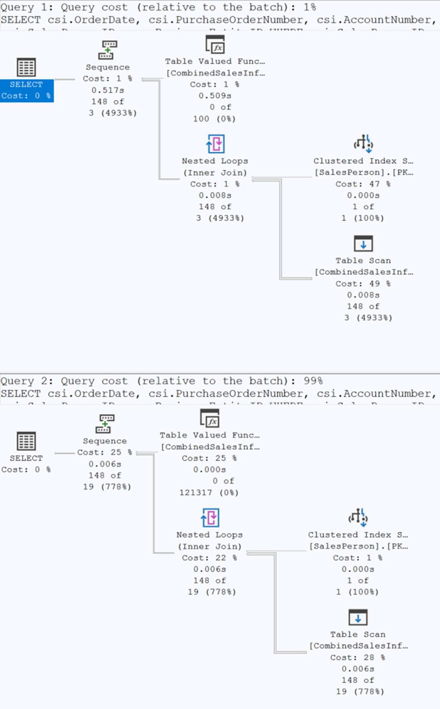

*Hình 21-1. Kế hoạch thực thi khi không có và có Interleaved Execution*

Thoạt nhìn, cấu trúc hình dạng tổng thể của hai kế hoạch có vẻ giống nhau. Tuy nhiên, khi hai câu lệnh được chạy trong cùng một lô (batch), bộ tối ưu hóa ước tính kế hoạch bên trên (không có Interleaved) chỉ chiếm **1% chi phí**, trong khi kế hoạch bên dưới (có Interleaved) lại chiếm tới **99% chi phí**! Tại sao lại có sự nghịch lý kỳ lạ này?

Hãy mở cửa sổ Properties của toán tử Table Scan trên kế hoạch không có Interleaved Execution (Hình 21-2).

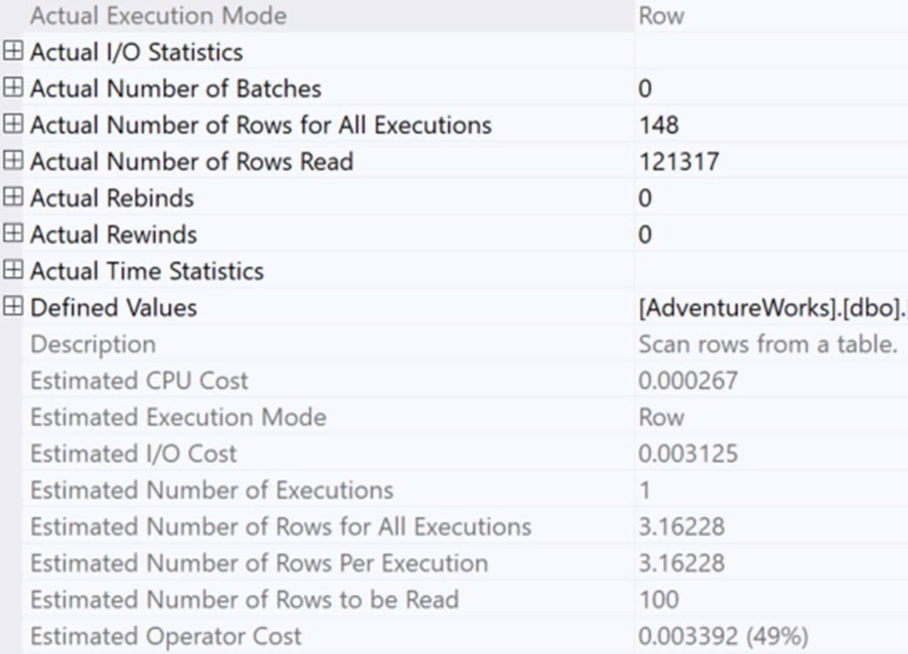

*Hình 21-2. Thuộc tính toán tử Scan trên kế hoạch không có Interleaved Execution*

Quan sát Hình 21-2:
* Ở phía trên, số dòng thực tế (**Actual Number of Rows**) là **148** dòng.
* Nhưng ở phía dưới, số dòng ước lượng (**Estimated Number of Rows**) chỉ là **100** dòng cố định, và ước lượng dòng lọc cho lần thực thi này chỉ vỏn vẹn là **3,16228** dòng!
* Chính sự sai lệch khổng lồ giữa con số ước lượng 3 dòng so với thực tế 148 dòng đã đánh lừa optimizer khiến nó đánh giá chi phí kế hoạch là "rất rẻ" (1%), dẫn đến việc lựa chọn các thuật toán nối không phù hợp.

Bây giờ hãy nhìn vào thuộc tính của kế hoạch có kích hoạt **Interleaved Execution** trên Hình 21-3.

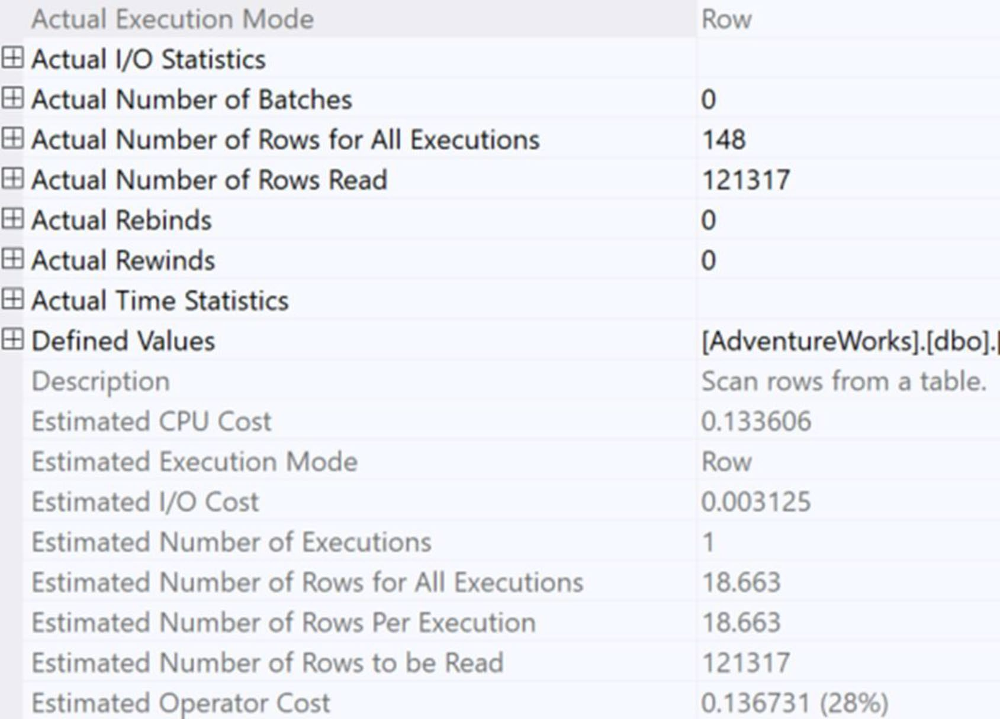

*Hình 21-3. Thuộc tính toán tử từ kế hoạch có Interleaved Execution*

Nhờ cơ chế thực thi xen kẽ, engine đã tạm dừng để chạy hàm và nắm được kích thước thực tế của tập dữ liệu là **121.317 dòng**. Từ đó, ước tính số dòng lọc cho truy vấn được nâng lên thành **18,663 dòng** (thay vì 3 dòng mù mờ như trước). Mặc dù ước lượng này chưa phải là hoàn hảo tuyệt đối, nhưng nó sát với thực tế hơn rất nhiều!

Về mặt thời gian thực thi: Kế hoạch không có Interleaved mất trung bình 542 ms với 372.637 reads; trong khi kế hoạch có Interleaved mất 512 ms với 368.636 reads. Mức cải thiện thời gian là có nhưng chưa quá lớn trong kịch bản này.

---

### Tối ưu hóa triệt để bằng việc truyền Tham số trực tiếp

Chúng ta có thể cải thiện hiệu năng vượt bậc nếu chủ động tái cấu trúc lại hàm: loại bỏ các hàm con lồng nhau và truyền trực tiếp các giá trị lọc vào làm **tham số đầu vào (parameters)** của hàm MSTVF như thể hiện trong Listing 21-3.

#### Listing 21-3. Tái cấu trúc hàm MSTVF tiếp nhận tham số trực tiếp
```sql
CREATE OR ALTER FUNCTION dbo.AllSalesInfo
(
    @SalesPersonID INT,
    @ShippingCity VARCHAR(50)
)
RETURNS @return_variable TABLE
(
    SalesPersonID INT,
    ShippingCity NVARCHAR(30),
    OrderDate DATETIME,
    PurchaseOrderNumber dbo.OrderNumber,
    AccountNumber dbo.AccountNumber,
    OrderQty SMALLINT,
    UnitPrice MONEY
)
AS
BEGIN;
    INSERT INTO @return_variable
    (
        SalesPersonID,
        ShippingCity,
        OrderDate,
        PurchaseOrderNumber,
        AccountNumber,
        OrderQty,
        UnitPrice
    )
    SELECT soh.SalesPersonID,
           A.City,
           soh.OrderDate,
           soh.PurchaseOrderNumber,
           soh.AccountNumber,
           sod.OrderQty,
           sod.UnitPrice
    FROM Sales.SalesOrderHeader AS soh
        JOIN Person.ADDRESS AS A
            ON A.AddressID = soh.ShipToAddressID
        JOIN Sales.SalesOrderDetail AS sod
            ON sod.SalesOrderID = soh.SalesOrderID
    WHERE soh.SalesPersonID = @SalesPersonID
          AND A.City = @ShippingCity;
    RETURN;
END;
GO
```

Bây giờ chúng ta viết lại câu truy vấn gọi hàm có truyền tham số trong Listing 21-4.

#### Listing 21-4. Truy vấn sử dụng hàm có tham số thay cho mệnh đề WHERE bên ngoài
```sql
SELECT asi.OrderDate,
       asi.PurchaseOrderNumber,
       asi.AccountNumber,
       asi.OrderQty,
       asi.UnitPrice,
       sp.SalesQuota
FROM dbo.AllSalesInfo(277, 'Odessa') AS asi
    JOIN Sales.SalesPerson AS sp
        ON asi.SalesPersonID = sp.BusinessEntityID;
```

Kế hoạch thực thi mới được minh họa trên Hình 21-4.

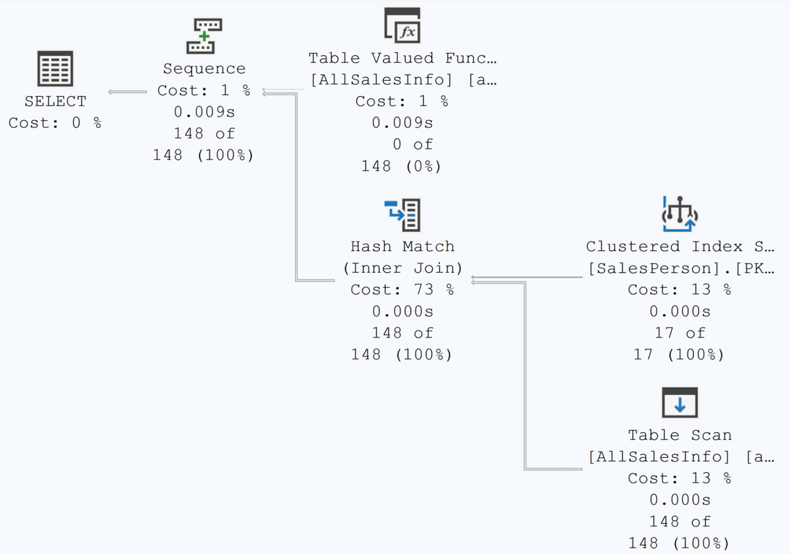

*Hình 21-4. Kế hoạch thực thi mới với ước lượng số dòng hoàn hảo*

Kết quả thật kinh ngạc: Số dòng ước tính và số dòng thực tế **khớp nhau hoàn hảo từng chữ số**! Nhờ nhận diện chính xác khối lượng dữ liệu, bộ tối ưu hóa đã thông minh chuyển từ thuật toán nối Nested Loops sang **Hash Match**, đem lại hiệu quả vượt trội.

Hiệu năng thực thi:
* Thời gian thực thi giảm thẳng đứng từ 512 ms xuống chỉ còn **6 ms**!
* Số lượt đọc I/O giảm ngoạn mục từ 368.636 reads xuống chỉ còn **1.120 reads**!

> [!WARNING]
> Có một điều quan trọng bạn cần ghi nhớ: Khi sử dụng tham số với Interleaved Execution, kế hoạch thực thi được xây dựng dựa trên các tham số của lần chạy đầu tiên sẽ được lưu vào Plan Cache. Điều này đồng nghĩa với việc kế hoạch có thể bị ảnh hưởng bởi hiện tượng **Parameter Sniffing** nếu các lần thực thi tiếp theo truyền vào các tham số có lượng dữ liệu chênh lệch quá lớn. Đó là lý do tại sao Microsoft luôn cung cấp tùy chọn tắt tính năng này ở cấp cơ sở dữ liệu hoặc thông qua gợi ý truy vấn (`DISABLE_INTERLEAVED_EXECUTION_TVF`) khi cần thiết.

---

### Cơ chế phản hồi xử lý truy vấn (Query Processing Feedback)

Query Optimizer đưa ra các quyết định tạo kế hoạch dựa trên các tính toán xác suất từ thống kê (Statistics) và độ chọn lọc (Cardinality). Bắt đầu từ SQL Server 2017 và hoàn thiện mạnh mẽ trong SQL Server 2022/2025, engine đã được trang bị các **cơ chế phản hồi (Feedback mechanisms)**: sau mỗi lần truy vấn thực thi, hệ thống sẽ tự phân tích các chỉ số tài nguyên thực tế để tự động điều chỉnh hành vi cho các lần thực thi tiếp theo.

Các cơ chế phản hồi động bao gồm:
* **Memory Grant Feedback (MGF):** Tự điều chỉnh cấp phát bộ nhớ làm việc.
* **Cardinality Estimation (CE) Feedback:** Tự điều chỉnh mô hình ước lượng số dòng.
* **Degree of Parallelism (DOP) Feedback:** Tự tối ưu hóa số luồng xử lý song song.
* **Feedback Persistence:** Lưu trữ bền vững các phản hồi vào Query Store.

---

#### Cơ chế phản hồi cấp phát bộ nhớ (Memory Grant Feedback - MGF)

Khi một câu truy vấn chứa các thao tác sắp xếp (`SORT`) hoặc băm nối (`HASH JOIN`), SQL Server bắt buộc phải ước tính một lượng bộ nhớ RAM nhất định cấp cho truy vấn đó (gọi là **Memory Grant**). 
* Nếu cấp phát **không đủ RAM**: Dữ liệu dư thừa buộc phải bị tràn xuống đĩa thông qua cơ sở dữ liệu `tempdb` (hiện tượng **Spill**), làm truy vấn chạy chậm chạp gấp hàng chục lần.
* Nếu cấp phát **quá thừa RAM** (lượng cấp phát lớn hơn gấp đôi lượng thực tế sử dụng): Truy vấn đang chiếm dụng lãng phí bộ nhớ của máy chủ, khiến các truy vấn khác phải xếp hàng chờ đợi tài nguyên (chờ cấp phát bộ nhớ - wait type `RESOURCE_SEMAPHORE`).

**Memory Grant Feedback** giải quyết triệt để tình thế tiến thoái lưỡng nan này: Hệ thống tự động phân tích lượng RAM thực tế đã tiêu thụ; nếu phát hiện bị tràn (spill) hoặc cấp phát thừa quá mức, engine sẽ **tự động điều chỉnh tăng hoặc giảm lượng Memory Grant** cho kế hoạch lưu trong cache ở lần chạy tiếp theo.

Ban đầu (SQL Server 2017), MGF chỉ hỗ trợ xử lý chế độ theo lô (Batch Mode). Đến SQL Server 2019, MGF đã chính thức hỗ trợ cả chế độ xử lý theo dòng (**Row Mode**). Đến SQL Server 2022 và 2025, các thuật toán phản hồi tiếp tục được nâng cấp theo cơ chế phân vị thống kê.

Để giám sát trực tiếp MGF hoạt động, Listing 21-5 thiết lập một phiên Extended Events chuyên biệt.

#### Listing 21-5. Tạo phiên Extended Events theo dõi Memory Grant Feedback
```sql
CREATE EVENT SESSION MemoryGrant
ON SERVER
    ADD EVENT sqlserver.memory_grant_feedback_loop_disabled
    (WHERE (sqlserver.database_name = N'AdventureWorks')),
    ADD EVENT sqlserver.memory_grant_updated_by_feedback
    (WHERE (sqlserver.database_name = N'AdventureWorks')),
    ADD EVENT sqlserver.sql_batch_completed
    (WHERE (sqlserver.database_name = N'AdventureWorks'))
WITH
(
    TRACK_CAUSALITY = ON
);
GO
ALTER EVENT SESSION MemoryGrant ON SERVER STATE = START;
```

Listing 21-6 tạo một thủ tục lưu trữ `dbo.CostCheck` để thử nghiệm trên bảng dữ liệu lớn `bigTransactionHistory`.

#### Listing 21-6. Khởi tạo thủ tục CostCheck
```sql
CREATE OR ALTER PROCEDURE dbo.CostCheck
(@Cost MONEY)
AS
SELECT p.NAME,
       AVG(th.Quantity),
       AVG(th.ActualCost)
FROM dbo.bigTransactionHistory AS th
    JOIN dbo.bigProduct AS p
        ON p.ProductID = th.ProductID
WHERE th.ActualCost = @Cost
GROUP BY p.NAME;
```

Khi chạy thủ tục này, kết quả bắt được từ phiên Extended Events được thể hiện trên Hình 21-5.

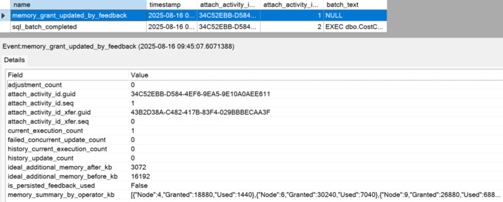

*Hình 21-5. Kết quả sự kiện Memory Grant Feedback trong Extended Events*

Phân tích Hình 21-5:
* Nhờ tính năng **Causality Tracking**, chúng ta thấy sự kiện phản hồi diễn ra ngay trước khi truy vấn hoàn tất.
* Ở dòng dưới cùng, lượng bộ nhớ được cấp phát ban đầu (**Granted Memory**) cho toán tử là **18.880 KB**, nhưng lượng bộ nhớ thực tế sử dụng (**Used Memory**) chỉ là **1.440 KB**. Đây là một sự cấp phát thừa nghiêm trọng (overallocation – vì lượng cấp lớn hơn gấp đôi lượng dùng).
* Ngay sau đó, sự kiện `memory_grant_updated_by_feedback` được kích hoạt, ghi nhận việc engine đã điều chỉnh cắt giảm lượng RAM cho kế hoạch này.
* Khi bạn thực thi lại thủ tục lần thứ hai với cùng tham số, sự kiện cập nhật không còn xuất hiện nữa, bởi vì lượng cấp phát đã được hiệu chỉnh chính xác và lưu sẵn vào Plan Cache!

Minh chứng về MGF cũng được ghi nhận trực tiếp bên trong thuộc tính của Kế hoạch thực thi (Hình 21-6).

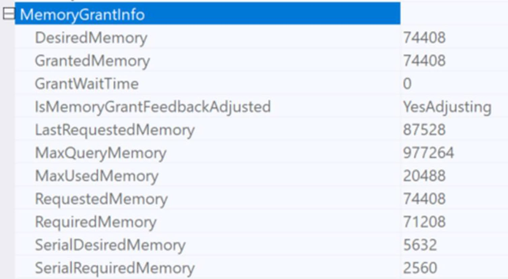

*Hình 21-6. Bằng chứng của Memory Grant Feedback bên trong Kế hoạch thực thi*

Các trạng thái điều chỉnh của MGF được phản ánh trong thuộc tính `IsMemoryGrantFeedbackAdjusted`:
* **`YesStable`:** Phản hồi cấp phát bộ nhớ đã được áp dụng và hiện tại đã đạt trạng thái cân bằng, ổn định.
* **`NoFirstExecution`:** Kế hoạch mới được biên dịch và chạy lần đầu tiên, chưa áp dụng cơ chế phản hồi.
* **`NoAccurateGrant`:** Lượng cấp phát bộ nhớ ban đầu đã chuẩn xác (không bị spill và sử dụng hơn 50% lượng RAM được cấp).
* **`NoFeedbackDisabled`:** Xuất hiện hiện tượng dao động bộ nhớ liên tục (thrashing) do tham số nhảy múa thất thường hoặc lỗi thống kê; engine đã chủ động tạm dừng MGF cho truy vấn này để tránh mất ổn định.

Để tính năng Row-Mode MGF tự động hoạt động, mức tương thích cơ sở dữ liệu (`COMPATIBILITY_LEVEL`) phải từ **150 trở lên**. Bạn có thể chủ động bật hoặc tắt tính năng này bằng câu lệnh trong Listing 21-7.

#### Listing 21-7. Vô hiệu hóa hoặc kích hoạt lại Row Mode Memory Grant Feedback
```sql
ALTER DATABASE SCOPED CONFIGURATION SET ROW_MODE_MEMORY_GRANT_FEEDBACK = OFF; -- hoặc ON
```

---

#### Tính năng MGF theo phân vị (Percentile MGF) trong SQL Server 2022/2025

Trước phiên bản SQL Server 2022, Memory Grant Feedback đôi khi gặp phải hiện tượng **dao động bộ nhớ (memory thrashing)**: Nếu lần chạy này cần nhiều RAM thì được cấp tăng lên; nhưng ngay lần chạy sau cần ít RAM thì lại bị cắt giảm xuống. Quá trình giằng co liên tục này có thể gây bất ổn hiệu năng.

Để giải quyết dứt điểm vấn đề này, bắt đầu từ **SQL Server 2022 và 2025**, engine đã nâng cấp thuật toán điều chỉnh MGF dựa trên **Phân vị thống kê (Percentile)** theo thời gian thay vì dựa trên các con số thô của từng lần chạy đơn lẻ. Thuật toán phân vị giúp mức cấp phát bộ nhớ luôn bao phủ an toàn cho phần lớn các lần thực thi mà không gây lãng phí. 

Tính năng này được kích hoạt mặc định. Nếu bạn muốn tắt tính năng phân vị này để quay về cơ chế cũ, bạn có thể sử dụng câu lệnh:
```sql
ALTER DATABASE SCOPED CONFIGURATION SET MEMORY_GRANT_FEEDBACK_PERCENTILE = OFF;
```

---

#### Phản hồi ước lượng số dòng (Cardinality Estimation Feedback - CE Feedback)

Bắt đầu từ phiên bản SQL Server 2022, quá trình ước lượng số dòng (*cardinality estimation*) đã có thể hưởng lợi từ cơ chế phản hồi tự động. Để tính năng này hoạt động, mức tương thích (*compatibility level*) của cơ sở dữ liệu bắt buộc phải được thiết lập từ **160** trở lên và tính năng **Query Store** phải được kích hoạt. Lý do là vì cơ chế phản hồi CE sử dụng các gợi ý Query Store (Query Store hints — đã được trình bày ở Chương 6) để tự động điều chỉnh cách thức bộ tối ưu hóa ước lượng số dòng cho các lần biên dịch tiếp theo.

Chúng ta có thể quan sát cơ chế phản hồi Cardinality Estimation (CE Feedback) hoạt động trong thực tế thông qua một phiên Extended Events được định nghĩa trong Listing 21-8.

**Listing 21-8.** Tạo phiên Extended Events để theo dõi CE feedback

```sql
CREATE EVENT SESSION [CardinalityFeedback]
ON SERVER
    ADD EVENT sqlserver.query_ce_feedback_telemetry(),
    ADD EVENT sqlserver.query_feedback_analysis(),
    ADD EVENT sqlserver.query_feedback_validation(),
    ADD EVENT sqlserver.sql_batch_completed();
GO
ALTER EVENT SESSION CardinalityFeedback ON SERVER STATE = START;
```

Có ba kịch bản chính trong thực tế mà cơ chế CE feedback có thể can thiệp giúp cải thiện hiệu năng:

1. **Sự tương quan dữ liệu giữa các cột (Data Correlation):**
   - Trong mô hình ước lượng CE cũ (mức tương thích 70, trước SQL Server 2014), giả định mặc định là hoàn toàn **không có sự tương quan** giữa các cột trong cùng một bảng.
   - Mô hình ước lượng CE hiện đại (mức tương thích 120 trở lên) giả định có một **sự tương quan một phần** (*partial correlation*) giữa các cột.
   - Tuy nhiên, trong thực tế có những tình huống các cột có sự tương quan trực tiếp, chặt chẽ với nhau. CE feedback sẽ theo dõi xem số lượng dòng ước tính bị đánh giá thấp (*underestimated*) hay đánh giá quá cao (*overestimated*) so với số dòng thực tế tại thời điểm chạy. Sau đó, nó sẽ tự động áp dụng các gợi ý thích hợp thông qua Query Store để đạt được ước tính số dòng chuẩn xác hơn cho kế hoạch thực thi.

Truy vấn đơn giản trong Listing 21-9 minh họa cho kịch bản lọc trên hai cột có tương quan.

**Listing 21-9.** Lọc dữ liệu trên hai cột của bảng Person.Address

```sql
SELECT AddressID,
       AddressLine1,
       AddressLine2
FROM Person.ADDRESS
WHERE StateProvinceID = 79
      AND City = N'Redmond';
```

Khi truy vấn này thực thi, một chuỗi các sự kiện CE feedback sẽ được kích hoạt như trong Hình 21-7.

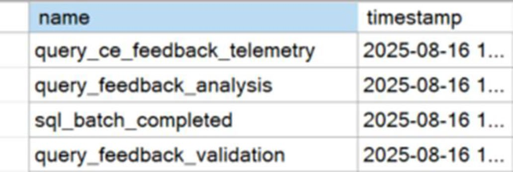

Hình 21-8 hiển thị chi tiết dữ liệu đo đạc bên trong sự kiện `query_ce_feedback_telemetry`. Dữ liệu này ghi nhận các thông số nội tại mà SQL Server sử dụng cho toàn bộ ba kịch bản đánh giá CE feedback.

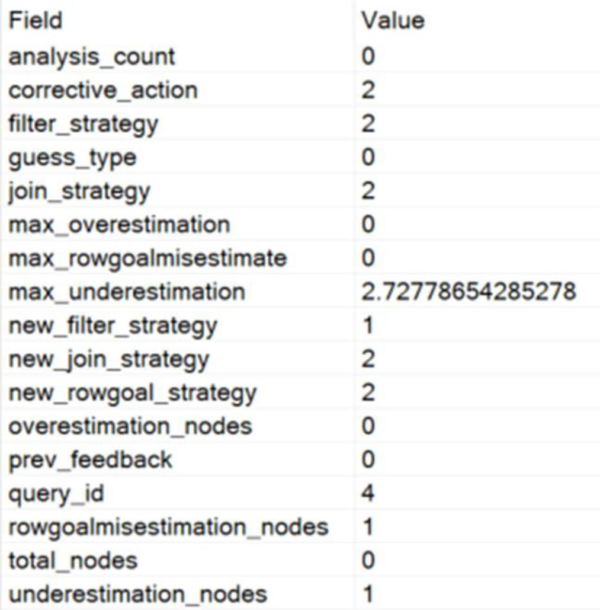

Tiếp theo, sự kiện `query_feedback_analysis` trong Hình 21-9 cho chúng ta biết gợi ý (*hint*) cụ thể mà SQL Server dự kiến sẽ sử dụng để giải quyết vấn đề, kèm theo `plan_id` và `query_id` để bạn có thể truy xuất trực tiếp từ Query Store.

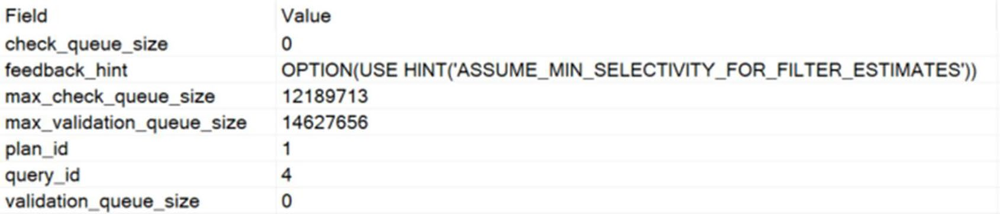

Sự kiện `query_feedback_validation` trong Hình 21-10 cung cấp hai giá trị băm (*hash values*). Trong trường hợp này, hai giá trị băm là giống nhau, cho thấy rằng mặc dù truy vấn đã được thẩm định cho cơ chế CE feedback, nhưng chưa có gợi ý nào được áp dụng chính thức tại thời điểm này.

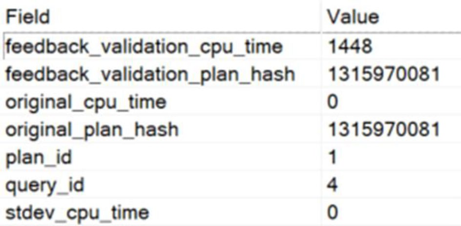

Chúng ta cũng có thể truy vấn trực tiếp view danh mục `sys.query_store_plan_feedback` để theo dõi trạng thái phản hồi của các truy vấn đã được hệ thống đánh giá, như thể hiện trong Listing 21-10.

**Listing 21-10.** Truy vấn dữ liệu từ sys.query_store_plan_feedback

```sql
SELECT qsqt.query_sql_text,
       CAST(qsp.query_plan AS XML) AS queryplan,
       qspf.feature_id,
       qspf.feature_desc,
       qspf.feedback_data,
       qspf.STATE,
       qspf.state_desc
FROM sys.query_store_plan_feedback AS qspf
    JOIN sys.query_store_plan AS qsp
        ON qsp.plan_id = qspf.plan_id
    JOIN sys.query_store_query AS qsq
        ON qsq.query_id = qsp.query_id
    JOIN sys.query_store_query_text AS qsqt
        ON qsqt.query_text_id = qsq.query_text_id;
```

Kết quả trong Hình 21-11 cho thấy trường `state_desc` phản ánh trạng thái kế hoạch sau khi đánh giá đã được phục hồi trở lại kế hoạch gốc (*regressed*) do việc áp dụng gợi ý không mang lại cải thiện vượt trội.


2. **Kịch bản mục tiêu dòng (Row Goals):**
   - Khi một truy vấn chỉ định rằng nó chỉ cần trả về một số lượng dòng hữu hạn (chẳng hạn khi dùng toán tử `TOP`), bộ tối ưu hóa sẽ kích hoạt cơ chế *row goal* để giới hạn mọi ước tính chi phí dưới ngưỡng mục tiêu đó. Tuy nhiên, nếu dữ liệu phân phối không đồng đều, cơ chế row goal có thể khiến optimizer chọn nhầm một thao tác quét chỉ mục tai hại. Trong trường hợp đó, CE feedback có thể can thiệp để vô hiệu hóa cơ chế quét row goal.

Listing 21-11 minh họa một truy vấn sử dụng toán tử `TOP`.

**Listing 21-11.** Truy vấn bảng bigProduct với toán tử TOP

```sql
SELECT TOP (1500)
       bp.Name,
       bp.ProductNumber,
       bth.Quantity,
       bth.ActualCost
FROM dbo.bigProduct AS bp
    JOIN dbo.bigTransactionHistory AS bth
        ON bth.ProductID = bp.ProductID
WHERE bth.Quantity = 10
      AND bth.ActualCost > 357
ORDER BY bp.Name;
```

Thực thi truy vấn này 17 lần sẽ sinh ra sự kiện `query_ce_feedback_telemetry`. Tuy nhiên, kết quả trả về trong `sys.query_store_plan_feedback` là `NO_RECOMMENDATION` — bộ đánh giá CE nhận định rằng việc thử nghiệm áp dụng gợi ý là không đáng giá đối với truy vấn này.

3. **Kịch bản vị từ phép nối (Join Predicates):**
   - Mô hình CE 70 cũ giả định tính bao hàm đơn giản (*simple containment* — coi các bộ lọc có tương quan đầy đủ). Mô hình CE hiện đại giả định tính bao hàm cơ sở (*base containment* — coi các bộ lọc độc lập hoàn toàn). CE feedback có thể thử nghiệm đảo ngược giả định này nếu nó phát hiện kế hoạch hiện tại hoạt động kém.

Listing 21-12 minh họa kịch bản này.

**Listing 21-12.** Truy vấn kết hợp bảng bigProduct và bigTransactionHistory

```sql
-- Cố ý sử dụng SELECT *
SELECT *
FROM dbo.bigTransactionHistory AS bth
    JOIN dbo.bigProduct AS bp
        ON bp.ProductID = bth.ProductID
WHERE bth.Quantity = 10
      AND bth.ActualCost > 357;
```

Kết quả trong Hình 21-12 cho thấy một gợi ý mới đang được đưa vào thử nghiệm: `ASSUME_FULL_INDEPENDENCE_FOR_FILTER_ESTIMATES`.

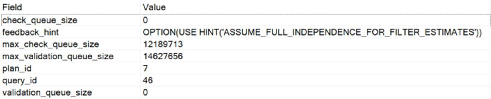

Bạn có thể vô hiệu hóa tính năng CE feedback ở cấp cơ sở dữ liệu bằng lệnh:
```sql
ALTER DATABASE SCOPED CONFIGURATION SET CE_FEEDBACK = OFF;
```
Hoặc bỏ qua ở cấp truy vấn bằng gợi ý `OPTION (USE HINT ('DISABLE_CE_FEEDBACK'))`.

---

#### Phản hồi mức độ song song (Degree of Parallelism - DOP Feedback)

Việc thực thi truy vấn song song (*parallel execution*) có thể mang lại lợi ích to lớn cho các truy vấn xử lý khối lượng dữ liệu khổng lồ. Tuy nhiên, có rất nhiều truy vấn lại bị suy giảm hiệu năng nghiêm trọng khi chạy song song do chi phí phối hợp luồng (*thread coordination overhead*) vượt quá lợi ích đạt được, dẫn đến lãng phí CPU và xuất hiện hàng loạt hiện tượng chờ `CXPACKET` / `CXCONSUMER`.

Mặc dù thiết lập Ngưỡng chi phí cho thực thi song song (*Cost Threshold for Parallelism*) giúp kiểm soát vấn đề này ở mức tổng thể, nhưng một số truy vấn vượt ngưỡng vẫn có thể bị tổn hại hiệu năng do mức độ song song (DOP) quá cao.

Tính năng **DOP Feedback** (yêu cầu Query Store và mức tương thích 160 trở lên, được bật mặc định trong SQL Server 2025) sẽ tự động theo dõi thời gian thực thi và mức độ sử dụng CPU của các truy vấn song song lặp lại. Nếu phát hiện thấy dấu hiệu lãng phí, hệ thống sẽ **tự động hạ mức DOP xuống** cho đến khi tìm được điểm cân bằng tối ưu nhất.

Trong các phiên bản SQL Server trước 2025 (như SQL Server 2022), bạn có thể bật tính năng này bằng Listing 21-13.

**Listing 21-13.** Kích hoạt DOP feedback ở cấp cơ sở dữ liệu

```sql
ALTER DATABASE SCOPED CONFIGURATION SET DOP_FEEDBACK = ON;
```

Listing 21-14 thiết lập một phiên Extended Events để giám sát quy trình điều chỉnh của DOP feedback.

**Listing 21-14.** Phiên Extended Events theo dõi DOP feedback

```sql
CREATE EVENT SESSION [DOPFeedback]
ON SERVER
    ADD EVENT sqlserver.dop_feedback_eligible_query(),
    ADD EVENT sqlserver.dop_feedback_provided(),
    ADD EVENT sqlserver.dop_feedback_reverted(),
    ADD EVENT sqlserver.dop_feedback_validation(),
    ADD EVENT sqlserver.sql_batch_completed();
```

Khi chạy một truy vấn nặng đáp ứng điều kiện (Hình 21-13), sự kiện `dop_feedback_eligible_query` sẽ được ghi nhận.

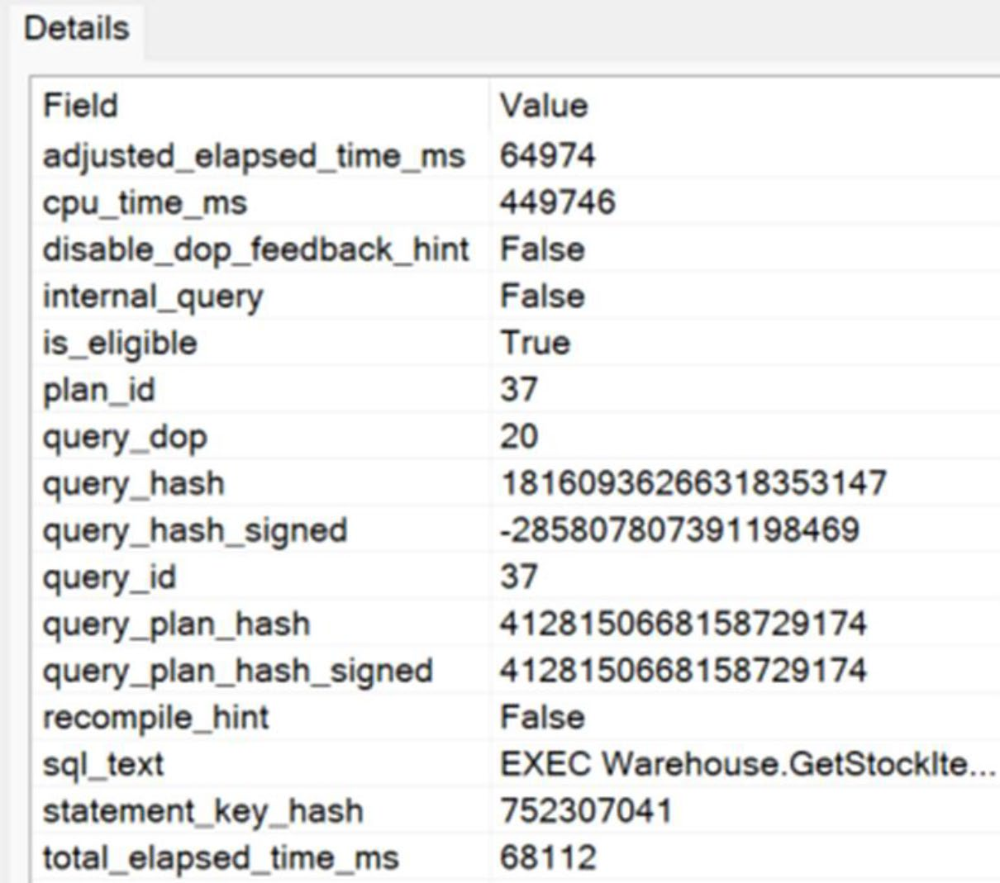

Sau đó, hệ thống đưa ra đề xuất điều chỉnh mức DOP trong Hình 21-14: mức DOP ban đầu là **20** được đề xuất hạ xuống còn **16**.

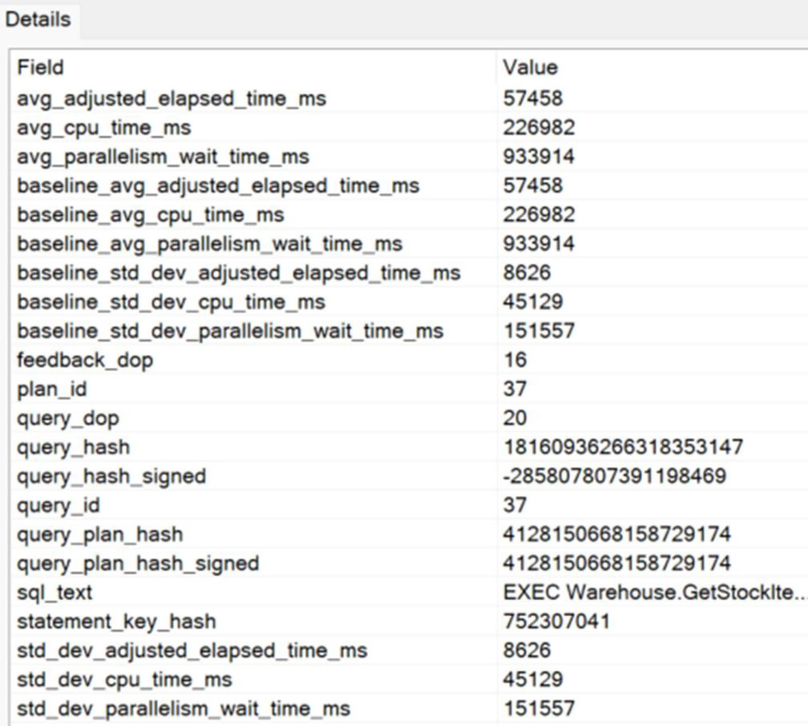

Hệ thống tiếp tục thực thi các bước thẩm định (`dop_feedback_validation`) trong Hình 21-15 để đo lường độ lệch chuẩn và thời gian thực thi thực tế.

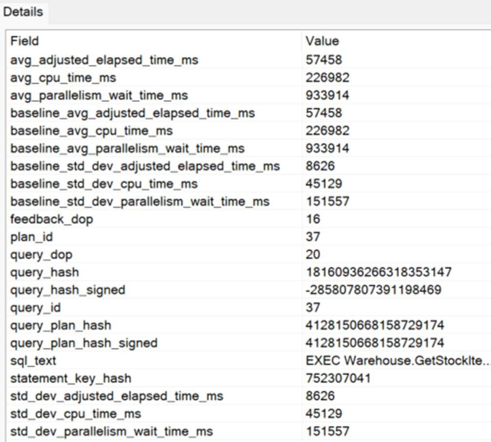

Trên máy thử nghiệm của tôi, một phản hồi thứ hai tiếp tục được đưa ra, hạ tiếp mức DOP từ **16 xuống 12**. Khi hệ thống nhận thấy thời gian thực thi đã đạt mức cải thiện thực tế và ổn định, nó sẽ chuyển trạng thái sang `Stable` và khóa cố định mức DOP tối ưu này cho truy vấn. Giá trị DOP thấp nhất mà cơ chế này có thể hạ xuống là **DOP = 2**.

---

#### Tính bền vững của cơ chế phản hồi (Feedback Persistence)

Khả năng nhận phản hồi tự động về cấp phát bộ nhớ (MGF), thống kê số dòng (CE), và mức độ song song (DOP) là những bước tiến vượt bậc của SQL Server. Tuy nhiên, trước phiên bản SQL Server 2022, toàn bộ các phản hồi này **không có tính bền vững** (*did not persist*): khi một kế hoạch bị đẩy ra khỏi bộ đệm cache, toàn bộ lịch sử phản hồi tối ưu hóa trước đó đều bị xóa sạch và truy vấn phải trải qua chu kỳ học lại từ đầu.

Kể từ SQL Server 2022, thông qua việc tích hợp sâu với **Query Store**, các phản hồi sau khi đã được thẩm định thành công sẽ được **lưu trữ bền vững xuống đĩa** trong Query Store theo mặc định. Điều này có nghĩa là khi một truy vấn bị biên dịch lại (do khởi động lại máy chủ, cập nhật thống kê, v.v.), kế hoạch mới tạo ra sẽ ngay lập tức tái sử dụng lại các phản hồi tối ưu đã được lưu trữ sẵn, mang lại sự ổn định hiệu năng tuyệt đối.

Hơn nữa, thay vì giao động thiếu ổn định giữa các mức cấp phát bộ nhớ, SQL Server 2022 sử dụng phương pháp **tính toán theo phân vị (percentile)** qua nhiều lần thực thi, giúp mức cấp phát bộ nhớ đạt trạng thái ổn định lâu dài và triệt tiêu nguy cơ tràn bộ nhớ ra đĩa (memory spills).

Bạn có thể vô hiệu hóa hành vi lưu trữ bền vững này cho tất cả các cơ chế phản hồi thông qua cấu hình:
```sql
ALTER DATABASE SCOPED CONFIGURATION SET MEMORY_GRANT_FEEDBACK_PERSISTENCE = OFF;
```

---

## Xử lý truy vấn xấp xỉ (Approximate Query Processing - AQP)

Trong kỷ nguyên dữ liệu lớn (Big Data) và các hệ thống kho dữ liệu phân tích quy mô hàng chục đến hàng trăm triệu dòng, việc tính toán chính xác tuyệt đối từng con số đôi khi đòi hỏi một chi phí phần cứng (CPU, bộ nhớ, I/O đĩa) quá đắt đỏ và không thực sự cần thiết. Đối với các bảng điều khiển trực quan hóa (dashboards), các báo cáo thống kê xu hướng hay phân tích kinh doanh (BI), một kết quả xấp xỉ với sai số được khống chế trong biên độ hẹp (khoảng 1–2%) nhưng có tốc độ phản hồi nhanh hơn gấp nhiều lần lại là giải pháp tối ưu hơn cả.

Nhằm đáp ứng nhu cầu này, Microsoft đã giới thiệu bộ tính năng **Xử lý truy vấn xấp xỉ (Approximate Query Processing - AQP)**. Khác với các tính năng tự động hóa khác trong IQP vốn hoạt động ngầm định bên dưới, các hàm AQP đòi hỏi bạn phải chủ động điều chỉnh mã lệnh T-SQL để sử dụng chúng.

---

### Hàm APPROX_COUNT_DISTINCT

Hàm đầu tiên trong nhóm này là **`APPROX_COUNT_DISTINCT`**. Thay vì phải thực hiện một thao tác đếm chính xác tuyệt đối từng giá trị đơn nhất (vốn đòi hỏi toán tử Sort/Distinct hoặc Hash Aggregate tốn rất nhiều bộ nhớ và thường xuyên bị tràn sang `tempdb`), hàm này sử dụng thuật toán xấp xỉ nổi tiếng **HyperLogLog** để ước lượng số lượng giá trị phân biệt.

Listing 21-15 so sánh hai câu truy vấn: một câu sử dụng hàm `COUNT(DISTINCT ...)` truyền thống và một câu sử dụng hàm `APPROX_COUNT_DISTINCT(...)` trên bảng dữ liệu lớn `bigTransactionHistory`.

**Listing 21-15.** So sánh hiệu năng giữa COUNT và APPROX_COUNT_DISTINCT

```sql
-- Đếm chính xác tuyệt đối
SELECT COUNT(DISTINCT bth.TransactionID)
FROM dbo.bigTransactionHistory AS bth
GROUP BY bth.TransactionDate,
         bth.ActualCost;
GO

-- Đếm xấp xỉ với APPROX_COUNT_DISTINCT
SELECT APPROX_COUNT_DISTINCT(bth.TransactionID)
FROM dbo.bigTransactionHistory AS bth
GROUP BY bth.TransactionDate,
         bth.ActualCost;
GO
```

Thời gian thực thi trong thử nghiệm này đã có sự cải thiện rõ rệt: từ **103 giây giảm xuống còn 93 giây** đối với hàm `APPROX_COUNT_DISTINCT`. Mục tiêu cốt lõi của hàm này là giải tỏa áp lực cho các tập dữ liệu khổng lồ hàng chục triệu dòng và triệt tiêu hoàn toàn các đợt tràn đĩa (*spills to tempdb*) kinh điển vốn rất hay gặp ở câu lệnh `COUNT(DISTINCT)`.

Theo tài liệu chính thức của Microsoft, hàm `APPROX_COUNT_DISTINCT` bảo đảm biên độ sai số chuẩn không vượt quá **2%** với độ tin cậy thống kê lên tới **97%**. Tóm lại, con số trả về sẽ cực kỳ sát với thực tế trong mọi kịch bản mà kết quả gần đúng là hoàn toàn chấp nhận được.

---

### Các hàm APPROX_PERCENTILE_CONT và APPROX_PERCENTILE_DISC

Bên cạnh phép đếm, việc tính toán phân vị (*percentiles*) trên các phân phối dữ liệu lớn cũng là một trong những tác vụ ngốn tài nguyên nhất trong SQL Server:
- `PERCENTILE_CONT`: Tính toán phân vị trên phân phối liên tục (sử dụng phép nội suy giữa các giá trị).
- `PERCENTILE_DISC`: Trả về một giá trị rời rạc cụ thể trong tập phân phối dựa trên vị trí phần trăm yêu cầu.

Hai hàm xấp xỉ tương ứng là **`APPROX_PERCENTILE_CONT`** và **`APPROX_PERCENTILE_DISC`** mang lại giải pháp thay thế siêu tốc độ bằng cách sử dụng cơ chế lấy mẫu ngẫu nhiên (*random sampling*). Listing 21-16 minh họa bài toán tìm giá trị trung vị (*median* - phân vị 0.5) của chi phí thực tế trên từng dòng sản phẩm.

**Listing 21-16.** So sánh các hàm phân vị chuẩn và hàm phân vị xấp xỉ

```sql
-- Sử dụng các hàm phân vị truyền thống (chính xác tuyệt đối)
SELECT DISTINCT
       bp.NAME,
       PERCENTILE_CONT(0.5) WITHIN GROUP(ORDER BY bth.ActualCost) OVER (PARTITION BY bp.NAME) AS MedianCont,
       PERCENTILE_DISC(0.5) WITHIN GROUP(ORDER BY bth.ActualCost) OVER (PARTITION BY bp.NAME) AS MedianDisc
FROM dbo.bigTransactionHistory AS bth
    JOIN dbo.bigProduct AS bp
        ON bp.ProductID = bth.ProductID
WHERE bth.Quantity > 75
ORDER BY bp.Name;
GO

-- Sử dụng các hàm phân vị xấp xỉ
SELECT bp.NAME,
       APPROX_PERCENTILE_CONT(0.5) WITHIN GROUP(ORDER BY bth.ActualCost) AS MedianCont,
       APPROX_PERCENTILE_DISC(0.5) WITHIN GROUP(ORDER BY bth.ActualCost) AS MedianDisc
FROM dbo.bigTransactionHistory AS bth
    JOIN dbo.bigProduct AS bp
        ON bp.ProductID = bth.ProductID
WHERE bth.Quantity > 75
GROUP BY bp.NAME
ORDER BY bp.Name;
GO
```

Sự chênh lệch về mặt hiệu năng giữa hai cách tiếp cận này là vô cùng kinh ngạc:
- Câu truy vấn đầu tiên (chính xác) mất tới **48 giây** để hoàn tất và tiêu tốn **244.367 lượt đọc đĩa**.
- Câu truy vấn thứ hai (xấp xỉ) chỉ mất vỏn vẹn **6.1 giây** (nhanh hơn gần **8 lần**!) và số lượt đọc chỉ dao động quanh mức **140.000 lượt**.

Hình 21-16 thể hiện mức độ chính xác của kết quả thu được từ hai truy vấn.


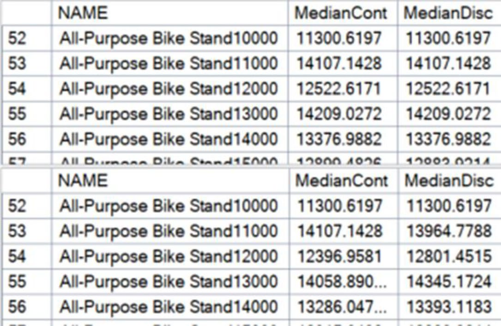

Các con số thu được hoàn toàn tương thích với cam kết của Microsoft: thuật toán bảo đảm sai số thực tế chỉ xấp xỉ **1.33%** so với giá trị thực. 

> [!WARNING]
> Đặc tính quan trọng nhất mà bạn bắt buộc phải ghi nhớ khi làm việc với các hàm `APPROX*` là: **bạn không được bảo đảm sẽ nhận lại tập kết quả hoàn toàn giống hệt nhau giữa các lần thực thi khác nhau**. Bởi vì chúng hoạt động dựa trên quy trình lấy mẫu ngẫu nhiên, tập dữ liệu đầu vào của mỗi lần chạy có thể xê dịch một chút. Do đó, các hàm này tuyệt đối không được sử dụng trong các hệ thống xử lý giao dịch tài chính, kế toán hoặc kiểm toán bắt buộc độ chính xác từng đồng.

---

## Biên dịch trì hoãn cho biến bảng (Table Variable Deferred Compilation)

Ưu điểm lớn nhất của biến bảng (`@table_variable`) là **chúng không hề có số liệu thống kê (Statistics)**. Điều này giúp chúng trở thành một công cụ tuyệt vời trong các trường hợp bạn cần lưu trữ dữ liệu tạm thời mà không muốn gánh chịu chi phí bảo trì thống kê hay nguy cơ kích hoạt các đợt biên dịch lại (*recompiles*) tốn kém.

Tuy nhiên, con dao hai lưỡi ở đây chính là: **vì không có thống kê, Query Optimizer buộc phải phỏng đoán mù quáng về số lượng dòng dữ liệu, và giá trị phỏng đoán cố định luôn luôn là đúng 1 dòng (Estimated Number of Rows = 1)**! Khi biến bảng của bạn trên thực tế chứa hàng chục nghìn hay hàng trăm nghìn dòng, sự sai lệch ước tính khổng lồ này sẽ dẫn Query Optimizer tới những quyết định kế hoạch thảm họa: chọn thuật toán Nested Loops thay vì Hash Match, hoặc cấp phát một dung lượng bộ nhớ quá nhỏ khiến dữ liệu tràn đĩa nghiêm trọng sang `tempdb`.

Tính năng **Biên dịch trì hoãn cho biến bảng (Table Variable Deferred Compilation)** — được giới thiệu từ SQL Server 2019 (compatibility level **150** trở lên) và tiếp tục được tinh chỉnh trong SQL Server 2025 — đã chấm dứt hoàn toàn nỗi ám ảnh lịch sử này.

### Cơ chế hoạt động của Deferred Compilation

Với cơ chế này, thay vì lập tức khóa cứng kế hoạch thực thi với ước lượng 1 dòng tại thời điểm biên dịch ban đầu, **SQL Server sẽ trì hoãn việc tối ưu hóa câu lệnh cho đến khi biến bảng được nạp dữ liệu thực tế tại thời điểm chạy**. 

Khi đó, Query Optimizer sẽ "nhìn thấy" chính xác số lượng dòng thực tế đang nằm trong biến bảng để đưa ra các lựa chọn toán tử và cấp phát bộ nhớ chuẩn xác nhất — tương tự như cơ chế hoạt động của bảng tạm `#temp`, nhưng **hoàn toàn không làm tăng tần suất recompiles**!

Tính năng này được kiểm soát thông qua cấu hình phạm vi cơ sở dữ liệu:
- `ALTER DATABASE SCOPED CONFIGURATION SET DEFERRED_COMPILATION_TV = ON;` (bật mặc định ở level 150+).
- `ALTER DATABASE SCOPED CONFIGURATION SET DEFERRED_COMPILATION_TV = OFF;` (tắt tính năng).

Listing 21-17 thực hiện cùng một câu truy vấn hai lần để so sánh hành vi khi tắt và khi bật Deferred Compilation.

**Listing 21-17.** Thực thi truy vấn khi tắt và bật tính năng Deferred Compilation

```sql
-- 1. Tắt tính năng Deferred Compilation để quan sát hành vi cũ
ALTER DATABASE SCOPED CONFIGURATION SET DEFERRED_COMPILATION_TV = OFF;
GO
DECLARE @HeaderInfo TABLE
(
    SalesOrderID INT,
    SalesOrderNumber NVARCHAR(25)
);
INSERT @HeaderInfo
(
    SalesOrderID,
    SalesOrderNumber
)
SELECT soh.SalesOrderID,
       soh.SalesOrderNumber
FROM Sales.SalesOrderHeader AS soh
WHERE soh.DueDate > '6/1/2014';

SELECT hi.SalesOrderNumber,
       sod.LineTotal
FROM @HeaderInfo AS hi
    JOIN Sales.SalesOrderDetail AS sod
        ON sod.SalesOrderID = hi.SalesOrderID;
GO

-- 2. Kích hoạt tính năng Deferred Compilation
ALTER DATABASE SCOPED CONFIGURATION SET DEFERRED_COMPILATION_TV = ON;
GO
DECLARE @HeaderInfo TABLE
(
    SalesOrderID INT,
    SalesOrderNumber NVARCHAR(25)
);
INSERT @HeaderInfo
(
    SalesOrderID,
    SalesOrderNumber
)
SELECT soh.SalesOrderID,
       soh.SalesOrderNumber
FROM Sales.SalesOrderHeader AS soh
WHERE soh.DueDate > '6/1/2014';

SELECT hi.SalesOrderNumber,
       sod.LineTotal
FROM @HeaderInfo AS hi
    JOIN Sales.SalesOrderDetail AS sod
        ON sod.SalesOrderID = hi.SalesOrderID;
GO
```

Hãy so sánh sự khác biệt trong kế hoạch thực thi giữa hai lần chạy:
- Khi tính năng bị tắt (Hình 21-17), toán tử Table Scan trên biến bảng hiển thị số dòng ước lượng cố định là **1 dòng**, bất chấp thực tế trả về tới **1.711 dòng**.

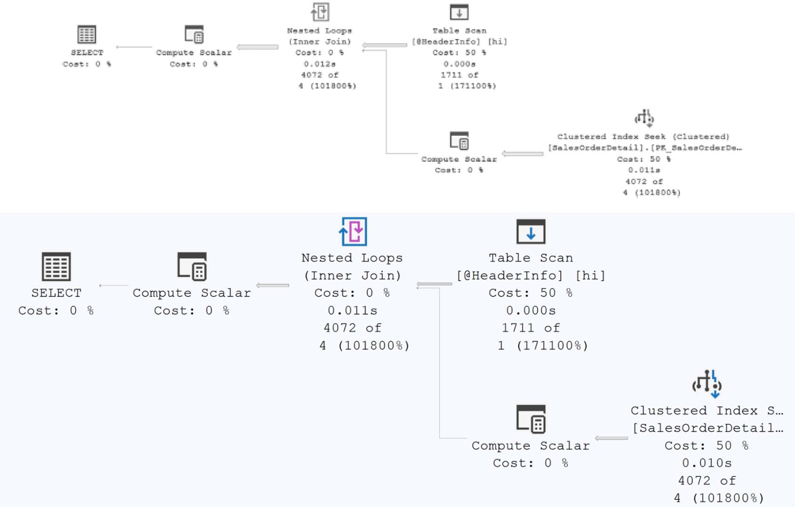

- Khi tính năng được kích hoạt (Hình 21-18), nhờ cơ chế biên dịch trì hoãn, số dòng ước lượng trên toán tử Table Scan đã hiển thị con số chính xác tuyệt đối là **1.711 dòng**, trùng khít hoàn hảo với số dòng thực tế!

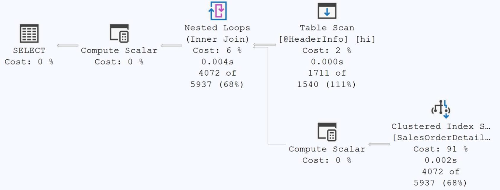

Mặc dù trong ví dụ minh họa đơn giản này hình thái tổng thể của kế hoạch chưa thay đổi nhiều, nhưng trên các truy vấn phức tạp gồm nhiều phép nối và các toán tử Sort/Aggregate, việc có được ước lượng số dòng chính xác ngay từ đầu sẽ giúp Query Optimizer tránh được những chiếc "bẫy hiệu năng" chết người.

---

## Nội suy hàm vô hướng người dùng định nghĩa (Scalar UDF Inlining)

Hàm người dùng định nghĩa (User-Defined Functions - UDFs) từ lâu đã là một trong những nguyên nhân hàng đầu gây ra các thảm họa hiệu năng trong SQL Server. Mặc dù các hàm bảng nội suy (Inline Table-Valued Functions) hoạt động rất tốt, nhưng các **Hàm vô hướng người dùng định nghĩa (Scalar UDFs)** lại là một "cơn ác mộng" thực sự:

1. **Thực thi dòng-theo-dòng (RBAR - Row-By-Agonizing-Row):** Về bản chất, hàm vô hướng bắt buộc phải được triệu gọi độc lập cho **từng dòng dữ liệu đơn lẻ** của câu truy vấn. Nếu bảng có 1 triệu dòng, hàm sẽ bị gọi và thực thi đúng 1 triệu lần!
2. **Chi phí chuyển đổi ngữ cảnh (Context Switching):** Mỗi lần triệu gọi hàm là một lần SQL Server phải chuyển đổi ngữ cảnh giữa công cụ truy vấn quan hệ và môi trường thực thi T-SQL nội bộ của hàm.
3. **Ước lượng chi phí sai lệch:** Do không mang bản chất quan hệ, Query Optimizer coi chi phí thực thi của một Scalar UDF gần như bằng 0, dẫn tới việc lập kế hoạch sai lệch hoàn toàn.
4. **Bị ép chạy đơn luồng tuần tự (Serial Execution):** Dưới cơ chế cũ, sự hiện diện của một Scalar UDF sẽ **vô hiệu hóa hoàn toàn khả năng xử lý song song (Parallelism)** của câu truy vấn, ép CPU chỉ được chạy trên một luồng duy nhất!

### Đột phá với Scalar UDF Inlining

Bắt đầu từ SQL Server 2019 (compatibility level **150** trở lên), tính năng **Scalar UDF Inlining** đã giải quyết triệt để vấn đề này. 

Về mặt nguyên lý, Query Optimizer sẽ **tự động chuyển hóa logic bên trong của Scalar UDF thành các biểu thức vô hướng hoặc các câu truy vấn con quan hệ (scalar subqueries), rồi nhúng trực tiếp (*inlined*) vào câu truy vấn cha** tại thời điểm biên dịch! Nhờ đó, logic của hàm được tối ưu hóa đồng nhất với toàn bộ câu truy vấn, tận dụng được các chỉ mục sẵn có và cho phép câu truy vấn được chạy song song trên nhiều lõi CPU.

Listing 21-18 minh họa một hàm vô hướng điển hình sẵn có trong AdventureWorks: `dbo.ufnGetProductStandardCost`.

**Listing 21-18.** Hàm vô hướng dbo.ufnGetProductStandardCost

```sql
CREATE OR ALTER FUNCTION dbo.ufnGetProductStandardCost
(
    @ProductID int,
    @OrderDate datetime
)
RETURNS money
AS
-- Trả về giá thành chuẩn của sản phẩm tại một ngày cụ thể
BEGIN
    DECLARE @StandardCost money;
    SELECT @StandardCost = pch.StandardCost
    FROM Production.Product p
        INNER JOIN Production.ProductCostHistory pch
            ON p.ProductID = pch.ProductID
               AND p.ProductID = @ProductID
               AND @OrderDate
               BETWEEN pch.StartDate AND COALESCE(pch.EndDate, 
CONVERT(datetime, '99991231', 112));
    RETURN @StandardCost;
END;
```

### Kiểm tra tính tương thích Inlining

Không phải mọi hàm vô hướng đều có thể được tự động nội suy. Có một danh sách các điều kiện ngoại lệ (chẳng hạn như hàm có chứa câu lệnh gọi hàm không xác định, dynamic SQL, v.v.). Bạn có thể kiểm tra xem một hàm cụ thể có đủ điều kiện để inline hay không bằng cách truy vấn cột **`is_inlineable`** trong DMV `sys.sql_modules` như trong Listing 21-19.

**Listing 21-19.** Kiểm tra tính tương thích inlining của hàm vô hướng

```sql
SELECT sm.is_inlineable
FROM sys.sql_modules AS sm
    JOIN sys.objects AS o
        ON o.OBJECT_ID = sm.OBJECT_ID
WHERE o.NAME = 'ufnGetProductStandardCost';
```

Nếu kết quả trả về giá trị **`1`**, điều đó khẳng định hàm vô hướng này hoàn toàn tương thích và sẽ được SQL Server tự động nội suy!

Bây giờ, chúng ta chạy thử nghiệm trong Listing 21-20 để so sánh hiệu năng thực tế khi tắt (`TSQL_SCALAR_UDF_INLINING = OFF`) và khi bật (`TSQL_SCALAR_UDF_INLINING = ON`) tính năng này.

**Listing 21-20.** Thực thi truy vấn gọi Scalar UDF khi tắt và bật inlining

```sql
-- 1. Tắt tính năng inlining để quan sát cơ chế cũ
ALTER DATABASE SCOPED CONFIGURATION SET TSQL_SCALAR_UDF_INLINING = OFF;
GO
SELECT sod.LineTotal,
       dbo.ufnGetProductStandardCost(sod.ProductID, soh.OrderDate)
FROM Sales.SalesOrderDetail AS sod
    JOIN Production.Product AS p
        ON p.ProductID = sod.ProductID
    JOIN Sales.SalesOrderHeader AS soh
        ON soh.SalesOrderID = sod.SalesOrderID
WHERE sod.LineTotal > 1000;
GO

-- 2. Kích hoạt tính năng inlining
ALTER DATABASE SCOPED CONFIGURATION SET TSQL_SCALAR_UDF_INLINING = ON;
GO
SELECT sod.LineTotal,
       dbo.ufnGetProductStandardCost(sod.ProductID, soh.OrderDate)
FROM Sales.SalesOrderDetail AS sod
    JOIN Production.Product AS p
        ON p.ProductID = sod.ProductID
    JOIN Sales.SalesOrderHeader AS soh
        ON soh.SalesOrderID = sod.SalesOrderID
WHERE sod.LineTotal > 1000;
GO
```

Kết quả đo lường thời gian thực thi:
- **Khi KHÔNG nội suy (Not inline):** Thời gian chạy mất **579 ms**, Số lượt đọc: 130.821
- **Khi ĐƯỢC nội suy (Inline):** Thời gian chạy giảm sâu xuống chỉ còn **182 ms** (nhanh hơn **hơn 3 lần**!), Số lượt đọc: 130.943

Hình 21-19 thể hiện sự tương phản rõ rệt giữa hai kế hoạch thực thi.

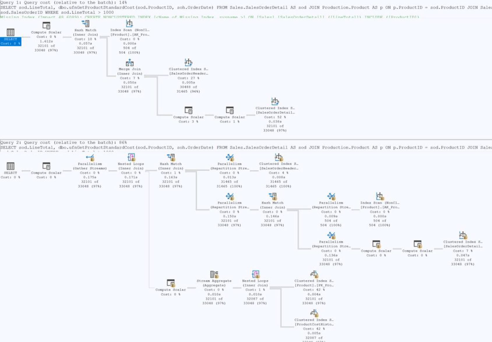

Phân tích kế hoạch thực thi mang lại nhiều phát hiện giá trị:
1. Trong kế hoạch cũ (không inline), xuất hiện một đề xuất Missing Index, nhưng trong kế hoạch inline đề xuất này đã biến mất. Điều này chứng tỏ kế hoạch mới đã tối ưu hóa trọn vẹn dựa trên các chỉ mục sẵn có.
2. **Kế hoạch inline đã được kích hoạt thực thi song song (Parallelism)**, chia sẻ tải tính toán trên nhiều luồng CPU.
3. Toán tử `Compute Scalar` tốn kém dùng để gọi hàm từng dòng ở cuối kế hoạch cũ đã biến mất hoàn toàn. Thay vào đó, dữ liệu được trích xuất thông qua các phép nối quan hệ thông thường ngay từ đầu chu trình xử lý.

---

## Tóm tắt chương & Tổng kết cuốn sách (Summary)

**Bộ Tính Năng Xử Lý Truy Vấn Thông Minh (Intelligent Query Processing - IQP)** trong SQL Server 2025 đại diện cho đỉnh cao của công nghệ tối ưu hóa cơ sở dữ liệu hiện đại. IQP bao quát một phạm vi cải tiến vô cùng rộng lớn:
- **Cơ chế phản hồi thích ứng theo thời gian thực (Adaptive Feedback):** Tự động học hỏi qua các lần thực thi để hiệu chỉnh bộ nhớ (**Memory Grant Feedback**), điều chỉnh sai số thống kê (**CE Feedback**), và hạ mức độ song song dư thừa (**DOP Feedback**) mà không đòi hỏi sự can thiệp thủ công từ con người.
- **Tối ưu hóa đứt gãy lịch sử:** Xóa bỏ dứt điểm các điểm mù hiệu năng hàng thập kỷ qua các tính năng **Interleaved Execution** (cho hàm MSTVF), **Table Variable Deferred Compilation** (cho biến bảng) và **Scalar UDF Inlining** (cho hàm vô hướng).
- **Xử lý truy vấn xấp xỉ (Approximate Query Processing):** Mở ra con đường tăng tốc đột phá cho các bài toán phân tích Big Data.

Tuy nhiên, như tác giả **Grant Fritchey** đã đúc kết sâu sắc xuyên suốt cuốn sách: **Công nghệ tự động hóa dù xuất sắc đến đâu cũng không bao giờ có thể sửa chữa thay cho bạn những dòng mã T-SQL được viết cẩu thả hoặc một cấu trúc cơ sở dữ liệu bị thiết kế sai lầm**. 

Các kỹ thuật tinh chỉnh truy vấn kinh điển — từ việc thiết kế chỉ mục chuẩn mực, duy trì số liệu thống kê chuẩn xác, kiểm soát tính SARGable của vị từ, cho đến việc làm chủ kế hoạch thực thi và hiểu thấu cơ chế khóa/tắc nghẽn — sẽ luôn là nền tảng trường tồn của mọi chuyên gia cơ sở dữ liệu. IQP là một người trợ lý thông minh phi thường, nhưng chính sự am hiểu sâu sắc về kiến trúc SQL Server của bạn mới là yếu tố quyết định đưa hiệu năng của hệ thống chạm tới đỉnh cao!
