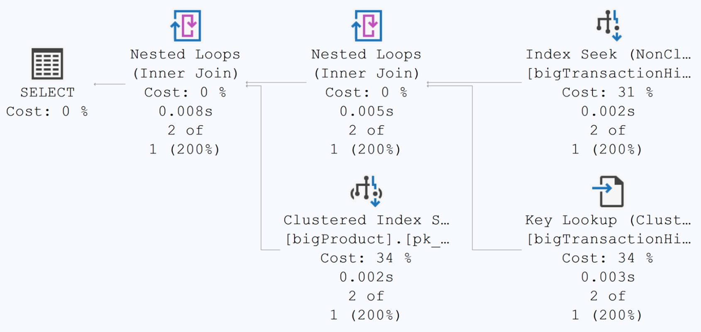
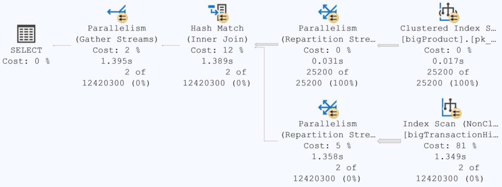
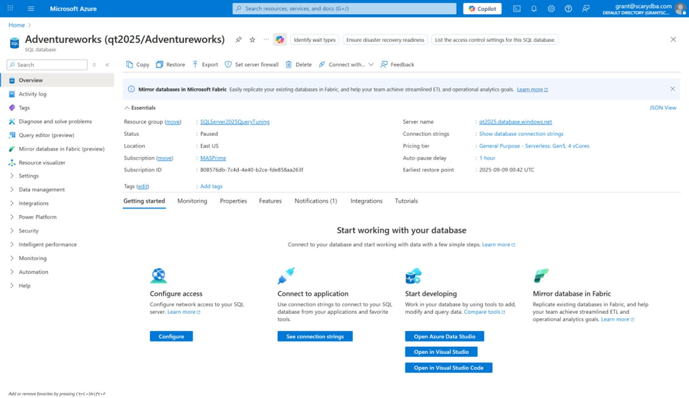
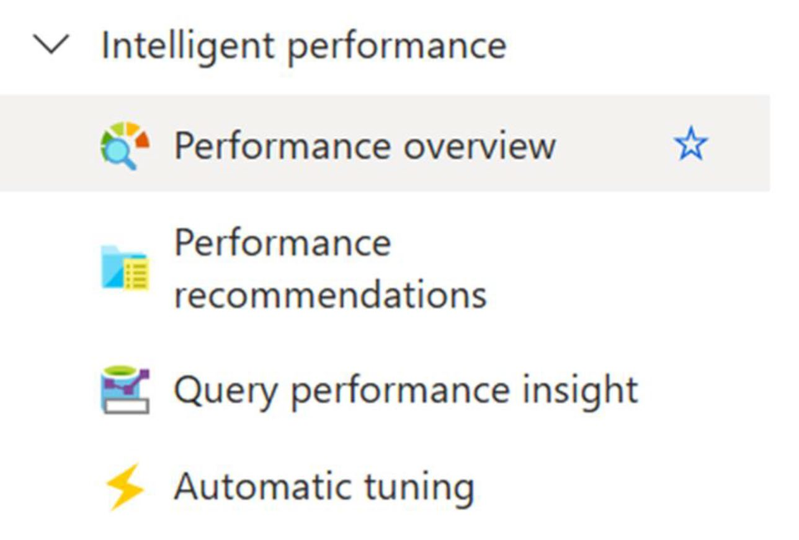
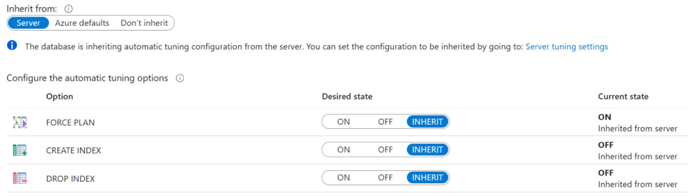
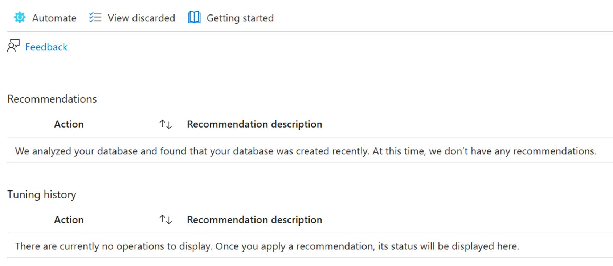
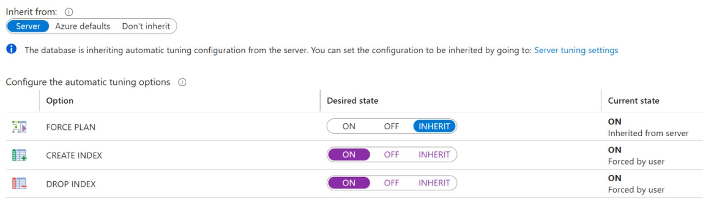
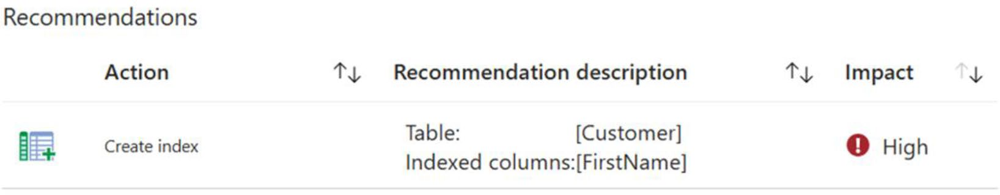
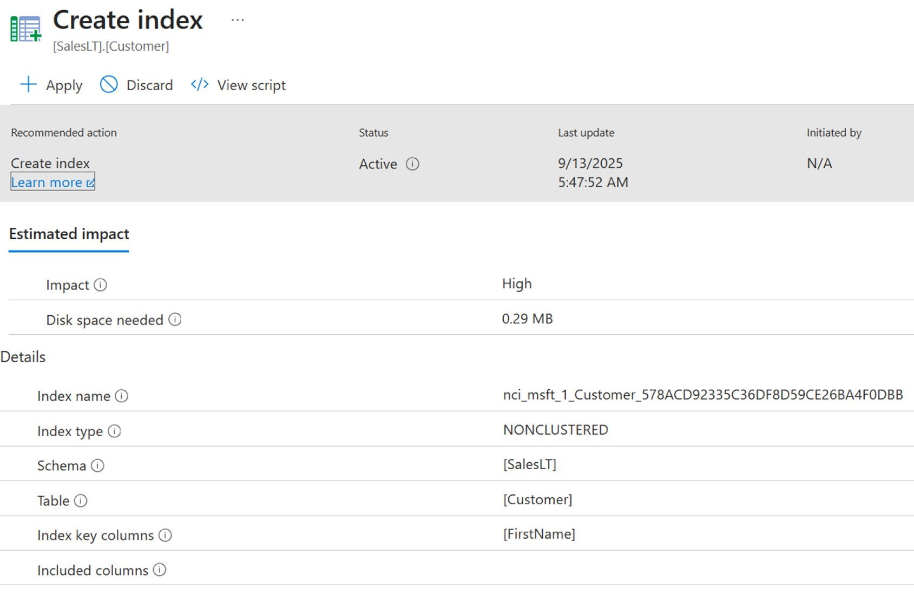

# CHƯƠNG 22: Tự động Tinh chỉnh trong Azure và SQL Server (Automated Tuning in Azure and SQL Server)

Một số khía cạnh trong công việc tinh chỉnh hiệu năng truy vấn – đặc biệt là những tác vụ xoay quanh việc tạo lập các chỉ mục cơ bản và nhận diện một kế hoạch thực thi vượt trội hơn sau khi xảy ra suy thoái – về bản chất mang tính cơ học và lặp đi lặp lại. Trong nhiều tình huống, tất cả những gì cần thiết chỉ là một phép đánh giá định lượng đơn giản: *"Thay đổi này làm hệ thống chạy nhanh hơn hay không?"*.

Xuất phát từ tư duy đó, Microsoft đã tự động hóa một số quy trình tạo và xóa chỉ mục bên trong **Azure SQL Database**. Đồng thời, việc lựa chọn và khôi phục các kế hoạch thực thi tối ưu cũng đã được tự động hóa trong cả **SQL Server** lẫn **Azure SQL Database**. 

Mặc dù các cơ chế tự động này chắc chắn mang lại sự hỗ trợ đắc lực – đặc biệt là trong các môi trường đám mây quy mô lớn nơi bạn phải quản lý hàng nghìn cơ sở dữ liệu cùng lúc – nhưng chúng không thể thay thế hoàn toàn con người. Bạn vẫn sẽ luôn cần phải rèn luyện và phát triển các kỹ năng phân tích, tinh chỉnh truy vấn chuyên sâu.

Chương này sẽ lần lượt trình bày hai trụ cột tự động hóa chính:
* **Tự động sửa lỗi kế hoạch thực thi (Automatic Plan Correction)**
* **Tự động quản lý chỉ mục trong Azure SQL Database (Azure SQL Database Automatic Index Management)**

---

## Tự động Sửa lỗi Kế hoạch Thực thi (Automatic Plan Correction)

Năng lực cốt lõi mà **Query Store** mang lại (đã được phân tích chi tiết trong Chương 6) là khả năng theo dõi và lưu trữ lịch sử hành vi của các câu truy vấn cùng các kế hoạch thực thi tương ứng theo thời gian. Dựa trên kho dữ liệu quý giá đó, Microsoft đã xây dựng thêm một tầng logic thông minh ngay bên trong SQL Server để khai thác trực tiếp các thông tin này. Khi hệ thống nhận thấy hiệu năng của một câu truy vấn bị suy giảm rõ rệt ngay sau một lần biên dịch lại (recompile), việc tự động quay về sử dụng kế hoạch tốt gần nhất trước đó (**Last Known Good Plan**) là một bước đi hoàn toàn hợp lý.

Trong thực tế vận hành, khi bạn đối mặt với các tình huống như truy vấn nhạy cảm với tham số (**Parameter-Sensitive Queries** – đã bàn sâu ở Chương 13), hoặc khi cài đặt các bản cập nhật tích lũy (Cumulative Updates - CU) làm thay đổi hành vi của bộ tối ưu hóa, hay đơn giản là khi phân phối dữ liệu biến động dẫn đến việc tạo ra kế hoạch thực thi mới, hiện tượng **suy thoái kế hoạch (plan regression)** rất dễ xảy ra. 

Việc tự động hóa quy trình theo dõi và xử lý các đợt suy thoái này diễn ra theo một luồng logic rất mạch lạc. Về cơ bản, Microsoft đang tự động thực hiện chính xác quy trình mà một chuyên gia DBA sẽ làm thủ công:

1. **Giám sát hiệu năng truy vấn** liên tục thông qua Query Store và ghi nhận ngay khi hiệu năng của một câu truy vấn bị suy giảm (tăng vọt thời gian CPU).
2. **Xác định nguyên nhân:** Kiểm tra xem sự suy thoái đó có phải bắt nguồn từ việc câu truy vấn vừa chuyển sang một kế hoạch thực thi mới hay không.
3. **Hành động khắc phục:** Nếu đúng là do thay đổi kế hoạch, hệ thống sẽ cưỡng chế (**force**) câu truy vấn quay lại sử dụng kế hoạch tốt gần nhất trước đó.
4. **Đo lường và kiểm chứng:** Tiếp tục theo dõi hiệu năng thực tế sau khi cưỡng chế kế hoạch để xác nhận xem giải pháp có thực sự mang lại hiệu quả hay không.
5. **Hoàn tác an toàn:** Nếu hiệu năng tiếp tục suy giảm hoặc không cải thiện, hệ thống sẽ tự động gỡ bỏ việc cưỡng chế kế hoạch (unforce) và chờ đợi chu kỳ biên dịch mới.

Mặc dù bên dưới lõi engine chắc chắn có rất nhiều thuật toán thống kê phức tạp để vận hành quy trình này, nhưng nhìn từ góc độ quản trị bên ngoài, đó chính xác là những gì đang diễn ra.

> [!NOTE]
> Đối với phiên bản **SQL Server** cài đặt tại chỗ (on-premises), tính năng tự động sửa lỗi kế hoạch này **không được bật mặc định (OFF)**. Ngược lại, bên trong môi trường đám mây **Azure SQL Database**, tính năng này **được bật mặc định (ON)**.

---

### Các Khuyến nghị Tinh chỉnh (Tuning Recommendations)

Để sử dụng được cơ chế phát hiện và khuyến nghị tinh chỉnh, điều kiện tiên quyết là bạn phải chạy từ phiên bản **SQL Server 2017 trở lên** (hoặc Azure SQL Database), đồng thời tính năng **Query Store bắt buộc phải được bật** trên cơ sở dữ liệu. Kể từ thời điểm Query Store hoạt động, SQL Server đã tự động thu thập toàn bộ dữ liệu cần thiết để nhận diện các kế hoạch bị suy thoái.

Để quan sát cơ chế này hoạt động trong thực tế, chúng ta sẽ tiếp tục sử dụng bộ bảng dữ liệu lớn từ kịch bản `MakeBigAdventure` (`dbo.bigTransactionHistory` và `dbo.bigProduct` – có thể tải về tại `http://dataeducation.com/thinking-big-adventure/`). 

Listing 22-1 thiết lập chỉ mục, tạo thủ tục lưu trữ thử nghiệm và chuẩn bị trạng thái sạch cho Query Store.

#### Listing 22-1. Tạo chỉ mục, thủ tục lưu trữ và chuẩn bị Query Store
```sql
CREATE INDEX ix_ActualCost ON dbo.bigTransactionHistory (ActualCost);
GO

-- Tạo thủ tục lưu trữ đơn giản phục vụ thử nghiệm
CREATE OR ALTER PROCEDURE dbo.ProductByCost
(@ActualCost MONEY)
AS
SELECT bth.ActualCost
FROM dbo.bigTransactionHistory AS bth
    JOIN dbo.bigProduct AS p
        ON p.ProductID = bth.ProductID
WHERE bth.ActualCost = @ActualCost;
GO

-- Đảm bảo Query Store được bật và làm sạch dữ liệu lịch sử
ALTER DATABASE AdventureWorks SET QUERY_STORE = ON;
ALTER DATABASE AdventureWorks SET QUERY_STORE CLEAR;
ALTER DATABASE SCOPED CONFIGURATION SET PARAMETER_SENSITIVE_PLAN_OPTIMIZATION = OFF;
GO
```

Lưu ý ở cuối Listing 22-1: Đoạn mã thử nghiệm này có thể được giải quyết tự động bởi tính năng *Parameter-Sensitive Plan (PSP) Optimization* (của SQL Server 2022/2025), do đó để phục vụ mục đích tái hiện rõ nét hiện tượng suy thoái kế hoạch cho bài kiểm tra này, tôi chủ động tắt tạm thời tính năng PSP Optimization (`PARAMETER_SENSITIVE_PLAN_OPTIMIZATION = OFF`).

Sau khi môi trường đã sẵn sàng, chúng ta sẽ thực thi thủ tục với một giá trị tham số có độ chọn lọc cao để thiết lập đường cơ sở hiệu năng tốt (baseline). Tiếp theo, chúng ta xóa kế hoạch đó khỏi bộ đệm Plan Cache, biên dịch lại với một tham số có dữ liệu khổng lồ, rồi chạy lại tham số ban đầu để tạo ra lịch sử hiệu năng suy thoái. Toàn bộ kịch bản được thực hiện trong Listing 22-2.

#### Listing 22-2. Thiết lập hai lịch sử hiệu năng truy vấn khác nhau
```sql
-- Bước 1: Thiết lập lịch sử hiệu năng tốt (chạy 30 lần)
EXEC dbo.ProductByCost @ActualCost = 54.838;
GO 30

-- Bước 2: Xóa kế hoạch thực thi hiện tại khỏi bộ đệm Plan Cache
DECLARE @PlanHandle VARBINARY(64);
SELECT  @PlanHandle = deps.plan_handle
FROM    sys.dm_exec_procedure_stats AS deps
WHERE   deps.object_id = OBJECT_ID('dbo.ProductByCost');

IF @PlanHandle IS NOT NULL
    BEGIN
        DBCC FREEPROCCACHE(@PlanHandle);
    END
GO

-- Bước 3: Thực thi truy vấn với tham số đặc biệt để tạo ra một kế hoạch thực thi khác
EXEC dbo.ProductByCost @ActualCost = 0.0;
GO

-- Bước 4: Thiết lập lịch sử hiệu năng suy thoái tồi tệ (chạy 15 lần)
EXEC dbo.ProductByCost @ActualCost = 54.838;
GO 15
```

Trong Listing 22-2, tôi đã chủ đích thực thi câu truy vấn **30 lần** ở giai đoạn đầu và **15 lần** ở giai đoạn hai. Lý do là bộ máy phân tích của SQL Server đòi hỏi phải đạt đủ một ngưỡng số lần thực thi tối thiểu nhất định:
* Giai đoạn đầu (30 lần) giúp thiết lập một đường cơ sở hành vi (baseline) đủ tin cậy.
* Giai đoạn hai (15 lần) giúp xác thực rằng hiệu năng thực sự đã bị suy giảm nghiêm trọng chứ không phải là một sự nhiễu động ngẫu nhiên.

Sau khi hoàn tất việc chạy kịch bản trên, chúng ta có thể kiểm tra xem SQL Server đã đưa ra khuyến nghị tinh chỉnh nào hay chưa bằng cách truy vấn trực tiếp DMV **`sys.dm_db_tuning_recommendations`** như trong Listing 22-3.

#### Listing 22-3. Truy xuất các khuyến nghị tinh chỉnh từ DMV
```sql
SELECT ddtr.TYPE,
       ddtr.reason,
       ddtr.STATE,
       ddtr.score,
       ddtr.details
FROM sys.dm_db_tuning_recommendations AS ddtr;
```

Kết quả trả về từ DMV được minh họa trên Hình 22-1.


*Hình 22-1. Các khuyến nghị tinh chỉnh từ sys.dm_db_tuning_recommendations*

Phân tích các cột dữ liệu quan trọng trên Hình 22-1:
* **`TYPE`:** Cho biết loại cơ hội tinh chỉnh mà hệ thống phát hiện được – trong trường hợp này là **`FORCE_LAST_GOOD_PLAN`**.
* **`reason`:** Giải thích rõ lý do đưa ra khuyến nghị: thời gian CPU trung bình của câu truy vấn đã tăng vọt từ **1,03 ms** lên tới **4.607 ms**, một sự suy thoái hiệu năng cực kỳ nghiêm trọng.
* **`STATE`:** Cho biết khuyến nghị này hiện chỉ đang ở trạng thái cố vấn (advisory) vì chúng ta chưa bật chế độ tự động thực thi.
* **`score`:** Điểm số đánh giá mức độ nghiêm trọng và tầm quan trọng của khuyến nghị (điểm càng cao thì bạn càng phải ưu tiên xử lý).
* **`details`:** Chứa một tài liệu định dạng **JSON** cung cấp toàn bộ thông số kỹ thuật chi tiết của đợt suy thoái:

```json
{
  "planForceDetails": {
    "queryId": 31,
    "queryHash": "0x5F791E9D3FE1F510",
    "regressedPlanId": 3,
    "regressedPlanHash": "0x04CB9DE3C20315A3",
    "regressedPlanExecutionCount": 15,
    "regressedPlanErrorCount": 0,
    "regressedPlanCpuTimeAverage": 7.046529466666667e+006,
    "regressedPlanCpuTimeStddev": 5.768587089464084e+006,
    "recommendedPlanId": 2,
    "recommendedPlanHash": "0x6F1B019D25F6B1A2",
    "recommendedPlanExecutionCount": 47,
    "recommendedPlanErrorCount": 0,
    "recommendedPlanCpuTimeAverage": 1.519361702127659e+002,
    "recommendedPlanCpuTimeStddev": 2.886145853980385e+002
  },
  "implementationDetails": {
    "method": "TSql",
    "script": "exec sp_query_store_force_plan @query_id = 31, @plan_id = 2"
  }
}
```

Bảng 22-1 bóc tách và trình bày rõ ràng các thuộc tính bên trong chuỗi JSON này.

#### Bảng 22-1. Chi tiết các thuộc tính trong cột details của sys.dm_db_tuning_recommendations

| Nhóm thuộc tính | Tên trường (Field) | Giá trị (Value) |
| :--- | :--- | :--- |
| **`planForceDetails`** | `queryId` | `31` |
| | `queryHash` | `0x5F791E9D3FE1F510` |
| | `regressedPlanId` | `3` |
| | `regressedPlanHash` | `0x04CB9DE3C20315A3` |
| | `regressedPlanExecutionCount` | `15` |
| | `regressedPlanErrorCount` | `0` |
| | `regressedPlanCpuTimeAverage` | `7.046529466666667e+006` (µs) |
| | `regressedPlanCpuTimeStddev` | `5.768587089464084e+006` |
| | `recommendedPlanId` | `2` |
| | `recommendedPlanHash` | `0x6F1B019D25F6B1A2` |
| | `recommendedPlanExecutionCount` | `47` |
| | `recommendedPlanErrorCount` | `0` |
| | `recommendedPlanCpuTimeAverage` | `1.519361702127659e+002` (µs) |
| | `recommendedPlanCpuTimeStddev` | `2.886145853980385e+002` |
| **`implementationDetails`** | `method` | `TSql` |
| | `script` | `exec sp_query_store_force_plan @query_id = 31, @plan_id = 2` |

Như vậy, ngay cả khi chúng ta chưa hề bật tính năng tự động sửa lỗi, chúng ta vẫn hoàn toàn có thể khai thác thông tin từ DMV này để phục vụ công tác quản trị hệ thống. SQL Server không chỉ chỉ đích danh câu truy vấn bị suy thoái do thay đổi kế hoạch, mà còn cung cấp sẵn câu lệnh T-SQL chính xác (`exec sp_query_store_force_plan...`) để bạn chạy và khắc phục sự cố ngay lập tức!

---

### Phân tích Hai Kế hoạch Thực thi Trước và Sau khi Biên dịch lại

Để hiểu tại sao lại có sự chênh lệch hiệu năng khủng khiếp đến vậy, hãy quan sát kế hoạch thực thi đầu tiên của `dbo.ProductByCost` trên Hình 22-2.



*Hình 22-2. Kế hoạch thực thi đầu tiên của dbo.ProductByCost*

Khi truyền vào giá trị `@ActualCost = 54.838`, câu truy vấn chỉ trả về đúng **1 dòng dữ liệu duy nhất**. Do đó, kế hoạch thực thi sử dụng **Index Seek** kết hợp với vòng lặp **Nested Loops** trên Hình 22-2 là hoàn toàn tối ưu. Việc thực thi lặp lại 30 lần đã xác lập một lịch sử hiệu năng chuẩn mực (lưu ý rằng con số 30 lần chỉ là ngưỡng quan sát thực nghiệm và Microsoft có thể tinh chỉnh ngưỡng nội bộ này).

Ngược lại, Hình 22-3 minh họa kế hoạch thực thi thứ hai sau khi thủ tục bị biên dịch lại với tham số `@ActualCost = 0.0`.



*Hình 22-3. Kế hoạch thực thi thứ hai của dbo.ProductByCost sau khi biên dịch lại*

Với giá trị `0.0`, có tới **12 triệu dòng** trên tổng số 30 triệu dòng của bảng thỏa mãn điều kiện! Để xử lý 12 triệu dòng, kế hoạch trên Hình 22-3 chuyển sang quét toàn bộ chỉ mục kết hợp với thuật toán nối băm (**Hash Match**) chạy song song. 

Rõ ràng, một kế hoạch được tối ưu hóa cho tập dữ liệu khổng lồ (12 triệu dòng), trong khi kế hoạch kia được tối ưu hóa cho tập dữ liệu cực nhỏ (1 dòng). Khi kế hoạch của 12 triệu dòng bị đem ra tái sử dụng cho các lần gọi chỉ lấy 1 dòng, thời gian thực thi đã vọt từ **hơn 1 ms lên tới 42 giây**!

---

### Bóc tách dữ liệu JSON kết hợp với Query Store

Chúng ta có thể viết một câu truy vấn tinh vi hơn để tự động bóc tách các thông tin bên trong cột JSON của `sys.dm_db_tuning_recommendations` bằng các hàm `OPENJSON` và `JSON_VALUE`, sau đó nối (`JOIN`) trực tiếp với các bảng hệ thống của Query Store để lấy ra văn bản câu truy vấn cùng biểu đồ XML của cả hai kế hoạch (kế hoạch suy thoái và kế hoạch được khuyến nghị) như trong Listing 22-4.

#### Listing 22-4. Kết hợp nhiều tập kết quả để lấy báo cáo khuyến nghị chi tiết
```sql
WITH DbTuneRec
AS (SELECT ddtr.reason,
           ddtr.score,
           pfd.query_id,
           pfd.regressedPlanId,
           pfd.recommendedPlanId,
           JSON_VALUE(ddtr.STATE, '$.currentValue') AS CurrentState,
           JSON_VALUE(ddtr.STATE, '$.reason') AS CurrentStateReason,
           JSON_VALUE(ddtr.details, '$.implementationDetails.script') AS ImplementationScript
    FROM sys.dm_db_tuning_recommendations AS ddtr
        CROSS APPLY
        OPENJSON(ddtr.details, '$.planForceDetails')
        WITH
        (
            query_id INT '$.queryId',
            regressedPlanId INT '$.regressedPlanId',
            recommendedPlanId INT '$.recommendedPlanId'
        ) AS pfd)
SELECT qsq.query_id,
       dtr.reason,
       dtr.score,
       dtr.CurrentState,
       dtr.CurrentStateReason,
       qsqt.query_sql_text,
       CAST(rp.query_plan AS XML) AS RegressedPlan,
       CAST(sp.query_plan AS XML) AS SuggestedPlan,
       dtr.ImplementationScript
FROM DbTuneRec AS dtr
    JOIN sys.query_store_plan AS rp
        ON rp.query_id = dtr.query_id
           AND rp.plan_id = dtr.regressedPlanId
    JOIN sys.query_store_plan AS sp
        ON sp.query_id = dtr.query_id
           AND sp.plan_id = dtr.recommendedPlanId
    JOIN sys.query_store_query AS qsq
        ON qsq.query_id = rp.query_id
    JOIN sys.query_store_query_text AS qsqt
        ON qsqt.query_text_id = qsq.query_text_id;
```

Với kết quả từ truy vấn trong Listing 22-4, bạn có trong tay đầy đủ mọi bằng chứng trực quan để tự đưa ra quyết định xem có nên sử dụng cơ chế cưỡng chế kế hoạch (plan forcing) hay cần áp dụng các giải pháp tái cấu trúc mã nguồn khác. Đây là một công cụ chẩn đoán cực kỳ nhanh nhạy giúp bạn phát hiện sớm các truy vấn đang gặp sự cố trên hệ thống.

> [!WARNING]
> Dữ liệu lưu trong DMV `sys.dm_db_tuning_recommendations` chỉ tồn tại trong bộ nhớ tạm và **sẽ bị xóa sạch nếu dịch vụ SQL Server khởi động lại, chuyển vùng dự phòng (failover) hoặc khi cơ sở dữ liệu chuyển sang trạng thái offline**. Nếu bạn muốn lưu trữ lịch sử các khuyến nghị này lâu dài, bạn cần xây dựng tác vụ định kỳ để trích xuất và lưu chúng vào một bảng quản trị riêng.

---

### Kích hoạt tính năng Tự động tinh chỉnh (Enabling Automatic Tuning)

Có hai phương thức khác nhau để kích hoạt tính năng tự động tinh chỉnh (*automatic tuning*): một phương thức dành cho môi trường đám mây Azure SQL Database, và phương thức còn lại dành cho thực thể SQL Server thông thường. Điều kiện tiên quyết bắt buộc là cơ sở dữ liệu của bạn phải đang bật **Query Store** (vốn đã được bật theo mặc định kể từ SQL Server 2022 cũng như trên Azure SQL Database).

Môi trường Azure hỗ trợ hai cách cấu hình: thông qua giao diện cổng thông tin (Azure Portal) và thông qua lệnh T-SQL. Trong khi đó, SQL Server on-premises yêu cầu mọi thao tác cấu hình phải được thực hiện thông qua T-SQL. Trước hết, tôi sẽ minh họa giao diện trên Azure Portal, và sau đó sẽ sử dụng T-SQL trên SQL Server (cú pháp T-SQL này cũng hoạt động hoàn toàn tương tự trên Azure).

> **Lưu ý:** Giao diện cổng thông tin Azure Portal được Microsoft cập nhật rất thường xuyên. Các hình ảnh chụp màn hình trong cuốn sách này có thể có đôi chút khác biệt về bố cục và đồ họa tại thời điểm bạn đọc.

---

#### Cấu hình trên giao diện Azure Portal

Hình 22-4 hiển thị giao diện tổng quan của một cơ sở dữ liệu trên cổng thông tin Azure SQL Database.



Trong thanh trình đơn bên trái, khi cuộn xuống mục **Intelligent Performance** (Hiệu năng thông minh), bạn sẽ thấy tùy chọn **Automatic tuning** như trong Hình 22-5.



Khi nhấp vào đó, bạn sẽ thấy ba tính năng tự động tinh chỉnh cốt lõi của Azure SQL Database như minh họa trong Hình 22-6.



Theo mặc định, các thiết lập này được kế thừa từ cấp máy chủ logic (*server defaults*). Các giá trị mặc định chuẩn của hệ thống bao gồm:
- **FORCE PLAN (Ép buộc kế hoạch):** `ON` (Bật)
- **CREATE INDEX (Tự động tạo chỉ mục):** `OFF` (Tắt)
- **DROP INDEX (Tự động xóa chỉ mục):** `OFF` (Tắt)

Trong phần này, chúng ta đang tập trung vào tùy chọn **FORCE PLAN**. Hai tùy chọn quản lý chỉ mục còn lại sẽ được khám phá chi tiết ở phần tiếp theo của chương.

Bên cạnh việc tự động thực thi, Azure Portal cũng hiển thị danh sách các khuyến nghị hiệu năng (*Performance recommendations*) trên giao diện đồ họa như trong Hình 22-7.



Hành vi này trên Azure về cơ bản giống hệt như trên một thực thể SQL Server. Bạn hoàn toàn có thể xem xét và áp dụng thủ công các khuyến nghị nếu bạn chọn tắt chế độ tự động hóa.

---

#### Cấu hình trên SQL Server bằng T-SQL

SQL Server Management Studio (SSMS) không có giao diện quản lý riêng cho tính năng tự động tinh chỉnh như Azure Portal. Thay vào đó, chúng ta sử dụng cú pháp lệnh `ALTER DATABASE` trong T-SQL như minh họa ở Listing 22-5.

**Listing 22-5.** Kích hoạt tính năng tự động tinh chỉnh bằng T-SQL

```sql
ALTER DATABASE CURRENT SET AUTOMATIC_TUNING(FORCE_LAST_GOOD_PLAN = ON);
```

Để vô hiệu hóa tính năng này, bạn chỉ cần chạy lại câu lệnh tương tự với giá trị `OFF`. Bạn có thể thay thế từ khóa `CURRENT` bằng tên cơ sở dữ liệu cụ thể của mình.

---

### Quan sát Tự động tinh chỉnh hoạt động trong thực tế (Automatic Tuning in Action)

Sau khi đã kích hoạt `FORCE_LAST_GOOD_PLAN = ON`, chúng ta có thể kiểm tra và xác nhận trạng thái cấu hình hiện tại của cơ sở dữ liệu thông qua view danh mục `sys.database_automatic_tuning_options` trong Listing 22-6 (cùng với `sys.database_automatic_tuning_mode` để xem chế độ tổng thể).

**Listing 22-6.** Kiểm tra trạng thái của tính năng tự động tinh chỉnh

```sql
SELECT NAME,
       desired_state,
       desired_state_desc,
       actual_state,
       actual_state_desc,
       reason,
       reason_desc
FROM sys.database_automatic_tuning_options;
```

Trước khi chạy lại kịch bản gây suy thoái kế hoạch trong Listing 22-2, bạn có thể xóa sạch cả Query Store lẫn bộ đệm plan cache để đảm bảo bắt đầu từ một trạng thái hoàn toàn mới (chỉ khuyến nghị thực hiện việc xóa này trên môi trường kiểm thử và phát triển).

Khi chạy lại kịch bản trong Listing 22-2 và truy vấn lại DMV khuyến nghị từ Listing 22-3, bạn sẽ nhận được kết quả như trong Hình 22-8.


Hãy chú ý các thay đổi quan trọng trong kết quả:
- Giá trị cột `CurrentState` giờ đây đã chuyển thành **`Verifying`** (Đang xác minh).
- Giá trị cột `CurrentStateReason` hiển thị **`LastGoodPlanForced`** (Kế hoạch tốt cuối cùng đã được ép buộc tự động).

Điều này có nghĩa là SQL Server đã tự động phát hiện sự suy thoái nghiêm trọng và lập tức ép buộc sử dụng lại kế hoạch tốt trước đó. Không dừng lại ở đó, hệ thống sẽ tiếp tục theo dõi và đo lường hiệu năng thực thi để thẩm định xem việc ép buộc kế hoạch cũ có thực sự mang lại hiệu quả tốt hay không:
- Nếu hiệu năng không được cải thiện hoặc thậm chí trở nên tồi tệ hơn, kế hoạch bị ép buộc sẽ được SQL Server **tự động gỡ bỏ** hoàn toàn.
- Nếu phát sinh lỗi hoặc hết thời gian chờ (*timeout*), trạng thái ép buộc kế hoạch cũng sẽ lập tức bị gỡ bỏ, đồng thời kế hoạch đó sẽ được đánh dấu là `error_prone` trong `sys.dm_db_tuning_recommendations`.
- Nếu có sự thay đổi cấu trúc lược đồ hoặc cập nhật số liệu thống kê làm mất hiệu lực kế hoạch, hệ thống cũng sẽ tự động giải phóng việc ép kế hoạch để bộ tối ưu hóa biên dịch kế hoạch mới phù hợp hơn.

Nếu máy chủ khởi động lại, dù toàn bộ dữ liệu trong `sys.dm_db_tuning_recommendations` bị xóa khỏi bộ nhớ, nhưng bất kỳ kế hoạch nào đã được ép buộc (chẳng hạn kế hoạch cho thủ tục `dbo.ProductByCost`) vẫn sẽ **tiếp tục được giữ nguyên trạng thái forced** bên trong Query Store (tuy nhiên quy trình thẩm định `Verifying` nếu chưa hoàn tất sẽ không tiếp tục chạy nữa). Khi bạn kiểm tra trong các DMV hoặc báo cáo của Query Store, hoặc xem thuộc tính `Use Plan = true` trong kế hoạch thực thi, nó hoạt động hoàn toàn giống hệt như một kế hoạch được quản trị viên ép buộc thủ công.

---

## Quản lý chỉ mục tự động trong Azure SQL Database (Azure SQL Database Automatic Index Management)

Azure SQL Database được định nghĩa là một dịch vụ Cơ sở dữ liệu dạng Nền tảng (**PaaS - Platform as a Service**). Trong mô hình này, toàn bộ các công tác vận hành hạ tầng như cập nhật bản vá bảo mật (*patching*), sao lưu tự động (*backups*), tính sẵn sàng cao (*high availability*), kiểm tra tính toàn vẹn dữ liệu... đều do Microsoft đảm nhiệm tự động thông qua nền tảng đám mây Azure. Do đó, việc bổ sung thêm khả năng **tự động tạo mới các chỉ mục còn thiếu (CREATE_INDEX)** và **tự động gỡ bỏ các chỉ mục dư thừa (DROP_INDEX)** là một bước tiến hoàn toàn tự nhiên, nhất quán với triết lý của một dịch vụ PaaS hiện đại.

Bởi vì Microsoft nắm quyền kiểm soát toàn diện đối với hạ tầng phần cứng bên trong các trung tâm dữ liệu Azure, họ có thể vận dụng sức mạnh của các mô hình Học máy (*Machine Learning*), phân tích thống kê quy mô lớn và Trí tuệ nhân tạo (*AI*) vào công tác quản trị hệ thống nói chung và quản lý chỉ mục tự động nói riêng.

> [!NOTE]
> Một điểm hết sức quan trọng cần làm rõ để xóa bỏ những hiểu lầm thường gặp: **Microsoft hoàn toàn không thu thập dữ liệu riêng tư, nội dung bản ghi hay thông tin mật từ các câu truy vấn của bạn**. Hệ thống chỉ đơn thuần thu thập và phân tích các chỉ số đo lường hiệu năng vận hành (*query metrics / telemetry*) để đánh giá hành vi tiêu thụ tài nguyên và đưa ra quyết định tối ưu hóa.

Để minh họa trực quan cơ chế này, chúng ta sẽ sử dụng cơ sở dữ liệu mẫu `AdventureWorksLT` được triển khai trên Azure SQL Database và khởi tạo bốn thủ tục lưu trữ như trong Listing 22-7.

**Listing 22-7.** Tạo các thủ tục lưu trữ thử nghiệm trên cơ sở dữ liệu AdventureWorksLT

```sql
CREATE OR ALTER PROCEDURE dbo.CustomerInfo
(@Firstname NVARCHAR(50))
AS
SELECT C.FirstName,
       C.LastName,
       C.Title,
       A.City
FROM SalesLT.Customer AS C
    JOIN SalesLT.CustomerAddress AS ca
        ON ca.CustomerID = C.CustomerID
    JOIN SalesLT.ADDRESS AS A
        ON A.AddressID = ca.AddressID
WHERE C.FirstName = @Firstname;
GO

CREATE OR ALTER PROCEDURE dbo.EmailInfo
(@EmailAddress nvarchar(50))
AS
SELECT C.EmailAddress,
       C.Title,
       soh.OrderDate
FROM SalesLT.Customer AS C
    JOIN SalesLT.SalesOrderHeader AS soh
        ON soh.CustomerID = C.CustomerID
WHERE C.EmailAddress = @EmailAddress;
GO

CREATE OR ALTER PROCEDURE dbo.SalesInfo
(@firstName NVARCHAR(50))
AS
SELECT C.FirstName,
       C.LastName,
       C.Title,
       soh.OrderDate
FROM SalesLT.Customer AS C
    JOIN SalesLT.SalesOrderHeader AS soh
        ON soh.CustomerID = C.CustomerID
WHERE C.FirstName = @firstName;
GO

CREATE OR ALTER PROCEDURE dbo.OddName
(@FirstName NVARCHAR(50))
AS
SELECT C.FirstName
FROM SalesLT.Customer AS C
WHERE C.FirstName
BETWEEN 'Brian' AND @FirstName;
GO
```

Tiếp theo, trên giao diện cổng thông tin Azure Portal, chúng ta tiến hành bật toàn bộ các tùy chọn tự động tinh chỉnh hiệu năng truy vấn (**Force Plan**, **Create Index**, **Drop Index**) sang trạng thái **ON** như hiển thị trong Hình 22-9.



Để hệ thống AI của Azure có đủ dữ liệu nhận diện khối lượng công việc, chúng ta cần giả lập một luồng tải truy vấn chạy liên tục. Bạn có thể sử dụng công cụ `ostress.exe` của Microsoft, bộ công cụ `dbatools`, hoặc sử dụng kịch bản PowerShell đơn giản trong Listing 22-8. Bạn cần để kịch bản này chạy lặp đi lặp lại trong khoảng **24 giờ** để Azure thu thập đủ mẫu thống kê và xác nhận rằng đây là một khối lượng công việc thực tế đang diễn ra ổn định.

**Listing 22-8.** Kịch bản PowerShell thực thi các thủ tục lưu trữ trong vòng lặp liên tục

```powershell
$SqlConnection = New-Object System.Data.SqlClient.SqlConnection
$SqlConnection.ConnectionString = 'Server=qpf.database.windows.net;Database=QueryPerformanceTuning;trusted_connection=false;user=UserName;password=YourPassword'

## Nạp danh sách tên và email khách hàng
$DatCmd = New-Object System.Data.SqlClient.SqlCommand
$DatCmd.CommandText = "SELECT c.FirstName, c.EmailAddress
FROM SalesLT.Customer AS c;"
$DatCmd.Connection = $SqlConnection
$DatDataSet = New-Object System.Data.DataSet
$SqlAdapter = New-Object System.Data.SqlClient.SqlDataAdapter
$SqlAdapter.SelectCommand = $DatCmd
$SqlAdapter.Fill($DatDataSet)

$Proccmd = New-Object System.Data.SqlClient.SqlCommand
$Proccmd.CommandType = [System.Data.CommandType]'StoredProcedure'
$Proccmd.CommandText = "dbo.CustomerInfo"
$Proccmd.Parameters.Add("@FirstName",[System.Data.SqlDbType]"nvarchar")
$Proccmd.Connection = $SqlConnection

$EmailCmd = New-Object System.Data.SqlClient.SqlCommand
$EmailCmd.CommandType = [System.Data.CommandType]'StoredProcedure'
$EmailCmd.CommandText = "dbo.EmailInfo"
$EmailCmd.Parameters.Add("@EmailAddress",[System.Data.SqlDbType]"nvarchar")
$EmailCmd.Connection = $SqlConnection

$SalesCmd = New-Object System.Data.SqlClient.SqlCommand
$SalesCmd.CommandType = [System.Data.CommandType]'StoredProcedure'
$SalesCmd.CommandText = "dbo.SalesInfo"
$SalesCmd.Parameters.Add("@FirstName",[System.Data.SqlDbType]"nvarchar")
$SalesCmd.Connection = $SqlConnection

$OddCmd = New-Object System.Data.SqlClient.SqlCommand
$OddCmd.CommandType = [System.Data.CommandType]'StoredProcedure'
$OddCmd.CommandText = "dbo.OddName"
$OddCmd.Parameters.Add("@FirstName",[System.Data.SqlDbType]"nvarchar")
$OddCmd.Connection = $SqlConnection

while(1 -ne 0)
{
    foreach($row in $DatDataSet.Tables[0])
    {
        $name = $row[0]
        $email = $row[1]
        $SqlConnection.Open()
        $Proccmd.Parameters["@FirstName"].Value = $name
        $Proccmd.ExecuteNonQuery() | Out-Null
        $EmailCmd.Parameters["@EmailAddress"].Value = $email
        $EmailCmd.ExecuteNonQuery() | Out-Null
        $SalesCmd.Parameters["@FirstName"].Value = $name
        $SalesCmd.ExecuteNonQuery() | Out-Null
        $OddCmd.Parameters["@FirstName"].Value = $name
        $OddCmd.ExecuteNonQuery() | Out-Null
        $SqlConnection.Close()
    }
}
```

Bạn cũng cần bảo đảm rằng **Query Store** đang được bật (Query Store luôn được bật mặc định trên Azure SQL Database). Trong những giờ đầu tiên khi mới chạy script, nếu bạn mở mục *Performance recommendations* trên Azure Portal, hệ thống sẽ chỉ hiển thị thông báo:

> *We analyzed your database and found that your database was created recently. At this time, we don’t have any recommendations.*
> *(Chúng tôi đã phân tích cơ sở dữ liệu của bạn và nhận thấy cơ sở dữ liệu mới được khởi tạo gần đây. Tại thời điểm này, chúng tôi chưa có khuyến nghị nào).*

Sau khi hệ thống đã tích lũy đủ dữ liệu (khoảng 24 giờ), một khuyến nghị tinh chỉnh chỉ mục sẽ xuất hiện như trong Hình 22-10.



Nếu phân tích các câu truy vấn trong Listing 22-7, bạn sẽ thấy mỗi thủ tục đều phát sinh đề xuất chỉ mục thiếu (*Missing Index*). Chúng đã được cố tình thiết kế để truy vấn các cột chưa có chỉ mục bao phủ nhằm tạo ra hàng loạt thao tác quét (*Index/Table Scans*) và tra cứu khóa (*Key Lookups*). Đây chính xác là mẫu hình truy vấn mục tiêu mà quy trình tinh chỉnh tự động được huấn luyện để xử lý.

Nhấp vào khuyến nghị để xem chi tiết như trong Hình 22-11.



### Quy trình xác thực và cơ chế tự động hoàn tác (Auto-Revert)

Tại thời điểm chụp màn hình trong Hình 22-11, chỉ mục được đề xuất đang nằm trong hàng đợi chuẩn bị được khởi tạo tự động (khi hệ thống nhận thấy tải máy chủ đang ở mức thấp để không làm ảnh hưởng tới giao dịch của người dùng). 

Ngay sau khi chỉ mục được tạo xong, Azure SQL Database sẽ lập tức kích hoạt **quy trình giám sát và xác thực hiệu năng (Validation Process)**:
- Nhờ việc liên tục thu thập các chỉ số từ Query Store trước và sau khi tạo chỉ mục, hệ thống có thể đo lường chính xác xem chỉ mục mới có thực sự cải thiện hiệu năng của các câu truy vấn mục tiêu hay không.
- Nếu hiệu năng thực tế **tốt hơn**, chỉ mục sẽ được giữ lại lâu dài.
- Ngược lại, nếu hệ thống phát hiện chỉ mục mới làm **suy giảm hiệu năng** (ví dụ làm chậm các câu lệnh ghi DML quá mức hoặc gây hồi quy kế hoạch), Azure sẽ **tự động hoàn tác (Auto-Revert)** bằng cách xóa bỏ chỉ mục đó ngay lập tức!

Trên giao diện Portal, bạn cũng có thể chủ động nhấn nút **Apply** để áp dụng khuyến nghị ngay lập tức, nhấn **View script** để xem câu lệnh T-SQL tạo chỉ mục, hoặc nhấn nút **Revert** nếu muốn gỡ bỏ một chỉ mục đã được tạo tự động trước đó.

### Các giới hạn và tính thận trọng của hệ thống (Conservative Approach)

Độ chính xác của cơ chế quản lý chỉ mục tự động trên Azure là rất cao, nhưng nó vẫn có những giới hạn kiến trúc rõ ràng:
1. **Không giải quyết được mọi bài toán chỉ mục:** Công cụ này **chỉ có khả năng tạo các chỉ mục không gom cụm dạng dòng (Nonclustered Rowstore Indexes)**. Nó hoàn toàn không thể tạo hoặc thay đổi chỉ mục gom cụm (*Clustered Index*), và cũng không thể tạo các chỉ mục dạng cột (*Columnstore Indexes*) ngay cả khi mẫu hình truy vấn phân tích rất cần đến chúng.
2. **Sự thận trọng tối đa khi tự động xóa chỉ mục (`DROP_INDEX`):**
   - Hệ thống có khả năng tự động phát hiện và xóa bỏ các chỉ mục bị trùng lặp hoàn toàn (*duplicate indexes*) hoặc các chỉ mục hoàn toàn không có bất kỳ thao tác đọc nào (`seeks = 0, scans = 0, lookups = 0`) trong một khoảng thời gian rất dài (thường là 90 ngày), trong khi vẫn liên tục phát sinh chi phí bảo trì ghi (`updates > 0`).
   - Tuy nhiên, hệ thống **tuyệt đối không bao giờ tự động xóa một Clustered Index**, và cũng **không bao giờ xóa một chỉ mục duy nhất (Unique Index)**! 
   - Lý do kỹ thuật đằng sau sự thận trọng này vô cùng sâu sắc: như chúng ta đã học ở các chương trước, ngay cả khi một Unique Index không hề được Query Optimizer lựa chọn để truy xuất dữ liệu trên kế hoạch thực thi, **bản thân sự tồn tại của thuộc tính duy nhất (uniqueness) và thống kê đi kèm của nó vẫn được Query Optimizer sử dụng ngầm định để ước lượng chính xác số lượng dòng (Cardinality Estimation)** cho các kế hoạch khác! Do đó, thuật toán của Microsoft luôn tuân thủ nguyên tắc an toàn và bảo thủ tối đa (*errs on the side of being conservative and cautious*).

---

## Tóm tắt chương (Summary)

Khi quy mô của các hệ thống dữ liệu doanh nghiệp ngày càng phình to — từ vài cơ sở dữ liệu lên tới hàng trăm, hàng nghìn cơ sở dữ liệu trên đám mây — khả năng để một người quản trị (DBA) có thể theo sát và tinh chỉnh thủ công từng câu truy vấn đơn lẻ sẽ ngày càng thu hẹp lại.

Đó chính là lý do vì sao các cơ chế **Tự động tinh chỉnh (Automated Tuning)** trở thành trợ thủ đắc lực không thể thiếu:
- **Tự động sửa lỗi kế hoạch thực thi (`FORCE_LAST_GOOD_PLAN = ON`):** Có sẵn trên cả SQL Server cài đặt cục bộ (từ SQL Server 2017+ đến SQL Server 2025) lẫn Azure SQL Database. Cơ chế này liên tục giám sát Query Store để phát hiện tức thì hiện tượng suy thoái kế hoạch (*plan regression*), tự động ép buộc sử dụng lại kế hoạch tốt gần nhất, và tiếp tục theo dõi để tự động gỡ bỏ ép buộc nếu dữ liệu biến đổi.
- **Tự động quản lý chỉ mục (Automatic Index Management):** Đặc quyền trên nền tảng PaaS của Azure SQL Database, sử dụng AI và dữ liệu lịch sử để tự động tạo các chỉ mục bao phủ còn thiếu và dọn dẹp các chỉ mục dư thừa, đi kèm cơ chế tự động xác thực và hoàn tác (*auto-revert*) an toàn.

Việc giao phó những khía cạnh cơ học, lặp đi lặp lại của công tác tinh chỉnh (như xử lý parameter sniffing tức thời hay tạo các chỉ mục cơ bản) cho hệ thống tự động sẽ giúp giải phóng thời gian và trí lực của bạn để tập trung vào những bài toán kiến trúc phức tạp và mang lại giá trị cao hơn nhiều. Dù vậy, như mọi công nghệ khác, hãy luôn kiểm thử và theo dõi kỹ lưỡng để thấu hiểu trọn vẹn lợi ích cũng như chi phí của chúng trên chính hệ thống của bạn.

Trong chương tiếp theo — và cũng là **chương cuối cùng của cuốn sách** — chúng ta sẽ cùng nhau đúc kết lại toàn bộ hành trình qua một danh sách kiểm tra toàn diện và hệ thống hóa: **Phương pháp luận tinh chỉnh hiệu năng truy vấn (A Query Tuning Methodology)**.
