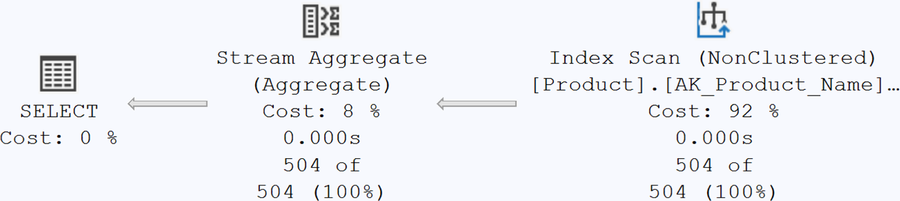
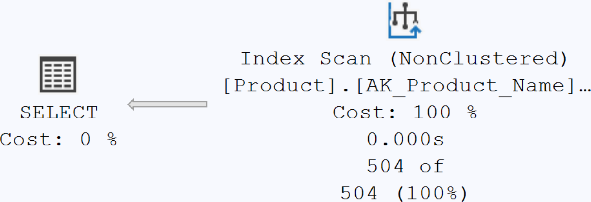
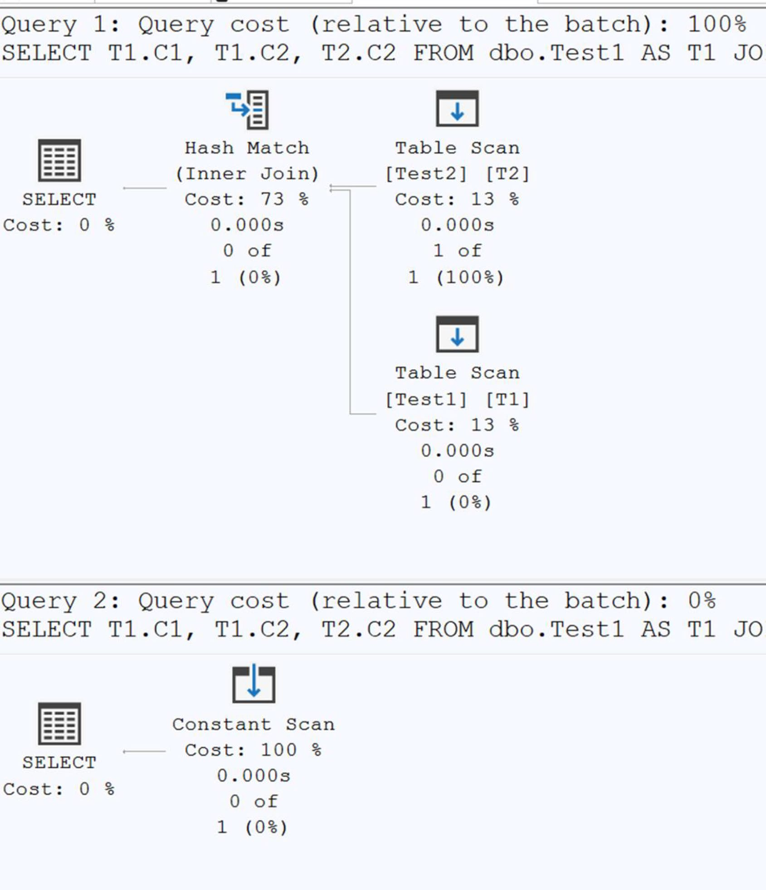
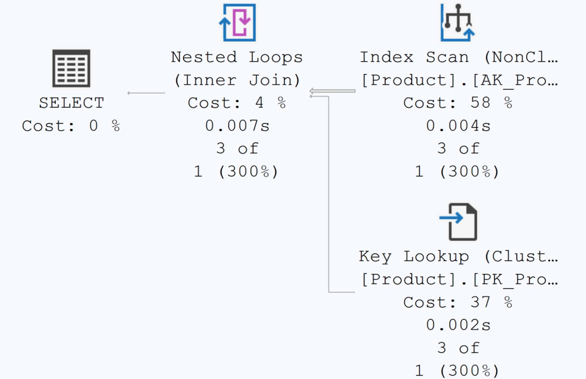
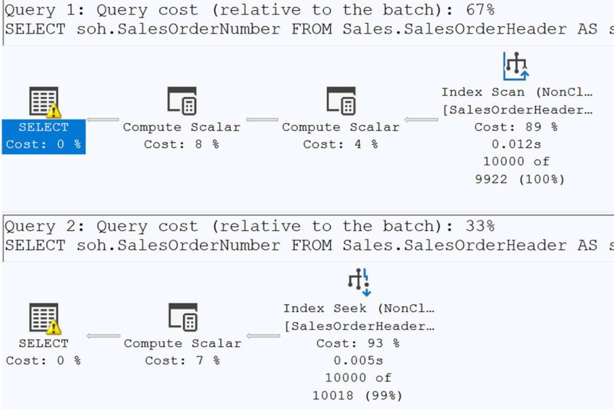

# CHƯƠNG 23: Phương pháp luận Tinh chỉnh Truy vấn (A Query Tuning Methodology)

Như tôi đã khẳng định ngay từ những trang đầu tiên của cuốn sách, công việc tinh chỉnh hiệu năng truy vấn (query tuning) luôn đầy rẫy những thử thách. Mục tiêu xuyên suốt của cuốn sách này dĩ nhiên là giúp bạn thu nhỏ quy mô của thử thách đó và làm chủ hoàn toàn hệ thống của mình. 

Với tinh thần đó, chương cuối cùng này được biên soạn nhằm đóng vai trò như một cuốn cẩm nang hướng dẫn thực hành tổng thể, đúc kết và hệ thống hóa toàn bộ các kiến thức từ tất cả các chương trước. Việc tuân thủ phương pháp luận được vạch ra tại đây sẽ trao cho bạn chìa khóa vững chắc để nâng cao toàn diện hiệu năng các hệ thống Microsoft SQL Server của mình.

Trong chương này, tôi sẽ lần lượt hệ thống hóa 4 trụ cột cốt lõi:
* **Thiết kế cơ sở dữ liệu (Database Design)**
* **Các thiết lập cấu hình hệ thống (Configuration Settings)**
* **Quản trị cơ sở dữ liệu (Database Administration)**
* **Thiết kế truy vấn (Query Design)**

Bên cạnh việc tham chiếu lại các kiến thức chuyên sâu từ những chương trước, tôi cũng sẽ giới thiệu thêm nhiều thông tin và góc nhìn thực tiễn mới trong chương tổng kết này.

---

## Thiết kế Cơ sở dữ liệu (Database Design)

Mặc dù ngày càng có nhiều cơ sở dữ liệu được sinh ra tự động từ các công cụ ánh xạ đối tượng - quan hệ (ORM) như Entity Framework, song thiết kế cơ sở dữ liệu quan hệ bài bản vẫn luôn là nền tảng sống còn khi xây dựng hệ thống trên SQL Server. Tôi sẽ không viết một chuyên luận học thuật dài dòng về lý thuyết lưu trữ quan hệ tại đây; thay vào đó, tôi sẽ tập trung trực tiếp vào những khía cạnh nền tảng trong thiết kế cơ sở dữ liệu có tác động trực tiếp và mạnh mẽ nhất đến hiệu năng thực thi:

* **Sử dụng các ràng buộc toàn vẹn thực thể (Use entity-integrity constraints).**
* **Duy trì các ràng buộc toàn vẹn miền và toàn vẹn tham chiếu (Maintain domain and referential integrity constraints).**
* **Áp dụng các phương pháp thực hành tốt nhất khi thiết kế chỉ mục (Adopt index-design best practices).**
* **Tránh sử dụng tiền tố `sp_` khi đặt tên cho các thủ tục lưu trữ (Stored Procedures).**
* **Giảm thiểu tối đa việc lạm dụng Triggers.**
* **Đưa các bảng vào vùng lưu trữ tối ưu hóa bộ nhớ (In-Memory Storage) khi phù hợp.**
* **Sử dụng chỉ mục Columnstore cho các tải công việc phân tích.**
* **Tận dụng lưu trữ đồ thị (Graph Storage) cho các mối quan hệ mạng lưới phức tạp.**
* **Sử dụng các kiểu dữ liệu phù hợp (Use appropriate data types).**

---

### Sử dụng các Ràng buộc Toàn vẹn Thực thể (Use Entity-Integrity Constraints)

Câu ngạn ngữ kinh điển của ngành máy tính *"Rác đầu vào, rác đầu ra"* (*Garbage in, garbage out*) chắc chắn đã được đúc kết từ chính bài toán quản trị dữ liệu. Tính toàn vẹn và độ sạch của dữ liệu có lẽ là khía cạnh quan trọng bậc nhất trong quản lý dữ liệu hiện đại, nhưng đáng tiếc lại thường xuyên bị xem nhẹ. 

**Toàn vẹn thực thể (Entity Integrity)** – tức khả năng định danh mỗi dòng dữ liệu là một thực thể duy nhất không trùng lặp bên trong một bảng – chính là viên gạch nền móng đầu tiên của toàn vẹn dữ liệu. Cột (hoặc tập hợp các cột) dùng để định danh duy nhất các dòng trong bảng là điểm khởi đầu cho mọi thiết kế cơ sở dữ liệu.

Một bảng dữ liệu có thể sở hữu nhiều cột hoặc tổ hợp cột có khả năng định danh duy nhất một dòng. Ví dụ: bảng Nhân viên (`Employee`) có thể vừa có cột mã nhân viên `EmployeeID` (sử dụng kiểu dữ liệu tự tăng `IDENTITY` hoặc `SEQUENCE`), vừa có cột số căn cước/an sinh xã hội `SocialSecurityNumber`. Bạn có thể chọn `EmployeeID` làm **Khóa chính (Primary Key)**, trong khi `SocialSecurityNumber` đóng vai trò là **Khóa thay thế / Khóa ứng viên (Alternate Key)**. Các khóa ứng viên này được bảo vệ thông qua các ràng buộc duy nhất (**UNIQUE constraints** – về mặt vật lý được SQL Server hiện thực hóa bằng các chỉ mục duy nhất `UNIQUE indexes`).

Từ lâu đã luôn tồn tại một cuộc tranh luận sôi nổi trong giới kiến trúc sư cơ sở dữ liệu về việc nên sử dụng **Khóa chính nhân tạo (Artificial / Surrogate Primary Keys)** như cột `EmployeeID` ở trên, hay chỉ nên sử dụng **Khóa tự nhiên (Natural Keys)** như `SocialSecurityNumber`. Tôi đã từng chứng kiến cả hai trường phái thiết kế này vận hành thành công trong thực tế, nhưng hãy để tôi phân tích rõ ưu và nhược điểm của từng hướng tiếp cận:

* **Khóa nhân tạo / Khóa thay thế (`IDENTITY`, `SEQUENCE`, `GUID`):**
  * Các cột `IDENTITY` thường sử dụng kiểu dữ liệu số nguyên `INT` (4 byte) hoặc `BIGINT` (8 byte) – đây là những lựa chọn tuyệt vời nhất cho hiệu năng chỉ mục vì kích thước cực kỳ nhỏ gọn và tăng trưởng tuần tự.
  * Việc tách rời giá trị khóa chính khỏi ý nghĩa nghiệp vụ thực tế – đặc biệt là tránh sử dụng các thông tin định danh cá nhân nhạy cảm (PII) chịu sự điều chỉnh khắt khe của Quy định chung về bảo vệ dữ liệu (**GDPR**) và các đạo luật quyền riêng tư khác – là một quyết định thiết kế vô cùng sáng suốt.
  * Một lựa chọn khóa nhân tạo khác là sử dụng **GUID (`UNIQUEIDENTIFIER`)**. Mặc dù GUID khó đọc và khó trao đổi bằng mắt thường khi gỡ lỗi, cũng như có kích thước lớn hơn (16 byte) làm tăng độ rộng của khóa chỉ mục, nhưng nhìn chung nó vẫn là một lựa chọn tốt trong các hệ thống phân tán nếu được sử dụng đúng cách (như dùng `NEWSEQUENTIALID()`).
  * Tuy nhiên, hãy luôn nhớ rằng khi dùng khóa nhân tạo làm khóa chính, bạn **vẫn bắt buộc phải tạo thêm một ràng buộc `UNIQUE` trên khóa tự nhiên** của bảng để ngăn chặn dữ liệu nghiệp vụ trùng lặp, đồng nghĩa với việc tăng thêm chi phí lưu trữ và I/O.

* **Khóa tự nhiên (Natural Keys):**
  * Mang lại định danh rõ ràng, có ý nghĩa trực tiếp và dễ đọc hiểu đối với con người mà không cần phải thực hiện phép nối (`JOIN`) sang bảng khác.
  * Tuy nhiên, khóa tự nhiên thường là các cột chuỗi ký tự hoặc tổ hợp nhiều cột có kích thước rộng, dẫn đến cây chỉ mục phình to và làm giảm hiệu năng tìm kiếm.
  * Quan trọng hơn, dữ liệu nghiệp vụ ngoài đời thực có xu hướng thay đổi theo thời gian; việc phải cập nhật giá trị của khóa chính sẽ kéo theo hiệu ứng dây chuyền (knock-on effects) cực kỳ nặng nề lên cấu trúc lưu trữ vật lý và toàn bộ các bảng khóa ngoại tham chiếu tới nó. Ngoài ra, khóa tự nhiên rất dễ vi phạm các quy định về quyền được lãng quên trong GDPR.

Cả hai phương pháp đều có thể hoạt động tốt nếu bạn hiểu rõ bản chất của chúng và cả hai đều đảm bảo tính toàn vẹn thực thể cốt lõi.

Về mặt hiệu năng truy vấn, **các chỉ mục duy nhất (Unique Indexes) định nghĩa toàn vẹn thực thể đóng vai trò sống còn đối với Query Optimizer**. Khi một chỉ mục `UNIQUE` tồn tại, bộ tối ưu hóa biết chắc chắn 100% rằng với bất kỳ giá trị khóa tìm kiếm nào, sẽ **chỉ có tối đa đúng 1 dòng duy nhất** được trả về. 

Các cột tham gia vào thao tác sắp xếp, gom nhóm (`GROUP BY`) hoặc khử trùng lặp (`DISTINCT`) được hưởng lợi trực tiếp từ các ràng buộc duy nhất này. Thậm chí, các ràng buộc `UNIQUE` còn hỗ trợ bộ tối ưu hóa đưa ra các ước lượng số dòng (cardinality estimations) chuẩn xác ngay cả khi câu truy vấn không hề chạm tới hay quét qua chỉ mục đó trong kế hoạch thực thi (do đó bạn sẽ không thấy số lượt sử dụng tăng lên trong `sys.dm_db_index_usage_stats`, dù thực tế chỉ mục vẫn đang âm thầm giúp ích cho việc tạo kế hoạch!).

Để chứng minh điều này, nếu chúng ta gỡ bỏ thuộc tính `UNIQUE` ra khỏi một chỉ mục như trong Listing 23-1, hiệu năng truy vấn sẽ lập tức bị ảnh hưởng.

#### Listing 23-1. Gỡ bỏ thuộc tính UNIQUE khỏi chỉ mục
```sql
CREATE NONCLUSTERED INDEX AK_Product_Name
ON Production.Product (NAME ASC)
WITH (DROP_EXISTING = ON);
```

Mặc dù dữ liệu thực tế bên trong cột `Name` của bảng `Production.Product` vẫn hoàn toàn là các tên sản phẩm duy nhất không trùng lặp, nhưng khi không còn từ khóa `UNIQUE` bảo증, Query Optimizer không thể nào biết được sự thật đó. Khi chúng ta chạy một câu truy vấn đơn giản sử dụng `DISTINCT` như trong Listing 23-2, bộ tối ưu hóa buộc phải làm thêm việc.

#### Listing 23-2. Sử dụng toán tử DISTINCT trong truy vấn
```sql
SELECT DISTINCT
       (p.NAME)
FROM Production.Product AS p;
```

Kế hoạch thực thi của câu truy vấn này được thể hiện trên Hình 23-1.



*Hình 23-1. Toán tử gom cụm xuất hiện trong kế hoạch thực thi khi thiếu ràng buộc UNIQUE*

Mặc dù chỉ mục trên cột `Name` vẫn được sử dụng để quét lấy dữ liệu, nhưng vì bộ tối ưu hóa không biết dữ liệu đã là duy nhất, nó bắt buộc phải chèn thêm toán tử **Stream Aggregate** vào kế hoạch để thực hiện việc lọc bỏ các giá trị trùng lặp.

Ngược lại, khi chúng ta khôi phục lại thuộc tính `UNIQUE` cho chỉ mục như trong Listing 23-3, bộ tối ưu hóa sẽ đưa ra quyết định hoàn toàn khác.

#### Listing 23-3. Khôi phục lại thuộc tính UNIQUE cho chỉ mục
```sql
CREATE UNIQUE NONCLUSTERED INDEX AK_Product_Name
ON Production.Product (NAME ASC)
WITH (DROP_EXISTING = ON);
```

Kế hoạch thực thi mới được minh họa trên Hình 23-2.



*Hình 23-2. Ràng buộc UNIQUE loại bỏ hoàn toàn sự cần thiết của toán tử gom cụm*

Như Hình 23-2 cho thấy, toán tử `Stream Aggregate` đã biến mất hoàn toàn! Vì biết chắc chắn mọi giá trị trong chỉ mục `UNIQUE` đều là duy nhất, SQL Server chỉ cần đọc thẳng dữ liệu từ chỉ mục ra kết quả mà không tốn bất kỳ chu kỳ CPU nào để gom cụm. Toàn vẹn thực thể và các ràng buộc duy nhất luôn trao cho bộ tối ưu hóa những thông tin quý giá để tạo ra các kế hoạch thực thi vượt trội.

---

### Duy trì các Ràng buộc Toàn vẹn Miền và Toàn vẹn Tham chiếu (Maintain Domain and Referential Integrity Constraints)

Toàn vẹn miền (Domain Integrity) và Toàn vẹn tham chiếu (Referential Integrity) nghe qua có vẻ chỉ thuần túy là các khái niệm bảo vệ logic dữ liệu, nhưng trên thực tế chúng lại là những vũ khí tối ưu hóa hiệu năng cực kỳ lợi hại.
* **Toàn vẹn miền (Domain Integrity)** của một cột được thực thi bằng cách giới hạn kiểu dữ liệu, định dạng chuẩn và thu hẹp miền giá trị hợp lệ được phép nhập vào cột đó.
* **Toàn vẹn tham chiếu (Referential Integrity)** được thực thi thông qua việc thiết lập các ràng buộc khóa ngoại (**FOREIGN KEY constraints**) liên kết chặt chẽ giữa các bảng.

SQL Server cung cấp 5 công cụ cốt lõi để triển khai toàn vẹn miền và toàn vẹn tham chiếu:
* **Kiểu dữ liệu (Data types)**
* **Ràng buộc khóa ngoại (`FOREIGN KEY` constraints)**
* **Ràng buộc kiểm tra (`CHECK` constraints)**
* **Định nghĩa giá trị mặc định (`DEFAULT` definitions)**
* **Định nghĩa không chấp nhận giá trị rỗng (`NOT NULL` definitions)**

Một quy tắc nghiệp vụ có thể được kiểm soát ở tầng mã nguồn ứng dụng, ở tầng cấu trúc cơ sở dữ liệu, hoặc kết hợp cả hai. Việc triển khai tường minh các quy tắc ràng buộc này ngay bên trong cơ sở dữ liệu sẽ giúp Query Optimizer tạo ra các kế hoạch thực thi thông minh và tiết kiệm tài nguyên hơn rất nhiều.

Hãy xem xét ví dụ thực tế thông qua hai bảng thử nghiệm được tạo trong Listing 23-4.

#### Listing 23-4. Định nghĩa các bảng thử nghiệm với ràng buộc CHECK
```sql
DROP TABLE IF EXISTS dbo.Test1;
GO
CREATE TABLE dbo.Test1
(
    C1 INT,
    C2 INT CHECK (C2 BETWEEN 10 AND 20)
);
INSERT INTO dbo.Test1
VALUES
(11, 12);
GO

DROP TABLE IF EXISTS dbo.Test2;
GO
CREATE TABLE dbo.Test2
(
    C1 INT,
    C2 INT
);
INSERT INTO dbo.Test2
VALUES
(101, 102);
```

Với bảng `dbo.Test1` có gắn ràng buộc `CHECK` chỉ cho phép cột `C2` nhận giá trị từ `10` đến `20`, chúng ta hãy thực thi hai câu truy vấn trong Listing 23-5.

#### Listing 23-5. Hai câu lệnh SELECT truy vấn trên bảng có ràng buộc CHECK
```sql
-- Truy vấn 1: Điều kiện lọc nằm trong phạm vi của ràng buộc CHECK (C2 = 20)
SELECT T1.C1,
       T1.C2,
       T2.C2
FROM dbo.Test1 AS T1
    JOIN dbo.Test2 AS T2
        ON T1.C1 = T2.C2
           AND T1.C2 = 20;
GO

-- Truy vấn 2: Điều kiện lọc nằm ngoài phạm vi của ràng buộc CHECK (C2 = 30)
SELECT T1.C1,
       T1.C2,
       T2.C2
FROM dbo.Test1 AS T1
    JOIN dbo.Test2 AS T2
        ON T1.C1 = T2.C2
           AND T1.C2 = 30;
```

Kế hoạch thực thi của hai câu truy vấn được đặt cạnh nhau trên Hình 23-3.



*Hình 23-3. Kế hoạch thực thi khi vị từ lọc nằm trong và nằm ngoài phạm vi ràng buộc CHECK*

Phân tích sự khác biệt trên Hình 23-3:
* Ở câu truy vấn đầu tiên (khi giá trị lọc `C2 = 20` nằm trong miền hợp lệ từ 10 đến 20 của ràng buộc `CHECK`), bộ tối ưu hóa tạo ra một kế hoạch thực thi chuẩn mực bình thường để quét và nối hai bảng.
* Tuy nhiên, ở câu truy vấn thứ hai (khi giá trị lọc `C2 = 30` nằm hoàn toàn ngoài biên của ràng buộc `CHECK`), bộ tối ưu hóa sinh ra một kế hoạch cực kỳ tinh gọn chỉ gồm đúng một toán tử **Constant Scan**! 
* Nhờ cơ chế **Phát hiện mâu thuẫn logic (Contradiction Detection)** dựa trên ràng buộc `CHECK`, bộ tối ưu hóa biết chắc chắn 100% rằng không thể nào tồn tại bất kỳ dòng dữ liệu nào trong bảng `Test1` có `C2 = 30`. Do đó, nó chỉ dùng toán tử `Constant Scan` để dựng khung cột rỗng trả về cho ứng dụng mà **hoàn toàn không thèm chạm vào đĩa hay đọc bất kỳ trang dữ liệu nào từ cả hai bảng** (0 logical reads)!

> [!IMPORTANT]
> Bạn hãy luôn sử dụng các ràng buộc toàn vẹn miền và toàn vẹn tham chiếu (`CHECK` và `FOREIGN KEY`) không chỉ để bảo vệ dữ liệu, mà còn để mở đường cho Query Optimizer thực hiện các phép tối ưu hóa loại bỏ bảng dư thừa. Hãy đặc biệt lưu ý rằng bạn bắt buộc phải sử dụng tùy chọn **`WITH CHECK`** khi tạo hoặc kích hoạt lại các ràng buộc để đảm bảo chúng ở trạng thái được tin cậy (`is_not_trusted = 0` trong `sys.check_constraints` và `sys.foreign_keys`); nếu không, bộ tối ưu hóa sẽ hoàn toàn phớt lờ chúng (như đã chứng minh chi tiết ở Chương 14).

---

### Áp dụng các Thực hành Tốt nhất khi Thiết kế Chỉ mục (Adopt Index-Design Best Practices)

Phương pháp phổ biến và hiệu quả nhất để nâng cao hiệu năng truy vấn là tạo lập các chỉ mục phù hợp. Trong khi một bảng dữ liệu có thể được thiết kế chỉ dựa trên yêu cầu lưu trữ thông tin thuần túy, thì việc thiết kế chỉ mục lại đòi hỏi một góc nhìn khác: **Bạn bắt buộc phải biết dữ liệu sẽ được truy vấn như thế nào thì mới có thể xây dựng được các chỉ mục chuẩn xác**.

Ngoại trừ các chỉ mục hiển nhiên phục vụ khóa chính (Primary Key) và khóa ứng viên (Unique Alternate Key), việc vội vàng tạo hàng loạt chỉ mục trước khi hiểu rõ các mẫu truy vấn thực tế là một sai lầm thiết kế phổ biến.

Tổng hợp từ các Chương 9 đến Chương 12, dưới đây là **Danh sách kiểm tra (Checklist) các nguyên tắc vàng** để thiết kế, xây dựng và áp dụng chỉ mục hiệu quả nhất:

1. **Giữ các cột khóa chỉ mục (index key columns) càng hẹp càng tốt:** Kích thước khóa nhỏ giúp mỗi trang chỉ mục 8 KB chứa được nhiều dòng hơn, làm giảm độ sâu của cây B-Tree và tiết kiệm tối đa bộ nhớ RAM cũng như I/O.
2. **Đảm bảo độ chọn lọc (selectivity) cao cho cột được đánh chỉ mục:** Ưu tiên đánh chỉ mục trên các cột có nhiều giá trị phân biệt, trả về số lượng dòng ít cho mỗi câu truy vấn tìm kiếm.
3. **Ưu tiên các kiểu dữ liệu số nguyên (`INT`, `BIGINT`, `SMALLINT`):** Hạn chế tối đa việc đánh chỉ mục trên các cột chuỗi ký tự dài (`VARCHAR`, `NVARCHAR`) nếu có giải pháp thay thế bằng khóa số.
4. **Sắp xếp thứ tự cột thông minh trong chỉ mục đa cột (multicolumn / composite index):** Đặt các cột xuất hiện trong điều kiện lọc đẳng thức (`=`) và có độ chọn lọc cao lên vị trí dẫn đầu (leading edge).
5. **Tận dụng danh sách `INCLUDE` để tạo Chỉ mục bao phủ (Covering Indexes):** Đưa các cột chỉ xuất hiện trong mệnh đề `SELECT` vào `INCLUDE` nhằm loại bỏ toán tử Key Lookup mà không làm phình kích thước các tầng nút nhánh của cây chỉ mục.
6. **Tập trung vào các mệnh đề `WHERE`, `JOIN` (`ON`), và `HAVING`:** Đây là các mệnh đề lọc dữ liệu được hưởng lợi trực tiếp và nhiều nhất từ các khóa chỉ mục.
7. **Lựa chọn đúng kiến trúc chỉ mục:** Cân nhắc kỹ ưu/nhược điểm giữa Rowstore và Columnstore, giữa Clustered và Nonclustered dựa trên đặc thù truy vấn (truy vấn điểm OLTP hay truy vấn tổng hợp phân tích OLAP).

Bởi vì **Chỉ mục cụm (Clustered Index)** định hình trực tiếp cấu trúc lưu trữ vật lý của toàn bộ bảng dữ liệu và mỗi bảng chỉ có duy nhất một chỉ mục cụm, bạn cần tuân thủ thêm 4 nguyên tắc đặc biệt sau khi chọn khóa cụm:
* **Giữ khóa của chỉ mục cụm hẹp nhất có thể:** Hãy nhớ rằng khóa của chỉ mục cụm sẽ tự động được sao chép vào từng dòng của **tất cả mọi chỉ mục phi cụm (nonclustered indexes)** trên bảng đó để làm con trỏ tham chiếu (bookmark). Khóa cụm càng rộng, toàn bộ các chỉ mục phi cụm càng phình to.
* **Luôn tạo chỉ mục cụm trước, sau đó mới tạo các chỉ mục phi cụm:** Quy trình này giúp tránh việc phải xây dựng lại toàn bộ các chỉ mục phi cụm.
* **Sử dụng tùy chọn `DROP_EXISTING = ON` khi cần sửa đổi chỉ mục cụm:** Nếu bắt buộc phải thay đổi cấu trúc chỉ mục cụm, hãy thực hiện trong một bước duy nhất bằng lệnh `CREATE CLUSTERED INDEX ... WITH (DROP_EXISTING = ON)`. Bạn tuyệt đối không muốn toàn bộ các chỉ mục phi cụm bị buộc phải xây dựng lại tới hai lần (lần một khi xóa chỉ mục cụm chuyển bảng về Heap, và lần hai khi tạo lại chỉ mục cụm mới).
* **Tránh đặt chỉ mục cụm trên cột thường xuyên bị cập nhật (frequently updated column):** Mỗi khi giá trị khóa cụm thay đổi, không chỉ dòng dữ liệu trong chỉ mục cụm phải di chuyển (gây phân tách trang - page splits), mà toàn bộ các chỉ mục phi cụm trên bảng cũng phải thực hiện ghi cập nhật theo.

Bạn có thể sử dụng DMV **`sys.dm_db_index_usage_stats`** để theo dõi chính xác những chỉ mục nào đang thực sự được sử dụng hiệu quả và những chỉ mục nào là dư thừa. Những chỉ mục không bao giờ được dùng để đọc (`user_seeks = 0`, `user_scans = 0`, `user_lookups = 0`) nhưng lại liên tục phải cập nhật (`user_updates > 0`) chính là gánh nặng lãng phí tài nguyên cần được dọn dẹp. Tuy nhiên, hãy nhớ kiểm tra chu kỳ chạy của hệ thống (như các báo cáo cuối tháng/cuối quý) trước khi quyết định xóa chỉ mục.

Đồng thời, mặc dù Query Optimizer thường đưa ra các gợi ý chỉ mục còn thiếu (**Missing Index hints**) trong kế hoạch thực thi và qua nhóm DMV `sys.dm_db_missing_index_*`, hãy luôn nhớ rằng **chúng chỉ là những gợi ý đơn lẻ và máy móc**. Tuyệt đối không tạo chỉ mục một cách mù quáng theo mọi gợi ý đó mà phải phân tích tổng thể và kiểm thử kỹ lưỡng với các chỉ mục hiện có.

---

### Tránh sử dụng tiền tố "sp_" khi đặt tên cho Stored Procedures

Đây là một chi tiết nhỏ nhưng rất dễ thực hiện và mọi sự tối ưu dù nhỏ nhất đều đáng giá. 

Các thủ tục lưu trữ có tên bắt đầu bằng tiền tố **`sp_`** được bộ máy của SQL Server mặc định hiểu là các **thủ tục hệ thống (system stored procedures)** nằm trong cơ sở dữ liệu `master`. Do đó, mỗi khi một thủ tục có tên `sp_...` được gọi, SQL Server luôn luôn phải tìm kiếm thủ tục đó trong cơ sở dữ liệu `master` trước tiên (kèm theo việc kiểm tra khóa lược đồ). Khi không tìm thấy trong `master`, nó mới quay về tìm trong cơ sở dữ liệu người dùng hiện tại. 

Mặc dù chi phí hao tổn CPU và độ trễ của thao tác tra cứu thừa này là nhỏ trên một lần gọi, nhưng trên một hệ thống thực thi hàng triệu lệnh mỗi giờ, việc loại bỏ tiền tố `sp_` (thay bằng `usp_` hoặc quy ước tên theo nghiệp vụ) là cách đơn giản nhất để tránh lãng phí tài nguyên vô ích.

---

### Giảm thiểu việc sử dụng Triggers (Minimize the Use of Triggers)

Triggers cung cấp một cơ chế có vẻ rất hấp dẫn để tự động hóa các hành vi nghiệp vụ bên trong cơ sở dữ liệu. Vì chúng tự động kích hoạt ngầm mỗi khi dữ liệu bị thay đổi bởi bất kỳ tiến trình nào, triggers thường được dùng để kiểm soát dữ liệu hoặc ghi nhật ký kiểm toán.

Tuy nhiên, chính đặc tính tự động chạy ngầm đó lại biến triggers thành một **mối nguy hiểm tiềm tàng đối với hiệu năng**, bởi sự tồn tại của chúng không hiển thị rõ ràng trước mắt lập trình viên hay DBA khi nhìn vào một câu lệnh `INSERT`, `UPDATE`, hay `DELETE` đơn thuần. 

Triggers luôn mang theo những chi phí tài nguyên ẩn giấu (thao tác trên các bảng ảo `inserted`/`deleted` trong `tempdb`, kéo dài thời gian giữ khóa giao dịch, thực thi lặp dòng RBAR). Trước khi quyết định viết một trigger, hãy tự vấn xem liệu có bất kỳ giải pháp nào khác (như ràng buộc `CHECK`, `FOREIGN KEY`, cột tính toán `Computed Column`, hoặc xử lý trong Stored Procedure) có thể giải quyết bài toán đó hay không. Nếu bắt buộc phải dùng trigger, hãy lập tài liệu ghi chú thật rõ ràng ở mọi nơi có thể để các lập trình viên và DBA khác luôn tính đến sự hiện diện của nó khi thiết kế truy vấn và xử lý sự cố.

---

### Đưa Bảng vào Lưu trữ Tối ưu hóa Bộ nhớ (Put Tables into In-Memory Storage)

Mặc dù công nghệ In-Memory OLTP có khá nhiều giới hạn về mặt cú pháp và kiểu dữ liệu, nhưng lợi ích hiệu năng mà nó mang lại là không thể phủ nhận. 
* Nếu bạn đang vận hành một hệ thống OLTP có lưu lượng giao dịch cực cao và gặp phải điểm nghẽn nghiêm trọng về I/O hoặc tranh chấp chốt trang bộ nhớ (latch contention), việc đưa các bảng nóng vào lưu trữ In-Memory là một giải pháp rất khả thi.
* Bạn cũng nên đặc biệt cân nhắc việc sử dụng **Biến bảng tối ưu bộ nhớ (In-Memory Table Variables)** để thay thế cho biến bảng truyền thống nhằm giải phóng tải cho `tempdb`.
* Đối với các dữ liệu trung gian tạm thời không đòi hỏi lưu trữ bền vững (như bảng staging trong ETL hoặc trạng thái phiên làm việc), việc tạo bảng In-Memory với tùy chọn **`DURABILITY = SCHEMA_ONLY`** sẽ mang lại tốc độ xử lý nhanh đến mức tối đa vì loại bỏ hoàn toàn việc ghi nhật ký giao dịch.

Hãy luôn nhớ rằng không có phép màu miễn phí nào ở đây: Bạn đang đổi dung lượng bộ nhớ RAM vật lý (và do đó là chi phí tài chính) để lấy tốc độ cực hạn. Tin vui lớn là kể từ phiên bản **SQL Server 2025**, bạn đã có thể gỡ bỏ hoàn toàn nhóm tệp In-Memory nếu không còn đối tượng nào bên trong, giúp việc thử nghiệm và đánh giá công nghệ này trở nên an toàn và linh hoạt hơn bao giờ hết.

---

### Sử dụng Chỉ mục Columnstore (Use Columnstore Indexes)

Nếu tải trọng truy vấn trên hệ thống của bạn nghiêng về hướng phân tích dữ liệu lớn (OLAP), kho dữ liệu (Data Warehouse) hoặc tổng hợp báo cáo, **Chỉ mục Columnstore** sẽ là công cụ gia tăng hiệu năng mạnh mẽ nhất. 

Bạn cũng hoàn toàn có thể kết hợp tạo **Chỉ mục Columnstore phi cụm (Nonclustered Columnstore Index)** ngay trên các bảng giao dịch OLTP để phục vụ cho các truy vấn báo cáo phân tích thời gian thực (**HTAP** - Hybrid Transactional and Analytical Processing). Điều cốt lõi cần ghi nhớ là hãy định hướng kiến trúc lưu trữ chỉ mục dựa trên bản chất của khối lượng công việc mà bảng đó phải phục vụ.

---

### Tận dụng Lưu trữ Đồ thị (Take Advantage of Graph Storage)

Khi mô hình dữ liệu của bạn chứa đầy các mối quan hệ nhiều-nhiều (many-to-many) chằng chịt hoặc các cấu trúc phân cấp mạng lưới nhiều tầng, việc chuyển đổi sang lưu trữ trong các **Bảng Nút (Node)** và **Bảng Cạnh (Edge)** của Graph Database có thể mang lại sự cải thiện rõ rệt cả về tốc độ thực thi lẫn sự tinh gọn của mã nguồn. Khi sử dụng lưu trữ đồ thị, đừng quên khai thác các hàm chuyên dụng như `MATCH` và `SHORTEST_PATH` để giải quyết các bài toán tìm đường đi và bắc cầu dữ liệu.

---

### Sử dụng Kiểu dữ liệu Phù hợp (Use Appropriate Data Types)

Nguyên tắc thiết kế bất di bất dịch cuối cùng nhưng vô cùng quan trọng: **Hãy luôn lưu trữ dữ liệu trong đúng kiểu dữ liệu sinh ra để dành cho nó**. 
* Tuyệt đối không lưu trữ dữ liệu ngày tháng (`DATE`, `DATETIME2`) hoặc dữ liệu số dưới dạng chuỗi văn bản (`VARCHAR`, `NVARCHAR`, `CHAR`). 
* Việc lưu ngày tháng dạng chuỗi có thể giúp bạn định dạng hiển thị dễ dàng ở một vài chỗ, nhưng bạn sẽ đánh mất hoàn toàn khả năng tính toán toán học ngày tháng tự nhiên, làm tăng kích thước lưu trữ, và tệ hại nhất là dẫn đến các phép **Chuyển đổi kiểu ngầm định (Implicit Conversions - `CONVERT_IMPLICIT`)** làm biến dạng thống kê và vô hiệu hóa hoàn toàn khả năng tìm kiếm trên chỉ mục (Index Seek).

---

## Thiết lập cấu hình hệ thống (Configuration Settings)

Phần lớn công việc tối ưu hóa của bạn sẽ tập trung vào việc tinh chỉnh cấu trúc lưu trữ và/hoặc mã lệnh T-SQL nhằm cải thiện hiệu năng. Tuy nhiên, có một số thiết lập cấu hình ở cấp độ hệ thống đóng vai trò nền tảng cực kỳ quan trọng đối với hiệu năng tổng thể của máy chủ SQL Server:

- Các tùy chọn cấu hình bộ nhớ (*Memory configuration options*)
- Ngưỡng chi phí cho thực thi song song (*Cost Threshold for Parallelism*)
- Mức độ song song tối đa (*Max Degree of Parallelism - MAXDOP*)
- Tối ưu hóa cho tải công việc đột xuất (*Optimize for Ad Hoc Workloads*)
- Ngưỡng tiến trình bị chặn (*Blocked process threshold*)
- Nén cơ sở dữ liệu (*Database compression*)

---

### Các tùy chọn cấu hình bộ nhớ (Memory Configuration Options)

Các thực thể SQL Server của bạn bắt buộc phải được cấu hình giới hạn bộ nhớ tối đa (**`max server memory`**) hợp lý nhằm tránh tình trạng tranh chấp bộ nhớ gay gắt với hệ điều hành hoặc các ứng dụng khác chạy cùng trên máy chủ. Bạn cũng có thể cấu hình mức bộ nhớ tối thiểu (`min server memory`) hoặc cấp phát bộ nhớ dành cho việc tạo chỉ mục nếu đó là tác vụ diễn ra thường xuyên trên hệ thống của bạn.

---

### Ngưỡng chi phí cho thực thi song song (Cost Threshold for Parallelism)

Các câu truy vấn phức tạp chắc chắn có thể hưởng lợi rất lớn từ việc thực thi song song (*parallel execution*). Tuy nhiên, bản thân việc điều phối thực thi song song (chia tách dữ liệu thành nhiều luồng, xử lý đồng thời trên các luồng, sau đó thu gom và hợp nhất các luồng lại với nhau) luôn đi kèm với một khoản chi phí phụ trội (*overhead*) không hề nhỏ. Do đó, các câu truy vấn đơn giản khi bị đẩy sang chạy song song thường không những không nhanh hơn mà trên thực tế còn chạy chậm hơn đáng kể.

Một cách "khắc phục" rất phổ biến nhưng **hoàn toàn sai lầm** là thiết lập *Max Degree of Parallelism (MAXDOP)* về `1`. Cách làm cực đoan này sẽ tước bỏ hoàn toàn lợi ích xử lý song song của các truy vấn báo cáo, phân tích phức tạp thực sự cần đến nhiều nhân CPU.

Phương pháp đúng đắn để kiểm soát việc những truy vấn nào sẽ được chạy song song là điều chỉnh giá trị **Cost Threshold for Parallelism** (Ngưỡng chi phí cho thực thi song song). Giá trị mặc định `5` (có từ thời kỳ phần cứng thập niên 1990) đã quá lỗi thời và quá thấp đối với hầu hết các hệ thống hiện đại. Tôi luôn luôn tăng giá trị này lên mức cao hơn.

Có hai cách để bạn xác định một giá trị phù hợp hơn cho thiết lập này:
1. **Phương pháp khoa học dựa trên dữ liệu:** Truy vấn bộ đệm kế hoạch (plan cache) hoặc **Query Store** để thu thập phân phối chi phí ước tính (`EstimatedTotalSubtreeCost`) của các kế hoạch thực thi hiện có trên hệ thống. Listing 23-6 minh họa câu truy vấn trích xuất danh sách chi phí từ Query Store.

**Listing 23-6.** Thu thập các giá trị chi phí kế hoạch từ Query Store

```sql
WITH XMLNAMESPACES
(
    DEFAULT N'http://schemas.microsoft.com/sqlserver/2004/07/showplan'
)
, QueryStore
AS (SELECT CAST(qsp.query_plan AS XML) AS QueryPlan
    FROM sys.query_store_plan AS qsp),
  QueryPlans
AS (SELECT RelOp.pln.value(N'@EstimatedTotalSubtreeCost', N'float') AS EstimatedCost,
           RelOp.pln.value(N'@NodeId', N'integer') AS NodeId,
           qs.QueryPlan
    FROM QueryStore AS qs
        CROSS APPLY qs.QueryPlan.nodes(N'//RelOp') RelOp(pln) )
SELECT qp.EstimatedCost
FROM QueryPlans AS qp
WHERE qp.NodeId = 0;
```

Bạn cũng có thể dễ dàng lấy thông tin tương tự từ plan cache. Khi đã có tập hợp các giá trị chi phí trong tay, hãy tính toán giá trị trung bình (*average*) và độ lệch chuẩn (*standard deviation*). Sau đó, hãy thiết lập *Cost Threshold for Parallelism* ở mức cao hơn giá trị trung bình từ **hai độ lệch chuẩn trở lên**.

2. **Phương pháp thực nghiệm:** Chọn một con số khởi điểm hợp lý, áp dụng và theo dõi hành vi hệ thống. Cách này ít tính học thuật hơn nhưng nhiều quản trị viên thấy dễ áp dụng ngay. Tôi thường khuyến nghị bắt đầu ở mức giá trị **35** (hoặc 50), sau đó giám sát chặt chẽ để xác nhận xem mức ngưỡng đó có hoạt động tối ưu với tải công việc thực tế hay không.

---

### Mức độ song song tối đa (Max Degree of Parallelism - MAXDOP)

Khi một máy chủ có nhiều bộ vi xử lý (nhân logic), theo mặc định (`MAXDOP = 0`), SQL Server sẽ cho phép một truy vấn song song sử dụng tất cả các nhân CPU hiện có. Để kiểm soát tải trên máy chủ tốt hơn và tránh hiện tượng chờ `CXPACKET` lan rộng, bạn nên giới hạn số lượng bộ xử lý tối đa mà mỗi kế hoạch thực thi song song được phép sử dụng (và kết hợp với tính năng *DOP Feedback* tự động trong SQL Server 2022/2025). Ngoài ra, bạn có thể cấu hình *CPU affinity* để dành riêng một số nhân cho hệ điều hành hoặc các dịch vụ khác chạy cùng SQL Server, cũng như sử dụng *Resource Governor* để kiểm soát tài nguyên giữa các nhóm tải công việc.

Hơn nữa, ngay cả trên các hệ thống OLTP thuần túy, trước khi nghĩ đến việc tắt hoàn toàn tính năng song song, hãy thử tăng *Cost Threshold for Parallelism* trước, bởi vì ngay cả hệ thống OLTP cũng có những truy vấn quản trị hoặc bảo trì chỉ mục hưởng lợi rất lớn từ việc thực thi song song.

---

### Tối ưu hóa cho tải công việc đột xuất (Optimize for Ad Hoc Workloads)

Nhiều hệ thống chứa một tỷ lệ lớn các câu truy vấn T-SQL động (*dynamic SQL*) hoặc truy vấn đột xuất (*ad hoc queries*) chỉ chạy một lần thay vì sử dụng thủ tục lưu trữ hoặc truy vấn tham số hóa. Trong những trường hợp này, việc bật tùy chọn **Optimize for Ad Hoc Workloads** sẽ giúp giảm thiểu đáng kể sự lãng phí bộ nhớ đệm kế hoạch (*plan cache bloat*): trong lần thực thi đầu tiên, SQL Server chỉ lưu lại một dấu vết kế hoạch nhỏ gọn (*plan stub*) thay vì lưu toàn bộ kế hoạch hoàn chỉnh (đã được phân tích chi tiết ở Chương 8).

---

### Ngưỡng tiến trình bị chặn (Blocked Process Threshold)

Thiết lập **blocked process threshold** định nghĩa khoảng thời gian tính bằng giây trước khi một sự kiện báo cáo tiến trình bị chặn (`blocked_process_report`) được kích hoạt. Khi một truy vấn bị khóa chặn vượt quá ngưỡng thời gian này, báo cáo sẽ được phát ra và bạn có thể bắt sự kiện này thông qua Extended Events hoặc thiết lập cảnh báo (Alert) gửi email/tin nhắn cho quản trị viên. Hãy kiểm thử trên từng hệ thống cụ thể để chọn ngưỡng số giây phù hợp.

---

### Nén cơ sở dữ liệu (Database Compression)

SQL Server cung cấp tính năng nén dữ liệu (`ROW` và `PAGE` compression) giúp mang lại lợi ích kép: vừa tiết kiệm dung lượng lưu trữ đĩa, vừa tăng tốc hiệu năng truy vấn nhờ lưu trữ được nhiều dòng dữ liệu hơn trên mỗi trang 8 KB (giảm số lượt đọc I/O và tiết kiệm bộ nhớ Buffer Pool). Chi phí đánh đổi là mức tiêu thụ CPU tăng thêm đôi chút cho việc nén và giải nén, nhưng trong đa số các hệ thống hiện đại (vốn thường bị nghẽn ở I/O hơn là CPU), lợi ích thu được vượt xa chi phí bỏ ra.

---

## Quản trị cơ sở dữ liệu (Database Administration)

Mặc dù phần lớn công việc quản trị cơ sở dữ liệu (DBA) xoay quanh tính sẵn sàng cao (HA) và phục hồi sau thảm họa (DR), có ba hoạt động bảo trì định kỳ tác động trực tiếp và mạnh mẽ nhất đến hiệu năng truy vấn:

1. Giữ số liệu thống kê (*statistics*) luôn được cập nhật.
2. Duy trì mức độ phân mảnh chỉ mục ở mức tối thiểu hợp lý.
3. Tuyệt đối tránh các chức năng tự động gây hại như `AUTO_CLOSE` hoặc `AUTO_SHRINK`.

---

### Giữ số liệu thống kê luôn được cập nhật (Keep Statistics Up to Date)

Chúng ta đã thảo luận chuyên sâu về thống kê trong Chương 5 và nhắc lại xuyên suốt cuốn sách. Thống kê là một trong những công cụ quan trọng bậc nhất giúp bộ tối ưu hóa truy vấn đưa ra quyết định đúng đắn: thống kê càng chính xác thì kế hoạch thực thi được tạo ra càng tối ưu. Hãy luôn ghi nhớ các nguyên tắc sau:

- Cho phép SQL Server tự động duy trì thống kê bằng cách luôn bật các thiết lập mặc định **`AUTO_CREATE_STATISTICS`** và **`AUTO_UPDATE_STATISTICS`**.
- Thiết lập lịch trình cập nhật thống kê chủ động (*scheduled statistics maintenance*) phù hợp với tần suất biến đổi dữ liệu của hệ thống.
- Cân nhắc sử dụng cập nhật thống kê bất đồng bộ (`AUTO_UPDATE_STATISTICS_ASYNC`) cho các hệ thống có yêu cầu độ trễ nghiêm ngặt, nhưng bắt buộc phải đo lường và kiểm thử kỹ lưỡng trước khi áp dụng.
- **Lưu ý quan trọng về thứ tự bảo trì:** Nếu bạn lên lịch chạy cả tác vụ bảo trì chỉ mục (*index maintenance*) và bảo trì thống kê (*statistics maintenance*), hãy đảm bảo hiểu rõ rằng việc tái tạo chỉ mục (**`INDEX REBUILD`**) đã tự động cập nhật lại thống kê của chỉ mục đó với độ chính xác tuyệt đối 100% (`FULLSCAN`). Bạn tuyệt đối không nên chạy lệnh cập nhật thống kê lấy mẫu (*sampled statistics update*) ngay sau khi vừa rebuild chỉ mục, vì làm như vậy sẽ ghi đè thống kê chuẩn 100% bằng một thống kê lấy mẫu kém chính xác hơn! (Chỉ nên cập nhật thống kê cho các chỉ mục không được rebuild hoặc các thống kê cấp cột).

---

### Duy trì mức độ phân mảnh chỉ mục ở mức tối thiểu hợp lý (Maintain a Minimum Amount of Index Fragmentation)

Quan điểm tư vấn của tôi về vấn đề phân mảnh đã thay đổi nhiều qua năm tháng. Hiện nay, tôi nghiêng hẳn về việc khuyên bạn dành thời gian tinh chỉnh **Hệ số điền đầy (`Fill Factor`)** hợp lý cho các chỉ mục hơn là liên tục chạy rebuild chỉ mục một cách máy móc. Nếu bạn thực hiện khử phân mảnh chỉ mục, hãy tuân thủ các hướng dẫn sau:

- Chỉ chạy tiến trình khử phân mảnh vào các khung giờ thấp điểm (*off-hours*) để tránh gây khóa chặn (blocking) và tranh chấp tài nguyên hệ thống.
- Đo lường chính xác mức độ phân mảnh và chỉ xử lý những chỉ mục thực sự bị phân mảnh nặng bằng các kịch bản có chọn lọc (như đã trình bày ở Chương 12).
- Ghi nhớ rằng các bảng rất nhỏ (dưới 8 trang dữ liệu, lưu trên mixed extents) không thể và không cần khử phân mảnh.
- Trên môi trường đám mây Azure SQL Database, các thao tác rebuild chỉ mục tiêu tốn lượng I/O rất lớn và có thể đẩy hệ thống chạm ngưỡng giới hạn tài nguyên (*throttling*) hoặc làm tăng chi phí dịch vụ.

---

### Tránh các chức năng tự động gây hại như AUTO_CLOSE hoặc AUTO_SHRINK

- **`AUTO_CLOSE`:** Tùy chọn này sẽ tự động đóng hoàn toàn cơ sở dữ liệu và giải phóng mọi tài nguyên khi kết nối người dùng cuối cùng ngắt đi. Điều này đồng nghĩa với việc **toàn bộ bộ đệm dữ liệu (Buffer Pool) và bộ đệm kế hoạch thực thi (Plan Cache) của cơ sở dữ liệu đó bị xóa sạch**. Khi kết nối tiếp theo đi vào, cơ sở dữ liệu không những phải tốn thời gian khởi động lại mà toàn bộ dữ liệu phải nạp lại từ đĩa vào RAM, đồng thời mọi thủ tục lưu trữ và truy vấn đều phải biên dịch lại từ đầu. Đây là một thao tác cực kỳ đắt đỏ và tàn phá hiệu năng. Hãy luôn để `AUTO_CLOSE = OFF`.
- **`AUTO_SHRINK`:** Tùy chọn này định kỳ tự động thu nhỏ kích thước tệp dữ liệu và tệp nhật ký giao dịch. Quá trình thu nhỏ tệp không những gây khóa chặn và làm chậm hệ thống nghiêm trọng, mà còn đi ngược lại hoàn toàn với tính năng tự động mở rộng tệp (*autogrowth*): hệ thống vừa tốn tài nguyên thu nhỏ tệp xong thì ngay sau đó khi có dữ liệu mới chèn vào, toàn bộ các giao dịch lại bị đóng băng chờ tệp dữ liệu phình to trở lại! Tệ hại hơn nữa, `AUTO_SHRINK` gây ra tình trạng **phân mảnh chỉ mục gần như 100%** bên trong CSDL và phân mảnh tệp vật lý ở cấp hệ điều hành. Hãy luôn để `AUTO_SHRINK = OFF`, quy hoạch kích thước tệp hợp lý ngay từ đầu, và cấu hình bước nhảy tăng trưởng (*autogrowth increment*) theo dung lượng cố định (MB/GB) thay vì theo tỷ lệ phần trăm (`%`).

---

## Thiết kế câu truy vấn (Query Design)

Dưới đây là tập hợp 15 nguyên tắc thực hành tốt nhất về thiết kế truy vấn đã được đúc kết xuyên suốt các chương của cuốn sách. Hãy luôn cân nhắc những nguyên tắc này khi bạn viết mới hoặc tinh chỉnh truy vấn:

1. Thao tác trên các tập kết quả nhỏ gọn (*Operate on small result sets*).
2. Sử dụng câu lệnh `SET NOCOUNT ON`.
3. Định nghĩa tường minh chủ sở hữu / lược đồ của đối tượng (`schema.ObjectName`).
4. Tránh các điều kiện tìm kiếm không thể tận dụng chỉ mục (*Non-sargable search conditions*).
5. Tránh các mệnh đề `IN` chứa danh sách giá trị quá lớn.
6. Tránh sử dụng số lượng lớn các mệnh đề `OR`.
7. Tránh các toán tử số học và hàm xử lý trực tiếp trên các cột trong mệnh đề lọc.
8. Hạn chế tối đa việc lạm dụng các gợi ý bộ tối ưu hóa (*Optimizer hints*).
9. Tránh lồng ghép nhiều tầng khung nhìn (*Nesting views*).
10. Đảm bảo không xảy ra hiện tượng chuyển đổi kiểu dữ liệu ngầm định (*Implicit data type conversions*).
11. Áp dụng các thực hành tốt nhất để tái sử dụng kế hoạch thực thi (*Plan reuse*).
12. Áp dụng các thực hành tốt nhất cho giao dịch cơ sở dữ liệu (*Database transactions*).
13. Loại bỏ hoặc giảm thiểu tối đa chi phí của con trỏ (*Cursors*).
14. Sử dụng thủ tục lưu trữ biên dịch gốc (*Natively compiled stored procedures*) khi phù hợp.
15. Tận dụng chỉ mục Columnstore cho các truy vấn phân tích và luôn bật **Query Store**.

---

### Thao tác trên các tập kết quả nhỏ gọn (Operate on Small Result Sets)

Hãy luôn giới hạn cả số lượng cột trong danh sách `SELECT` (tuyệt đối tránh thói quen dùng `SELECT *`) lẫn số lượng dòng trả về thông qua mệnh đề `WHERE` chặt chẽ. Tập dữ liệu càng nhỏ gọn thì băng thông mạng, bộ nhớ cấp phát, I/O đọc đĩa và cơ hội tận dụng chỉ mục bao phủ (*covering index*) càng đạt hiệu quả tối đa (đã phân tích ở Chương 14).

---

### Sử dụng câu lệnh SET NOCOUNT ON (Use the Command SET NOCOUNT ON)

Hãy luôn đặt câu lệnh `SET NOCOUNT ON` làm câu lệnh đầu tiên bên trong các thủ tục lưu trữ, triggers và các lô truy vấn. Khi `NOCOUNT` được bật, bạn loại bỏ được chi phí truyền tải mạng dư thừa do các thông điệp `DONE_IN_PROC` (báo cáo số dòng bị ảnh hưởng sau mỗi câu lệnh thực thi) gửi về máy khách (đã trình bày chi tiết ở Chương 15).

---

### Định nghĩa tường minh chủ sở hữu / lược đồ của đối tượng (Explicitly Define the Owner of an Object)

Như một nguyên tắc chuẩn mực về hiệu năng, hãy luôn định danh đầy đủ tên lược đồ (*schema/owner*, ví dụ `dbo.TableName`) cho mọi đối tượng cơ sở dữ liệu trong câu truy vấn. Điều này giúp SQL Server tránh được chi phí kiểm tra phân giải tên đối tượng tại thời điểm chạy và đặc biệt là ngăn ngừa việc tạo ra nhiều bản sao kế hoạch thực thi trùng lặp trong bộ đệm plan cache cho các người dùng có default schema khác nhau (đã giải thích chi tiết ở Chương 7).

---

### Tránh các điều kiện tìm kiếm không thể tận dụng chỉ mục (Avoid Non-sargable Search Conditions)

Một trong những lỗi phổ biến nhất làm tê liệt hiệu năng truy vấn là việc viết các điều kiện tìm kiếm vi phạm nguyên lý **SARGability** trong các mệnh đề `WHERE`, `ON`, và `HAVING`. Nếu biểu thức điều kiện ngăn cản bộ tối ưu hóa sử dụng cấu trúc thứ tự của cây chỉ mục và làm sai lệch ước tính số dòng từ thống kê, hiệu năng truy vấn sẽ sụp đổ ngay cả khi bạn đã tạo sẵn những chỉ mục tốt nhất.

Một thói quen điển hình dẫn đến vấn đề này là sử dụng toán tử `LIKE` với ký tự đại diện (*wildcard* `%`) đặt ngay ở đầu chuỗi tìm kiếm, như trong Listing 23-7.

**Listing 23-7.** Truy vấn sử dụng LIKE với ký tự đại diện ở đầu chuỗi

```sql
SELECT p.ProductID,
       p.Name,
       p.ProductNumber,
       p.SafetyStockLevel,
       p.ReorderPoint,
       p.StandardCost,
       p.ListPrice,
       p.Size,
       p.DaysToManufacture,
       p.ProductLine
FROM Production.Product AS p
WHERE p.NAME LIKE '%Caps';
```

Kế hoạch thực thi của câu truy vấn trên được hiển thị trong Hình 23-4.



Do ký tự `%` nằm ở đầu chuỗi (`'%Caps'`), thứ tự bảng chữ cái của chỉ mục trên cột `Name` hoàn toàn vô tác dụng trong việc định vị điểm bắt đầu tìm kiếm; kết quả là dữ liệu buộc phải được truy xuất thông qua thao tác **Quét chỉ mục (Index Scan)** toàn bộ bảng. Không có cách nào lách qua quy luật này bằng chỉ mục B-Tree thông thường cả; nếu bạn cố tình ép buộc sử dụng một gợi ý chỉ mục (*index hint*), khả năng rất cao là bạn sẽ chỉ làm cho hiệu năng suy thoái tồi tệ hơn mà thôi.

---

### Tránh Các Mệnh Đề IN Quá Lớn (Avoid Large IN Clauses)

Không có một ngưỡng cố định cứng nhắc nào quy định chính xác bao nhiêu phần tử bên trong mệnh đề `IN` sẽ dẫn đến sự cố hiệu năng. Tuy nhiên, trên thực tế, khi danh sách của bạn vượt quá **100 giá trị** — và đặc biệt chắc chắn là khi chạm ngưỡng **1.000 giá trị trở lên** — bạn sẽ đối mặt với sự suy giảm hiệu năng nghiêm trọng (do chi phí phân tích cú pháp, biên dịch kế hoạch khổng lồ và tràn bộ nhớ đệm).

Đây là tình huống mà việc tái cấu trúc câu truy vấn trở nên tối quan trọng. Bạn sẽ thường xuyên bắt gặp các danh sách `IN` khổng lồ này trong các câu truy vấn được sinh tự động bởi các bộ khung ánh xạ quan hệ đối tượng (**ORM** - Object Relational Mapping như Entity Framework hay Hibernate). Giải pháp thay thế chuẩn mực và hiệu quả nhất là nạp danh sách giá trị đó vào một **bảng tạm (`#temp`)** hoặc **biến bảng / tham số có giá trị bảng (Table-Valued Parameter - TVP)** rồi thực hiện phép nối `JOIN`.

> [!TIP]
> Kể từ phiên bản SQL Server 2022, Microsoft đã giới thiệu một sự kiện Extended Event mới vô cùng hữu ích có tên là **`query_antipattern`**. Sự kiện này sử dụng các thuật toán phỏng đoán nội bộ để tự động nhận diện và cảnh báo khi một câu truy vấn chứa danh sách mệnh đề `IN` quá lớn, chứa quá nhiều mệnh đề `OR`, tìm giá trị `MAX` trên cột không có chỉ mục, hoặc xảy ra chuyển đổi kiểu dữ liệu ngầm định làm vô hiệu hóa chỉ mục!

---

### Tránh Sử Dụng Số Lượng Lớn Mệnh Đề OR (Avoid a Large Number of OR Clauses)

Tương tự như mệnh đề `IN`, không có một con số tuyệt đối nào định nghĩa thế nào là "quá nhiều" mệnh đề `OR`. Tuy nhiên, theo kinh nghiệm thực tiễn, khi câu truy vấn của bạn kết nối từ **khoảng một tá (12) điều kiện `OR` trở lên**, bạn sẽ bắt đầu chứng kiến kế hoạch thực thi bị phình to và hiệu năng tụt dốc rõ rệt (Query Optimizer thường phải chuyển sang quét bảng hoặc tạo ra hàng loạt nhánh toán tử nối phức tạp).

Nếu gặp phải tình huống có trên một tá điều kiện `OR`, bạn cần chủ động tái cấu trúc logic câu truy vấn (chẳng hạn tách thành các câu lệnh `UNION ALL` gọn nhẹ hoặc gom vào bảng tạm). Hãy tận dụng sự kiện Extended Event `query_antipattern` để nhanh chóng truy tìm các câu truy vấn mắc lỗi này trong hệ thống.

---

### Tránh Các Biểu Thức Số Học và Hàm Trên Cột Lọc (Avoid Arithmetic Expressions on Filter Clauses)

Hãy luôn tránh việc áp dụng trực tiếp các toán tử số học hoặc các hàm xử lý dữ liệu lên các cột nằm trong mệnh đề `WHERE`, `ON` và `HAVING`. Việc bọc cột dữ liệu bên trong một hàm hay phép tính sẽ biến vị từ trở thành **Non-SARGable**, ngăn cản hoàn toàn khả năng sử dụng thao tác tìm kiếm chỉ mục (*Index Seek*) của Query Optimizer (chủ đề này đã được phân tích chuyên sâu ở Chương 14).

Để ôn lại nhanh nguyên lý này, hãy quan sát hai câu truy vấn trả về cùng một tập dữ liệu trong Listing 23-8.

**Listing 23-8.** Hai câu truy vấn trả về cùng một kết quả nhưng có tính SARGable khác nhau

```sql
-- Truy vấn 1: Sử dụng hàm LEFT trên cột lọc (Non-SARGable)
SELECT soh.SalesOrderNumber
FROM Sales.SalesOrderHeader AS soh
WHERE 'SO5' = LEFT(SalesOrderNumber, 3);

-- Truy vấn 2: Sử dụng LIKE với ký tự đại diện ở cuối (SARGable)
SELECT soh.SalesOrderNumber
FROM Sales.SalesOrderHeader AS soh
WHERE SalesOrderNumber LIKE 'SO5%';
```

So sánh hai kế hoạch thực thi tương ứng trong Hình 23-5.



Câu truy vấn đầu tiên buộc phải thực hiện thao tác quét toàn bộ chỉ mục (**Index Scan**), trong khi câu truy vấn thứ hai tận dụng hoàn hảo thao tác tìm kiếm chỉ mục (**Index Seek**) với tốc độ vượt trội.

*(Lưu ý: Dấu chấm than cảnh báo trên toán tử SELECT trong Hình 23-5 xuất phát từ một phép chuyển đổi ngầm định bên trong định nghĩa cột tính toán `SalesOrderNumber` của bảng `SalesOrderHeader`. Trong ví dụ này, đó chỉ là một cảnh báo giả dương tính vì cột tính toán đó không gây cản trở cho bộ lọc của truy vấn thứ hai).*

---

### Tránh Lạm Dụng Gợi Ý Bộ Tối Ưu Hóa (Avoid Optimizer Hints)

Mặc dù có những tình huống hoàn toàn hợp lý để sử dụng gợi ý truy vấn (chẳng hạn dùng `OPTIMIZE FOR UNKNOWN` để cấp cứu sự cố parameter sniffing), nhưng trong phần lớn các trường hợp, việc gắn cứng các gợi ý vào mã lệnh chỉ đơn giản là đang **tước đoạt quyền tự do lựa chọn của Query Optimizer**. Khi dữ liệu thay đổi theo thời gian, chính các gợi ý từng giúp bạn hôm nay sẽ trở thành chiếc còng số 8 bóp nghẹt hiệu năng của hệ thống vào ngày mai.

---

### Tránh Lồng Ghép Các Khung Nhìn (Stay Away from Nesting Views)

Khi bạn tạo một khung nhìn (*View*) mà bên trong nó lại gọi hoặc nối (`JOIN`) tới các khung nhìn khác — và các khung nhìn đó lại tiếp tục tham chiếu tới những khung nhìn tầng sâu hơn — hiện tượng này được gọi là **lồng ghép khung nhìn (Nesting Views)**.

Đây là một thảm họa thiết kế nghiêm trọng. Query Optimizer không coi View là một bảng vật lý; nó coi View đúng như bản chất của nó: **một câu truy vấn đóng gói**. Khi gặp các View lồng nhau, bộ tối ưu hóa phải bung toàn bộ mã lệnh của mọi tầng View ra và ghép chung lại thành một siêu truy vấn khổng lồ cực kỳ rối rắm. Hệ quả nặng nề nhất là quá trình đơn giản hóa (*simplification*) để loại bỏ các bảng không cần thiết sẽ ngốn sạch thời gian biên dịch của bộ tối ưu hóa, dẫn đến hiện tượng **Compile Timeout** (hết thời gian chờ tối ưu hóa) và sản sinh ra những kế hoạch thực thi vô cùng tồi tệ! Quy tắc cấm kỵ tương tự cũng áp dụng cho việc lồng ghép các hàm người dùng định nghĩa (*Nesting UDFs*).

---

### Đảm Bảo Không Xảy Ra Chuyển Đổi Kiểu Dữ Liệu Ngầm Định (Ensure No Implicit Data Type Conversions)

Mọi biến cục bộ và tham số truyền vào bắt buộc phải có kiểu dữ liệu khớp chính xác tuyệt đối với kiểu dữ liệu của cột trên bảng. Mặc dù SQL Server có khả năng tự động ép kiểu ngầm định (ví dụ chuyển đổi giữa `VARCHAR` và `NVARCHAR`, hoặc giữa chuỗi và `DATE`), nhưng thao tác **`CONVERT_IMPLICIT`** trên cột bảng hoạt động giống hệt như việc bạn đặt một hàm tính toán lên cột đó: **nó vô hiệu hóa hoàn toàn khả năng Index Seek và gây lãng phí chu kỳ CPU nghiêm trọng**.

Bạn cũng phải đặc biệt cẩn trọng trong các phép nối bảng (`JOIN`): hãy bảo đảm cột khóa chính (*Primary Key*) của bảng cha và cột khóa ngoại (*Foreign Key*) của bảng con có cùng kiểu dữ liệu và độ dài hoàn toàn đồng nhất.

---

### Giảm Thiểu Chi Phí Ghi Nhật Ký Giao Dịch (Minimize Logging Overhead)

Để bảo đảm tính nhất quán và tính bền vững (ACID), SQL Server phải ghi lại trạng thái trước và sau của mọi giao dịch vào tệp nhật ký giao dịch (*Transaction Log*). Điều này tạo ra áp lực I/O rất lớn lên ổ đĩa chứa tệp log. Để giảm thiểu chi phí ghi nhật ký từ góc độ thiết kế truy vấn, hãy áp dụng các thực hành tốt nhất sau:
- **Ưu tiên biến bảng hơn bảng tạm cho các tập kết quả siêu nhỏ:** Nếu tập dữ liệu chỉ có dưới 20–50 dòng và không cần thống kê phức tạp, biến bảng (`@table`) sẽ tránh được việc ghi nhật ký giao dịch trong `tempdb` (đã phân tích ở Chương 8). Tuy nhiên, hãy cẩn trọng nếu tập dữ liệu lớn (trừ khi đã có Table Variable Deferred Compilation hỗ trợ).
- **Gom nhóm các câu truy vấn hành động vào một giao dịch tường minh:** Thay vì để hàng nghìn câu lệnh `INSERT`/`UPDATE` tự động commit riêng lẻ từng dòng, hãy gom chúng vào các lô (*batches*) vừa phải bên trong `BEGIN TRAN ... COMMIT`. Lưu ý không gom lô quá lớn để tránh giữ khóa lâu gây tắc nghẽn người dùng khác.
- **Tận dụng chế độ ghi nhật ký tối thiểu (Minimal Logging):** Khi thực hiện các tác vụ nạp dữ liệu hàng loạt quy mô lớn, xây dựng lại chỉ mục hoặc sử dụng mệnh đề `.WRITE`, hãy cân nhắc chuyển mô hình khôi phục sang **Bulk-Logged Recovery Model** để cắt giảm tối đa dung lượng ghi log.

---

### Áp Dụng Các Thực Hành Tốt Nhất Để Tái Sử Dụng Kế Hoạch Thực Thi (Adopt Best Practices for Reusing Execution Plans)

Tái sử dụng kế hoạch thực thi có sẵn trong bộ nhớ đệm giúp hệ thống không phải biên dịch lại từ đầu, tiết kiệm đáng kể tài nguyên CPU và thời gian phản hồi. Chiến lược này gồm hai mũi nhọn:

#### 1. Lưu Trữ Đệm Kế Hoạch Thực Thi Hiệu Quả (Caching Execution Plans Effectively)
- **Tuyệt đối tránh gửi các câu truy vấn Ad Hoc nối chuỗi cứng (Non-parameterized):** Luôn tham số hóa các giá trị biến thiên và triệu gọi thông qua **Stored Procedures**, **Prepared Statements** hoặc thủ tục hệ thống **`sp_executesql`**.
- **Kích hoạt `Optimize for Ad Hoc Workloads`:** Nếu hệ thống bắt buộc phải tiếp nhận nhiều truy vấn ad hoc dùng một lần, hãy bật cấu hình này để SQL Server chỉ lưu một con trỏ giữ chỗ nhỏ gọn (*plan stub*) trong lần chạy đầu tiên, bảo vệ bộ đệm kế hoạch khỏi nguy cơ phình to (*plan cache bloat*).
- **Đồng nhất các thiết lập môi trường kết nối (ANSI SET Options):** Bảo đảm mọi kết nối ứng dụng đều sử dụng cùng một bộ thiết lập (như `ANSI_NULLS`, `QUOTED_IDENTIFIER`), vì chỉ cần khác một thiết lập nhỏ cũng khiến SQL Server phải biên dịch một kế hoạch mới riêng biệt.
- **Luôn định danh đầy đủ tên lược đồ (Schema Qualification):** Luôn viết `dbo.TableName` thay vì `TableName` để tránh việc SQL Server phải kiểm tra ngữ cảnh schema mặc định của từng người dùng.

#### 2. Giảm Thiểu Việc Biên Dịch Lại Kế Hoạch Thực Thi (Minimize Recompilation of Execution Plans)
- **Không đan xen các câu lệnh DDL và DML:** Trong một Stored Procedure, hãy đặt toàn bộ các câu lệnh khởi tạo đối tượng (DDL như `CREATE TABLE #temp`) lên ngay phần đầu của thủ tục, trước khi bắt đầu các câu lệnh thao tác dữ liệu (DML).
- **Tránh tham chiếu tới các bảng tạm được tạo ở bên ngoài thủ tục lưu trữ hiện tại.**
- **Không thay đổi các tùy chọn `SET` ở giữa thân của Stored Procedure.**

---

### Áp Dụng Các Thực Hành Tốt Nhất Cho Giao Dịch Cơ Sở Dữ Liệu (Adopt Best Practices for Database Transactions)

Để tối đa hóa mức độ tương tranh (*concurrency*) và ngăn ngừa hiện tượng tắc nghẽn (*blocking*) cũng như khóa chết (*deadlocks*):
- **Giữ phạm vi giao dịch ngắn gọn nhất có thể:** Chỉ đưa vào bên trong giao dịch những câu lệnh thực sự bắt buộc phải thành công hoặc thất bại cùng nhau. Tuyệt đối không đưa các tác vụ ngoại vi hay tương tác người dùng vào trong giao dịch.
- **Ngăn chặn triệt để nguy cơ giao dịch bị bỏ ngỏ (Orphaned Open Transactions):**
  + Luôn bật thiết lập **`SET XACT_ABORT ON`** để bảo đảm giao dịch tự động được rollback trọn vẹn ngay khi phát sinh lỗi runtime.
  + Trong khối xử lý lỗi của ứng dụng hoặc khối `CATCH`, luôn kiểm tra và giải phóng giao dịch đang mở bằng câu lệnh:
    ```sql
    IF @@TRANCOUNT > 0 ROLLBACK;
    ```
- **Sử dụng mức cô lập giao dịch thấp nhất đáp ứng đủ yêu cầu nghiệp vụ:** Mức mặc định `READ COMMITTED` là đủ cho hầu hết các tác vụ. Nếu hệ thống gặp tình trạng tranh chấp khóa giữa luồng đọc và luồng ghi, hãy chủ động kích hoạt **Read Committed Snapshot Isolation (RCSI)** và tính năng **Optimized Locking** (trong SQL Server 2025).

---

### Loại Bỏ Hoặc Giảm Thiểu Chi Phí Của Con Trỏ Cơ Sở Dữ Liệu (Eliminate or Reduce the Overhead of Database Cursors)

SQL Server là một công cụ cơ sở dữ liệu quan hệ được tối ưu hóa cho **xử lý theo tập hợp (Set-based processing)**. Mọi thao tác xử lý từng dòng (RBAR) thông qua Cursor đều đi ngược lại kiến trúc tự nhiên của hệ thống và gây lãng phí tài nguyên nặng nề. 

Hãy luôn nỗ lực viết lại logic Cursor sang các câu lệnh DML tập hợp hoặc sử dụng các hàm cửa sổ (*Window Functions*). Nếu trong trường hợp bất khả kháng bắt buộc phải dùng Cursor, hãy chọn loại con trỏ có chi phí thấp nhất: **`FAST_FORWARD`** (đối với T-SQL Cursor) hoặc đối tượng **`SqlDataReader`** / Default Result Set (đối với ứng dụng khách).

---

### Sử Dụng Thủ Tục Lưu Trữ Biên Dịch Gốc (Use Natively Compiled Stored Procedures)

Trong những kịch bản OLTP cường độ cực cao mà bạn đã chuyển đổi các bảng nóng sang lưu trữ tối ưu bộ nhớ (*In-Memory OLTP*), hãy tiến thêm một bước nữa bằng cách biên dịch các Stored Procedure truy cập các bảng đó thành mã máy DLL thông qua **`WITH NATIVE_COMPILATION`** (đã trình bày ở Chương 19). 

> [!TIP]
> Một mẹo nhỏ mang lại hiệu năng tối đa khi gọi các thủ tục biên dịch gốc: hãy truyền các tham số theo **vị trí thứ tự (ordinal position)** thay vì truyền theo tên tham số (`@param = value`). Mặc dù điều này nghe có vẻ ngược với thói quen viết mã thông thường, nhưng đối với thủ tục biên dịch gốc, nó giúp rút ngắn chi phí ánh xạ tham số và tăng tốc độ thực thi!

---

### Tận Dụng Chỉ Mục Columnstore Cho Các Truy Vấn Phân Tích (Take Advantage of Columnstore for Analytical Queries)

Hầu hết mọi hệ thống cơ sở dữ liệu đều phải phục vụ một tỷ lệ nhất định các câu truy vấn mang tính chất tổng hợp, thống kê và báo cáo phân tích:
- Nếu hệ thống của bạn là kho dữ liệu (*Data Warehouse*) hoặc chuyên phục vụ báo cáo phân tích, hãy sử dụng **Clustered Columnstore Index** làm cấu trúc lưu trữ chính để đạt tỷ lệ nén gấp 10 lần và tốc độ quét Batch Mode siêu việt.
- Nếu hệ thống của bạn là **OLTP** nhưng cần chạy các báo cáo phân tích thời gian thực (*Real-time Operational Analytics*), hãy bổ sung một **Nonclustered Columnstore Index** bên cạnh các chỉ mục B-tree truyền thống. Việc lựa chọn đúng công cụ cho đúng bài toán chính là nghệ thuật đỉnh cao của người làm tối ưu hóa.

---

### Bật Tính Năng Query Store (Enable the Query Store)

Kích hoạt **Query Store** trên toàn bộ các cơ sở dữ liệu của bạn không chỉ đơn thuần mang lại một "hộp đen máy bay" để lưu trữ lịch sử kế hoạch thực thi và chỉ số hiệu năng. Quan trọng hơn thế:
- Query Store chính là **trái tim nền tảng** cung cấp dữ liệu cho hầu hết các cơ chế tự động học hỏi của **Intelligent Query Processing (IQP)** trong SQL Server 2022 và SQL Server 2025 (như Memory Grant Feedback Persistence, CE Feedback, DOP Feedback đã học ở Chương 21).
- Query Store cũng là động cơ vận hành tính năng **Tự động sửa lỗi kế hoạch (`FORCE_LAST_GOOD_PLAN`)** đã học ở Chương 22.
- Đồng thời, nó trao cho bạn quyền năng kiểm soát kế hoạch thực thi và áp dụng Query Store Hints mà không cần sửa đổi một dòng mã ứng dụng nào.

---

## Tóm tắt chương & Lời kết toàn bộ cuốn sách (Summary)

**Tối ưu hóa hiệu năng cơ sở dữ liệu là một hành trình không bao giờ có điểm dừng.** Khi dữ liệu của bạn lớn lên từng ngày, khi hành vi của người dùng thay đổi và khi các tính năng phần mềm mới liên tục được triển khai, bạn sẽ luôn tìm thấy những bài toán mới cần phải chinh phục.

Chương cuối cùng này được biên soạn như một **danh sách kiểm tra thực chiến (Checklist)** toàn diện — kết nối bốn trụ cột **Thiết kế cơ sở dữ liệu**, **Cấu hình hệ thống**, **Quản trị bảo trì** và **Thiết kế câu truy vấn** — để bạn có thể đặt ngay trên bàn làm việc và áp dụng cùng với toàn bộ kho tàng kiến thức chuyên sâu trong suốt 23 chương của cuốn sách nhằm làm cho hệ thống SQL Server của mình vận hành nhanh hơn, mạnh mẽ hơn và ổn định hơn.

Và lời nhắn nhủ cuối cùng của tác giả **Grant Fritchey** gửi tới bạn:

> *Hãy luôn giữ cho mình niềm vui và sự hứng khởi trên hành trình này! Tinh thần dám thử nghiệm và tìm tòi khám phá chính là chìa khóa vàng dẫn tới thành công trong nghệ thuật tinh chỉnh truy vấn. Đừng ngại thử nghiệm những ý tưởng mới trên môi trường kiểm thử — bạn sẽ không bao giờ biết trước được điều kỳ diệu gì đang chờ đợi mình đâu. Hãy nhớ lấy câu châm ngôn kinh điển của giới kỹ sư: "Nếu một giải pháp nghe có vẻ ngốc nghếch nhưng nó thực sự chạy tốt và giải quyết được vấn đề, thì nó hoàn toàn không ngốc nghếch chút nào!"*
>
> **Chúc bạn gặp nhiều may mắn và thành công trên con đường làm chủ hiệu năng SQL Server!**
